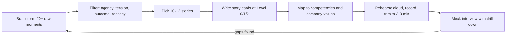

# Behavioral Interview Prep -- Comprehensive Guide for Big-Tech, GPU/HPC, and Systems Roles

> A reusable system for behavioral rounds: what interviewers score, how to structure answers (STAR and CARL), how to build and rehearse a story bank, how stories map to the published values of Amazon, Google, Meta, NVIDIA, and AMD, and a bank of 50+ questions grouped by competency. Every placeholder for your own experience is marked **TODO(you)**. This file contains no facts about you. The worked examples describe fictional engineers and are labeled.
>
> Last reviewed: 2026-11 · Company values checked against public sources as of this date (sources in [Section 4](#4-mapping-stories-to-company-values)). Values pages change, so re-check before each loop.

## Table of Contents

1. [What Behavioral Rounds Assess](#1-what-behavioral-rounds-assess)
2. [Answer Formats: STAR and CARL](#2-answer-formats-star-and-carl)
3. [Building Your Story Bank](#3-building-your-story-bank)
4. [Mapping Stories to Company Values](#4-mapping-stories-to-company-values)
5. [Question Bank by Competency](#5-question-bank-by-competency)
6. [Frameworks for Failure and Conflict Answers](#6-frameworks-for-failure-and-conflict-answers)
7. [Tell Me About Yourself: The 90-Second Template](#7-tell-me-about-yourself-the-90-second-template)
8. [Senior and Staff-Level Signals](#8-senior-and-staff-level-signals)
9. [Anti-Patterns](#9-anti-patterns)
10. [Questions to Ask the Interviewer](#10-questions-to-ask-the-interviewer)
11. [Rehearsal Plan and Final Checklist](#11-rehearsal-plan-and-final-checklist)

**See also:** [Project Deep Dive: rocprof-compute](Project_Deep_Dive_rocprof-compute.md) (the "walk me through your project" round) · [Interview Loops and Logistics](Interview_Loops_and_Logistics.md) (round structure per company) · [Night-Before Cheat Sheet](../practice/Night_Before_Cheat_Sheet.md) · [HLD interview pitfalls](../computer-science/High_Level_Design.md#7-interview-checklists-and-pitfalls)

---

## 1. What Behavioral Rounds Assess

A behavioral round tests one idea: **past behavior in similar situations is the best available predictor of future behavior.** The interviewer is not judging whether your story is impressive. They are collecting *evidence* for a fixed set of competencies at a target level, and writing it down in a form that a hiring committee or debrief can check.

That has three practical consequences:

1. **Specific beats general.** "I usually try to understand both sides" is not evidence. "I set up a 30-minute call, asked them to walk me through their benchmark, and found they were measuring with a cold cache" is evidence.
2. **"I" beats "we."** The interviewer has to write "the candidate did X." If every sentence says "we," there is nothing to write.
3. **Level matters.** The same story can earn "strong hire" at mid-level and "lean no hire" at staff because the scope, ambiguity, and influence are too small for the higher bar (see [Section 8](#8-senior-and-staff-level-signals)).

### 1.1 The universal rubric

Almost every company's rubric reduces to these dimensions, whatever names they use:

| Dimension | What the interviewer writes down | Strong evidence sounds like |
|---|---|---|
| Ownership / drive | Did they take responsibility beyond the assigned task? | "Nobody owned the nightly perf regression job, so I..." |
| Collaboration and conflict | Can they disagree productively and keep relationships intact? | "I asked what they were optimizing for and found we had different metrics." |
| Dealing with ambiguity | Can they make progress when the problem is fuzzy? | "I wrote down three hypotheses, picked the cheapest to falsify first..." |
| Influence | Can they change outcomes they do not control? | "I built a prototype and shared numbers instead of arguing in the review." |
| Judgment and prioritization | Do they pick the right thing and cut the wrong thing? | "I dropped feature B because 80% of users hit path A." |
| Learning and self-awareness | Do they learn from mistakes and feedback? | "Since then I always add a regression test before closing a perf bug." |
| Impact | Did it matter, and can they quantify it? | "Cut profiling overhead from 3.1x to 1.4x, which unblocked two customer evaluations." |
| Communication | Is the answer structured, concise, and calibrated? | 2-3 minute answer, clear arc, numbers, no rambling. |

### 1.2 Big tech vs hardware and GPU companies

| Aspect | Big tech (Amazon, Google, Meta, Microsoft) | Hardware / GPU companies (AMD, NVIDIA, Intel, Qualcomm, startups) |
|---|---|---|
| Format | Often one or more dedicated behavioral rounds with a structured rubric | Often blended into hiring-manager and technical rounds; fewer standalone behavioral rounds |
| Who decides | Debrief or hiring committee reads written feedback; Amazon adds a "Bar Raiser" from outside the team | Hiring manager has more weight; team fit and specific technical depth matter more |
| Value framework | Explicit and published (Amazon's 16 Leadership Principles, Meta's 6 values) and asked about directly | Published values exist (Section 4) but are referenced less mechanically |
| Typical conflict | Product vs engineering, team vs team, launch pressure | Cross-functional: silicon / architecture, compiler, driver, runtime, firmware, field application engineers |
| Typical time pressure | Launch dates, on-call incidents, quarterly goals | Tape-out, product launch and SDK release trains, customer escalations from labs and hyperscalers, benchmark submissions |
| Customer | Often millions of end users and internal teams | Fewer, larger, technical customers (HPC centers, cloud providers, ML framework teams) and internal teams |
| Favorite probes | "Tell me about a time you disagreed..." with deep follow-ups (Amazon often drills 2-3 levels) | "Walk me through the hardest bug you debugged," "How did you work with the compiler team on X?" |
| Hidden test | Consistency with values under follow-up questioning | Technical credibility while telling the story, and whether you can work across the hardware-software boundary |

**Why the difference matters:** at a GPU company the "behavioral" signal often comes from how you tell a *technical* story. A clean narrative of a debugging session (hypothesis, measurement, root cause, fix, prevention) is scored for both technical depth and ownership. Prepare stories that work as either.

### 1.3 Behavioral signal inside technical rounds

Even in coding or design rounds, interviewers note:

- How you respond to a hint (defensive vs curious).
- Whether you state assumptions and check them.
- Whether you admit "I don't know" and then reason toward an answer.
- How you handle a bug they point out.

These all show up in feedback as "collaboration" or "coachability." See [HLD interview pitfalls](../computer-science/High_Level_Design.md#7-interview-checklists-and-pitfalls) for the design-round version.

### 1.4 Interview Q&A

**Q1.** Why do companies use behavioral interviews when they already test coding and design?

Technical rounds measure what you *can* do in 45 minutes under ideal conditions. Behavioral rounds estimate what you *will* do over years: how you handle ambiguity, pressure, disagreement, and failure. Structured behavioral interviews with consistent questions and rubrics predict job performance better than unstructured "chat" interviews because every candidate is scored against the same evidence criteria. They are also the main way to calibrate *level*: scope, influence, and independence are hard to see in a coding round.

**Q2.** How is a behavioral answer actually scored?

The interviewer maps your story to competencies and asks three questions for each: (1) Is there specific evidence of *your* actions? (2) Was the behavior effective, and is the result real and measurable? (3) Does the scope match the target level? A typical scale is strong no hire / no hire / lean hire / hire / strong hire per competency, then a summary. A vague answer is not scored as "bad." It is scored as "insufficient signal," which in a committee usually counts as a no.

**Q3.** The interviewer keeps interrupting with follow-up questions. Is that bad?

Usually not. Follow-ups mean they are trying to find signal, either because your answer lacked a detail they need ("What exactly did *you* do?") or because they want to test depth ("Why that approach and not X?"). Answer the follow-up directly and briefly, then stop. It is a bad sign only if they keep asking "but what did *you* specifically do?", which means your answer is "we"-heavy.

**Q4.** How much does a behavioral round count at a hardware company where the hiring manager mainly cares about technical depth?

It still counts, but more as a filter than a differentiator. A strong technical candidate who blames other teams, cannot describe working with the compiler or firmware team, or shows no ownership of customer issues will be rejected for "team fit." Hardware projects span years and many teams, so collaboration and reliability under schedule pressure carry real weight.

---

## 2. Answer Formats: STAR and CARL

### 2.1 STAR

| Part | Content | Share of the answer |
|---|---|---|
| **S**ituation | Context: team, system, stakes. Just enough to make the problem understandable. | ~10-15% |
| **T**ask | Your specific responsibility or goal, and why it was hard. | ~5-10% |
| **A**ction | What *you* did, step by step, with reasoning: options considered, why you chose one, how you handled people. | ~55-65% |
| **R**esult | Quantified outcome, what happened next, and ideally what you learned. | ~15-20% |

Target **2 to 3 minutes** for the first pass (roughly 300-450 words at a natural speaking pace of about 150 words per minute). Leave room for follow-ups. In a 45-minute round with 5 minutes of intro and 5-10 minutes for your questions, that leaves time for about 4-6 stories with follow-ups.

### 2.2 CARL

CARL = **C**ontext, **A**ction, **R**esult, **L**earning. It merges Situation and Task into Context and adds an explicit **Learning** step. Use CARL when:

- The question is about failure, mistakes, or feedback (the learning is the point).
- You are interviewing for senior or staff roles, where reflection and changed behavior are part of the signal.
- The interviewer asks "what would you do differently?" (CARL answers this before they ask).

| STAR | CARL | When to prefer |
|---|---|---|
| Situation + Task | Context | CARL is tighter when the task is obvious from the context |
| Action | Action | Same |
| Result | Result | Same |
| (optional) | Learning | Always include for failure, conflict, and feedback questions |

A practical hybrid: **STAR + L**. Use STAR structure and finish with one sentence of learning or one thing you would do differently.

### 2.3 Worked example in STAR

> **EXAMPLE -- fictional engineer, not about the owner of this repo.** "Alex" is a mid-level engineer on a data-platform team at a hypothetical company. The question is: *"Tell me about a time you disagreed with a technical decision."*

**Situation (about 20 seconds).**
"Our nightly batch pipeline computed billing aggregates for about 40,000 customers. It had to finish inside a 6-hour window before reports went out at 7 a.m. Over two quarters the runtime crept from 3.5 hours to about 5 hours 50 minutes, and we missed the window twice in one month. Each miss delayed invoices and triggered a support escalation."

**Task (about 10 seconds).**
"I was the on-call owner for the pipeline that quarter. My tech lead's plan was to double the cluster size. I was asked to implement it, but I thought it treated the symptom, and I wanted to check before we committed to a permanent cost increase."

**Action (about 90 seconds).**
"First, I wanted data instead of opinions. I pulled per-stage timings from the scheduler logs for the last 60 runs. Three of the 14 stages took 78% of the runtime, and all three re-read the full 18-month history every night even though only the last 2 days of data changed.

Second, I checked whether scaling would help. I ran the slowest stage on a staging cluster at 1x and 2x size. Runtime dropped only 22%, because the stage was bottlenecked on a single-partition shuffle, not on compute. So doubling the cluster would roughly double cost for a fifth of the gain.

Third, I took this to my lead one-on-one rather than in the team meeting. I opened by saying the cluster plan was the fastest mitigation, then showed the two charts and proposed an incremental design: process only changed partitions and merge into the existing aggregates. I suggested we do both. Scale up temporarily to stop the SLA misses this week, and in parallel I would prototype the incremental path in two sprints, with a clear rollback.

He agreed but asked for a correctness guarantee, since billing errors are worse than late billing. So I added a weekly full recompute that diffs against the incremental result and pages us on any mismatch."

**Result (about 25 seconds).**
"The incremental version shipped in five weeks. Runtime went from 5 hours 50 minutes to 1 hour 40 minutes. We scaled the cluster back down, which cut the pipeline's compute cost by about 35% compared with before the incident. The weekly diff caught one real bug in late-arriving data handling in the first month, before any customer saw it. We had zero SLA misses in the following two quarters. What I took from it: when I disagree, I bring a measurement and a path that also solves the other person's immediate concern."

**Why this example scores well:**

- The disagreement is with a *person with more authority*, handled respectfully and privately.
- Actions are specific and "I"-owned: pulled logs, ran an experiment, proposed a two-track plan, added a safety net.
- Alex *incorporated the lead's concern* (correctness), which shows listening, not just winning.
- Results are quantified (runtime, cost, SLA misses, a bug caught).
- It ends with a one-line learning.

**Likely follow-ups and what they test:**

| Follow-up | What it tests | Good direction |
|---|---|---|
| "What if your lead had said no?" | Disagree and commit | "I would have implemented the scale-up well, documented the measurement in the ticket, and raised it again at the next SLA review with fresh data." |
| "Why not just optimize the shuffle?" | Technical depth, options considered | Explain why you rejected it (for example, it was still a full scan, so it did not fix the growth trend). |
| "How did you validate correctness?" | Rigor | The weekly full recompute and diff; also shadow-ran both paths for N days. |
| "What would you do differently?" | Self-awareness | "Add per-stage runtime alerts earlier, so creep is caught at 4 hours, not at an SLA miss." |

### 2.4 The same story in CARL

- **Context:** Billing pipeline creeping toward its 6-hour SLA. My lead proposed doubling the cluster, and I owned the pipeline that quarter.
- **Action:** Measured per-stage timings, ran a 1x vs 2x scaling test (22% gain), proposed a two-track plan privately, and added a weekly full-recompute diff to address the correctness concern.
- **Result:** 5h50m to 1h40m, about 35% lower compute cost, zero SLA misses for two quarters, and one latent bug caught.
- **Learning:** Disagree with data plus a plan that also solves the other person's short-term problem. Since then I add stage-level runtime alerts when I take over any batch system.

### 2.5 Surviving the drill-down

Strong interviewers (Amazon is known for this) drill 2-3 levels into one story. Prepare each story at three depths:

```text
Level 0 (headline, 1 sentence):   "Cut a nightly pipeline from 5h50m to 1h40m by making it incremental."
Level 1 (STAR, 2-3 min):          The full answer above.
Level 2 (any action, 1-2 min):    The experiment design, the exact data, the rollback plan,
                                  the conversation with the lead, the correctness check.
Level 3 (rare, deep technical):   Partitioning scheme, how late data was handled, what the diff compared.
```

If you cannot go to Level 2 on an action, it is either not your action or you have forgotten the details. Either way, pick a different story.

### 2.6 Interview Q&A

**Q1.** STAR or CARL -- which should I use?

Use STAR as the default skeleton because interviewers are trained on it and listen for each part. Add CARL's explicit Learning for failure, conflict, and feedback questions, and generally at senior levels. The format is a tool, not a script. Never say "the situation was... the task was..." out loud. Use natural transitions ("So the problem was...", "What I did first was...").

**Q2.** How do I keep Situation short when the technical context is complex (for example, GPU performance counters)?

Give only the context needed to understand *why the problem was hard and why it mattered*, and promise detail on request: "The tool computes derived metrics from hardware counters. One of them, memory bandwidth utilization, was being reported above 100% on one GPU family -- happy to go into the counter details." Then move to actions. Interviewers who want depth will ask. A 90-second setup leaves no time for the part that is scored.

**Q3.** What if my result is not quantifiable?

Quantify something adjacent: time saved, number of teams or users affected, bugs prevented, review turnaround, adoption ("three other teams now use the script"), or a qualitative but verifiable outcome ("the customer renewed," "the design became the team template"). If there truly is no number, describe the before and after concretely. Do not invent precision you cannot defend under follow-up.

**Q4.** Can I use the same story for two different questions in one loop?

Within a single interview, avoid it. Across a loop, reusing one strong story with *different emphasis* is acceptable, but interviewers sometimes compare notes, so prefer distinct stories for distinct competencies. That is why you need 8-12 stories rather than 3.

**Q5.** How do I handle "Tell me about a time..." when I have no exact match?

Say so briefly and offer the closest real story: "I haven't had a direct conflict with a manager, but I had a significant disagreement with a senior engineer who was leading the project -- can I use that?" That is honest and usually accepted. Never invent a story. Follow-up questions expose fabricated details quickly, and integrity failures are disqualifying.

---

## 3. Building Your Story Bank

### 3.1 Selection criteria

A good story has:

- **Recency.** It happened in the last 2-3 years, ideally in your current role. Older stories are fine for "biggest failure" but suggest stagnation if they dominate.
- **Clear personal agency.** You can name at least 3 things you did yourself.
- **Tension.** Something was hard: a constraint, a disagreement, a deadline, an unknown.
- **A measurable or verifiable outcome.**
- **Multi-competency coverage.** One good story can answer 3-5 different question types with different emphasis.
- **Safe to tell.** No confidential product details (see [Section 3.5](#35-confidentiality-talking-about-current-work-safely)).

Aim for **8-12 stories** that together cover every competency in [Section 5](#5-question-bank-by-competency) at least twice.



### 3.2 Story-bank template

Fill this in. Write the "Your action" column with verbs in the first person ("I measured...", "I proposed...", "I wrote..."). Keep each cell to a phrase. The full detail goes on the story card ([Section 3.4](#34-story-card-template)).

| # | Story title | Situation (1-2 lines) | Your action (I, not we) | Measurable result | Competencies it maps to |
|---|---|---|---|---|---|
| 1 | TODO(you) | TODO(you) | TODO(you) | TODO(you) | TODO(you) |
| 2 | TODO(you) | TODO(you) | TODO(you) | TODO(you) | TODO(you) |
| 3 | TODO(you) | TODO(you) | TODO(you) | TODO(you) | TODO(you) |
| 4 | TODO(you) | TODO(you) | TODO(you) | TODO(you) | TODO(you) |
| 5 | TODO(you) | TODO(you) | TODO(you) | TODO(you) | TODO(you) |
| 6 | TODO(you) | TODO(you) | TODO(you) | TODO(you) | TODO(you) |
| 7 | TODO(you) | TODO(you) | TODO(you) | TODO(you) | TODO(you) |
| 8 | TODO(you) | TODO(you) | TODO(you) | TODO(you) | TODO(you) |
| 9 | TODO(you) | TODO(you) | TODO(you) | TODO(you) | TODO(you) |
| 10 | TODO(you) | TODO(you) | TODO(you) | TODO(you) | TODO(you) |

### 3.3 Guiding prompts for a GPU profiling-tools engineer

Use these prompts to mine your own experience. They are *prompts*, not claims. Only keep a story if it really happened and you can go to Level 2 detail on it.

| # | Prompt | Competencies it usually covers |
|---|---|---|
| 1 | TODO(you): A time you found a performance bug or wrong metric that customers or internal users had missed (for example, a derived metric that did not match hand-computed values from raw counters, or a kernel that the tool attributed incorrectly). | Ownership, customer focus, dive deep |
| 2 | TODO(you): A time you pushed back on a design: a CLI or config change, a data format, an architecture for analysis or report generation, or a proposal to add a feature you thought was wrong. | Technical disagreement, backbone |
| 3 | TODO(you): A cross-team dependency with a compiler, runtime, driver, firmware, or lower-level profiling-library team, where you needed them to change or fix something and had no authority over their roadmap. | Influence without authority, collaboration |
| 4 | TODO(you): A customer or field escalation (HPC center, cloud partner, ML framework team, or internal application team) where the tool's output was confusing or wrong, and how you handled it end to end. | Customer focus, deadline pressure |
| 5 | TODO(you): A time a new GPU architecture or a new counter set forced you to learn something fast (ISA details, memory hierarchy, counter semantics) and ship support on a schedule. | Learning fast, ambiguity, delivery |
| 6 | TODO(you): A time you reduced profiling overhead, collection time, or analysis runtime, with before/after numbers. | Impact, invent and simplify |
| 7 | TODO(you): A time you improved developer experience or quality for the team (CI, test coverage, packaging, build system, reproducible test data). | Ownership, raising the bar |
| 8 | TODO(you): A bug you shipped or a release that went wrong, and what you changed afterward. | Failure, learning |
| 9 | TODO(you): A time you mentored or onboarded someone into the codebase, GPU architecture concepts, or profiling methodology. | Mentoring, communication |
| 10 | TODO(you): A time you had to cut scope or choose between architectures, features, or customers before a release deadline. | Prioritization, judgment |
| 11 | TODO(you): A time you disagreed with a reviewer or were the reviewer who blocked a change, and how it resolved. | Technical disagreement, standards |
| 12 | TODO(you): A time requirements were vague ("make the tool useful for ML workloads") and you turned them into a concrete plan. | Ambiguity, think big |
| 13 | TODO(you): A time you explained a hardware performance concept (roofline, occupancy, cache hit rates) to a non-expert so they could make a decision. | Communication, customer focus |
| 14 | TODO(you): A time your measurement or conclusion was wrong and you had to correct it publicly. | Intellectual honesty, failure |
| 15 | TODO(you): A contribution in open source (public PRs, issues, community questions) and how you worked with external contributors. | Collaboration, influence |

### 3.4 Story card template

Write one card per story. Keep the cards in a private file, not in this repo if they contain internal details.

```text
STORY: TODO(you) short title
Headline (Level 0, 1 sentence): TODO(you)
When / role / team size: TODO(you)

Situation (2-3 sentences, why it mattered): TODO(you)
Task (my responsibility, what made it hard): TODO(you)
Actions (I, numbered, each with a WHY):
  1. TODO(you)
  2. TODO(you)
  3. TODO(you)
People dimension (who disagreed or helped, how I handled it): TODO(you)
Result (numbers, before -> after, who benefited): TODO(you)
Learning / what I would do differently: TODO(you)

Level-2 details I must remember (data, dates, alternatives rejected): TODO(you)
Competencies: TODO(you)
Amazon LPs / company values: TODO(you)
Confidentiality check (what NOT to say): TODO(you)
```

### 3.5 Confidentiality: talking about current work safely

When you interview while employed at a hardware company, assume anything not public is confidential.

| Safe | Not safe |
|---|---|
| Publicly released products, open-source code, public docs and blog posts | Unreleased products, codenames, roadmaps, performance numbers for unannounced hardware |
| Generic descriptions ("a next-generation accelerator," "a large cloud customer") | Customer names and contract details unless publicly announced |
| Relative improvements on your own tooling ("cut overhead by about 2x") | Internal benchmark results that compare against competitors |
| Your role, decisions, and learnings | Internal org politics, named colleagues' mistakes |

Saying "I can't go into details because it's unreleased, but the shape of the problem was..." is a *positive* integrity signal. Interviewers at competitors are trained to respect it and are often testing for it.

### 3.6 Coverage matrix

After filling the bank, check coverage. Each competency should have at least two stories, so you have a backup if one is used up.

| Competency | Story # (primary) | Story # (backup) |
|---|---|---|
| Conflict | TODO(you) | TODO(you) |
| Failure | TODO(you) | TODO(you) |
| Ambiguity | TODO(you) | TODO(you) |
| Influence without authority | TODO(you) | TODO(you) |
| Ownership | TODO(you) | TODO(you) |
| Mentoring | TODO(you) | TODO(you) |
| Prioritization | TODO(you) | TODO(you) |
| Deadline pressure | TODO(you) | TODO(you) |
| Customer focus | TODO(you) | TODO(you) |
| Technical disagreement | TODO(you) | TODO(you) |
| Learning fast | TODO(you) | TODO(you) |

The script below reports gaps automatically if you keep your bank as data. It is a complete program. Replace the sample entries with your own.

```python
from collections import defaultdict

COMPETENCIES = [
    "conflict", "failure", "ambiguity", "influence", "ownership", "mentoring",
    "prioritization", "deadline", "customer", "tech_disagreement", "learning",
]

# Sample entries only -- replace with your own stories (TODO(you)).
stories = {
    "example-story-A": ["ownership", "customer", "deadline"],
    "example-story-B": ["tech_disagreement", "influence", "conflict"],
    "example-story-C": ["failure", "learning"],
}


def coverage_report(bank: dict[str, list[str]], minimum: int = 2) -> dict[str, list[str]]:
    by_comp: dict[str, list[str]] = defaultdict(list)
    for title, comps in bank.items():
        for comp in comps:
            if comp not in COMPETENCIES:
                raise ValueError(f"unknown competency {comp!r} in {title!r}")
            by_comp[comp].append(title)
    for comp in COMPETENCIES:
        have = by_comp.get(comp, [])
        status = "OK " if len(have) >= minimum else "GAP"
        print(f"{status} {comp:18s} {len(have)}  {', '.join(have)}")
    return dict(by_comp)


if __name__ == "__main__":
    coverage_report(stories)
```

### 3.7 Interview Q&A

**Q1.** How many stories do I really need?

Eight to twelve well-rehearsed stories cover almost every question, because each strong story maps to 3-5 competencies. Fewer than six forces you to reuse stories within a loop. More than fifteen means you will not rehearse them well enough to survive drill-down. Quality and Level-2 recall matter more than count.

**Q2.** Should my stories all be technical?

For engineering roles, most should have a technical core, because that makes them credible and lets the interviewer see your depth. But at least 3-4 should have a strong *people* dimension (a disagreement, a mentee, a difficult stakeholder), because purely technical stories do not give signal on conflict or influence.

**Q3.** I have mostly worked on one product for years. How do I avoid every story sounding the same?

Vary the *axis*, not the product: one story about a customer, one about a peer team, one about your manager, one about a mentee, one about a release, one about a bug, one about a design decision, and one about a process improvement. Name the different stakeholders and constraints clearly so the stories are distinguishable. Interviewers do not penalize a single product. They penalize a single *type* of story.

**Q4.** How do I talk about work on unreleased hardware?

Abstract the hardware and keep the engineering. "Support for a new GPU generation whose counter layout changed" is fine. The codename, specs, and dates are not. If the interviewer pushes, say plainly that it is not public. That is the correct and expected answer.

---
## 4. Mapping Stories to Company Values

Companies publish values so interviewers have a shared vocabulary. You do not need to quote them, but you should (1) know them, (2) pick stories that clearly show them, and (3) occasionally use their language naturally ("I wanted to dive deep before committing"). Do not recite values. Show them.

### 4.1 Amazon: 16 Leadership Principles

Amazon's behavioral rounds are organized around its Leadership Principles (LPs). Each interviewer is typically assigned 1-3 LPs (most often two), and the Bar Raiser can probe any of them. There are 16 LPs. The last two, "Strive to be Earth's Best Employer" and "Success and Scale Bring Broad Responsibility," were added in July 2021. Source: [aboutamazon.com Leadership Principles](https://www.aboutamazon.com/about-us/leadership-principles).

| # | Leadership Principle | What a story must show | Typical question | Story slot |
|---|---|---|---|---|
| 1 | Customer Obsession | You started from a customer need and earned their trust | "Tell me about a time you went above and beyond for a customer." | TODO(you) |
| 2 | Ownership | You acted for the long term and beyond your scope; you never said "not my job" | "Tell me about a time you took on something outside your responsibilities." | TODO(you) |
| 3 | Invent and Simplify | You found a simpler or new way, and were willing to look outside | "Tell me about a time you simplified a complex process." | TODO(you) |
| 4 | Are Right, A Lot | Good judgment; you sought diverse views and tried to disprove your own beliefs | "Tell me about a time you made a decision with incomplete data." | TODO(you) |
| 5 | Learn and Be Curious | You learned something new, fast, by choice | "Tell me about something you learned recently on your own." | TODO(you) |
| 6 | Hire and Develop the Best | You raised others: mentoring, hiring, feedback | "Tell me about a time you helped someone grow." | TODO(you) |
| 7 | Insist on the Highest Standards | You refused to ship something below the bar and fixed root causes | "Tell me about a time you were not satisfied with the status quo." | TODO(you) |
| 8 | Think Big | You proposed a bold direction and communicated it | "Tell me about a time you proposed a much larger vision than was asked." | TODO(you) |
| 9 | Bias for Action | You moved quickly on a reversible decision with calculated risk | "Tell me about a time you made a decision quickly without all the data." | TODO(you) |
| 10 | Frugality | You did more with less (time, hardware, headcount) | "Tell me about a time you delivered with limited resources." | TODO(you) |
| 11 | Earn Trust | You listened, spoke candidly, admitted mistakes | "Tell me about a time you had to deliver bad news." | TODO(you) |
| 12 | Dive Deep | You went to the data and details; metrics and anecdotes disagreed and you found out why | "Tell me about a problem you solved by going deep into the data." | TODO(you) |
| 13 | Have Backbone; Disagree and Commit | You challenged respectfully, then committed fully once decided | "Tell me about a time you disagreed with your manager." | TODO(you) |
| 14 | Deliver Results | You delivered on time and with quality despite setbacks | "Tell me about the most difficult project you delivered." | TODO(you) |
| 15 | Strive to be Earth's Best Employer | You made the team environment safer, more productive, or more inclusive | "Tell me about a time you improved how your team works together." | TODO(you) |
| 16 | Success and Scale Bring Broad Responsibility | You considered secondary effects of your work: users, other teams, the environment | "Tell me about a time you considered the downstream impact of a decision." | TODO(you) |

**Amazon-specific tips:**

- Expect each story to be drilled 2-3 levels deep ([Section 2.5](#25-surviving-the-drill-down)).
- "Dive Deep" and "Ownership" are where profiling-tools stories shine: root-causing a wrong metric or a regression is direct evidence.
- "Disagree and Commit" needs both halves. A story where you disagreed and *won* is only half the principle. Have one where you were overruled and committed fully.

### 4.2 Google: GCA, RRK, Leadership, and Googleyness

Google's hiring framework has historically been described with four attributes. They were popularized by Laszlo Bock's *Work Rules!* (2015) and are still widely used by interviewers and candidates. Google's public pages have changed over time, so treat the names as a working vocabulary rather than an official rubric.

| Attribute | What it means | How it shows up in a behavioral answer |
|---|---|---|
| General Cognitive Ability (GCA) | How you reason through new, open-ended problems, not trivia | Structured thinking about an ambiguous problem: hypotheses, how you narrowed them, how you used data |
| Role-Related Knowledge (RRK) | Depth in the skills the role needs | Technical credibility in your stories (for example, correct use of GPU performance terminology) |
| Leadership (emergent) | Stepping up when needed and stepping back when someone else is better placed, regardless of title | A time you led without authority, *and* a time you deliberately let someone else lead |
| Googleyness | Commonly described as intellectual humility, comfort with ambiguity, conscientiousness, bias to action, collaboration, and doing right by users | Admitting mistakes, changing your mind given evidence, helping others, user-first decisions |

**Google-specific tips:**

- Feedback goes to a hiring committee that never met you, so *clear, quotable evidence* matters more than rapport.
- "Googleyness and Leadership" rounds often use hypothetical questions too ("What would you do if a teammate kept missing deadlines?"). Answer hypotheticals with a principle *plus* a real example: "I'd first talk privately to understand why. When this happened on my team..."
- Show intellectual humility explicitly: "I was wrong about X; the data showed Y."

### 4.3 Meta: Six company values

Meta introduced its current six values in February 2022, and its careers site still lists them. Source: [metacareers.com/culture](https://www.metacareers.com/culture/).

| Value | What a story must show | Story slot |
|---|---|---|
| Move Fast | Urgency, shipping, removing blockers, iterating | TODO(you) |
| Focus on Long-Term Impact | Choosing durable wins over short-term gains, investing in infrastructure | TODO(you) |
| Build Awesome Things | Quality and ambition beyond "good enough" | TODO(you) |
| Live in the Future | Meta defines this as building the future of work (in-person focus, thoughtful remote practices). Story angle: adopting or championing new ways of working or new tools early, e.g. a workflow or tooling change that made a distributed team more effective. This is the value least tied to technical stories. | TODO(you) |
| Be Direct and Respect Your Colleagues | Candid feedback delivered with respect, and receiving it well | TODO(you) |
| Meta, Metamates, Me | Putting the company and team ahead of personal credit; stewardship | TODO(you) |

**Meta-specific tips:** Meta's behavioral round typically focuses on conflict, growth, ambiguity, and scope. "Move fast" stories should show *judgment* about what can be fast (reversible decisions) and what cannot (data loss, correctness). Expect "What feedback have you received?" and "How did you grow?"

### 4.4 NVIDIA: Five core values

NVIDIA's Code of Conduct lists five core values. Source: [NVIDIA Code of Conduct (PDF)](https://images.nvidia.com/aem-dam/en-zz/Solutions/about-us/NVIDIA-Code-of-Conduct-External.pdf) and [NVIDIA culture page](https://www.nvidia.com/en-eu/about-nvidia/culture-at-nvidia/). Some third-party sites list different or partial versions. Rely on the primary source.

| Value | Tagline (from the Code of Conduct) | What a story must show | Story slot |
|---|---|---|---|
| Innovation | "Dream big, start small. Take risks, learn fast." | A new approach driven by first principles, not consensus; prototyping small | TODO(you) |
| Intellectual Honesty | "Seek truth, learn from mistakes, share learnings." | Finding the root cause of a mistake without blame and sharing it | TODO(you) |
| Speed and Agility | "Learn, adapt, shape the world." | Changing course quickly when reality changed | TODO(you) |
| Excellence and Determination | "Maintain the highest standards." | Persisting on a hard problem, high quality bar | TODO(you) |
| One Team | "Do what's best for the company." | Cross-team work without politics, helping another team succeed | TODO(you) |

**NVIDIA-specific tips:** NVIDIA's culture page stresses "no politics, no hierarchy," teams forming around projects, and treating failure as a step toward success. Interviews are usually hiring-manager-driven and technical-heavy. Behavioral signal comes from how you describe working across hardware, compiler, and software teams and how you talk about mistakes. "Intellectual honesty" is the value most often probed implicitly: "What was the root cause? Whose mistake was it? What did you share afterward?"

### 4.5 AMD: Culture statement

AMD's careers site states its culture as: "We push the limits of innovation to solve the world's most important challenges. We strive for execution excellence, while being direct, humble, collaborative and inclusive of diverse perspectives." Source: [careers.amd.com](https://careers.amd.com/careers-home/). Some third-party sites list AMD "core values" (such as "customer focus" or "integrity") that do not appear on AMD's own pages. Use the official statement.

| Culture element | What a story must show | Story slot |
|---|---|---|
| Push the limits of innovation | A technically ambitious solution or a new capability | TODO(you) |
| Execution excellence | Delivering on schedule with quality; a release or customer commitment met | TODO(you) |
| Direct | Raising a problem or disagreement clearly and early | TODO(you) |
| Humble | Crediting others, admitting mistakes, learning from others | TODO(you) |
| Collaborative | Working across teams (hardware, compiler, runtime, customers) | TODO(you) |
| Inclusive of diverse perspectives | Seeking out and incorporating different views; supporting teammates | TODO(you) |

**If you are interviewing at AMD as an internal transfer:** the hiring manager may already know your work. The behavioral signal then shifts toward *why this team*, how you will ramp up, and what you will bring from your current team. Prepare a short answer for "What would your current manager say about you?" TODO(you).

### 4.6 One story, many framings

The same story can be framed for different values by changing the opening line and the emphasis in Actions and Result. Example with the fictional pipeline story from [Section 2.3](#23-worked-example-in-star):

| Question / value | Opening emphasis | Action emphasis | Result emphasis |
|---|---|---|---|
| Amazon: Dive Deep | "The SLA misses looked like a capacity problem, but I wanted to see per-stage data." | Logs, the scaling experiment, finding the shuffle bottleneck | Root cause found; a fifth of the gain at double the cost avoided |
| Amazon: Have Backbone | "My lead had decided to double the cluster, and I disagreed." | The private conversation, the two-track proposal | Plan adopted; relationship intact |
| Google: GCA | "The problem was ambiguous: compute, I/O, or data growth?" | Hypotheses and the cheapest experiment first | Clear decision from data |
| NVIDIA: Intellectual Honesty | "Our runtime had crept up for two quarters before anyone noticed." | Shared the analysis openly, including why the team missed the trend | Added alerts so creep is caught early |
| AMD: Execution excellence | "We were missing a customer-facing SLA." | Immediate mitigation plus a durable fix on a schedule | Zero misses for two quarters |

### 4.7 Interview Q&A

**Q1.** Should I mention the company's values by name in my answers?

Sparingly and naturally. One reference per answer at most ("this was really about earning trust with that customer"). Reciting values sounds rehearsed. What matters is that the *behavior* in your story clearly matches the value. At Amazon, it is acceptable to ask "Is there a particular principle you would like me to focus on?" if the question is ambiguous.

**Q2.** Amazon has 16 LPs. Do I need a story for each?

You need coverage, not 16 separate stories. With 10-12 stories, each mapping to 3-4 LPs, you can cover all 16 with at least one backup each. Prioritize Customer Obsession, Ownership, Dive Deep, Have Backbone; Disagree and Commit, Deliver Results, Earn Trust, and Bias for Action. These come up most often for engineering roles.

**Q3.** How do I answer "Why NVIDIA?" (or "Why AMD?") without sounding generic?

Connect three things: (1) a specific technical direction of the company that you can name from public information (a product line, a software stack, a published paper or talk), (2) the specific team's role in it, and (3) a concrete reason your experience transfers. Do not criticize your current employer. Frame it as being pulled toward something, not pushed away. TODO(you): draft one sentence for each target company.

**Q4.** The values at hardware companies emphasize being "direct." How direct is too direct?

Direct means stating the problem and your view early, clearly, and to the person who can act on it. It does not mean public criticism or dismissing others. A good test: did you raise it *privately first*, with *data*, and with a *proposal*? If yes, the story shows directness. If you raised it in a big meeting to win the argument, it shows poor judgment, even if you were right.

---

## 5. Question Bank by Competency

Each table lists a common question, what the interviewer is really probing, and a prompt to pick your story. Fill in the story number from your bank ([Section 3.2](#32-story-bank-template)). Expect variations in wording. The probe is what matters.

### 5.1 Conflict

| # | Question | What they are probing | TODO(you) prompt |
|---|---|---|---|
| 1 | Tell me about a time you disagreed with a teammate. | Do you listen, find the real disagreement, and resolve it without damage? | TODO(you): a code review or design disagreement within your team; story # ___ |
| 2 | Tell me about a conflict with your manager. | Managing up; backbone with respect; disagree and commit | TODO(you): a priority, estimate, or technical-direction disagreement with a lead; story # ___ |
| 3 | Describe the most difficult person you have worked with. | Empathy; no badmouthing; adapting your style to theirs | TODO(you): a stakeholder with a very different working style (not a villain story); story # ___ |
| 4 | Tell me about a time two teams you depended on wanted conflicting things. | Navigating the organization; escalation hygiene; finding the shared goal | TODO(you): e.g. two consumer teams wanting incompatible output formats or defaults; story # ___ |
| 5 | Tell me about a time you had to give difficult feedback to a peer. | Directness with care; specificity; follow-through | TODO(you): feedback to a peer about test coverage or a risky PR; story # ___ |

### 5.2 Failure

| # | Question | What they are probing | TODO(you) prompt |
|---|---|---|---|
| 6 | Tell me about a time you failed. | Ownership without excuses; real learning; changed behavior since | TODO(you): a real failure with a consequence, not a disguised success; story # ___ |
| 7 | Tell me about a bug you shipped that reached customers. | Incident response, accountability, systemic fix (tests, process) | TODO(you): a regression in a release, or a wrong metric in a shipped version; story # ___ |
| 8 | Tell me about a project that did not go as planned. | Resilience, replanning, communicating bad news early | TODO(you): a GPU-architecture support item or release feature that slipped; story # ___ |
| 9 | Tell me about a technical decision you got wrong. | Intellectual honesty; how you detect and reverse mistakes | TODO(you): a design or library choice you later reversed; story # ___ |
| 10 | What is your biggest weakness? | Self-awareness; active mitigation; no fake weaknesses | TODO(you): a real, non-disqualifying weakness plus what you do about it (see [Section 6.4](#64-the-weakness-question)) |

### 5.3 Ambiguity

| # | Question | What they are probing | TODO(you) prompt |
|---|---|---|---|
| 11 | Tell me about a time you worked with unclear requirements. | Turning fuzz into a plan: clarifying questions, assumptions, iteration | TODO(you): a feature request like "support workload X" with no spec; story # ___ |
| 12 | Tell me about a decision you made without complete data. | Judgment under uncertainty; reversibility; risk mitigation | TODO(you): shipping a metric or default before counter docs were final; story # ___ |
| 13 | Tell me about a time the goals changed midway. | Adaptability; salvaging work; communicating the change | TODO(you): a priority shift due to a new architecture, a customer, or a release change; story # ___ |
| 14 | Tell me about a problem nobody owned. | Ownership in a vacuum; defining the problem | TODO(you): a flaky CI job, an orphaned analysis module, or unowned docs; story # ___ |

### 5.4 Influence without authority

| # | Question | What they are probing | TODO(you) prompt |
|---|---|---|---|
| 15 | Tell me about a time you convinced others to adopt your idea. | Persuasion with data, prototypes, and empathy rather than volume | TODO(you): a new report/analysis workflow or tooling change you got the team to adopt; story # ___ |
| 16 | Tell me about a time you needed another team to change something. | Cross-team influence; understanding their incentives; offering help | TODO(you): a compiler, runtime, driver, or profiling-library team dependency; story # ___ |
| 17 | Tell me about a time you got buy-in for technical debt or infrastructure work. | Framing engineering work in business or customer terms | TODO(you): test infrastructure, refactor, or CI investment; story # ___ |
| 18 | Tell me about a time you failed to persuade someone. | Graceful loss; disagree and commit; what you learned about persuasion | TODO(you): a proposal to a peer or runtime team that was declined; story # ___ |

### 5.5 Ownership

| # | Question | What they are probing | TODO(you) prompt |
|---|---|---|---|
| 19 | Tell me about a time you went beyond your job scope. | Initiative; caring about outcomes, not tickets | TODO(you): fixing a packaging, build, or upstream profiling-library issue outside your component; story # ___ |
| 20 | Tell me about a time you fixed something broken that was not yours. | Fixing vs complaining; doing it in a way that respected the owner | TODO(you): fixing a packaging, build, or upstream profiling-library issue outside your component; story # ___ |
| 21 | Tell me about a project you drove end to end. | Planning, execution, follow-through, long-term thinking | TODO(you): your largest feature or rewrite; story # ___ |
| 22 | Tell me about a time you noticed a risk before others did. | Foresight; raising it effectively; acting on it | TODO(you): a counter or API change upstream that would break the tool; story # ___ |

### 5.6 Mentoring

| # | Question | What they are probing | TODO(you) prompt |
|---|---|---|---|
| 23 | Tell me about a time you mentored someone. | Teaching, patience, measurable growth of the mentee | TODO(you): an intern, new hire, or peer ramping on GPU concepts; story # ___ |
| 24 | Tell me about a time you helped an underperforming teammate. | Empathy, diagnosing the cause, candid feedback, involving the manager appropriately | TODO(you): a teammate struggling with GPU concepts or the codebase; story # ___ |
| 25 | How have you raised the bar for your team? | Multiplying impact: standards, reviews, docs, tooling | TODO(you): a review checklist, test framework, or onboarding doc; story # ___ |
| 26 | Tell me about onboarding someone into a complex codebase. | Communication of complex systems; documentation habits | TODO(you): ramping a new hire on the analysis/report pipeline; story # ___ |

### 5.7 Prioritization

| # | Question | What they are probing | TODO(you) prompt |
|---|---|---|---|
| 27 | Tell me about a time you had too many priorities. | A method (impact vs effort, deadlines, dependencies) and transparent tradeoffs | TODO(you): multiple architectures, customer asks, and release work at once; story # ___ |
| 28 | Tell me about a time you said no to a stakeholder. | Protecting focus while preserving the relationship; offering alternatives | TODO(you): a feature request you declined or deferred; story # ___ |
| 29 | Tell me about a time you cut scope. | Judgment about what matters; communicating the cut | TODO(you): dropping a metric or feature to make a release; story # ___ |
| 30 | How do you balance technical debt against new features? | A principled approach with an example, not "it depends" | TODO(you): refactoring vs new-architecture support; story # ___ |

### 5.8 Deadline pressure

| # | Question | What they are probing | TODO(you) prompt |
|---|---|---|---|
| 31 | Tell me about a time you had a very tight deadline. | Planning under pressure; scoping; staying calm | TODO(you): a release train or customer date; story # ___ |
| 32 | Tell me about a time you missed a deadline. | Early communication; ownership; what changed afterward | TODO(you): a feature that missed a ROCm release train; story # ___ |
| 33 | Tell me about a time you traded quality for speed. | Explicit, reversible tradeoffs; paying the debt back | TODO(you): shipping a metric with a known caveat and following up; story # ___ |
| 34 | Tell me about working on a release-blocking issue or incident. | Calm triage; communication cadence; prioritizing mitigation before root cause | TODO(you): a release-blocking bug or a customer-down issue; story # ___ |

### 5.9 Customer focus

| # | Question | What they are probing | TODO(you) prompt |
|---|---|---|---|
| 35 | Tell me about a time you went above and beyond for a customer. | Customer empathy; durable fixes over one-off help | TODO(you): an internal or external user escalation; story # ___ |
| 36 | Tell me about a time a customer asked for something you thought was wrong. | Understanding the underlying need; saying no well; offering the right thing | TODO(you): a user asking for a metric that would be misleading; story # ___ |
| 37 | Tell me about a time customer feedback changed your product. | Listening loops; data from users; prioritizing feedback | TODO(you): a GitHub issue or user report that changed a default or report layout; story # ___ |
| 38 | Tell me about a problem you found that customers had not reported. | Proactive quality; dive deep; trust | TODO(you): a perf bug or wrong metric that customers missed; story # ___ |

### 5.10 Technical disagreement

| # | Question | What they are probing | TODO(you) prompt |
|---|---|---|---|
| 39 | Tell me about a time you pushed back on a design. | Technical judgment, communication, use of evidence | TODO(you): a CLI, config, or data-format proposal; story # ___ |
| 40 | Tell me about a time you were overruled. | Disagree and commit; no sabotage; respect for the decision process | TODO(you): a design decision you lost and then implemented; story # ___ |
| 41 | Tell me about a time you changed your mind based on evidence. | Intellectual humility; updating beliefs | TODO(you): a benchmark or counter analysis that changed your view; story # ___ |
| 42 | Tell me about a disagreement in code review. | Standards vs pragmatism; depersonalizing review | TODO(you): a review dispute over tests, API shape, or perf; story # ___ |
| 43 | Tell me about a build-vs-buy or technology-choice decision. | Tradeoff reasoning (cost, risk, maintenance, team skills) | TODO(you): e.g. choosing a library, data format, or framework; story # ___ |

### 5.11 Learning fast

| # | Question | What they are probing | TODO(you) prompt |
|---|---|---|---|
| 44 | Tell me about a time you had to learn a new technology quickly. | A learning method; time to productivity; knowing what to skip | TODO(you): a new GPU architecture, language, or framework; story # ___ |
| 45 | Tell me about a time you went deep into an unfamiliar area. | Curiosity; dive deep; first principles | TODO(you): e.g. counter semantics, ISA, or memory hierarchy details; story # ___ |
| 46 | What have you learned recently, and how do you keep up? | Genuine curiosity; concrete habits | TODO(you): a specific recent topic and source |
| 47 | Tell me about feedback that changed how you work. | Coachability; behavior change | TODO(you): review or manager feedback that changed a habit; story # ___ |

### 5.12 Motivation and fit

| # | Question | What they are probing | TODO(you) prompt |
|---|---|---|---|
| 48 | Why do you want to leave your current role? | Pull vs push; no badmouthing; realistic expectations | TODO(you): one-sentence "pull" reason per target company |
| 49 | Why this company and this team? | Research; specific fit; genuine interest | TODO(you): see [Section 4.7 Q3](#47-interview-qa) |
| 50 | What project are you most proud of? | What you value; depth; ownership | TODO(you): link to [Project Deep Dive](Project_Deep_Dive_rocprof-compute.md) |
| 51 | Where do you see yourself in 3-5 years? | Ambition aligned with the role; staying power | TODO(you): technical-depth path vs leadership path, honestly |

### 5.13 Interview Q&A

**Q1.** What if I get a question that is not on any list?

Identify the competency first (most questions map to one of the 11 core competencies above, or to motivation and fit), pick the closest story from your bank, and take 5-10 seconds to think. "Let me think of the best example" is normal and signals care. Then deliver the STAR answer with emphasis on the competency you identified.

**Q2.** How do I answer hypothetical questions ("What would you do if...")?

Give a short principle, then anchor it in a real past example: "I'd start by understanding why they disagree -- often it's different metrics. When this happened with a peer team last year, I..." Hypothetical answers alone are weak evidence. A past example converts them to strong evidence.

**Q3.** How do I answer "Tell me about a time you failed" without hurting myself?

Pick a real failure with a real consequence that is not a character flaw (no integrity or ethics failures). Own it in the first sentence, spend most of the time on what you did to recover and what you changed systemically, and finish with evidence that the change worked. See [Section 6.1](#61-failure-answers-the-own-fix-prevent-frame).

**Q4.** What is the difference between "conflict" and "technical disagreement" questions?

Conflict questions focus on the *relationship*: emotions, communication, and repair. Technical disagreement questions focus on *reasoning*: evidence, tradeoffs, and decision process. The same story can serve both, but change the emphasis. For conflict, spend more time on how you understood the other person. For technical disagreement, spend more time on the data and the options.

---
## 6. Frameworks for Failure and Conflict Answers

Failure and conflict questions are where candidates lose the most points, usually by blaming others, choosing a fake failure, or skipping the learning. Use a fixed frame so you do not improvise under stress.

### 6.1 Failure answers: the own-fix-prevent frame

| Step | What to say | Time | Pitfall to avoid |
|---|---|---|---|
| 1. Own it | One sentence: what went wrong and that it was your responsibility. "I shipped a change that broke X for Y users." | 10 s | Diluting with "we" or with context first |
| 2. Context | Just enough to understand the stakes and why the mistake was plausible | 20 s | Long excuses disguised as context |
| 3. Immediate response | How you detected it, communicated it, and mitigated it | 40 s | Hiding it, or waiting until it was discovered |
| 4. Root cause | The real cause, including your own reasoning error. "I assumed the input was always sorted because my test data was" type of specificity | 20 s | Stopping at the proximate cause ("a typo") |
| 5. Systemic fix | What you changed so that it cannot recur: test, check, process, alert | 30 s | A fix that depends only on "being more careful" |
| 6. Evidence of change | A later situation where the fix or new habit worked | 15 s | No evidence that you actually changed |

**Choosing the right failure:**

| Good failure stories | Bad failure stories |
|---|---|
| A bug you shipped that had real impact, owned and fixed systemically | "I worked too hard" or other disguised strengths |
| A wrong estimate or plan that you replanned and communicated | A failure caused entirely by someone else |
| A design you chose and later had to reverse | Ethical or integrity lapses |
| A mentoring or communication approach that did not work | Something trivial with no consequence |
| A project that was canceled partly due to your choices | A failure from 10 years ago with nothing recent |

**Short generic example (fictional, not about the owner):**

> "I shipped a caching change that cut a CLI's startup time from 4 seconds to 0.6 seconds, but it served stale configuration when users switched environments. About 30 users got wrong results for two days before a teammate noticed. I posted in the user channel within an hour of confirming it, shipped a fix that invalidated the cache on environment change the same day, and wrote down exactly who was affected. The root cause was that I tested only the single-environment path because that was my own workflow. I added a test matrix for environment switching and, more importantly, I now write a short 'who else uses this and how' list before any caching or defaulting change. Two months later that list caught a similar issue with a shared-filesystem setup before release."

### 6.2 Conflict answers: the understand-align-resolve-repair frame

| Step | What to say | Why it matters |
|---|---|---|
| 1. Neutral setup | Describe the disagreement without villains. "We disagreed on whether to change the default output format." | Shows maturity; the interviewer is listening for blame |
| 2. Understand | How you learned *their* goals and constraints: a 1:1, questions, reading their design doc | Most conflicts are different objectives, not different intelligence |
| 3. Align on the goal | The shared objective you named ("we both want users to trust the numbers") | Moves the conversation from positions to interests |
| 4. Resolve with evidence | Data, a prototype, a time-boxed experiment, or a decision-maker | Shows you resolve disagreements on merit |
| 5. Decide and commit | Who decided, and how you supported the decision, especially if it was not yours | Disagree and commit |
| 6. Repair and result | The outcome and the state of the relationship afterward | Tests whether you leave relationships better |

**Escalation done well.** Escalation is a legitimate tool, not a failure, if done correctly:

1. Try to resolve it directly first, and say so.
2. Escalate *together* ("Let's take this to our leads with both options written up"), not behind someone's back.
3. Write up both positions fairly, ideally in a shared document that the other person reviews.
4. Ask for a decision with a deadline, then commit to it.

### 6.3 Technical disagreement: the evidence ladder

When the disagreement is technical, climb this ladder and stop as soon as it resolves:

```text
1. Clarify     -> Are we solving the same problem with the same requirements?
2. Criteria    -> Agree on how to judge (latency, overhead, maintainability, schedule risk).
3. Evidence    -> Existing data, benchmarks, prior incidents, external references.
4. Experiment  -> Time-boxed prototype or benchmark that would change someone's mind.
5. Decide      -> The owner or a tie-breaker decides; record the decision and the reasoning.
6. Commit      -> Execute fully; define a checkpoint to revisit with new data.
```

Mentioning step 2 explicitly is a strong senior signal: many arguments are actually disagreements about criteria, not about solutions.

### 6.4 The weakness question

A good answer has three parts: a **real** weakness that is not a core requirement of the role, **concrete evidence** that you understand its impact, and **active mitigation** with results.

| Weak answer | Why it fails | Better shape |
|---|---|---|
| "I'm a perfectionist." | Cliché; a disguised strength | Name a specific behavior and its cost |
| "I work too hard." | Same | Same |
| "I'm bad at C++." (for a C++ role) | Disqualifying | Choose something not central to the role |
| "I don't really have weaknesses." | No self-awareness | Any honest answer is better |

Template:

```text
"A real weakness of mine is TODO(you): specific behavior.
 It showed up when TODO(you): concrete instance and its cost.
 What I do about it now is TODO(you): specific practice.
 Recently that meant TODO(you): evidence it is improving."
```

Common real-and-safe categories for engineers: going too deep before checking direction with stakeholders, under-communicating progress, saying yes to too many requests, reluctance to delegate, and writing design docs late. Pick one that is true for you.

### 6.5 Interview Q&A

**Q1.** Should I ever say the other person was wrong in a conflict story?

You can say the *approach* turned out not to work, using data, but avoid characterizing the person. "The benchmark they used ran on a warm cache, so it overstated the gain" is fine. "They didn't know what they were doing" is not. Also include a moment where the other person was right about something. It makes the story credible and shows you listen.

**Q2.** What if the conflict was never resolved?

That is a valid story if you show good behavior: you understood their view, tried evidence, escalated cleanly, committed to the decision, and learned something. Unresolved conflicts that you handled maturely are more believable than stories where everyone ended up agreeing with you.

**Q3.** The interviewer asks "What would you do differently?" right after my failure story. What do they want?

They want a *specific, different action* at a specific point, not "communicate more." For example: "I would have shared the regression numbers with the release manager on day 1 instead of day 3, when I first suspected it, even though I was not yet sure." Specificity proves the reflection is real.

**Q4.** How do I handle a follow-up like "Whose fault was it really?"

Answer with systems thinking and personal ownership together: "My part was X. The process allowed it because Y, which we fixed by Z." Never shift the blame to an individual. If someone else made a mistake, describe it neutrally and focus on what *you* could control.

---

## 7. Tell Me About Yourself: The 90-Second Template

This is usually the first question in every round, and it sets the frame for the whole conversation. It is not your life story. It is a 90-second pitch that answers: *who are you professionally, what are you great at, and why are you here?* At about 150 words per minute, 90 seconds is roughly 200-230 words.

### 7.1 Structure

| Part | Time | Content |
|---|---|---|
| Present | ~30 s | Current role, the domain, and the problem space you own. One concrete impact with a number. |
| Past | ~25 s | One or two earlier experiences that explain how you got the skills this role needs. Skip anything irrelevant. |
| Strengths | ~15 s | Two or three themes the interviewer should remember, ideally matching the job description. |
| Why here | ~15 s | Why this role and company, specifically. |
| Handoff | ~5 s | An invitation to go deeper: "Happy to dive into any of that." |

### 7.2 Fill-in template

```text
PRESENT (30 s)
"I'm a software engineer at TODO(you): company, working on TODO(you): product/area in one phrase.
 I own TODO(you): your specific scope -- e.g. which components or workflows you are responsible for.
 Recently I TODO(you): one concrete achievement with a number (before -> after)."

PAST (25 s)
"Before that, I TODO(you): previous role or project that built a relevant skill.
 That's where I learned TODO(you): skill that matters for the target role."

STRENGTHS (15 s)
"The common thread is TODO(you): 2-3 themes, e.g. performance analysis, building developer tools,
 working across the hardware/software boundary."

WHY HERE (15 s)
"I'm excited about this role because TODO(you): specific team/product reason tied to the job description."

HANDOFF (5 s)
"Happy to go deeper into any of that."
```

### 7.3 Generic worked example

> **EXAMPLE -- fictional engineer, not about the owner of this repo.** "Jordan" is a backend engineer applying for an ML-infrastructure role.

"I'm a backend engineer at a mid-size analytics company, on the team that runs our data ingestion platform. I own the streaming ingestion service, which handles about 2 billion events a day. Last year I led a redesign of its batching layer that cut end-to-end latency from about 9 seconds to under 2 at the 99th percentile, and reduced our compute bill by about a quarter.

Before that, I spent two years on a team building internal developer tools, where I wrote a test-sharding system that cut CI time for a large monorepo from 50 minutes to 12. That's where I learned to love making other engineers faster.

The common thread is performance work on shared infrastructure: measuring carefully, finding the real bottleneck, and shipping changes that many teams depend on safely.

I'm interested in this role because your team builds the training-data pipeline for the model teams, and that combines the throughput problems I've been working on with a domain I've been learning on my own, especially data loading for GPU training. Happy to go deeper into any of that."

That is about 180 words, so it fits comfortably in 90 seconds with natural pauses.

### 7.4 Variants

| Variant | When | Adjustment |
|---|---|---|
| 30-second | Recruiter screen, or panel introductions | Present + one strength + why here |
| 90-second | Default for every technical and behavioral round | Full template |
| 2-minute | Hiring manager who says "walk me through your background" | Add one more past role and a sentence of career narrative |
| Technical-heavy | GPU or HPC hiring manager | Replace part of "past" with one sentence of technical depth (for example, the class of performance problems you analyze) |

### 7.5 Interview Q&A

**Q1.** Should my "tell me about yourself" be the same in every round?

The core should be the same, because consistency across interviewers is good. Tailor the last 20 seconds: emphasize technical depth for engineers, collaboration and scope for managers, and impact and direction for directors. Never contradict yourself between rounds. Interviewers compare notes.

**Q2.** Should I mention personal details or hobbies?

Only if they are short and relevant (for example, an open-source project in the domain). Personal background is fine as a single sentence if you are comfortable with it, but the interviewer is scoring professional signal. Do not volunteer information that is legally irrelevant to hiring, such as age, family status, or health.

**Q3.** How do I make the pitch memorable?

Use one specific number and one specific noun the interviewer will remember. "Cut CI from 50 minutes to 12" is memorable. "Improved developer productivity" is not. Then make sure your later stories reinforce the same 2-3 themes you named. Interviewers write summaries, and a consistent theme makes yours easy to write.

---

## 8. Senior and Staff-Level Signals

Behavioral rounds are the primary tool for **leveling**. The question is the same at every level. What changes is the scope, ambiguity, and influence that your story must demonstrate.

### 8.1 Signals by level

Level names differ by company (for example, Google L4/L5/L6, Meta E4/E5/E6, Amazon SDE II/Senior/Principal). Numeric levels are not comparable across companies: Amazon SDE II is L5, Senior SDE is L6, and Principal is L7. The L4/L5/L6 labels below follow Google numbering; see the leveling table in [Interview Loops and Logistics](Interview_Loops_and_Logistics.md#14-leveling-equivalences-across-companies). Use the shape, not the names.

| Dimension | Mid-level (L4-ish) | Senior (L5-ish) | Staff (L6-ish) and above |
|---|---|---|---|
| Scope | A feature or component | A project or system, often several engineers | Multiple teams or an organization's technical direction |
| Ambiguity | Given a defined problem; chooses the solution | Given a goal; defines the problem and the plan | Given a vague business need; finds which problems matter |
| Influence | Within the team | Across adjacent teams, with peers and the lead | Across orgs, with senior leaders and external partners |
| Time horizon | Weeks to a quarter | Quarters | A year or more; sets multi-year direction |
| Multiplying others | Helps teammates | Mentors; improves team practices | Grows senior engineers and leaders; creates standards adopted widely |
| Conflict | Resolves with peers | Resolves across teams and with management | Resolves strategic disagreements; aligns orgs with competing incentives |
| Failure stories | A bug or a missed estimate | A project-level miss and a process fix | A strategic bet that did not pay off, and what the org learned |
| Typical verbs | Built, fixed, implemented | Led, designed, drove, aligned | Set direction, defined, influenced, deprecated, grew |

### 8.2 Staff-level evidence to include explicitly

- **Problem selection.** Why *this* problem was the most important one to work on, and what you chose not to do.
- **Written artifacts.** Design docs, RFCs, or strategy docs that other teams adopted.
- **Organizational leverage.** A change that made many engineers more effective: a platform, a standard, a tool, or a review process.
- **Saying no and deprecating.** Ending a project or deprecating a system is a strong signal of judgment.
- **Developing leaders.** People you helped grow into leads or senior engineers.
- **Business context.** Tying technical decisions to customer, revenue, or schedule outcomes.
- **Handling failure at scale.** Owning a strategic miss without defensiveness.

### 8.3 Upleveling a story

The same underlying event can be told at a higher level *if it is true*. Add the dimensions you actually exercised:

| Mid-level telling | Senior/staff telling (only if true) |
|---|---|
| "I fixed the slow analysis step." | "I noticed analysis time was the top complaint in user feedback, profiled the pipeline, fixed the main bottleneck, and then proposed a performance budget for every new analysis module, which the team adopted." |
| "I added support for the new counter." | "I wrote the plan for supporting the new architecture across three components, negotiated the counter-availability timeline with the lower-level team, and sequenced the work so the most-requested metrics shipped first." |

Never inflate. Interviewers drill into "I led" claims ("How many people? Who decided? What did you do when they disagreed?").

### 8.4 Interview Q&A

**Q1.** How do I show staff-level signal if my title is not staff?

Scope and influence are judged by evidence, not titles. Pick stories where you defined the problem, influenced multiple teams, or set a technical standard. Make the scope explicit ("this affected four teams and every release after"). If you do not have such stories, interview at the level your evidence supports. Being down-leveled after an over-reach is common.

**Q2.** Is "we" acceptable at senior levels, since leadership is collective?

Use "we" for the team's outcome and "I" for your contribution: "We shipped it in Q3. My part was writing the design, aligning the runtime team on the API, and reviewing every change to the data model." Interviewers at senior levels look for both team leadership and clear personal contribution.

**Q3.** What is the most common reason senior candidates get down-leveled in behavioral rounds?

Stories whose scope is too small or too execution-focused: well-delivered tasks that someone else defined. The fix is to choose stories where you identified the problem, made a non-obvious decision with tradeoffs, and influenced people outside your team, and to make that explicit in the telling.

---

## 9. Anti-Patterns

| Anti-pattern | Why it hurts | Fix |
|---|---|---|
| "We" everywhere | The interviewer cannot attribute actions to you | Use "I" for your actions; "we" only for team outcomes |
| Long setup (more than 45 s) | Leaves no time for actions, which are what gets scored | Situation in 2-3 sentences; offer detail on request |
| No numbers | The result is unverifiable and forgettable | Before and after, scale, time saved, users affected |
| Hero narrative | Sounds like poor collaboration or exaggeration | Credit others; show what you learned from them |
| Blaming others | Strong negative signal on collaboration and ownership | Describe others' actions neutrally; focus on what you controlled |
| Fake failure or weakness | Signals low self-awareness or evasiveness | Choose a real, recoverable failure ([Section 6.1](#61-failure-answers-the-own-fix-prevent-frame)) |
| Rambling with no structure | Hard to score; looks like poor communication | STAR skeleton; aim for 2-3 minutes; stop and let them ask |
| Story with no tension | No signal on judgment | Name the constraint, disagreement, or risk explicitly |
| Generic hypothetical answers | Weak evidence | Anchor in a real past example |
| Badmouthing a current or past employer | Integrity and fit concerns | Frame moves as being pulled toward something new |
| Sharing confidential information | Integrity failure; can be disqualifying, especially at competitors | Abstract details; say "that's not public" ([Section 3.5](#35-confidentiality-talking-about-current-work-safely)) |
| Memorized monologue | Sounds rehearsed; collapses when interrupted | Memorize bullet points and numbers, not sentences |
| Inventing or embellishing | Drill-down exposes it; integrity failures end loops | Use real stories; say "I don't recall the exact number, roughly X" |
| Jargon without explanation | Non-specialist interviewers cannot score it | One-line plain-language explanation of the technical core |
| Ending without a result | The story feels unfinished | Always close with the outcome and, ideally, the learning |

### 9.1 Interview Q&A

**Q1.** I'm naturally modest. How do I avoid underselling?

Separate facts from adjectives. You do not need to say "I was brilliant." Say what you did and what happened: "I proposed the design, wrote the prototype, and it became the default." Facts are not bragging. Also rehearse saying "I" out loud. It feels awkward at first, which is why rehearsal matters.

**Q2.** How do I explain deep technical work, such as GPU counter analysis, to an interviewer from a different background?

Use a one-line analogy, then the impact: "The tool reads the GPU's internal hardware counters -- like a car's diagnostic port -- and turns them into explanations of why a program is slow. One of our derived metrics was wrong on one hardware family, which meant users chased the wrong bottleneck." Then continue with your actions. Offer more depth if they want it.

**Q3.** What do I do if I realize mid-answer that I picked the wrong story?

Finish it briefly and honestly with the result, then offer another: "That shows the technical side. If it's helpful, I have another example that's more about the disagreement itself." Interviewers appreciate self-correction more than a story that wanders.

---

## 10. Questions to Ask the Interviewer

You will almost always get 5-10 minutes for your questions. Good questions show research, judgment, and genuine interest, and they also help *you* decide. Prepare 3-4 per interviewer type, and never say "No, I think you covered everything."

### 10.1 For engineers on the team

- What does a typical week look like for you? How much time goes to new development vs support, reviews, and meetings?
- What is the hardest technical problem the team is working on right now?
- How do code review and testing work here? What does CI cover, and what is still manual?
- What happened the last time a significant bug reached users? How was it handled?
- What do you wish you had known when you joined?

### 10.2 For the hiring manager

- What would success look like for this role at 3, 6, and 12 months?
- What are the biggest challenges the team faces this year?
- How is the team's work prioritized, and who are the main stakeholders?
- How do you support growth -- for example, toward a senior or staff role, or toward a specific technical depth?
- How do you give feedback, and how often?
- Why is this role open (growth or backfill)?

### 10.3 For skip-level managers and directors

- How does this team's work connect to the organization's priorities for the next year or two?
- What would make you say this team had a great year?
- How do teams across the organization coordinate on shared roadmaps?

### 10.4 For GPU, HPC, and ML-infrastructure teams

- How does the team get access to new hardware, and how early in the hardware cycle are you involved?
- How do you work with the compiler, runtime, driver, and kernel-library teams? Is there a formal process for requesting changes?
- Who are the main users of what you build -- internal performance engineers, framework teams, or external customers -- and how do you hear from them?
- How do you validate correctness of performance data or results across hardware generations?
- How much of the work is open source, and how does the team interact with the external community?
- What is the balance between supporting new architectures and improving existing workflows?

### 10.5 Questions to avoid

| Avoid | Why | Instead |
|---|---|---|
| Anything easily found on the company website | Signals no research | Ask about something you read: "I saw the team's talk on X -- how has that evolved?" |
| Compensation, leave, or perks in technical rounds | Wrong audience; handle with the recruiter | Ask the recruiter |
| "Did I pass?" | Puts the interviewer in an awkward position | "Is there anything from today you'd like me to clarify?" |
| Yes/no questions | Short answers waste your time | Open-ended "how" and "what" questions |

### 10.6 Interview Q&A

**Q1.** Do my questions actually affect the evaluation?

Usually only slightly, but they can tip a borderline decision, and poor questions (none, or purely about perks) can leave a negative impression. Their bigger value is for *you*: the answers tell you whether the team is healthy and the role is what you want.

**Q2.** Is it OK to ask "What concerns do you have about my candidacy?"

It can work with a hiring manager in a final conversation, but it may put an interviewer in an uncomfortable position, and many are told not to share feedback. A safer version is "Is there anything from my background you'd like me to expand on?", which gives them an opening without pressure.

---

## 11. Rehearsal Plan and Final Checklist

### 11.1 A two-week plan

| Days | Activity | Output |
|---|---|---|
| 1-2 | Brainstorm 20+ raw moments using [Section 3.3](#33-guiding-prompts-for-a-gpu-profiling-tools-engineer) | Raw list |
| 3-4 | Select 10-12 stories; write story cards ([Section 3.4](#34-story-card-template)) | Filled story bank and coverage matrix |
| 5-6 | Map to values of each target company ([Section 4](#4-mapping-stories-to-company-values)) | Story slots filled per company |
| 7-8 | Say each story aloud, recorded; trim to 2-3 minutes | Timed recordings |
| 9-10 | Drill-down practice: a friend asks "why?" and "what exactly did you do?" three levels deep | List of weak spots |
| 11-12 | Full mock behavioral round (45 min) with a peer; answer 6-8 random questions from [Section 5](#5-question-bank-by-competency) | Feedback notes |
| 13 | Finalize "tell me about yourself" and per-company "why us" | Two scripts in bullet form |
| 14 | Light review only; check logistics | Ready |

### 11.2 Day-of checklist

- [ ] Story bank summary (titles, headlines, and numbers) reviewed, not memorized word for word.
- [ ] "Tell me about yourself" rehearsed once aloud.
- [ ] "Why this company / team" prepared for the specific company.
- [ ] Three to four questions ready for each interviewer type.
- [ ] Confidentiality boundaries clear in your head: what is public and what is not.
- [ ] Water, notes with story titles only (if the format allows), quiet environment for virtual rounds.

### 11.3 Interview Q&A

**Q1.** Is it OK to have notes during a virtual behavioral interview?

A short list of story titles as reminders is generally acceptable and common. Reading answers word for word is obvious and hurts the impression of authenticity. If you glance at notes, keep it brief. If unsure, ask the recruiter about the norms beforehand.

**Q2.** How do I know if I've rehearsed enough?

You are ready when you can (1) tell each story in 2-3 minutes without notes, (2) start any story from a one-line prompt, (3) answer three levels of "why" and "what exactly did you do" on any action, and (4) switch the emphasis of a story to a different competency on request. If a mock interviewer cannot summarize your story's result in one sentence, tighten it.

---

**See also:**

- [Project Deep Dive: rocprof-compute](Project_Deep_Dive_rocprof-compute.md) -- prepare the technical "walk me through your project" round that often follows behavioral questions.
- [Interview Loops and Logistics](Interview_Loops_and_Logistics.md) -- round-by-round structure at each target company.
- [AMD GPU Architecture and Profiling](../ml-gpu/AMD_GPU_Architecture_and_Profiling.md) -- technical vocabulary for explaining profiling stories accurately.
- [Performance Engineering](../computer-science/Performance_Engineering.md) -- measurement methodology to reference in "dive deep" stories.
- [High Level Design: checklists and pitfalls](../computer-science/High_Level_Design.md#7-interview-checklists-and-pitfalls) -- collaboration signals in design rounds.
- [Night-Before Cheat Sheet](../practice/Night_Before_Cheat_Sheet.md) -- final-day review.
