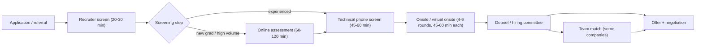
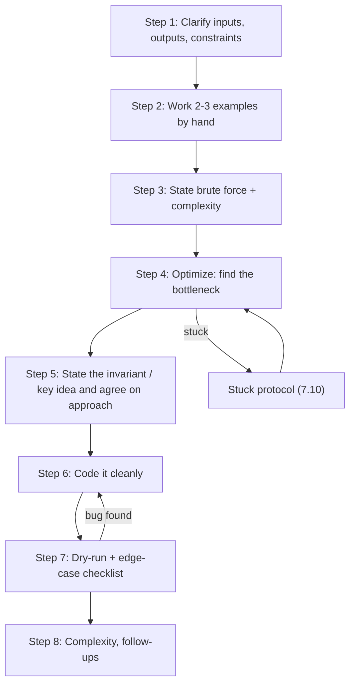

# Interview Loops and Logistics -- Comprehensive Guide to Process, Round Execution, and Offers

> Last reviewed: 2026-11 · Versions assumed: loop formats from public candidate reports and company career pages through 2026. Interview processes change often and vary by team and level, so treat everything here as a typical pattern, not a rule, and confirm the details with your recruiter.

> How to win the rounds themselves: the full loop from the first recruiter call through the signed offer. It covers the online assessment, the coding-round communication framework (with a worked 45-minute example), debug-this-code and code-review rounds, GPU/HPC deep dives, virtual whiteboarding, offer mechanics, leveling, negotiation scripts, and checklists. Written for a GPU profiling/tooling engineer (ROCm, rocprof-compute) targeting GPU/HPC, systems C++, ML infrastructure, and general big-tech SWE roles.

## Table of Contents

1. [How to Use This Guide](#1-how-to-use-this-guide)
2. [Anatomy of a Tech Interview Loop](#2-anatomy-of-a-tech-interview-loop)
3. [Company Loop Profiles](#3-company-loop-profiles)
   - [AMD](#31-amd)
   - [NVIDIA](#32-nvidia)
   - [Google](#33-google)
   - [Meta](#34-meta)
   - [Microsoft](#35-microsoft)
   - [Amazon](#36-amazon)
   - [HPC Centers and National Labs](#37-hpc-centers-and-national-labs)
4. [Online Assessments](#4-online-assessments)
5. [Take-Home Assignments](#5-take-home-assignments)
6. [Live-Coding Environment Etiquette](#6-live-coding-environment-etiquette)
7. [The Coding-Round Communication Framework](#7-the-coding-round-communication-framework)
8. [Worked Coding Round: Subarray Sum Equals K](#8-worked-coding-round-subarray-sum-equals-k)
9. [Debug-This-Code Rounds](#9-debug-this-code-rounds)
10. [Code-Review Rounds](#10-code-review-rounds)
11. [Domain and Deep-Dive Rounds for GPU and HPC Roles](#11-domain-and-deep-dive-rounds-for-gpu-and-hpc-roles)
12. [Virtual Whiteboarding for Design Rounds](#12-virtual-whiteboarding-for-design-rounds)
13. [Offer Evaluation: Compensation Mechanics](#13-offer-evaluation-compensation-mechanics)
14. [Leveling Equivalences Across Companies](#14-leveling-equivalences-across-companies)
15. [Negotiation Strategy and Scripts](#15-negotiation-strategy-and-scripts)
16. [Questions to Ask Your Interviewers](#16-questions-to-ask-your-interviewers)
17. [Preparation Checklists](#17-preparation-checklists)

---

## 1. How to Use This Guide

This file covers **process and execution**. The technical content you need for each round is in other files:

| Round type | What this file gives you | Technical content lives in |
|---|---|---|
| Coding (DSA) | Communication framework, time budget, stuck-recovery, edge-case checklist | [LeetCode Patterns](../computer-science/LeetCode_Patterns.md), [DSA Fundamentals](../computer-science/DSA_Fundamentals.md) |
| Concurrency coding | Etiquette, testing approach | [Concurrency Coding Problems](../computer-science/Concurrency_Coding_Problems.md) |
| System design (HLD) | Virtual whiteboarding mechanics | [High Level Design](../computer-science/High_Level_Design.md#2-a-repeatable-interview-process), [HLD Mock Interviews](../practice/HLD_Mock_Interviews.md) |
| Object/class design (LLD) | Virtual whiteboarding, code-review checklist | [Low Level Design](../design-patterns/Low_Level_Design_Interview_Prep.md#2-a-repeatable-interview-method) |
| Behavioral | Where the round sits in each loop | [Behavioral Interview Prep](Behavioral_Interview_Prep.md) |
| Project deep dive | How the round is run | [Project Deep Dive: rocprof-compute](Project_Deep_Dive_rocprof-compute.md) |
| GPU/HPC domain | Structure for answering open-ended performance questions | [AMD GPU Architecture and Profiling](../ml-gpu/AMD_GPU_Architecture_and_Profiling.md), [Performance Engineering](../computer-science/Performance_Engineering.md#3-roofline-model) |
| Night before | Final checklist (Section 17) | [Night-Before Cheat Sheet](../practice/Night_Before_Cheat_Sheet.md) |

**Recommended use:**

1. Read Sections 2-3 when you start applying, so you know what each company's loop will test.
2. Practice Section 7 on **every** problem you solve, out loud, with a timer. The framework only works if it is a habit.
3. Read Sections 13-15 **before** your first recruiter call. Comp expectations come up in that call, and what you say there anchors the negotiation that follows.

---

## 2. Anatomy of a Tech Interview Loop

Most large-company software loops follow the same pipeline. The company-specific differences (Section 3) are mostly in *which* rounds appear and *who* makes the decision.



### 2.1 Stage by stage

| Stage | Typical length | What is evaluated | What to prepare |
|---|---|---|---|
| Recruiter screen | 20-30 min | Fit to role, level, timeline, location and work authorization, comp expectations | A 60-second story about yourself, why this company, timeline. Do not give a number first (Section 15). |
| Hiring-manager screen (team-based companies) | 30-45 min | Background match, project depth, motivation | Your project deep dive, and questions about the team |
| Online assessment | 60-120 min | Correctness and speed on auto-graded problems | Section 4 |
| Technical phone screen | 45-60 min | One or two coding problems, sometimes domain questions | Section 7, in a shared editor |
| Onsite (often virtual) | 4-6 rounds, 45-60 min each | Coding, design, domain depth, behavioral | Everything |
| Debrief / committee | Days to weeks | Interviewers submit written feedback with a hire/no-hire signal; a manager or committee decides | Nothing, but *your* follow-up questions to the recruiter matter |
| Team match | Days to weeks | Mutual interest between you and specific teams | Questions for managers (Section 16) |

### 2.2 How interviewers score you

Most companies use a rubric with roughly four axes for coding rounds. The names differ, but the ideas are the same:

| Axis | What "strong" looks like | What hurts you |
|---|---|---|
| Problem solving | Explores the problem, considers more than one approach, justifies the choice | Jumping to code; one approach with no analysis |
| Coding | Correct, idiomatic, readable code with sensible names and helpers | Pseudo-code that never becomes real code; tangled control flow |
| Verification | Tests your own code with planned cases, finds your own bugs | Saying "I think it works", or having the interviewer find the bugs |
| Communication | The interviewer can follow your reasoning the whole time; you take hints well | Silence; arguing with hints; vague statements of complexity |

The interviewer writes notes **during** the round and turns them into feedback afterwards. Anything you do not say aloud ("I'm assuming the input fits in memory", "this is O(n log n) because of the sort") cannot be written down as evidence in your favour.

### 2.3 Practical logistics that matter more than people think

- **Scheduling:** Ask for onsite rounds across two half-days if you can. Five back-to-back hours is a real performance drop by round 4. Many companies will agree to this if you ask.
- **Batching:** Try to line up your loops so the offers arrive within a 1-2 week window (Section 15.5). Ask each recruiter "What is your typical time from onsite to offer?"
- **Practice loops first:** Interview at one or two companies you care less about before the ones you care about most.
- **Accommodations:** If you need extra time, a captioned call, or breaks, ask the recruiter early. The request goes through a separate process, and interviewers usually do not see it as anything other than logistics.
- **AI tools:** Most companies forbid AI assistance in interviews and assessments unless the round is explicitly AI-enabled. Some (for example Amazon, per public reports) ask candidates to affirm this in writing. Breaking the rule is grounds for rejection or a rescinded offer.

**Q1. Why do so many companies use the same 45-60 minute coding format when it does not resemble day-to-day work?**

It is cheap to run, it scales to thousands of interviewers, and it produces a reasonably comparable signal across candidates. It checks whether you can turn an idea into correct code under mild pressure while explaining your reasoning, which is a proxy for design discussions and debugging with colleagues. Companies accept its weaknesses (false negatives, practice effects) because false positives cost more. Recent formats like Meta's AI-enabled round and debugging rounds are partial attempts to make it more realistic. In the interview itself, the useful takeaway is that the **communication and verification** axes are half the score, and they are the axes where practice pays off fastest.

**Q2. The recruiter asks "Where are you in your process with other companies?" What do you say?**

Tell the truth at a useful level of detail: "I'm early in conversations with a couple of other companies and expect onsites in the next three to four weeks." This helps the recruiter schedule you so offers land at the same time. Do not name companies or numbers yet unless it helps you. Never invent a competing process, because recruiters often check, and a discovered bluff ends the negotiation.

**Q3. What happens after the onsite, and how should you follow up?**

Each interviewer submits written feedback, usually within 24-48 hours. Then a debrief, hiring committee, or hiring manager makes the decision, possibly followed by team matching and comp approval. It is fine to email the recruiter after about 3-5 business days: "Thanks again for organizing the loop. Is there anything you need from me, and what's the expected timeline for next steps?" If you have a deadline from another company, say so early. Recruiters can often expedite a decision.

---

## 3. Company Loop Profiles

> **Read this first:** These profiles summarize *publicly reported* candidate experiences and company career pages. They are not authoritative. Loops vary by team, level, location, and year. At team-driven companies (AMD, NVIDIA, Microsoft) they can differ a lot even between two teams in the same org. Ask your recruiter: "Can you walk me through the rounds, what each focuses on, and which language/editor I'll use?" Recruiters expect the question and usually answer in detail.

### Summary table

| Company | Hiring model | Typical screen | Typical onsite | Decision maker | Distinctive feature |
|---|---|---|---|---|---|
| AMD | Team-driven | Recruiter, hiring manager, sometimes 1 technical screen | 4-6 interviews with team members and adjacent teams | Hiring manager | Heavy domain focus (GPU arch, C/C++, drivers, compilers, profiling) |
| NVIDIA | Team-driven | Recruiter, hiring manager, 1-2 technical screens; OA for some new-grad pipelines | 4-8 interviews, often in one day | Hiring manager / team | Deep C/C++, architecture, CUDA, and systems questions; varies widely by team |
| Google | Centralized | Recruiter, 1-2 coding screens | ~4-5 rounds: coding, Googleyness & Leadership, design at L5+ | Hiring committee reviews the packet; then team match | Standardized rubric; at least one in-person round reported for most SWE candidates since 2025 |
| Meta | Centralized | Recruiter, 45-min coding screen | Coding (one may be AI-enabled), system/product design (mid-level and up), behavioral | Debrief/committee; team selection after offer for many levels | Fast pace: often 2 problems per coding round |
| Microsoft | Team-driven | Recruiter, 1 technical screen (sometimes an OA) | 4-5 rounds: coding, design, behavioral; often a final senior-leader round | Hiring manager / senior leader | Behavioral and collaboration weigh heavily; the offer is for a specific team |
| Amazon | Centralized process, team-owned reqs | OA (coding + work-style survey), sometimes a phone screen | 4-5 rounds, each pairing Leadership Principles with technical work; Bar Raiser | Debrief led by the Bar Raiser | Leadership Principles in **every** round |
| National labs / HPC centers | Committee/team | Hiring-manager call | Seminar talk + 1:1s with 6-10 staff | Hiring committee + manager | Job talk, references, citizenship/clearance requirements for some roles |

### 3.1 AMD

**Typical shape (reported):** recruiter screen → hiring-manager conversation (background, project depth, team fit) → sometimes a technical phone screen → a panel of roughly 4-6 interviews with engineers on the team and neighbouring teams, often in a single day.

**What gets tested:**

- **C/C++ fundamentals:** memory management, RAII, virtual dispatch and object layout, move semantics, templates, undefined behaviour, the `volatile`/atomics distinction. See [C++ Fundamentals](../languages/Cpp_Fundamentals.md).
- **Domain depth for the team:** GPU architecture (CUs, wavefronts, LDS, caches, HBM), HIP programming, performance analysis, compilers (LLVM/AMDGPU), drivers/KFD, or ML frameworks, depending on the team.
- **Coding:** usually medium-difficulty problems, sometimes framed as practical tasks: parse a trace, implement a ring buffer, bit manipulation on register fields, a small thread-safe component.
- **Project deep dive:** expect 20-30 minutes on your past work, with drill-down questions.

**Internal transfers:** As a current AMD engineer, an internal move usually means conversations with the hiring manager and a smaller technical panel instead of the full external loop. Policies such as time-in-role requirements, whether your current manager must be told, and how level and comp carry over are set by internal HR. Check the internal job portal and policy docs rather than relying on hearsay. Your rocprof-compute knowledge is a strong asset for teams that consume profiling data, such as math libraries, compilers, ML framework enablement, and customer performance engineering.

### 3.2 NVIDIA

**Typical shape (reported):** recruiter → hiring-manager screen → one or two technical screens → a virtual or onsite loop of roughly 4-8 interviews of 45-60 minutes. Some new-grad and intern pipelines start with a HackerRank-style OA. There is no central hiring committee comparable to Google's. The team and hiring manager own the decision, so loops vary widely.

**What gets tested (varies by team):**

- C/C++ (pointers, bit manipulation, memory layout, concurrency primitives), often in a plain editor.
- Computer architecture: caches and coherence, pipelining, virtual memory/TLBs, memory consistency.
- CUDA/GPU: the thread hierarchy, warps (32 threads), shared memory bank conflicts, coalescing, occupancy, streams, and writing a reduction or a transpose.
- Systems: OS internals, drivers, debugging approach, performance triage.
- For ML-infrastructure teams: collective communication (NCCL), distributed training, inference serving.

**Positioning tip:** coming from AMD, translate your terms precisely (wavefront 64/32 vs warp 32, LDS vs shared memory, CU vs SM, rocprof-compute vs Nsight Compute). Interviewers are impressed when you can compare the two ecosystems accurately, and they notice quickly when you blur them.

### 3.3 Google

**Typical shape (reported):** recruiter → one or two 45-minute technical screens → onsite of about 4-5 rounds: mostly coding/algorithms, one "Googleyness & Leadership" (behavioral) round, and system design for roughly L5 and above. Interviewers write structured feedback. Traditionally a **hiring committee** reviews the packet, and **team matching** happens before or after committee review. Then comes comp approval.

- Coding rounds are algorithm-focused (graphs, DP, intervals, heaps, design-a-data-structure) with follow-ups that change the constraints.
- The editor may not run code. Plan to verify by hand (dry run, Section 7.7).
- Since 2025, public reports say Google is reintroducing **at least one in-person round** for most SWE candidates, to address AI-assisted cheating in virtual interviews. Ask your recruiter whether your loop includes one, and plan travel.
- The decision rests on the written packet, so make your reasoning explicit and quotable.

### 3.4 Meta

**Typical shape (reported):** recruiter → 45-minute technical screen (often two problems) → onsite: two coding rounds, a design round (system design or "product architecture"; mostly at mid-level and above), and a behavioral round. Many candidates do team selection after the offer decision.

- **Pace:** classic Meta coding rounds expect about **two medium problems in ~40 minutes**. That means about 18 minutes per problem, which compresses the framework in Section 7. Clarify quickly, state the approach and complexity, code cleanly, test briefly.
- **AI-enabled coding round:** Since late 2025, public reports describe one onsite coding round replaced by a ~60-minute **AI-enabled** round in a CoderPad environment with a built-in AI assistant. You work on a multi-file project with phases such as fixing a bug, adding a feature, and optimizing. You are evaluated on problem solving, code quality, verification, and communication, including how critically you use the AI's output. Meta reportedly provides a practice environment. Use it. Which levels and roles get this round varies across reports, so confirm with your recruiter.
- The behavioral round probes conflict, ambiguity, impact, and growth. See [Behavioral Interview Prep](Behavioral_Interview_Prep.md).

### 3.5 Microsoft

**Typical shape (reported):** recruiter → one technical screen (sometimes an OA for new grads) → a loop of about 4-5 interviews, each mixing coding or design with behavioral questions. The loop often ends with a senior manager or leader (historically called the "as appropriate" interview). Hiring is team-specific, so the offer is for a particular team and level.

- Coding is usually medium difficulty. Clean, well-tested code and collaboration count more than trick algorithms.
- Expect "tell me about a time" questions inside technical rounds.
- Level numbers (59-70+) are shared across Microsoft, so ask which level the role is being hired at (Section 14).

### 3.6 Amazon

**Typical shape (reported):** an online assessment (coding problems plus a work-style survey; some versions add a work simulation) → sometimes a phone screen → a loop of about 4-5 interviews of ~55-60 minutes. Each round covers one or two **Leadership Principles** (behavioral) plus a technical component (coding, system design for SDE II and above, or object-oriented design). One interviewer is a **Bar Raiser**, a trained interviewer from outside the hiring team who holds strong influence over the decision.

- Prepare **two stories per Leadership Principle** (there are 16). Stories need data: "reduced profiling overhead from 3.1x to 1.4x" beats "made it faster." See [Behavioral Interview Prep](Behavioral_Interview_Prep.md).
- Expect about 20-25 minutes of behavioral questions in each round. Follow-ups dig for *your* specific actions ("What did you do? What would you do differently?").
- Amazon's equity vests on a back-loaded schedule, offset by cash sign-on bonuses in years 1-2 (Section 13).

### 3.7 HPC Centers and National Labs

This covers DOE labs such as ORNL, LLNL, ANL, LBNL/NERSC, Sandia, LANL, and PNNL, as well as university HPC centers. Your profile fits well here: Frontier (ORNL) runs on AMD MI250X GPUs and El Capitan (LLNL) runs on AMD MI300A APUs, so these sites need people who can profile and tune code on AMD GPUs.

**Typical shape (reported):**

1. Application with a CV (publication and project lists are welcome). Some positions ask for a cover letter and research statement.
2. A call with the hiring manager or group lead.
3. An onsite or virtual interview day: a **45-60 minute seminar** on your work, followed by **one-on-ones with 6-10 staff** (30-45 minutes each) and sometimes lunch with the team.
4. **References**, often three, which are actually contacted.
5. Offer. For some roles, a **background investigation and security clearance** (for example a DOE Q clearance at weapons labs) follows, which can take months.

**Differences from big tech:**

| Aspect | National lab / HPC center | Big tech |
|---|---|---|
| Central artefact | The seminar talk | Coding rounds |
| Coding test | Often lighter or none; discussions of your code and approach are common | Central |
| Citizenship | Some positions (especially cleared roles at LLNL/LANL/Sandia) require US citizenship; open-science labs hire foreign nationals but may add vetting | Generally work-authorization only |
| Timeline | Often 2-6 months, longer with a clearance | Typically 3-8 weeks |
| Comp | Lower cash, little or no equity, strong benefits and stability; less room to negotiate base pay, more room on level/step, relocation, start date | Base + bonus + equity; more room to negotiate |

**Seminar talk tips:** Aim for a 40-minute talk in a 60-minute slot. Structure it as: problem and motivation → your approach → results with numbers (speedups, roofline position, scaling plots) → lessons and future work. Expect the audience to interrupt with deep questions. A profiling-tool story works well: "what metric was misleading users, how we fixed it, measured impact."

**Q1. A recruiter says "the onsite is five rounds." What exactly should you ask next?**

Ask: (1) the focus of each round (coding, design, domain, behavioral) and whether any are in person; (2) the coding environment, whether code can be run, and which languages are allowed; (3) whether any round is AI-enabled or allows documentation lookup; (4) the level being considered and whether the loop can level you up or down; (5) who the interviewers are (team vs cross-team) and whether there is a hiring committee or team match; (6) timeline to decision. Each answer changes how you prepare. For example, a non-executing editor means more hand-simulation practice, and an in-person round means practicing on a physical whiteboard.

**Q2. How would you prepare differently for an NVIDIA loop versus a Google loop?**

For Google, focus on breadth of algorithms and data structures with clean code and explicit complexity reasoning, plus one or two system-design mocks if L5+. The rubric is standardized and a committee reads the packet. For NVIDIA, the loop is team-defined. Ask the hiring manager what the team builds. Expect C/C++ depth (UB, memory layout, bit tricks), architecture (caches, coherence, memory models), and CUDA (warps, shared memory, reductions, occupancy), plus deep questions about your past work. LeetCode-hard puzzles matter less there than precise systems knowledge.

**Q3. What is a Bar Raiser and how should you treat that round?**

At Amazon, a Bar Raiser is a trained interviewer from outside the hiring team whose job is to judge whether you would raise the bar for the role across the company, independent of the team's urgency to fill it. They lead the debrief and hold strong influence over the outcome. You usually do not know which interviewer it is, so treat every round as if it were. Bring concrete, data-backed Leadership Principle stories, own your decisions and failures, and expect deep follow-ups on your answers.

---

## 4. Online Assessments

An online assessment (OA) is an auto-graded, timed coding test that screens candidates before human interviews. It is common for new grads, interns, and high-volume roles (for example Amazon). The two big platforms behave differently:

| Aspect | HackerRank (company-configured tests) | CodeSignal General Coding Assessment (GCA) |
|---|---|---|
| Length | Set by the company; commonly 60-120 min | 70 minutes |
| Questions | Set by the company: commonly 2-4 coding problems, sometimes multiple-choice (C/C++ output, OS, SQL) or SQL tasks | 4 questions of increasing difficulty; all visible from the start |
| Scoring | Hidden test cases per problem; partial credit by test case | Single score on a 200-600 scale (an older 300-850 scale is retired); reusable across employers within the employer's accepted score age |
| Retakes | Per company invitation | Limited (CodeSignal caps attempts per time window) |
| Proctoring | Often webcam, tab-switch, and copy-paste monitoring | Proctored; certified only if no irregular activity |
| I/O | Often read stdin, write stdout (know your language's fast I/O) | Implement a function signature |

Formats change, so read the invitation email carefully. It usually states duration, number of questions, allowed languages, and whether documentation lookup is permitted.

### 4.1 Strategy

1. **Environment check first.** Run the sample test before starting the timer if the platform allows it. Pick your fastest language for typing (usually Python) unless the role requires C++.
2. **Read every problem in the first 3-5 minutes** (when they are all visible). Classify each: "easy implementation / medium algorithm / long simulation / hard". Solve in order of points per minute, not in listed order.
3. **Bank partial credit.** Scoring is by hidden test cases. A correct O(n²) solution that passes 60% of the tests beats an unfinished O(n) one. Submit the brute force, then optimize if time remains.
4. **Read the constraints to choose the complexity.** n ≤ 10⁵ means O(n log n) or better, n ≤ 10³ allows O(n²). See [Constraint-Based Complexity Targets](../computer-science/DSA_Fundamentals.md#constraint-based-complexity-targets).
5. **Test the edge cases the platform will test:** empty input, n = 1, maximum n (performance), negative numbers, duplicates, integer overflow in C++/Java.
6. **Watch the clock.** Set mental checkpoints. On a 4-question/70-minute GCA a reasonable plan is Q1 ≤ 8 min, Q2 ≤ 12 min, Q3 ≤ 20 min, Q4 for the rest. Never let one problem take all the remaining time while easier points sit unclaimed.
7. **CodeSignal-specific:** Q3 is often a long implementation or simulation problem. Q4 is often the algorithmically hardest. Many candidates do Q1, Q2, Q4, then Q3, or Q1, Q2, Q3, then Q4, depending on strengths. Decide this in practice, not on test day.

### 4.2 Common OA pitfalls

- **Time limit exceeded from slow I/O.** In Python, use `sys.stdin.readline` or `sys.stdin.buffer.read().split()` for large inputs. In C++, use `std::ios::sync_with_stdio(false); std::cin.tie(nullptr);`.
- **Recursion depth.** Python's default limit (about 1000) breaks a DFS on a 10⁵-node path graph. Use an explicit stack or `sys.setrecursionlimit` plus iterative fallbacks.
- **Off-by-one in output formatting.** HackerRank compares output exactly, including trailing spaces and newlines in some configurations.
- **Overflow:** sums of 10⁵ values up to 10⁹ need 64-bit integers in C++.
- **Work-style or personality sections** (Amazon includes one in its OA, per reports): answer consistently and in line with the company's published values. These sections are designed to detect inconsistent answers.

**Q1. You have 15 minutes left on an OA. Q3 passes 7/10 tests with an O(n²) solution, and Q4 is untouched. What do you do?**

Spend 2-3 minutes reading Q4. If it has an obvious brute force that can pass the small tests, write it, because unclaimed partial credit there is worth more than squeezing 3 more tests out of Q3. If Q4 is a hard problem with no quick brute force, go back to Q3 and attack the specific failing tests: they are most likely timeouts (optimize the inner loop) or an edge case (check empty or maximum inputs). Decide by **expected points per remaining minute**.

**Q2. Why might a correct solution fail hidden tests even though all sample tests pass?**

Common causes: (1) a timeout on maximum-size inputs (wrong complexity, slow I/O, or Python recursion); (2) integer overflow at large values; (3) unhandled edge cases (empty input, n = 1, all duplicates, negative numbers); (4) a stated assumption that is not true in hidden data (the input is "sorted" only in the samples); (5) output formatting. Read the constraints again and build adversarial tests for each category.

---

## 5. Take-Home Assignments

Take-homes are more common at smaller companies, research and HPC groups, and some infrastructure teams. A typical prompt: "Build a small CLI/service/library that does X; we expect it to take 3-4 hours; then we'll discuss it."

### 5.1 What reviewers look for

| Criterion | What good looks like |
|---|---|
| Works as specified | A reviewer can build and run it from a clean checkout in under five minutes using your README |
| Correctness | Handles edge cases and malformed input; fails with clear errors |
| Tests | Meaningful unit tests and one or two end-to-end tests; one command runs them all |
| Code quality | Clear module boundaries, good names, no dead code, consistent formatting (run a formatter/linter) |
| Scope judgment | Solves the stated problem well and does **not** gold-plate. Extras are listed under "future work" |
| Communication | A README explaining design decisions, tradeoffs, assumptions, known limitations, and what you would do with more time |
| Reproducibility | Pinned dependencies (`requirements.txt`/`pyproject.toml`, CMake presets), optionally a Dockerfile; no machine-specific paths |

### 5.2 Process

1. **Clarify before starting:** Ask about the time expectation, allowed libraries, whether AI tools are permitted, and how it will be evaluated.
2. **Respect the time box.** If they say 4 hours, spend about 4-5, and say in the README what you skipped. Submitting 20 hours of polish can backfire: it signals poor scope judgment, and the follow-up discussion will probe whether you actually understand all of it.
3. **Commit as you go** with meaningful messages. Some reviewers read the history.
4. **Write the README last, but write it well.** Include: how to build/run/test, architecture overview (a small diagram helps), key decisions with alternatives considered, complexity/performance notes, limitations.
5. **Prepare for the review call.** You will be asked to extend the code live ("now support streaming input"), justify choices, and find weaknesses yourself. Re-read your code the day before.

**Q1. The take-home says "about 3 hours" but doing it properly would take 10. What do you do?**

Deliver a well-scoped, working core within about 3-4 hours, with tests, and use the README to list what was deliberately left out and how you would build it ("I'd add a bounded worker pool here; I'd replace the in-memory index with SQLite for >1 GB inputs"). This shows the judgment the take-home is really testing. If the scope truly seems off, email the recruiter early to ask which parts matter most. This is a reasonable professional question, not a weakness.

---

## 6. Live-Coding Environment Etiquette

Most remote coding rounds use a shared editor: CoderPad, HackerRank CodePair, CodeSignal live, an internal tool, or even a plain shared document. Common features:

- **Often no autocomplete, no linting, and sometimes no code execution.** You must know the standard library by heart.
- The interviewer sees every keystroke, including deletions.
- You may or may not be able to run code. Ask.

### 6.1 Before the round

- **Ask the recruiter** which tool is used and whether code runs. Practice in that tool. CoderPad has a public sandbox, and you can practice with autocomplete turned off in your own editor.
- **Know the API signatures you will need without lookup:**

| Python | C++ |
|---|---|
| `collections.Counter`, `defaultdict`, `deque` (`appendleft`, `popleft`) | `std::unordered_map::find/count/emplace`, `operator[]` inserts! |
| `heapq.heappush/heappop/heapify/nlargest` (min-heap; negate keys for a max-heap; Python 3.14 added `heappush_max` and friends, but interview environments may run older versions) | `std::priority_queue<T, std::vector<T>, std::greater<T>>` is a **min**-heap; the default is a max-heap |
| `bisect.bisect_left/right`, `insort` | `std::lower_bound` (first ≥), `std::upper_bound` (first >) |
| `sorted(xs, key=..., reverse=True)`, `functools.cache` | `std::sort` with a strict-weak-ordering comparator (`<`, never `<=`) |
| `itertools.accumulate/product/combinations/permutations` | `std::accumulate` (watch the init type: `0LL` for 64-bit), `std::iota`, `std::partial_sum` |
| `math.inf`, `float('inf')`, integer `//` floors toward −∞ | `INT_MAX`, `std::numeric_limits<long long>::max()`; `/` truncates toward 0 |

- **Set up your physical environment:** a quiet room, wired internet if possible, headset with a good mic, camera at eye level, notifications off, a second monitor only if it is allowed. Keep water and paper nearby, since drawing a small example on paper is fine. Close everything else.

### 6.2 During the round

1. **Narrate.** Never go silent for more than about a minute. If you need to think, say "Let me think quietly for 30 seconds about the invariant" and then share what you found.
2. **Write the function signature first** and confirm it: "I'll write `def subarray_sum(nums: list[int], k: int) -> int`. Does that match what you want?"
3. **Write clean code as you go.** Use real names (`left`, `window_sum`, not `a`, `b`), small helpers, and no debug printing scattered everywhere. In C++, add `#include`s and use `std::` consistently.
4. **Ask before you assume a library:** "Can I use `heapq`, or would you like me to implement the heap?"
5. **Write your own tests** even if nobody asks. If the code can run, write a tiny harness (below). If it cannot, dry-run a test case line by line in comments.
6. **Do not silently delete large chunks of code.** Say "This approach has a bug with negatives; I'll restructure the loop" before rewriting.
7. **Keep the interviewer in the loop when you change direction**, and agree on the approach before writing a lot of code.

A minimal self-test harness you can type in under a minute:

```python
def solve(nums: list[int]) -> int:
    return max(nums, default=0)          # placeholder solution


def check(got, want, label: str) -> None:
    status = "ok  " if got == want else "FAIL"
    print(f"{status} {label}: got={got!r} want={want!r}")


if __name__ == "__main__":
    check(solve([]), 0, "empty")
    check(solve([7]), 7, "single")
    check(solve([-3, -1, -2]), -1, "all negative")
    check(solve([2, 2, 2]), 2, "duplicates")
```

In C++, a `main()` with `assert`s is enough (see Section 8.4). Compile mentally with warnings on. For a deeper treatment of test design, see [C++ Testing](../languages/CPP_Testing.md).

**Q1. The editor cannot run code. How do you convince the interviewer your solution is correct?**

Do a structured **dry run**. Pick one small normal case and one or two edge cases. Trace each through the code, writing the variable state per iteration in a comment table (`i=2 prefix=3 seen={0:1,1:1,3:1} count=1`). Point out where the loop invariant holds. Then state the remaining risks explicitly: "Overflow is not an issue in Python. In C++ I'd use 64-bit." This is exactly the verification signal the rubric asks for.

**Q2. You don't remember the exact API (for example, whether `std::lower_bound` returns the first element ≥ or >). What do you do?**

Say so and state your assumption: "I believe `lower_bound` returns the first element not less than the key, so ≥. I'll write the code assuming that, and if I'm wrong it's a one-word change to `upper_bound`." Interviewers care about the reasoning, not memorization. Guessing silently and getting it wrong looks worse than stating the uncertainty. Better still, know the dozen APIs in the table above cold.

---
## 7. The Coding-Round Communication Framework

This is the core of the file. The framework is a sequence of **visible steps**, each producing evidence the interviewer can write down. It works for the 45-minute single-problem round. Section 7.9 shows how to compress it for two-problem rounds.



### 7.1 Step 1 -- Clarify inputs, outputs, and constraints (2-4 min)

Restate the problem in your own words, then ask the questions that **change the algorithm**. Do not ask generic questions for show.

| Category | Questions | Why it matters |
|---|---|---|
| Input type and range | Integers or floats? Can values be negative or zero? Value range? | Negatives break sliding-window approaches; ranges decide overflow and counting-sort feasibility |
| Size | How large can n be? Does it fit in memory? Streaming? | Picks the complexity target (n = 10⁵ means O(n log n)) |
| Duplicates | Can elements repeat? Should the output contain duplicates? | Changes hashing, sorting, and dedup logic |
| Order | Is the input sorted? Must the output preserve order? | Sorted input unlocks two pointers and binary search |
| Output | Return count, indices, or values? One answer or all? Any order? Behaviour if no answer? | Changes the data you must carry |
| Strings | ASCII only or Unicode? Case-sensitive? Whitespace? | Fixed 26/128-size arrays vs hash maps; grapheme issues |
| Graphs | Directed? Weighted (negative weights)? Can there be cycles, self-loops, disconnected components? | BFS vs Dijkstra vs Bellman-Ford; cycle handling |
| Mutability | Can I modify the input in place? | Enables O(1)-space tricks (marking, in-place sort) |
| Validity | Is input guaranteed valid, or should I validate? | Error handling scope |

**Script:** "Just to confirm: the input is an array of integers that can be negative, n up to around 2×10⁴, and I return the count of contiguous subarrays summing to k. Empty array returns 0. Is that right?"

### 7.2 Step 2 -- Work examples by hand (2-3 min)

Write one **normal** example and one **tricky** example in the editor as comments, and compute the expected answers by hand. This:

- confirms you understood the problem (interviewers often correct misunderstandings here, which is cheap now and expensive later);
- usually reveals the key insight;
- gives you ready-made test cases for Step 7.

Pick examples that stress the hard part: negatives for sum problems, duplicates for sets, a cycle for graphs.

### 7.3 Step 3 -- State the brute force with its complexity (1-2 min)

"The brute force is to try every start index i and extend j, keeping a running sum. That's O(n²) time and O(1) space. For n = 2×10⁴ that's about n²/2 = 2×10⁸ additions. That's too slow in Python but borderline fine in C++. I think we can do better."

Why state it even when you know the optimal answer:

- It is a **correct fallback**. If the optimization goes badly, the interviewer already knows you can solve the problem.
- It sets the **baseline** that justifies the optimization.
- It is often the reference implementation you test the optimized version against.

Do **not** code the brute force unless the interviewer asks, or the optimal approach is unclear and time is running out. One sentence plus complexity is enough.

### 7.4 Step 4 -- Optimize (3-8 min)

Find the bottleneck in the brute force and ask what data structure or ordering would remove it:

| Technique | Question to ask yourself | Typical result |
|---|---|---|
| Remove repeated work | "What does the inner loop recompute each iteration?" | Prefix sums, memoization/DP |
| Precompute a lookup | "Am I searching for something I've already seen?" | Hash map/set: O(n) instead of O(n²) |
| Sort first | "Would order make this easier?" | Two pointers, binary search, greedy: O(n log n) |
| Maintain a window | "Is there a monotonic property as the window grows?" | Sliding window: O(n), but only with monotonicity (no negatives for sums) |
| Keep the best k | "Do I only need extremes?" | Heap: O(n log k) |
| Monotonic structure | "Do I need the next greater/smaller element?" | Monotonic stack: O(n) |
| Change representation | "Is this secretly a graph/interval/bit problem?" | BFS/Union-Find/sweep line/bitmask |
| Binary search the answer | "Is there a monotone yes/no predicate over the answer?" | O(n log range) |

Use the constraint size as a hint about the target complexity, and say so: "n up to 10⁵ suggests O(n log n) or O(n)." For pattern recognition, see the [Pattern Selection Flowchart](../computer-science/LeetCode_Patterns.md#pattern-selection-flowchart).

### 7.5 Step 5 -- State the invariant and agree on the approach (1-2 min)

Before coding, give a 3-5 sentence description of the algorithm, **including the invariant**: what is true at the start of every loop iteration. Then ask: "Does this approach sound good before I code it?"

Examples of invariant statements:

- Prefix-sum hashing: "Before processing index j, `seen` maps every prefix sum of `nums[0:i]` for i ≤ j to how many times it occurred."
- Sliding window: "The window `[left, right]` always contains at most k distinct characters."
- Binary search: "The answer is always in `[lo, hi]`; every iteration strictly shrinks the range."
- BFS: "Nodes leave the queue in non-decreasing distance order; each node is enqueued at most once."
- Monotonic stack: "The stack holds indices whose values are strictly decreasing from bottom to top."

Stating the invariant is the single highest-leverage habit here. It makes your code easier to write correctly, easier to dry-run, and it sounds like an engineer who reasons about correctness instead of trying things until they work.

### 7.6 Step 6 -- Code it (10-15 min)

- **Top-down:** write the main function first and call helpers you have not written yet (`if not is_valid(cell): ...`), then fill the helpers in. This keeps the structure visible.
- **Narrate intent, not syntax:** "Now I look up how many earlier prefixes equal `prefix - k`. I do the lookup *before* inserting so a subarray can't be empty." Do not narrate "for i in range n colon".
- **Handle edge cases in the code you write first,** not as patches at the end, when they fall out naturally (empty input often needs no special case if the loop is right).
- **Language hygiene:** Python type hints on the signature. In C++, use `const&` parameters, `size_t` vs `int` deliberately, `int64_t` for sums.
- If you realize mid-way that the approach is wrong, **stop and say so**. Do not keep patching a broken approach silently.

### 7.7 Step 7 -- Dry-run and edge-case checklist (5-7 min)

**Dry run first:** trace your small normal example through the code, tracking the variables. Look for off-by-one errors, wrong initialization, and lookup-before-insert ordering. Then walk the checklist:

| Edge case | Typical failure | Applies to |
|---|---|---|
| **Empty input** | Index error, `max()` of empty, division by zero | Everything |
| **Single element** | Loops that assume a pair; `n-1` underflow with `size_t` | Arrays, strings, lists |
| **Duplicates** | Double counting, infinite loops in two pointers, wrong set semantics | Arrays, sorting, combinations |
| **Negatives and zero** | Sliding window breaks (no monotonicity); zero-length or zero-sum cases; `%` of negatives differs between Python and C++ | Sums, products, mod |
| **Overflow** | `int` sum/product overflow; `(lo + hi) / 2` overflow; `abs(INT_MIN)` | C++/Java (Python ints are unbounded) |
| **Unicode / case** | Fixed `[26]` arrays break on non-ASCII; `len()` counts code points, not grapheme clusters; case folding | Strings |
| **Cycles** | Infinite recursion/loops without a visited set; cycle detection in linked lists | Graphs, linked lists |
| **All equal / sorted / reverse sorted** | Worst case for naive quicksort; monotonic stacks never pop | Sorting, stacks |
| **Maximum size** | Recursion depth (Python ~1000), time limit, memory | All |
| **Disconnected graph / unreachable target** | Only one component explored; missing "-1" return | Graphs |
| **Boundaries of the value range** | `INT_MAX` sentinels colliding with real values | Min/max tracking |

You do not need to test all of these aloud. **Name** the relevant ones ("duplicates, negatives, and empty are the risky ones here") and test two or three.

### 7.8 Step 8 -- Complexity and follow-ups (2-4 min)

State the final complexity precisely, with what n means: "O(n) time on average because hash-map operations are expected O(1). The worst case is O(n²) under adversarial hashing. Space is O(n) for the map." Then expect follow-ups. Prepare for the common ones:

| Follow-up | Typical answer direction |
|---|---|
| "What if the input doesn't fit in memory?" | External sort / chunked processing; streaming with bounded state; map-reduce by key hash |
| "What if it's a stream?" | Online algorithm with O(1) or O(k) state per element; sketches (Count-Min, HyperLogLog) if approximate is fine |
| "Can you do it in O(1) extra space?" | In-place tricks, sorting first (O(n log n) time), two pointers |
| "What if many queries?" | Precompute (prefix sums, sparse table, segment/Fenwick tree); cache |
| "Make it thread-safe / parallel." | Partition the data, combine partial results (prefix sums can be parallelized with a scan); locks vs lock-free; see [Concurrency Coding Problems](../computer-science/Concurrency_Coding_Problems.md) |
| "How would you test this in production code?" | Unit tests for edge cases, a randomized differential test against the brute force, property-based tests |

### 7.9 Time budget

**One problem in a 45-minute round** (about 40 usable minutes after introductions):

| Minutes | Activity | Checkpoint |
|---|---|---|
| 0-2 | Introductions (keep yours to about 30 seconds) | |
| 2-6 | Clarify + examples | Interviewer agrees with your restatement |
| 6-9 | Brute force + complexity | |
| 9-15 | Optimize, state the invariant, agree on the approach | **By minute 15 you should be coding.** If not, code the best approach you have |
| 15-30 | Code | Complete, compilable code by minute 30 |
| 30-37 | Dry run, edge cases, fix bugs | |
| 37-40 | Complexity, follow-up discussion | |
| 40-45 | Your questions for the interviewer | Have 2 ready (Section 16) |

**Two problems in 45 minutes** (Meta-style): about 18 minutes per problem. Clarify in 1-2 min, say the brute force and the optimal approach in one breath ("Brute force is O(n²); a hash map gives O(n)"), code in about 10 min, test 2-3 cases in about 3 min. Leave 3-5 minutes at the end. If problem 1 runs long, say "I'll note that the remaining fix is X so we can move to the second problem." Two working solutions usually beat one perfect one.

**60-minute rounds:** same shape, with more time for the follow-up discussion. Interviewers often add a second part ("now support deletions").

### 7.10 What to do when stuck

Being stuck for a few minutes is normal and expected. Interviewers look at **how** you get unstuck. Work through this protocol out loud:

1. **Say it:** "I'm not seeing the optimization yet. Let me try a few things." Silence is the worst option.
2. **Go back to examples.** Solve a slightly bigger example by hand and watch what *you* do. Your hand method is often the algorithm.
3. **Simplify the problem:** solve it for sorted input, for k = 1, for positive numbers only, or for 2 rows instead of n. Then generalize.
4. **Find the bottleneck in the brute force:** "The inner loop recomputes the sum of `nums[i..j]`. Can I get that in O(1)?" Look for repeated work, unnecessary work, and work you could precompute.
5. **Run through the data-structure list:** hash map, sorting, heap, stack, two pointers, prefix sums, BFS/DFS, union-find, trie, binary search on the answer. Say why each one does or does not fit.
6. **Think about what the constraints hint at.** A strange constraint (n ≤ 20, values ≤ 100) is often a deliberate hint: bitmask DP, counting arrays.
7. **Fall back.** If you are still stuck around minute 15-18, say "Let me implement the O(n²) solution correctly first and then look at optimizing." A working brute force with excellent testing is a weak pass or borderline. A blank editor is a fail.

### 7.11 Handling hints

Hints are part of the interview, not a failure. How you take them is scored.

- **Listen fully and do not interrupt.** Repeat the hint back in your own words: "So you're suggesting I think about what prefix sums give me. If I know prefix[j] and need sum k, I'm looking for an earlier prefix equal to prefix[j] - k."
- **Connect it to your reasoning** rather than just switching mechanically. This shows you understood *why* it helps.
- **Do not argue** with a hint. If you think your approach also works, say it briefly: "I think my approach also handles that because X, but let me check your case." Then check it.
- **If the interviewer asks a leading question** ("What happens if there are negative numbers?"), it almost always means there is a bug or a gap. Test that case immediately.
- One or two small hints rarely sink a round. Needing the whole algorithm explained does. Asking for a small hint early is better than wasting 10 minutes stuck.

### 7.12 Communication anti-patterns

| Anti-pattern | Better |
|---|---|
| "I've seen this one" + typing the memorized solution | Go through the steps anyway. Interviewers spot memorized solutions and probe until they find the gap. Saying you have seen the problem is honest and often gets you a different one. |
| Complexity as "it's fast" | "O(n log n) time due to the sort; O(n) extra space for the copy" |
| Asking 10 clarifying questions before thinking | Ask the 2-4 that change the algorithm |
| "Let me just code and see" | Agree on the approach first |
| Defensive response to bug reports | "Good catch, let me trace that case" |
| Leaving no time for questions | Watch the clock; aim for complete code by minute 30 |

**Q1. Why state the brute force if you already know the optimal solution?**

Three reasons. (1) It shows you have a correct baseline, so the interviewer knows you can solve the problem even if the optimized version has a bug. (2) It justifies the optimization: the complexity drop is the evidence of problem-solving skill, and you can only show a drop from a stated starting point. (3) It gives you a reference implementation for differential testing. Keep it to one or two sentences unless asked to code it.

**Q2. You realize at minute 28 that your approach is wrong for negative numbers. What do you do?**

Say so immediately: "I just realized the sliding window assumes the sum only grows as the window expands, which is false with negatives." Then estimate quickly. If the fix is local (switching to prefix sums + hash map is about 8 lines), explain the new approach in a few sentences and rewrite the core loop. If time is too short, state the correct approach and its complexity precisely, write as much as possible, and explain what remains. Finding your own bug and correcting course is a strong verification signal. Hiding it and hoping the interviewer misses it is a strong negative one.

**Q3. What is an invariant and why mention it in an interview?**

An invariant is a property that holds at a specific point in every loop iteration, for example "the window contains at most k distinct characters". It turns "I think this works" into an argument: if the invariant holds initially, is preserved by each iteration, and implies the answer at termination, the loop is correct. In interviews it does three things: it guides coding (each line either preserves the invariant or restores it), it makes dry runs fast (check the invariant, not every variable), and it is quotable evidence of rigorous reasoning in the interviewer's notes.

**Q4. The interviewer says "Can you do better?" but you believe your solution is optimal. How do you respond?**

Do not automatically search for a different algorithm, and do not just say "no." Argue a lower bound: "Any algorithm has to read each element at least once, because an unread element could change the answer, so Ω(n) time is required, and I'm at O(n)." Then check the other dimensions: "Space is O(n). We could get O(1) space if the input were sorted or if we were allowed to modify it." Sometimes "better" means space, the constant factor, or the worst case instead of the average (hash maps can degrade to O(n²) under adversarial inputs). Ask: "Do you mean time, space, or worst-case guarantees?"

---

## 8. Worked Coding Round: Subarray Sum Equals K

A complete 45-minute round, showing what to **say** and **write** at each step. The problem is well known (LeetCode 560), and it is a good example because it punishes a common wrong instinct (sliding window) and has real edge cases.

> **Problem:** Given an integer array `nums` and an integer `k`, return the number of contiguous non-empty subarrays whose sum equals `k`.

### 8.1 Clarify (minutes 2-5)

> **You:** "Can values be negative or zero?" **Interviewer:** "Yes, both."
> **You:** "How big can n be, and what's the value range?" **Interviewer:** "n up to 2×10⁴, values between -1000 and 1000, k up to ±10⁷."
> **You:** "Do overlapping subarrays count separately, for example [1,1,1] with k=2?" **Interviewer:** "Yes, that's 2."
> **You:** "Empty array returns 0, and we count only non-empty subarrays?" **Interviewer:** "Yes."

Restate: "Count pairs (i, j), i ≤ j, with `sum(nums[i..j]) == k`. Negatives allowed. That rules out a sliding window, because expanding the window doesn't monotonically increase the sum."

### 8.2 Examples (written as comments)

```text
# [1, 1, 1], k=2        -> 2   ([1,1] at 0..1 and 1..2)
# [1, -1, 0], k=0       -> 3   ([1,-1], [0], [1,-1,0])
# [3,4,7,2,-3,1,4,2], k=7 -> 4 ([3,4], [7], [7,2,-3,1], [1,4,2])
```

### 8.3 Brute force, then optimize (minutes 5-14)

> **You:** "Brute force: for each start i, extend j and keep a running sum. That's O(n²) time and O(1) space, about 2×10⁸ additions at n = 2×10⁴. OK in C++, slow in Python."
>
> "The repeated work is recomputing sums. With prefix sums `P[0]=0, P[j+1]=P[j]+nums[j]`, the sum of `nums[i..j]` is `P[j+1] - P[i]`. I want the number of i ≤ j with `P[i] = P[j+1] - k`. That's a counting lookup, so a hash map from prefix-sum value to frequency gives O(n)."
>
> **Invariant:** "Before processing element j, `seen` holds the counts of P[0..j]. I add `seen[P[j+1] - k]` to the answer, then insert P[j+1]. Looking up before inserting ensures i ≤ j, so the subarray is non-empty. Initializing `seen[0] = 1` accounts for subarrays starting at index 0."
>
> "O(n) average time, O(n) space. Sound good?"

### 8.4 Code (minutes 14-28)

Python, with the brute force kept as a test oracle:

```python
from collections import defaultdict


def subarray_sum_brute(nums: list[int], k: int) -> int:
    """O(n^2) time, O(1) space: try every start, extend the end."""
    count = 0
    for i in range(len(nums)):
        running = 0
        for j in range(i, len(nums)):
            running += nums[j]
            if running == k:
                count += 1
    return count


def subarray_sum(nums: list[int], k: int) -> int:
    """O(n) time, O(n) space.

    Invariant: before processing index j, seen[p] is the number of prefixes
    nums[0:i] (0 <= i <= j) whose sum is p. A subarray nums[i:j+1] sums to k
    exactly when prefix(j+1) - prefix(i) == k, i.e. prefix(i) == prefix(j+1) - k.
    """
    seen = defaultdict(int)
    seen[0] = 1          # the empty prefix -- subarrays that start at index 0
    prefix = 0
    count = 0
    for x in nums:
        prefix += x
        count += seen[prefix - k]   # look up BEFORE inserting the current prefix
        seen[prefix] += 1
    return count


def run_tests() -> None:
    cases = [
        ([], 0, 0),                    # empty input
        ([5], 5, 1),                   # single element, hit
        ([5], 3, 0),                   # single element, miss
        ([1, 1, 1], 2, 2),             # duplicates / overlapping answers
        ([1, -1, 0], 0, 3),            # negatives and zero: [1,-1], [0], [1,-1,0]
        ([0, 0, 0], 0, 6),             # all zeros: n(n+1)/2 subarrays
        ([3, 4, 7, 2, -3, 1, 4, 2], 7, 4),
        ([-1, -1, 1], 0, 1),
    ]
    for nums, k, want in cases:
        assert subarray_sum_brute(nums, k) == want, (nums, k)
        assert subarray_sum(nums, k) == want, (nums, k)

    # Randomized cross-check of the optimized version against the brute force.
    import random
    rng = random.Random(42)
    for _ in range(500):
        nums = [rng.randint(-5, 5) for _ in range(rng.randint(0, 12))]
        k = rng.randint(-6, 6)
        assert subarray_sum(nums, k) == subarray_sum_brute(nums, k), (nums, k)
    print("all tests passed")


if __name__ == "__main__":
    run_tests()
```

C++, if the round is in C++. Note the 64-bit prefix sums, and `find` instead of `operator[]` for the lookup:

```cpp
#include <cassert>
#include <cstdint>
#include <iostream>
#include <unordered_map>
#include <vector>

// Count subarrays whose sum is exactly k. O(n) time, O(n) space.
// Prefix sums are int64_t: n = 2e4 values of magnitude 1e9 would overflow int32.
std::int64_t subarraySum(const std::vector<int>& nums, std::int64_t k) {
    std::unordered_map<std::int64_t, std::int64_t> seen;
    seen.reserve(nums.size() * 2 + 1);
    seen[0] = 1;
    std::int64_t prefix = 0, count = 0;
    for (int x : nums) {
        prefix += x;
        auto it = seen.find(prefix - k);   // find() does not insert, unlike operator[]
        if (it != seen.end()) count += it->second;
        ++seen[prefix];
    }
    return count;
}

int main() {
    assert(subarraySum({}, 0) == 0);
    assert(subarraySum({5}, 5) == 1);
    assert(subarraySum({1, 1, 1}, 2) == 2);
    assert(subarraySum({1, -1, 0}, 0) == 3);
    assert(subarraySum({0, 0, 0}, 0) == 6);
    assert(subarraySum({2'000'000'000, 2'000'000'000}, 4'000'000'000LL) == 1);  // overflow case
    std::cout << "all tests passed\n";
}
```

### 8.5 Dry run (minutes 28-34)

Trace `[1, -1, 0], k = 0`:

| step | x | prefix | lookup `prefix-k` | count | seen after insert |
|---|---|---|---|---|---|
| init | | 0 | | 0 | {0:1} |
| 1 | 1 | 1 | seen[1]=0 | 0 | {0:1, 1:1} |
| 2 | -1 | 0 | seen[0]=1 | 1 | {0:2, 1:1} |
| 3 | 0 | 0 | seen[0]=2 | 3 | {0:3, 1:1} |

Result 3, as expected. Then the checklist: empty → loop does not run → 0 ✓; single element ✓; duplicates/zeros (`[0,0,0]` → 6 = 3·4/2) ✓; negatives ✓; overflow: Python is fine, C++ uses `int64_t` ✓; no Unicode or cycles here.

### 8.6 Follow-ups (minutes 34-40)

- **"Return the subarrays themselves?"** Store a list of indices per prefix value. The output can be O(n²) in size (all zeros), so say that the output size dominates.
- **"All values are positive. Can you use O(1) space?"** Yes: a sliding window, because the sum is monotonic in the window size.
- **"Streaming input?"** The same algorithm is already online: O(1) work per element, but O(distinct prefixes) memory.
- **"Count subarrays with sum divisible by k?"** Key the map by `prefix mod k`. In C++, normalize negative remainders with `((p % k) + k) % k`. Python's `%` already returns a non-negative result for positive k.

**Q1. Why is `seen[0] = 1` needed, and what goes wrong without it?**

It represents the empty prefix P[0] = 0. Without it, any subarray starting at index 0 whose sum equals k (so P[j+1] - 0 = k) is never counted. For `[5], k=5` you would return 0 instead of 1. It is the same "sentinel for the empty prefix" idea used in prefix-sum, longest-subarray, and divisibility problems.

**Q2. Why does the lookup have to happen before the insert?**

The lookup counts earlier prefixes i ≤ j for the subarray `nums[i..j]`. If you insert P[j+1] first and k = 0, the lookup `seen[P[j+1] - 0]` matches the prefix you just inserted, which corresponds to an empty subarray, so you overcount by n. Ordering the lookup before the insert enforces "non-empty".

**Q3. In C++, why use `find` instead of `seen[prefix - k]` for the lookup?**

`operator[]` inserts a default-constructed value when the key is missing. That wastes memory (up to n extra entries), can trigger rehashing, and invalidates iterators. Also, `operator[]` is non-const and cannot be used on a `const` map. `find` (or `count`/`contains` in C++20) looks up without mutating.

---

## 9. Debug-This-Code Rounds

Some loops include a round where you get existing code (often 50-300 lines) and are asked to find and fix bugs, or to explain why a test fails. Meta's AI-enabled round includes a bug-fixing phase, and systems teams like this format because it is close to real work.

### 9.1 A systematic method

1. **Understand the contract before reading the implementation.** What should the function do? Read the docstring and the tests. Ask the interviewer for the intended behaviour if it is unclear.
2. **Reproduce.** If there is a failing test or a reported symptom, run it. Find the **smallest input** that fails. If the code can't be run, construct one.
3. **Read for structure, then for detail.** First skim: data flow, ownership, loop boundaries. Then read carefully around the failure.
4. **Form a hypothesis and say it aloud:** "I suspect the erase inside the loop invalidates the iterator." Then **test** it: add a targeted print or assertion, or trace by hand. Do not change things at random.
5. **Bisect** when the cause is unclear: comment out halves, check intermediate values against expectations, or check invariants at function boundaries.
6. **Fix the root cause**, not the symptom. Explain why the fix is correct and whether the same bug exists elsewhere ("this pattern appears twice more in the file").
7. **Add a regression test** for the case you found.
8. **Mention tooling** you'd use in real life: `-Wall -Wextra -Wconversion`, AddressSanitizer/UBSan/ThreadSanitizer, valgrind, gdb/lldb, rocgdb for HIP kernels. See [Debugging and Profiling Tools](../tools/Debugging_and_Profiling_Tools.md).

### 9.2 Bug classes to scan for

| Class | C++ examples | Python examples |
|---|---|---|
| Boundaries | Off-by-one, `<=` vs `<`, `size_t` underflow in countdown loops | Slice end exclusive, `range(n-1)` skipping the last element |
| Arithmetic | Signed overflow (UB), integer division, `int / size_t` converting to unsigned | `/` vs `//`, float equality, `round()` banker's rounding |
| Lifetime | Dangling references/pointers, iterator invalidation, use-after-move | Late-binding closures in loops (`lambda: i`) |
| Initialization | Uninitialized locals, missing member init | Mutable default arguments (`def f(x=[])`) |
| Aliasing/copying | Shallow copy of a struct holding raw pointers; rule of 3/5 violations | `[[0]*n]*m` aliasing rows, `list.copy()` shallow copy |
| Ordering | Comparator not a strict weak ordering (UB in `std::sort`) | `sort` key mistakes, dict ordering assumptions |
| Error handling | Ignored return codes, exceptions leaking from destructors | Bare `except:` hiding bugs, swallowed exceptions |
| Concurrency | Data races, check-then-act, lock-order deadlocks, missing `notify` | Shared mutable state across threads, GIL misconceptions |
| Resources | Leaks on early return/exception (no RAII), double free | Files and sockets not closed (no `with`) |

### 9.3 Practice: find the seven bugs

This compiles (with only two warnings even at `-Wall -Wextra`) but has seven bugs. Try to find them before reading the fixed version.

```cpp
// fragment -- intentionally buggy; compiles (with warnings) but misbehaves
#include <algorithm>
#include <iostream>
#include <string>
#include <vector>

// Remove all negative numbers in place.
void remove_negatives(std::vector<int>& v) {
    for (auto it = v.begin(); it != v.end(); ++it) {
        if (*it < 0) v.erase(it);
    }
}

// Mean of the values; values can be large and may be negative.
double average(const std::vector<int>& v) {
    int sum = 0;
    for (int x : v) sum += x;
    return sum / v.size();
}

// Print elements last-to-first.
void print_reverse(const std::vector<int>& v) {
    for (size_t i = v.size() - 1; i >= 0; --i) std::cout << v[i] << ' ';
    std::cout << '\n';
}

// Sort in descending order.
void sort_desc(std::vector<int>& v) {
    std::sort(v.begin(), v.end(), [](int a, int b) { return a >= b; });
}

const std::string& greet(const std::string& name) {
    std::string s = "Hello, " + name;
    return s;
}
```

| # | Location | Bug | Consequence |
|---|---|---|---|
| 1 | `remove_negatives` | `erase(it)` invalidates `it`; then `++it` uses the invalid iterator. Even with `it = v.erase(it)`, the `++it` would skip the next element | UB; adjacent negatives survive; possible crash past `end()` |
| 2 | `average` | `int sum` overflows for large values | Signed overflow is UB; wrong results |
| 3 | `average` | Empty vector: division by zero | `sum / 0u` is UB (integer division by zero) |
| 4 | `average` | `sum / v.size()` converts `sum` to `size_t` (unsigned) and does integer division | Negative sums become huge positive numbers; fractions are truncated |
| 5 | `print_reverse` | `size_t i >= 0` is always true; for an empty vector `v.size() - 1` wraps to `SIZE_MAX` | Infinite loop / out-of-bounds read |
| 6 | `sort_desc` | `>=` is not a strict weak ordering (`comp(a,a)` must be false) | UB: `std::sort` may read out of bounds with many equal elements |
| 7 | `greet` | Returns a reference to a local | Dangling reference; UB on use |

Fixed, complete program:

```cpp
#include <algorithm>
#include <cassert>
#include <cstdint>
#include <functional>
#include <iostream>
#include <optional>
#include <string>
#include <vector>

// Fix 1: erase-remove idiom (C++20: std::erase_if(v, pred)). O(n), no invalidated iterators.
void remove_negatives(std::vector<int>& v) {
    v.erase(std::remove_if(v.begin(), v.end(), [](int x) { return x < 0; }), v.end());
}

// Fix 2-4: 64-bit accumulator, explicit empty case, floating-point division
// with a signed numerator (int / size_t converts the int to unsigned).
std::optional<double> average(const std::vector<int>& v) {
    if (v.empty()) return std::nullopt;
    std::int64_t sum = 0;
    for (int x : v) sum += x;
    return static_cast<double>(sum) / static_cast<double>(v.size());
}

// Fix 5: count down with the "i-- > 0" idiom (or use reverse iterators).
void print_reverse(const std::vector<int>& v) {
    for (size_t i = v.size(); i-- > 0;) std::cout << v[i] << ' ';
    std::cout << '\n';
}

// Fix 6: comparator must be a strict weak ordering: use > (or std::greater<>).
void sort_desc(std::vector<int>& v) { std::sort(v.begin(), v.end(), std::greater<>{}); }

// Fix 7: return by value; copy elision / move makes this cheap.
std::string greet(const std::string& name) { return "Hello, " + name; }

int main() {
    std::vector<int> v{-1, -2, 3, -4, 5};
    remove_negatives(v);
    assert((v == std::vector<int>{3, 5}));

    assert(!average({}).has_value());
    assert(*average({2'000'000'000, 2'000'000'000}) == 2e9);
    assert(*average({-3, 1}) == -1.0);

    print_reverse({});            // prints an empty line, no crash
    print_reverse({1, 2, 3});     // 3 2 1

    std::vector<int> s{3, 1, 3, 2, 3};
    sort_desc(s);
    assert((s == std::vector<int>{3, 3, 3, 2, 1}));

    assert(greet("GPU") == "Hello, GPU");
    std::cout << "all tests passed\n";
}
```

Compile it with `g++ -std=c++17 -Wall -Wextra -fsanitize=address,undefined fixed.cpp`. A useful interview remark: on the buggy version, the compiler flagged only bugs 5 and 7 (`-Wtype-limits`, `-Wreturn-local-addr`). Sanitizers and tests catch the rest. That is why "compiles cleanly" is not evidence of correctness.

**Q1. You are given 300 lines of unfamiliar code and a failing test. What are your first five minutes?**

Read the failing test and its assertion message to learn the expected vs actual behaviour. Locate the entry point the test calls and skim the call graph (function names, data structures, ownership) without reading every line. Run the test (if possible) with a debugger or added prints at module boundaries to see where actual values first diverge from expected ones. Narrow the input to the smallest failing case. Narrate all of this: "I'm going to find the first point where the state is wrong, then read that function in detail." This beats reading top to bottom, which spends time on code unrelated to the failure.

**Q2. How do you distinguish a logic bug from undefined behaviour in C++ while debugging?**

Signs of UB: behaviour changes with optimization level (`-O0` vs `-O2`), compiler, or unrelated code changes; adding a print "fixes" it; crashes in places that make no sense. Use UBSan (`-fsanitize=undefined`) for signed overflow, invalid shifts, and misaligned access; ASan for out-of-bounds and use-after-free; TSan for races. A logic bug reproduces deterministically under every build configuration, and a debugger trace shows a wrong value computed by well-defined code.

---

## 10. Code-Review Rounds

In a code-review round you receive a diff or a file and are asked: "Review this as if it were a PR from a teammate." You are evaluated on **what you find**, **how you prioritize it**, and **how you communicate it**.

### 10.1 Review checklist

Go through these passes in order of severity:

| Pass | Questions |
|---|---|
| **1. Correctness** | Does it do what the description says? Edge cases (empty, max, negative, Unicode)? Off-by-one? Error paths? Return values checked? |
| **2. Concurrency** | Shared mutable state? Check-then-act races? Lock ordering? Holding a lock during I/O or a callback? Thread-safety documented? Atomics with the right memory order? |
| **3. Resource management** | Every acquire paired with a release on *all* paths, including exceptions/early returns? RAII / `with`? Unbounded growth (caches, queues, logs)? |
| **4. Security** | Injection (SQL, shell), unvalidated input, path traversal, secrets in code/logs, integer overflow on sizes from untrusted input |
| **5. API design** | Is the interface hard to misuse? Clear ownership in signatures (`unique_ptr` vs `&` vs `*`)? `const`-correctness? Units in names (`timeout_ms`)? Consistent error-reporting style? Backward compatibility? |
| **6. Performance** | Algorithmic complexity on realistic sizes, unnecessary copies, allocation in hot loops, N+1 queries, blocking calls on hot paths |
| **7. Tests** | Are the new behaviours tested? Edge cases and failure paths? Are the tests deterministic (no sleeps, no ordering assumptions)? |
| **8. Readability** | Names, function length, comments explaining *why*, dead code, consistency with codebase conventions |

### 10.2 How to communicate findings

- **Label the severity:** `[blocking]` correctness/security/data loss; `[should-fix]` maintainability/perf; `[nit]` style. Start with the most severe.
- **Be specific and actionable:** "Line 12 builds SQL with an f-string, so `user="x' OR '1'='1"` returns every row. Use a parameterized query: `execute(sql, (user,))`."
- **Ask questions when intent is unclear:** "Is `since` meant to be a list of timestamps to exclude? The name suggests a lower bound."
- **Acknowledge what is good.** It shows balance and is how good reviewers behave on real teams.
- **Do not rewrite the whole thing** unless asked. Propose the fix for each issue and maybe sketch the improved version of the key part.

### 10.3 Practice: review this function

```python
# fragment -- code under review (intentionally flawed)
import sqlite3

_cache = {}
hits = 0


def load_user_events(db_path, user, since=[], limit=100):
    global hits
    if user in _cache:
        hits += 1
        return _cache[user]
    conn = sqlite3.connect(db_path)
    rows = conn.execute(f"SELECT ts, kind FROM events WHERE user = '{user}'").fetchall()
    try:
        events = [r for r in rows if r[0] not in since][:limit]
    except:
        events = []
    _cache[user] = events
    since.append(user)
    return events
```

A strong review, ordered by severity:

1. `[blocking]` **SQL injection:** the f-string query lets `user` inject SQL. Use `?` placeholders.
2. `[blocking]` **Wrong cache key:** the cache key is `user` only, but the result depends on `since` and `limit`. A second call with different arguments returns stale, wrong data.
3. `[blocking]` **Mutable default argument plus mutation:** `since=[]` is shared across calls, and `since.append(user)` mutates it (and the caller's list). It also appends a *user* to what is apparently a list of *timestamps*. This is very likely a bug.
4. `[blocking]` **Thread safety:** `hits += 1` and the check-then-insert on `_cache` are not atomic. Concurrent callers race. (In CPython, the GIL does not make `+=` atomic.)
5. `[should-fix]` **Resource leak:** `conn` is never closed. Use `with closing(sqlite3.connect(...))`.
6. `[should-fix]` **Unbounded cache:** memory grows with every distinct user. Add an LRU bound.
7. `[should-fix]` **The callers can corrupt the cache:** the cached list is returned by reference, and a caller mutating it changes future results. Return a tuple.
8. `[should-fix]` **Bare `except:`** swallows every error, including `KeyboardInterrupt`, and hides bugs. Nothing in that block should raise. Remove it, or catch a specific exception.
9. `[should-fix]` **Filtering and limit in Python, with no `ORDER BY`:** "first 100" is arbitrary. Push the filter, order, and limit into SQL.
10. `[nit]` Missing type hints; `since` is ambiguous (use `since_ts: int`); global `hits` should be instance state. No tests.

One possible revision (complete, runnable, with tests):

```python
import os
import sqlite3
import tempfile
import threading
from collections import OrderedDict
from contextlib import closing
from typing import NamedTuple


class Event(NamedTuple):
    ts: int
    kind: str


class EventStore:
    """Thread-safe, bounded LRU cache in front of an SQLite events table."""

    def __init__(self, db_path: str, max_entries: int = 1024) -> None:
        self._db_path = db_path
        self._max_entries = max_entries
        self._cache: OrderedDict[tuple[str, int, int], tuple[Event, ...]] = OrderedDict()
        self._lock = threading.Lock()
        self.hits = 0

    def events_since(self, user: str, since_ts: int = 0, limit: int = 100) -> tuple[Event, ...]:
        if limit <= 0:
            raise ValueError("limit must be positive")
        key = (user, since_ts, limit)            # every argument that affects the result
        with self._lock:
            if key in self._cache:
                self._cache.move_to_end(key)
                self.hits += 1
                return self._cache[key]          # immutable tuple: callers cannot corrupt it
        # Query outside the lock so slow I/O does not serialize all callers.
        with closing(sqlite3.connect(self._db_path)) as conn:
            rows = conn.execute(
                "SELECT ts, kind FROM events WHERE user = ? AND ts >= ? ORDER BY ts LIMIT ?",
                (user, since_ts, limit),         # parameterized: no SQL injection
            ).fetchall()
        result = tuple(Event(*r) for r in rows)
        with self._lock:
            self._cache[key] = result
            self._cache.move_to_end(key)
            if len(self._cache) > self._max_entries:
                self._cache.popitem(last=False)  # evict least recently used
        return result


def _test() -> None:
    fd, path = tempfile.mkstemp(suffix=".db")
    os.close(fd)
    try:
        with closing(sqlite3.connect(path)) as conn:
            conn.execute("CREATE TABLE events (user TEXT, ts INTEGER, kind TEXT)")
            conn.executemany("INSERT INTO events VALUES (?, ?, ?)",
                             [("ann", 3, "b"), ("ann", 1, "a"), ("bob", 2, "x"),
                              ("o'neil", 5, "q")])
            conn.commit()
        store = EventStore(path, max_entries=2)
        assert store.events_since("ann") == (Event(1, "a"), Event(3, "b"))
        assert store.events_since("ann", since_ts=2) == (Event(3, "b"),)
        assert store.events_since("ann", limit=1) == (Event(1, "a"),)
        assert store.events_since("o'neil") == (Event(5, "q"),)   # quote is safe
        assert store.events_since("x' OR '1'='1") == ()           # injection attempt
        assert store.events_since("x' OR '1'='1") == ()           # served from cache
        assert store.hits == 1
        assert len(store._cache) == 2                             # bounded: LRU evicted
        threads = [threading.Thread(target=store.events_since, args=("bob",)) for _ in range(8)]
        for t in threads:
            t.start()
        for t in threads:
            t.join()
        assert store.events_since("bob") == (Event(2, "x"),)
        print("all tests passed")
    finally:
        os.remove(path)


if __name__ == "__main__":
    _test()
```

A good follow-up remark: two threads that miss the cache at the same time will both query the database (a "thundering herd" or cache stampede). That is acceptable here. If the query were expensive, add per-key in-flight tracking ("single-flight") so later callers wait for the first query's result.

**Q1. You find 15 issues in a code-review round with 10 minutes left. How do you present them?**

Group and prioritize: lead with the 2-4 blocking issues (correctness, security, data loss, races), each with a concrete failure scenario and fix. Then summarize the rest by category in one sentence each ("several resource-handling issues: the connection is never closed, the cache is unbounded"). End with the overall verdict ("request changes: the injection and cache-key bugs must be fixed before merge") and something positive. Interviewers score prioritization and clarity, not the length of the list.

**Q2. What concurrency issues do you look for specifically when reviewing C++ code?**

Shared mutable state accessed without a common lock (data races are UB in C++). Check-then-act sequences (`if (!map.count(k)) map[k] = ...`) that need to be atomic. Inconsistent lock ordering across functions (deadlock risk). Holding a lock while calling user callbacks or doing I/O. Condition-variable waits without a predicate loop (spurious wakeups). Relaxed atomics used to publish data without release/acquire ordering. Objects destroyed while another thread still holds a reference (lifetime races; often fixed with `shared_ptr` or joining threads first). `static` local initialization is thread-safe since C++11, but mutation of statics is not. More in [Concurrency Coding Problems](../computer-science/Concurrency_Coding_Problems.md).

---
## 11. Domain and Deep-Dive Rounds for GPU and HPC Roles

GPU, HPC, and ML-infrastructure loops usually include one or two rounds that are **not** LeetCode: a domain round (architecture, performance, programming model) and a project deep dive. For a profiling-tools engineer, these are the rounds where you should be strongest. They are also where vague answers are most obvious.

### 11.1 What gets asked

| Question type | Examples | Where to prepare |
|---|---|---|
| Architecture concepts | How does a GPU hide memory latency? What limits occupancy? Wavefront vs warp, CU vs SM, LDS vs shared memory. What is divergence and what does it cost? | [AMD GPU Architecture and Profiling](../ml-gpu/AMD_GPU_Architecture_and_Profiling.md) |
| Kernel coding | Parallel reduction, matrix transpose (LDS tiling + padding), histogram (atomics vs privatization), prefix sum, tiled GEMM | [GPU Kernel Case Studies](../ml-gpu/GPU_Kernel_Case_Studies.md) |
| Performance triage | "This kernel is slow. What do you do?" "Here is profiler output. What's the bottleneck?" | Section 11.2; [Performance Engineering](../computer-science/Performance_Engineering.md#3-roofline-model) |
| Back-of-envelope | Roofline position of SAXPY/GEMM; all-reduce time for a gradient size; memory needed to serve a 70B model | [Math, Probability, and Estimation](../computer-science/Math_Probability_Estimation.md), [ML Systems Design](../ml-gpu/ML_Systems_Design.md) |
| Tooling internals | How does a profiler read hardware counters? Why do some metrics need multiple passes? What overhead does tracing add? How do you attribute time to source lines? | [Debugging and Profiling Tools](../tools/Debugging_and_Profiling_Tools.md), [Project Deep Dive](Project_Deep_Dive_rocprof-compute.md) |
| Parallel programming models | MPI collectives, OpenMP, streams/async, multi-GPU communication | [Parallel and GPU Programming](../ml-gpu/Parallel_GPU_Programming.md) |
| ML systems (ML-infra roles) | Data/tensor/pipeline parallelism, KV cache, kernel fusion, mixed precision | [LLM and ML Fundamentals](../ml-gpu/LLM_and_ML_Fundamentals.md), [ML/AI Frameworks](../ml-gpu/ML_AI_Frameworks.md) |

### 11.2 A framework for "this kernel is slow -- what do you do?"

This is the most common open-ended GPU question. A structured answer separates engineers who profile from engineers who guess.

1. **Confirm where the time goes.** Take a timeline trace of the whole application (`rocprofv3` kernel/API tracing or `rocprof-sys` on ROCm; Nsight Systems on NVIDIA). Is the kernel actually the bottleneck, or is it host-device copies, launch overhead from thousands of tiny kernels, synchronization, or CPU work?
2. **Place the kernel on the roofline.** Compute or measure its arithmetic intensity (FLOPs / bytes moved from DRAM) and its achieved FLOP/s and bandwidth. Compare them with the machine's peaks and ridge point.
3. **Classify the kernel:**
   - **Memory-bound** (low AI, achieved bandwidth near peak): reduce bytes moved by fusing kernels, using lower precision, or reusing data through LDS/cache.
   - **Memory-bound but far from peak bandwidth:** access-pattern problems. Look for uncoalesced access, poor cache hit rates, TLB misses, or channel/partition camping.
   - **Compute-bound** (high AI, near peak FLOP/s): use matrix cores (MFMA/Tensor Cores), lower precision, or better instruction selection.
   - **Latency-bound** (neither near peak): too little parallelism. Look at occupancy limited by VGPRs/LDS, too few blocks for the number of CUs, dependency chains, or barriers.
4. **Drill down with hardware counters** (`rocprof-compute` on AMD; Nsight Compute on NVIDIA): occupancy and its limiter, VALU/MFMA utilization, LDS bank conflicts, L2 hit rate, instruction stall reasons, divergence.
5. **Make one change at a time** based on the hypothesis, and **re-measure**. Check correctness after every change.
6. **Know when to stop:** state the remaining distance to the roofline bound and whether further work pays off.

**Worked number (memory-bound check), MI300X:** AMD's peak specs are 5.3 TB/s HBM3 bandwidth and 163.4 TFLOP/s FP32, so the FP32 ridge point is 163.4 / 5.3 ≈ **31 FLOP/byte**. SAXPY (`y = a*x + y`) performs 2 FLOPs per element and moves 12 bytes (read x, read y, write y), so AI = 2/12 ≈ **0.17 FLOP/byte**. That is far below the ridge, so the kernel is memory-bound. For n = 2²⁸ floats, the kernel moves 12 × 2²⁸ B ≈ 3.22 GB, so the lower bound is 3.22 GB / 5.3 TB/s ≈ **0.61 ms**. If the profiler shows 1.2 ms, the achieved bandwidth is 2.68 TB/s ≈ 51% of peak. Before chasing the remaining gap, compare against a STREAM-like copy benchmark on the same system, because sustained bandwidth is always below the theoretical peak.

```python
# Back-of-envelope roofline check for an interview answer.
PEAK_BW = 5.3e12          # bytes/s, MI300X HBM3 peak (AMD spec)
PEAK_FP32 = 163.4e12      # FLOP/s, MI300X peak FP32 (AMD spec)

n = 2**28                 # SAXPY: y = a*x + y over n floats
flops = 2 * n             # one multiply + one add per element
bytes_moved = 3 * 4 * n   # read x, read y, write y (4-byte floats)
ai = flops / bytes_moved  # arithmetic intensity, FLOP/byte
ridge = PEAK_FP32 / PEAK_BW

t_min = max(flops / PEAK_FP32, bytes_moved / PEAK_BW)
measured = 1.2e-3         # seconds, hypothetical profiler measurement
print(f"AI = {ai:.3f} FLOP/B, ridge = {ridge:.1f} FLOP/B -> "
      f"{'memory' if ai < ridge else 'compute'}-bound")
print(f"bytes = {bytes_moved / 1e9:.2f} GB, roofline lower bound = {t_min * 1e3:.2f} ms")
print(f"achieved bandwidth = {bytes_moved / measured / 1e12:.2f} TB/s "
      f"({bytes_moved / measured / PEAK_BW:.0%} of peak)")
```

### 11.3 Project deep-dive round

Interviewers pick one project from your resume and drill until they reach the edge of your knowledge. Typical sequence: "Give me the overview" → "Draw the architecture" → "What did *you* build?" → "What was the hardest bug?" → "Why this design over X?" → "How did you measure the impact?" → "What would you change?"

- Prepare a **2-minute** and a **10-minute** version of each major project, and a diagram you can draw in 2 minutes.
- Quantify: overhead percentages, speedups, users, number of supported GPUs/metrics, test coverage, time saved.
- Separate **I** from **we** precisely. Interviewers are explicitly checking your individual contribution.
- Be ready to go one level deeper than you think necessary on anything you mention: if you say "counter multiplexing", expect "why can't all counters be collected in one pass?" (there are only a limited number of hardware counter registers per block, so a large metric set needs multiple replays or passes).

A full rehearsal script for your own work is in [Project Deep Dive: rocprof-compute](Project_Deep_Dive_rocprof-compute.md).

### 11.4 Ecosystem translation table (AMD ↔ NVIDIA)

Use the correct term for the company you are interviewing at, and show you know both:

| AMD / ROCm | NVIDIA / CUDA | Note |
|---|---|---|
| Compute Unit (CU) | Streaming Multiprocessor (SM) | |
| Wavefront (64 on CDNA; 32 or 64 on RDNA) | Warp (32) | Affects reduction code and divergence granularity |
| LDS (Local Data Share) | Shared memory | Both banked; padding avoids bank conflicts |
| Workgroup | Thread block (CTA) | |
| MFMA / matrix cores | Tensor Cores (MMA) | |
| HIP | CUDA | HIP is largely source-compatible; `hipify` translates CUDA |
| rocprofv3 / rocprof-sys (formerly Omnitrace) | Nsight Systems | Timeline/tracing |
| rocprof-compute (formerly Omniperf) | Nsight Compute | Per-kernel counters and analysis |
| RCCL | NCCL | Collective communication |
| rocBLAS / hipBLASLt, MIOpen | cuBLAS / cuBLASLt, cuDNN | |
| rocgdb | cuda-gdb | |

**Q1. "Occupancy is 100% but the kernel is still slow." How do you respond?**

High occupancy only means many waves are resident, so the hardware *can* hide latency. It does not mean the hardware is doing useful work efficiently. Check the roofline: if the kernel is memory-bound and already near the sustained bandwidth, occupancy is irrelevant and only reducing bytes helps. If bandwidth is low, look at access patterns (uncoalesced access, cache thrashing): more waves just queue on the same bad memory system. If compute-bound, look at instruction mix (is it using matrix cores? divergence? integer index math?). Some of the fastest kernels (tuned GEMMs) deliberately run at low occupancy, using many registers per thread for data reuse and instruction-level parallelism.

**Q2. How would you explain the difference between a timeline profiler and a kernel-counter profiler?**

A timeline (tracing) profiler records *when* things happen: kernel launches, memory copies, API calls, CPU activity, across the whole application. It answers "what is the bottleneck in the application?" and shows gaps, serialization, and overlap. A kernel-counter profiler (rocprof-compute, Nsight Compute) samples hardware performance counters for individual kernels. It answers "why is *this* kernel slow?" through cache hit rates, occupancy, pipeline utilization, and stalls. It often needs multiple replays because only a limited number of counters can be read per pass, and it adds overhead that distorts timelines. The correct workflow is timeline first to find the hot kernel, then counters to diagnose it.

**Q3. The interviewer asks a GPU question you do not know the answer to. What do you do?**

Say what you do know and reason from first principles, clearly labelled: "I haven't worked with that specific feature, but based on how the memory hierarchy works, I'd expect X because Y. I'd verify by running Z." Interviewers in domain rounds deliberately go deeper until you hit your limit. They are measuring how you behave at that boundary. Confident wrong answers are much worse than a well-reasoned "I'm not sure, but here's how I'd find out."

---

## 12. Virtual Whiteboarding for Design Rounds

System design (HLD) and object/class design (LLD) rounds are now often run remotely. The content is covered in [High Level Design](../computer-science/High_Level_Design.md) and [Low Level Design](../design-patterns/Low_Level_Design_Interview_Prep.md). This section is about the **mechanics** of whiteboarding remotely, which affect your score more than people expect.

### 12.1 Tools

| Tool | Notes |
|---|---|
| Excalidraw | Fast, hand-drawn style, no account needed; common choice |
| Company tools (Google Drawings/Jamboard successors, Miro, Lucidchart, internal whiteboards) | Ask which one; practice in it beforehand |
| CoderPad drawing mode / shared doc | Fall back to boxes-and-arrows in text or a Mermaid-style list |
| Physical whiteboard (in-person rounds) | Write large; plan your board layout; bring your own markers if allowed |

**Learn the keyboard shortcuts** of the tool you will use (rectangle, arrow, text, duplicate, select-all-and-move). Fumbling with a mouse for 5 minutes takes visible time out of a 45-minute round.

### 12.2 Board layout

Split the canvas into fixed zones and keep them updated throughout the round:

```text
+---------------------------+---------------------------------------------+
| REQUIREMENTS              | ARCHITECTURE DIAGRAM                        |
| Functional: ...           |                                             |
| Non-functional: ...       |   [Client] -> [LB] -> [API svc] -> [Cache]   |
| Out of scope: ...         |                         |          |         |
+---------------------------+                         v          v         |
| ESTIMATES                 |                     [Queue]     [DB]        |
| 10M DAU, 100 QPS write    |                                             |
| 10k QPS read, 1 TB/yr     |                                             |
+---------------------------+---------------------------------------------+
| API / DATA MODEL          | DEEP DIVES / TRADEOFFS / OPEN QUESTIONS     |
| POST /v1/urls -> 201      | - cache invalidation: write-through vs TTL  |
| urls(id PK, long, owner)  | - hot keys: replicate + local cache         |
+---------------------------+---------------------------------------------+
```

### 12.3 Practices

- **Label every arrow** with what flows over it (protocol and payload: "gRPC: GetUser(id)", "Kafka: click events"). Unlabelled arrows invite "what's on this arrow?" questions.
- **Number the request flows** (1, 2, 3...) when you walk through a read or write path, so the interviewer can follow along.
- **Draw the simple version first**, then evolve it. Use colour or a new copy to show the scaled version instead of erasing the earlier one.
- **Keep the numbers visible.** Refer back to the estimates when you choose components ("10k QPS read, so one Redis node is enough; I'd still replicate for availability").
- **Use the interviewer's cursor:** "Feel free to point at anything on the board you want me to go deeper on."
- **Screen hygiene:** close unrelated tabs and notifications; zoom to a level where text is readable on a laptop screen; avoid tiny fonts.
- **If the tool fails**, switch to a text-based diagram in the shared doc without fuss. Interviewers remember calm recovery.

**Q1. The interviewer can't follow your diagram. What went wrong, and how do you fix it in the moment?**

Usually the diagram grew without structure: unlabelled arrows, components added in random places, no numbered flow. Fix it by pausing and summarizing: "Let me restate the read path: 1, client → LB; 2, LB → API; 3, API checks cache; 4, on a miss, DB." Number the arrows as you speak, and move or tidy the components on the path. If the board is too messy, create a clean copy of the core path next to it. The pause costs 1-2 minutes and recovers the communication score.

---
## 13. Offer Evaluation: Compensation Mechanics

> Numbers below are hypothetical illustrations. Company-specific vesting and plan details are taken from public reports, which change. **Your offer letter and equity agreement are the only authoritative source.** Nothing here is tax advice.

### 13.1 Components of an offer

| Component | What it is | What to check |
|---|---|---|
| **Base salary** | Fixed annual cash | The level's band; the location tier; review cycle timing |
| **Annual bonus** | Target % of base × company and individual multipliers | Target %, historical payout ratio, whether year 1 is prorated, payment month |
| **Sign-on bonus** | One-time cash, sometimes split over years 1-2 | **Clawback terms** (commonly repaid, often prorated, if you leave within 12-24 months) |
| **Initial equity grant (RSUs)** | A dollar value converted to shares at grant, vesting over time | Conversion method (often an average price over a window), vesting schedule, cliff, grant date |
| **Vesting schedule** | When granted shares become yours | Even vs front-loaded vs back-loaded; vest frequency (monthly/quarterly/annual) |
| **Cliff** | A period (classically 1 year) before the first vest | If you leave before the cliff you get nothing |
| **Refreshers** | Additional annual grants, usually performance-based | Typical size at your level, and their *own* vesting schedule. Refreshers decide pay in years 3-5 |
| **ESPP** | Buy company stock through payroll at a discount | Discount %, **lookback**, offering-period length, contribution cap |
| **Retirement match** | e.g. 401(k) match % and vesting of the match | Match formula, immediate vs vested match |
| **Other** | Relocation, PTO, parental leave, remote/hybrid policy, education, on-call pay | Repayment terms on relocation |

**Total compensation (TC) for year *y*:**

```text
TC(y) = base(y) + bonus_target(y) x expected_payout + sign_on(y)
        + sum over grants g of [ value_g x vest_fraction_g(y) x price(y) / price(grant_g) ]
```

Always compare offers **year by year for four years**, not by "year 1" or "average". Vesting shape, sign-ons, and refreshers move money between years.

### 13.2 Vesting shapes

| Shape | Year 1-4 split | Reported examples (verify) | Effect |
|---|---|---|---|
| Even with 1-year cliff | 25 / 25 / 25 / 25, first vest at 12 months | Classic structure at many companies | Nothing if you leave before 12 months |
| Even, no cliff | 25 / 25 / 25 / 25, vesting quarterly or monthly from the start | Generic shape; NVIDIA's earlier grants vested evenly at 6.25%/quarter | Money from the first quarter |
| Front-loaded | e.g. 40 / 30 / 20 / 10 or 38 / 32 / 20 / 10 | Google: 38/32/20/10, monthly, no cliff (2025 reports; earlier 33/33/22/12). NVIDIA: 40/30/20/10, quarterly, no 1-year cliff (reported 2025; earlier grants vested evenly) | High early years; a **"cliff" in TC in years 3-4** unless refreshers make up for it |
| Back-loaded | 5 / 15 / 40 / 40 | Amazon (widely reported), with cash sign-ons in years 1-2 to smooth TC | Low early equity; leaving early forfeits most of the grant |

Microsoft, Meta, and AMD schedules have also been reported in various forms. Ask your recruiter for the exact vesting schedule, frequency, and cliff in writing.

### 13.3 Worked comparison

Three hypothetical offers of similar headline value, compared with the script below. All three assume a refresher every year from year 2, vesting 25% per year.

```python
"""Compare multi-year offers. All numbers are hypothetical illustrations."""
from dataclasses import dataclass, field


@dataclass
class Offer:
    name: str
    base: float                      # annual base salary
    bonus_pct: float                 # target annual bonus as a fraction of base
    sign_on: list[float]             # cash sign-on paid in year 1, 2, ...
    grant: float                     # initial equity grant value at grant price
    vest: list[float]                # fraction of the grant vesting in year 1..N
    refresher: float = 0.0           # assumed annual refresher grant value
    refresher_vest: list[float] = field(default_factory=lambda: [0.25] * 4)
    refresher_start: int = 2         # first year a refresher starts vesting

    def year_total(self, year: int, growth: float) -> float:
        """Total comp in `year` (1-based) with stock growing `growth`/yr."""
        cash = self.base * (1 + self.bonus_pct)
        if year <= len(self.sign_on):
            cash += self.sign_on[year - 1]
        # Grant dollar values are fixed at grant time; vested shares are worth
        # (1 + growth) ** (years since grant) times that value.
        equity = 0.0
        if year <= len(self.vest):
            equity += self.grant * self.vest[year - 1] * (1 + growth) ** (year - 1)
        # A refresher granted in year g vests refresher_vest[year - g] in `year`.
        for g in range(self.refresher_start, year + 1):
            idx = year - g
            if idx < len(self.refresher_vest):
                equity += self.refresher * self.refresher_vest[idx] * (1 + growth) ** idx
        return cash + equity


offers = [
    Offer("A back-loaded", base=190_000, bonus_pct=0.0, sign_on=[80_000, 60_000],
          grant=420_000, vest=[0.05, 0.15, 0.40, 0.40], refresher=60_000),
    Offer("B even", base=200_000, bonus_pct=0.15, sign_on=[30_000],
          grant=360_000, vest=[0.25] * 4, refresher=70_000),
    Offer("C front-loaded", base=195_000, bonus_pct=0.15, sign_on=[0],
          grant=380_000, vest=[0.33, 0.33, 0.22, 0.12], refresher=70_000),  # illustrative shape
]

for growth in (0.0, -0.30):
    print(f"\nstock growth per year = {growth:+.0%}")
    print(f"{'offer':16}" + "".join(f"{'Y' + str(y):>10}" for y in range(1, 5)) + f"{'4-yr sum':>12}")
    for o in offers:
        ys = [o.year_total(y, growth) for y in range(1, 5)]
        print(f"{o.name:16}" + "".join(f"{v:>10,.0f}" for v in ys) + f"{sum(ys):>12,.0f}")
```

Output:

```text
stock growth per year = +0%
offer                   Y1        Y2        Y3        Y4    4-yr sum
A back-loaded      291,000   328,000   388,000   403,000   1,410,000
B even             350,000   337,500   355,000   372,500   1,415,000
C front-loaded     349,650   367,150   342,850   322,350   1,382,000

stock growth per year = -30%
offer                   Y1        Y2        Y3        Y4    4-yr sum
A back-loaded      291,000   309,100   297,820   280,474   1,178,394
B even             350,000   310,500   303,850   299,195   1,263,545
C front-loaded     349,650   329,530   294,964   278,216   1,252,360
```

What this shows:

- Offers A and B have nearly the same four-year total with flat stock, but A pays **$59k less in year 1**. If you might leave within two years, A is clearly worse.
- C is roughly tied with B in year 1, **peaks in year 2** (highest of the three), then **declines in years 3 and 4** as the front-loaded grant tapers. Ask what typical refreshers are, because they are what prevents the year-3/4 drop.
- In a down market, offers with more cash (B, C) hold up better than the equity-heavy back-loaded offer.
- The model ignores bonus payout variance, taxes, and the fact that refreshers depend on performance. State those caveats when you discuss it.

### 13.4 ESPP math

With a 15% discount and a **lookback**, the purchase price is 85% of the *lower* of the offering-start price and the purchase-date price. If you sell immediately at purchase:

- If the stock is flat or down: gain = 1/0.85 − 1 ≈ **17.6%** of your contribution, before tax.
- If the stock rose: gain = P_end / (0.85 × P_start) − 1, which can be much larger.

```python
def espp_gain(contribution: float, p_start: float, p_end: float,
              discount: float = 0.15, lookback: bool = True) -> float:
    """Pre-tax gain if ESPP shares are sold immediately at p_end."""
    base_price = min(p_start, p_end) if lookback else p_end
    shares = contribution / (base_price * (1 - discount))
    return shares * p_end - contribution


for p_end in (80, 100, 130):
    g = espp_gain(10_000, p_start=100, p_end=p_end)
    print(f"start 100 -> end {p_end}: gain ${g:,.0f} ({g / 10_000:.1%})")
print(f"no lookback, 10% discount: {espp_gain(10_000, 100, 130, 0.10, False) / 10_000:.1%}")
```

```text
start 100 -> end 80: gain $1,765 (17.6%)
start 100 -> end 100: gain $1,765 (17.6%)
start 100 -> end 130: gain $5,294 (52.9%)
no lookback, 10% discount: 11.1%
```

Plan comparison (public reports; verify current plan documents):

| Company | Discount | Lookback | Notes |
|---|---|---|---|
| NVIDIA | 15% | Yes; offering price can hold for up to 24 months | One of the most valuable plans when the stock rises |
| AMD | 15% | Yes | Contribution limits as per plan documents |
| Microsoft | 10% | No | Quarterly purchases |
| Google, Meta, Amazon | No ESPP | -- | |

In the US, Section 423 plans cap purchases at **$25,000 of stock per calendar year**, valued at the offering-date price. With a 15% discount that is about $21,250 of contributions. Holding shares for more than 2 years from the offering date **and** more than 1 year from purchase makes it a qualifying disposition with different tax treatment.

### 13.5 Taxes and risk (US, high level)

- **RSUs are ordinary income at vest**, at the fair market value on the vest date. Employers typically withhold federal tax at the **22% supplemental rate** (37% above $1M of supplemental wages). If your marginal rate is higher, you will **owe money at filing**. Plan for it.
- **Concentration risk:** if your salary, unvested equity, and ESPP are all in one company's stock, a downturn hits everything at once. Many people sell RSUs at vest and diversify, which is economically the same as receiving a cash bonus and choosing what to buy.
- **Private-company equity** (stock options): value depends on the strike price, the preferred-stock overhang, dilution, exercise windows after leaving, and liquidity. Value it at a steep discount, or at zero, when comparing offers.

### 13.6 Non-compensation factors

| Factor | Why it matters |
|---|---|
| Level and title | Affects comp for years (refreshers, raises) and your next job's level |
| Team and manager | The biggest predictor of growth and satisfaction |
| Scope and technology | GPU/HPC/ML-infra experience is valuable; check the role is core work, not a support function |
| Promotion velocity | Ask how many people were promoted on the team last cycle and what the expectations are |
| Stability | Recent reorganizations and layoffs; product funding |
| Location and remote policy | Cost of living, commute, flexibility; location-based pay bands |
| On-call and hours | The real hourly rate |

**Q1. An offer has a large year-1 number because of a sign-on bonus. How do you evaluate it?**

Separate one-time from recurring compensation. Compute TC year by year for four years. Note the sign-on clawback terms. Ask what TC looks like in year 2 and beyond, once the sign-on ends, and what typical refreshers are at your level. A large sign-on often compensates for a back-loaded vesting schedule or for unvested equity you leave behind. That is fine, but compare the recurring parts (base, target bonus, steady-state equity) when deciding which job pays more.

**Q2. Explain the "four-year cliff" problem with front-loaded vesting.**

With a front-loaded initial grant (for example 38/32/20/10 or 33/33/22/12), equity income from that grant falls sharply in years 3 and 4. Unless annual refreshers are large enough, total comp drops even with good performance. People sometimes leave at that point, which is part of why companies have adjusted refresher policies. When comparing, ask for typical refresher amounts and model steady-state comp, not just the initial grant.

**Q3. Why is an ESPP with a lookback worth more than its headline discount suggests?**

The lookback sets the purchase price from the *lower* of the offering-start price and the purchase-date price. When the stock rises during the offering, you buy at 85% of the old, lower price, so the gain is P_end / (0.85·P_start) − 1, well above 15%. When it falls, you still get the guaranteed 1/0.85 − 1 ≈ 17.6% if you sell immediately. Contributions are spread across the purchase period, so on average your money is tied up for only about half the period's length, which makes the annualized return higher still. The main constraints are the $25k/year statutory cap and the plan's contribution limit.

---

## 14. Leveling Equivalences Across Companies

> **Approximate and contested.** Level mappings below are rough community consensus (sites like levels.fyi and candidate reports), not official equivalences. Scope at a given level varies by company, org, and year. Use the table to sanity-check an offer, not to argue with a recruiter. Arguing for a level works through evidence of scope, not through a chart.

| Rough band | Google | Meta | Microsoft | Amazon | NVIDIA | AMD (reported grades / titles) |
|---|---|---|---|---|---|---|
| Entry / new grad | L3 | E3 | 59-60 (SDE) | L4 (SDE I) | IC1 | ~L5 (Software/Development Engineer) |
| Mid-level | L4 | E4 | 61-62 (SDE II) | L5 (SDE II) | IC2 | ~L6 (Senior Engineer) |
| Senior | L5 | E5 | 63-64 (Senior SDE) | L6 (SDE III / Senior) | IC3-IC4 (Senior) | ~L7 (MTS) |
| Staff | L6 | E6 | 65-66 (Principal) | L7 (Principal) | IC5 | ~L8 (SMTS) |
| Senior staff / principal | L7 | E7 | 67-68 (Principal / Partner) | L7-L8 (Principal / Senior Principal) | IC6 (Principal) | ~L9-L10 (PMTS / Fellow) |

Notes:

- **Amazon's bands are wide.** L6 overlaps Google L5-L6, and L7 Principal is often compared with Google L7. Microsoft also has many levels per band.
- **NVIDIA** titles do not map one-to-one to IC numbers. Reported examples: IC3-IC5 all titled "Senior" in some orgs; "Staff" used in others. Job postings sometimes state the level and its pay range.
- **AMD:** levels.fyi reports grades L5-L10 for software engineers. The mapping between grades and titles (SDE, Senior, MTS, SMTS, PMTS, Fellow) is reported inconsistently. As an AMD employee, check your own grade and its band in the internal HR system rather than relying on external charts.
- **Level is decided by the loop.** Senior and above are mostly decided by system design, the scope of your project deep dive, and behavioral evidence of leadership. Coding performance alone rarely moves you up a level.

### 14.1 Down-leveling and up-leveling

- If you are offered a lower level than you expected, ask: "What signal in the loop led to that level, and is there an option for an additional interview (typically design) to be considered for the higher level?" Some companies allow it.
- A down-level with more money now is usually worse than the right level with slightly less. Level drives refreshers, raises, scope, and the level of your *next* job.
- Pre-negotiate the promotion path if you accept a lower level: "What would a promotion case look like in the first 12-18 months?" Get the answer from the hiring manager, not just the recruiter.

**Q1. You're an SMTS at AMD and get an offer from Google at L5. Is that a down-level?**

Possibly, by about one band, but it depends on actual scope, not titles. The table above places AMD SMTS (~L8) in the staff band and Google L5 at senior. AMD grade-to-title mappings are reported inconsistently, though, and many SMTS roles carry senior-level rather than staff-level scope. Compare concrete things: the scope expected at each level (team-level vs multi-team technical leadership), the comp bands, and how long promotions typically take. If your current scope matches Google L6 expectations (setting technical direction across teams), ask the recruiter whether the loop can assess you for L6, which usually requires strong system design and leadership signals.

---

## 15. Negotiation Strategy and Scripts

### 15.1 Principles

1. **Negotiation is expected.** Recruiters at large companies plan for it, and a polite, well-reasoned negotiation does not cost you the offer.
2. **Leverage comes from alternatives:** competing offers, your current compensation (including unvested equity you would forfeit), and specialized skills (GPU profiling, HPC performance, ML infrastructure are in demand).
3. **Know which parts move.** Base pay is limited by the level's band. **Equity and sign-on bonuses are usually more flexible.** Level is the biggest lever of all.
4. **Do not name a number first** if you can avoid it. Many US jurisdictions (for example California, Colorado, New York, Washington) require salary ranges in job postings. Use the posted range and public data instead of anchoring with your current salary. Several states and cities also bar employers from asking about salary history.
5. **Be honest.** Never invent offers or numbers. Recruiters may ask for written offers, and getting caught ends the negotiation and your reputation with that recruiter.
6. **Be enthusiastic and specific.** "I'm excited about this team. Here's what would make it an easy yes" is far more effective than adversarial bargaining.
7. **Get everything in writing** before resigning from your current job: level, base, bonus target, sign-on with clawback terms, equity grant with vesting schedule, start date, remote policy.

### 15.2 What is negotiable

| Item | Flexibility | Notes |
|---|---|---|
| Level | Low-medium | Requires evidence from the loop; sometimes an extra interview |
| Base | Low-medium | Within the level's band; location-adjusted |
| Initial equity | Medium-high | The most common lever at public big-tech companies |
| Sign-on | High | Used to cover forfeited unvested equity or a bonus you lose by leaving |
| Bonus target | Low | Usually fixed by level |
| Start date | High | Use it to finish a vest at your current job, or take a break |
| Relocation | Medium | Lump sum vs managed relocation |
| Remote / location | Varies | Ask early, not at the end |
| Team | Medium | At team-match companies, you can ask to talk to more teams |

### 15.3 Scripts

**When asked for salary expectations early (recruiter screen):**

> "I'd like to learn more about the role and level first. I'm confident we can find a number that works if it's the right fit. Could you share the range for this role?"

If pressed:

> "Based on the posted range and market data for senior GPU performance roles, I'd expect to be competitive within the upper part of the range for this level. I'm focusing on total compensation, not just base."

**When you receive the offer (verbally):**

> "Thank you, I'm really excited about this. Could you send the full details in writing, including the vesting schedule and sign-on terms? I'd like a few days to review everything before we discuss it further."

Do not accept or negotiate on the spot.

**Counter-offer (no competing offer):**

> "I'm very excited about the team and want to make this work. Looking at the full package, I'll be leaving about $X in unvested equity at my current role, and market data for this level puts total compensation a bit higher. If you can increase the initial equity grant to $Y, I'm ready to sign this week."

The pattern: **enthusiasm → specific reason → specific ask → commitment**. A concrete ask with a commitment ("I'll sign if...") is much easier for a recruiter to take to the comp team than "can you do better?"

**With a competing offer:**

> "I have an offer from [Company] at [level] with total compensation of about $Z in year one and $W on average over four years. Your team is my first choice because of [specific reason]. Is there flexibility to close the gap? If you can get to $V, I'll accept."

Share real numbers only. Be ready to send the written offer if asked.

**Level discussion:**

> "Before we discuss numbers, I'd like to understand the level. In my current role I [led the design of X across N teams / owned Y end to end]. That seems to match the L6 expectations you described. Is there an opportunity for the team to reconsider the level, or for an additional design interview?"

**Exploding deadline:**

> "I'm very interested, and I want to give you a well-considered answer. I'm finishing another process and expect to decide by [date]. Could we extend the deadline to then?"

Most deadlines can be extended at least a few days. A company that refuses any extension is telling you something about how it treats people.

**Declining gracefully:**

> "Thank you for the offer and for everyone's time. After a lot of thought I've decided to accept another role that's a better fit for me right now. I really enjoyed meeting the team and hope our paths cross again."

### 15.4 Current-employer counteroffers

Since you are currently at AMD, an external offer may prompt a retention counteroffer (more equity, a level change, a team move). Before you engage, decide what problem the move solves. If the reason is compensation alone, a counteroffer can fix it. If it is scope, technology, or team, money usually does not. Treat a counteroffer like any other offer: get it in writing and compare it year by year.

### 15.5 Timing competing offers

- **Synchronize processes.** Start the slow companies (Google, national labs) first. Tell faster companies your timeline early. Ask recruiters to expedite or slow down to align final decisions within one or two weeks.
- **Use deadlines honestly.** "I have a deadline from another company on Friday" is a legitimate reason to ask for an expedited decision.
- **Do not accept and then renege** except in exceptional circumstances. Decline before you sign, not after.

**Q1. The recruiter says "this is our best and final offer." Is negotiation over?**

Usually on that particular component, but often not entirely. You can still ask about other levers: sign-on bonus, start date, a written guarantee of an early comp or level review, relocation, or the team. Ask once, politely: "I understand. Is there any flexibility on the sign-on to offset the bonus I'm forfeiting?" If the answer is still no, decide on the offer as it stands. Repeated pushing after a clear final answer damages the relationship without changing the outcome.

**Q2. Why ask for more equity rather than more base?**

Base pay is constrained by the band for the level and location, and raising it sets a precedent the comp team protects. Equity and sign-on budgets are more flexible and are one-time costs from the company's perspective. Equity also matches the company's interest in retention. The tradeoff for you is risk: equity value depends on the stock price and vests over time, so if you value certainty, ask for sign-on cash instead.

**Q3. What information should you never share during negotiation?**

Do not share a specific minimum you would accept, your current salary (where it would anchor low and is not legally required), or a commitment to accept before you have the final written offer. Do not invent or inflate competing offers. Sharing the *existence* and real numbers of competing offers, and the value of unvested equity you would forfeit, is useful and legitimate.

---

## 16. Questions to Ask Your Interviewers

Ask at the end of each round, and in dedicated conversations with the hiring manager during team matching. Good questions give you real information and signal seniority. Prepare two or three for each interviewer type and **vary them**, so different interviewers don't get identical questions.

### 16.1 To engineers on the team

- "What does a typical week look like for you? How much is development vs debugging vs meetings vs support?"
- "What does the release process look like, from merged PR to customers? How long does it take?"
- "What's the testing setup? How do you test against real hardware, and how much CI capacity on GPUs do you have?"
- "What's the hardest technical problem the team is working on right now?"
- "What's something you'd change about how the team works?"
- "How are on-call and customer escalations handled?"

### 16.2 To the hiring manager

- "What would success look like for this role at 3 months, 6 months, and 1 year?"
- "What are the team's top priorities this year, and how do they connect to the org's goals?"
- "How do you decide who works on what? How do people get exposure to high-impact projects?"
- "How do you support promotion? How many people on the team were promoted in the last year or two?"
- "How do you give feedback, and how often do you have 1:1s?"
- "Why is this position open? Backfill or growth?"
- "What's the biggest challenge the team faces in the next six months?"

### 16.3 For GPU/HPC/ML-infra teams specifically

- "Which hardware generations do you target, and how early do you get access to new hardware or simulators?"
- "How do you measure performance regressions? Is there a perf CI and dashboard?"
- "Who are your users: internal library teams, external customers, researchers? How do you get their feedback?"
- "How much of the work is upstream/open source vs internal?"
- "How closely does the team work with hardware architects, compiler, and driver teams?"

### 16.4 To a skip-level or senior leader

- "Where do you see this org in two years, and what's the biggest risk to that?"
- "How does this team's work show up in the company's product strategy?"
- "What distinguishes the engineers who have the most impact here?"

### 16.5 Red-flag answers to listen for

| Answer | Possible meaning |
|---|---|
| Vague answer to "what does success look like?" | Role not well defined; risk of mismatched expectations |
| "We're a family" / heavy emphasis on hustle | Long hours expected |
| Nobody promoted recently; manager can't describe the process | Slow growth |
| Several recent reorgs or the manager is new and can't describe priorities | Instability |
| On-call questions dodged | Heavy operational load |

**Q1. Why is "Why is this position open?" a useful question?**

It tells you whether the role is a backfill (someone left; ask why, carefully) or a new headcount (growth, usually a good sign with clearer scope). It also leads naturally to "What happened to the previous person's projects?" and "How has the team changed over the last year?" Those questions reveal attrition and stability, which matter more for your day-to-day than most comp differences.

---

## 17. Preparation Checklists

### 17.1 One week before

- [ ] Confirm the round schedule, the format of each round, the tool/editor, whether code runs, the language, and whether any round is in person or AI-enabled.
- [ ] Do 2-3 **timed mock interviews** out loud (a friend, a peer, or a mock platform), including one design round and one domain round.
- [ ] Review the edge-case checklist (Section 7.7) and the time budget (Section 7.9). Solve 2 problems per day with the full framework, out loud.
- [ ] Re-solve 10-15 problems across the main patterns. Review, don't learn new material. See [Coding Problem List](../practice/Coding_Problem_List.md).
- [ ] Rehearse your **project deep dive** (2-minute and 10-minute versions) and draw its architecture from memory.
- [ ] Prepare **behavioral stories** mapped to the company's values (Amazon LPs, Google G&L, etc.). See [Behavioral Interview Prep](Behavioral_Interview_Prep.md).
- [ ] For design rounds: practice two full designs in the actual whiteboard tool. See [HLD Mock Interviews](../practice/HLD_Mock_Interviews.md).
- [ ] Research the team: recent talks, papers, blog posts, open-source repos, products. Prepare your questions (Section 16).
- [ ] Review your comp numbers: current TC, unvested equity, what you would forfeit by leaving. Decide your negotiation priorities **before** the offer arrives.
- [ ] Sleep schedule: shift it if the interview is in another time zone.

### 17.2 The day before

- [ ] Test your setup in the actual tools: camera, microphone, screen sharing, editor, whiteboard, internet. Have a phone hotspot as backup.
- [ ] Prepare the room: lighting in front of you, quiet, a neutral background, door sign.
- [ ] Have the recruiter's phone number and email handy in case of a technical failure.
- [ ] For in-person rounds: plan the route and parking, bring ID, and pack water and a snack.
- [ ] Light review only: the [Night-Before Cheat Sheet](../practice/Night_Before_Cheat_Sheet.md), your stories, your project diagram. **No new problems.** Cramming increases anxiety more than it increases performance.
- [ ] Sleep. Sleep deprivation measurably hurts working memory and reasoning, and one extra evening of practice rarely makes up for it.

### 17.3 Day of

- [ ] Eat a normal meal. Have water and a light snack ready for breaks.
- [ ] Warm up 30-60 minutes before: one easy problem solved out loud, with the full framework.
- [ ] Join 5 minutes early. Close every other app, silence the phone, turn off notifications.
- [ ] Have paper and pen for scratch work, and your list of questions for each interviewer.
- [ ] During each round: clarify → examples → brute force → optimize → invariant → code → test → complexity. Watch the clock (coding by minute 15, complete code by minute 30).
- [ ] **Between rounds:** reset. Do not replay the previous round. A bad round is rarely fatal, because loops are judged on the overall packet, and dwelling on it hurts the next round.
- [ ] After the last round: write down the questions you were asked and what you'd do differently. This is your best prep material for the next loop.
- [ ] Send a short thank-you note to the recruiter. Notes to individual interviewers are optional.

**Q1. Your previous round went badly and the next one starts in 5 minutes. What do you do?**

Accept it and reset. Most loops judge the whole packet, and many hires had one weak round. Take a minute away from the screen, drink water, and do a two-breath reset. Then go into the next round with the framework: restate the problem, ask the clarifying questions, start with examples. The structured routine is valuable precisely because it runs well when you are not at your best. If you have a short break, jot down one note about what went wrong to review *after* the loop, and do not think about it again until then.
