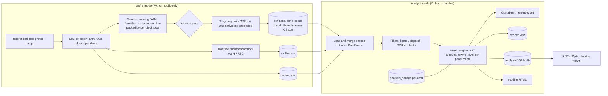

# rocprof-compute (ROCm Compute Profiler) -- Comprehensive Project Deep Dive

> Last reviewed: 2026-11 · Versions assumed: ROCm Compute Profiler 3.9.0 (latest published docs, ROCm 10.1.0) and the public `develop` CHANGELOG through 3.11.0 (ROCm 10.3.0); ROCprofiler-SDK / `rocprofv3` as the collection backend.

> Version note: ROCm 10.0.0 (Aug 2026) and 10.1.0 are public releases of the ROCm Core SDK, built with TheRock since 7.14. This line succeeded the 7.x releases (the 7.0-7.2 production stream and the 7.9-7.14 technology previews). 3.11.0 (ROCm 10.3.0) is unreleased `develop` work; your local nightly builds (for example `10.1.0a<date>`) are pre-release snapshots. Other files in this repo state their own assumed versions (often ROCm 6.4-7.x) in their header lines, so check those headers when a flag or tool name differs.

> A rehearsal document for the interview prompt "walk me through your project", applied to **rocprof-compute** (package `rocprofiler-compute`, formerly **Omniperf**), AMD's kernel-level GPU performance analysis tool. Everything marked **[PUBLIC]** comes from public sources: the ROCm docs, the public CHANGELOG, and the public source tree in `ROCm/rocm-systems` under `projects/rocprofiler-compute`. These are listed in [Sources](#15-sources). Everything marked **[TODO(you)]** is a slot for your own experience. This document does not invent personal contributions. Fill those slots with true, specific stories before an interview.

---

## Table of Contents

1. [How to Use This Document](#1-how-to-use-this-document)
2. [The Pitches](#2-the-pitches)
3. [What Problem It Solves](#3-what-problem-it-solves)
4. [History and Version Timeline](#4-history-and-version-timeline)
5. [Architecture Overview](#5-architecture-overview)
6. [Profile Mode and Counter Collection](#6-profile-mode-and-counter-collection)
7. [Analyze Mode and the Metric Engine](#7-analyze-mode-and-the-metric-engine)
8. [Speed-of-Light, Memory Chart, and Roofline](#8-speed-of-light-memory-chart-and-roofline)
9. [User Interfaces and Outputs](#9-user-interfaces-and-outputs)
10. [Key Design Tradeoffs](#10-key-design-tradeoffs)
11. [Likely Interviewer Follow-Ups](#11-likely-interviewer-follow-ups)
12. [Your Story Templates](#12-your-story-templates)
13. [Rehearsal Checklist and Pitfalls](#13-rehearsal-checklist-and-pitfalls)
14. [Glossary](#14-glossary)
15. [Sources](#15-sources)

---

## 1. How to Use This Document

**Labels used throughout:**

| Label | Meaning | What to do with it |
|---|---|---|
| **[PUBLIC]** | Facts taken from public docs, the CHANGELOG, or public source code | Learn them well enough to explain them on a whiteboard. Re-check version-specific details before the interview. |
| **[TODO(you)]** | A template with prompts | Replace it with your own true story, your numbers, and your decisions |
| **[ANALYSIS]** | Engineering reasoning about tradeoffs, not a claim about AMD's internal intent | Use it as a starting point and adapt it to what you actually saw |

**Ground rules for a project deep dive:**

1. **Separate "the team" from "I".** Interviewers listen for this. Say "the tool does X" for public architecture and "I designed / I debugged / I measured" only for work you personally did.
2. **Know the public boundary.** Discuss only what is in the public repo, docs, and CHANGELOG. If asked about unreleased hardware or internal roadmaps, say: "I can't go into unreleased details, but the public design is ..."
3. **Every claim needs a number or a mechanism.** "It was slow" is weak. "Analyze took N minutes on a workload with M dispatches because we re-read and pivoted an intermediate CSV; removing that step cut it to K" is strong.
4. **Prepare three zoom levels**: 30 seconds, 2 minutes, and 10 minutes (section 2). Then be ready to go one level deeper on any box in the architecture diagram (section 5).

**How the sections map to typical interview questions:**

| Interview question | Section |
|---|---|
| "Tell me about a project you're proud of" | 2, then 12 |
| "Draw the architecture" | 5 |
| "How do hardware counters work? Why multiple passes?" | 6, 11 |
| "How do you know your metrics are right?" | 7, 11 |
| "What is a roofline? How do you measure the ceilings?" | 8, 11 |
| "What would you redesign?" | 10, 12 |
| "Hardest bug?" | 12 |

> See also: [Behavioral Interview Prep](./Behavioral_Interview_Prep.md) for STAR structure, and [Interview Loops and Logistics](./Interview_Loops_and_Logistics.md) for where this deep dive usually falls in a loop.

---

## 2. The Pitches

**[TODO(you)]** These are templates. The **[PUBLIC]** sentences are safe to say as written. Replace every `TODO(you)` with your own facts.

### 2.1 30-Second Pitch

> "I work on **rocprof-compute**, AMD's open-source, kernel-level GPU performance analyzer for Instinct GPUs (MI100 through MI350) and some Ryzen APUs. It's the AMD counterpart to Nsight Compute. You point it at an application. It replays the application several times to collect hundreds of hardware performance counters. Then it turns those counters into derived metrics: speed-of-light utilization, a cache-hierarchy memory chart, and an empirical roofline. Users can then tell *why* a kernel is slow, not just *that* it's slow. My part is `TODO(you): one sentence, e.g. "the counter-collection pipeline" / "the metric engine and per-architecture configs" / "roofline and benchmarking"`. One result I'm proud of is `TODO(you): one quantified result`."

### 2.2 2-Minute Pitch

Structure it as **problem, approach, my role, result, what's next**:

1. **Problem [PUBLIC].** GPU performance counters are low-level and per hardware block, with names like `SQ_INSTS_VALU_FMA_F32` and `TCC_EA0_RDREQ_sum`. Only a few can be read at once. On gfx90a, for example, the shader sequencer (SQ) block has 8 counter slots and the L2 (TCC) block has 4. Few application developers can interpret raw counters.
2. **Approach [PUBLIC].** Collection has two modes:
   - **Profile mode** plans which counters each pass collects and runs the application once per pass, using ROCprofiler-SDK and a native C++ tool to read counters for each dispatch. It also runs roofline microbenchmarks.
   - **Analyze mode** loads the counters into pandas and evaluates per-architecture YAML formulas into derived metrics, grouped top-down: System Speed-of-Light, then a panel per hardware block.
3. **My role [TODO(you)].** `TODO(you): scope (component, feature, or migration), team size, how long, what you owned end to end vs contributed to.`
4. **Result [TODO(you)].** `TODO(you): 1-2 numbers, e.g. profiling passes, wall time, analyze memory, number of metrics validated, bugs closed, customers unblocked.`
5. **What's next [PUBLIC + TODO(you)].** The public direction includes:
   - rocpd/SQLite as the canonical profile format,
   - an analysis database consumed by the ROCm Optiq desktop viewer,
   - single-pass modes (iteration multiplexing, `--set`),
   - ML-framework attribution (`--torch-trace`, `--triton-trace`).

   `TODO(you): what you would do next.`

### 2.3 10-Minute Walkthrough (whiteboard plan)

| Minute | What to draw or say | Reference |
|---|---|---|
| 0-1 | Problem and users: HPC/ML kernel developers, AMD application engineers, customers | Section 3 |
| 1-3 | Architecture diagram: profile side, workload directory, analyze side, outputs | Section 5 |
| 3-5 | Deep dive 1: why multiple passes, how counters are bin-packed, serialization, variance | Section 6 |
| 5-7 | Deep dive 2: YAML metric to AST to pandas evaluation; SOL and roofline math | Sections 7-8 |
| 7-8 | Tradeoffs: replay vs multiplexing, declarative configs, Python stack | Section 10 |
| 8-10 | **[TODO(you)]** Your contribution, the hardest bug, impact numbers, what you'd redesign | Section 12 |

**Tip:** Interviewers usually interrupt by minute 3. Plan to finish the diagram quickly. The deep dives are where you score, so let them choose which box to open.

### Interview Q&A -- Pitches

**Q1.** "In one sentence, how is rocprof-compute different from rocprofv3?"

**A:** `rocprofv3` is the command-line front end of ROCprofiler-SDK. It collects *raw* data: API and kernel traces, and the counters you name with `--pmc`. rocprof-compute is an *analysis tool on top of it*. It decides which counters a full analysis needs, schedules them across passes, collects them per dispatch, adds empirical roofline benchmarks, and turns everything into derived, architecture-aware metrics with peaks and percent-of-peak. The analogy is Nsight Compute on top of CUPTI.

**Q2.** "Who are the users and how do they use it?"

**A:** **[PUBLIC]** The users are kernel developers and performance engineers on ML and HPC workloads running on AMD Instinct GPUs. The typical loop is:
1. `rocprof-compute profile -n name -- ./app`
2. `rocprof-compute analyze -p workloads/name/<gpu>` and start at Speed-of-Light (block 2).
3. Drill into the bottleneck block, for example the L2 panel.
4. Change the kernel.
5. Re-profile, then compare baseline and new runs with two `-p` arguments.

**[TODO(you)]** Add one real (non-confidential) user story you saw.

---

## 3. What Problem It Solves

**[PUBLIC]** The docs describe ROCm Compute Profiler as "a kernel-level profiling tool for machine learning and high performance computing (HPC) workloads running on AMD Instinct GPUs". Its core features are: system and per-block Speed-of-Light evaluation, a memory chart, roofline analysis, baseline comparison, filtering by kernel, dispatch, and GPU ID, and several normalizations.

### 3.1 The Gap Between Raw Counters and Answers

| Raw reality | What users want | What the tool does |
|---|---|---|
| Hundreds of counters named per hardware block (`SQ_*`, `TCP_*`, `TCC_*`, `TA_*`, `SPI_*`, `CPC_*` ...) | "Is my kernel compute- or memory-bound?" | Derived metrics with units, peaks, and percent-of-peak |
| Only a few counter slots per block per pass | All counters in one report | Plans passes, replays the application, and merges results |
| Counter semantics differ per architecture (gfx908, gfx90a, gfx94x, gfx950, gfx115x) | One consistent report | Per-architecture YAML configs and SoC classes |
| Peaks depend on clocks, CU count, partition mode | "% of what?" | Theoretical peaks from system info plus empirical roofline ceilings |
| Many dispatches across many kernels | "Which kernel matters?" | Top Stats (block 0) by time, plus filters |

### 3.2 Where It Sits in the ROCm Profiling Family

| Tool | Level | Typical question | NVIDIA analogue |
|---|---|---|---|
| **ROCprofiler-SDK / rocprofv3** | Library plus CLI for tracing and counters | "Which kernels ran, for how long? What is counter X?" | CUPTI / nsys CLI pieces |
| **rocprof-sys** (ROCm Systems Profiler, formerly Omnitrace) | System-wide timeline: CPU, GPU, MPI, sampling | "Where does wall time go across the whole app?" | Nsight Systems |
| **rocprof-compute** (ROCm Compute Profiler, formerly Omniperf) | Single-kernel hardware utilization | "Why is *this* kernel slow?" | Nsight Compute |
| **ROCm Optiq** | Desktop visualizer | "Let me explore the trace or analysis visually" | Nsight UI |
| **rocprof-compute-viewer** | Thread-trace viewer | "Instruction-level timing of waves" | Nsight Compute source view (roughly) |

**Workflow advice to quote:** start with a system profiler to find the hot kernels, then use rocprof-compute on those kernels with `-k` filters. A full counter collection on a whole application is expensive (section 6).

> See also: [AMD GPU Architecture and Profiling](../ml-gpu/AMD_GPU_Architecture_and_Profiling.md) for the hardware blocks behind these counters, and [Parallel GPU Programming, HIP Performance Tuning](../ml-gpu/Parallel_GPU_Programming.md#30-hip-performance-tuning-for-amd-gpus).

### Interview Q&A -- Problem

**Q1.** "Why not just give users rocprofv3 and a counter list?"

**A:** There are three reasons.
1. **Scheduling.** A meaningful analysis needs far more counters than fit in one pass. Someone must partition them under per-block limits, run the passes, and join the results per dispatch.
2. **Semantics.** Raw counters need formulas: unit conversions, per-XCD and per-channel aggregation, and architecture-specific constants such as wave size, cache-line size, and FLOPs per MFMA op. Getting these right is the hard part. Encoding them once per architecture is the product.
3. **Methodology.** A top-down structure (SOL, then block panels, plus roofline) tells users where to look next. A flat list of 300 numbers does not.

**Q2.** "When would you *not* use rocprof-compute?"

**A:**
- **To understand end-to-end timelines** (CPU/GPU overlap, communication, launch gaps), use rocprof-sys or rocprofv3 tracing. rocprof-compute serializes dispatches, so it distorts concurrency.
- **For very long jobs**, a full application replay can cost N times the runtime. Filter by kernel or dispatch, use `--set`, use iteration multiplexing, or profile a shortened input.
- **For instruction-level stalls**, use PC sampling, which rocprof-compute exposes as an experimental feature, or thread trace.

---

## 4. History and Version Timeline

**[PUBLIC]** Taken from the CHANGELOG. Releases after 3.9.0 come from the public `develop` CHANGELOG and may be ahead of the published docs. **Re-verify before the interview**, because this area changes every release.

| Version (ROCm) | Notable public changes |
|---|---|
| Omniperf 1.0.x (2022-2023) | Open-sourced by AMD Research. Profile, analyze, and **database** modes. Grafana + MongoDB dashboards and a standalone GUI. |
| Omniperf 2.0.0 (May 2024) | MI300 support. "Extensible SoC classes to better support adding new hardware configs." |
| **3.0.0 (ROCm 6.3.0)** | **Renamed Omniperf to ROCm Compute Profiler.** CLI becomes `rocprof-compute`. |
| 3.1.0 (6.4.0) | Experimental `rocprofv3` support (not default) |
| 3.1.1 (6.4.2) | FP8 metrics on MI300. Roofline data types FP8 through I64. `rocm-smi` replaced by `amd-smi`. |
| **3.2.3 (7.0.0)** | **MI350/MI355 (CDNA4) support.** `rocprofv3` becomes the default backend. TUI (beta). PC sampling (beta). Roofline and memory chart in the CLI. MI50/MI60 dropped. MongoDB deprecated. Docker recipes for a single-file standalone binary. |
| **3.3.0 (7.1.0)** | Default interface changes to the **ROCprofiler-SDK** library. **`--set`** for single-pass collection of predefined metric subsets. `--attach-pid` dynamic attach. **`--output-format db`** (SQLite analysis report). |
| 3.4.0 (7.2.0) | **Database mode (Grafana/MongoDB) removed.** `-b` accepts block aliases. Analysis configs managed through `tools/config_management/`. `Active CUs` deprecated in favor of `CU Utilization`. |
| **3.5.0 (7.12.0)** | **Native counter-collection tool** (ROCprofiler-SDK public API) becomes the default. **Iteration multiplexing.** `rocpd` becomes the default SDK output. Roofline kernels **compiled at runtime through HIP/HIPRTC Python wrappers**, replacing the `rocm-amdgpu-bench` binaries. MPI rank detection. `NOISE_CLAMP` for multi-pass variance. Experimental `--torch-trace`. |
| 3.6.0 (7.13.0) | Profile mode runs on vanilla Python with no pip dependencies. Strix Halo (gfx1151). Roofline HTML generated in analyze. One counter file per replay, merged in analyze. |
| **3.7.0 (7.14.0)** | Ratio metrics aggregated as **`SUM(A)/SUM(B)`** instead of `AVG(A/B)`. L1/L2 roofline on gfx942/gfx950 fixed to a **128 B cache line**. `--gui`/`--tui` moved behind `--experimental`. `--bench-only`. gfx1150/gfx1152 roofline. |
| 3.8.0 (10.0.0) | Experimental Triton trace. `--overwrite`. gfx115x roofline improved (WMMA in place of MFMA). |
| 3.9.0 (10.1.0) | **CSV profile backend removed; `rocpd` always.** Per-kernel and multi-process PC sampling. Profile-side gzip of large CSVs. |
| 3.10.0 (10.2.0) | `-d/--dispatch` (profile) renamed to **`--kernel-iteration-range`**, matching rocprofv3. Dispatch IDs start at 1. Nuitka standalone binary removed. Memory chart redesign. Analyze reads profiling output directly; `pmc_perf.csv` is no longer written. |
| 3.11.0 (10.3.0, develop) | **Experimental `--gui` and `--tui` removed.** Use the CLI, or `--output-format db` with ROCm Optiq. Profile mode collects only the counters that metric equations use. Roofline benchmark reports the peak sample instead of the mean. |

**Repository history [PUBLIC].** The project was AMDResearch/omniperf, then ROCm/omniperf, then **ROCm/rocprofiler-compute**, which is now marked deprecated. Development for releases after ROCm 7.0 happens in the **ROCm/rocm-systems** monorepo under `projects/rocprofiler-compute`. Sibling projects such as rocprofiler-sdk and rocprofiler-systems moved there too.

### Interview Q&A -- History

**Q1.** "Why was Omniperf renamed and moved onto ROCprofiler-SDK?"

**A:** **[PUBLIC facts + ANALYSIS]** The rename (3.0.0) aligned the tool with the ROCm profiler family: rocprofiler-sdk, rocprofv3, rocprof-sys, rocprof-compute. The backend migration followed ROCm's own deprecation of the older rocprof v1/v2 interfaces in favor of ROCprofiler-SDK. The CHANGELOG says rocprof v1/v2/v3 *interfaces* would be removed "in favor of the ROCprofiler-SDK interface". Building on the SDK's public API, through the native tool, gives three things:
- in-process collection with per-dispatch callbacks,
- features such as iteration multiplexing that need control inside the process,
- one maintained counter-definition source shared across ROCm tools.

**Q2.** "Why did the Grafana/MongoDB mode go away?"

**A:** **[PUBLIC + ANALYSIS]** It was removed in 3.4.0 "in favor of other visualization methods". The direction since then is an analysis SQLite database (3.3.0) consumed by **ROCm Optiq**, a standalone desktop app that needs no ROCm stack on the viewing machine. Running a database server plus a dashboard stack is a heavy deployment for a per-kernel tool, and it tied visualization to the tool's release cycle. A file-based database is portable, diffable, and decoupled from the viewer.

---

## 5. Architecture Overview

**[PUBLIC]** Paths are from the public `develop` tree as of late 2026. File names change quickly, so describe *responsibilities* in interviews, not file names.

### 5.1 Components

| Component | Responsibility | Public location (develop) |
|---|---|---|
| Entry point and argument parsing | `profile` / `analyze` modes, general options (`--list-metrics`, `--list-blocks`, `--config-dir`) | `src/rocprof-compute`, `src/argparser.py`, `src/rocprof_compute_base.py` |
| SoC layer | Detect the GPU (arch, model, CUs, clocks, partition modes), load per-arch limits and configs, plan counter passes | `src/rocprof_compute_soc/soc_base.py`, `soc_gfx908.py` ... `soc_gfx950.py`, `soc_gfx115x`, `src/utils/mi_gpu_spec.yaml` |
| Profiler backends | Launch the app once per pass with the SDK tool and native tool preloaded; attach mode | `src/rocprof_compute_profile/profiler_base.py`, `profiler_rocprofiler_sdk.py` |
| Native counter tool (C++) | In-process ROCprofiler-SDK client: per-dispatch counter records, kernel symbols, agent info, writers (gzip CSV) | `src/lib/rocprofiler_compute_tool/` |
| Roofline benchmarks | HIP kernels compiled at runtime (HIPRTC through ctypes) to measure peak BW and FLOPs per level and data type | `src/roofline/benchmark/`, `src/utils/hip_interface.py`, `hiprtc_interface.py` |
| Analysis configs | Per-arch YAML panels: metric name to formula, unit, peak | `src/rocprof_compute_soc/analysis_configs/<arch>/NNNN_*.yaml` |
| Metric engine | Parse, validate, rewrite, and evaluate formulas over a pandas DataFrame | `src/utils/metrics/expression.py`, `metric_evaluator.py`, `aggregation.py`, `noise_clamper.py` |
| Analyze front ends | CLI tables, memory chart rendering, CSV/DB export | `src/rocprof_compute_analyze/analysis_cli.py`, `analysis_db.py`, `src/memory_chart/` |
| Extras | PC sampling, ML API trace (Torch/Triton ROCTX injection), memory-bandwidth guided analysis | `src/pc_sampling/`, `src/utils/inject_roctx/`, `src/membw_analysis/` |

### 5.2 Architecture Diagram



### 5.3 Workload Directory (the contract between the two modes)

**[PUBLIC]** The default is `./workloads/<name>/<gpu_model>`, or `./workloads/<name>/<rank>` under MPI. `--output-directory` accepts the keywords `%hostname%`, `%gpumodel%`, `%rank%`, and `%env{NAME}%`.

```text
workloads/vcopy/MI300X/
├── perfmon/              # generated per-pass counter input YAMLs (pmc_perf_*.yaml)
├── out/pmc_1/...         # raw per-pass, per-process SDK output (rocpd .db)
├── results_*.csv.gz      # per-pass counter results (being phased out)
├── pmc_perf.csv          # merged counters: written by analyze up to 3.9.x; not written since 3.10.0
├── sysinfo.csv           # GPU model, CUs, clocks, partition modes, ...
├── roofline.csv          # empirical peaks from microbenchmarks
└── log.txt
```

**[ANALYSIS]** The workload directory is a deliberate seam:
- You can profile on a GPU node and analyze on a laptop.
- You can re-analyze with different filters or normalizations without re-profiling.
- Baseline comparisons are just two directories.

A public design doc ("Profile Interface Architecture", status: proposal with Phases A, B, and D implemented) moves this to a **reader interface**. Analyze builds the DataFrame directly from source artifacts per run, filters are applied in memory, and `pmc_perf.csv` is no longer an input. Phases A (CSV backend removed, 3.9.0), B (gzip), and D (reader interface, no `pmc_perf.csv`, 3.10.0) are implemented. Phases C (stop the rocpd-to-CSV conversion) and E (Profiler Hub) remain. The stated motivations are:
- On large AI workloads, time was "dominated by redundant reads, writes, and pivots of intermediate CSVs over millions of rows".
- A stale `pmc_perf.csv` could be reused after re-profiling.

### Interview Q&A -- Architecture

**Q1.** "Why split profile and analyze into separate modes?"

**A:**
1. **Different machines and lifetimes.** Profiling needs the GPU, ROCm, and the application. Analysis needs only data, so it can run anywhere and be repeated cheaply.
2. **Different dependencies.** Since 3.6.0, profile mode runs on vanilla Python with no pip packages, so it installs easily on locked-down clusters. Analyze uses pandas and numpy.
3. **Reproducibility.** The workload directory is an artifact you can attach to a bug report or share with AMD application engineers.
4. **Iteration.** Filters, normalizations, and new metric formulas can be applied to old data, as long as the needed counters were collected.

**Q2.** "Why is there a C++ native tool if the tool is Python?"

**A:** Counter callbacks run *inside the profiled process* through ROCprofiler-SDK's tool interface: the library is loaded into the target with `LD_PRELOAD` and receives `rocprofiler_configure`-style callbacks. That code must be native, low-overhead, and thread-safe. It sees every dispatch on the hot path. Python orchestrates the process from outside. The native tool also enables iteration multiplexing, which picks a different counter subset per dispatch and so needs in-process control. Its outputs (per-dispatch counter records, kernel symbols, agent info) are written through small writer classes behind an interface. That keeps storage formats such as gzip CSV or a future Profiler Hub replaceable, and lets unit tests use mocks instead of the disk.

**Q3.** "What is the single most important data structure?"

**A:** The **per-dispatch counter table**. Each row is one kernel dispatch: dispatch ID, kernel name, GPU, grid and workgroup sizes, LDS/VGPR/SGPR usage, start and end timestamps. Each column is one counter. Every metric is a vectorized expression over these columns plus system variables. Passes are joined on dispatch identity, so the join key's correctness across replays is critical (section 6).

---
## 6. Profile Mode and Counter Collection

### 6.1 What Happens When You Run `profile`

**[PUBLIC]** By default profile mode does two things: (1) collects the counters needed for analysis, and (2) runs the roofline microbenchmark, which `--no-roof` disables. The docs' `vcopy` example on an MI325X logs `Run 1/13` through `Run 13/13`, which means 13 application replays for one full collection.

```bash
# fragment -- requires ROCm and rocprof-compute; flags as of 3.9-3.11
rocprof-compute profile --name vcopy -- ./vcopy -n 1048576 -b 256          # full collection + roofline
rocprof-compute profile --name vcopy -b 2 -- ./vcopy -n 1048576 -b 256     # only counters for block 2 (SOL)
rocprof-compute profile --name vcopy --set <set_name> -- ./vcopy           # single-pass predefined set (--list-sets)
rocprof-compute profile --name vcopy -k vecCopy -- ./vcopy                 # kernel-name substring filter
rocprof-compute profile --name vcopy --iteration-multiplexing kernel -- ./vcopy -i 20
rocprof-compute profile --name vcopy --roof-only -- ./vcopy                # roofline benchmark only
rocprof-compute analyze -p workloads/vcopy/MI300X/ -b 2                    # analyze: System SOL
```

**Version note:** in 3.10.0 the profile-mode dispatch filter `-d/--dispatch` was renamed to `--kernel-iteration-range`, to match rocprofv3, and `-d` became the short form of `--output-directory`. The 3.9.0 docs still show `-d/--dispatch`. Say "kernel-iteration filter" in an interview and you will be right for either version.

### 6.2 Why Multiple Passes: Hardware Counter Slots

**[PUBLIC]** Each hardware block has a small, fixed number of physical performance-counter registers. Each register is programmed to count one event at a time. The per-arch limits live in `src/utils/mi_gpu_spec.yaml` as `perfmon_config`, "copied from aqlprofile ... block counter registers". They are identical for gfx908, gfx90a, gfx940-942, and gfx950:

| Block | Meaning | Slots per pass |
|---|---|---|
| SQ | Shader sequencer: waves, instruction counts, busy cycles | 8 |
| SPI | Shader processor input: wave launch / workgroup manager | 6 |
| TCP | Vector L1 data cache (vL1D) | 4 |
| TCC | L2 cache | 4 |
| TA / TD | Texture addresser / texture data (address and data paths) | 2 / 2 |
| CPC / CPF | Command processor compute / fetcher | 2 / 2 |
| GRBM | Graphics register bus manager (for example `GRBM_GUI_ACTIVE`, the GPU-busy cycle count) | 2 |

**Where the pass count comes from.** The profile-mode docs example (MI325X, rocprof-compute 3.5.0) shows **13 runs = 6 regular passes + 7 accumulator passes**:
- 6 regular passes: `pmc_perf_0.yaml` through `pmc_perf_5.yaml`.
- 7 accumulator passes, one per `*_ACCUM` counter, each with a reserved slot for its paired level event: `pmc_perf_SQ_LEVEL_WAVES`, `SQ_INST_LEVEL_VMEM`, `SQ_INST_LEVEL_SMEM`, `SQ_INST_LEVEL_LDS`, `SQ_IFETCH_LEVEL`, `SQC_ICACHE_INFLIGHT_LEVEL`, and `SQC_DCACHE_INFLIGHT_LEVEL`.

The regular-pass count is set by the busiest block. SQ and SQC share 8 slots, and TCC has 4. The lower bound is `max over blocks of ceil(counters_in_block / slots_in_block)`. The actual number varies with version, architecture, and filters (`-b`, `--set`, and the 3.11.0 "only collect what formulas use" change). Do not predict it from a grep of the YAMLs: a naive count of counter names on develop gfx942 implies more regular passes than the docs show. Read the real number from the `Run i/N` progress lines, or with `ls workloads/<name>/<gpu>/perfmon/`. **Interview point:** the bottleneck block sets the regular-pass count, and each accumulator adds a whole pass. So the levers are cutting counters in the scarcest block and dropping accumulator-based metrics you do not need.

**Special cases the planner handles [PUBLIC, from `soc_base.py`]:**
- **Accumulator counters** (`*_ACCUM`, used to integrate a "level" such as in-flight requests over time for latency and occupancy) each get a **dedicated pass**, with an extra slot reserved for the paired level event.
- **Per-channel TCC counters** (`TCC_HIT[0..N]`): all channel instances of a counter go into the **same pass**.
- **Metric-aware coalescing (policy-driven, per arch).** If the arch has a counter-grouping policy in `analysis_configs/profiling_counter_grouping_policy.yaml`, a metric-aware greedy pass runs first and tries to place *all counters of a metric into the same pass*. Policy-listed metrics are tier 0. On gfx908 through gfx942 these are HBM Read/Write Traffic (17.2.1 and 17.2.5), so the percentage cannot exceed 100% from replay variance. All other metrics are then packed largest group first. Leftover counters go to a per-counter first-fit. Archs with an empty policy (for example gfx950, `same_bucket_priority_metric_ids: {}`) use only the per-counter first-fit. Grouping matters because a metric like `A - B` or `A / B` computed from two different replays picks up run-to-run noise (section 6.4). The 3.10.0 CHANGELOG notes HBM traffic percentages "are now more accurate, with all their counters collected in a single profiling pass".
- **Only collect what formulas use** (3.11.0). Counters that no metric equation references are dropped, which can reduce the number of passes.

A toy version of the planner (complete program; runs with `python3`):

```python
"""Toy model of rocprof-compute pass planning.

Bin-pack the hardware counters that metric formulas need into "passes"
(one application replay each), subject to per-block counter-slot limits.
Limits below are the gfx90a values from src/utils/mi_gpu_spec.yaml.
"""
from collections import defaultdict

PERFMON = {"SQ": 8, "TA": 2, "TD": 2, "TCP": 4, "TCC": 4,
           "CPC": 2, "CPF": 2, "SPI": 6, "GRBM": 2}


def block_of(counter: str) -> str:
    return counter.split("_", 1)[0]


def fits(pass_: dict, counters: list[str]) -> bool:
    need = defaultdict(int)
    for c in counters:
        if c not in pass_[block_of(c)]:
            need[block_of(c)] += 1
    return all(len(pass_[b]) + n <= PERFMON[b] for b, n in need.items())


def add(pass_: dict, counters: list[str]) -> None:
    for c in counters:
        if c not in pass_[block_of(c)]:
            pass_[block_of(c)].append(c)


def plan_passes(metrics: dict[str, list[str]]) -> list[dict]:
    """Metric-aware greedy: keep each metric's counters in ONE pass when
    possible (so its ratio is computed from one run), biggest groups first;
    fall back to per-counter first-fit otherwise."""
    passes: list[dict] = []
    for name, counters in sorted(metrics.items(), key=lambda kv: -len(kv[1])):
        target = next((p for p in passes if fits(p, counters)), None)
        if target is None:
            target = defaultdict(list)
            if not fits(target, counters):          # metric too big for one pass
                for c in counters:                  # split it: first-fit per counter
                    p = next((p for p in passes if fits(p, [c])), None)
                    if p is None:
                        p = defaultdict(list)
                        passes.append(p)
                    add(p, [c])
                continue
            passes.append(target)
        add(target, counters)
    return passes


if __name__ == "__main__":
    metrics = {
        "VALU FLOPs": ["SQ_INSTS_VALU_ADD_F32", "SQ_INSTS_VALU_MUL_F32",
                       "SQ_INSTS_VALU_FMA_F32", "SQ_INSTS_VALU_TRANS_F32"],
        "VALU Utilization": ["SQ_ACTIVE_INST_VALU", "GRBM_GUI_ACTIVE"],
        "Occupancy": ["SQ_WAVES", "SQ_BUSY_CYCLES", "GRBM_GUI_ACTIVE"],
        "LDS Bank Conflict": ["SQ_LDS_BANK_CONFLICT", "SQ_LDS_IDX_ACTIVE"],
        "L2 Hit Rate": ["TCC_HIT_sum", "TCC_MISS_sum"],
        "HBM Read BW": ["TCC_EA0_RDREQ_sum", "TCC_EA0_RDREQ_32B_sum",
                        "TCC_BUBBLE_sum", "GRBM_GUI_ACTIVE"],
        "vL1D Hit Rate": ["TCP_TCC_READ_REQ_sum", "TCP_TOTAL_CACHE_ACCESSES_sum"],
    }
    plan = plan_passes(metrics)
    for i, p in enumerate(plan, 1):
        print(f"pass {i}: " + ", ".join(f"{b}={v}" for b, v in sorted(p.items())))
    print(f"{len(plan)} passes => {len(plan)} application replays")
```

Output: 2 passes. The SQ block fills up (7 of 8 slots) in pass 1, so the LDS metric's two SQ counters spill to pass 2, and the L2 hit-rate pair joins them there. **Interview point:** this is a bin-packing problem with multiple dimensions, one capacity per block. Optimal packing is NP-hard. A greedy first-fit-decreasing heuristic is fine because the input is small (hundreds of counters) and the objective is "few passes, and keep each metric's counters together". If the interviewer asks for an exact approach, mention an ILP over (counter, pass) assignment that minimizes passes plus a penalty for splitting metric groups.

### 6.3 Collection Strategies Compared

| Strategy | How | Pros | Cons | When |
|---|---|---|---|---|
| **Application replay** (default) | Run the whole app once per counter group | Works for any app, every dispatch gets every counter | N times the runtime. Needs a deterministic app. Fails under MPI, because `MPI_Init` cannot run twice in one launch. | Short or medium workloads, single process |
| **Iteration multiplexing** (3.5.0+) | One run; successive dispatches of the *same kernel* (policy `kernel`) or same kernel + grid/workgroup/LDS sizes (policy `kernel_launch_params`, the default) get different counter subsets; results are combined | One run, works with MPI | Needs enough dispatches per kernel to cover every subset. The docs say a kernel should dispatch at least about 50 times to cover about 15 subsets. Assumes iterations are statistically alike. Cannot combine with `--attach-pid`. | Long training or inference loops, MPI jobs |
| **`--set <name>`** (3.3.0+) | Predefined metric subsets that fit in one pass | One run, cheap | Only a slice of the analysis | Quick triage, MPI |
| **`-b` block or metric filtering** | Collect only the counters that the chosen report blocks or metric IDs need | Fewer passes | Partial report | You already know where to look |
| **`--attach-pid`** (3.3.0+) | Attach to a running process for `--attach-duration-msec` | No relaunch | Not combinable with multiplexing | Long-running services |

**[PUBLIC]** On MPI: "Application replay fails with MPI." Use `--iteration-multiplexing` or `--set`, and put the launcher *outside*: `mpirun -n 4 rocprof-compute profile --iteration-multiplexing -- ./app`. Rank detection supports OpenMPI, MPICH, MVAPICH2, Slurm, Flux, PMI/PMIx, and PALS.

### 6.4 Dispatch Serialization and Multi-Pass Variance

**Serialization [PUBLIC].** "ROCm Compute Profiler collects GPU performance counters with kernel dispatch association which requires serializing kernel dispatches." Kernels on different HIP streams of the *same* GPU do not run concurrently while profiling, but different GPUs are not serialized. ROCprofiler-SDK's **dispatch counting** service works per kernel launch and serializes. Its **device counting** service counts device-wide without serialization but cannot attribute counts to a dispatch. Consequences:
- Durations and throughput reflect isolated execution. A kernel that normally overlaps with others looks "better utilized" or "worse utilized" than in production.
- Co-dependent kernels can deadlock in dispatch-counting mode, for example a producer and consumer spinning on each other. The SDK docs call this out.

**Variance [PUBLIC].** Every pass is a separate run, so `A` from pass 3 and `B` from pass 7 come from different executions. Derived values such as `A - B` can go **negative**. Since 3.5.0 the `NOISE_CLAMP` expression function clamps negatives to 0 and tracks the relative error. The FAQ's guidance:

| Max deviation | Interpretation |
|---|---|
| < 1% | Normal variance, no warning |
| >= 1% | Warning "Counter variance corrected ..."; results still valid |
| > 5% | Investigate: system load, thermal throttling, nondeterministic application behavior |

**Dispatch identity.** Joining passes requires that "dispatch k" means the same thing in every run. Dynamic shapes, autotuning, data-dependent launches, and multi-process apps can all break that assumption. The 3.11.0 CHANGELOG includes a fix for "dispatch IDs not always following kernel launch order". With iteration multiplexing, kernels with missing counter data after imputation are **excluded from metrics** and listed in a warning (3.7.0).

### 6.5 Overhead and Perturbation

| Source | Effect | Mitigation |
|---|---|---|
| Replays | Wall time is about (passes x app time) + roofline benchmark | `-k`, kernel-iteration range, `-b`, `--set`, multiplexing, shorter inputs |
| Dispatch serialization | Lost inter-kernel concurrency, changed durations | Interpret per-kernel metrics as isolated behavior; use rocprof-sys for concurrency |
| Counter readout per dispatch | Small fixed cost per dispatch, which dominates for tiny kernels | Filter; judge micro-kernels by counts, not time |
| Profiling-mode clocks and power states | On gfx115x the `AUTO` perf level can gate the perfmon clock and zero some counters (3.10.0 known issue) | Use a stable power profile, as the warning suggests |
| Cache state between replays | Each replay starts with different L2/MALL contents | Compare ratios across runs carefully; prefer same-pass metrics |

**Key insight to say aloud:** counter *counts* (instructions, requests) are largely deterministic for a given kernel and input. *Time-based* metrics (bandwidth, utilization, percent of peak) are where perturbation shows up. So a formula that divides a count from one pass by a time from another pass carries cross-pass noise.

### Interview Q&A -- Profile Mode

**Q1.** "How exactly are counters collected for a single dispatch?"

**A:** **[PUBLIC + ANALYSIS]**
1. The profiler writes the pass's counter list (a `perfmon/pmc_perf_*.yaml`) and launches the app with ROCprofiler-SDK's tool library and rocprof-compute's native tool preloaded.
2. The SDK intercepts the HSA runtime. Conceptually, for each kernel dispatch packet in **dispatch counting** mode, it wraps the dispatch with extra AQL packets, built through the aqlprofile library, that program the selected counters into the block registers, enable counting, and read the registers after the kernel completes. This is why dispatches are serialized: counters are global per block, so two concurrent kernels would mix their counts.
3. Counter values are reduced over **dimensions** (shader engine, XCD, CU, L2 channel) according to the counter definition. That is why names like `TCC_HIT_sum` and per-channel `TCC_HIT[3]` exist.
4. The native tool gets the per-dispatch record (kernel ID, grid, workgroup, LDS, registers, timestamps, counter values) in a callback and writes it out. Python merges passes later.

**Q2.** "A user says profiling takes 40 minutes. What do you do?"

**A:** Measure first: app runtime x number of passes (shown as `Run i/N`) + roofline time. Then reduce:
1. Filter kernels (`-k`) and iterations, since you rarely need all 10k dispatches.
2. Restrict blocks with `-b`, or use `--set` for one pass.
3. Use `--iteration-multiplexing` if the loop repeats kernels enough times.
4. Skip roofline with `--no-roof` if peaks are already measured (`roofline.csv` is reused when present).
5. Shrink the problem size or the number of steps.

Also confirm that the slowdown is not the per-dispatch overhead on millions of tiny kernels. In that case, filtering is the only real fix.

**Q3.** "Why not use device-wide counting so you don't need serialization?"

**A:** Device counting gives totals over a time window across all running work. You lose the attribution of counts to a specific kernel, and per-kernel attribution is the main reason the tool exists. It is great for system-level monitoring, which is a different tool's job. A hybrid design is possible: device counting for an overview, then dispatch counting on the top kernels.

**Q4.** "How do you choose which counters go in the same pass?"

**A:** Hard constraint: per-block slot limits. Soft objectives, in order:
1. Keep all counters of one metric together, so ratios and differences come from one run.
2. Minimize the number of passes.
3. Give accumulators dedicated passes.
4. Keep all channels of a per-channel counter together.

The implementation (`soc_base.py`) depends on the arch. If the arch has a counter-grouping policy (`profiling_counter_grouping_policy.yaml`), a greedy, metric-aware first-fit-decreasing runs first. Policy-listed metrics go first (HBM Read/Write Traffic on gfx908 through gfx942), then all other metrics, largest group first. A per-counter first-fit handles leftovers. Archs with an empty policy, such as gfx950, use only the per-counter first-fit. Section 6.2 has a toy version.

---

## 7. Analyze Mode and the Metric Engine

### 7.1 Pipeline

**[PUBLIC]**
1. Load `sysinfo.csv`, `roofline.csv`, and the per-pass counter data. These are merged into one DataFrame. Up to 3.9.x the merged frame was written to `pmc_perf.csv`. Since 3.10.0, analyze builds it in memory from the source artifacts.
2. Apply filters: kernel (`-k`, by index from `--list-stats`), dispatch, `--gpu-id`, and blocks or metric IDs (`-b 2`, `-b 2 5.1.0`, or aliases such as `sol`).
3. For each panel YAML for this architecture, evaluate every metric's `value`, `peak`, and other columns.
4. Render: CLI tables and memory chart, `--output-format csv` (one CSV per analysis view), or `db` (SQLite for ROCm Optiq). Roofline HTML is written to disk.

### 7.2 The YAML Panel Config

**[PUBLIC]** Here is an excerpt from `analysis_configs/gfx942/0200_system_speed_of_light.yaml`. Per-arch YAMLs are edited in place and must conform to a per-family template (`gfx9`, `gfx11`, or `gfx12_config_template.yaml`). Their hashes are enforced in pre-commit and CI (`.config_hashes.json`). Some files still carry an old "AUTOGENERATED ... unified_config.yaml" header, but that header is stale: the tooling README says to "edit panel YAMLs directly".

```text
Panel Config:
  id: 200
  title: System Speed-of-Light
  data source:
  - metric_table:
      id: 201
      title: System Speed-of-Light
      header: {metric: Metric, value: Avg, unit: Unit, peak: Peak, pct_of_peak: Percent of Peak}
      metric:
        VALU FLOPs:
          value: 64 * SUM(SQ_INSTS_VALU_ADD_F16 + ... + 2 * SQ_INSTS_VALU_FMA_F32 + ...) / SUM(End_Timestamp - Start_Timestamp)
          unit: GFLOP/s
          peak: $max_sclk * $cu_per_gpu * 64 * 2 / 1000
          pct_of_peak: true
        VALU Utilization:
          value: 100 * SUM(SQ_ACTIVE_INST_VALU) / SUM($GRBM_GUI_ACTIVE_PER_XCD * $cu_per_gpu)
          unit: Percent
          peak: 100
```

Elements of the YAML vocabulary:
- **Bare identifiers** are counters, which become DataFrame columns (`SQ_ACTIVE_INST_VALU`), or dispatch fields (`End_Timestamp`).
- **`$variables`** are system or derived values: `$max_sclk` (MHz), `$cu_per_gpu`, `$wave_size`, `$lds_banks_per_cu`, `$GRBM_GUI_ACTIVE_PER_XCD`, and others.
- **Functions**: `SUM`, `AVG`, `MIN`, `MAX`, `MEDIAN`, `STD`, `QUANTILE`, `ROUND`, `MOD`, `TO_INT`, `CONCAT`, and `NOISE_CLAMP`.
- **Panels and IDs.** The file prefix gives the panel number: 0000 Top Stats, 0100 System Info, 0200 System SOL, 0300 Memory Chart, 0400 Roofline, 0500 CP, 0600 SPI, 0700 Wavefront, 1000-1100 CU instruction mix and pipeline, 1200 LDS, 1300 instruction cache, 1400 sL1D, 1500 TA/TD, 1600 vL1D, 1700 L2, 1800 L2 per channel, 2100 PC sampling. Metric IDs such as `2.1.0` (panel 2, table 1, row 0) are what `-b` accepts.

### 7.3 Expression Engine: Parse, Allow-List, Rewrite, Evaluate

**[PUBLIC]** `src/utils/metrics/expression.py` and `metric_evaluator.py`:
1. **Parse** the formula with Python's `ast`.
2. **Allow-list** node types: arithmetic, comparisons, boolean operators, if-expressions, calls, names, constants, subscripts. `ast.Attribute` is **deliberately excluded**, because it "enables dunder-chain escapes" such as `().__class__.__base__.__subclasses__()`. Calls are allowed only to the supported function names.
3. **Rewrite**:
   - each counter name becomes `raw_pmc_df["NAME"]`,
   - `SUM(...)` becomes `to_sum(...)` and the other functions map the same way,
   - `x if cond else y` becomes `x.where(cond, y)` so it vectorizes over pandas,
   - `$vars` become prefixed local names.
4. **Evaluate** with `eval` using restricted builtins and a local context holding the DataFrame, system variables, empirical peaks, and helpers.
5. **Normalize failures.** Scalar NaN or inf (for example from divide-by-zero) becomes `"N/A"`. Missing counters (`KeyError`) and type errors become warnings plus `"N/A"`. In 3.7.0, the redundant `if (X != 0) else None` guards were removed from every YAML, because the engine already handles division by zero.

A compact, runnable model of the same idea (stdlib only):

```python
"""Minimal sketch of a YAML-metric expression engine in the style of
rocprof-compute: parse with ast, allow-list node types, rewrite bare names
to counter columns, map SUM/AVG to aggregation helpers, then eval with no
builtins. Pure stdlib; per-dispatch columns are plain lists."""
import ast
import operator


class Col:
    """Tiny column type: element-wise arithmetic over per-dispatch values."""
    def __init__(self, vals): self.vals = list(vals)
    def _op(self, other, fn):
        o = other.vals if isinstance(other, Col) else [other] * len(self.vals)
        return Col(fn(a, b) for a, b in zip(self.vals, o))
    def __add__(self, o): return self._op(o, operator.add)
    def __sub__(self, o): return self._op(o, operator.sub)
    def __mul__(self, o): return self._op(o, operator.mul)
    def __truediv__(self, o): return self._op(o, operator.truediv)
    __radd__, __rmul__ = __add__, __mul__


ALLOWED = (ast.Expression, ast.BinOp, ast.UnaryOp, ast.Constant, ast.Name,
           ast.Call, ast.Load, ast.Add, ast.Sub, ast.Mult, ast.Div, ast.USub)
FUNCS = {"SUM": lambda c: sum(c.vals) if isinstance(c, Col) else c,
         "AVG": lambda c: sum(c.vals) / len(c.vals) if isinstance(c, Col) else c}


class Rewrite(ast.NodeTransformer):
    def generic_visit(self, node):
        if not isinstance(node, ALLOWED):          # no Attribute, Subscript, Lambda...
            raise ValueError(f"disallowed: {type(node).__name__}")
        return super().generic_visit(node)

    def visit_Call(self, node):
        if not (isinstance(node.func, ast.Name) and node.func.id in FUNCS):
            raise ValueError("unsupported call")
        if node.keywords:                          # kwargs would skip the allow-list
            raise ValueError("disallowed: keyword arguments")
        node.args = [self.visit(a) for a in node.args]  # leave func name alone
        return node

    def visit_Name(self, node):                    # counter -> pmc["NAME"]
        if node.id.startswith("var_") or node.id in FUNCS:
            return node
        sub = ast.Subscript(value=ast.Name("pmc", ast.Load()),
                            slice=ast.Constant(node.id), ctx=ast.Load())
        return ast.copy_location(sub, node)


def evaluate(formula: str, pmc: dict, sys_vars: dict):
    src = formula.replace("$", "var_")            # $max_sclk -> var_max_sclk
    tree = Rewrite().visit(ast.parse(src, mode="eval"))
    ast.fix_missing_locations(tree)
    env = {"pmc": {k: Col(v) for k, v in pmc.items()}, **FUNCS,
           **{"var_" + k: v for k, v in sys_vars.items()}}
    try:
        return eval(compile(tree, "<metric>", "eval"), {"__builtins__": {}}, env)
    except ZeroDivisionError:
        return "N/A"


if __name__ == "__main__":
    pmc = {"SQ_ACTIVE_INST_VALU": [9.0e6, 1.0e6],      # two dispatches
           "GRBM_GUI_ACTIVE":     [1.0e6, 1.0e6]}
    sys_vars = {"cu_per_gpu": 104}
    f = "100 * SUM(SQ_ACTIVE_INST_VALU) / SUM(GRBM_GUI_ACTIVE * $cu_per_gpu)"
    print(f"VALU Utilization = {evaluate(f, pmc, sys_vars):.2f} %")
    try:
        evaluate("SUM(GRBM_GUI_ACTIVE).__class__", pmc, sys_vars)
    except ValueError as e:
        print("rejected:", e)
```

Output: `VALU Utilization = 4.81 %` and `rejected: disallowed: Attribute`.

**Pitfall in this kind of rewriter:** overriding `visit_Call` without calling `generic_visit` means only the children you visit by hand are checked. If `node.keywords` were not rejected, `SUM(G, k=().__class__.__base__.__subclasses__())` would skip the allow-list, and the attribute chain would be evaluated before the call fails. Every child field of an overridden node (`args`, `keywords`, `func`) must be checked or rejected.

**Pitfall to mention:** an AST allow-list plus empty `__builtins__` is defense in depth, not a perfect sandbox. The real protection is that the YAML configs ship with the tool and are reviewed. If users could supply arbitrary formulas from untrusted sources, you would want a purpose-built expression language, for example compiling to `numexpr` or a small interpreter with no Python objects exposed.

### 7.4 Aggregation Semantics: `SUM(A)/SUM(B)` vs `AVG(A/B)`

**[PUBLIC]** 3.7.0 changed every ratio metric, on all architectures, from the mean of per-dispatch ratios to the ratio of totals. The reason: the ratio of totals weights each dispatch by its denominator (cycles, accesses, duration). Single-dispatch results are unchanged. Multi-dispatch workloads with different kernels or durations get corrected values.

```python
"""AVG(A/B) vs SUM(A)/SUM(B): why rocprof-compute 3.7.0 switched ratio
metrics to the ratio of totals. Two dispatches of an L2-bound workload."""
dispatches = [
    # (name,        L2 hits,    L2 requests)
    ("tiny_kernel",        9,            10),   # 90% hit rate, negligible traffic
    ("big_kernel",  1_000_000,   10_000_000),   # 10% hit rate, dominates traffic
]
avg_of_ratios = sum(h / r for _, h, r in dispatches) / len(dispatches)
ratio_of_sums = sum(h for _, h, _ in dispatches) / sum(r for _, _, r in dispatches)
print(f"AVG(hit/req)      = {100 * avg_of_ratios:5.1f} %")   # 50.0 % (misleading)
print(f"SUM(hit)/SUM(req) = {100 * ratio_of_sums:5.1f} %")   # 10.0 % (traffic-weighted)
```

This is Simpson's-paradox-style aggregation error. Use it as a crisp "how do you know metrics are right" example: **the formula can be right per dispatch and still wrong after aggregation.**

### 7.5 Normalization Units

**[PUBLIC]** `--normal-unit` controls how counts are normalized:

| Unit | Definition | Good for |
|---|---|---|
| `per_kernel` (default) | Total per kernel invocation | Comparing configurations |
| `per_wave` | Divided by wavefronts launched (`SQ_WAVES`) | Instruction mix per wave |
| `per_cycle` | Divided by kernel cycles as measured by the command processor | Rates independent of clock |
| `per_second` | Divided by kernel time | FLOP/s, bandwidth |

### 7.6 Per-Architecture Configs and Config Management

**[PUBLIC]**
- Each architecture has its own config directory (`gfx908`, `gfx90a`, `gfx940`, `gfx941`, `gfx942`, `gfx950`, `gfx115x`, and `gfx1250` in develop) and a SoC class (`soc_gfx942.py` sets things like `l2_banks = 16`, `lds_banks_per_cu = 32`, `pipes_per_gpu = 4`).
- Since 3.4.0, YAMLs are managed through `tools/config_management/`: hash checking, a master workflow script, template verification, and per-arch metric-description files. The 3.4.0 CHANGELOG also mentions a `config_delta/gfx950_diff.yaml` for tracking differences against the latest architecture. That is a 3.4.0-era mechanism: there is no `config_delta/` directory under `analysis_configs/` on develop.
- Product mapping: gfx908 = MI100 (CDNA), gfx90a = MI200 (CDNA2), gfx940/941/942 = MI300 family (CDNA3; gfx942 covers MI300X, MI300A, and MI325X), gfx950 = MI350/MI355 (CDNA4), gfx1150-1153 = RDNA 3.5 Ryzen APUs (gfx1151 = Strix Halo).

### Interview Q&A -- Analyze Mode

**Q1.** "Why a declarative YAML plus an expression engine instead of Python functions per metric?"

**A:** **[ANALYSIS]**
- **Pros.**
  - Hardware architects and performance engineers can review formulas without reading Python.
  - Per-arch differences are data, not code branches.
  - The same file drives the CLI, the CSV/DB exports, `--list-metrics`, documentation (metric descriptions are synced to public docs), and profile-mode counter selection, because the planner parses formulas to find which counters are needed.
  - Formulas are vectorized for free over pandas.
- **Cons.**
  - Errors are found only at runtime, for example a misspelled counter becomes a `KeyError` that turns into `N/A`.
  - `eval` needs sandboxing.
  - Copies of formulas across architectures drift. That is why per-family templates, template validation, and hash checks exist.
- **Mitigations.** Lint every formula at CI time:
  - parse it,
  - check that every identifier is a known counter for that arch,
  - check that every `$var` is defined,
  - evaluate it on synthetic data.

**Q2.** "Why does an empty or `N/A` metric happen, and is it a bug?"

**A:** Common causes:
1. The counter was not collected, because of `-b`/`--set` filtering or no multiplexing coverage.
2. The denominator is zero, for example no write requests means write latency is undefined.
3. The counter is not supported on that architecture. For example, MI300 does not support `TCP_TCP_LATENCY_sum`, so `VL1 Lat` was removed in 3.5.0.
4. Specs are missing: clocks were not detected, so use `--specs-correction`.

It is a bug only if the counter was collected and the formula should be defined. Debug by reproducing the evaluation on the DataFrame for one dispatch.

**Q3.** "How would you add a new metric end to end?"

**A:**
1. Add the metric, with ID, unit, peak, and description, to each arch's panel YAML. If it is a new row, also add it to the family template.
2. Run `master_config_workflow_script.py --validate-only` and `hash_manager.py --compute-all` (both in `tools/config_management/`) to validate against the templates and update the hashes.
3. Check that the needed counters exist on each arch (`rocprofv3 --list-avail`) and that the planner can fit them, ideally in one pass with the metric's other counters.
4. Add a unit test that evaluates the formula on a synthetic DataFrame with known values.
5. Add an integration test on a microbenchmark with an analytically known answer.
6. Update docs and the CHANGELOG.

---

## 8. Speed-of-Light, Memory Chart, and Roofline

### 8.1 Speed-of-Light (SOL)

**[PUBLIC]** System SOL (block 2) is the top-down entry point. It shows each key throughput or utilization metric next to a **theoretical peak** derived from system info, plus percent of peak. Examples from the gfx942 YAML:

| Metric | Value formula (simplified) | Peak formula |
|---|---|---|
| VALU FLOPs | `64 * SUM(ADD + MUL + TRANS + 2*FMA over F16/F32/F64 VALU instr) / SUM(duration_ns)` -> GFLOP/s | `$max_sclk * $cu_per_gpu * 64 * 2 / 1000` |
| MFMA FLOPs (F16) | `512 * SUM(SQ_INSTS_VALU_MFMA_MOPS_F16) / SUM(duration_ns)` | `$max_sclk * $cu_per_gpu * 2048 / 1000` |
| VALU Utilization | `100 * SUM(SQ_ACTIVE_INST_VALU) / SUM($GRBM_GUI_ACTIVE_PER_XCD * $cu_per_gpu)` | 100 |
| VALU Active Threads | `SUM(SQ_THREAD_CYCLES_VALU) / SUM(SQ_ACTIVE_INST_VALU)` | `$wave_size` |

**How to explain the FLOP formulas:**
- A VALU instruction executes on 64 lanes (wave64), and an FMA counts as 2 FLOPs. That gives `64 x (ADD + MUL + TRANS + 2 x FMA)`.
- MFMA counters count in units of 512 FLOPs ("MOPS"), hence `x 512`.
- Dividing FLOPs by nanoseconds gives GFLOP/s directly.

**Worked example (MI300X, 304 CUs, 2100 MHz peak engine clock):**
- VALU peak = 2100 x 304 x 128 / 1000 = **81,715 GFLOP/s, about 81.7 TFLOP/s**. That matches MI300X's published FP64 vector peak. The published FP32 vector peak, 163.4 TFLOP/s, is double this because of packed FP32 math (two FP32 operations per lane per instruction), which this single-rate formula does not include. Be ready to explain this factor of 2.
- MFMA FP16 dense peak = 2100 x 304 x 2048 / 1000 = **1,307,443 GFLOP/s, about 1307 TFLOP/s**. That matches the published dense FP16 number.

### 8.2 Memory Chart

**[PUBLIC]** Block 3 draws the memory hierarchy as one diagram per kernel selection:
- instruction buffer and wavefront stats,
- LDS, vL1D, sL1D, instruction cache,
- L2 per channel,
- Infinity Fabric / MALL / HBM, xGMI, PCIe.

It annotates request counts, hit rates, latencies, and bandwidth on each edge. Recent releases redesigned it as a Rich-based terminal layout driven by per-arch JSON layouts (`src/memory_chart/layouts/*.json`). Each edge reports traffic at the interface it represents, and units are uniform (GB/s, three decimal places). Use `--view table` to print it as tables.

### 8.3 Roofline: Model, Ceilings, and Measurement

**Model.** Attainable performance = `min(peak_compute, AI x peak_bandwidth)`, where arithmetic intensity AI = FLOPs / bytes moved at a given memory level. The **ridge point** = peak_compute / peak_bandwidth. A kernel left of the ridge is memory-bound at that level; a kernel to the right is compute-bound.

**Hierarchical roofline [PUBLIC].** The tool plots one AI per memory level for the same kernel: **HBM, L2, L1 (vL1D), and LDS**. The plotting code also has an L0 level, used for architectures with a GL0 cache. It also draws ceilings per data type for VALU and MFMA. Selected gfx942 YAML formulas:

| Level | Bytes denominator (simplified) |
|---|---|
| HBM | Sized L2-to-fabric requests: `TCC_BUBBLE*128 + RDREQ_32B*32 + (other RDREQ)*64 + WRREQ (32 B or 64 B)` |
| L2 | `128 * (TCP_TCC read + write + atomic requests)` |
| L1 | `128 * TCP_TOTAL_CACHE_ACCESSES` |
| LDS | `(SQ_LDS_IDX_ACTIVE - SQ_LDS_BANK_CONFLICT) * 4 * $lds_banks_per_cu` |

The `128` is the 128 B cache line on gfx942/gfx950. The 3.7.0 fix ("L1/L2 bandwidth and AI ... now use the correct 128B cache line") doubled reported bandwidth and halved AI relative to earlier releases on those architectures. This is a good public example of a units bug in a metric formula.

**How the ceilings are measured [PUBLIC].**
- **Empirical, not datasheet.** Microbenchmark kernels measure achievable peaks:
  - HBM streaming,
  - cache bandwidth with buffers sized to fit L1, L2, or MALL,
  - an LDS pointer-chase/bandwidth kernel,
  - VALU FMA loops per data type,
  - MFMA loops per data type.
- **Compiled at runtime.** Since 3.5.0 these kernels are compiled with HIPRTC through Python ctypes wrappers, replacing the separately built `rocm-amdgpu-bench` binaries.
- **Example, the HBM benchmark on develop.** It streams a 4 GB buffer with 16-byte elements, 256-thread workgroups, and 128 workgroups per CU. It runs 10 experiments and reports `max(samples)` in GB/s. 3.11.0 changed the reported value "from the mean to the peak measured sample across runs".
- **One benchmark per GPU at a time.** A per-GPU lock (3.5.0) stops concurrent `rocprof-compute` processes from benchmarking the same GPU and corrupting each other's peaks.
- **Results** go to `roofline.csv`, which is reused if present. `--roof-only` and `--bench-only` regenerate it.
- **Coverage.** Roofline is not available on pre-MI200 hardware (MI100). Benchmarks exist for gfx90a, gfx942, gfx950, gfx115x, and gfx1250 in develop.

**Why empirical ceilings?** **[ANALYSIS]** Datasheet peaks assume ideal clocks and access patterns. The profile-mode docs' MI325X example shows a measured HBM mean of about **4705 GB/s**, against a 6 TB/s datasheet figure, so about 78% of theoretical. Using measured ceilings makes "% of roofline" actionable, because 95% of an empirical ceiling really means "no headroom". SOL percentages, by contrast, use theoretical peaks. Be ready to explain why the two can disagree.

**Worked roofline numbers (complete program):**

```python
"""Roofline arithmetic using the peak formulas from the gfx942 System
Speed-of-Light YAML and MI300X public specs (304 CUs, 2100 MHz, 5.3 TB/s)."""
max_sclk_mhz, cus, hbm_tbs = 2100, 304, 5.3

valu_peak = max_sclk_mhz * cus * 64 * 2 / 1000          # GFLOP/s, YAML formula
mfma_f16_peak = max_sclk_mhz * cus * 2048 / 1000         # GFLOP/s, YAML formula
hbm_gbs = hbm_tbs * 1000

for name, peak in [("VALU (non-packed FP32/FP64)", valu_peak),
                   ("MFMA FP16 (dense)", mfma_f16_peak)]:
    print(f"{name:28s} peak {peak / 1000:7.1f} TFLOP/s, "
          f"ridge point {peak / hbm_gbs:6.1f} FLOP/byte")

def attainable(ai_flop_per_byte: float, peak_gflops: float, bw_gbs: float) -> float:
    return min(peak_gflops, ai_flop_per_byte * bw_gbs)

# FP32 SAXPY y = a*x + y: 2 FLOPs per element, 12 bytes moved (load x, y; store y)
ai = 2 / 12
print(f"SAXPY AI = {ai:.3f} FLOP/B -> attainable {attainable(ai, valu_peak, hbm_gbs):.0f} "
      f"GFLOP/s ({100 * attainable(ai, valu_peak, hbm_gbs) / valu_peak:.1f}% of VALU peak)")
```

Output: VALU ridge point about 15.4 FLOP/byte, MFMA FP16 ridge point about 247 FLOP/byte, and SAXPY attainable about 883 GFLOP/s (1.1% of VALU peak). SAXPY is hopelessly memory-bound. The right question for it is "what % of HBM bandwidth do I get?", not "what % of FLOPs?".

**Roofline output evolution [PUBLIC].**
- 3.5.0: PDF output replaced by HTML.
- 3.6.0: HTML generated in analyze mode.
- 3.9.0: standalone roofline HTML redesigned.
- 3.10.0: axes fixed per GPU, so runs are comparable.
- 3.11.0: "Limited by" AI-axis mode and richer hover. The CLI roofline plot was removed, while the HTML remains.

> See also: [Performance Engineering, Roofline Model](../computer-science/Performance_Engineering.md#3-roofline-model) and [GPU Kernel Case Studies](../ml-gpu/GPU_Kernel_Case_Studies.md) for worked kernels at different arithmetic intensities.

### Interview Q&A -- SOL and Roofline

**Q1.** "How do you measure the roofline ceilings, and what could go wrong?"

**A:** Run microbenchmarks that saturate one resource each:
- streaming loads over a buffer much larger than the caches for HBM,
- buffers sized to fit a cache level for that level's bandwidth,
- dependent FMA chains, wide enough to hide latency, for VALU peaks,
- MFMA loops per data type for matrix peaks.

Take the best of N runs, because the goal is the achievable *peak*.

Pitfalls:
- clocks not at peak (power management) during the benchmark,
- the compiler optimizing away loads, which the cache kernel prevents with an index trick and a `sink` written to memory,
- packed and dual-issue math needing vector types (fixed for FP16 VALU in 3.5.0),
- a benchmark that under-reports a ceiling (the gfx90a BF16 MFMA roofline peak was half the correct value until 3.7.0),
- benchmarking while another process uses the GPU (solved by the lock).

**Q2.** "SOL says 30% of HBM bandwidth but roofline says the kernel sits on the HBM roof. Contradiction?"

**A:** Not necessarily:
1. SOL uses **theoretical** peak while the roofline uses **empirical** peak. If achievable bandwidth is about 85% of theoretical, the numbers differ, but not by that much.
2. The **duration** used may differ. SOL divides by kernel time, and a kernel with a long tail of under-occupied execution (few waves at the end) can average low bandwidth.
3. The point may sit on a *different level's* roof, for example L2. Check which level's AI the point refers to.
4. Partition modes (CPX/NPS) change per-partition peaks. 3.9.0 added a warning that reports the active modes.

Check the numbers explicitly. Do not hand-wave.

**Q3.** "Why might VALU utilization exceed 100%?"

**A:** **[PUBLIC FAQ]** On architectures that **co-issue** two VALU instructions, active-instruction cycles can exceed the single-issue cycle budget the denominator assumes. The metric is correct per its definition, but the definition assumes single issue. The fix is in documentation or in the peak definition, not in the counter.

---
## 9. User Interfaces and Outputs

**[PUBLIC]** The interfaces changed a lot across versions. Interviewers who used Omniperf in 2023 may remember Grafana. Know the timeline.

| Interface | What it is | Status by version |
|---|---|---|
| **CLI analyze** (default) | Text tables, memory chart, and top stats in the terminal; baseline comparison with multiple `-p` | Always present; the primary interface |
| **Grafana + MongoDB "database mode"** | `database --import` into MongoDB, dashboards in Grafana | Omniperf 1.x/2.x; MongoDB deprecated in 3.2.3; **mode removed in 3.4.0** |
| **Standalone GUI** (`--gui`) | Dash/Plotly web app served locally | Omniperf era onward; experimental in 3.7.0; **removed in 3.11.0** (develop) |
| **TUI** (`--tui`) | Textual-based terminal UI with metric descriptions | Beta in 3.2.3; experimental in 3.7.0; **removed in 3.11.0** (develop) |
| **CSV export** | `--output-format csv`: one CSV per analysis view (replaced `--save-dfs` in 3.3.0) | Current |
| **Analysis database** | `--output-format db`: SQLite with kernel, dispatch, metric, roofline, and PC-sampling views | Added 3.3.0; current |
| **ROCm Optiq** | Desktop app (Linux, Windows, macOS) that opens the analysis `.db`; no ROCm needed on the viewing machine | Current recommended GUI path (needs compute data from ROCm 7.12+) |
| **Roofline HTML** | Interactive standalone HTML with per-level AI, data-type filters, hover details | Current |
| **Standalone binary** | Single-file executable (Nuitka) built through Docker recipes | Docker files added 3.2.3; **removed in 3.10.0** |

**Other analysis features to know [PUBLIC]:**
- **PC sampling** (`--experimental --pc-sampling` since 3.7.0). Host-trap sampling on MI200 and later; stochastic (hardware) sampling on MI300X and later. Results are per-instruction issue and stall counts, mapped to ISA and source. Per-kernel CSV export arrived in 3.9.0.
- **ML API tracing.** `--torch-trace` (3.5.0, experimental) and `--triton-trace` (3.8.0, experimental) inject ROCTX markers so counters can be attributed to PyTorch operators or Triton kernels (`--torch-operator "*conv*"` in analyze).
- **Live attach** (`--attach-pid`, 3.3.0).
- **Memory-bandwidth guided analysis** (`--membw-analysis`, experimental).

### Interview Q&A -- Interfaces

**Q1.** "Why remove a GUI and a TUI? Isn't that a regression?"

**A:** **[ANALYSIS, consistent with the public CHANGELOG]** Every in-tool front end is a second or third rendering path that must stay in sync with the metric engine. The cost shows up as bug fixes ("Fixed standalone GUI crashing"), dependency weight (dash, textual, plotext), and duplicated features. The replacement is an **export-then-view** design: the tool owns correctness and writes a versioned SQLite schema, and a separate viewer owns UX. This is the same pattern as compilers that emit structured diagnostics for IDEs. The cost is that users install another application. The benefits: profile and analyze stay small and testable, and the viewer can also show other tools' data (Optiq opens ROCm Systems Profiler traces too).

**Q2.** "Why SQLite for the analysis output?"

**A:** It is a single file with no server, readable from every language. It is queryable, so a user can find the top-10 kernels by L2 miss rate in one SQL query. It also supports a versioned schema (Optiq reads a schema version from a metadata table). Its weaknesses are columnar analytics at very large scale (Parquet is better) and concurrent writers, which do not matter for a post-processing artifact.

> See also: [SQL and Pandas Exercises](../practice/SQL_and_Pandas_Exercises.md) to practice queries of the "top-N kernels by metric" kind.

---

## 10. Key Design Tradeoffs

**[ANALYSIS]** grounded in public facts. For each tradeoff, the interview-ready structure is: **options, what was chosen, why, cost, what would change the decision.**

| # | Decision | Alternatives | Why this choice | Cost | Revisit if |
|---|---|---|---|---|---|
| 1 | **Application replay** as the default collection | Kernel replay (save and restore memory, re-run one dispatch); iteration multiplexing; sampling | Works for any app without modifying it. Every dispatch gets every counter. | N times runtime. Needs deterministic apps. Breaks MPI. | Workloads are long or iterative (multiplexing, added 3.5.0); MPI (sets and multiplexing) |
| 2 | **Dispatch-serialized counting** | Device counting | Exact attribution of counts to kernels | Concurrency lost, timing perturbed, possible deadlock with co-dependent kernels | You need system-level behavior (use rocprof-sys) |
| 3 | **Declarative YAML formulas + AST evaluator** | Hard-coded Python per metric; a custom DSL | Reviewable by hardware experts; one source drives collection, analysis, and docs; vectorized | Runtime-only errors; `eval` must be sandboxed; drift across arch copies | Formulas need types and units checking, so build a typed DSL with unit algebra |
| 4 | **Per-arch full YAML copies** validated against family templates + hash checks | Inheritance (base arch + overrides) | Each arch file is self-contained and diffable; architects review exact formulas | Duplication; template validation and hash-check tooling needed | The number of archs grows (it now includes RDNA APUs and gfx1250) |
| 5 | **Python** for orchestration and analysis, **C++** for the in-process tool | All C++; all Python | Fast iteration; pandas for analysis; natural for config-driven logic; native code only where it must run inside the process | Startup and memory cost on huge workloads; dependency packaging (hence a stdlib-only profile mode since 3.6.0) | Analyze on millions of dispatches gets too slow; push joins and aggregations into SQL or Arrow |
| 6 | **rocpd (SQLite) as the canonical profile format**; CSV backend removed (3.9.0) | Keep CSV and DB both | One storage path; no "not supported in CSV" branches; structured | Older tooling that expected CSV breaks (rocpd can still export CSV) | Scale needs columnar storage (Parquet is named as a possible future option) |
| 7 | **Empirical** roofline ceilings, **theoretical** SOL peaks | Theoretical everywhere; empirical everywhere | Roofline shows achievable headroom; SOL is stable and needs no benchmark | Two "peaks" confuse users; benchmark time; per-GPU locking | Benchmarks become too slow on new parts |
| 8 | **Ratio of sums** aggregation (3.7.0) | Mean of ratios | Weighted by the denominator, so physically meaningful | Changed reported numbers between releases | -- (this is a correctness fix) |
| 9 | **Metric-aware counter packing** | Pure first-fit by counter | Fewer cross-pass ratios, so less variance and fewer negative values | Sometimes more passes | -- |
| 10 | **Export-then-view** (DB + Optiq) | In-tool GUI or TUI | Decoupled release cycles; smaller dependency surface | Extra install for users | -- |

### 10.1 Deeper Discussion: Replay vs Multiplexing

**Accuracy model.** With application replay, *each counter* is measured on *every* dispatch, but different counters come from different runs. With iteration multiplexing, everything comes from *one* run, but each counter is measured on only a *subset of dispatches* of a kernel and then combined. This works when iterations are statistically identical, for example training steps after warm-up. It is biased when behavior drifts, for example warm-up iterations, changing cache contents, or dynamic shapes. The `kernel_launch_params` policy, the default, partitions by kernel *and* grid, workgroup, and LDS size. Dispatches with different shapes are therefore never mixed, which removes the most obvious source of bias.

**Back-of-envelope.** Take an application with a 60 s runtime and 13 counter groups:
- Replay: about 13 x 60 s = **13 minutes**, plus the roofline benchmark.
- Multiplexing: about 60 s plus per-dispatch overhead, but it needs at least 13 dispatches per (kernel, launch-params) key. The docs advise at least about 50 dispatches to cover about 15 subsets, which leaves margin for subsets that need repeats.

### 10.2 Deeper Discussion: The Python Stack

| Concern | Mitigation seen in public history |
|---|---|
| Dependency hell on HPC clusters | Profile mode needs no pip packages (3.6.0); analyze reports missing packages |
| Analyze memory and time on huge workloads | Reduced profile-mode peak memory (3.9.0); gzip for large CSVs; caching and multiprocessing in post-analysis (3.3.0); the reader interface removed the `pmc_perf.csv` round trip (3.10.0) |
| `eval` safety | AST allow-list without `Attribute`; restricted builtins |
| Distribution | Nuitka single binary tried (3.2.3) and later removed (3.10.0), favoring normal packaging |
| Calling HIP from Python | ctypes wrappers for HIP and HIPRTC compile the roofline kernels at runtime, so no separate benchmark binaries need building |

> See also: [Python Fundamentals](../languages/Python_Fundamentals.md) for `ast`, ctypes, and GIL background; [CMake Fundamentals](../tools/CMake_Fundamentals.md) for how a mixed Python/C++ project is built and installed; [High Level Design](../computer-science/High_Level_Design.md) for the general "storage-format boundary" pattern.

### Interview Q&A -- Tradeoffs

**Q1.** "If you could redesign the metric engine from scratch, what would you do?"

**A:** **[ANALYSIS; adapt it to your own view in section 12.3]**
1. **A typed, unit-aware DSL.** Formulas would compile to an IR with dimensions such as bytes, cycles, ns, and FLOPs. "GB/s divided by cycles" would then be a compile-time error, which catches the class of bug behind the 128 B cache-line fix.
2. **A static counter manifest per arch,** generated from formulas and validated in CI against the SDK's counter list (`rocprofv3 --list-avail` output captured per arch).
3. **Explicit aggregation semantics per metric** (sum, ratio-of-sums, max, mean) instead of relying on where `SUM` appears in the string.
4. **Golden tests** with synthetic counter tables per metric.
5. **Columnar execution** (Arrow, Polars, or DuckDB) for large workloads.

**Q2.** "Kernel replay instead of application replay?"

**A:** Kernel replay saves the memory the kernel can touch, runs the kernel once per counter group, and restores memory between runs. Pros: one application run, and exact same inputs for every group, so no cross-run variance. Cons: you need to know or snapshot every buffer the kernel can write, which is hard with pointers inside structs, device-side `malloc`, or unified memory. It costs memory and time per replay, interacts badly with inter-kernel communication and atomics on host-visible memory, and changes cache state. Nsight Compute offers both kernel and application replay modes for these reasons. rocprof-compute uses application replay plus multiplexing and sets. The ROCprofiler-SDK docs list "replay each dispatch" as one possible strategy for tools.

---

## 11. Likely Interviewer Follow-Ups

**[PUBLIC + ANALYSIS]** Model answers. Rehearse them out loud in under 2 minutes each, then insert your own experience where marked.

**Q1.** "Walk me through how a hardware counter value ends up as a number in the SOL table."

**A:**
1. **Plan.** At profile time, the planner parses every YAML formula and extracts identifiers such as `SQ_ACTIVE_INST_VALU` and `GRBM_GUI_ACTIVE`. It bin-packs them under per-block limits and writes per-pass input files.
2. **Collect.** For each pass, it launches the app with the SDK tool and native tool preloaded. In dispatch counting, the counters are programmed and read around each kernel, reduced over dimensions (for example summed across SEs or XCDs), and written per dispatch with timestamps.
3. **Merge.** Analyze loads all passes, joins them per dispatch, and builds one DataFrame.
4. **Evaluate.** The formula `100 * SUM(SQ_ACTIVE_INST_VALU) / SUM($GRBM_GUI_ACTIVE_PER_XCD * $cu_per_gpu)` is parsed and allow-listed. Names are rewritten to columns, `SUM` becomes a pandas sum over the filtered dispatches, and `$vars` come from sysinfo.
5. **Present.** The value, unit, peak, and percent of peak go into the SOL table, CSV view, or DB row.

**Q2.** "Why does it need multiple passes, and how many?"

**A:** Each hardware block has a fixed number of counter registers: on gfx9 Instinct parts, SQ has 8, TCP 4, TCC 4, TA 2, and so on. A full analysis needs on the order of 200 counter names, and SQ plus SQC share the SQ block's 8 slots. Regular passes are set by the busiest block: `max over blocks of ceil(counters / slots)`. On top of that, each `*_ACCUM` accumulator counter gets a dedicated pass. The docs' MI325X example (3.5.0) shows 13 runs = 6 regular passes (`pmc_perf_0..5`) + 7 accumulator passes (`SQ_LEVEL_WAVES`, `SQ_INST_LEVEL_VMEM/SMEM/LDS`, `SQ_IFETCH_LEVEL`, `SQC_ICACHE_INFLIGHT_LEVEL`, `SQC_DCACHE_INFLIGHT_LEVEL`). The exact count varies with version, arch, and filters, so read it from `Run i/N` or the `perfmon/` directory. Reduce passes by filtering blocks or metrics (`-b`), using a predefined `--set`, or spreading counter groups across iterations (`--iteration-multiplexing`).

**Q3.** "What's the overhead, and how does profiling perturb results?"

**A:**
1. Time overhead is about N passes x app runtime, plus per-dispatch counter read cost (which matters for tiny kernels) and the roofline benchmark.
2. Perturbation:
   - (a) dispatch serialization removes concurrency between streams;
   - (b) per-pass variance appears in cross-pass derived metrics, handled by `NOISE_CLAMP` and warnings above 1%;
   - (c) clock and power state;
   - (d) cache contents differ between replays.
3. Counts (instructions, requests) are robust. Time-derived metrics are the sensitive ones.
4. Advice: profile representative but shortened inputs, warm up, and compare against an unprofiled timing of the same kernel. **[TODO(you)]** Add a number you measured, for example "for workload X, profiling took Y passes and Z minutes versus W seconds unprofiled".

**Q4.** "How are roofline ceilings measured?"

**A:** Empirically, with HIP microbenchmarks compiled at runtime through HIPRTC: HBM streaming (4 GB buffer), cache-resident bandwidth kernels for L1, L2, and MALL, an LDS kernel, VALU FMA loops per data type, and MFMA loops per data type. Each runs about 10 experiments and the best sample is reported (develop; earlier releases used the mean). Results go to `roofline.csv`, which is reused across runs, and a per-GPU lock prevents concurrent benchmarking. The kernel's position comes from counters: FLOPs from VALU and MFMA instruction counters, bytes per level from request counters times the request size (128 B lines on gfx942/gfx950), and time from timestamps.

**Q5.** "How would you validate that a metric is correct?"

**A:** Layered:
1. **Analytic microbenchmarks.** A kernel with a known answer, for example a memcopy of B bytes should move about B bytes from HBM, or a kernel with a known FMA count. The public integration test `test_metric_validation.py` profiles a `memcopy` test and checks the derived HBM data transfer against an expected value within a **10% tolerance** on MI200, MI300, and MI350.
2. **Cross-tool consistency.** Compare against `rocprofv3 --pmc` raw counts for the same dispatch, and against the instruction counts in the ISA (`--save-temps` disassembly times the trip count).
3. **Invariants.** Hit + miss = requests. Percentages in [0, 100] except where co-issue is documented. Bytes per level should usually be monotonic (HBM <= L2 <= L1 for reads, under normal reuse). No negative counts after clamping.
4. **Unit and semantic review.** Cache-line size, FLOPs per MFMA op, wave size, per-XCD versus per-GPU normalization. Errors of this kind caused the public 128 B cache-line fix. Also review benchmark ceilings: the gfx90a BF16 MFMA roofline peak was under-reported by half until 3.7.0.
5. **Aggregation review.** Ratio-of-sums vs mean-of-ratios (3.7.0).
6. **Hardware documentation and architect review** for the counter definition itself.

**[TODO(you)]** Name one metric you validated or fixed and how.

**Q6.** "How would you scale this to an application with 10,000 distinct kernels and millions of dispatches?"

**A:**
1. **Collection.** Don't replay 13 times; use iteration multiplexing. Filter to the top-K kernels by time from a cheap first pass (kernel trace only). Sample dispatches with a kernel-iteration range. Collect only counters for the requested blocks.
2. **Storage.** Write per-process, per-pass outputs in a compressed or columnar form (gzip today; Parquet suggested). Avoid wide CSV pivots. Keep SDK and native lanes separate and merge in memory (the public design doc).
3. **Analysis.** Group by kernel first, then aggregate (ratio-of-sums), so metrics are evaluated per kernel group instead of per dispatch. Push filters down before loading. Cache parsed formulas. Use multiprocessing per panel, or a SQL engine (SQLite or DuckDB) for joins.
4. **Presentation.** Top-N tables, kernel name shortening, operator-level rollups (`--torch-trace`), and an export to a viewer that paginates.
5. **Memory.** Estimate: 1e6 dispatches x 200 counters x 8 bytes = **1.6 GB** of raw doubles, before pandas overhead. That is why per-kernel pre-aggregation and avoiding full materialization matter.

**Q7.** "What is your testing strategy?"

**A:** **[PUBLIC structure + TODO(you) specifics]**

| Layer | What | Public evidence |
|---|---|---|
| Unit (Python) | Argument parsing, expression rewrite and eval, aggregation helpers, counter packing, schema | `tests/unit/`, pytest |
| Unit (C++) | Native tool writers, SDK callback handling, kernel-name handling, gzip stream, PC sampling collector, using mocks so tests do not touch disk or the GPU | `src/lib/*/tests/` with GoogleTest and mocks |
| Integration (GPU) | Profile and analyze sample workloads per arch: dispatch filtering, iteration multiplexing, roofline, sets, multi-rank, live attach, Torch/Triton trace | `tests/integration/test_profile_*.py`, `test_analyze_*.py` |
| Metric validation | Known-answer workloads within tolerance | `tests/integration/test_metric_validation.py` |
| Config integrity | Generated YAML hashes, template verification, set metric IDs exist | `tools/config_management/`, `tools/validate_sets_metric_ids.py` |
| Build + CI matrix | CMake builds the HIP sample workloads used by integration tests (`vcopy`, `vmem`, sequential and random access); CI runs across GPU archs | `tests/CMakeLists.txt`, `.github/ci-matrix.yml` |

Principles to state: test the metric engine **without a GPU** using synthetic DataFrames. Keep I/O behind adapters ("Unit tests do not touch disk" is a stated boundary in the design doc). Reserve GPU runners for integration. Use tolerances, not equality, for hardware-measured values.

> See also: [C++ Testing](../languages/CPP_Testing.md) for GoogleTest and mocking patterns, and [Containers and CI](../tools/Containers_and_CI.md) for GPU CI runners.

**Q8.** "How do you add support for a new GPU architecture?"

**A:**
1. Add the arch to the GPU spec: perfmon slot limits, models, chip IDs, partition modes, memory levels.
2. Add a SoC class that sets arch constants (L2 banks, LDS banks, pipes) and wires up profiling setup.
3. Create analysis configs from the closest arch plus a delta: new counters, removed counters, changed widths such as cache-line size, and new data types (for example FP6/FP4 on gfx950).
4. Add roofline benchmark support (MFMA vs WMMA kernels, data types).
5. Add memory-chart layouts.
6. Add CI coverage and metric validation.

Typical gotchas: counters renamed or missing, per-channel counts (gfx950 lists `TCC_channels: 16`), new co-issue behavior that breaks a utilization peak, and partition modes that change per-partition CU and channel counts.

**Q9.** "A customer reports negative L2-to-fabric read bandwidth. Debug it."

**A:**
1. Check which counters the formula subtracts. A public known issue (3.3.0) involves 64 B reads computed as `RDREQ - BUBBLE - RDREQ_32B`.
2. Were those counters collected in **different passes**? If so, run-to-run variance explains small negatives. Check the "Counter variance corrected" warning and its percentage.
3. If the deviation is above 5%, look for nondeterminism: different dispatch counts per pass, dynamic shapes, or dispatch ID misalignment.
4. Fixes: co-locate the counters in one pass (metric-aware packing), clamp with tracking (`NOISE_CLAMP`), or reformulate the metric.
5. Add a regression test with a synthetic table where the subtraction goes negative.

**Q10.** "Compare rocprof-compute and Nsight Compute."

**A:**

| Similar | Different |
|---|---|
| Kernel-level, counter-driven, top-down from speed-of-light | Nsight Compute defaults to **kernel replay** with memory save/restore; rocprof-compute uses **application replay** plus multiplexing and sets |
| Both serialize kernels for attribution | rocprof-compute splits **profile and analyze into separate CLI modes** with an on-disk workload directory |
| Both have hierarchical roofline | rocprof-compute's formulas are **open YAML in a public repo**, so users can read exactly how each metric is computed |
| Both have source/PC-level views | rocprof-compute uses PC sampling (host-trap and stochastic); Nsight Compute has source counters and warp-state sampling |

Avoid claiming either tool is "better". Talk about the design pressures behind each choice.

**Q11.** "What happens with multi-GPU or MPI apps?"

**A:** Under MPI, wrap the profiler inside the launcher (`mpirun -n 4 rocprof-compute profile ...`). Rank is auto-detected, giving one output directory per rank (`%rank%`). Use single-pass modes, because replay would re-run `MPI_Init`. Across GPUs, `--gpu-id` in analyze filters by GPU. As of 3.11.0 it counts every GPU on the node in topology order. Dispatches are serialized per GPU, not across GPUs.

**Q12.** "Tell me about a correctness bug in this space that you find instructive."

**A:** **[PUBLIC examples; use your own in section 12 if you have one]**
1. **Cache-line size** (3.7.0). L1/L2 bandwidth on gfx942/gfx950 used 64 B instead of 128 B, so values were off by 2x. The fix made the roofline panel consistent with the SOL and cache panels.
2. **Mean of ratios** (3.7.0). The aggregation was wrong even though every per-dispatch formula was right.
3. **Peak clocks** (3.5.0). The maximum memory clock read from `amd-smi` used the max *gfx* clock, which corrupts every bandwidth peak.
4. **Hidden devices** (3.5.0). Hidden by `HIP_VISIBLE_DEVICES`/`ROCR_VISIBLE_DEVICES`, they made `amd-smi` values belong to the wrong GPU.

Lesson: the most damaging bugs in profilers are **plausible-looking wrong numbers**, not crashes. Hence invariants and known-answer tests.

---

## 12. Your Story Templates

**[TODO(you)]** Everything in this section is a template. Do not use the example phrasing as if it happened. Write down *true* stories and practice them until they take 2-3 minutes each. Pull concrete details from your commit history, PR descriptions, the CHANGELOG entries you authored, and issues you closed. Use only what is public, or what you are allowed to discuss.

### 12.1 Your Contribution Map

| Area | What I owned | What I contributed to | Evidence (public PR or CHANGELOG line) |
|---|---|---|---|
| Profile / collection | TODO(you) | TODO(you) | TODO(you) |
| Native tool (C++) | TODO(you) | TODO(you) | TODO(you) |
| Metric engine / configs | TODO(you) | TODO(you) | TODO(you) |
| Roofline / benchmarks | TODO(you) | TODO(you) | TODO(you) |
| Analyze outputs (CLI / DB / CSV) | TODO(you) | TODO(you) | TODO(you) |
| Testing / CI / build | TODO(you) | TODO(you) | TODO(you) |
| Docs / customer support | TODO(you) | TODO(you) | TODO(you) |

Prompts:
- Which 1-2 rows will you claim as "mine" in the 30-second pitch?
- For every "owned" row, can you draw its internals and name one tradeoff you made?

### 12.2 The Hardest Bug (STAR, about 3 minutes)

```text
TODO(you): Title (one line, e.g. "<symptom> on <arch> only when <condition>")

Situation  - Who hit it (customer, CI, internal team)? Which arch, ROCm version, workload type?
             What was the visible symptom (crash / hang / wrong number / flaky test)?
Task       - Why was it hard or high-stakes? (wrong numbers erode trust; release deadline; only repro on hardware X)
Action     - Your debugging path, step by step:
             1. How did you reproduce it? Minimal repro size?
             2. Which hypotheses did you rule out, and with what evidence?
                (cross-pass variance? dispatch misalignment? units? SDK version? arch config drift?)
             3. Tools you used (gdb, ASan/UBSan, rocprofv3 raw counters, logging, bisecting with git bisect, ...)
             4. Root cause in one sentence.
             5. The fix, and why that fix rather than the alternatives.
Result     - Numbers: error before/after, time to repro, tests added, releases affected.
Lesson     - What you changed in process (new invariant check, test, CI job, review checklist).
```

Probing questions to prepare for:
- "How did you know it was fixed and not just hidden?"
- "Why didn't existing tests catch it?"
- "What would you do differently?"
- "How long did it take, and what would have made it faster?"

> See also: [Debugging and Profiling Tools](../tools/Debugging_and_Profiling_Tools.md) for gdb, sanitizers, and `git bisect` workflows to reference in the Action step.

### 12.3 Impact with Numbers

Fill at least three. Each should follow **metric, baseline, after, how measured, why it matters**.

| # | Metric | Before | After | How measured | Why it matters |
|---|---|---|---|---|---|
| 1 | TODO(you), e.g. profiling passes for a full collection | TODO | TODO | TODO, e.g. `Run i/N` in logs on arch X | Fewer replays mean shorter time to insight |
| 2 | TODO(you), e.g. analyze wall time or peak RSS on a workload with N dispatches | TODO | TODO | TODO, e.g. `/usr/bin/time -v` | Usable on large AI workloads |
| 3 | TODO(you), e.g. metric error vs known-answer benchmark | TODO | TODO | TODO | Trust in numbers |
| 4 | TODO(you), e.g. CI coverage, flaky-test rate, build time | TODO | TODO | TODO | Team velocity |
| 5 | TODO(you), e.g. customer or internal teams unblocked, issues closed | TODO | TODO | TODO | Adoption |

Prompts:
- If you lack an exact number, give an honest range and the method: "roughly 3-4x, measured on two workloads".
- Be ready for "how do you know that improvement came from your change?" Was there a controlled before/after on the same machine and inputs?

### 12.4 What Would You Redesign?

Pick **one** thing and go deep. Choose something you have real evidence for. Candidate prompts (choose one and make it yours):

```text
TODO(you): "If I started over, I would change <X>."
- Current design and why it made sense at the time (be generous to past decisions).
- The pain it causes now, with evidence (bugs, perf, user complaints, maintenance cost).
- Proposed design (draw it), migration plan (phases, compatibility, deprecation warnings),
  and how you'd measure success.
- Risks and what you'd prototype first.
```

Possible topics (public context exists for each; your opinion must be your own):
- A typed, unit-checked metric DSL instead of Python-expression strings (section 10, Q1).
- Storage: a reader interface plus a columnar format instead of CSV intermediates (public design doc phases A-E).
- Collection: making single-pass (multiplexing or sets) the default for large workloads.
- Config management: inheritance with explicit per-arch overrides vs generated full copies.
- Front ends: export-then-view only (DB + Optiq) vs in-tool UI.

### 12.5 Collaboration and Conflict (behavioral cross-over)

```text
TODO(you): A time you disagreed on a design (e.g., with a reviewer, another ROCm team, or a customer request).
- What each side wanted and why (steelman the other side).
- How you resolved it (data, prototype, design doc, compromise).
- Outcome and what you learned.
```

> See also: [Behavioral Interview Prep](./Behavioral_Interview_Prep.md) for STAR timing and common behavioral prompts.

---

## 13. Rehearsal Checklist and Pitfalls

### 13.1 Before the Interview

- [ ] Re-read the latest CHANGELOG section: flags and features change every release (`--dispatch` became `--kernel-iteration-range`; GUI and TUI removed in develop).
- [ ] Be able to draw the section 5.2 diagram from memory in under 90 seconds.
- [ ] Recompute one roofline ridge point and one SOL peak from the formulas, by hand.
- [ ] Explain the 13 runs as regular passes (per-block slot limits) plus one pass per accumulator counter (6 + 7 in the MI325X docs example).
- [ ] Fill in section 12 with true stories, and time each answer.
- [ ] Prepare one sentence for "what's confidential": "I'll stick to what's in the public repo and docs."
- [ ] Have the public repo URL ready if the interviewer wants to look at code.

### 13.2 Common Pitfalls

| Pitfall | Better |
|---|---|
| "We" for everything, so the interviewer can't find your contribution | "The tool does X. I designed Y and measured Z." |
| Reciting feature lists | Lead with the problem and one deep mechanism |
| Claiming theoretical peak equals roofline peak | Distinguish theoretical SOL peaks from empirical roofline ceilings |
| Saying counters are "sampled" | Counters are *counted* per dispatch. PC *sampling* is a separate feature. |
| Ignoring perturbation | Volunteer serialization, replay variance, and how to interpret them |
| Outdated names (Omniperf, Omnitrace, `rocprof` v1 flags) | Use current names and mention the rename once: "rocprof-compute, formerly Omniperf" |
| Overclaiming version-specific facts | "As of 3.9/3.10 ..." and "in the develop branch ..." |
| Discussing unreleased hardware or internal plans | Redirect to public design docs and released features |

---

## 14. Glossary

| Term | Meaning |
|---|---|
| **rocprof-compute / rocprofiler-compute / ROCm Compute Profiler** | This tool: CLI name, package or repo name, and product name. Formerly **Omniperf**. |
| **ROCprofiler-SDK** | ROCm's profiling library with tracing and counter services; tools plug into it in-process |
| **rocprofv3** | CLI front end of ROCprofiler-SDK |
| **rocprof-sys** | ROCm Systems Profiler (formerly Omnitrace): system-wide timeline profiler |
| **rocpd** | SQLite-based output format for ROCprofiler-SDK data |
| **ROCm Optiq** | Desktop visualizer for Systems Profiler traces and Compute Profiler analysis databases |
| **Native tool** | rocprof-compute's C++ in-process ROCprofiler-SDK client that writes per-dispatch counter records |
| **PMC** | Performance-monitoring counter, a hardware event counter |
| **perfmon_config** | Per-arch map from hardware block to number of counter slots per pass |
| **Pass / application replay** | One full run of the application that collects one group of counters |
| **Iteration multiplexing** | Collecting different counter groups on different dispatches of the same kernel in one run |
| **Dispatch counting vs device counting** | Per-kernel-launch counters (serialized) vs device-wide counters over a time window |
| **Accumulator counter (`_ACCUM`)** | A counter that integrates a level (for example in-flight requests) over cycles; used for latencies and occupancy; gets its own pass |
| **SQ / SQC** | Sequencer, which issues instructions and counts waves and instructions / sequencer cache (instruction cache and scalar L1D) |
| **SPI** | Shader processor input, which launches workgroups and waves |
| **TA / TD** | Texture addresser / texture data: the vector-memory address and data-return path |
| **TCP (vL1D)** | Per-CU vector L1 data cache |
| **TCC (L2)** | Shared L2 cache, organized in channels |
| **EA / Data Fabric / MALL** | L2's memory-side interface / Infinity Fabric / Memory Attached Last Level cache (Infinity Cache) on MI300 |
| **XCD** | Accelerator complex die; MI300X has 8 XCDs |
| **GRBM_GUI_ACTIVE** | GPU-busy cycle counter, used as a time base |
| **VALU / SALU / MFMA / WMMA** | Vector ALU / scalar ALU / CDNA matrix-core instructions / RDNA matrix instructions |
| **LDS** | Local data share, the per-CU scratchpad ("shared memory") |
| **Wavefront (wave64)** | 64-lane SIMD execution unit of work on CDNA (RDNA supports wave32) |
| **Speed-of-Light (SOL)** | Achieved throughput as a percent of theoretical peak for each key unit |
| **Roofline / AI / ridge point** | Performance bound min(peak, AI x BW); FLOPs per byte; where the bandwidth and compute roofs meet |
| **Empirical peak** | Ceiling measured by microbenchmark rather than computed from specs |
| **Normalization unit** | `per_kernel`, `per_wave`, `per_cycle`, `per_second` |
| **Workload directory** | On-disk output of profile mode and input to analyze mode |
| **PC sampling (host-trap / stochastic)** | Periodic sampling of wave program counters, software- or hardware-triggered |
| **gfx908 / gfx90a / gfx942 / gfx950 / gfx1151** | MI100 / MI200 / MI300X-A-325X / MI350-355 / Strix Halo APU LLVM targets |

---

## 15. Sources

Public sources used for the **[PUBLIC]** sections. Access date: 2026-11.

- ROCm Compute Profiler documentation (3.9.0): https://rocm.docs.amd.com/projects/rocprofiler-compute/en/latest/
- What is ROCm Compute Profiler: https://rocm.docs.amd.com/projects/rocprofiler-compute/en/latest/what-is-rocprof-compute.html
- Profile mode: https://rocm.docs.amd.com/projects/rocprofiler-compute/en/latest/how-to/profile/mode.html
- Analyze mode: https://rocm.docs.amd.com/projects/rocprofiler-compute/en/latest/how-to/analyze/mode.html
- CLI analysis: https://rocm.docs.amd.com/projects/rocprofiler-compute/en/latest/how-to/analyze/cli.html
- Analyze with ROCm Optiq: https://rocm.docs.amd.com/projects/rocprofiler-compute/en/latest/how-to/analyze/optiq.html
- FAQ (counter variance, serialization, VALU co-issue): https://rocm.docs.amd.com/projects/rocprofiler-compute/en/latest/reference/faq.html
- Compatible accelerators: https://rocm.docs.amd.com/projects/rocprofiler-compute/en/latest/reference/compatible-accelerators.html
- Performance model: https://rocm.docs.amd.com/projects/rocprofiler-compute/en/latest/conceptual/performance-model.html
- Public source (monorepo): https://github.com/ROCm/rocm-systems/tree/develop/projects/rocprofiler-compute
- CHANGELOG (develop, through 3.11.0): https://github.com/ROCm/rocm-systems/blob/develop/projects/rocprofiler-compute/CHANGELOG.md
- Design doc, Profile Interface Architecture: https://github.com/ROCm/rocm-systems/blob/develop/projects/rocprofiler-compute/docs/design/profile_interface_architecture.md
- System SOL YAML (gfx942): https://github.com/ROCm/rocm-systems/blob/develop/projects/rocprofiler-compute/src/rocprof_compute_soc/analysis_configs/gfx942/0200_system_speed_of_light.yaml
- Roofline YAML (gfx942): https://github.com/ROCm/rocm-systems/blob/develop/projects/rocprofiler-compute/src/rocprof_compute_soc/analysis_configs/gfx942/0400_roofline.yaml
- Expression engine: https://github.com/ROCm/rocm-systems/blob/develop/projects/rocprofiler-compute/src/utils/metrics/expression.py
- Metric evaluator: https://github.com/ROCm/rocm-systems/blob/develop/projects/rocprofiler-compute/src/utils/metrics/metric_evaluator.py
- Noise clamper: https://github.com/ROCm/rocm-systems/blob/develop/projects/rocprofiler-compute/src/utils/metrics/noise_clamper.py
- Counter pass planning (SoC base): https://github.com/ROCm/rocm-systems/blob/develop/projects/rocprofiler-compute/src/rocprof_compute_soc/soc_base.py
- GPU spec and perfmon limits: https://github.com/ROCm/rocm-systems/blob/develop/projects/rocprofiler-compute/src/utils/mi_gpu_spec.yaml
- Roofline benchmark base: https://github.com/ROCm/rocm-systems/blob/develop/projects/rocprofiler-compute/src/roofline/benchmark/benchmark_base.py
- Metric validation test: https://github.com/ROCm/rocm-systems/blob/develop/projects/rocprofiler-compute/tests/integration/test_metric_validation.py
- Legacy repo (deprecated, ROCm 7.0 and earlier): https://github.com/ROCm/rocprofiler-compute
- ROCprofiler-SDK, using rocprofv3: https://rocm.docs.amd.com/projects/rocprofiler-sdk/en/latest/how-to/using-rocprofv3.html
- ROCprofiler-SDK counter collection services: https://rocm.docs.amd.com/projects/rocprofiler-sdk/en/latest/api-reference/counter_collection_services.html
- ROCm Optiq: https://rocm.docs.amd.com/projects/roc-optiq/en/latest/what-is-optiq.html and https://github.com/ROCm/roc-optiq
- rocprof-compute-viewer (thread trace): https://github.com/ROCm/rocprof-compute-viewer
