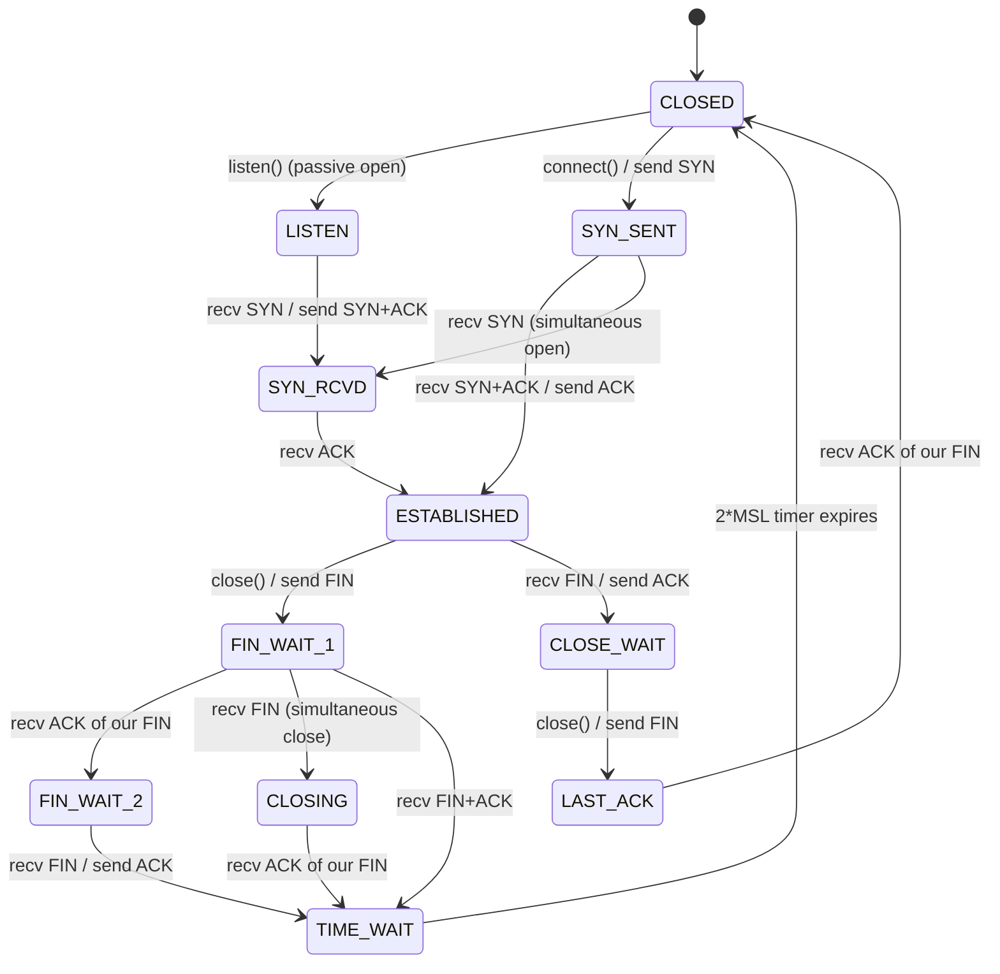
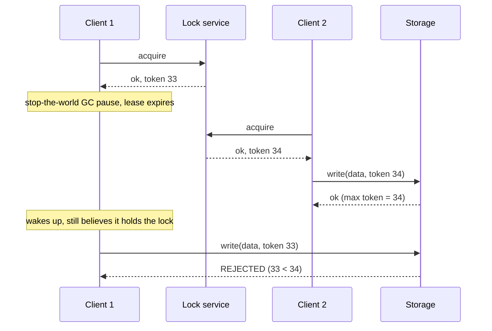

# CS Fundamentals -- Comprehensive Interview Reference

> An interview-focused reference covering essential Computer Science topics beyond data structures and algorithms. Each section includes key concepts, quick-reference tables, and common interview questions with detailed answers. Complements the *DSA Fundamentals* and *LeetCode Patterns* guides.

---

## Table of Contents

1. [Operating Systems](#1-operating-systems)
   - [1.1 Processes and Threads](#11-processes-and-threads) · [1.2 CPU Scheduling](#12-cpu-scheduling) · [1.3 Memory Management](#13-memory-management) · [1.4 Deadlocks](#14-deadlocks) · [1.5 File Systems](#15-file-systems) · [1.6 IPC](#16-inter-process-communication-ipc) · [1.7 System Calls](#17-system-calls) · [1.8 I/O Systems](#18-io-systems)
   - [1.9 Linux Process Lifecycle, Signals, and File Descriptors](#19-linux-process-lifecycle-signals-and-file-descriptors)
   - [1.10 I/O Multiplexing and Event-Driven Servers](#110-io-multiplexing-and-event-driven-servers)
   - [1.11 Linux Memory Management Internals](#111-linux-memory-management-internals)
   - [1.12 The Linux Scheduler](#112-the-linux-scheduler)
   - [1.13 Containers and Virtualization: Isolation Theory](#113-containers-and-virtualization-isolation-theory)
   - [1.14 Operating Systems -- Interview Questions](#114-operating-systems----interview-questions)
2. [Computer Networks](#2-computer-networks)
   - [2.1 OSI and TCP/IP](#21-osi-model-and-tcpip-model) · [2.2 TCP vs UDP](#22-tcp-vs-udp) · [2.3 HTTP/HTTPS](#23-http--https) · [2.4 DNS](#24-dns-domain-name-system) · [2.5 IP Addressing](#25-ip-addressing) · [2.6 Routing](#26-routing) · [2.7 Application Layer](#27-application-layer-protocols) · [2.8 TLS Handshake](#28-tlsssl-handshake)
   - [2.9 TCP Internals Deep Dive](#29-tcp-internals-deep-dive) (state machine, CLOSE_WAIT/TIME_WAIT, flow vs congestion control, CUBIC/BBR, Nagle, HOL blocking, SYN cookies)
   - [2.10 HPC and Datacenter Interconnects](#210-hpc-and-datacenter-interconnects) (RDMA, InfiniBand/RoCE, PCIe, NVLink, Infinity Fabric/xGMI)
   - [2.11 Computer Networks -- Interview Questions](#211-computer-networks----interview-questions)
3. [Database Systems](#3-database-systems)
   - [3.1 Relational Concepts](#31-relational-database-concepts) · [3.2 SQL Essentials](#32-sql-essentials) · [3.3 Normalization](#33-normalization) · [3.4 Indexing](#34-indexing) · [3.5 Transactions and ACID](#35-transactions-and-acid) · [3.6 NoSQL](#36-nosql-databases) · [3.7 CAP and PACELC](#37-cap-theorem-and-pacelc) · [3.8 Sharding and Replication](#38-sharding-replication-and-partitioning)
   - [3.9 Storage Engine Internals](#39-storage-engine-internals) (B+ trees, LSM trees, compaction, Bloom filters, WAL and ARIES recovery)
   - [3.10 Concurrency Control in Depth](#310-concurrency-control-in-depth) (2PL, MVCC, snapshot isolation, write skew, SSI, FOR UPDATE, version columns)
   - [3.11 Database Systems -- Interview Questions](#311-database-systems----interview-questions)
4. [Object-Oriented Programming and Design Patterns](#4-object-oriented-programming-and-design-patterns)
   - [4.1 Four Pillars](#41-four-pillars-of-oop) · [4.2 SOLID](#42-solid-principles) · [4.3 Design Patterns at a Glance](#43-design-patterns-at-a-glance) · [4.4 Composition vs Inheritance](#44-composition-vs-inheritance) · [4.5 Coupling and Cohesion](#45-coupling-and-cohesion) · [4.6 Interview Questions](#46-oop--design-patterns----interview-questions)
5. [System Design](#5-system-design)
   - [5.1 Scalability](#51-scalability) · [5.2 Load Balancing](#52-load-balancing) · [5.3 Caching](#53-caching) · [5.4 CDN](#54-content-delivery-network-cdn) · [5.5 Message Queues](#55-message-queues) · [5.6 Microservices](#56-microservices-vs-monolith) · [5.7 API Design](#57-api-design) · [5.8 Consistent Hashing](#58-consistent-hashing) · [5.9 Estimation](#59-back-of-the-envelope-estimation)
   - [5.10 Observability and Production Debugging](#510-observability-and-production-debugging) (metrics/logs/traces, USE/RED, SLOs and error budgets, debugging scenarios)
   - [5.11 System Design -- Interview Questions](#511-system-design----interview-questions)
6. [Concurrency and Multithreading](#6-concurrency-and-multithreading)
   - [6.1 Threads vs Processes](#61-threads-vs-processes) (+ [Python/GIL mapping](#how-the-model-maps-onto-python-cpython)) · [6.2 Synchronization Primitives](#62-synchronization-primitives) · [6.3 Race Conditions](#63-race-conditions-and-critical-sections) · [6.4 Deadlock, Livelock, Starvation](#64-deadlock-livelock-and-starvation) · [6.5 Classic Problems](#65-classic-concurrency-problems) · [6.6 Thread Pools](#66-thread-pools-and-executors) · [6.7 Async/Await](#67-asyncawait-and-event-loops) (+ [asyncio mapping](#python-asyncio-mapping-the-concepts)) · [6.8 Lock-Free](#68-lock-free-and-wait-free-data-structures)
   - [6.9 Memory Models and Visibility](#69-memory-models-and-visibility) (litmus tests, x86-TSO vs ARM, fences)
   - [6.10 Lock Implementation Internals](#610-lock-implementation-internals) (spinlocks, futexes, Peterson, priority inversion)
   - [6.11 Concurrency and Multithreading -- Interview Questions](#611-concurrency-and-multithreading----interview-questions)
7. [Computer Architecture](#7-computer-architecture)
   - [7.1 CPU Basics](#71-cpu-basics) · [7.2 ISA](#72-instruction-set-architecture-isa) · [7.3 Pipelining](#73-pipelining) · [7.4 Memory Hierarchy](#74-memory-hierarchy) · [7.5 Cache](#75-cache) · [7.6 Virtual Memory](#76-virtual-memory) · [7.7 Storage](#77-storage) · [7.8 Parallelism](#78-parallelism) · [7.9 Endianness and Floating Point](#79-endianness-and-floating-point)
   - [7.10 Out-of-Order Superscalar Microarchitecture](#710-out-of-order-superscalar-microarchitecture) (ROB, renaming, Tomasulo, branch prediction, MLP, SMT, Spectre/Meltdown)
   - [7.11 Computer Architecture -- Interview Questions](#711-computer-architecture----interview-questions)
8. [Distributed Systems](#8-distributed-systems)
   - [8.1 Consistency Models](#81-consistency-models) · [8.2 Consensus](#82-consensus-algorithms) · [8.3 Replication](#83-replication-strategies) · [8.4 Partitioning](#84-partitioning--sharding) · [8.5 Distributed Transactions](#85-distributed-transactions) · [8.6 Clocks](#86-clock-synchronization-and-ordering) · [8.7 Failure Detection](#87-failure-detection) · [8.8 MapReduce](#88-mapreduce) · [8.9 Gossip](#89-gossip-protocol) · [8.10 Resilience](#810-resilience-patterns) · [8.11 Key Systems](#811-key-distributed-systems)
   - [8.12 Consensus Theory and Raft in Depth](#812-consensus-theory-and-raft-in-depth) (FLP, failure models, quorum math, PBFT, Raft elections and log repair)
   - [8.13 Consistency Guarantees, Split Brain, Leases, and Fencing](#813-consistency-guarantees-split-brain-leases-and-fencing)
   - [8.14 Distributed Systems -- Interview Questions](#814-distributed-systems----interview-questions)
9. [Security](#9-security)
   - [9.1 Symmetric vs Asymmetric](#91-symmetric-vs-asymmetric-encryption) · [9.2 Hashing](#92-hashing) · [9.3 TLS/SSL](#93-tlsssl) · [9.4 Authentication](#94-authentication) · [9.5 Authorization](#95-authorization) · [9.6 OWASP Top 10](#96-common-vulnerabilities-owasp-top-10) · [9.7 CORS](#97-cors-cross-origin-resource-sharing) · [9.8 PKI](#98-public-key-infrastructure-pki) · [9.9 API Security](#99-api-security) · [9.10 Secure Coding](#910-secure-coding-practices)
   - [9.11 Systems and Memory-Safety Security](#911-systems-and-memory-safety-security) (stack/heap overflow, use-after-free, double free, format strings, ROP; canaries, ASLR, NX, RELRO, CFI, CET; privilege separation, capabilities, seccomp)
   - [9.12 Security -- Interview Questions](#912-security----interview-questions)

---

# 1. Operating Systems

---

## 1.1 Processes and Threads

### Processes

A **process** is an instance of a program in execution. The OS maintains a **Process Control Block (PCB)** for each process containing:

| PCB Field | Description |
|---|---|
| Process ID (PID) | Unique integer identifier |
| Process State | New, Ready, Running, Waiting, Terminated |
| Program Counter | Address of the next instruction to execute |
| CPU Registers | Saved register values for context switching |
| Memory Info | Page tables, segment tables, base/limit registers |
| I/O Status | List of open files, allocated I/O devices |
| Scheduling Info | Priority, scheduling queue pointers, CPU time used |

**Process states and transitions:**

```
                  ┌──────────────────────┐
                  │                      │
    ┌─────┐   admitted   ┌───────┐  scheduler   ┌─────────┐
    │ New │──────────────▶│ Ready │─────────────▶│ Running │
    └─────┘               └───────┘              └─────────┘
                              ▲                    │     │
                              │   I/O or event     │     │  exit
                              │   completion       │     │
                          ┌─────────┐              │  ┌────────────┐
                          │ Waiting │◀─────────────┘  │ Terminated │
                          └─────────┘  I/O or event   └────────────┘
                                         wait
```

### Threads

A **thread** (lightweight process) is the smallest unit of CPU execution. Threads within the same process share the code section, data section, heap, and open files, but each has its own:

- Thread ID
- Program counter
- Register set
- Stack

### Process vs Thread Comparison

| Aspect | Process | Thread |
|---|---|---|
| Memory | Separate address space | Shared address space within process |
| Creation cost | High (fork + copy page tables) | Low (share existing address space) |
| Context switch cost | Expensive (flush TLB, swap page tables) | Cheap (same address space, swap registers + stack) |
| Communication | IPC required (pipes, sockets, shared memory) | Direct shared memory access |
| Isolation | Full isolation; crash in one does not affect others | No isolation; a crash kills all threads in the process |
| Overhead | Higher memory overhead | Lower memory overhead |

### User-Level vs Kernel-Level Threads

| Aspect | User-Level Threads | Kernel-Level Threads |
|---|---|---|
| Management | Thread library in user space | OS kernel |
| Context switch | Fast (no kernel involvement) | Slower (kernel trap required) |
| Scheduling | Application-controlled | OS scheduler |
| Blocking | One thread blocks → all threads block (many-to-one) | Only the blocking thread is suspended |
| Multicore utilization | Cannot run on multiple cores (many-to-one) | Can run on multiple cores |

**Threading models:** Many-to-One, One-to-One (Linux, Windows), Many-to-Many (Solaris).

---

## 1.2 CPU Scheduling

The **CPU scheduler** selects a process from the ready queue and allocates the CPU to it. Scheduling decisions occur when a process:

1. Switches from running to waiting (I/O request) -- *non-preemptive*
2. Switches from running to ready (interrupt) -- *preemptive*
3. Switches from waiting to ready (I/O completion) -- *preemptive*
4. Terminates -- *non-preemptive*

### Scheduling Criteria

| Metric | Goal |
|---|---|
| **CPU Utilization** | Keep the CPU as busy as possible (target 40-90%) |
| **Throughput** | Maximize processes completed per time unit |
| **Turnaround Time** | Minimize total time from submission to completion |
| **Waiting Time** | Minimize time spent in the ready queue |
| **Response Time** | Minimize time from submission to first response (interactive systems) |

### Scheduling Algorithms

| Algorithm | Type | Description | Pros | Cons |
|---|---|---|---|---|
| **FCFS** | Non-preemptive | First-Come, First-Served | Simple, fair | Convoy effect: short jobs wait behind long ones |
| **SJF** | Non-preemptive | Shortest Job First | Optimal average waiting time | Requires knowing burst time; starvation of long jobs |
| **SRTF** | Preemptive | Shortest Remaining Time First (preemptive SJF) | Better avg waiting time than SJF | Starvation; high overhead |
| **Round Robin** | Preemptive | Fixed time quantum, rotate | Fair, good response time | High context-switch overhead if quantum too small |
| **Priority** | Either | Higher-priority jobs first | Supports urgency levels | Starvation (solved with **aging**) |
| **MLFQ** | Preemptive | Multiple queues with different priorities and quanta | Adapts to job behavior | Complex to tune |

**Round Robin time quantum tradeoff:**
- Too small → excessive context switching overhead
- Too large → degrades to FCFS
- Rule of thumb: 80% of CPU bursts should be shorter than the quantum

**Multilevel Feedback Queue (MLFQ) rules:**
1. If Priority(A) > Priority(B), A runs.
2. If Priority(A) = Priority(B), run in Round Robin.
3. New jobs start at the highest priority.
4. If a job uses its entire time slice, move it down one level.
5. If a job gives up the CPU before the time slice expires, it stays at the same level.
6. Periodically boost all jobs to the highest priority (prevents starvation).

> How Linux actually schedules (CFS, EEVDF, nice weights, real-time classes, affinity) is covered in [1.12 The Linux Scheduler](#112-the-linux-scheduler).

---

## 1.3 Memory Management

### Contiguous Allocation

The simplest scheme: each process gets a contiguous block of memory. Suffers from **external fragmentation** (free memory scattered in small chunks). Mitigated by **compaction** (expensive).

### Paging

Divides physical memory into fixed-size **frames** and logical memory into same-size **pages** (typically 4 KB). A **page table** maps each page to a frame.

```
Logical Address:  [ Page Number | Page Offset ]
                       ↓
                  Page Table
                       ↓
Physical Address: [ Frame Number | Page Offset ]
```

- Eliminates external fragmentation
- Introduces internal fragmentation (last page may not be full, wastes up to page_size - 1 bytes)
- Page table itself can be large → use **multi-level page tables** or **inverted page tables**

### Translation Lookaside Buffer (TLB)

A small, fast hardware cache of recent page-table entries. Without TLB, every memory access requires two memory accesses (page table + actual data). TLB hit rates of 99%+ are typical.

**Effective Access Time (EAT):**

```
EAT = hit_rate × (TLB_access + memory_access) + (1 - hit_rate) × (TLB_access + 2 × memory_access)
```

### Virtual Memory and Demand Paging

Not all pages need to be in physical memory at once. Pages are loaded on demand (when a **page fault** occurs). The OS keeps a **valid/invalid bit** in each page-table entry.

**Page fault handling:**
1. CPU generates a page fault trap to the OS
2. OS checks if the reference is valid; if not, terminate the process
3. Find a free frame (or evict one using a replacement algorithm)
4. Schedule a disk read to bring the page into the frame
5. Update the page table entry
6. Restart the instruction that caused the page fault

### Page Replacement Algorithms

| Algorithm | Description | Optimal? | Notes |
|---|---|---|---|
| **FIFO** | Replace the oldest page | No | Simple; suffers from Belady's anomaly |
| **Optimal (OPT)** | Replace the page that will not be used for the longest time | Yes | Not implementable (requires future knowledge); used as benchmark |
| **LRU** | Replace the least recently used page | No (but good) | Good approximation of OPT; expensive to implement exactly |
| **Clock (Second Chance)** | FIFO with a reference bit; skip pages with bit=1, clear bit | No | Practical approximation of LRU |
| **LFU** | Replace the least frequently used page | No | Counts accesses; can keep stale popular pages |

**Belady's Anomaly:** With FIFO, increasing the number of frames can paradoxically increase page faults. LRU and OPT are immune (they are **stack algorithms**).

**Thrashing:** When a process does not have enough frames, it spends more time paging than executing. The working-set model prevents thrashing by tracking the set of pages a process actively uses.

### Segmentation

Divides memory into variable-size **segments** corresponding to logical units (code, stack, heap, data). Each segment has a base address and a limit. Supports the programmer's view of memory but suffers from external fragmentation.

Modern systems use **segmentation with paging** (e.g., x86 historically) or pure paging (most modern 64-bit OSes).

> For the Linux-specific layer (page cache, `mmap` semantics, `fsync`, huge pages, NUMA, `malloc` internals, buddy/slab allocators, OOM killer), see [1.11 Linux Memory Management Internals](#111-linux-memory-management-internals).

---

## 1.4 Deadlocks

A **deadlock** occurs when a set of processes are each waiting for a resource held by another process in the set, forming a circular wait.

### Coffman Conditions (all four must hold simultaneously)

| Condition | Description |
|---|---|
| **Mutual Exclusion** | At least one resource is held in a non-sharable mode |
| **Hold and Wait** | A process holds at least one resource while waiting for additional resources |
| **No Preemption** | Resources cannot be forcibly taken from a process |
| **Circular Wait** | A circular chain of processes exists where each waits for a resource held by the next |

### Handling Strategies

| Strategy | Approach | Example |
|---|---|---|
| **Prevention** | Ensure at least one Coffman condition cannot hold | Impose total ordering on resources (breaks circular wait) |
| **Avoidance** | Dynamically check if granting a request is safe | Banker's Algorithm |
| **Detection + Recovery** | Allow deadlocks, detect them, then recover | Resource-allocation graph; kill processes or preempt resources |
| **Ignore** | Assume deadlocks are rare enough to not handle | The "Ostrich Algorithm" (used by most general-purpose OSes) |

### Banker's Algorithm (Avoidance)

Maintains matrices of **Available**, **Max**, **Allocation**, and **Need** (Need = Max - Allocation). Before granting a request, the algorithm checks if the resulting state is **safe** -- meaning there exists at least one sequence of process completions that allows all processes to finish.

A state is **safe** if for every process P_i, the resources P_i still needs can be satisfied by the currently available resources plus resources held by all P_j with j < i in the safe sequence.

---

## 1.5 File Systems

### Key Concepts

| Concept | Description |
|---|---|
| **File** | A named collection of related data stored on secondary storage |
| **Directory** | A file that contains a list of (name, metadata pointer) entries |
| **inode** (Unix) | Data structure storing file metadata (permissions, size, timestamps, pointers to data blocks) |
| **Superblock** | Stores metadata about the filesystem itself (size, block size, free block count) |

### Allocation Methods

| Method | Description | Pros | Cons |
|---|---|---|---|
| **Contiguous** | Each file occupies contiguous blocks | Fast sequential and random access | External fragmentation; file size must be known |
| **Linked** | Each block contains a pointer to the next | No external fragmentation | Slow random access; pointer overhead; reliability issues |
| **Indexed (inode)** | An index block holds pointers to all data blocks | Good random access; no fragmentation | Index block overhead; limited by index block size (use multi-level) |

### Journaling

A **journal** (log) records intended changes before applying them to the filesystem. If the system crashes, the journal is replayed to restore consistency. Modes:

- **Write-ahead logging:** Log both metadata and data changes
- **Ordered mode (ext4 default):** Log metadata; ensure data is written before metadata commit
- **Writeback mode:** Log metadata only; fastest but data can be inconsistent after crash

---

## 1.6 Inter-Process Communication (IPC)

| Mechanism | Description | Use Case |
|---|---|---|
| **Pipe** | Unidirectional byte stream between related processes | Parent-child communication (`ls \| grep`) |
| **Named Pipe (FIFO)** | Like pipe but has a filesystem name; unrelated processes can use it | Communication between independent processes |
| **Message Queue** | Kernel-maintained queue of messages with types | Structured message passing with priority |
| **Shared Memory** | Region of memory mapped into multiple processes' address spaces | High-throughput data sharing (fastest IPC) |
| **Semaphore** | Integer counter for synchronization | Controlling concurrent access to shared resources |
| **Socket** | Bidirectional communication endpoint (local or networked) | Client-server communication, networked IPC |
| **Signal** | Asynchronous notification sent to a process | Interrupt handling (SIGINT, SIGKILL, SIGTERM) |
| **Memory-Mapped File** | File mapped into address space; changes reflected in file | Shared configuration, database engines |

---

## 1.7 System Calls

| System Call | Purpose | Example |
|---|---|---|
| `fork()` | Create a new process (child is a copy of parent) | Returns 0 in child, child PID in parent |
| `exec()` | Replace the current process image with a new program | `execvp("ls", args)` |
| `wait()` | Parent blocks until child terminates | Prevents zombie processes |
| `exit()` | Terminate the calling process | Frees resources, sends SIGCHLD to parent |
| `open()` / `close()` | Open / close a file descriptor | `int fd = open("file.txt", O_RDONLY)` |
| `read()` / `write()` | Read / write bytes from/to a file descriptor | `read(fd, buf, count)` |
| `mmap()` | Map a file or device into memory | Memory-mapped I/O, shared memory |
| `pipe()` | Create a unidirectional data channel | `int pipefd[2]; pipe(pipefd);` |
| `dup2()` | Duplicate a file descriptor to a specific number | Redirect stdin/stdout |
| `kill()` | Send a signal to a process | `kill(pid, SIGTERM)` |

**`fork()` + `exec()` pattern (Unix process creation):**

```
Parent calls fork()
├── Parent (fork returns child PID)
│   └── wait() for child
└── Child (fork returns 0)
    └── exec() replaces child with new program
        └── Program runs
            └── exit() → parent's wait() returns
```

> Copy-on-write, what survives `exec`, fd inheritance, zombies/orphans, and signal handling are covered in [1.9 Linux Process Lifecycle, Signals, and File Descriptors](#19-linux-process-lifecycle-signals-and-file-descriptors).

---

## 1.8 I/O Systems

### I/O Methods

| Method | Description | CPU Involvement |
|---|---|---|
| **Programmed I/O (Polling)** | CPU repeatedly checks device status register | High (busy-waiting) |
| **Interrupt-Driven I/O** | Device interrupts CPU when ready | Medium (interrupt handling overhead) |
| **DMA (Direct Memory Access)** | DMA controller transfers data directly to/from memory | Low (CPU only sets up transfer and gets notified on completion) |

### Buffering

- **Single buffer:** OS assigns a kernel buffer for I/O; while device fills buffer, CPU processes previous buffer
- **Double buffer:** Two buffers alternate roles, overlapping I/O and computation
- **Circular buffer:** Ring of buffers for producer-consumer scenarios

> For how servers multiplex thousands of sockets on top of these mechanisms (non-blocking fds, `select`/`poll`/`epoll`, `io_uring`), see [1.10 I/O Multiplexing and Event-Driven Servers](#110-io-multiplexing-and-event-driven-servers).

---

## 1.9 Linux Process Lifecycle, Signals, and File Descriptors

This section goes deeper than the system-call table in 1.7. These are standard follow-ups in systems interviews, and they come up often in profiler and tooling work: launching a target process, injecting via `LD_PRELOAD`, sampling with signals, and reading `/proc`.

### User Mode, Kernel Mode, and the Cost of a System Call

| Concept | What it means |
|---|---|
| **User mode (ring 3)** | Unprivileged. Code cannot touch page tables, I/O ports, or other processes' memory directly. |
| **Kernel mode (ring 0)** | Privileged. Entered only through a **system call** (`syscall` instruction on x86-64), an **exception** (page fault, divide by zero), or an **interrupt** (timer, NIC, GPU). |
| **System call cost** | The mode switch is roughly 50-100 ns on modern x86 when the call does almost nothing (e.g. `getppid`). Spectre/Meltdown mitigations such as KPTI can multiply this (see [7.10](#710-out-of-order-superscalar-microarchitecture)). Real calls add their own work on top. |
| **vDSO** | A small shared library the kernel maps into every process. Hot read-only calls such as `clock_gettime` and `gettimeofday` run entirely in user mode through it. This is why timestamps in a tracer are cheap but `read()` is not. |

### `fork()` and Copy-on-Write (COW)

`fork()` does **not** copy the parent's memory. The kernel:

1. Duplicates the process descriptor (`task_struct`), the **file-descriptor table**, signal dispositions, and the **page tables**, but not the pages themselves.
2. Marks every private writable page **read-only** in *both* parent and child, and bumps each physical page's reference count.
3. When either process **writes** to such a page, a page fault fires. The kernel allocates a new frame, copies the 4 KB, maps it writable for the writer, and returns. Pages that are only read stay shared forever.

```text
Before write:   parent PTE ─┐
                            ├──► frame F (read-only, refcount 2)
                child  PTE ─┘

After child writes:  parent PTE ──► frame F  (refcount 1, writable again on next fault)
                     child  PTE ──► frame F' (private copy)
```

**Worked numbers:** A process with 10 GB resident in 4 KB pages has about 2.6 M page-table entries (10 GB / 4 KB). At 8 bytes each that is roughly 20 MB of page tables to copy, so `fork()` alone can take tens of milliseconds. That is why `posix_spawn()`, `vfork()`, and `clone(CLONE_VM | CLONE_VFORK)` exist. They let the child `exec` without copying the parent's page tables.

**COW in practice:**
- **Redis `BGSAVE`** forks and the child writes a snapshot while the parent keeps serving writes. Every page the parent dirties gets copied, so a write-heavy instance can briefly need up to about 2x memory. With **Transparent Huge Pages** each COW fault copies 2 MB instead of 4 KB, which is why Redis warns you to disable THP (see [1.11](#111-linux-memory-management-internals)).
- **Python `multiprocessing` with the `fork` start method** shares read-only data cheaply at first. CPython's reference counting writes to every object header it touches, though, which gradually un-shares those pages.

**`fork()` in a multithreaded program:** only the calling thread is duplicated in the child. Any mutex held by another thread at the moment of the fork, including the `malloc` arena lock or a logging lock, stays **locked forever** in the child. POSIX therefore says that between `fork()` and `exec()` a multithreaded program's child may only call **async-signal-safe** functions.

### `exec()` -- What Survives and What Is Reset

| Attribute | Across `fork()` (child gets...) | Across `execve()` |
|---|---|---|
| Memory (text, heap, stack, mmaps) | COW copy | **Replaced** by the new program image |
| PID / PPID | New PID; PPID = parent | **Kept** (exec does not create a process) |
| File descriptors | Copied table that **shares open file descriptions** | **Kept**, except fds marked `FD_CLOEXEC` / `O_CLOEXEC` |
| Signal handlers | Copied | **Reset to default** (the handler code is gone). Ignored signals stay ignored. |
| Signal mask / pending signals | Mask copied; pending set **cleared** | Mask and pending set **kept** |
| Threads | Only the calling thread | All other threads destroyed |
| cwd, umask, rlimits, uid/gid | Copied | Kept (set-uid binaries may change euid) |
| `mmap`/`shm` attachments, timers, locks (`fcntl`) | Mappings copied; `fcntl` record locks **not** inherited | Mappings discarded |

**Why `O_CLOEXEC` matters:** without it, a server that `fork`+`exec`s a helper leaks every open socket and file into the helper. The listening port can then stay bound after the server dies. The flag must be set atomically at `open`/`socket`/`accept4` time. Setting it later with `fcntl` races against a `fork` in another thread.

### The File-Descriptor Table (Three Levels)

```text
 Process A fd table          Open file table (kernel)              inode / vnode
 ┌────┬──────────┐          ┌───────────────────────────┐        ┌──────────────┐
 │ 0  │ ─────────┼────────► │ offset=120, flags=O_RDWR  │ ─────► │ /var/log/app │
 │ 1  │ ─────────┼────┐     └───────────────────────────┘        └──────────────┘
 │ 3  │ ─────────┼──┐ │     ┌───────────────────────────┐              ▲
 └────┴──────────┘  │ └───► │ offset=0, /dev/pts/0      │              │
                    │       └───────────────────────────┘              │
 Process B (child)  │       ┌───────────────────────────┐              │
 fd 3 ──────────────┴─────► │ offset=4096, O_APPEND     │ ─────────────┘
                            └───────────────────────────┘
```

- **fd table** (per process): small integers mapped to pointers. `dup`/`dup2` and `fork` create new entries that point at the **same open file description**.
- **Open file description** (shared): holds the **file offset**, status flags (`O_APPEND`, `O_NONBLOCK`), and access mode. After `fork`, parent and child **share the offset**, so their writes interleave instead of overwriting each other. A separate `open()` of the same path creates a new description with its own offset.
- **inode**: the file itself (size, permissions, data blocks).

**How the shell implements `cmd > out.txt 2>&1`:** `fork()`. In the child: `fd = open("out.txt", O_WRONLY|O_CREAT|O_TRUNC)`, `dup2(fd, 1)`, `dup2(1, 2)`, `close(fd)`, then `execvp(cmd)`. The new program simply writes to fd 1 and never learns about the redirect.

### Zombies, Orphans, and Reaping

| State | What it is | Cost | Fix |
|---|---|---|---|
| **Zombie** (`Z` in `ps`) | The child has exited but the parent has not called `wait`/`waitpid`. The kernel keeps the PID and exit status so the parent can collect them. | One process-table slot and a PID. It holds no memory or fds, but thousands of zombies can exhaust `pid_max`. | The **parent** must reap. Calling `kill -9` on a zombie does nothing because it is already dead. Fix or kill the parent instead. |
| **Orphan** | The parent exited first. | None | The kernel reparents the child to **PID 1** (or to the nearest ancestor marked with `prctl(PR_SET_CHILD_SUBREAPER)`), and that process reaps it. |

Reaping patterns:
1. Call `waitpid(pid, &status, 0)` synchronously, then decode the result with `WIFEXITED`/`WEXITSTATUS`/`WIFSIGNALED`/`WTERMSIG`.
2. Use a `SIGCHLD` handler that loops `while (waitpid(-1, NULL, WNOHANG) > 0)`. It must loop because standard signals **coalesce**: two children exiting can produce only one `SIGCHLD`.
3. Set `SIGCHLD` to `SIG_IGN`. POSIX.1-2001 then auto-reaps children, but you lose their exit status.
4. **Double fork** (classic daemonization): the grandchild is orphaned and reaped by init.

**Containers and PID 1:** inside a PID namespace your entrypoint *is* PID 1. It must reap orphans, otherwise zombies accumulate. It also does **not** get default signal actions: the kernel delivers `SIGTERM` to a namespace's init only if it has installed a handler. A naive `CMD ["python", "app.py"]` therefore ignores `docker stop` and gets `SIGKILL`ed after the 10 s grace period. Fix it with `docker run --init` (tini) or a real init. See [1.13](#113-containers-and-virtualization-isolation-theory).

### Signals

| Signal | No. (x86 Linux) | Default action | Typical source |
|---|---|---|---|
| `SIGHUP` | 1 | Terminate | Terminal hangup; by convention "reload config" for daemons |
| `SIGINT` | 2 | Terminate | Ctrl-C |
| `SIGABRT` | 6 | Core dump | `abort()`, failed `assert` |
| `SIGKILL` | 9 | Terminate (**cannot be caught, blocked, or ignored**) | `kill -9`, OOM killer |
| `SIGSEGV` | 11 | Core dump | Invalid memory access |
| `SIGPIPE` | 13 | Terminate | Write to a pipe or socket whose reader has closed |
| `SIGTERM` | 15 | Terminate | Polite shutdown request (`kill`, `docker stop`, Kubernetes) |
| `SIGCHLD` | 17 | Ignore | A child stopped or exited |
| `SIGSTOP` / `SIGCONT` | 19 / 18 | Stop / continue (`SIGSTOP` cannot be caught) | Debuggers, job control |
| `SIGPROF` / `SIGALRM` | 27 / 14 | Terminate | `setitimer` timers; sampling profilers (e.g. gperftools) use `SIGPROF` |

**Kernel bookkeeping per signal:** a *disposition* (default, ignore, or handler) is shared by the whole process. A *mask* (blocked set) is kept **per thread**. A *pending* set exists both per thread and per process. A process-directed signal is delivered to **any one thread** that does not block it. Standard signals do not queue: if one is already pending, a second identical one is dropped. Real-time signals (`SIGRTMIN`..`SIGRTMAX`) do queue and carry a payload.

**Use `sigaction`, not `signal`:** `signal()` semantics differ across Unixes. System V resets the handler after each delivery, while BSD and glibc do not. `sigaction` makes the following explicit:
- `sa_mask`: extra signals blocked while the handler runs
- `SA_RESTART`: auto-restart "slow" syscalls such as `read` on a socket instead of failing with `EINTR`
- `SA_SIGINFO`: a richer handler that receives the sender PID and the faulting address
- `SA_NOCLDSTOP`, `SA_ONSTACK` (run on an alternate stack, needed to handle stack-overflow `SIGSEGV`)

**Async-signal-safety:** a handler can interrupt the program **between any two instructions**, including in the middle of `malloc` while it holds the arena lock. If the handler then calls `printf`, which may call `malloc`, the thread deadlocks against itself. Only functions listed in `man 7 signal-safety` may be called from a handler. That list includes `write`, `_exit`, `read`, `kill`, `sigaction`, `waitpid`, and `clock_gettime`. It does **not** include `printf`, `malloc`/`new`, `std::cout`, mutexes, or `exit` (which runs `atexit` handlers and flushes stdio).

Safe designs:
1. Set a `volatile sig_atomic_t` flag (or a lock-free `std::atomic<int>`) in the handler and check it in the main loop.
2. **Self-pipe trick**: the handler `write()`s one byte to a non-blocking pipe that the event loop polls.
3. **`signalfd`** (Linux): block the signals and read them as data from an fd that plugs into `epoll`.
4. A dedicated thread calling `sigwait()` with the signals blocked in every other thread.

**Profiler connection:** a sampling profiler built on `SIGPROF` has to walk the interrupted thread's stack *inside the handler*. That code must be async-signal-safe: no `malloc`, no `dladdr` with locks. It is why such profilers pre-allocate ring buffers and use frame pointers or carefully written unwinders. Writing a server? Ignore `SIGPIPE` (or send with `MSG_NOSIGNAL`) and handle `EPIPE`, otherwise a disconnecting client kills your process.

```cpp
// fork_cow.cpp -- copy-on-write, shared file offsets, zombie reaping.
// Build: g++ -std=c++17 -O2 fork_cow.cpp -o fork_cow
#include <cerrno>
#include <cstdio>
#include <fcntl.h>
#include <signal.h>
#include <sys/wait.h>
#include <unistd.h>

static volatile sig_atomic_t g_children_exited = 0;

// Async-signal-safe handler: only touches a sig_atomic_t and calls waitpid().
static void on_sigchld(int) {
    int saved_errno = errno;              // waitpid may clobber errno
    while (waitpid(-1, nullptr, WNOHANG) > 0) {
        g_children_exited = g_children_exited + 1;
    }
    errno = saved_errno;
}

int main() {
    struct sigaction sa {};
    sa.sa_handler = on_sigchld;
    sigemptyset(&sa.sa_mask);
    sa.sa_flags = SA_RESTART | SA_NOCLDSTOP;   // restart slow syscalls, ignore stops
    sigaction(SIGCHLD, &sa, nullptr);

    int value = 42;                            // will be COW-copied on write
    int fd = open("/tmp/fork_cow_demo.txt", O_CREAT | O_TRUNC | O_WRONLY | O_CLOEXEC, 0644);

    pid_t pid = fork();
    if (pid < 0) { std::perror("fork"); return 1; }
    if (pid == 0) {                            // child
        value = 99;                            // write fault -> private copy of this page
        if (write(fd, "child\n", 6) < 0) _exit(1); // shares the open file description (offset)
        std::printf("child : value=%d at %p\n", value, static_cast<void*>(&value));
        std::fflush(stdout);                   // _exit() skips stdio flushing...
        _exit(0);                              // ...which avoids flushing inherited buffers twice
    }
    sleep(1);  // demo only; SIGCHLD may cut this short (sleep is never auto-restarted)
    if (write(fd, "parent\n", 7) < 0) return 1; // lands AFTER "child\n": offset is shared
    std::printf("parent: value=%d at %p (same virtual addr, different frame)\n",
                value, static_cast<void*>(&value));
    std::printf("children reaped by handler: %d\n", static_cast<int>(g_children_exited));
    close(fd);
    return 0;
}
```

```text
child : value=99 at 0x7ffebf364e8c
parent: value=42 at 0x7ffebf364e8c (same virtual addr, different frame)
children reaped by handler: 1
$ cat /tmp/fork_cow_demo.txt
child
parent
```

Two lessons hide in this program:
- **Same virtual address, different values.** The addresses are virtual. After the COW fault the two processes map that address to different physical frames.
- **The `fflush` before `_exit`.** If stdout is a pipe it is fully buffered. Without the flush, the child's line would be lost because `_exit` skips stdio cleanup. Calling `exit()` in a forked child instead would flush any data **inherited** from the parent's buffer, printing it twice.

### `/proc` and `/sys` -- The Kernel's Introspection Filesystems

Both are virtual filesystems with no on-disk storage. `procfs` is process-centric plus legacy tunables, while `sysfs` mirrors the kernel's device/driver object model (one value per file). Tools such as `ps`, `top`, `free`, `lsof`, `numactl --hardware`, `rocm-smi`, and `rocminfo` are mostly parsers of these files.

| Path | What you learn | Interview use |
|---|---|---|
| `/proc/<pid>/status` | `VmRSS`, `VmHWM` (peak RSS), `Threads`, `voluntary_ctxt_switches` / `nonvoluntary_ctxt_switches` | "Is it blocking (voluntary) or being preempted (nonvoluntary)?" |
| `/proc/<pid>/maps`, `smaps_rollup` | Every VMA (heap, stack, `.so` files, anon mmaps); RSS vs **PSS** (shared pages divided among sharers) | Memory accounting, finding which library is mapped |
| `/proc/<pid>/fd/`, `fdinfo/` | Open fds as symlinks; offsets and flags | fd leaks, "which file is this process writing?" |
| `/proc/<pid>/stack`, `wchan` | Kernel stack / wait channel (root only) | Why a process is stuck in `D` (uninterruptible) state |
| `/proc/<pid>/limits`, `environ`, `cmdline` | rlimits (e.g. `Max open files`), environment, argv | "Too many open files", checking `LD_PRELOAD` / `HIP_VISIBLE_DEVICES` |
| `/proc/<pid>/task/<tid>/` | Per-thread view of the above | Thread-level CPU and state |
| `/proc/meminfo`, `/proc/loadavg`, `/proc/pressure/{cpu,memory,io}` | System memory, load average, **PSI** (pressure stall information, 4.20+) | Saturation analysis |
| `/proc/sys/...` (= `sysctl`) | Tunables: `vm.overcommit_memory`, `vm.dirty_ratio`, `kernel.perf_event_paranoid` | Why `perf` is denied for non-root users (`perf_event_paranoid`) |
| `/sys/devices/system/cpu/`, `/sys/devices/system/node/` | Topology, frequency governors, SMT control, NUMA nodes and their CPUs | Benchmark setup |
| `/sys/kernel/mm/transparent_hugepage/enabled` | THP mode (`always` / `madvise` / `never`) | See 1.11 |
| `/sys/fs/cgroup/` | cgroup v2 hierarchy | Container limits (1.13) |
| `/sys/class/drm/card*/device/` | amdgpu driver attributes (e.g. `gpu_busy_percent`, `mem_info_vram_used`, `numa_node`) | What `rocm-smi`-style tools read |
| `/sys/class/kfd/kfd/topology/nodes/` | ROCm KFD topology: CPU and GPU agents and their properties | What `rocminfo` / the ROCr runtime enumerate |

> See also: [Linux Command Line](../tools/Linux_Command_Line.md) for `ps`/`lsof`/`strace` usage and [Debugging and Profiling Tools](../tools/Debugging_and_Profiling_Tools.md) for `gdb`, `perf`, and core dumps.

---

## 1.10 I/O Multiplexing and Event-Driven Servers

### Blocking vs Non-Blocking File Descriptors

| Mode | `read()` on a socket with no data | How to set |
|---|---|---|
| **Blocking** (default) | Thread sleeps until data, EOF, or error arrives | -- |
| **Non-blocking** | Returns `-1` immediately with `errno == EAGAIN` (== `EWOULDBLOCK` on Linux) | `fcntl(fd, F_SETFL, flags \| O_NONBLOCK)`, or `SOCK_NONBLOCK` with `socket`/`accept4` |

**Important nuance:** `O_NONBLOCK` has **no effect on regular files**. A `read()` that misses the page cache still blocks on the disk. `select`/`poll` report regular files as always ready, and `epoll_ctl` rejects them with `EPERM`. That is why libuv and Node.js run file I/O on a thread pool, and why `io_uring` (below) was a big deal.

### The Five Unix I/O Models

| Model | Waits for readiness | Waits for copy | Example |
|---|---|---|---|
| Blocking I/O | Blocks | Blocks | `read()` on a blocking socket |
| Non-blocking + busy polling | Spins on `EAGAIN` | Blocks (copy) | DPDK-style poll loops (kernel-bypass variant) |
| **I/O multiplexing (readiness)** | Blocks in `select`/`poll`/`epoll_wait` on *many* fds | Blocks (copy) | nginx, Redis, libevent, asyncio on Linux |
| Signal-driven | `SIGIO` notification | Blocks (copy) | Rare |
| **Asynchronous (completion)** | No | No: kernel does the I/O and notifies | `io_uring`, Windows IOCP, POSIX AIO |

The readiness model maps onto the **Reactor** pattern and the completion model onto **Proactor** (see [Design Patterns: Reactor](../design-patterns/Design_Patterns_Cpp.md#44-reactor)).

### The C10K Problem

Dan Kegel's 1999 question was how to serve 10,000 concurrent clients on one machine. **Thread-per-connection** hits several walls:
- **Stacks:** 10 K threads x 8 MB default stack is 80 GB of *virtual* address space. RSS is smaller because stacks are touched lazily, but still large, and each thread costs kernel memory.
- **Scheduler and context switches:** each costs microseconds plus cache and TLB pollution.
- **`select()` scans:** an O(n) scan of every fd on every call.

The fix was **one thread (or one per core) running an event loop** over non-blocking sockets, plus a kernel API whose cost scales with *ready* fds rather than *watched* fds. That API is `epoll` on Linux and `kqueue` on BSD/macOS. Today's version of the question is C10M, and its answers move the network stack itself out of the way: kernel bypass (DPDK, RDMA), `io_uring`, and `SO_REUSEPORT` sharding.

### `select` vs `poll` vs `epoll`

| Aspect | `select` | `poll` | `epoll` (Linux) |
|---|---|---|---|
| Interest set passed | Every call, as three bitmaps (`fd_set`) | Every call, as an array of `pollfd` | **Once**, via `epoll_ctl(ADD/MOD/DEL)`; kept in the kernel (red-black tree) |
| Max fds | `FD_SETSIZE` = **1024** (fd *values* >= 1024 overflow the bitmap: undefined behavior) | No fixed limit | No fixed limit |
| Cost per wait call | O(n) copy in + O(n) scan + O(n) user scan of results | O(n) copy + O(n) scan | **O(ready)**: the kernel appends fds to a ready list from wakeup callbacks |
| Rebuild after call | Yes: `fd_set` is modified in place | No (`revents` separate) | No |
| Trigger modes | Level only | Level only | Level (default) **and edge** (`EPOLLET`), plus `EPOLLONESHOT` and `EPOLLEXCLUSIVE` |
| Portability | POSIX everywhere | POSIX | Linux only (`kqueue` on BSD/macOS, IOCP on Windows) |
| Good for | Tiny fd counts, portability | Moderate fd counts, all mostly active | Many fds, few active at a time (the C10K shape) |

**Worked comparison:** 10,000 idle keep-alive connections and 10 active ones. `poll` copies and scans 10,000 entries per wakeup. `epoll_wait` returns 10 entries. When almost **all** fds are active every time, `epoll`'s advantage shrinks, and its `epoll_ctl` syscalls for frequently changing interest sets can make `poll` competitive.

### Level-Triggered vs Edge-Triggered

| | Level-triggered (LT, default) | Edge-triggered (ET, `EPOLLET`) |
|---|---|---|
| Fires when | The fd **is** ready, on every `epoll_wait` while data remains | The fd **becomes** ready (a new arrival changes the state) |
| You may read | As much as you like; leftover data re-triggers | **Must drain until `EAGAIN`**. Leftover data never re-triggers, so that connection silently hangs. |
| fd mode | Blocking fds work (dangerous) | **Must** be non-blocking, or the drain loop blocks the whole loop |
| Syscalls | More `epoll_wait` returns | Fewer wakeups; common in high-performance servers |
| Fairness pitfall | -- | A firehose connection drained "until `EAGAIN`" can starve others. Cap reads per turn and keep your own ready list. |

Write side: register `EPOLLOUT` **only** when `write` returned `EAGAIN` (send buffer full), and remove it once drained. A level-triggered `EPOLLOUT` on an idle socket is always ready and turns your loop into a 100% CPU busy-spin.

Multithreaded epoll:
- **`EPOLLONESHOT`**: after one event the fd is disabled until re-armed with `EPOLL_CTL_MOD`. This guarantees that only one worker handles a connection at a time.
- **`EPOLLEXCLUSIVE`** (Linux 4.5+): wakes only one of several epoll instances waiting on the same listening socket (thundering-herd fix).
- **`SO_REUSEPORT`**: an alternative where each thread gets its own listen socket and the kernel load-balances.

**Gotcha:** epoll registers the *open file description*, not the fd number. If you `dup()` an fd and close the original, the registration survives and events keep arriving with the old `data.fd`.

```cpp
// epoll_echo.cpp -- single-threaded, edge-triggered, non-blocking TCP echo server.
// Build: g++ -std=c++17 -O2 epoll_echo.cpp -o epoll_echo   Run: ./epoll_echo 9000
// Test:  printf 'hello\n' | nc -q1 localhost 9000
#include <arpa/inet.h>
#include <cerrno>
#include <cstdio>
#include <cstdlib>
#include <netinet/in.h>
#include <sys/epoll.h>
#include <sys/socket.h>
#include <unistd.h>

int main(int argc, char** argv) {
    int port = argc > 1 ? std::atoi(argv[1]) : 9000;
    int lfd = socket(AF_INET, SOCK_STREAM | SOCK_NONBLOCK | SOCK_CLOEXEC, 0);
    int one = 1;
    setsockopt(lfd, SOL_SOCKET, SO_REUSEADDR, &one, sizeof one);
    sockaddr_in addr{};
    addr.sin_family = AF_INET;
    addr.sin_addr.s_addr = htonl(INADDR_ANY);
    addr.sin_port = htons(static_cast<uint16_t>(port));
    if (bind(lfd, reinterpret_cast<sockaddr*>(&addr), sizeof addr) < 0 || listen(lfd, SOMAXCONN) < 0) {
        std::perror("bind/listen");
        return 1;
    }

    int ep = epoll_create1(EPOLL_CLOEXEC);
    epoll_event ev{};
    ev.events = EPOLLIN | EPOLLET;               // edge-triggered on the listener too
    ev.data.fd = lfd;
    epoll_ctl(ep, EPOLL_CTL_ADD, lfd, &ev);

    epoll_event events[64];
    char buf[4096];
    for (;;) {
        int n = epoll_wait(ep, events, 64, -1);   // O(#ready), not O(#watched)
        if (n < 0 && errno == EINTR) continue;
        for (int i = 0; i < n; ++i) {
            int fd = events[i].data.fd;
            if (fd == lfd) {
                // ET: one notification may cover many pending connections -> drain.
                for (;;) {
                    int cfd = accept4(lfd, nullptr, nullptr, SOCK_NONBLOCK | SOCK_CLOEXEC);
                    if (cfd < 0) break;          // EAGAIN/EWOULDBLOCK: backlog drained
                    epoll_event cev{};
                    cev.events = EPOLLIN | EPOLLRDHUP | EPOLLET;
                    cev.data.fd = cfd;
                    epoll_ctl(ep, EPOLL_CTL_ADD, cfd, &cev);
                }
                continue;
            }
            // ET: must read until EAGAIN, or remaining bytes never trigger another event.
            for (;;) {
                ssize_t r = read(fd, buf, sizeof buf);
                if (r > 0) {
                    // Simplification: a real server buffers unsent bytes and waits for EPOLLOUT.
                    if (write(fd, buf, static_cast<size_t>(r)) < 0 && errno != EAGAIN) { close(fd); break; }
                } else if (r == 0) {             // peer closed
                    close(fd);                   // close() also removes fd from the epoll set
                    break;
                } else {
                    if (errno == EAGAIN || errno == EWOULDBLOCK) break;  // drained
                    if (errno == EINTR) continue;
                    close(fd);
                    break;
                }
            }
        }
    }
}
```

### `io_uring` (Linux 5.1+, 2019)

`epoll` tells you *when* you may call `read`. You still make one syscall per operation, and regular files are not covered. `io_uring` is a **completion-based** interface built from two ring buffers that the kernel and user space share through `mmap`:

```text
 user space                                      kernel
 ┌──────────────────────────┐  io_uring_enter()  ┌──────────────────────────┐
 │ Submission Queue (SQ)    │ ─────────────────► │ executes read/write/     │
 │  [SQE][SQE][SQE] ...     │  (or no syscall    │ accept/send/fsync/...    │
 └──────────────────────────┘   with SQPOLL)     └────────────┬─────────────┘
 ┌──────────────────────────┐                                 │
 │ Completion Queue (CQ)    │ ◄───────────────────────────────┘
 │  [CQE res=n][CQE] ...    │   results posted; user reaps without a syscall
 └──────────────────────────┘
```

Key properties:
- **Batching:** submit N operations with one `io_uring_enter`. With `IORING_SETUP_SQPOLL` a kernel thread polls the SQ, so a busy app makes **zero** syscalls in steady state.
- **True async file I/O,** including buffered reads, plus sockets, `accept`, `openat`, `fsync`, and timeouts. Linked SQEs express "write then fsync".
- **Registered files and buffers** skip per-operation fd lookup and page pinning.
- **Downsides:** a large and fast-moving kernel attack surface. After a run of CVEs, Google restricted it in 2023 (ChromeOS, Android apps, production servers), and some container seccomp profiles block it. The API is also more complex; most people use **liburing**.

```cpp
// fragment -- liburing: read a file asynchronously (link with -luring)
struct io_uring ring;
io_uring_queue_init(64, &ring, 0);                      // 64-entry SQ/CQ
struct io_uring_sqe* sqe = io_uring_get_sqe(&ring);
io_uring_prep_read(sqe, fd, buf, 4096, /*offset=*/0);  // describe the op
io_uring_sqe_set_data(sqe, user_ctx);                   // tag to match the completion
io_uring_submit(&ring);                                 // 1 syscall for all queued SQEs
struct io_uring_cqe* cqe;
io_uring_wait_cqe(&ring, &cqe);                         // cqe->res = bytes read or -errno
io_uring_cqe_seen(&ring, cqe);
```

| Choose | When |
|---|---|
| Blocking I/O + thread pool | Simple code, hundreds of connections, or file I/O on older kernels |
| `epoll` event loop (via libevent, Boost.Asio, asyncio, Netty) | Many mostly idle sockets; the battle-tested default |
| `io_uring` | Very high op rates, async file I/O (databases, storage engines), syscall-bound workloads |
| Kernel bypass (DPDK, RDMA verbs) | Microsecond latency or 100 Gb/s+ packet rates; you give up the kernel network stack |

> See also: [6.7 Async/Await and Event Loops](#67-asyncawait-and-event-loops) for the language-level view (asyncio is an epoll reactor underneath), [Concurrency Coding Problems](Concurrency_Coding_Problems.md) for implement-it-yourself exercises, and [Performance Engineering](Performance_Engineering.md) for measuring syscall overhead.

---

## 1.11 Linux Memory Management Internals

Section 1.3 covers the textbook model (paging, TLB, replacement). This section covers how Linux actually does it, layer by layer:

```text
 Application:  new / malloc / std::vector            mmap(file)        read()/write()
                     │                                   │                   │
 C library:    glibc ptmalloc2 (arenas, bins, tcache)    │                   │
                     │ brk()/mmap() for big chunks       │                   │
 ────────────────────┼───────────────────────────────────┼───────────────────┼──────── syscall
 Kernel:       VMAs (virtual memory areas) per process ◄─┘          page cache ◄┘
                     │ page fault on first touch                          │
               page allocator (buddy system: 4 KB .. 4 MB blocks) ◄───────┘
                     │
               slab/SLUB caches for kernel objects (inodes, task_struct, sk_buff ...)
```

### Lazy Allocation and Overcommit

`malloc(1 GB)` usually returns instantly. The kernel only creates a **VMA** (a virtual address range plus permissions) and touches no physical memory. Physical pages are allocated on the **first touch**, through a minor page fault that maps a zeroed frame. Consequences:
- **VSZ** (virtual size) can be huge while **RSS** (resident set) is small. **PSS** divides shared pages among their sharers, which makes it the fairest per-process number.
- An allocation can "succeed" and the process can still be killed later, when it touches the memory and the system cannot supply pages (see the OOM killer below).
- Benchmarks must **pre-touch** buffers, otherwise the first iteration measures page faults.

### The Page Cache

All buffered file I/O goes through the **page cache**, which uses free RAM to cache file pages. `read()` copies from it, and `write()` copies into it, marks the page **dirty**, and returns. It does not wait for the disk.

| Knob / fact | Default | Meaning |
|---|---|---|
| `free -h` "buff/cache" | -- | Page cache. It is *reclaimable*, so "available" is the number that matters, not "free". |
| `vm.dirty_background_ratio` | 10 % | Background flusher threads start writeback above this share of dirty memory |
| `vm.dirty_ratio` | 20 % | Writers are **throttled** (blocked in `write()`) above this |
| `vm.dirty_expire_centisecs` | 3000 (30 s) | Dirty data older than this gets written back |
| `echo 3 > /proc/sys/vm/drop_caches` | -- | Drops clean caches for a cold-cache benchmark (`sync` first, because dirty pages are not dropped) |
| `O_DIRECT` | -- | Bypasses the page cache. Buffers, offsets, and sizes must be block-aligned. Used by databases that manage their own cache. |
| `posix_fadvise` / `madvise` | -- | Hints: `SEQUENTIAL` (larger readahead), `DONTNEED` (drop), `WILLNEED` (prefetch) |

### `mmap`: File-Backed vs Anonymous, Private vs Shared

| | `MAP_SHARED` | `MAP_PRIVATE` |
|---|---|---|
| **File-backed** | Maps the page-cache pages themselves. Writes are visible to every mapper and to `read()`, and are written back to the file. | Reads come from the file. The first write triggers **COW**: the process gets an anonymous private copy and the file is **never** modified. Used for loading `.so` files and executables. |
| **Anonymous** (`MAP_ANONYMOUS`) | Zero-filled memory shared with children across `fork`. Parent-child shared memory. | Zero-filled private memory. This is what `malloc` uses for big chunks. |

```cpp
// mmap_demo.cpp -- MAP_PRIVATE vs MAP_SHARED on the same file.
// Build: g++ -std=c++17 -O2 mmap_demo.cpp -o mmap_demo
#include <cstdio>
#include <cstring>
#include <fcntl.h>
#include <sys/mman.h>
#include <unistd.h>

int main() {
    const char* path = "/tmp/mmap_demo.bin";
    int fd = open(path, O_RDWR | O_CREAT | O_TRUNC, 0644);
    if (fd < 0 || ftruncate(fd, 4096) < 0) { std::perror("setup"); return 1; }
    if (pwrite(fd, "original", 8, 0) != 8) { std::perror("pwrite"); return 1; }

    auto* priv = static_cast<char*>(mmap(nullptr, 4096, PROT_READ | PROT_WRITE, MAP_PRIVATE, fd, 0));
    auto* shrd = static_cast<char*>(mmap(nullptr, 4096, PROT_READ | PROT_WRITE, MAP_SHARED, fd, 0));
    if (priv == MAP_FAILED || shrd == MAP_FAILED) { std::perror("mmap"); return 1; }

    std::memcpy(priv, "PRIVATE!", 8);   // COW: this process gets an anonymous copy of the page
    std::memcpy(shrd, "SHARED!!", 8);   // writes the page-cache page itself
    msync(shrd, 4096, MS_SYNC);         // push dirty page to the file (durability also needs fsync)

    char disk[9] = {};
    if (pread(fd, disk, 8, 0) != 8) { std::perror("pread"); return 1; }
    std::printf("private view: %.8s\n", priv);   // PRIVATE!
    std::printf("shared  view: %.8s\n", shrd);   // SHARED!!
    std::printf("file (read) : %s\n", disk);     // SHARED!!  (private write never reaches the file)

    munmap(priv, 4096);
    munmap(shrd, 4096);
    close(fd);
    return 0;
}
```

**mmap pitfalls interviewers like:**
- Before its first write, a `MAP_PRIVATE` page **may** still show later changes made to the file by others. POSIX leaves this unspecified, and Linux shows them until the COW happens.
- Accessing a mapped page beyond EOF (for example, after another process truncated the file) raises **`SIGBUS`**, not an error code. I/O errors also surface as `SIGBUS`.
- mmap is not automatically faster than `read()`. Each first touch of a 4 KB page is a page fault, TLB shootdowns on `munmap` are expensive, and you lose control over eviction and I/O scheduling. The CIDR 2022 paper "Are You Sure You Want to Use MMAP in Your DBMS?" argues this case. mmap wins for random access to read-mostly data that fits in RAM and for sharing between processes.

### Durability: `write` vs `fsync` vs `fdatasync` vs `msync`

| Call | Guarantees when it returns |
|---|---|
| `write()` | Data is in the **page cache**. It survives a process crash but **not** a power loss or kernel crash. |
| `fflush()` (stdio) / `f.flush()` (Python) | User-space buffer copied into the kernel, which is the same as `write()`. Not durable. |
| `fsync(fd)` | File data **and** metadata (size, mtime) written to the device, and the device's volatile write cache flushed |
| `fdatasync(fd)` | Like `fsync`, but skips metadata not needed to read the data back (e.g. mtime). Still writes the size if it changed. Cheaper. |
| `msync(addr, len, MS_SYNC)` | Writes back the dirty pages of a `MAP_SHARED` mapping. This is the mmap analogue of `fsync`. `MS_ASYNC` only schedules writeback. |
| `fsync(dir_fd)` | Makes a **directory entry** durable (a newly created or renamed file). Often forgotten. |
| `O_SYNC` / `O_DSYNC` | Every `write` behaves like `write` + `fsync`/`fdatasync` |

**fsyncgate (2018):** PostgreSQL discovered that when background writeback failed, Linux could mark the pages clean and report the error only **once**. A retried `fsync()` then returned success even though the data never reached disk. The lesson: treat an `fsync` failure as fatal (PostgreSQL now PANICs and recovers from its WAL) rather than retrying.

**The atomic-replace recipe** (config files, checkpoints, profiler output) is a standard interview answer:

```python
import os, tempfile

def atomic_write(path: str, data: bytes) -> None:
    """Crash-safe replace: readers see either the old file or the new one, never a torn mix."""
    d = os.path.dirname(os.path.abspath(path))
    fd, tmp = tempfile.mkstemp(dir=d, prefix=".tmp-")   # same filesystem -> rename is atomic
    try:
        with os.fdopen(fd, "wb") as f:
            f.write(data)
            f.flush()                 # Python buffer -> kernel page cache
            os.fsync(f.fileno())      # page cache -> device (data + inode)
        os.replace(tmp, path)         # atomic rename(2) over the old file
    except BaseException:
        os.unlink(tmp)
        raise
    dfd = os.open(d, os.O_RDONLY)     # make the *rename* (a directory entry change) durable
    try:
        os.fsync(dfd)
    finally:
        os.close(dfd)

atomic_write("/tmp/config.json", b'{"version": 2}\n')
print(open("/tmp/config.json").read(), end="")
```

### Huge Pages and Transparent Huge Pages (THP)

**Why:** TLB *reach* is the number of TLB entries times the page size. As an example, take a 2048-entry L2 TLB:

| Page size | TLB reach (2048 entries) | Page-walk levels on x86-64 |
|---|---|---|
| 4 KB | 8 MB | 4 |
| 2 MB | 4 GB | 3 |
| 1 GB | 2 TB | 2 |

A 50 GB hash table with random access misses the TLB on nearly every lookup with 4 KB pages, and each miss is a page walk of up to 4 dependent memory references. Huge pages can give 10-30 % speedups for such workloads (HPC, databases, JVM heaps, ML embedding tables).

| | Explicit huge pages (hugetlbfs) | Transparent Huge Pages (THP) |
|---|---|---|
| Setup | Reserve a pool: `vm.nr_hugepages=1024`. Allocate with `mmap(MAP_HUGETLB)` or files on hugetlbfs. 1 GB pages are usually reserved at boot. | Automatic: `/sys/kernel/mm/transparent_hugepage/enabled` = `always` / `madvise` / `never` |
| Guarantee | Pre-reserved; never swapped; never fragmented away | Best effort. Faults try to get a 2 MB page, and the `khugepaged` thread later collapses 4 KB pages into huge pages. |
| Downsides | Static sizing; memory unusable for anything else | **Latency spikes** from synchronous compaction or defrag; **memory bloat** (a 4 KB touch commits 2 MB); expensive COW after `fork` |
| Typical use | DPDK, Oracle/PostgreSQL shared buffers, HPC | `madvise` mode + `madvise(MADV_HUGEPAGE)` on big heaps. Redis and many databases recommend `never` or `madvise`. |

### NUMA (Non-Uniform Memory Access)

Multi-socket servers, and chiplet CPUs configured with several NUMA nodes per socket (AMD EPYC "NPS1/NPS2/NPS4" BIOS setting), have memory attached to specific nodes. Remote access costs extra latency (commonly 1.3-2x local) and crosses the inter-socket fabric bandwidth.

| Concept | Detail |
|---|---|
| **First-touch policy** (default) | A page is allocated on the node of the CPU that **first writes** it, not the one that called `malloc`. If one thread initializes a big array and 64 threads on two sockets then use it, half the accesses are remote. Initialize in parallel with the same thread layout as the compute. |
| `numactl --hardware` | Nodes, CPUs per node, and the distance matrix |
| `numactl --cpunodebind=0 --membind=0 ./app` | Pin both CPU and memory to node 0 |
| `numactl --interleave=all` | Round-robin pages across nodes: even bandwidth for shared data with no clear owner |
| `numastat -p <pid>` | Per-node memory of a process |
| Automatic NUMA balancing (`kernel.numa_balancing`) | The kernel samples accesses with hinting faults and migrates pages toward the accessing CPU. It helps long-running jobs but adds noise. |
| GPUs | Every GPU hangs off a PCIe root complex on one NUMA node (`/sys/class/drm/cardN/device/numa_node`). Pin the host thread and its pinned staging buffers (`hipHostMalloc`) to that node to maximize H2D/D2H bandwidth. |

> See also: [Performance Engineering: NUMA](Performance_Engineering.md#7-numa), [TLB effects and huge pages (measured)](Performance_Engineering.md#58-tlb-effects-and-huge-pages), [OpenMP NUMA awareness](../ml-gpu/Parallel_GPU_Programming.md#163-numa-awareness), and [thread affinity](../ml-gpu/Parallel_GPU_Programming.md#162-thread-affinity-and-binding).

### How `malloc` Works (glibc ptmalloc2)

| Mechanism | Detail |
|---|---|
| **Chunks** | Every allocation is a chunk with an 8-byte size header, 16-byte aligned. The minimum chunk is 32 bytes on 64-bit, so `malloc(1)` gives 24 usable bytes and costs 32. |
| **Small/medium requests** | Carved from a **heap**. For the main arena the heap grows with `brk`/`sbrk`, moving the program break. |
| **Large requests** | Requests of at least `M_MMAP_THRESHOLD` (128 KB by default, raised dynamically up to 32 MB on 64-bit as large blocks are freed) get their **own `mmap`**. `free` returns them to the OS immediately with `munmap`. |
| **tcache** (glibc 2.26+) | Per-thread, lock-free cache: 64 size classes up to 1032 bytes, 7 chunks each by default. Most small malloc/free pairs never take a lock. |
| **Bins** | fastbins (small, LIFO, no coalescing), the unsorted bin, small bins (exact size), and large bins (sorted ranges). Freed neighbors are **coalesced**. |
| **Arenas** | Threads contend on arena locks, so glibc creates extra arenas up to `8 x cores` on 64-bit. Each thread sticks to one. |

Two memory problems follow from this design:
- **Fragmentation and "RSS never goes down":** the brk heap can only shrink from the **top**. One live chunk near the top pins everything below it. `free()`d holes in the middle stay in RSS unless they span whole pages and `malloc_trim` is called, which uses `madvise(MADV_DONTNEED)` on them. Many threads times many arenas multiplies this. The usual fixes are `MALLOC_ARENA_MAX=2`, or swapping in **jemalloc**, **tcmalloc**, or **mimalloc** (size-class slabs, better return-to-OS behavior).
- **Allocation churn on hot paths:** use arenas or pools, `reserve()`, and object reuse. See [Performance Engineering](Performance_Engineering.md).

```cpp
// malloc_demo.cpp -- glibc malloc: chunk overhead, brk heap vs mmap, RSS that does not shrink.
// Build: g++ -std=c++17 -O1 malloc_demo.cpp -o malloc_demo   (Linux + glibc)
#include <cstdio>
#include <cstdlib>
#include <cstring>
#include <malloc.h>
#include <unistd.h>
#include <vector>

static long rss_kb() {                       // VmRSS from /proc/self/status
    FILE* f = std::fopen("/proc/self/status", "r");
    char line[256];
    long kb = -1;
    while (f && std::fgets(line, sizeof line, f))
        if (std::sscanf(line, "VmRSS: %ld kB", &kb) == 1) break;
    if (f) std::fclose(f);
    return kb;
}

int main() {
    void* tiny = std::malloc(1);
    std::printf("malloc(1)  usable=%zu bytes (min chunk is 32 B incl. header)\n", malloc_usable_size(tiny));
    void* brk_end = sbrk(0);
    void* big = std::malloc(1 << 20);        // 1 MiB >= M_MMAP_THRESHOLD (128 KiB default)
    std::printf("small @ %p, program break @ %p, 1 MiB @ %p (separate mmap region)\n", tiny, brk_end, big);
    std::free(big);                           // mmapped chunk: munmap'd immediately
    std::free(tiny);

    std::vector<char*> blocks;
    for (int i = 0; i < 200000; ++i) {        // ~200k x 512 B = ~100 MB on the brk heap
        char* p = static_cast<char*>(std::malloc(512));
        std::memset(p, 1, 512);               // touch -> resident
        blocks.push_back(p);
    }
    std::printf("after alloc           RSS = %ld MB\n", rss_kb() / 1024);
    for (size_t i = 0; i < blocks.size(); i += 2) std::free(blocks[i]);   // free every other block
    std::printf("after freeing 50%%     RSS = %ld MB (holes cannot be returned via brk)\n", rss_kb() / 1024);
    malloc_trim(0);                           // madvise(MADV_DONTNEED) whole free pages inside the heap
    std::printf("after malloc_trim(0)  RSS = %ld MB (free 512 B holes rarely span a whole page)\n", rss_kb() / 1024);
    for (size_t i = 1; i < blocks.size(); i += 2) std::free(blocks[i]);
    malloc_trim(0);
    std::printf("after freeing all     RSS = %ld MB\n", rss_kb() / 1024);
}
```

```text
malloc(1)  usable=24 bytes (min chunk is 32 B incl. header)
small @ 0x55cd0eac5020, program break @ 0x55cd0eae6000, 1 MiB @ 0x761938cff010 (separate mmap region)
after alloc           RSS = 106 MB
after freeing 50%     RSS = 106 MB (holes cannot be returned via brk)
after malloc_trim(0)  RSS = 106 MB (free 512 B holes rarely span a whole page)
after freeing all     RSS = 5 MB
```

### Kernel Allocators: Buddy System and Slab (SLUB)

**Buddy allocator (physical pages).** It keeps free lists of blocks of 2^order pages, for orders 0 to 10 (4 KB up to 4 MB on x86-64).
- **Allocate:** take a block from the smallest order that fits. If none is free, split a larger block in halves ("buddies") until it fits.
- **Free:** check whether the block's buddy is also free and merge recursively. The buddy's address is computed with an XOR: `buddy_pfn = pfn ^ (1 << order)`.
- **Fast:** O(log max_order) per operation, and merging needs no search.
- **Fragmentation:** internal fragmentation for non-power-of-2 sizes, plus external fragmentation over time. After a long uptime there may be plenty of free memory but no free order-9 (2 MB) block. That is why THP and huge allocations trigger **compaction** (migrating pages to defragment). Inspect with `/proc/buddyinfo`.

**Slab allocator (kernel objects).** The kernel allocates millions of small fixed-size objects (`task_struct`, `inode`, `dentry`, socket buffers). A slab cache (`kmem_cache`) carves buddy pages into equal-size object slots and keeps per-CPU free lists.
- **Why:** no per-object rounding to page size, O(1) lock-free-ish alloc and free on the local CPU, cache-warm reuse, and optional constructors.
- `kmalloc(size)` is a set of generic caches (`kmalloc-8` ... `kmalloc-8k`).
- **SLUB** is the only implementation since Linux 6.8 (SLOB was removed in 6.4, SLAB in 6.8).
- Inspect with `/proc/slabinfo` or `slabtop`. A growing `dentry` cache is the classic "where did my memory go?" answer.
- The same idea in user space is the size-class design of jemalloc/tcmalloc and object pools.

### The OOM Killer and Overcommit

| `vm.overcommit_memory` | Policy |
|---|---|
| **0** (default) | Heuristic. Refuses only obviously absurd requests, so most `malloc`s succeed. |
| **1** | Always overcommit. Never refuses; used by some scientific codes that allocate huge sparse arrays. |
| **2** | Strict. Commit limit = swap + RAM x `overcommit_ratio` (50 % by default). `malloc` returns NULL instead of a later kill. |

When the kernel cannot reclaim memory (from page cache, swap, or slab shrinkers), the **OOM killer** picks a victim:
- **Badness:** the victim has the highest `oom_score`, which is roughly its RSS + swap + page-table pages as a fraction of RAM, plus `oom_score_adj` (-1000 to +1000; -1000 means never kill). It sends **`SIGKILL`**.
- **Evidence:** `dmesg` shows `Out of memory: Killed process 1234 (python) total-vm:... anon-rss:...`. A container exits with code **137** (= 128 + 9), which Kubernetes reports as `OOMKilled`.
- **cgroup v2:** hitting `memory.max` triggers a **cgroup-local** OOM kill even when the host has free RAM. `memory.high` throttles and reclaims first. `memory.oom.group=1` kills the whole group together (all or nothing).
- **User-space killers:** `systemd-oomd` and `earlyoom` act earlier, based on PSI memory pressure, to avoid the thrashing that precedes a kernel OOM.
- **GPU memory is different:** running out of VRAM is **not** handled by the Linux OOM killer. `hipMalloc` simply returns `hipErrorOutOfMemory`, and the application must handle it.

> See also: [CS Fundamentals Drills](../practice/CS_Fundamentals_Drills.md) for TLB-reach and page-table-size numeric drills.

---

## 1.12 The Linux Scheduler

The textbook algorithms in 1.2 (RR, MLFQ) are building blocks. Linux layers **scheduling classes** and checks them in strict priority order: a runnable task in a higher class always beats every task in a lower class.

| Class (highest first) | Policies | Priority range | Behavior |
|---|---|---|---|
| stop | (internal) | -- | Per-CPU kernel work: migration, CPU hotplug |
| **Deadline** | `SCHED_DEADLINE` | -- | Each task declares (runtime, deadline, period). Scheduled by **EDF** (earliest deadline first) with a constant-bandwidth server; the kernel runs **admission control**. |
| **Real-time** | `SCHED_FIFO`, `SCHED_RR` | 1-99 (static) | **FIFO**: runs until it blocks, yields, or a higher RT priority arrives. **RR**: FIFO plus a time slice (default 100 ms) among equal priorities. |
| **Fair** | `SCHED_NORMAL` (= `SCHED_OTHER`), `SCHED_BATCH`, `SCHED_IDLE` | nice -20..+19 | **CFS** (2.6.23-6.5), replaced by **EEVDF** in **6.6+** |
| idle | -- | -- | Runs when nothing else can |

Linux 6.12 also added **`sched_ext`**, which lets a BPF program implement a whole scheduling policy.

### CFS: Virtual Runtime and a Red-Black Tree

CFS models an "ideal multitasking CPU" in which every runnable task gets a weighted share of the CPU.
- **Virtual runtime:** each task tracks `vruntime += delta_exec x (1024 / weight)`. Nice 0 has weight 1024.
- **Run queue:** runnable tasks sit in a **red-black tree keyed by vruntime**. The scheduler always picks the **leftmost** task (smallest vruntime), which is cached, so picking is O(1). Enqueue and dequeue are O(log n).
- **Time slices:** they are not fixed. The scheduler tries to run every task once per "target latency" (about 6 ms, scaled up with CPU count), but never gives a slice below a minimum granularity (about 0.75 ms, also scaled).
- **Waking tasks:** a task that slept gets `vruntime = max(own, min_vruntime - small bonus)`. Interactive tasks therefore run promptly after waking, but cannot bank unlimited credit by sleeping.

**Nice values are weights**, and each nice step is about a 1.25x weight ratio, which works out to roughly 10 % CPU for two competing tasks:

| nice | -20 | -5 | 0 | 1 | 5 | 10 | 19 |
|---|---|---|---|---|---|---|---|
| weight | 88761 | 3121 | **1024** | 820 | 335 | 110 | 15 |

**Worked example:** two CPU-bound tasks on one core, A at nice 0 and B at nice 5.
- **Shares:** A gets 1024 / (1024 + 335) = **75 %** and B gets **25 %**.
- **vruntime check:** if each runs 10 ms of real time, A's vruntime grows by 10 ms and B's by 10 x 1024/335 ≈ 30.6 ms. B therefore moves right in the tree three times as fast and gets picked a third as often.

### EEVDF (Linux 6.6+)

**Earliest Eligible Virtual Deadline First** (Stoica et al., 1995) keeps weights and virtual time but replaces CFS's pick logic and its pile of latency heuristics:
- **Lag** = the service a task *should* have received minus what it *did* receive. A task is **eligible** only if lag >= 0, meaning it is not ahead of its fair share.
- Each task has a **virtual deadline** = eligible time + (requested slice / weight).
- The scheduler picks the **eligible task with the earliest virtual deadline**, using an augmented red-black tree.

The effect is that a latency-sensitive task requesting a short slice gets an earlier deadline and runs sooner, but runs for less time each round. Throughput-oriented tasks use longer slices. Fairness is unchanged, and latency stops being a side effect of heuristics. The base slice defaults to 0.75 ms, scaled with log2 of the CPU count.

### Real-Time and Deadline Policies

```bash
chrt -f 50 ./control_loop          # SCHED_FIFO priority 50
chrt -r 10 ./worker                # SCHED_RR priority 10
chrt -d --sched-runtime 5000000 --sched-deadline 10000000 \
        --sched-period 16666666 0 ./frame_renderer      # 5 ms every 16.7 ms (ns units)
chrt -p <pid>                      # show policy/priority of a running task
```

- **RT throttling** is the safety net. By default RT tasks may use at most `sched_rt_runtime_us / sched_rt_period_us` = 950000 / 1000000 = **95 %** of each second, so a runaway `SCHED_FIFO` loop cannot lock up the box completely. Recent kernels (6.12+) also run fair-class tasks through a deadline "server" so they get a guaranteed minimum share.
- **RT is not "fast".** It means *predictable preemption order*. A `SCHED_FIFO` busy-loop at priority 99 can starve kernel threads (RCU, kworkers) on that CPU. Combine RT with `PREEMPT_RT` kernels and isolated CPUs for real low latency.
- **Priority inversion** applies to RT tasks sharing locks. Linux `rt_mutex` and PI futexes implement priority inheritance (see [6.10](#610-lock-implementation-internals)).

### CPU Affinity, Isolation, and Load Balancing

| Tool / knob | Effect |
|---|---|
| `taskset -c 2-5 ./bench`, `sched_setaffinity()`, `pthread_setaffinity_np()` | Restrict a process or thread to a set of CPUs |
| `numactl --physcpubind=... --membind=...` | Affinity plus a NUMA memory policy |
| `isolcpus=2-7` (boot parameter) | Remove CPUs from the general scheduler and load balancer; only explicitly pinned tasks run there |
| `nohz_full=2-7`, `rcu_nocbs=2-7` | Stop the periodic scheduler tick and offload RCU callbacks on those CPUs (near-zero OS jitter for a single pinned task) |
| `irqaffinity=0-1` / `/proc/irq/*/smp_affinity` | Steer device interrupts away from benchmark cores |
| cgroup `cpuset.cpus` | Same as affinity, enforced for a whole container |

**Load balancing** runs over a hierarchy of **scheduling domains**: SMT siblings, then cores sharing an LLC (an AMD **CCX**), then the NUMA node, then the whole machine. Balancing is frequent and cheap at the bottom and rare and expensive at the top, because migrating a task across an LLC or NUMA boundary throws away cache warmth and makes its memory remote.

**Benchmarking hygiene for a profiling engineer:**
1. Pin threads (`taskset` or OpenMP `OMP_PROC_BIND=close`) so they do not migrate mid-run.
2. Fix the frequency (`cpupower frequency-set -g performance`, or disable boost) to avoid turbo variance.
3. Avoid SMT siblings, or disable SMT, for single-thread latency tests.
4. Isolate cores (`isolcpus`/`nohz_full`) and move IRQs away for jitter-sensitive measurements.
5. Warm up, repeat, and report the distribution (`perf stat -r 10` prints the variance), not a single number.
6. Watch `nonvoluntary_ctxt_switches` in `/proc/<pid>/status` or `perf sched latency`. If they climb, something else is competing for your CPU.

> See also: [Performance Engineering: Benchmarking Rigor](Performance_Engineering.md#8-benchmarking-rigor) for measurement methodology and [CS Fundamentals Drills](../practice/CS_Fundamentals_Drills.md) for nice/weight and quota arithmetic drills.

---

## 1.13 Containers and Virtualization: Isolation Theory

A **container** is not a lightweight VM. It is an ordinary Linux process (tree) that the kernel shows a restricted view of the system and holds to resource limits:

```text
container  =  namespaces   (what the process can SEE)
           +  cgroups      (what the process can USE)
           +  layered root filesystem (OverlayFS image layers + writable layer)
           +  security     (capabilities, seccomp-bpf syscall filter, AppArmor/SELinux, user namespaces)
```

All containers on a host share **one kernel**. A VM runs its own kernel on virtualized hardware.

### Namespaces

| Namespace | `clone`/`unshare` flag | Isolates |
|---|---|---|
| Mount | `CLONE_NEWNS` | Mount table (the container's own `/`) |
| PID | `CLONE_NEWPID` | PID numbers. The first process is PID 1 inside, with a different PID on the host. |
| Network | `CLONE_NEWNET` | Interfaces, routes, iptables, ports (a veth pair connects it to the host bridge) |
| UTS | `CLONE_NEWUTS` | Hostname, domain name |
| IPC | `CLONE_NEWIPC` | System V IPC and POSIX message queues |
| User | `CLONE_NEWUSER` | UID/GID mapping: root (0) inside maps to an unprivileged UID outside. This is the basis of **rootless** containers. |
| Cgroup | `CLONE_NEWCGROUP` | The view of the cgroup hierarchy |
| Time | `CLONE_NEWTIME` (5.6+) | `CLOCK_MONOTONIC`/`BOOTTIME` offsets (checkpoint/restore) |

```bash
# Build a "container" by hand (root required for --net/--mount-proc without user ns)
sudo unshare --pid --fork --mount-proc --uts --net bash
hostname sandbox        # changes only this UTS namespace
ps aux                  # shows bash as PID 1 and ps -- nothing from the host
ip link                 # only 'lo', and it is DOWN
ls -l /proc/$$/ns       # namespace inode ids; compare with the host's
# From the host: lsns lists namespaces; nsenter -t <pid> -a  enters all of a process's namespaces
```

### cgroups v2

cgroups v2 is a **single unified hierarchy** mounted at `/sys/fs/cgroup`. Every process belongs to exactly one cgroup, and controllers are enabled per subtree through `cgroup.subtree_control`.

| Controller file | Meaning |
|---|---|
| `cpu.max` = `"200000 100000"` | **Bandwidth quota**: 200 ms of CPU per 100 ms period, i.e. 2 CPUs' worth (`max` = unlimited) |
| `cpu.weight` (1-10000, default 100) | Proportional share under contention (like nice, for groups) |
| `cpuset.cpus`, `cpuset.mems` | Pin the group to CPUs and NUMA nodes |
| `memory.max` | Hard limit. Above it, reclaim and then a **cgroup OOM kill**. |
| `memory.high` | Soft limit. Above it the group is throttled and reclaimed aggressively, with no kill. |
| `memory.current`, `memory.events`, `memory.pressure` | Usage, OOM and high-limit event counters, per-group PSI |
| `io.max` = `"8:0 rbps=10485760"` | Per-device bandwidth and IOPS limits |
| `pids.max` | Cap on the number of tasks (fork-bomb protection) |

```bash
sudo mkdir /sys/fs/cgroup/demo
echo "+cpu +memory" | sudo tee /sys/fs/cgroup/cgroup.subtree_control
echo "50000 100000"  | sudo tee /sys/fs/cgroup/demo/cpu.max      # half a CPU
echo 512M            | sudo tee /sys/fs/cgroup/demo/memory.max
echo $$              | sudo tee /sys/fs/cgroup/demo/cgroup.procs  # move this shell in
```

v1 vs v2:
- **v1** had a separate hierarchy per controller, so a process could sit in different trees for cpu and memory, and the semantics were inconsistent.
- **v2** has one tree, a "no internal processes" rule (processes live only in leaves when controllers are enabled), unified writeback accounting for memory+io, and PSI per group. It is the default in current distros, systemd, Docker, and Kubernetes.

**The CPU-quota throttling trap:** a container has `cpu.max = 200000 100000` (2 CPUs) on a 64-core host. The runtime sees **64 CPUs** (`nproc` and `os.cpu_count()` report host CPUs, not the quota) and starts 64 busy threads. Together they burn 200 ms of quota in 200/64 ≈ **3.1 ms**, and then the whole group is **throttled for the remaining ~97 ms** of the period. Average utilization looks low while p99 latency jumps by ~100 ms. Diagnose it with `nr_throttled`/`throttled_usec` in `cpu.stat`. Fix it by sizing thread pools from the quota (recent JVMs and Go runtimes read cgroup limits), raising the quota, or using `cpuset` instead.

### chroot vs pivot_root, and Union Filesystems

- **`chroot`** only changes how the calling process resolves `/`. It is **not a security boundary**. A root process can escape: it calls `chroot` into a subdirectory while holding an fd to a directory outside, then `fchdir` to that fd and walks `..` upward. Open fds and other namespaces are untouched.
- **`pivot_root`** (what container runtimes use) runs inside a new **mount namespace**. It swaps the root mount and then unmounts the old root entirely, so no path back exists.
- **OverlayFS** (the union filesystem behind Docker and containerd image layers):

```text
merged/   (what the container sees)
   ▲ union
upperdir/   writable, per container          <- new files, modified copies, whiteouts
lowerdir/   read-only image layers (L3:L2:L1) <- shared by every container using the image
workdir/    scratch for atomic copy-up
```

Reads fall through to the topmost layer that has the file. The **first write to a lower file copies the whole file up** (copy-up), so modifying one byte of a 2 GB file inside a container copies 2 GB. Put large mutable data in volumes. Deletes create **whiteout** entries in the upper layer. Image layers are content-addressed and shared, which explains fast container start and disk deduplication.

### Hypervisors: Type 1 vs Type 2

| | Type 1 (bare-metal) | Type 2 (hosted) |
|---|---|---|
| Runs on | Hardware directly | A conventional host OS |
| Examples | VMware ESXi, Xen, Microsoft Hyper-V. **KVM** turns the Linux kernel itself into the hypervisor and is usually classed as Type 1. | VirtualBox, VMware Workstation/Fusion, Parallels |
| Overhead | Lower; used by every public cloud | Higher; desktop and development use |

Hardware support makes modern VMs near-native for CPU-bound work:
- **CPU virtualization extensions:** Intel VT-x and AMD-V (SVM).
- **Two-dimensional page tables:** Intel EPT and AMD NPT/RVI. Guest-virtual goes to guest-physical, which goes to host-physical. A TLB miss can then cost up to **24** memory references with 4-level tables in both dimensions, which is one more reason huge pages matter in VMs.
- **IOMMU** (Intel VT-d / AMD-Vi) for device passthrough.
- **SR-IOV** to split one PCIe device (NIC, or GPU as in AMD MxGPU) into virtual functions.
- **virtio** paravirtual devices for fast I/O.

### Containers vs VMs

| Aspect | Containers | Virtual machines |
|---|---|---|
| Isolation boundary | Kernel namespaces and cgroups. **Shared host kernel**, so a kernel exploit is a container escape. | Hardware virtualization; separate guest kernel |
| Startup | Milliseconds (it is just a process) | Seconds to minutes (boot a kernel); microVMs ~100-200 ms |
| Overhead | Near zero CPU; MBs of memory | Guest kernel and memory per VM; small CPU overhead with VT-x/EPT |
| Density | Hundreds to thousands per host | Tens per host |
| Guest OS | Must be Linux (same kernel ABI) | Any OS |
| Kernel features / drivers | Host's kernel version and modules | Own kernel; can differ |
| Use | Packaging, CI, microservices, reproducible ML/ROCm environments | Multi-tenant isolation, different OSes, kernel development |

Middle grounds:
- **gVisor** intercepts syscalls with a user-space kernel.
- **Kata Containers** and **Firecracker** microVMs (AWS Lambda) give each container a tiny VM with a fast boot and small overhead.

**GPUs in containers:** the GPU kernel driver (amdgpu/KFD) lives in the **host kernel**. The container only gets device nodes (`docker run --device=/dev/kfd --device=/dev/dri --group-add video ...`) plus the user-space ROCm stack. The container's ROCm user-space must therefore be compatible with the host's kernel driver, which is a common source of "works on my machine" failures.

> See also: [Containers and CI](../tools/Containers_and_CI.md) for Dockerfiles, ROCm images, Kubernetes GPU scheduling, and CI runners; [1.9](#19-linux-process-lifecycle-signals-and-file-descriptors) for the PID-1 reaping problem.

---

## 1.14 Operating Systems -- Interview Questions

**Q1: What is the difference between a process and a thread?**

A process is an independent program in execution with its own address space, file descriptors, and system resources. A thread is a unit of execution within a process that shares the process's address space and resources. Creating a thread is cheaper than creating a process because there is no need to duplicate the address space. Context switching between threads of the same process is faster because the TLB and page tables do not need to be flushed. However, threads lack the isolation of processes -- a bug in one thread (e.g., writing to invalid memory) can crash all threads in the process.

**Q2: Explain context switching. Why is it expensive?**

A context switch saves the state (registers, program counter, stack pointer) of the currently running process/thread and loads the state of the next one. It is expensive because: (1) The direct cost of saving/restoring registers takes time. (2) For process switches, the TLB must be flushed since the new process has a different address space, causing TLB misses and extra memory accesses until the TLB warms up. (3) Cache pollution: the new process's data is unlikely to be in the CPU cache, causing cache misses. (4) Pipeline flush: the CPU pipeline must be flushed. Typical context switch times range from 1-10 microseconds on modern hardware, but the indirect costs (cold caches/TLBs) can make the effective cost much higher.

**Q3: What is a deadlock? How can you prevent it?**

A deadlock is a situation where two or more processes are blocked forever, each waiting for a resource held by another. It requires all four Coffman conditions to hold simultaneously: mutual exclusion, hold and wait, no preemption, and circular wait. Prevention strategies break at least one condition. The most practical approach is breaking circular wait by imposing a total ordering on resource types and requiring processes to request resources in increasing order. Another approach is breaking hold-and-wait by requiring a process to request all resources at once before execution.

**Q4: Explain virtual memory and demand paging.**

Virtual memory provides each process with an illusion of a large, contiguous address space, independent of physical RAM size. The OS and MMU (Memory Management Unit) translate virtual addresses to physical addresses using page tables. With demand paging, pages are only loaded into physical memory when first accessed. If a process accesses a page that is not in memory, a page fault occurs. The OS then fetches the page from disk (swap space), places it in a free frame, updates the page table, and restarts the instruction. This allows running programs larger than physical memory and enables efficient memory sharing between processes.

**Q5: Compare FIFO, LRU, and Optimal page replacement algorithms.**

FIFO replaces the page that has been in memory the longest. It is simple but can suffer from Belady's anomaly (more frames can lead to more faults). LRU replaces the page that has not been used for the longest time, based on temporal locality. It is a good practical choice and is immune to Belady's anomaly, but exact implementation requires tracking access times or maintaining a stack, which is expensive. The Optimal algorithm replaces the page that will not be used for the longest time in the future -- it provides the fewest page faults but requires future knowledge, making it useful only as a theoretical benchmark. In practice, the Clock algorithm approximates LRU efficiently using a reference bit.

**Q6: What is thrashing and how do you prevent it?**

Thrashing occurs when a process spends more time handling page faults than executing instructions. It happens when a process has too few frames to hold its working set (the set of pages it is actively using). The system becomes I/O bound as the disk is constantly swapping pages in and out. Prevention strategies include: (1) The working-set model: track each process's working set and ensure enough frames are allocated. (2) Page-fault frequency (PFF): if a process faults too often, give it more frames; if it faults rarely, take frames away. (3) Decrease the degree of multiprogramming by swapping out entire processes.

**Q7: Explain the difference between preemptive and non-preemptive scheduling.**

In non-preemptive (cooperative) scheduling, a running process keeps the CPU until it voluntarily releases it (by blocking on I/O, completing, or yielding). In preemptive scheduling, the OS can forcibly interrupt a running process (via a timer interrupt) and dispatch another one. Preemptive scheduling is used in all modern general-purpose OSes because it ensures responsiveness and prevents a single process from monopolizing the CPU. The downside is the overhead of context switches and the need for synchronization primitives to protect shared data that might be accessed mid-update when preemption occurs.

**Q8: What happens when you type `ls` in a Unix shell?**

1. The shell reads the input and parses "ls".
2. The shell calls `fork()` to create a child process.
3. In the child process, `execvp("ls", args)` is called, which replaces the child's memory image with the `ls` binary.
4. The kernel loads the `ls` program (using demand paging), sets up its stack and registers, and begins execution.
5. `ls` makes system calls like `opendir()`, `readdir()`, and `stat()` to read the directory.
6. `ls` calls `write()` to output the listing to stdout (file descriptor 1).
7. `ls` calls `exit()` to terminate.
8. The parent shell's `wait()` call returns, collecting the child's exit status.
9. The shell prints the next prompt and waits for input.

**Q9: What is the difference between a mutex and a semaphore?**

A mutex (mutual exclusion) is a locking mechanism that allows only one thread to access a critical section at a time. It has ownership: only the thread that locked the mutex can unlock it. A semaphore is a signaling mechanism based on a counter. A **binary semaphore** (count 0 or 1) can mimic a mutex but has no ownership -- any thread can signal (increment) it. A **counting semaphore** allows up to N concurrent accesses, useful for resource pools (e.g., limiting database connections to 10). Mutexes are for mutual exclusion; semaphores are for signaling and controlling concurrent access to a finite number of resources.

**Q10: How does shared memory IPC work? Why is it the fastest IPC mechanism?**

With shared memory, the OS maps a region of physical memory into the virtual address spaces of multiple processes. Once the mapping is set up (via `shmget`/`shmat` or `mmap`), processes read and write directly to the shared region without any kernel involvement -- the data does not need to be copied between user space and kernel space (unlike pipes or message queues where each send/receive requires a copy into/out of the kernel). This zero-copy access makes it the fastest IPC mechanism. The tradeoff is that processes must explicitly synchronize access using semaphores or mutexes to avoid race conditions, since the kernel provides no built-in ordering of reads and writes.

#### Linux internals (1.9)

**Q11: How does `fork()` avoid copying the whole address space, and why is `fork()` in a multithreaded program dangerous?**

`fork()` copies the page tables, not the pages. The kernel marks every private writable page read-only in both processes and increments the frame's reference count. The first write by either side causes a page fault, and the kernel then copies just that 4 KB page (copy-on-write). Pages that are only read stay shared, so `fork` + `exec` copies almost nothing. The page tables themselves still have to be copied, though: about 20 MB for a 10 GB resident process. That is why `posix_spawn`/`vfork` exist for launching helpers from large processes.

In a multithreaded parent, only the calling thread exists in the child. Any lock another thread held at fork time, such as malloc's arena lock or a logger mutex, is held forever in the child, so calling `malloc` or `printf` can deadlock. POSIX allows only async-signal-safe functions between `fork` and `exec` in that case. **Follow-up:** "What about `pthread_atfork`?" It can acquire locks before the fork and release them in both processes afterward, but it is fragile and cannot cover locks inside libraries you do not control. Prefer `posix_spawn`.

**Q12: What is a zombie process? You see 5,000 zombies on a box. What do you do?**

A zombie is a child that has exited but has not been reaped by its parent with `wait`/`waitpid`. The kernel keeps its PID and exit status until then. Zombies use no memory or CPU, but they hold PIDs, and enough of them make `fork` fail with `EAGAIN`.
1. **Find the parent:** `ps -eo pid,ppid,stat,cmd | awk '$3 ~ /Z/'`.
2. **Do not bother killing the zombies.** They are already dead.
3. **Fix or restart the parent.** It is missing a `SIGCHLD` handler with a `WNOHANG` loop, or it is blocked. Killing the parent makes the zombies orphans, which PID 1 or a subreaper then reaps.

In containers the usual root cause is an entrypoint running as PID 1 that never reaps. Use `--init`/tini.

**Q13: Why can't you call `printf` or `malloc` from a signal handler? How do you handle `SIGTERM` correctly in a server?**

A signal can interrupt the thread at any instruction, including in the middle of `malloc` while it holds an internal lock or has a half-updated free list. If the handler re-enters `malloc` (and `printf` may allocate), it deadlocks on the lock it already holds, or it corrupts the heap. Only async-signal-safe functions (`man 7 signal-safety`), such as `write`, `_exit`, and `waitpid`, may be used.

For `SIGTERM`, install the handler with `sigaction`. Have it set a `volatile sig_atomic_t` flag or write a byte to a self-pipe. Alternatively, block the signal everywhere and read it from a `signalfd` registered in the `epoll` loop. The main loop then stops accepting connections, drains in-flight requests, flushes logs, and exits before the orchestrator's grace period ends (10 s in `docker stop`, 30 s by default in Kubernetes). **Pitfalls:** saving and restoring `errno` in handlers, `EINTR` from slow syscalls without `SA_RESTART`, and standard signals coalescing.

**Q14: A parent opens a log file, forks, and both processes write to it. What happens? What if the child calls `open()` on the same path instead?**

After `fork` both fd tables point to the **same open file description**, so they share one file offset. Each `write` advances the shared offset, and the writes interleave without overwriting each other. A single `write` is not guaranteed to be atomic against the other process unless the file was opened with `O_APPEND`, which makes seek-to-end-and-write atomic per call. If the child instead calls `open()` again, it gets a **new** description with its own offset starting at 0, and the two processes overwrite each other's bytes. **Follow-up:** "How do you stop a child from inheriting fds after `exec`?" Use `O_CLOEXEC` at open time (atomic), not `fcntl(FD_CLOEXEC)` afterward (racy with concurrent forks).

**Q15: Where would you look in `/proc` to tell whether a slow process is CPU-bound, blocked on I/O, or being starved?**

- `/proc/<pid>/stat` or `status` for the state: `R` running, `S` sleeping, `D` uninterruptible (usually disk or NFS I/O).
- `voluntary_ctxt_switches` (it blocks a lot, so I/O or lock waits) vs `nonvoluntary_ctxt_switches` (it is being preempted, so CPU contention or a cgroup quota).
- `/proc/<pid>/stack` and `wchan` for where it sleeps in the kernel.
- `/proc/<pid>/io` for bytes actually read and written.
- `/proc/pressure/{cpu,io,memory}` for system-wide stall percentages.
- `/proc/<pid>/task/*/stat` for per-thread CPU time.

Then confirm with `perf top -p`, `strace -c -p`, or `offcputime` (BPF). See [Debugging and Profiling Tools](../tools/Debugging_and_Profiling_Tools.md).

#### I/O multiplexing (1.10)

**Q16: Compare `select`, `poll`, and `epoll`. When would `poll` still be a reasonable choice?**

`select` passes three fixed-size bitmaps (limited to fd values below 1024) on every call. The kernel scans them all in O(n) and rewrites them, so the caller must rebuild and rescan them. `poll` replaces the bitmaps with an array (no 1024 limit), but each call still copies and scans the whole interest set. `epoll` registers interest once (`epoll_ctl`), keeps it in a kernel red-black tree, and has wakeup callbacks append ready fds to a ready list. `epoll_wait` is O(number ready), which is what makes 100K mostly idle connections cheap.

`poll` remains reasonable when the fd set is small, when it changes on every iteration (epoll would need extra `epoll_ctl` syscalls), when nearly all fds are active each time, or when you need portability beyond Linux. **Follow-up:** "What is the macOS equivalent?" `kqueue`, which also handles timers, signals, and file changes in one API.

**Q17: Your edge-triggered epoll server occasionally hangs on a connection while the client insists it sent data. What is the bug?**

With `EPOLLET` you are notified only on a *transition* to readable. If the handler reads once (say 4 KB) and returns while more bytes remain in the socket buffer, no new edge occurs, so no new event arrives. The connection hangs until the client sends more.

The fix is to make the fd non-blocking and loop `read` until it returns `EAGAIN` (and likewise `accept4` on the listener). The related fairness issue: with very busy peers, cap the work per event and requeue the fd yourself so one connection cannot starve the rest. Level-triggered mode avoids the hang but costs more `epoll_wait` wakeups. A second classic bug is leaving `EPOLLOUT` registered in level-triggered mode, which busy-spins at 100 % CPU because an idle socket is always writable.

**Q18: What is `io_uring` and why can it beat `epoll`?**

`epoll` is readiness-based: it tells you an fd is ready, and you still issue one `read`/`write` syscall per operation. It also does not work for regular files. `io_uring` is completion-based and uses two shared-memory rings. You put submission entries in the SQ, the kernel performs the operations, and it posts results to the CQ.
- **Fewer syscalls:** many operations go in with one `io_uring_enter`, or with zero syscalls in SQPOLL mode.
- **True async file I/O,** including buffered reads.
- **Less per-op overhead:** registered buffers and files avoid repeated pinning and fd lookups.
- **Chaining:** linked operations (write then fsync) are possible.

The costs are API complexity, kernel-version dependence, and security concerns: it is a large attack surface, restricted on some platforms and container seccomp profiles. It pays off at high IOPS (NVMe databases, storage engines) or when syscall overhead dominates. A typical low-QPS web service is not bottlenecked on this.

#### Memory management internals (1.11)

**Q19: You `write()` a record and return "committed" to the client. The machine loses power. Is the record safe?**

No. `write` only copies data into the page cache. Durability requires `fsync` (or `fdatasync`) on the file, which also flushes the drive's volatile cache. If the file was newly created or renamed, you also need an `fsync` of the parent directory.

The standard crash-safe update is: write to a temp file in the same directory, `fsync` it, `rename` it over the target (atomic), then `fsync` the directory. Databases instead append to a write-ahead log and `fsync` the log at commit, often batching multiple transactions per fsync (group commit). **Follow-up (fsyncgate):** if `fsync` returns `EIO`, do not retry and assume success. The kernel may have already dropped the dirty pages, so treat it as fatal and recover from the log.

**Q20: A long-running C++ service frees most of its objects but RSS stays high. Why? How do you fix it?**

glibc's main heap grows with `brk` and can only shrink from the top. Live chunks scattered through the heap pin the pages around them, and freed small chunks sit in tcache or bins for reuse instead of returning to the OS. Per-thread arenas (up to 8 x cores) multiply the effect.

How to tell what you have:
- **Fragmentation:** `malloc_stats()`/`mallinfo2()` show large free totals. RSS drops after `malloc_trim(0)` only if the free holes span whole pages.
- **Leak:** heap profiling (heaptrack, jemalloc prof, ASan/LSan) shows growing live allocations.

Fixes for fragmentation: `MALLOC_ARENA_MAX=2`, switching to jemalloc/tcmalloc/mimalloc (size-class slabs, which return memory with `madvise`), using pools or arenas for objects with a shared lifetime, and avoiding interleaving long-lived and short-lived allocations.

**Q21: What are huge pages? When do they help, and why do some databases tell you to disable THP?**

Huge pages (2 MB or 1 GB on x86-64) cut the number of TLB entries needed and shorten page walks. With 2048 TLB entries, reach grows from 8 MB with 4 KB pages to 4 GB with 2 MB pages. Large random-access working sets (hash tables, embedding tables, HPC grids, JVM heaps, VM guests with 2-D page walks) see fewer TLB misses and often 10-30 % speedups.

THP gets huge pages transparently but has costs:
- Allocation may stall on **compaction** (latency spikes).
- Touching 4 KB commits 2 MB (**memory bloat**).
- After `fork`, COW copies 2 MB per write fault (Redis `BGSAVE`).

Hence the `madvise` mode, where only regions that ask with `madvise(MADV_HUGEPAGE)` get huge pages, or explicit hugetlbfs pools for predictable behavior.

**Q22: A container keeps exiting with code 137. Walk through your diagnosis.**

137 = 128 + 9, so the process received `SIGKILL`, almost always from an OOM kill.
1. **Confirm it was an OOM kill:** `kubectl describe pod` shows `OOMKilled`; check `dmesg`/`journalctl -k` for "Out of memory: Killed process" or "memory cgroup out of memory".
2. **Find which limit was hit:** usually the container's cgroup `memory.max`, even if the host has free RAM. `memory.events` shows `oom_kill` counts.
3. **Check whether usage is real:** compare RSS and page cache. Dirty page cache counts against the cgroup, while clean cache is reclaimable. tmpfs/`/dev/shm` usage counts too, a common trap with PyTorch DataLoader shared memory.
4. **Fix it:** raise the limit, fix the leak or fragmentation (Q20), bound caches, set `memory.high` below `memory.max` to get throttling before the kill, or reduce concurrency.

Do not confuse this with GPU OOM, which surfaces as an allocation error (`hipErrorOutOfMemory`), not a kill.

**Q23: Explain NUMA first-touch with an example of it going wrong.**

Linux allocates a physical page on the NUMA node of the CPU that first touches it. Example: the main thread `calloc`s and initializes a 32 GB array, so every page lands on node 0. Then 128 OpenMP threads across two sockets process it. Half the threads make every access remote: higher latency, the inter-socket link saturated, and node 0's memory controllers doing all the work. Scaling flattens at about half of what is expected.

Fixes:
- Initialize the array in parallel with the same static schedule and thread binding (`OMP_PROC_BIND=close`, `OMP_PLACES=cores`) as the compute loop.
- Or use `numactl --interleave=all` for data shared without clear ownership.
- Verify with `numastat -p`.

For GPU hosts, bind the feeding thread and its pinned buffers to the GPU's NUMA node.

#### Scheduler (1.12)

**Q24: How does Linux decide which normal task runs next? What changed in 6.6?**

Up to 6.5, CFS kept runnable tasks in a red-black tree keyed by *virtual runtime*, which is actual runtime scaled by 1024/weight (nice 0 = weight 1024, about x1.25 per nice step). It always ran the leftmost task, the one that had received the least weighted CPU. Time slices came from a target latency divided among the tasks, with a minimum granularity, and a set of heuristics handled wakeup preemption.

Linux 6.6 replaced the pick logic with **EEVDF**. Among *eligible* tasks (those with lag >= 0, i.e. not ahead of their fair share), it picks the one with the earliest *virtual deadline* = eligible time + slice/weight. Fairness stays the same, but latency becomes explicit: a task with a shorter requested slice gets earlier deadlines. **Numbers follow-up:** nice 0 vs nice 5 on one core gives 1024/(1024+335) = 75 % vs 25 %.

**Q25: What is the difference between `SCHED_FIFO`, `SCHED_RR`, and `SCHED_DEADLINE`? What can go wrong with RT priorities?**

All three outrank every normal task.
- **`SCHED_FIFO`** runs until it blocks or a higher RT priority preempts it. There is no time slice.
- **`SCHED_RR`** adds round-robin slicing among tasks of equal priority.
- **`SCHED_DEADLINE`** takes (runtime, deadline, period) parameters, schedules by earliest deadline first, and rejects tasks whose total utilization would exceed capacity.

Risks:
- A spinning FIFO task can starve kernel threads on its CPU. The 95 % RT throttle is a safety net, not a design.
- **Priority inversion** when RT and normal tasks share a lock. Use priority-inheritance mutexes.
- RT priority does not fix latency caused by page faults, so call `mlockall` and pre-fault memory.

**Q26: Your benchmark's run-to-run variance is 15 %. What scheduler and OS factors do you control?**

- **Pinning:** `taskset`/`numactl`, OpenMP `OMP_PROC_BIND`, so threads do not migrate across CCX or NUMA domains.
- **Frequency:** fixed, with the performance governor or boost disabled.
- **SMT:** sibling interference avoided.
- **Isolation:** `isolcpus`, `nohz_full`, and IRQ affinity to keep other tasks and interrupts away.
- **Memory:** pre-faulted, with consistent THP and NUMA policy (`numactl --membind`).
- **Caches:** drop or warm them consistently.
- **Other load:** check `nonvoluntary_ctxt_switches` and `perf sched latency` for interference. In containers, check `cpu.stat` for throttling.

Then run several repetitions and report the median plus spread, not the best run. See [Performance Engineering: Benchmarking Rigor](Performance_Engineering.md#8-benchmarking-rigor).

#### Containers and virtualization (1.13)

**Q27: How does Docker isolate a process? Is a container as secure as a VM?**

Docker uses kernel features:
- **Namespaces** give the process its own view of PIDs, mounts, network, hostname, IPC, users, and cgroups.
- **cgroups v2** limit CPU, memory, IO, and PIDs.
- An **OverlayFS** root built from image layers, entered with `pivot_root` in a new mount namespace.
- **Dropped capabilities**, a **seccomp** syscall filter, and AppArmor/SELinux profiles.

It is not as strong as a VM. Every container shares the host kernel, so a kernel vulnerability reachable from inside, or a misconfiguration such as `--privileged` or a mounted Docker socket, escapes to the host. A VM's boundary is the hypervisor plus hardware virtualization, which exposes a much smaller interface. For untrusted multi-tenant code, use VMs or sandboxed runtimes (gVisor, Kata, Firecracker microVMs). User namespaces (rootless containers) significantly reduce the impact of an escape.

**Q28: A service in a container with a 2-CPU limit shows 30 % average CPU but terrible p99 latency. Why?**

The likely cause is CFS bandwidth throttling. `cpu.max` grants 200 ms of CPU time per 100 ms period. A runtime that sized its thread pool from the host's 64 cores can burn the whole quota in about 3 ms of wall time (200 ms / 64 threads) and then sit throttled for about 97 ms. Averages look fine while individual requests stall for up to a full period.

Confirm with `nr_throttled` and `throttled_usec` in the cgroup's `cpu.stat`. Fixes:
- Size thread pools from the quota (`GOMAXPROCS`, `-XX:ActiveProcessorCount`, `torch.set_num_threads`).
- Raise or remove the CPU limit and keep only requests/`cpu.weight` for fairness.
- Use a `cpuset` for latency-critical pods.

**Q29: Type 1 vs Type 2 hypervisor, and how does hardware make VMs fast?**

- **Type 1** runs directly on hardware (ESXi, Xen, Hyper-V, and KVM, which makes the Linux kernel the hypervisor). It is used in data centers and clouds.
- **Type 2** runs as an application on a host OS (VirtualBox, VMware Workstation). It is used on desktops.

What makes VMs fast:
- **VT-x/AMD-V** let the guest kernel run natively in a de-privileged mode, with only sensitive operations trapping to the hypervisor.
- **EPT/NPT** let the MMU walk guest and host page tables in hardware, so there is no shadow page table maintenance. The cost is TLB misses that can need up to 24 memory references, which is why huge pages help VMs.
- **IOMMU + SR-IOV** pass a device or a virtual function (a NIC, or a GPU with AMD MxGPU) directly to the guest.
- **virtio** paravirtualized devices avoid emulating real hardware.

---

# 2. Computer Networks

---

## 2.1 OSI Model and TCP/IP Model

### OSI Model (7 Layers)

| Layer | Name | Function | Key Protocols | Data Unit |
|---|---|---|---|---|
| 7 | **Application** | End-user services and APIs | HTTP, FTP, SMTP, DNS, SSH | Data |
| 6 | **Presentation** | Data format translation, encryption, compression | SSL/TLS, JPEG, ASCII, MPEG | Data |
| 5 | **Session** | Establish, manage, and terminate sessions | NetBIOS, RPC, PPTP | Data |
| 4 | **Transport** | End-to-end communication, reliability, flow control | TCP, UDP | Segment/Datagram |
| 3 | **Network** | Logical addressing, routing across networks | IP, ICMP, ARP, OSPF, BGP | Packet |
| 2 | **Data Link** | Frame delivery between adjacent nodes, error detection | Ethernet, Wi-Fi (802.11), PPP | Frame |
| 1 | **Physical** | Raw bit transmission over physical medium | Ethernet cables, fiber optics, radio | Bits |

### TCP/IP Model (4 Layers)

| TCP/IP Layer | Corresponds to OSI | Key Protocols |
|---|---|---|
| **Application** | OSI 5-7 | HTTP, DNS, FTP, SMTP, SSH |
| **Transport** | OSI 4 | TCP, UDP |
| **Internet** | OSI 3 | IP, ICMP, ARP |
| **Network Access** | OSI 1-2 | Ethernet, Wi-Fi, PPP |

**Mnemonic for OSI (top-down):** All People Seem To Need Data Processing.

### Encapsulation

```
Application Data
    ↓ + [App Header]
Transport Segment: [TCP/UDP Header | Data]
    ↓ + [IP Header]
Network Packet:    [IP Header | TCP Header | Data]
    ↓ + [Frame Header + Trailer]
Data Link Frame:   [Ethernet Header | IP Header | TCP Header | Data | FCS]
    ↓
Physical:          101010010110001... (bits on the wire)
```

---

## 2.2 TCP vs UDP

### TCP (Transmission Control Protocol)

- **Connection-oriented:** Requires a 3-way handshake before data transfer
- **Reliable:** Guarantees delivery, ordering, and error checking
- **Flow control:** Sliding window protocol prevents sender from overwhelming receiver
- **Congestion control:** Slow Start, Congestion Avoidance, Fast Retransmit, Fast Recovery

**TCP 3-Way Handshake:**

```
Client                    Server
  │                         │
  │──── SYN (seq=x) ──────▶│
  │                         │
  │◀── SYN-ACK (seq=y, ────│
  │     ack=x+1)           │
  │                         │
  │──── ACK (ack=y+1) ────▶│
  │                         │
  │    Connection Established
```

**TCP Connection Termination (4-way):**

```
Client                    Server
  │                         │
  │──── FIN ───────────────▶│
  │◀── ACK ─────────────────│
  │                         │
  │◀── FIN ─────────────────│
  │──── ACK ───────────────▶│
  │                         │
  │  (TIME_WAIT → CLOSED)  │
```

### UDP (User Datagram Protocol)

- **Connectionless:** No handshake; send datagrams independently
- **Unreliable:** No guarantee of delivery, ordering, or duplicate protection
- **Low overhead:** 8-byte header vs TCP's 20-byte minimum header
- **No congestion control:** Can blast data at any rate

### TCP vs UDP Comparison

| Feature | TCP | UDP |
|---|---|---|
| Connection | Connection-oriented | Connectionless |
| Reliability | Guaranteed delivery | Best-effort |
| Ordering | Maintains order | No ordering |
| Header size | 20-60 bytes | 8 bytes |
| Speed | Slower (overhead) | Faster (minimal overhead) |
| Flow control | Yes (sliding window) | No |
| Congestion control | Yes | No |
| Use cases | HTTP, FTP, email, SSH | DNS, video streaming, gaming, VoIP, IoT |

### TCP Congestion Control

| Phase | Behavior |
|---|---|
| **Slow Start** | cwnd starts at 1 MSS; doubles every RTT (exponential growth) until ssthresh |
| **Congestion Avoidance** | cwnd increases by 1 MSS per RTT (linear growth) |
| **Fast Retransmit** | On 3 duplicate ACKs, retransmit the lost segment immediately (don't wait for timeout) |
| **Fast Recovery** | After fast retransmit, set ssthresh = cwnd/2 and cwnd = ssthresh + 3, then enter congestion avoidance |

---

## 2.3 HTTP / HTTPS

### HTTP Methods

| Method | Idempotent | Safe | Description |
|---|---|---|---|
| **GET** | Yes | Yes | Retrieve a resource |
| **POST** | No | No | Submit data; create a resource |
| **PUT** | Yes | No | Replace/create a resource at a specific URI |
| **PATCH** | No | No | Partial update of a resource |
| **DELETE** | Yes | No | Remove a resource |
| **HEAD** | Yes | Yes | Same as GET but returns only headers |
| **OPTIONS** | Yes | Yes | Describe communication options (used in CORS preflight) |

### HTTP Status Codes

| Range | Category | Common Codes |
|---|---|---|
| 1xx | Informational | 100 Continue, 101 Switching Protocols |
| 2xx | Success | 200 OK, 201 Created, 204 No Content |
| 3xx | Redirection | 301 Moved Permanently, 302 Found, 304 Not Modified |
| 4xx | Client Error | 400 Bad Request, 401 Unauthorized, 403 Forbidden, 404 Not Found, 429 Too Many Requests |
| 5xx | Server Error | 500 Internal Server Error, 502 Bad Gateway, 503 Service Unavailable, 504 Gateway Timeout |

### HTTP/1.1 vs HTTP/2 vs HTTP/3

| Feature | HTTP/1.1 | HTTP/2 | HTTP/3 |
|---|---|---|---|
| Transport | TCP | TCP | **QUIC (over UDP)** |
| Multiplexing | No (one request per connection or pipelining with HOL blocking) | Yes (multiple streams over single connection) | Yes (no HOL blocking at transport level) |
| Header compression | No | HPACK | QPACK |
| Server push | No | Yes | Yes |
| Connection setup | TCP handshake + TLS handshake | Same as HTTP/1.1 | 0-RTT or 1-RTT (QUIC combines transport + TLS) |

### Cookies and Sessions

- **Cookie:** Small piece of data stored by the browser, sent with every subsequent request to the same domain. Used for session management, personalization, and tracking.
- **Session:** Server-side data store identified by a session ID (typically stored in a cookie). Stores user state across stateless HTTP requests.

---

## 2.4 DNS (Domain Name System)

DNS translates human-readable domain names (e.g., `www.example.com`) into IP addresses (e.g., `93.184.216.34`).

### DNS Resolution Process

```
User types www.example.com
        │
        ▼
1. Browser Cache → found? → done
        │ miss
        ▼
2. OS Cache (hosts file) → found? → done
        │ miss
        ▼
3. Recursive Resolver (ISP) → found in cache? → done
        │ miss
        ▼
4. Root Name Server → "Go ask .com TLD server"
        │
        ▼
5. TLD Name Server (.com) → "Go ask ns1.example.com"
        │
        ▼
6. Authoritative Name Server → "93.184.216.34" (with TTL)
        │
        ▼
7. Resolver caches the result and returns to client
```

### DNS Record Types

| Type | Purpose | Example |
|---|---|---|
| **A** | Maps domain to IPv4 address | `example.com → 93.184.216.34` |
| **AAAA** | Maps domain to IPv6 address | `example.com → 2606:2800:220:1:...` |
| **CNAME** | Alias for another domain name | `www.example.com → example.com` |
| **MX** | Mail exchange server | `example.com → mail.example.com (priority 10)` |
| **NS** | Authoritative name server for the zone | `example.com → ns1.example.com` |
| **TXT** | Arbitrary text (SPF, DKIM, domain verification) | `example.com → "v=spf1 include:_spf.google.com"` |
| **SOA** | Start of Authority; zone metadata | Serial number, refresh/retry timers |
| **PTR** | Reverse DNS (IP → domain) | `34.216.184.93.in-addr.arpa → example.com` |

---

## 2.5 IP Addressing

### IPv4 vs IPv6

| Feature | IPv4 | IPv6 |
|---|---|---|
| Address size | 32 bits (4 bytes) | 128 bits (16 bytes) |
| Notation | Dotted decimal: `192.168.1.1` | Hex colon: `2001:0db8::1` |
| Address space | ~4.3 billion | ~3.4 × 10^38 |
| Header size | 20-60 bytes | Fixed 40 bytes |
| NAT required | Commonly | No (enough addresses) |
| IPSec | Optional | Built-in |

### Subnetting and CIDR

**CIDR notation:** `192.168.1.0/24` means the first 24 bits are the network portion.

| CIDR | Subnet Mask | Hosts per Subnet |
|---|---|---|
| /8 | 255.0.0.0 | 16,777,214 |
| /16 | 255.255.0.0 | 65,534 |
| /24 | 255.255.255.0 | 254 |
| /32 | 255.255.255.255 | 1 (single host) |

Number of usable hosts = 2^(32 - prefix) - 2 (subtract network address and broadcast address).

### Private IP Ranges

| Class | Range | CIDR |
|---|---|---|
| A | 10.0.0.0 -- 10.255.255.255 | 10.0.0.0/8 |
| B | 172.16.0.0 -- 172.31.255.255 | 172.16.0.0/12 |
| C | 192.168.0.0 -- 192.168.255.255 | 192.168.0.0/16 |

### NAT (Network Address Translation)

NAT translates private IPs to a public IP (and vice versa) at the router. It conserves IPv4 addresses and provides a layer of security by hiding internal network structure. The router maintains a **NAT table** mapping (internal IP:port) → (external IP:port).

---

## 2.6 Routing

### Distance-Vector vs Link-State

| Aspect | Distance-Vector | Link-State |
|---|---|---|
| Algorithm | Bellman-Ford | Dijkstra's |
| Knowledge | Each router knows only its neighbors' distances | Each router has complete topology of the network |
| Updates | Periodic, share full routing table with neighbors | Event-driven, flood link-state advertisements to all |
| Convergence | Slow; suffers from count-to-infinity problem | Fast |
| Protocols | RIP, BGP (path-vector variant) | OSPF, IS-IS |
| Scalability | Better for small networks | Better for large networks |

### Key Routing Protocols

| Protocol | Type | Scope | Notes |
|---|---|---|---|
| **OSPF** | Link-state | Interior (within an AS) | Uses areas for hierarchy; fast convergence |
| **BGP** | Path-vector | Exterior (between ASes) | The protocol that routes the internet; uses policies and path attributes |
| **RIP** | Distance-vector | Interior | Max 15 hops; mostly legacy |

---

## 2.7 Application Layer Protocols

### Sockets

A **socket** is an endpoint for bidirectional communication. Identified by (IP address, port number, protocol).

**Socket types:**
- **Stream socket (SOCK_STREAM):** TCP -- reliable, ordered byte stream
- **Datagram socket (SOCK_DGRAM):** UDP -- unreliable, message-oriented

**Socket lifecycle (TCP server):**

```
socket() → bind() → listen() → accept() → read()/write() → close()
```

**Socket lifecycle (TCP client):**

```
socket() → connect() → read()/write() → close()
```

### REST API Principles

| Principle | Description |
|---|---|
| **Stateless** | Each request contains all information needed; server stores no client state |
| **Resource-based** | URLs represent resources (`/users/123`), not actions |
| **HTTP methods as verbs** | GET = read, POST = create, PUT = update, DELETE = remove |
| **Representations** | Resources can have multiple representations (JSON, XML) |
| **HATEOAS** | Responses include links to related resources |

### WebSockets vs HTTP

| Feature | HTTP | WebSocket |
|---|---|---|
| Communication | Request-response (half-duplex) | Full-duplex, persistent |
| Connection | New connection per request (HTTP/1.1 keep-alive reuses) | Single long-lived connection |
| Overhead | Headers on every request | Minimal frame overhead after handshake |
| Use case | Standard web requests | Real-time: chat, live feeds, gaming |

### gRPC and GraphQL

| Feature | REST | gRPC | GraphQL |
|---|---|---|---|
| Protocol | HTTP/1.1 or HTTP/2 | HTTP/2 | HTTP |
| Data format | JSON (text) | Protocol Buffers (binary) | JSON |
| Schema | OpenAPI/Swagger (optional) | `.proto` files (required) | Schema Definition Language (required) |
| Streaming | No native | Unary, server, client, bidirectional streaming | Subscriptions |
| Best for | Public APIs, web | Microservice-to-microservice, low latency | Flexible client queries, mobile apps |

---

## 2.8 TLS/SSL Handshake

TLS (Transport Layer Security) provides encryption, authentication, and integrity for communication over a network.

**TLS 1.2 Handshake (simplified):**

```
Client                                   Server
  │                                        │
  │──── ClientHello ──────────────────────▶│  (supported cipher suites, random)
  │                                        │
  │◀──── ServerHello ──────────────────────│  (chosen cipher suite, random)
  │◀──── Certificate ──────────────────────│  (server's public key certificate)
  │◀──── ServerHelloDone ─────────────────│
  │                                        │
  │──── ClientKeyExchange ────────────────▶│  (pre-master secret encrypted with server's public key)
  │──── ChangeCipherSpec ─────────────────▶│  (switching to encrypted communication)
  │──── Finished ─────────────────────────▶│  (encrypted verification)
  │                                        │
  │◀──── ChangeCipherSpec ─────────────────│
  │◀──── Finished ─────────────────────────│
  │                                        │
  │        Encrypted Data Exchange         │
```

**TLS 1.3 improvements:** 1-RTT handshake (vs 2-RTT in TLS 1.2), 0-RTT resumption, removed insecure cipher suites, simplified handshake.

---

## 2.9 TCP Internals Deep Dive

Section 2.2 covers the handshake and the congestion-control phases at a high level. This section covers what interviewers ask next: the full state machine, what CLOSE_WAIT and TIME_WAIT mean when you find thousands of them, flow control versus congestion control, modern congestion-control algorithms, Nagle and delayed ACKs, head-of-line blocking, and the listen backlog.

> **See also:** [Linux Command Line -- `ss`](../tools/Linux_Command_Line.md#142-sockets-ss) for socket inspection, [CS Fundamentals Drills -- TCP Throughput and BDP](../practice/CS_Fundamentals_Drills.md#28-tcp-throughput-and-bandwidth-delay-product) for numeric practice, and [Debugging and Profiling Tools -- Production Debugging Scenarios](../tools/Debugging_and_Profiling_Tools.md#19-production-debugging-scenarios).

### The TCP State Machine



The side that calls `close()` first is the **active closer**. It goes through FIN_WAIT_1, FIN_WAIT_2 and TIME_WAIT. The other side is the **passive closer** and goes through CLOSE_WAIT and LAST_ACK.

| State | Side | Meaning | If you see thousands of these |
|---|---|---|---|
| **SYN_SENT** | Client | SYN sent, waiting for SYN-ACK | Server unreachable or dropping SYNs (firewall, full SYN queue) |
| **SYN_RCVD** | Server | SYN-ACK sent, waiting for final ACK | SYN flood, or clients behind a broken path. See SYN cookies below |
| **ESTABLISHED** | Both | Data transfer | Normal. Compare against expected connection-pool sizes |
| **FIN_WAIT_2** | Active closer | Our FIN was ACKed; waiting for the peer's FIN | Peer application has not closed its end. Linux times orphaned ones out after `tcp_fin_timeout` (60 s) |
| **CLOSE_WAIT** | Passive closer | Peer sent FIN; **our application has not called `close()`** | **Bug in your application**: leaked sockets or file descriptors. The kernel never times these out |
| **LAST_ACK** | Passive closer | We sent our FIN, waiting for its ACK | Usually transient |
| **TIME_WAIT** | Active closer | Waiting 2 × MSL before reusing the 4-tuple | Normal for the side that closes first. A problem only when it exhausts ephemeral ports |

### Debugging CLOSE_WAIT

CLOSE_WAIT means the peer has finished sending, the kernel has ACKed its FIN, and the socket is waiting for **your process** to call `close()`. There is no timer. A socket stays in CLOSE_WAIT until the process closes the descriptor or exits. A growing CLOSE_WAIT count is therefore an application bug, not a kernel tuning problem.

Typical causes:
- An error path returns without closing the socket, for example a C++ function that returns early with a raw `int fd` instead of an RAII wrapper.
- A connection pool keeps idle connections the server has already closed and never reads from them, so it never sees EOF.
- Worker threads are blocked or deadlocked, so nothing gets around to closing the connections.

```bash
# Count sockets per state
ss -tan | awk 'NR>1 {print $1}' | sort | uniq -c | sort -rn

# Which process owns the CLOSE_WAIT sockets, and to which peer?
ss -tanp state close-wait

# Is the fd count of that process growing? (compare against ulimit -n)
ls /proc/<pid>/fd | wc -l
```

The fix is in the code: close on every path (RAII or `with`), make the pool validate or evict idle connections, and add idle timeouts. Raising `ulimit -n` only postpones the "too many open files" crash.

### TIME_WAIT: Why It Exists and When It Hurts

The active closer stays in TIME_WAIT for **2 × MSL** (Maximum Segment Lifetime). Linux hard-codes this as 60 s (`TCP_TIMEWAIT_LEN`). It serves two purposes:
1. **Reliable termination.** If the final ACK is lost, the peer retransmits its FIN. The socket in TIME_WAIT can re-ACK it instead of answering with a RST.
2. **Old duplicates expire.** Delayed segments from this connection die in the network before a new connection with the same 4-tuple (src IP, src port, dst IP, dst port) can reuse the sequence space.

**When it hurts.** A client that opens many short-lived connections to the same server can run out of ephemeral ports. The default Linux range is `32768-60999`, which is 28,232 ports. With a 60 s TIME_WAIT, that allows about 28,232 / 60 ≈ **470 new connections per second** to one (dst IP, dst port) from one source IP.

| Fix | How it helps | Caveat |
|---|---|---|
| **Connection pooling / HTTP keep-alive** | Removes most connection churn | The correct fix in almost every case |
| `net.ipv4.tcp_tw_reuse = 1` | Lets **outgoing** connections reuse a TIME_WAIT 4-tuple when TCP timestamps prove the new segments are newer | Client side only; requires timestamps |
| Widen `net.ipv4.ip_local_port_range` | More ports | Linear gain only |
| More source IPs or destination ports | Each extra 4-tuple dimension multiplies the space | Operational complexity |
| Let the **server** close first | Moves TIME_WAIT to the server, which has a single listening port and no ephemeral-port pressure | Protocol-dependent |
| `SO_LINGER` with timeout 0 | `close()` sends RST and skips TIME_WAIT | Discards unsent data; hides bugs. Avoid |

`net.ipv4.tcp_tw_recycle` was removed in Linux 4.12 because it broke clients behind NAT. **SO_REUSEADDR** solves a different problem: it lets a restarted server `bind()` to its port while old connections on that port are still in TIME_WAIT.

### Flow Control vs Congestion Control

| Aspect | Flow control | Congestion control |
|---|---|---|
| Protects | The **receiver** (its socket buffer) | The **network** (router queues, links) |
| Signal | Receiver advertises `rwnd` in every ACK | Inferred from loss, ECN marks, or RTT growth |
| Variable | `rwnd` (receive window) | `cwnd` (congestion window), kept only at the sender |
| Mechanism | Sliding window. A zero window pauses the sender, which sends **persist-timer** probes | Slow start, AIMD, CUBIC, BBR, and others |

The sender may have at most **min(rwnd, cwnd)** bytes unacknowledged. So throughput ≤ window / RTT.

**Worked example: the bandwidth-delay product (BDP).**
- A 10 Gb/s path with 50 ms RTT has BDP = 10 × 10⁹ / 8 × 0.05 = **62.5 MB**. You need about 62.5 MB in flight to fill the pipe.
- Without the window-scale option, `rwnd` is capped at 65,535 bytes. Throughput ≤ 65,535 B / 0.05 s ≈ 1.3 MB/s ≈ **10.5 Mb/s**, which is 0.1 % of the link.
- The **window scale** option (negotiated in the SYN) shifts the 16-bit window left by up to 14 bits, allowing windows up to 1 GiB. Linux auto-tunes buffers up to `net.ipv4.tcp_rmem` / `tcp_wmem` max, so long fat networks often need those maxima raised.

**Loss-limited throughput (Mathis formula)** for Reno-style TCP: throughput ≈ (MSS / RTT) × (1.22 / √p). With MSS = 1460 B, RTT = 100 ms and loss p = 10⁻⁴, that is 14,600 B/s × 122 ≈ 1.78 MB/s ≈ **14 Mb/s**, no matter how fast the link is. This is why lossy long-haul links motivated CUBIC and BBR.

### Congestion Control Algorithms

**Slow start.** cwnd starts at the **initial window**: 10 MSS on Linux since 2.6.39 (RFC 6928), historically 1-4 MSS. Each ACK grows cwnd by one MSS, so cwnd **doubles every RTT** until it reaches `ssthresh` or loss occurs. Reaching W segments from IW takes about log₂(W / IW) RTTs, so a short HTTP response often finishes while still in slow start. That is why RTT, not bandwidth, dominates small-transfer latency.

**AIMD (Reno/NewReno).**
- **Additive increase:** in congestion avoidance, add 1 MSS per RTT.
- **Multiplicative decrease:** on 3 duplicate ACKs, halve cwnd and fast-retransmit. On a retransmission timeout (RTO), set ssthresh = flight / 2 and cwnd = 1 MSS, then slow-start again.
- Why AIMD: Chiu and Jain showed it converges to a fair and efficient share when flows compete. Additive-increase/additive-decrease does not converge to fairness.

**The problem with AIMD on fast, long paths.** At 10 Gb/s with 100 ms RTT and 1500-byte packets, the BDP is about 83,000 packets. After one loss halves cwnd, regaining 41,500 packets at +1 per RTT takes 41,500 × 0.1 s ≈ **69 minutes**. One loss per hour caps you below line rate.

| Algorithm | Congestion signal | Window growth | Where used |
|---|---|---|---|
| **Reno / NewReno** | Packet loss | +1 MSS/RTT, × 0.5 on loss | Textbook baseline |
| **CUBIC** (RFC 9438) | Packet loss | Cubic function of **time since last loss**: W(t) = C(t − K)³ + W_max, with C = 0.4, β = 0.7 (cut to 70 %), K = ∛(W_max(1 − β)/C) | **Linux default since 2.6.19**; Windows, macOS |
| **BBR** (Google, 2016; Linux 4.9) | Model of bottleneck bandwidth and minimum RTT | Paces at the estimated bottleneck bandwidth; cwnd ≈ 2 × BDP | Google, YouTube, many CDNs |
| **DCTCP** | Fraction of ECN-marked packets | Cuts cwnd in proportion to the marking fraction | Datacenters with ECN-capable switches |

CUBIC's curve is concave as it approaches the old W_max, so it probes cautiously near the previous loss point. Past W_max it becomes convex and probes aggressively for new bandwidth. Because growth depends on time rather than ACK arrivals, flows with different RTTs get a fairer share than with Reno.

BBR does not treat loss as the congestion signal. It tracks the **max delivery rate** over roughly the last 10 RTTs (BtlBw) and the **min RTT** over 10 s (RTprop). It paces packets at gain × BtlBw, cycling the gain (1.25, 0.75, then 1.0) to probe for more bandwidth and drain any queue it built. Every 10 s it enters PROBE_RTT, dropping cwnd to 4 packets for about 200 ms to re-measure the empty-queue RTT. Strengths: high throughput on lossy links and low queueing delay (it avoids bufferbloat). Weaknesses: BBRv1 can be unfair to CUBIC flows and ignores heavy loss. BBRv2 and v3 add loss and ECN responses. Enable it with `sysctl net.ipv4.tcp_congestion_control=bbr`.

### Nagle's Algorithm, Delayed ACKs, and `TCP_NODELAY`

- **Nagle's algorithm (RFC 896):** while any data is unacknowledged, hold back small segments (less than one MSS) until an ACK arrives or a full MSS accumulates. It prevents "tinygrams", such as a 1-byte keystroke carried in a 41-byte packet.
- **Delayed ACK (RFC 1122/5681):** the receiver waits a little before ACKing, hoping to piggyback the ACK on response data. It must ACK at least every second full-sized segment. Linux's delayed-ACK timer is 40 ms minimum and 200 ms maximum; other stacks commonly use 200 ms.

**The pathological interaction: write-write-read.** A client sends a request header with one `send()` and the body with a second `send()`, then waits for the response.
1. Write 1 goes out immediately, because nothing is in flight.
2. Write 2 is small and write 1 is unACKed, so **Nagle holds write 2**.
3. The server has only half a request, so it sends no response. It has received only one segment, so **delayed ACK holds the ACK**.
4. Deadlock until the delayed-ACK timer fires, adding about 40 ms on Linux to **every request**.

This reproduces on Linux loopback:

```python
"""Measure the Nagle + delayed-ACK stall on loopback (Linux)."""
import socket
import threading
import time

HEADER, BODY, ROUNDS = b"H" * 100, b"B" * 100, 20


def server(listener: socket.socket) -> None:
    while True:
        conn, _ = listener.accept()
        with conn:
            while True:
                data = b""
                while len(data) < len(HEADER) + len(BODY):  # wait for the full request
                    chunk = conn.recv(4096)
                    if not chunk:
                        break
                    data += chunk
                if not data:
                    break
                conn.sendall(b"OK")


def client(port: int, nodelay: bool) -> float:
    with socket.create_connection(("127.0.0.1", port)) as s:
        s.setsockopt(socket.IPPROTO_TCP, socket.TCP_NODELAY, 1 if nodelay else 0)
        start = time.perf_counter()
        for _ in range(ROUNDS):
            s.sendall(HEADER)  # write 1
            s.sendall(BODY)    # write 2: held by Nagle until write 1 is ACKed
            s.recv(2)          # read
        return (time.perf_counter() - start) / ROUNDS * 1e3


listener = socket.socket()
listener.bind(("127.0.0.1", 0))
listener.listen()
threading.Thread(target=server, args=(listener,), daemon=True).start()
port = listener.getsockname()[1]
print(f"Nagle on : {client(port, nodelay=False):6.2f} ms per request")
print(f"NODELAY  : {client(port, nodelay=True):6.2f} ms per request")
```

```text
# sample run, Linux 7.0, Python 3.14 (loopback)
Nagle on :  39.11 ms per request
NODELAY  :   0.01 ms per request
```

Fixes, in order of preference:
1. **Coalesce writes:** build the whole message in one buffer, or use `writev()`/`sendmsg()` with an iovec, and issue one send. This fixes the latency and also saves syscalls and packets.
2. **`TCP_NODELAY`:** disables Nagle. It is standard for RPC, databases, games and interactive protocols (gRPC, Redis clients and most HTTP/2 stacks set it). Without coalescing, though, NODELAY can produce many tiny packets.
3. **`TCP_CORK` (Linux):** hold all partial segments while corked, then flush on uncork. Useful for "header + `sendfile()` body".
4. **`TCP_QUICKACK` on the receiver:** disables delayed ACK, but it is not sticky. The kernel can return to delayed-ACK mode, so you have to set it again after reads.

### Head-of-Line Blocking: HTTP/1.1 → HTTP/2 → QUIC

| Protocol | HOL blocking | Why |
|---|---|---|
| **HTTP/1.1** | Application level | One outstanding request per connection. Pipelining must return responses in order, so a slow response blocks the rest. Browsers work around it with about 6 parallel connections per host |
| **HTTP/2** (RFC 9113) | **Transport (TCP) level** | Many streams are multiplexed over one TCP connection, which fixes application-level HOL. But TCP delivers one in-order byte stream, so **one lost segment stalls every stream** until it is retransmitted. Under packet loss, one HTTP/2 connection can do worse than six HTTP/1.1 connections |
| **HTTP/3 over QUIC** (RFC 9000, 9114) | Removed at transport level | QUIC runs over UDP and orders bytes **per stream**. A loss on stream 3 delays only stream 3 |

Further QUIC benefits:
- **TLS 1.3 is built in:** 1-RTT setup, or 0-RTT on resumption. TCP + TLS 1.3 needs 2 RTTs before the first request; TCP + TLS 1.2 needs 3.
- **Connection IDs** let a connection survive an IP or port change (Wi-Fi to cellular).
- **Packet numbers are never reused**, which removes retransmission ambiguity in RTT measurement.
- It runs in **user space**, so congestion control evolves without kernel upgrades.

Costs: some networks block or rate-limit UDP, so clients must fall back to TCP. CPU cost per byte is higher than kernel TCP with segmentation offload, though UDP GSO/GRO narrows the gap. Note also that HTTP/2 server push is effectively dead: Chrome removed it in 2022.

### The Listen Backlog, SYN Floods, and SYN Cookies

A listening socket on Linux has **two queues**:

| Queue | Holds | Size |
|---|---|---|
| **SYN queue** (incomplete) | Connections in SYN_RCVD (SYN-ACK sent, waiting for the ACK) | `net.ipv4.tcp_max_syn_backlog` |
| **Accept queue** (complete) | ESTABLISHED connections waiting for `accept()` | `min(backlog argument to listen(), net.core.somaxconn)`. `somaxconn` defaults to 4096 since Linux 5.4 (128 before) |

**Accept-queue overflow** happens when the application calls `accept()` too slowly, for example because of a stalled event loop. By default (`tcp_abort_on_overflow = 0`) Linux silently drops the client's final ACK. The client believes it is connected and sends its request, while the server keeps retransmitting the SYN-ACK. The symptom is connect-time latency spikes of 1 s, 3 s and so on with no errors logged.

Diagnose it:

```bash
ss -lnt                                   # for LISTEN sockets: Recv-Q = current accept queue, Send-Q = max backlog
nstat -az | grep -iE 'ListenOverflows|ListenDrops|SyncookiesSent'
sysctl net.core.somaxconn net.ipv4.tcp_max_syn_backlog net.ipv4.tcp_syncookies
ss -ti dst 10.0.0.5                        # per-connection cwnd, rtt, retrans, delivery rate
```

**SYN flood.** An attacker sends SYNs from spoofed source addresses and never completes the handshake, filling the SYN queue so legitimate clients are dropped.

**SYN cookies** make the server stateless until the handshake completes. When the SYN queue overflows (`net.ipv4.tcp_syncookies = 1`, the default), the server stores nothing. Instead it encodes the state into its initial sequence number:
- a slowly incrementing time counter (so cookies expire),
- a small index into a table of common MSS values (2 bits / 4 values on Linux; 3 bits in Bernstein's original design),
- a keyed cryptographic hash of the 4-tuple and the time counter.

When the ACK arrives, the server takes `ack − 1`, recomputes the hash and, if it matches, recreates the connection. The tradeoff is that options not encoded in the cookie (window scaling, SACK) are lost unless TCP timestamps are available to carry them.

---

## 2.10 HPC and Datacenter Interconnects

The internet stack in 2.1-2.9 is built for unreliable, wide-area networks with kernel-mediated sockets. Inside an HPC cluster or an AI training pod, the bottleneck shifts to moving bytes between GPUs, between a GPU and its host, and between nodes, with microsecond latency and hundreds of GB/s. This section explains the hardware vocabulary interviewers expect a GPU, HPC or ML-infra engineer to know.

> **See also:** [Parallel and GPU Programming -- Collective Communication Algorithms and Cost Model](../ml-gpu/Parallel_GPU_Programming.md#34-collective-communication-algorithms-and-cost-model), [Multi-GPU Programming Beyond Peer Copies (HIP)](../ml-gpu/Parallel_GPU_Programming.md#35-multi-gpu-programming-beyond-peer-copies-hip), [AMD GPU Architecture and Profiling](../ml-gpu/AMD_GPU_Architecture_and_Profiling.md), and [ML Systems Design](../ml-gpu/ML_Systems_Design.md).

### Why the Kernel Network Stack Is Too Slow, and Kernel Bypass

A kernel TCP send costs a syscall, a copy from user to kernel buffers, protocol processing, an interrupt or softirq on receive, and another copy to the receiver's user buffer. That adds up to several microseconds and several CPU-bound copies per message. Line rate makes the budget concrete: 100 Gb/s with 1500-byte frames (1538 bytes on the wire, including preamble and inter-frame gap) is about **8.1 million packets per second**, or about **123 ns per packet**, which is less than one cache miss to DRAM.

**Kernel bypass** moves the data path out of the kernel:

| Approach | What it does | Typical use |
|---|---|---|
| **DPDK** | User-space poll-mode NIC drivers; the app owns the NIC queues and busy-polls | Packet processing, NFV, load balancers |
| **AF_XDP / XDP** | eBPF hook at the driver; AF_XDP hands frames to user space with zero copy | Fast packet filtering and forwarding while keeping the kernel |
| **RDMA** | The **NIC implements the transport in hardware** and reads/writes registered application memory directly. Zero-copy, no CPU on the data path, no syscalls per message | HPC (MPI), storage (NVMe-oF), distributed training (RCCL/NCCL) |

### RDMA Verbs: The Concepts

RDMA applications program the NIC through the **verbs** API (`libibverbs`). The control path (setup) goes through the kernel. The **data path** (posting work and polling completions) is user-space MMIO writes and memory polling.

| Object | Purpose |
|---|---|
| **Protection Domain (PD)** | Groups resources; a QP can only use MRs from its own PD |
| **Memory Region (MR)** | `ibv_reg_mr` **pins** pages (they cannot be swapped or migrated) and gives the NIC an address translation. Returns an **lkey** (local access) and an **rkey** (handed to peers so they can access it remotely) |
| **Queue Pair (QP)** | A send queue plus a receive queue: the RDMA "socket". Transitions RESET → INIT → RTR (ready to receive) → RTS (ready to send) |
| **Completion Queue (CQ)** | The NIC writes a completion entry (CQE) when a work request finishes; the app polls it |
| **Work Request (WR)** | A descriptor posted to a queue: opcode, scatter-gather list, remote address and rkey |

**Transport types:** **RC** (Reliable Connected, one QP per peer, the most common), **UC** (Unreliable Connected), and **UD** (Unreliable Datagram: one QP can talk to many peers, messages up to one MTU).

**Operations:**
- **Two-sided SEND/RECV:** the receiver must have pre-posted a RECV buffer. Both CPUs participate, as with sockets but without copies.
- **One-sided RDMA WRITE / RDMA READ:** the initiator reads or writes the remote MR directly using its rkey. **The remote CPU is not involved and not even notified.** This is what makes RDMA fast for key-value stores and parameter exchange.
- **Atomics:** 64-bit remote compare-and-swap and fetch-and-add.

```cpp
// fragment: post a one-sided RDMA WRITE on an already-connected RC queue pair (libibverbs)
#include <infiniband/verbs.h>

ibv_mr* mr = ibv_reg_mr(pd, buf, len,
                        IBV_ACCESS_LOCAL_WRITE | IBV_ACCESS_REMOTE_WRITE | IBV_ACCESS_REMOTE_READ);

ibv_sge sge{};
sge.addr   = reinterpret_cast<uint64_t>(buf);
sge.length = static_cast<uint32_t>(len);
sge.lkey   = mr->lkey;

ibv_send_wr wr{};
ibv_send_wr* bad = nullptr;
wr.wr_id               = 42;                    // echoed back in the completion
wr.opcode              = IBV_WR_RDMA_WRITE;
wr.send_flags          = IBV_SEND_SIGNALED;     // ask for a CQE
wr.sg_list             = &sge;
wr.num_sge             = 1;
wr.wr.rdma.remote_addr = remote_addr;           // peer's buffer address, exchanged out of band
wr.wr.rdma.rkey        = remote_rkey;           // peer's MR rkey, exchanged out of band
ibv_post_send(qp, &wr, &bad);                   // user-space doorbell write, no syscall

ibv_wc wc{};
while (ibv_poll_cq(cq, 1, &wc) == 0) { /* busy-poll: no syscall, no interrupt */ }
if (wc.status != IBV_WC_SUCCESS) { /* handle error: e.g. remote access error */ }
```

Connection setup (exchanging QP numbers, GIDs, buffer addresses and rkeys) happens out of band, usually over a TCP socket or via `librdmacm`. **GPU-direct RDMA** registers GPU memory with the NIC so that it reads and writes VRAM directly over PCIe without staging through host memory. NVIDIA calls this GPUDirect RDMA; ROCm supports the same peer-to-peer path for AMD GPUs. It is how RCCL and NCCL move data between nodes.

### InfiniBand vs RoCE vs iWARP (and Ultra Ethernet)

| Fabric | Transport | Loss handling | Notes |
|---|---|---|---|
| **InfiniBand** | Native IB link, network and transport layers | **Lossless by design**: credit-based link-level flow control means a sender never transmits without buffer space downstream | Centrally managed by a subnet manager. Per-port (4x) speeds: EDR 100, HDR 200, NDR 400, XDR 800 Gb/s. Dominant in the TOP500 and AI clusters |
| **RoCE v1** | IB transport over Ethernet L2 | Needs lossless Ethernet | Not routable; obsolete |
| **RoCE v2** | IB transport over **UDP/IP** (dst port 4791) | Expects **lossless or near-lossless Ethernet**: PFC (Priority Flow Control) plus ECN with **DCQCN** congestion control | Routable, runs on commodity Ethernet switches. Classic RC NICs use go-back-N recovery, so one drop is very expensive |
| **iWARP** | RDMA over TCP | TCP handles loss | Tolerates lossy networks, but has less ecosystem momentum |
| **Ultra Ethernet (UEC 1.0, June 2025)** | Ultra Ethernet Transport (UET) over IP | Packet spraying across paths, out-of-order delivery, selective retransmit; **no PFC requirement** | Designed for AI and HPC scale-out on Ethernet. Backed by AMD, Intel, Meta, HPE and others |

**Why PFC is painful.** PFC pauses an entire traffic class on a link when a buffer fills. That causes head-of-line blocking for innocent flows, **pause storms** that propagate upstream, and even cyclic buffer-dependency deadlocks. This is why newer transports aim to tolerate loss instead of forbidding it.

**Latency ballpark.** A small-message RDMA round trip between two nodes on one switch takes a few microseconds; one-way latency is about 1-2 µs. A tuned kernel TCP round trip is typically tens of microseconds.

### PCIe Generations and Bandwidth

PCIe is a point-to-point serial link. A **x16** slot bonds 16 lanes, and each lane is full duplex.

| Generation | Transfer rate per lane | Encoding | ≈ GB/s per lane per direction | ≈ GB/s x16 per direction |
|---|---|---|---|---|
| 1.0 | 2.5 GT/s | 8b/10b | 0.25 | 4 |
| 2.0 | 5 GT/s | 8b/10b | 0.5 | 8 |
| 3.0 | 8 GT/s | 128b/130b | 0.985 | 15.75 |
| 4.0 | 16 GT/s | 128b/130b | 1.97 | 31.5 |
| 5.0 | 32 GT/s | 128b/130b | 3.94 | 63 |
| 6.0 | 64 GT/s (PAM4) | FLIT mode + FEC | ~7.6 | ~121 |
| 7.0 (spec June 2025) | 128 GT/s (PAM4) | FLIT mode + FEC | ~15 | ~242 |

Pitfalls:
- **Marketing numbers are bidirectional.** "PCIe 5.0 x16 = 128 GB/s" means about 64 GB/s each way.
- **Protocol overhead** from TLP headers, max payload size and DLLPs means a pinned-memory `hipMemcpy` typically achieves about 80-90 % of the per-direction figure. **Pageable** host memory is slower, because the driver stages it through a pinned bounce buffer.
- **Downtrained links** are a classic "why is this node slow" bug. A card that negotiated x8 or Gen3 because of a bad riser, BIOS setting or slot shows it in `sudo lspci -vv`: compare `LnkCap` (capability) against `LnkSta` (status).

**Worked example.** Copying a 2 GB tensor host-to-device over PCIe 5.0 x16 at about 55 GB/s achieved takes about **36 ms**. Reading the same 2 GB from MI300X HBM3 at a peak of 5.3 TB/s takes about **0.4 ms**, roughly 100 times faster. So keep data resident on the device, overlap transfers with compute using streams, and never copy inside the training loop unless you have to.

### GPU-to-GPU Fabrics: NVLink and AMD Infinity Fabric (xGMI)

| Fabric | GPU | Topology | Bandwidth per GPU |
|---|---|---|---|
| **AMD Infinity Fabric (xGMI), 4th gen** | MI300X | **7 links per GPU, fully connected 8-GPU mesh** on the UBB baseboard, **no switch** | 128 GB/s bidirectional per link (64 GB/s per direction raw; AMD measures about 48 GB/s usable per link per direction). 7 × 128 = **896 GB/s aggregate** |
| **AMD Infinity Fabric** | MI355X | 7 links per GPU, fully connected 8-GPU mesh | AMD specifies 7 links at 153.6 GB/s each, about **1.075 TB/s aggregate** |
| **NVLink 4 + NVSwitch** | H100 | 18 links per GPU into NVSwitches (all-to-all through the switch) | **900 GB/s** total bidirectional |
| **NVLink 5 + NVSwitch** | B200 / GB200 | Switched; NVL72 extends one NVLink domain to 72 GPUs in a rack | **1.8 TB/s** total bidirectional |
| **PCIe 5.0 x16** (host link) | All of the above | Through CPU root complex or PCIe switches | ~63 GB/s per direction |

**Mesh vs switch.** In a switchless full mesh, each **pair** of GPUs shares exactly one link. A single peer-to-peer copy from GPU 0 to GPU 1 is therefore limited to one link (about 48-64 GB/s per direction on MI300X), even though the GPU has 896 GB/s aggregate. Collective libraries (RCCL) reach high bandwidth by driving all 7 links at once, with multiple rings or direct all-to-all patterns. With NVSwitch, any pair can use the GPU's full NVLink bandwidth. On-package, "Infinity Fabric" also names the AMD die-to-die interconnect that links the compute chiplets (XCDs) and I/O dies inside one MI300X, as well as the socket-to-socket links on EPYC CPUs.

**Collective cost reminder.** Ring all-reduce of N bytes over p GPUs moves 2(p − 1)/p × N bytes per GPU, so time ≈ 2(p − 1)/p × N / B + 2(p − 1) × α, where B is per-GPU link bandwidth and α is per-step latency. That is why `rccl-tests` / `nccl-tests` report **busbw = algbw × 2(n − 1)/n** for all-reduce: busbw is the number to compare against hardware link speed. The derivations are in [Parallel and GPU Programming -- Collective Communication](../ml-gpu/Parallel_GPU_Programming.md#34-collective-communication-algorithms-and-cost-model).

### The Topology Hierarchy

Each step down this hierarchy costs roughly an order of magnitude in bandwidth. Good distributed-training layouts put the heaviest communication on the fastest level: tensor parallelism inside a node over xGMI/NVLink, data and pipeline parallelism across nodes.

| Level | Example link | ≈ Bandwidth per direction | Typical traffic |
|---|---|---|---|
| On-device memory | MI300X HBM3 | 5.3 TB/s (peak) | Kernels |
| GPU ↔ GPU, same node | xGMI link (MI300X) / NVLink (H100) | 64 GB/s per link (7 links) / 450 GB/s per GPU | Tensor-parallel all-reduce, all-to-all for MoE |
| CPU ↔ GPU / NIC | PCIe 5.0 x16 | ~63 GB/s | Data loading, host staging, NIC DMA |
| Node ↔ node | 400 Gb/s RDMA NIC (IB NDR or RoCE), often 1 per GPU | 50 GB/s per NIC (8 NICs = 400 GB/s per node) | Data-parallel gradient all-reduce, pipeline sends |
| Rack ↔ rack | Leaf-spine / fat-tree, often **rail-optimized** (NIC *i* of every node on the same leaf switch) | Oversubscription-dependent | Cross-pod collectives |

**Affinity matters.** A GPU, its NIC and its CPU NUMA node should sit under the same PCIe switch or root complex. GPU-direct RDMA then stays on that switch instead of crossing the CPU socket interconnect. Bind each rank's process and memory to the nearest NUMA node (`numactl --cpunodebind`/`--membind`). Inspect the topology with `amd-smi topology` or `rocm-smi --showtopo` (AMD), `nvidia-smi topo -m` (NVIDIA), `lstopo` (hwloc), and `ibv_devinfo` / `ibstat` for RDMA ports. Measure links with `ib_write_bw` / `ib_write_lat` (perftest) and `rccl-tests`.

---

## 2.11 Computer Networks -- Interview Questions

**Q1: What happens when you type `https://www.google.com` in a browser?**

1. **URL parsing:** The browser parses the URL into protocol (HTTPS), host (www.google.com), and path (/).
2. **DNS resolution:** The browser checks its cache, then the OS cache, then queries the recursive DNS resolver. The resolver contacts root servers → .com TLD → google.com's authoritative DNS server to get the IP address.
3. **TCP connection:** The browser establishes a TCP connection to the server's IP on port 443 using the 3-way handshake (SYN, SYN-ACK, ACK).
4. **TLS handshake:** Since it's HTTPS, a TLS handshake occurs. The server presents its certificate, the browser verifies it against trusted CAs, and they negotiate a symmetric session key.
5. **HTTP request:** The browser sends an HTTP GET request for `/` with headers (Host, User-Agent, Accept, cookies, etc.).
6. **Server processing:** Google's load balancer routes the request to a web server, which generates the HTML response.
7. **HTTP response:** The server sends back a response (status 200 OK, headers, HTML body).
8. **Rendering:** The browser parses the HTML, builds the DOM tree, requests additional resources (CSS, JS, images), constructs the CSSOM, creates the render tree, performs layout, and paints pixels to the screen.
9. **Connection management:** The connection may be kept alive for subsequent requests (HTTP/2 multiplexing).

**Q2: Explain the difference between TCP and UDP. When would you use each?**

TCP is connection-oriented, providing reliable, ordered delivery with flow and congestion control, at the cost of higher latency and overhead. UDP is connectionless and provides best-effort delivery with minimal overhead. Use TCP when data integrity is critical (web browsing, file transfer, email, database queries). Use UDP when speed matters more than reliability and the application can tolerate or handle packet loss (live video/audio streaming, online gaming, DNS lookups, IoT sensor data). Many modern protocols like QUIC (used by HTTP/3) build reliability on top of UDP to get the best of both worlds.

**Q3: What is the difference between HTTP and HTTPS?**

HTTP transmits data in plaintext, making it vulnerable to eavesdropping and man-in-the-middle attacks. HTTPS is HTTP over TLS -- it encrypts all communication between client and server, authenticates the server's identity via certificates, and ensures data integrity. HTTPS uses port 443 by default (vs 80 for HTTP). The TLS handshake adds latency to the initial connection but provides confidentiality and trust. Modern best practice is to use HTTPS for all web traffic.

**Q4: How does DNS work? What could cause DNS resolution to be slow?**

DNS is a hierarchical distributed naming system that maps domain names to IP addresses. Resolution starts with local caches (browser, OS), then queries a recursive resolver, which contacts root, TLD, and authoritative name servers as needed. DNS can be slow due to: (1) cache misses requiring multiple round trips, (2) high TTL misses after DNS record changes, (3) slow or overloaded DNS resolvers, (4) network latency to geographically distant DNS servers, (5) DNSSEC validation overhead. Mitigation includes using fast public DNS (Google 8.8.8.8, Cloudflare 1.1.1.1), DNS prefetching in browsers, and appropriate TTL values.

**Q5: What is a CDN and how does it work?**

A Content Delivery Network (CDN) is a geographically distributed network of proxy servers that cache content close to end users. When a user requests a resource, DNS routes them to the nearest CDN edge server (using anycast or geo-DNS). If the edge has the content cached, it serves it directly (cache hit). If not (cache miss), it fetches from the origin server, caches it, and serves it. CDNs reduce latency, decrease load on origin servers, absorb traffic spikes (DDoS protection), and improve availability. Push CDNs receive content proactively from the origin; pull CDNs fetch content lazily on first request.

**Q6: Explain the TCP 3-way handshake. Why is it necessary?**

The 3-way handshake (SYN → SYN-ACK → ACK) establishes a TCP connection. The client sends a SYN with its initial sequence number (ISN). The server responds with SYN-ACK, acknowledging the client's ISN and sending its own. The client sends ACK confirming the server's ISN. This is necessary to: (1) synchronize sequence numbers for reliable ordered delivery, (2) confirm both sides can send and receive, (3) prevent old duplicate connection requests from being accepted (the sequence numbers and timestamps guard against this).

**Q7: What is NAT? What problems does it solve and create?**

NAT (Network Address Translation) modifies IP addresses in packet headers as they pass through a router, allowing multiple devices on a private network to share a single public IP. It solves IPv4 address exhaustion and provides a basic layer of security (external hosts cannot initiate connections to internal hosts). Problems: (1) breaks end-to-end connectivity, (2) complicates protocols that embed IP addresses in payloads (FTP, SIP), (3) makes peer-to-peer connections difficult (requires techniques like STUN/TURN/ICE), (4) adds state to the router (NAT table), making it a potential bottleneck.

**Q8: Compare REST, gRPC, and GraphQL.**

REST is resource-oriented, uses standard HTTP methods and JSON, and is best for public APIs due to simplicity and broad tooling. gRPC uses Protocol Buffers (binary serialization) over HTTP/2, providing strongly-typed contracts, streaming support, and lower latency -- ideal for internal microservice communication. GraphQL gives clients a query language to request exactly the data they need, solving over-fetching and under-fetching problems common with REST. REST is the most ubiquitous, gRPC is the fastest, and GraphQL is the most flexible for complex client data requirements.

#### TCP internals (2.9)

**Q9: A service has 20,000 sockets in CLOSE_WAIT and eventually fails with "too many open files". What is happening and how do you fix it?**

CLOSE_WAIT means the peer sent FIN, the kernel ACKed it, and the socket is waiting for **this process** to call `close()`. The kernel never times CLOSE_WAIT out, so the count grows until the process hits its fd limit. That makes it an application bug.

Investigate with `ss -tanp state close-wait` to find the owning process and the peer (often one downstream service or database). Watch `ls /proc/<pid>/fd | wc -l` grow. Then look for error paths that skip `close()`, connection pools that never read from idle connections (so they never see EOF), or a stuck thread pool.

Fix it with RAII or `with` blocks so every path closes, pool-side idle eviction and validation, and timeouts. Raising `ulimit -n` only delays the crash. **Follow-up:** "And thousands in FIN_WAIT_2 on the other side?" That is the mirror image: the peer closed its half and is waiting for your FIN, which never comes because your socket is stuck in CLOSE_WAIT.

**Q10: Why does TIME_WAIT exist, why 2 × MSL, and how do you handle a client running out of ephemeral ports?**

TIME_WAIT keeps the 4-tuple reserved on the active closer for 2 × MSL (60 s on Linux) so that:
1. a lost final ACK can be re-sent when the peer retransmits its FIN, and
2. delayed duplicate segments from the old connection expire before a new connection with the same 4-tuple could accept them.

Two MSLs cover one segment's lifetime in each direction.

A client making short-lived connections to one `ip:port` gets about 28,232 ephemeral ports / 60 s ≈ 470 connections per second. Fixes, best first:
- keep-alive and connection pooling,
- `tcp_tw_reuse = 1` (outgoing connections only, relies on timestamps),
- widen `ip_local_port_range`,
- add source IPs.

Do not use `SO_LINGER {1, 0}` to force RSTs, and note that `tcp_tw_recycle` no longer exists.

**Q11: Distinguish flow control from congestion control. What limits a single TCP flow's throughput on a 10 Gb/s, 80 ms path?**

Flow control protects the receiver: it advertises `rwnd`, the free space in its socket buffer. Congestion control protects the network: the sender keeps `cwnd` based on loss, ECN or delay. The sender keeps at most min(rwnd, cwnd) bytes in flight, so throughput ≤ min(rwnd, cwnd) / RTT.

On 10 Gb/s × 80 ms the BDP is 100 MB:
- Without window scaling, 64 KB / 0.08 s ≈ 6.5 Mb/s.
- With default Linux buffer maxima (`tcp_rmem` max of 6 MB on many distros), the ceiling is about 6 MB / 0.08 s ≈ 600 Mb/s.
- Even with big buffers, loss caps Reno-style TCP. By the Mathis formula, p = 10⁻⁵ gives about 1460 / 0.08 × 1.22 / 0.00316 ≈ 7 MB/s ≈ 56 Mb/s.

So raise the buffers, use CUBIC or BBR, or run parallel streams (as GridFTP does).

**Q12: Walk through slow start, congestion avoidance and fast recovery, then explain why CUBIC and BBR exist.**

- **Slow start:** cwnd starts at 10 MSS and doubles every RTT, until it reaches ssthresh or loss occurs.
- **Congestion avoidance:** cwnd grows by 1 MSS per RTT.
- **Three duplicate ACKs:** fast retransmit, then ssthresh = cwnd / 2 and cwnd ≈ ssthresh (fast recovery).
- **RTO:** cwnd = 1 MSS and slow start again.

On high-BDP links, linear growth after a halving takes far too long: about 69 minutes to recover at 10 Gb/s and 100 ms.

**CUBIC** grows as a cubic function of time since the last loss, cuts only to 0.7 × W, and is RTT-fair. It is the Linux default. **BBR** stops treating loss as the congestion signal. It estimates bottleneck bandwidth and minimum RTT, then paces at that rate with cwnd ≈ 2 × BDP. That gives high throughput on lossy links and short queues, at the cost of fairness problems against loss-based flows in v1.

**Q13: Your RPC client shows a suspicious ~40 ms latency floor on Linux even on loopback. What is the likely cause?**

The likely cause is Nagle plus delayed ACK. The client writes the request in two `send()` calls. Nagle holds the second small segment until the first is ACKed. The server will not respond until it has the whole request, so it delays its ACK until the delayed-ACK timer fires (40 ms minimum on Linux, 200 ms on many other stacks).

Fixes:
- Assemble the request in one buffer or use `writev`.
- Set `TCP_NODELAY`, which is standard for RPC.
- For header-plus-file patterns, use `TCP_CORK`.

Confirm it with `tcpdump`: you will see about 40 ms between the first data segment and the ACK that releases the second.

**Q14: HTTP/2 fixed head-of-line blocking, so why did we need HTTP/3?**

HTTP/2 fixed **application-level** HOL by multiplexing streams over one connection, but that connection is a single TCP byte stream. Any lost segment blocks delivery of every stream behind it until it is retransmitted, so on lossy mobile networks one HTTP/2 connection can be worse than six HTTP/1.1 connections.

QUIC (HTTP/3) runs over UDP and orders data per stream, so a loss only stalls its own stream. It also merges the transport and TLS 1.3 handshakes (1-RTT, or 0-RTT on resumption), survives IP changes via connection IDs, and lives in user space so it can evolve quickly. **Follow-up:** 0-RTT data can be replayed, so servers must accept only idempotent requests in 0-RTT.

**Q15: Explain the SYN queue and accept queue. What is a SYN flood and how do SYN cookies defeat it?**

Half-open connections (SYN_RCVD) live in the SYN queue. Completed connections wait in the accept queue, whose size is min(`listen` backlog, `somaxconn`), until the app calls `accept()`.

A SYN flood fills the SYN queue with spoofed SYNs that never complete. With SYN cookies, the server stores nothing once the queue overflows. It encodes a time counter, an MSS index and a keyed hash of the 4-tuple into its ISN, and validates the returning ACK's `ack − 1` to rebuild the connection. The cost is losing unencoded TCP options.

Separately, if the **accept** queue overflows because the app is slow to accept, Linux drops the final ACK and clients see 1 s or 3 s connect stalls. Check `nstat` for ListenOverflows and `ss -lnt` Recv-Q vs Send-Q.

#### HPC and datacenter interconnects (2.10)

**Q16: What is RDMA and why is it faster than TCP? Contrast one-sided and two-sided operations.**

RDMA offloads the reliable transport to the NIC and lets it DMA directly to and from registered (pinned) application memory. There are no kernel copies, no per-message syscalls (work requests are posted with a user-space doorbell write), and no receiver CPU on the data path. Small-message latency drops to about 1-2 µs, and the NIC drives line rate without burning cores.

- **Two-sided** SEND/RECV needs the receiver to pre-post a buffer and consume a completion, like a zero-copy message.
- **One-sided** RDMA READ/WRITE/atomics access a remote memory region by address plus rkey without involving or notifying the remote CPU.

The cost is complexity: memory registration is expensive (pin and translate), so you cache registrations. Connection state is per QP, and you must design your own notification protocol for one-sided writes (for example, poll a flag written last).

**Q17: InfiniBand vs RoCE v2: why does RoCE need a "lossless" Ethernet, and what goes wrong?**

InfiniBand uses credit-based link-level flow control, so switches never drop for lack of buffer. RoCE v2 carries the InfiniBand transport over UDP/IP on ordinary Ethernet. Classic RDMA NICs recover from loss with go-back-N, which retransmits everything after the lost packet, so even a 0.1 % drop rate destroys throughput.

RoCE deployments therefore enable PFC (per-priority pause frames) plus ECN marking with DCQCN rate control. PFC brings its own problems: head-of-line blocking of innocent flows, pause storms spreading through the fabric, and possible deadlocks. Newer designs, such as NICs with selective retransmission and the Ultra Ethernet Transport (UEC 1.0, 2025), aim to tolerate loss and spray packets across paths instead of requiring PFC.

**Q18: An 8× MI300X node gets far lower all-reduce bandwidth than expected. Where do you look?**

Start from the topology and the expected numbers. Each MI300X has 7 xGMI links in a full mesh, at 64 GB/s per direction raw and about 48 GB/s usable. A single GPU pair therefore gets one link's worth, and only collectives that drive all links approach the aggregate.

Checks:
1. Compare `rccl-tests` **busbw** (not algbw) against the expected per-link × links figure.
2. Check that all 8 GPUs are visible and peer-to-peer is enabled (`amd-smi topology` / `rocm-smi --showtopo` should show XGMI between every pair, not PCIe).
3. Check whether traffic is actually crossing PCIe or the host, for example because some ranks are in a different container or the visible-device mapping is wrong.
4. Check message size: small messages are latency-bound (the α term).
5. For multi-node runs, check `lspci -vv` LnkSta for downtrained NIC or GPU links, NUMA affinity between each GPU and its NIC, and RoCE PFC/ECN counters or IB port errors (`ibstat`, `perfquery`).

This is roofline thinking applied to links ([Performance Engineering -- Roofline](Performance_Engineering.md#3-roofline-model)): compute the ceiling first, then measure the gap.

---

# 3. Database Systems

---

## 3.1 Relational Database Concepts

### Core Terminology

| Term | Definition |
|---|---|
| **Relation (Table)** | A set of tuples (rows) with a common schema |
| **Tuple (Row)** | A single record in a table |
| **Attribute (Column)** | A named field with a defined data type |
| **Schema** | The structure definition of a table (column names, types, constraints) |
| **Primary Key** | A column (or set of columns) that uniquely identifies each row |
| **Foreign Key** | A column that references the primary key of another table, enforcing referential integrity |
| **Candidate Key** | Any column(s) that could serve as a primary key (unique + not null) |
| **Composite Key** | A primary key consisting of two or more columns |

### Types of Relationships

| Relationship | Example | Implementation |
|---|---|---|
| **One-to-One** | User ↔ Profile | Foreign key in either table (with UNIQUE constraint) |
| **One-to-Many** | Author → Books | Foreign key in the "many" table references the "one" table |
| **Many-to-Many** | Students ↔ Courses | Junction/bridge table with foreign keys to both tables |

---

## 3.2 SQL Essentials

### Types of SQL Statements

| Category | Commands | Purpose |
|---|---|---|
| **DDL** (Data Definition Language) | CREATE, ALTER, DROP, TRUNCATE | Define/modify schema |
| **DML** (Data Manipulation Language) | SELECT, INSERT, UPDATE, DELETE | Manipulate data |
| **DCL** (Data Control Language) | GRANT, REVOKE | Control access |
| **TCL** (Transaction Control Language) | COMMIT, ROLLBACK, SAVEPOINT | Manage transactions |

### JOIN Types

| Join | Returns | Venn Diagram |
|---|---|---|
| **INNER JOIN** | Rows with matching keys in both tables | Intersection |
| **LEFT JOIN** | All rows from left table + matching rows from right (NULLs for no match) | Left circle + intersection |
| **RIGHT JOIN** | All rows from right table + matching rows from left | Right circle + intersection |
| **FULL OUTER JOIN** | All rows from both tables (NULLs where no match) | Both circles |
| **CROSS JOIN** | Cartesian product of both tables | Every combination |
| **SELF JOIN** | Table joined with itself | Hierarchical data (employees → manager) |

```sql
-- INNER JOIN
SELECT e.name, d.dept_name
FROM employees e
INNER JOIN departments d ON e.dept_id = d.id;

-- LEFT JOIN
SELECT e.name, d.dept_name
FROM employees e
LEFT JOIN departments d ON e.dept_id = d.id;
```

### Aggregations and GROUP BY

```sql
SELECT dept_id, COUNT(*) as emp_count, AVG(salary) as avg_salary
FROM employees
WHERE status = 'active'
GROUP BY dept_id
HAVING COUNT(*) > 5
ORDER BY avg_salary DESC;
```

**Execution order:** FROM → WHERE → GROUP BY → HAVING → SELECT → ORDER BY → LIMIT

### Window Functions

Window functions perform calculations across a set of rows related to the current row without collapsing them (unlike GROUP BY).

```sql
SELECT name, department, salary,
    RANK() OVER (PARTITION BY department ORDER BY salary DESC) as dept_rank,
    SUM(salary) OVER (PARTITION BY department) as dept_total,
    LAG(salary) OVER (ORDER BY salary) as prev_salary,
    salary - LAG(salary) OVER (ORDER BY salary) as salary_diff
FROM employees;
```

| Function | Description |
|---|---|
| `ROW_NUMBER()` | Unique sequential number for each row in the partition |
| `RANK()` | Rank with gaps (ties get same rank, next rank skips) |
| `DENSE_RANK()` | Rank without gaps |
| `NTILE(n)` | Divide rows into n roughly equal buckets |
| `LAG(col, n)` | Value of col from n rows before |
| `LEAD(col, n)` | Value of col from n rows after |
| `SUM/AVG/MIN/MAX() OVER(...)` | Running aggregates |

### Common Table Expressions (CTEs)

```sql
WITH high_earners AS (
    SELECT id, name, salary, dept_id
    FROM employees
    WHERE salary > 100000
),
dept_stats AS (
    SELECT dept_id, COUNT(*) as count, AVG(salary) as avg_sal
    FROM high_earners
    GROUP BY dept_id
)
SELECT d.dept_name, ds.count, ds.avg_sal
FROM dept_stats ds
JOIN departments d ON ds.dept_id = d.id;
```

**Recursive CTE** (for hierarchical data like org charts):

```sql
WITH RECURSIVE org_chart AS (
    SELECT id, name, manager_id, 0 AS level
    FROM employees
    WHERE manager_id IS NULL
    UNION ALL
    SELECT e.id, e.name, e.manager_id, oc.level + 1
    FROM employees e
    JOIN org_chart oc ON e.manager_id = oc.id
)
SELECT * FROM org_chart ORDER BY level;
```

> **Practice:** Classic SQL interview problems with worked solutions (Nth highest salary, top-N per group, duplicates, gaps-and-islands, running totals, pivots, anti-joins, and `NULL` traps in `NOT IN` and `COUNT`), plus the equivalent pandas, are in [SQL and Pandas Exercises](../practice/SQL_and_Pandas_Exercises.md).

---

## 3.3 Normalization

Normalization reduces data redundancy and prevents update anomalies by organizing tables according to functional dependencies.

| Normal Form | Rule | Violation Example | Fix |
|---|---|---|---|
| **1NF** | All columns contain atomic (indivisible) values; each row is unique | `phone_numbers = "555-1234, 555-5678"` | Separate into rows or a new table |
| **2NF** | 1NF + no partial dependency (non-key attribute depends on part of composite key) | In (StudentID, CourseID) → StudentName depends only on StudentID | Move StudentName to a Students table |
| **3NF** | 2NF + no transitive dependency (non-key attribute depends on another non-key attribute) | Employee → DeptID → DeptName (DeptName depends on DeptID, not Employee) | Move DeptName to a Departments table |
| **BCNF** | Every determinant is a candidate key | When a non-candidate-key column determines another column | Decompose the table |

### Denormalization

Intentionally introducing redundancy to improve read performance. Common in analytics/OLAP systems and when joining normalized tables is too expensive. Tradeoff: faster reads but slower writes, risk of data inconsistency, and more storage.

---

## 3.4 Indexing

An **index** is a data structure that improves query speed at the cost of additional storage and slower writes.

### Index Types

| Index Type | Data Structure | Best For | Notes |
|---|---|---|---|
| **B-Tree** | Balanced tree | Range queries, equality, sorting | Default in most RDBMS; O(log n) search |
| **B+ Tree** | B-Tree variant with data only in leaves | Range scans | Leaves are linked for efficient sequential access; used by InnoDB |
| **Hash** | Hash table | Exact equality lookups | O(1) average; cannot support range queries or ordering |
| **Bitmap** | Bit arrays per distinct value | Low-cardinality columns (gender, status) | Efficient for AND/OR/NOT operations; common in data warehouses |
| **GiST / GIN** | Generalized trees | Full-text search, geometric data | PostgreSQL extensions |

### Index Categories

| Category | Description |
|---|---|
| **Clustered Index** | Determines the physical order of data on disk. Only one per table (usually the primary key). Accessing rows by clustered index is very fast. |
| **Non-Clustered Index** | Separate structure with pointers to data rows. Multiple allowed per table. Requires a "bookmark lookup" to get full row data. |
| **Composite Index** | Index on multiple columns. Follows the **leftmost prefix rule**: an index on (A, B, C) can serve queries on (A), (A, B), or (A, B, C), but NOT (B) or (C) alone. |
| **Covering Index** | A composite index that includes all columns needed by a query, eliminating the need to access the base table (index-only scan). |
| **Unique Index** | Enforces uniqueness constraint on indexed columns. |

### When NOT to Index

- Tables with very few rows (full scan is faster)
- Columns with very low selectivity (e.g., boolean flags -- unless using bitmap index)
- Write-heavy tables where index maintenance outweighs read benefits
- Columns rarely used in WHERE, JOIN, or ORDER BY clauses

---

## 3.5 Transactions and ACID

A **transaction** is a sequence of database operations that are treated as a single logical unit of work.

### ACID Properties

| Property | Description | Mechanism |
|---|---|---|
| **Atomicity** | All operations in a transaction succeed or all fail (all-or-nothing) | Undo log (rollback on failure) |
| **Consistency** | A transaction brings the database from one valid state to another, respecting all constraints | Constraint checks, triggers |
| **Isolation** | Concurrent transactions do not interfere with each other | Locks, MVCC |
| **Durability** | Once committed, changes survive system failures | Write-ahead log (WAL), fsync |

### Isolation Levels

| Isolation Level | Dirty Read | Non-Repeatable Read | Phantom Read | Performance |
|---|---|---|---|---|
| **Read Uncommitted** | Possible | Possible | Possible | Fastest |
| **Read Committed** | Prevented | Possible | Possible | Good |
| **Repeatable Read** | Prevented | Prevented | Possible | Moderate |
| **Serializable** | Prevented | Prevented | Prevented | Slowest |

**Definitions:**
- **Dirty Read:** Reading data written by an uncommitted transaction
- **Non-Repeatable Read:** Reading the same row twice yields different values (another transaction modified it)
- **Phantom Read:** A query returns different sets of rows when executed twice (another transaction inserted/deleted rows)

### MVCC (Multi-Version Concurrency Control)

Instead of locking, MVCC keeps multiple versions of each row. Readers see a snapshot consistent with their transaction's start time, while writers create new versions. This allows readers and writers to not block each other, greatly improving concurrency. Used by PostgreSQL, MySQL InnoDB, and Oracle.

> **Beyond the ANSI table:** The isolation-level table above lists only the three anomalies from the SQL standard. Real engines differ from it. PostgreSQL's REPEATABLE READ is snapshot isolation and does not show phantoms. MySQL's REPEATABLE READ allows lost updates. Snapshot isolation also permits **write skew**, which is not in the table at all. See [3.10 Concurrency Control in Depth](#310-concurrency-control-in-depth). For how commits survive crashes (WAL, checkpoints, ARIES), see [3.9 Storage Engine Internals](#39-storage-engine-internals).

---

## 3.6 NoSQL Databases

| Type | Data Model | Examples | Best For | Limitations |
|---|---|---|---|---|
| **Key-Value** | Simple key → value pairs | Redis, Memcached, DynamoDB | Caching, session stores, simple lookups | No complex queries or relationships |
| **Document** | JSON/BSON documents (schema-flexible) | MongoDB, CouchDB, Firestore | Content management, catalogs, user profiles | Joins are expensive; denormalization needed |
| **Column-Family** | Rows with dynamic columns grouped into families | Cassandra, HBase, Bigtable | Time-series, IoT, write-heavy analytics | Limited query flexibility; no joins |
| **Graph** | Nodes + edges with properties | Neo4j, Amazon Neptune, JanusGraph | Social networks, recommendations, fraud detection | Not efficient for bulk analytics |

### SQL vs NoSQL Decision Guide

| Factor | Choose SQL | Choose NoSQL |
|---|---|---|
| Data structure | Well-defined, relational | Flexible, evolving schema |
| Consistency | Strong consistency required (financial) | Eventual consistency acceptable |
| Query complexity | Complex joins, aggregations, transactions | Simple lookups, denormalized reads |
| Scale | Vertical (scale up) | Horizontal (scale out) |
| Examples | Banking, ERP, inventory | Social media feeds, real-time analytics, caching |

---

## 3.7 CAP Theorem and PACELC

### CAP Theorem

In a distributed system, you can only guarantee two of three properties simultaneously:

| Property | Description |
|---|---|
| **Consistency** | Every read receives the most recent write (all nodes see the same data at the same time) |
| **Availability** | Every request receives a response (not necessarily the most recent data) |
| **Partition Tolerance** | The system continues to operate despite network partitions between nodes |

Since network partitions are inevitable in distributed systems, the real choice is between **CP** (consistent but may be unavailable during partitions) and **AP** (available but may return stale data during partitions).

| System | CAP Choice | Behavior During Partition |
|---|---|---|
| Traditional RDBMS | CA (single node) | N/A (not distributed) |
| HBase, MongoDB (default), Redis Cluster | CP | Rejects requests to maintain consistency |
| Cassandra, DynamoDB, CouchDB | AP | Serves potentially stale data; resolves conflicts later |

### PACELC Theorem

Extends CAP: if there is a **P**artition, choose **A**vailability or **C**onsistency; **E**lse (normal operation), choose **L**atency or **C**onsistency.

| System | During Partition (PAC) | Normal Operation (ELC) |
|---|---|---|
| Cassandra | PA | EL (low latency) |
| MongoDB | PC | EC (consistency) |
| DynamoDB | PA | EL (tunable) |

---

## 3.8 Sharding, Replication, and Partitioning

### Replication

| Strategy | Description | Pros | Cons |
|---|---|---|---|
| **Leader-Follower** | One leader handles writes; followers replicate and handle reads | Simple, scales reads | Leader is SPOF; replication lag |
| **Leader-Leader** | Multiple nodes accept writes | No single write bottleneck | Conflict resolution needed |
| **Quorum** | W + R > N ensures consistency (write to W nodes, read from R nodes) | Tunable consistency/availability | Higher latency per operation |

### Partitioning Strategies

| Strategy | Method | Pros | Cons |
|---|---|---|---|
| **Range-based** | Partition by key ranges (A-M, N-Z) | Good for range queries | Hotspots if keys are not uniformly distributed |
| **Hash-based** | Hash(key) mod N determines partition | Uniform distribution | Range queries become scatter-gather |
| **Directory-based** | Lookup table maps keys to partitions | Flexible | Lookup table is a bottleneck/SPOF |

### Query Optimization

| Technique | Description |
|---|---|
| **EXPLAIN / EXPLAIN ANALYZE** | Shows the execution plan (seq scan vs index scan, join strategy, estimated cost) |
| **Index selection** | Ensure WHERE/JOIN/ORDER BY columns are indexed |
| **Avoid SELECT \*** | Select only needed columns to reduce I/O |
| **Use covering indexes** | Include all queried columns in the index |
| **Batch operations** | Use bulk INSERT/UPDATE instead of row-by-row |
| **Parameterized queries** | Allow plan caching; prevent SQL injection |
| **Partitioning** | Split large tables to scan fewer rows |
| **Materialized views** | Precompute expensive aggregations |

---

## 3.9 Storage Engine Internals

A storage engine decides how rows sit on disk, how a write becomes durable, and how many I/Os a read costs. Two designs dominate. **B+ trees** update pages in place and are used by PostgreSQL, MySQL InnoDB, SQL Server, Oracle and SQLite. **LSM trees** (log-structured merge trees) append and later merge, and are used by RocksDB, LevelDB, Cassandra, ScyllaDB, HBase, and the storage layers of CockroachDB and TiKV. "Why does Cassandra or RocksDB write so fast?" is a standard question.

> **See also:** [High Level Design -- Distributed Key-Value Store: storage engine (LSM tree)](High_Level_Design.md#deep-dive-storage-engine-lsm-tree) and [1.11 Durability: `write` vs `fsync`](#durability-write-vs-fsync-vs-fdatasync-vs-msync) for what "durable" means at the OS level.

### Pages and the Buffer Pool

Disk-based engines read and write fixed-size **pages**: 8 KB in PostgreSQL, 16 KB in InnoDB, 4 KB by default in SQLite. The **buffer pool** caches pages in RAM. A modified page is **dirty** until a background writer or checkpoint flushes it. Every index lookup is a sequence of page fetches, so "how many pages must I touch?" is the cost model.

### B+ Tree Internals: Fanout, Height, and Splits

- **Internal nodes** hold only separator keys and child page pointers. **Leaves** hold the keys plus either the full row (a *clustered* index, as in the InnoDB primary key) or a row locator (a PostgreSQL heap tuple ID, or the primary key in an InnoDB secondary index).
- Leaves are linked, so a range scan is one descent followed by a sequential walk.
- **Fanout** = entries per internal page ≈ page size / (key size + pointer size). Height ≈ ⌈log_fanout(N)⌉.

**Worked example (InnoDB, BIGINT primary key).**
- An internal entry is about an 8-byte key plus a 6-byte page pointer, about 14 bytes, so fanout ≈ 16,384 / 14 ≈ **1,170**.
- With ~1 KB rows, a 16 KB leaf holds about 16 rows. Height 3 indexes 1,170 × 1,170 × 16 ≈ **21.9 million rows**. With ~100-byte rows (~150 per leaf), height 3 covers ~**200 million rows**.
- The root plus the second level is about 1 + 1,170 pages ≈ 18 MB. That always stays in the buffer pool, so a point lookup on a cold leaf costs about **one disk read**.

**Splits and key choice.** Inserting into a full leaf splits it into two half-full pages and pushes a separator key up the tree, which may split recursively and grow the root.
- **Monotonic keys** (auto-increment, time-ordered UUIDv7) always append to the right-most leaf. Pages fill to about 100 % and the hot path stays in cache.
- **Random keys** (UUIDv4) insert all over the tree. Pages end up about 50-70 % full, every insert can touch a cold page, and the buffer pool thrashes once the index exceeds RAM.
- In InnoDB a large random primary key also bloats **every secondary index**, because each secondary index entry stores the primary key.

### LSM Trees: Memtable, SSTables, and Compaction

```text
WRITE PATH                                   READ PATH (point lookup for key k)
client put(k, v)                             1. active memtable          -> hit? return
   │                                         2. immutable memtable(s)    -> hit? return
   ├─► append to WAL (sequential, fsync      3. L0 SSTables, newest first (key ranges overlap)
   │    or group commit)                     4. L1 ... Ln: at most one SSTable per level
   └─► insert into memtable (skiplist,          whose key range covers k
        sorted, in RAM)                         - check its Bloom filter: "definitely not here"?
   memtable full (e.g. 64 MB)                     skip the file (no I/O)
   └─► freeze → flush as an immutable          - else binary-search the index block, read one
        sorted file = SSTable in L0               data block (often already in the block cache)
   background compaction merges SSTables     Deletes write a TOMBSTONE; space is reclaimed
   into larger sorted runs at lower levels   only when compaction drops the tombstone at the
                                              bottom level
```

An **SSTable** (sorted string table) is an immutable file of sorted key-value pairs in data blocks of about 4-64 KB, plus an **index block** (the first key of each data block), a **Bloom filter** block, and a footer. Because SSTables are immutable, writes never update in place, and every disk write is a large sequential write. That is the main reason LSM writes are fast, especially on HDDs. Even on SSDs, large sequential writes avoid the device's own garbage-collection penalty for small random writes.

### Read, Write, and Space Amplification

| Metric | Definition |
|---|---|
| **Write amplification (WA)** | Bytes written to storage ÷ bytes written by the application |
| **Read amplification (RA)** | Pages or files read per logical lookup or scan |
| **Space amplification (SA)** | Bytes on disk ÷ bytes of live data |

The **RUM conjecture** says you can optimize at most two of Read, Update and Memory (space) overheads at the expense of the third. Compaction strategies are points on that curve:

| Compaction | How it works | Write amp | Read amp | Space amp | Used by |
|---|---|---|---|---|---|
| **Leveled** | Each level L1..Ln is one sorted run, about T = 10 × larger than the previous. A file from Li is merged into the overlapping files of Li+1 | **High**: each byte is rewritten ≈ T times per level, so 10-30× in practice | **Low**: ≤ 1 file per level plus L0 | **Low**: ≈ 1.1× | RocksDB default, LevelDB, Cassandra LCS |
| **Size-tiered / universal** | Wait for about T similar-sized runs, then merge them into one run of the next tier | **Low**: ≈ once per tier | **Higher**: several overlapping runs per tier | **High**: stale versions linger; a big merge temporarily needs about 2× space | Cassandra STCS (long-time default), ScyllaDB, RocksDB universal |
| **Time-window (TWCS)** | Tiered inside each time bucket; never merges across windows; whole files expire with TTL | Very low for append-only time series | Good for recent-time queries | Low when data is TTL'd | Cassandra time-series tables |

**B+ tree amplification for comparison.** Updating one 100-byte row dirties a 16 KB page. If that page is flushed before more updates land on it, WA ≈ 160× plus the WAL record. Torn-page protection adds more: PostgreSQL writes full-page images into the WAL after each checkpoint, and InnoDB's doublewrite buffer writes each page twice. The buffer pool amortizes many updates onto one page flush. B+ tree reads are cheap (RA ≈ height, mostly cached) and SA is moderate (pages ~70 % full, plus fragmentation).

### Bloom Filters

A Bloom filter is an m-bit array with k hash functions. **add(x)** sets the k bits h₁(x)..h_k(x). **query(x)** returns "maybe present" if all k bits are set, and "definitely absent" otherwise. There are **no false negatives**, a tunable false-positive rate (FPR), and no deletions (a counting Bloom filter or a cuckoo filter supports them).

| Quantity | Formula |
|---|---|
| FPR after n inserts | p ≈ (1 − e^(−kn/m))^k |
| Optimal number of hashes | k = (m/n) · ln 2 |
| Bits per key for target p | m/n = −ln p / (ln 2)² ≈ 1.44 · log₂(1/p) |
| Rule of thumb | **~10 bits/key → ~1 % FPR** (k = 7); each extra 4.8 bits/key cuts FPR another 10× |

In an LSM tree, a point lookup for a missing key would otherwise read one block from every level. With 1 % FPR filters, about 99 % of those reads are skipped. RocksDB keeps filters in the block cache and can partition them, so the filters themselves do not blow the memory budget.

```python
"""A Bloom filter sized from (n, p), with measured vs predicted false-positive rate."""
import hashlib
import math


class BloomFilter:
    def __init__(self, n: int, p: float) -> None:
        self.m = math.ceil(-n * math.log(p) / math.log(2) ** 2)  # bits
        self.k = max(1, round(self.m / n * math.log(2)))          # hash functions
        self.bits = bytearray((self.m + 7) // 8)

    def _positions(self, key: str):
        # Double hashing (Kirsch-Mitzenmacher): g_i(x) = h1(x) + i*h2(x) mod m
        d = hashlib.sha256(key.encode()).digest()
        h1 = int.from_bytes(d[:8], "little")
        h2 = int.from_bytes(d[8:16], "little") | 1
        return ((h1 + i * h2) % self.m for i in range(self.k))

    def add(self, key: str) -> None:
        for pos in self._positions(key):
            self.bits[pos >> 3] |= 1 << (pos & 7)

    def might_contain(self, key: str) -> bool:
        return all(self.bits[pos >> 3] >> (pos & 7) & 1 for pos in self._positions(key))


n, p = 100_000, 0.01
bf = BloomFilter(n, p)
for i in range(n):
    bf.add(f"key-{i}")

assert all(bf.might_contain(f"key-{i}") for i in range(n))  # no false negatives, ever
trials = 200_000
fp = sum(bf.might_contain(f"absent-{i}") for i in range(trials))
predicted = (1 - math.exp(-bf.k * n / bf.m)) ** bf.k
print(f"m = {bf.m} bits ({bf.m / n:.2f} bits/key), k = {bf.k}")
print(f"predicted FPR = {predicted:.4f}, measured FPR = {fp / trials:.4f}")
```

```text
m = 958506 bits (9.59 bits/key), k = 7
predicted FPR = 0.0100, measured FPR = 0.0098
```

### B+ Tree vs LSM Tree

| Aspect | B+ tree | LSM tree |
|---|---|---|
| Write pattern | Random in-place page writes, plus WAL | Sequential appends: WAL plus SSTable flushes and compactions |
| Write throughput | Moderate | **High** (ingest-heavy, time series, logs, KV stores) |
| Point read | ~1 I/O (upper levels cached) | Memtable, then levels with Bloom filters; usually 1 I/O, worse on misses or many L0 files |
| Range scan | Excellent (linked leaves) | Must merge iterators across all levels |
| Space | ~70 % page fill | Leveled ≈ 1.1×; tiered up to 2× or more |
| Latency predictability | Good | Compaction can cause **write stalls** and p99 spikes if it falls behind |
| Updates and deletes | In place | New versions and tombstones; tombstone buildup slows scans |
| Typical engines | InnoDB, PostgreSQL, SQL Server, SQLite, LMDB | RocksDB, LevelDB, Cassandra, ScyllaDB, HBase, Pebble (CockroachDB) |

### WAL, Checkpoints, and ARIES-Style Recovery

**Buffer-management policies decide what recovery must do.**
- **Steal:** the buffer pool may flush a dirty page of an **uncommitted** transaction, for example to free a frame. After a crash, disk may hold uncommitted changes, so recovery needs **UNDO**.
- **No-force:** commit does **not** force the transaction's data pages to disk, only its log records. After a crash, committed changes may be missing from data pages, so recovery needs **REDO**.
- Steal + no-force gives the best runtime performance and the most complex recovery. That is the combination ARIES (Mohan et al., 1992) handles, and the template for most commercial engines.

**The write-ahead logging rule:**
1. A page's log record must reach stable storage **before** the page itself (so it can be undone).
2. All of a transaction's log records, including COMMIT, must be on stable storage **before commit returns** (so it can be redone).

A commit therefore costs one sequential `fsync` of the log. **Group commit** batches many transactions' commit records into one `fsync`, which is the main throughput lever for durable OLTP.

**ARIES bookkeeping:**
- Every log record has a monotonically increasing **LSN**.
- Every page stores the **pageLSN** of the last update applied to it.
- Each transaction's records are chained through **prevLSN**.
- The **Transaction Table** tracks each active transaction's status and lastLSN. The **Dirty Page Table (DPT)** tracks each dirty page's **recLSN**, the first LSN that dirtied it.
- A **fuzzy checkpoint** writes the Transaction Table and DPT to the log without flushing any data pages, so it does not stall the system. Checkpoints bound how far back recovery must read, and let old log be recycled.

**The three recovery phases:**
1. **Analysis.** Scan forward from the last checkpoint and rebuild the Transaction Table and DPT. Transactions with no COMMIT are **losers**. The redo starting point is min(recLSN) over the DPT.
2. **Redo: "repeat history".** Scan forward and reapply **every** logged update, including the losers' updates, wherever the page's pageLSN < the record's LSN. This brings the database back to its exact state at the crash. Comparing with pageLSN makes redo idempotent.
3. **Undo.** Roll back the losers in reverse LSN order by following prevLSN chains. Each undo step writes a **Compensation Log Record (CLR)** with an *undoNextLSN* pointer. CLRs are redo-only. If the system crashes again during recovery, redo replays the CLRs and undo resumes where it stopped, so it never undoes the same change twice.

```text
LSN 10  T1 update P5            LSN 40  T1 COMMIT
LSN 20  T2 update P3            LSN 50  T2 update P5
LSN 30  checkpoint: TT{T1:10, T2:20}  DPT{P5:10, P3:20}
LSN 60  T3 update P7            ----- CRASH -----
On disk: P5 has pageLSN 10, P3 has pageLSN 20, P7 was never flushed.

Analysis: T1 committed; T2, T3 are losers. DPT = {P5:10, P3:20, P7:60}. Redo starts at LSN 10.
Redo:     10 (P5 pageLSN 10, skip)  20 (P3 pageLSN 20, skip)  50 (P5: 10 < 50, redo)  60 (P7, redo)
Undo:     60 (write CLR; T3 done)   50 (CLR, undoNext=20)     20 (CLR, undoNext=nil; T2 done)
```

**How real engines map to this.**
- **InnoDB** has a redo log plus undo logs (the undo logs also serve MVCC). It uses fuzzy checkpoints and a **doublewrite buffer** against torn 16 KB pages.
- **PostgreSQL** is effectively **redo-only**. Its MVCC never overwrites a committed tuple, and an aborted transaction's tuples are simply invisible, because the commit log (`pg_xact`) marks the transaction aborted. Torn pages are handled by `full_page_writes`.
- **LSM engines** recover by replaying the WAL into a fresh memtable. SSTables are immutable and already durable, so there is nothing to undo.

---

## 3.10 Concurrency Control in Depth

### Pessimistic vs Optimistic

| Approach | Idea | Wins when | Loses when |
|---|---|---|---|
| **Pessimistic** (locking, 2PL) | Prevent conflicts by blocking | Contention is high and retries are expensive | Low contention: lock overhead and deadlocks for no benefit |
| **Optimistic** (OCC, version checks, SSI) | Proceed, then validate at commit; abort and retry on conflict | Contention is low and transactions are short | High contention: retry storms waste work |
| **Multi-version** (MVCC) | Readers see a snapshot, so they never block writers | Read-heavy mixed workloads | Long transactions pin old versions (bloat) |

### Two-Phase Locking (2PL)

Locks are **shared (S)** for reads and **exclusive (X)** for writes. S is compatible with S; X conflicts with everything. Hierarchical engines add intention locks (IS, IX) on tables so that a table lock can be checked without scanning row locks.

| Variant | Rule | Guarantees | Problem |
|---|---|---|---|
| **Basic 2PL** | A **growing** phase (acquire only), then a **shrinking** phase (release only) | Conflict-serializable schedules | **Cascading aborts**: a lock released before commit lets others read data that may be rolled back |
| **Strict 2PL** | Hold all **X** locks until commit or abort | Serializable and recoverable; no cascading aborts | Deadlocks |
| **Strong strict (rigorous) 2PL** | Hold **all** locks until commit or abort | Serialization order = commit order | What engines actually implement for locking isolation |
| **Conservative 2PL** | Acquire every lock up front | Deadlock-free | Needs the read and write sets in advance |

**Phantoms.** Locking the rows that exist does not stop another transaction from **inserting** a new row that matches your `WHERE` clause. True serializability needs predicate locks. Engines approximate them with **index-range locks**; InnoDB uses **next-key locks**, a row lock plus the gap before it.

**Deadlocks.**
- **Detection:** look for a cycle in the waits-for graph. InnoDB checks on every lock wait and rolls back the cheaper victim. PostgreSQL checks after `deadlock_timeout` (1 s).
- **Prevention:** timestamp schemes such as **wait-die** and **wound-wait**.
- **In application code:** lock rows in a consistent order, for example `SELECT ... WHERE id IN (...) ORDER BY id FOR UPDATE`, and keep transactions short. Either way, retry when the database reports a deadlock (SQLSTATE `40P01` in PostgreSQL, error 1213 in MySQL).

### MVCC Implementations

| Engine | Where old versions live | Visibility | Cleanup | Gotcha |
|---|---|---|---|---|
| **PostgreSQL** | In the heap: an UPDATE writes a **new tuple**; each tuple has `xmin`/`xmax` transaction IDs | A snapshot lists in-progress transaction IDs; a tuple is visible if `xmin` committed before the snapshot and `xmax` did not | **VACUUM** reclaims dead tuples; HOT updates avoid index churn when no indexed column changes | Long-running transactions block vacuum (bloat); 32-bit XID **wraparound** requires freezing |
| **MySQL InnoDB** | Row updated **in place**; prior versions reconstructed from **undo log** chains | A **read view** (snapshot) decides which undo version to show | **Purge** thread discards undo no longer needed | A long transaction makes undo grow (history list length) |
| **Oracle** | Undo segments | SCN-based read consistency | Undo retention | "Snapshot too old" (ORA-01555) |

### Snapshot Isolation and Its Anomalies

**Snapshot isolation (SI):**
- Each transaction reads from a consistent snapshot taken at its start. Under READ COMMITTED, each **statement** gets a fresh snapshot instead.
- At commit, a transaction fails if a concurrent transaction already committed a write to a row it also wrote (**first-committer-wins**; PostgreSQL enforces it at UPDATE time, "first-updater-wins").
- SI prevents dirty reads, non-repeatable reads and snapshot phantoms. It still allows two anomalies.

**Anomaly 1: Lost update (a read-modify-write race).**

```sql
-- account 1 has balance = 100. T1 deposits 50, T2 withdraws 30. Correct final balance = 120.
-- T1                                         -- T2
BEGIN;                                        BEGIN;
SELECT balance FROM account WHERE id = 1;     -- 100
                                              SELECT balance FROM account WHERE id = 1;  -- 100
UPDATE account SET balance = 150 WHERE id = 1;
COMMIT;
                                              UPDATE account SET balance = 70 WHERE id = 1;
                                              COMMIT;   -- final 70: T1's deposit is LOST
```

- **READ COMMITTED** (any engine): both commit, and the update is lost.
- **PostgreSQL REPEATABLE READ (SI):** T2's UPDATE fails with `could not serialize access due to concurrent update` (SQLSTATE 40001), and the application retries.
- **MySQL InnoDB REPEATABLE READ:** the UPDATE does a "current read" of the latest committed row and **succeeds**, so the lost update is **not** prevented. This is a frequent interview trap.

**Anomaly 2: Write skew.** Two transactions read overlapping data, make decisions based on it, then write **different** rows. There is no write-write conflict, so SI lets both commit and an invariant breaks.

```sql
-- Invariant: at least one doctor on call. Alice and Bob are both on call.
-- T1 (Alice)                                       -- T2 (Bob)
BEGIN ISOLATION LEVEL REPEATABLE READ;              BEGIN ISOLATION LEVEL REPEATABLE READ;
SELECT count(*) FROM doctors WHERE on_call;  -- 2   SELECT count(*) FROM doctors WHERE on_call;  -- 2
UPDATE doctors SET on_call = false                  UPDATE doctors SET on_call = false
  WHERE name = 'Alice';                               WHERE name = 'Bob';
COMMIT;                                             COMMIT;
-- Different rows were written -> no conflict under SI -> nobody is on call.
```

Other write-skew shapes:
- double-booking a meeting room ("check there is no overlapping booking, then INSERT"; a phantom-driven skew),
- claiming a username without a UNIQUE constraint,
- two withdrawals that together overdraw a pair of linked accounts.

### Serializable Snapshot Isolation (SSI)

PostgreSQL's SERIALIZABLE level (since 9.1, based on Cahill et al., 2008) keeps SI's non-blocking reads and adds conflict detection:
- Reads take **SIREAD** predicate "locks" that never block anything. They only record what was read.
- The engine tracks **rw-antidependencies**: T1 read a version that a concurrent T2 overwrote.
- Every non-serializable SI execution contains a **dangerous structure** of two consecutive rw edges, T1 → T2 → T3, among concurrent transactions (T1 and T3 may be the same transaction). When the engine sees one, it aborts a transaction with SQLSTATE `40001`.

It can produce **false positives**, so applications must **retry the whole transaction**. It is still usually cheaper than 2PL, because readers and writers never block each other. `SERIALIZABLE READ ONLY DEFERRABLE` lets a long read-only report wait for a safe snapshot and then run with no risk of abort.

| Engine | Default level | REPEATABLE READ really is | SERIALIZABLE really is |
|---|---|---|---|
| **PostgreSQL** | READ COMMITTED | Snapshot isolation (prevents lost update; allows write skew) | SSI (truly serializable) |
| **MySQL InnoDB** | REPEATABLE READ | Snapshot reads for plain SELECT; locking "current reads" plus next-key locks for UPDATE and FOR UPDATE; **lost update not detected** | Plain SELECTs become locking reads (2PL) |
| **Oracle** | READ COMMITTED | (not offered) | **Snapshot isolation**: write skew is possible |
| **SQL Server** | READ COMMITTED (locking; RCSI optional) | Locking RR | Key-range locking (2PL); separate SNAPSHOT level |

PostgreSQL's READ UNCOMMITTED behaves like READ COMMITTED: it never shows dirty reads.

### Fixing Lost Updates and Write Skew

| Technique | Example | Fixes | Notes |
|---|---|---|---|
| **Atomic update** | `UPDATE account SET balance = balance + 50 WHERE id = 1` | Lost update | The best fix for counters and balances. The database does the read-modify-write under a row lock |
| **Conditional atomic update** | `UPDATE account SET balance = balance - 30 WHERE id = 1 AND balance >= 30` | Lost update and overdraft | Check the affected-row count |
| **Pessimistic locking read** | `SELECT ... FOR UPDATE` on **every row the decision depends on**, then write | Both | Blocks concurrent writers. For write skew, lock the whole set (`SELECT * FROM doctors WHERE on_call FOR UPDATE`) |
| **Optimistic version column** | `UPDATE ... SET qty = ?, version = version + 1 WHERE id = ? AND version = ?` | Lost update | 0 rows updated means someone won the race: re-read and retry. Good for web forms where a "transaction" spans HTTP requests |
| **SERIALIZABLE + retry loop** | PostgreSQL SSI | Both, including phantoms | Wrap the transaction in a retry-on-40001 helper |
| **Constraints / materialized conflicts** | `UNIQUE`; PostgreSQL `EXCLUDE USING gist (room WITH =, during WITH &&)` for bookings; or one lock row per room-slot to `FOR UPDATE` | Phantom-driven write skew | Turns a predicate conflict into a row conflict the database can see |

**Locking-read variants:**
- `FOR SHARE`: others may read-lock but not modify.
- `FOR UPDATE NOWAIT`: fail immediately instead of waiting.
- `FOR UPDATE SKIP LOCKED`: skip rows other transactions hold. This is the standard **database-as-job-queue** pattern (PostgreSQL 9.5+, MySQL 8.0+).

```sql
-- Each worker atomically claims one queued job without blocking on jobs other workers hold.
BEGIN;
SELECT id, payload
FROM jobs
WHERE status = 'queued'
ORDER BY created_at
LIMIT 1
FOR UPDATE SKIP LOCKED;
-- application reads :id from the result
UPDATE jobs SET status = 'running', worker = 'w42' WHERE id = :id;
COMMIT;
```

**Optimistic concurrency, runnable.** This uses sqlite3 from the Python standard library, interleaving two "sessions" by hand to show the race deterministically:

```python
"""Lost update vs optimistic concurrency control with a version column (sqlite3)."""
import sqlite3

db = sqlite3.connect(":memory:", isolation_level=None)  # autocommit; we interleave by hand
db.execute("CREATE TABLE stock (id INTEGER PRIMARY KEY, qty INTEGER, version INTEGER)")


def reset() -> None:
    db.execute("DELETE FROM stock")
    db.execute("INSERT INTO stock VALUES (1, 10, 0)")


# --- 1. Naive read-modify-write: both sessions read qty=10, both write qty=9 ---
reset()
a_qty = db.execute("SELECT qty FROM stock WHERE id = 1").fetchone()[0]  # session A reads 10
b_qty = db.execute("SELECT qty FROM stock WHERE id = 1").fetchone()[0]  # session B reads 10
db.execute("UPDATE stock SET qty = ? WHERE id = 1", (a_qty - 1,))       # A writes 9
db.execute("UPDATE stock SET qty = ? WHERE id = 1", (b_qty - 1,))       # B writes 9 (A lost)
print("naive     :", db.execute("SELECT qty FROM stock").fetchone()[0], "(expected 8)")


# --- 2. Optimistic: UPDATE ... WHERE version = <version I read>; retry on 0 rows ---
def buy_one(read_snapshot=None) -> int:
    """Return attempts used. read_snapshot lets us inject a stale read for the demo."""
    attempts = 0
    while True:
        attempts += 1
        qty, ver = read_snapshot or db.execute(
            "SELECT qty, version FROM stock WHERE id = 1").fetchone()
        read_snapshot = None  # only the first attempt uses the injected stale read
        cur = db.execute(
            "UPDATE stock SET qty = ?, version = version + 1 WHERE id = 1 AND version = ?",
            (qty - 1, ver))
        if cur.rowcount == 1:
            return attempts  # nobody changed the row since we read it
        # rowcount == 0: someone else committed first -> re-read and retry


reset()
a_snap = db.execute("SELECT qty, version FROM stock WHERE id = 1").fetchone()  # A reads (10, v0)
b_snap = db.execute("SELECT qty, version FROM stock WHERE id = 1").fetchone()  # B reads (10, v0)
print("A attempts:", buy_one(a_snap))  # succeeds: v0 -> v1
print("B attempts:", buy_one(b_snap))  # first try sees 0 rows (v0 gone), retries, succeeds
print("optimistic:", db.execute("SELECT qty, version FROM stock").fetchone(), "(qty, version)")
```

```text
naive     : 9 (expected 8)
A attempts: 1
B attempts: 2
optimistic: (8, 2) (qty, version)
```

---

## 3.11 Database Systems -- Interview Questions

**Q1: What are the ACID properties? Explain each one.**

ACID ensures reliable transaction processing. **Atomicity** guarantees all-or-nothing execution -- if any operation in a transaction fails, the entire transaction is rolled back. **Consistency** ensures the database transitions only between valid states, respecting all defined constraints (unique keys, foreign keys, check constraints). **Isolation** ensures concurrent transactions do not see each other's intermediate states -- the level of isolation is configurable (from Read Uncommitted to Serializable). **Durability** guarantees that once a transaction commits, its changes are permanent even if the system crashes, typically enforced by writing to a write-ahead log (WAL) before acknowledging the commit.

**Q2: What is the difference between a clustered and a non-clustered index?**

A clustered index determines the physical storage order of data in the table. Since data can only be sorted one way, a table can have only one clustered index (typically on the primary key). Accessing rows via a clustered index is fast because the data is co-located. A non-clustered index is a separate structure containing the indexed columns and a pointer (row locator) back to the actual data row. A table can have many non-clustered indexes. Queries using a non-clustered index may require a "bookmark lookup" to retrieve columns not in the index, unless it is a covering index.

**Q3: Explain normalization. What is 3NF?**

Normalization is the process of organizing a relational database to reduce redundancy and prevent update anomalies (insertion, deletion, and modification anomalies). A table is in Third Normal Form (3NF) if: (1) it is in 2NF (no partial dependencies on a composite key), and (2) it has no transitive dependencies -- every non-key attribute depends directly on the primary key, not through another non-key attribute. For example, if an employee table stores dept_id and dept_name, dept_name depends on dept_id (a non-key column), creating a transitive dependency. The fix is to create a separate departments table.

**Q4: When would you denormalize a database?**

Denormalization is appropriate when read performance is critical and the cost of joins becomes prohibitive. Common scenarios include: (1) OLAP/analytics systems where complex aggregation queries run on large datasets, (2) read-heavy applications with infrequent writes, (3) caching precomputed values to avoid repeated expensive calculations, (4) NoSQL databases where joins are not natively supported. The tradeoffs are increased storage, data redundancy, risk of inconsistency on updates, and slower writes. A common pattern is to keep the normalized source of truth and denormalize into materialized views or read replicas.

**Q5: Explain the CAP theorem. Give examples of CP and AP systems.**

The CAP theorem states that a distributed system can provide at most two of three guarantees: Consistency (every read sees the most recent write), Availability (every request gets a response), and Partition Tolerance (the system operates despite network failures). Since partitions are unavoidable, the real choice is CP vs AP. CP systems (e.g., HBase, ZooKeeper) sacrifice availability during partitions to maintain consistency -- they may reject requests rather than return stale data. AP systems (e.g., Cassandra, DynamoDB) sacrifice consistency during partitions to remain available -- they may return stale data and resolve conflicts later using techniques like last-write-wins or vector clocks.

**Q6: What is an execution plan? How do you optimize a slow query?**

An execution plan (obtained via EXPLAIN or EXPLAIN ANALYZE) shows how the database engine will execute a query: which indexes it uses, the join strategy (nested loop, hash join, merge join), estimated row counts, and cost. To optimize a slow query: (1) Check for full table scans and add appropriate indexes. (2) Ensure composite indexes follow the leftmost prefix rule for the query's WHERE clause. (3) Avoid SELECT * -- select only needed columns. (4) Rewrite correlated subqueries as JOINs. (5) Use covering indexes to avoid bookmark lookups. (6) Partition large tables. (7) Analyze table statistics so the query planner has accurate information. (8) Consider materialized views for expensive recurring aggregations.

**Q7: Explain the different types of SQL JOINs with examples.**

INNER JOIN returns only rows with matching keys in both tables (intersection). LEFT JOIN returns all rows from the left table and matching rows from the right table (NULLs for unmatched). RIGHT JOIN is the mirror of LEFT JOIN. FULL OUTER JOIN returns all rows from both tables (NULLs for unmatched on either side). CROSS JOIN returns the Cartesian product (every combination). SELF JOIN joins a table with itself, useful for hierarchical relationships (e.g., finding each employee's manager when both are in the employees table). In practice, INNER JOIN and LEFT JOIN cover 90%+ of use cases.

**Q8: What is database sharding? What are its challenges?**

Sharding horizontally partitions data across multiple database servers (shards), each holding a subset of the data. It enables horizontal scaling beyond the capacity of a single server. Challenges include: (1) choosing a good shard key to avoid hotspots, (2) cross-shard queries and joins become complex and slow, (3) maintaining referential integrity across shards, (4) rebalancing data when adding or removing shards, (5) distributed transactions require coordination (2PC). Consistent hashing can help with rebalancing. An alternative is to use a distributed database that handles sharding transparently (e.g., CockroachDB, Google Spanner).

**Q9: Compare SQL and NoSQL databases. When would you choose each?**

SQL databases (PostgreSQL, MySQL) provide a fixed schema, ACID transactions, powerful query language with JOINs, and are ideal for structured, relational data with complex query needs (financial systems, ERP, inventory). NoSQL databases provide flexible schemas, horizontal scalability, and are optimized for specific access patterns: key-value stores (Redis) for caching, document stores (MongoDB) for semi-structured data, column-family stores (Cassandra) for write-heavy time-series, and graph databases (Neo4j) for relationship-heavy data. Choose SQL when you need strong consistency, complex queries, and well-defined relationships. Choose NoSQL when you need horizontal scale, flexible schema, and your access patterns are well-known and simple.

**Q10: What is MVCC and why is it important?**

Multi-Version Concurrency Control keeps multiple versions of each data row, tagged with transaction timestamps. When a transaction reads data, it sees a consistent snapshot from the transaction's start time, even if other transactions have since modified the data. Writers create new versions instead of overwriting. This means readers never block writers and writers never block readers, dramatically improving concurrency compared to lock-based approaches. MVCC is used by PostgreSQL, MySQL InnoDB, and Oracle. The tradeoff is that old versions must be garbage-collected (PostgreSQL's VACUUM process), and write-write conflicts still require coordination.

#### Storage engines (3.9)

**Q11: Why do LSM-tree databases like Cassandra and RocksDB ingest writes so much faster than B-tree databases? What do you pay for it?**

An LSM write is a sequential WAL append plus an insert into an in-memory skiplist. Flushes and compactions are also large sequential writes, so the engine never does random in-place page updates. A B-tree update must find the leaf, dirty a whole 8-16 KB page for a small row, and eventually write that page back at a random location, plus the WAL and torn-page protection.

You pay in three places:
1. **Reads:** a lookup may check the memtable, several L0 files and one file per level. Bloom filters and the block cache keep this near one I/O for point reads, but range scans must merge every level.
2. **Background write amplification:** leveled compaction rewrites each byte 10-30 times. It is sequential, but it consumes disk bandwidth and can cause write stalls and p99 spikes if compaction falls behind.
3. **Space and tombstones:** deletes are writes, and tombstones slow scans until compaction removes them at the bottom level.

**Q12: Size a Bloom filter for 1 billion keys at a 1 % false-positive rate. What about 0.1 %?**

Bits per key = −ln p / (ln 2)² = 4.605 / 0.4805 ≈ 9.6. So m ≈ 9.6 × 10⁹ bits ≈ **1.2 GB**, with k = 9.6 × ln 2 ≈ **7** hash functions. For 0.1 %, it is 14.4 bits per key ≈ **1.8 GB** with k ≈ 10. Each 10× improvement in FPR costs about 4.8 more bits per key.

In practice, you would build one filter per SSTable, not one global filter, and partition the filters so only the hot parts stay in the block cache. **Follow-up:** "Why not a hash set?" Storing the keys themselves costs bytes per key, while a Bloom filter answers "definitely not present" in about 1.2 bytes per key.

**Q13: The database crashed mid-transaction. Walk me through how it recovers.**

With steal/no-force buffer management, disk may hold uncommitted changes (needing undo) and lack committed ones (needing redo). The WAL rule guarantees the log has everything needed: log records are written before the pages they describe, and the commit record is forced before commit returns.

ARIES recovery has three phases:
1. **Analysis:** from the last fuzzy checkpoint, rebuild the active-transaction and dirty-page tables, identify the losers, and find the redo start, min(recLSN).
2. **Redo:** repeat history. Reapply every logged change whose LSN exceeds the page's pageLSN, including the losers' changes, so the database is in its exact crash-time state.
3. **Undo:** roll back the losers in reverse LSN order, writing a CLR for each step so that a crash during recovery never undoes the same change twice.

Checkpoints bound how much log must be scanned. **Follow-up:** "Why redo the losers' changes only to undo them?" Repeating history keeps redo simple and page-oriented (it needs only the LSN comparison), and it makes undo correct even with fine-grained locking, where other transactions may have touched the same page.

**Q14: When would you pick leveled vs size-tiered compaction?**

**Leveled** compaction keeps one sorted run per level. Reads check at most one file per level, and space amplification is about 1.1×, but each byte is rewritten about 10× per level. Choose it for read-heavy or update-heavy workloads, and when disk space is tight.

**Size-tiered** compaction merges similar-sized runs. Write amplification is low, so it suits write-heavy ingestion, but reads may check many runs per tier, and a big merge needs about 2× free space. **Time-window** compaction suits append-only TTL'd time series, because whole files expire without rewriting. The RUM conjecture is the framing: you choose which of read, update and space overhead to sacrifice.

**Q15: Inserts into a MySQL table with a UUIDv4 primary key get dramatically slower as the table grows. Why, and what would you do?**

InnoDB clusters rows by primary key in a B+ tree. Random UUIDs insert into random leaves. Once the index exceeds the buffer pool, almost every insert reads a cold page from disk, splits pages so they sit at about 50-70 % fill, and dirties pages scattered across the whole tree, so write-back becomes random I/O. Every secondary index also stores the 16-byte (or 36-byte as text) primary key, which inflates them as well.

Fixes:
- Use a monotonic key: `BIGINT AUTO_INCREMENT`, or a time-ordered UUIDv7 / ULID stored as `BINARY(16)`.
- If you must keep the public UUID, keep a surrogate integer primary key and put a secondary unique index on the UUID.

#### Concurrency control (3.10)

**Q16: Explain lost update and write skew with examples. Which isolation levels prevent each?**

A **lost update** is a concurrent read-modify-write of the **same** row. Two sessions read balance 100, one writes 150 and the other writes 70, and one change vanishes. READ COMMITTED allows it everywhere. PostgreSQL REPEATABLE READ prevents it by aborting the second writer with 40001. MySQL REPEATABLE READ does **not** prevent it, because UPDATE reads the latest committed row.

**Write skew** happens when two transactions read an overlapping set and then write **different** rows based on what they read. The classic case is two on-call doctors who each see "2 on call" and each go off call. There is no write-write conflict, so snapshot isolation allows it. That includes PostgreSQL REPEATABLE READ and Oracle's "SERIALIZABLE".

Only true serializability prevents write skew: PostgreSQL SSI, or 2PL-based SERIALIZABLE in MySQL and SQL Server. Explicit `SELECT ... FOR UPDATE` on the rows the decision depends on also works, as do constraints that materialize the conflict.

**Q17: Design "reserve seat 14C on flight 123" so two users can never both get it.**

Make the database enforce it. Options, from best to weakest:
1. **A uniqueness constraint**, such as `UNIQUE(flight_id, seat)` on a `reservations` table. The second INSERT fails with a constraint violation, under any isolation level.
2. **A conditional atomic update**: `UPDATE seats SET holder = :user WHERE flight_id = 123 AND seat = '14C' AND holder IS NULL`, then check that exactly one row was updated.
3. **Pessimistic locking**: `SELECT ... FOR UPDATE` on the seat row, check it, then update. This is good when the check involves several rows.
4. **Optimistic**: a version column, retrying on zero rows updated.

Avoid "SELECT to check, then INSERT" under READ COMMITTED or SI. That is exactly the phantom-driven write-skew pattern. For "hold the seat for 10 minutes while paying", store `held_until` and treat expired holds as free inside the same conditional update.

**Q18: Optimistic or pessimistic concurrency control: how do you choose?**

The choice depends on the conflict probability and the cost of a retry.

- **Optimistic** (version columns, SSI): best when conflicts are rare and transactions are short or cheap to replay. Typical cases are web edits where a user holds a form for minutes (you cannot hold a database lock across HTTP requests) and read-mostly workloads. Throughput collapses under contention, because the work done by aborted transactions is wasted and retries pile up.
- **Pessimistic** (`FOR UPDATE`, 2PL): best for hot rows such as an inventory counter or a popular seat map, where conflicts are expected and a wait is cheaper than redoing work. Its costs are blocking, deadlocks (lock in a consistent order and retry on deadlock errors), and lock hold time that grows with transaction length.

For a single hot counter, neither is ideal. Use an atomic `UPDATE ... SET n = n + 1`, or shard the counter.

**Q19: Compare strict two-phase locking with MVCC. Why "strict"?**

2PL makes transactions conflict-serializable by acquiring locks in a growing phase and releasing them in a shrinking phase. Readers block writers and writers block readers, so long reports stall OLTP traffic.

**Strict** 2PL holds write locks until commit. Otherwise a transaction could read data written by another transaction that later aborts, forcing it to abort too (cascading aborts) and making the schedule non-recoverable. Rigorous 2PL holds all locks to commit, so the serialization order equals the commit order.

MVCC lets readers use a snapshot, so they never block and are never blocked, and writers create new versions. MVCC alone gives snapshot isolation, not serializability, because it is still vulnerable to write skew. Engines add either locking reads (MySQL SERIALIZABLE) or SSI (PostgreSQL) for full serializability. The price of MVCC is version garbage: VACUUM and purge, plus bloat from long-running transactions.

---

# 4. Object-Oriented Programming and Design Patterns

---

## 4.1 Four Pillars of OOP

### Encapsulation

Bundling data (attributes) and the methods that operate on that data into a single unit (class), while restricting direct access to some of the object's internals. Access modifiers control visibility:

| Modifier | Class | Subclass | Package | World |
|---|---|---|---|---|
| `private` | Yes | No | No | No |
| `protected` | Yes | Yes | Yes (Java) | No |
| `public` | Yes | Yes | Yes | Yes |
| (default/package) | Yes | No | Yes | No |

**Why it matters:** Encapsulation allows the internal representation to change without affecting external code. It enforces invariants (e.g., a `BankAccount` class can ensure balance never goes negative).

### Abstraction

Hiding complex implementation details and exposing only the essential interface. Achieved through abstract classes and interfaces. The user of a class interacts with its public API without needing to know how it works internally.

**Example:** A `Database` interface exposes `query()`, `insert()`, `delete()`. The caller does not need to know whether the implementation uses PostgreSQL, MongoDB, or an in-memory store.

### Inheritance

A mechanism where a new class (subclass) derives properties and behaviors from an existing class (superclass). Supports code reuse and establishes an "is-a" relationship.

| Type | Description | Supported In |
|---|---|---|
| **Single** | One parent class | Java, C++, Python |
| **Multiple** | Multiple parent classes | C++, Python (via MRO) |
| **Multilevel** | Chain: A → B → C | All OOP languages |
| **Hierarchical** | One parent, multiple children | All OOP languages |

**The Diamond Problem:** In multiple inheritance, if class D inherits from B and C, both of which inherit from A, ambiguity arises about which path to follow. C++ resolves this with virtual inheritance. Python uses the C3 Linearization (MRO -- Method Resolution Order).

### Polymorphism

The ability to treat objects of different classes through a common interface. Comes in two forms:

| Type | Mechanism | Binding Time | Example |
|---|---|---|---|
| **Compile-time (Static)** | Method overloading, operator overloading | Compile time | `add(int, int)` vs `add(double, double)` |
| **Runtime (Dynamic)** | Method overriding, virtual functions | Runtime (vtable lookup) | `Shape* s = new Circle(); s->draw();` |

---

## 4.2 SOLID Principles

| Principle | Definition | Violation Symptom | Example |
|---|---|---|---|
| **S** -- Single Responsibility | A class should have only one reason to change | God classes that do everything | Separate `UserAuth` from `UserProfile` from `UserNotification` |
| **O** -- Open/Closed | Open for extension, closed for modification | Adding features requires changing existing code | Use strategy pattern or inheritance to add new behaviors |
| **L** -- Liskov Substitution | Subtypes must be substitutable for their base types without breaking correctness | Subclass overrides violate parent's contract | A `Square` class that inherits from `Rectangle` but breaks `setWidth/setHeight` behavior |
| **I** -- Interface Segregation | Clients should not be forced to depend on interfaces they do not use | Fat interfaces with many unrelated methods | Split `IWorker` into `IWorkable` and `IFeedable` |
| **D** -- Dependency Inversion | High-level modules should not depend on low-level modules; both should depend on abstractions | Direct instantiation of concrete classes in business logic | Inject a `PaymentProcessor` interface rather than depending on `StripeProcessor` directly |

### Liskov Substitution Principle -- Classic Example

The Square-Rectangle problem: A `Square` inheriting from `Rectangle` violates LSP because `setWidth()` on a Rectangle should not affect height, but on a Square it must. Any code expecting Rectangle behavior will break with a Square.

**Fix:** Use composition or separate interfaces rather than forcing an "is-a" relationship.

---

## 4.3 Design Patterns at a Glance

The full Gang of Four catalog, with complete C++ and Python implementations, tradeoffs and per-pattern interview questions, lives in the dedicated guides:
- [Design Patterns in C++](../design-patterns/Design_Patterns_Cpp.md): includes modern C++ idioms such as RAII, CRTP, pImpl and type erasure.
- [Design Patterns in Python](../design-patterns/Design_Patterns_Python.md): includes Pythonic alternatives such as first-class functions, decorators, context managers and protocols.
- For applying patterns in a timed object-oriented design round, see [Low Level Design Interview Prep](../design-patterns/Low_Level_Design_Interview_Prep.md).

This table is the one-screen recall sheet.

| Category | Pattern | Intent | Reach for it when... |
|---|---|---|---|
| **Creational** | [Singleton](../design-patterns/Design_Patterns_Cpp.md#4-singleton) | Exactly one instance with a global access point | A process-wide resource truly must be unique (a logger sink, a hardware handle). Prefer dependency injection; singletons hide dependencies and hurt testing |
| | [Factory Method](../design-patterns/Design_Patterns_Cpp.md#5-factory-method) | Let subclasses or a function decide which concrete class to create | The caller knows *what* it needs (an interface), not *which* implementation, e.g. a parser chosen by file extension |
| | [Abstract Factory](../design-patterns/Design_Patterns_Cpp.md#6-abstract-factory) | Create *families* of related objects without naming concrete classes | Products must be used together consistently (a UI theme's widgets, a backend's buffer + stream + event types) |
| | [Builder](../design-patterns/Design_Patterns_Cpp.md#7-builder) | Construct a complex object step by step and validate it at `build()` | Many optional parameters or multi-step construction (HTTP requests, query objects, config structs) |
| | [Prototype](../design-patterns/Design_Patterns_Cpp.md#8-prototype) | Create new objects by cloning an existing instance | Construction is expensive or types are only known at runtime (`virtual clone()`, `copy.deepcopy`) |
| **Structural** | [Adapter](../design-patterns/Design_Patterns_Cpp.md#9-adapter) | Convert one interface into the one a client expects | Integrating a third-party or legacy API without changing either side |
| | [Bridge](../design-patterns/Design_Patterns_Cpp.md#10-bridge) | Separate an abstraction from its implementation so both vary independently | Two orthogonal dimensions would otherwise multiply subclasses (shape × renderer, profiler front end × GPU backend) |
| | [Composite](../design-patterns/Design_Patterns_Cpp.md#11-composite) | Treat individual objects and trees of objects uniformly | Part-whole hierarchies: file systems, scene graphs, expression trees, UI containers |
| | [Decorator](../design-patterns/Design_Patterns_Cpp.md#12-decorator) | Add responsibilities by wrapping an object behind the same interface | Stackable optional behavior (buffering, compression, logging, retries) without subclass explosion |
| | [Facade](../design-patterns/Design_Patterns_Cpp.md#13-facade) | One simple interface over a complex subsystem | Hiding a multi-step library workflow behind `profile(app)` or `deploy(build)` |
| | [Flyweight](../design-patterns/Design_Patterns_Cpp.md#14-flyweight) | Share immutable intrinsic state across many fine-grained objects | Millions of similar objects (glyphs, tiles, interned strings) dominate memory |
| | [Proxy](../design-patterns/Design_Patterns_Cpp.md#15-proxy) | A stand-in that controls access to another object | Lazy loading, remote stubs (RPC), access control, caching, smart pointers |
| **Behavioral** | [Chain of Responsibility](../design-patterns/Design_Patterns_Cpp.md#16-chain-of-responsibility) | Pass a request along handlers until one handles it | Middleware pipelines, event bubbling, layered validation |
| | [Command](../design-patterns/Design_Patterns_Cpp.md#17-command) | Encapsulate a request as an object | Undo/redo, queuing, logging or replaying operations, task queues |
| | [Iterator](../design-patterns/Design_Patterns_Cpp.md#19-iterator) | Traverse a collection without exposing its representation | Custom containers (C++ iterators, Python `__iter__`/generators) |
| | [Mediator](../design-patterns/Design_Patterns_Cpp.md#20-mediator) | Centralize many-to-many interactions in one object | Components would otherwise reference each other directly (dialog widgets, chat rooms) |
| | [Memento](../design-patterns/Design_Patterns_Cpp.md#21-memento) | Capture and restore state without breaking encapsulation | Snapshots for undo or checkpoints |
| | [Observer](../design-patterns/Design_Patterns_Cpp.md#22-observer) | One-to-many notification when a subject changes | Event systems, pub/sub, MVC model → views, reactive streams |
| | [State](../design-patterns/Design_Patterns_Cpp.md#23-state) | Change behavior when internal state changes by swapping a state object | Objects with explicit state machines (connections, vending machines, document workflow) |
| | [Strategy](../design-patterns/Design_Patterns_Cpp.md#24-strategy) | Make a family of algorithms interchangeable at runtime | Pluggable policies: compression codecs, pricing rules, retry/backoff, sort comparators |
| | [Template Method](../design-patterns/Design_Patterns_Cpp.md#25-template-method) | Fix an algorithm's skeleton in a base class; subclasses fill in steps | Frameworks with invariant flow and customizable hooks (test fixtures, data-processing pipelines) |
| | [Visitor](../design-patterns/Design_Patterns_Cpp.md#26-visitor) | Add operations over a fixed class hierarchy without modifying it | ASTs and IR passes; in modern C++ often `std::variant` + `std::visit` |
| | [Interpreter](../design-patterns/Design_Patterns_Cpp.md#18-interpreter) | Represent a small language's grammar as classes and evaluate it | Tiny DSLs, filter or query expressions |

**Often confused pairs:**

| Pair | The distinction |
|---|---|
| Adapter vs Decorator vs Proxy | All three wrap an object. Adapter **changes** the interface. Decorator **keeps** the interface and **adds** behavior. Proxy **keeps** the interface and **controls access** (laziness, remoteness, permissions) |
| Strategy vs State | Same structure. With Strategy the **client** picks the algorithm; with State the object switches its own state objects as it transitions |
| Factory Method vs Abstract Factory vs Builder | One product, chosen by type / a consistent **family** of products / **one complex product** assembled step by step |
| Template Method vs Strategy | Template Method varies steps via **inheritance** (compile-time structure); Strategy varies the whole algorithm via **composition** (runtime swap) |

---

## 4.4 Composition vs Inheritance

| Aspect | Inheritance | Composition |
|---|---|---|
| Relationship | "is-a" (Dog is an Animal) | "has-a" (Car has an Engine) |
| Coupling | Tight (changes to parent affect children) | Loose (components are interchangeable) |
| Flexibility | Static (fixed at compile time) | Dynamic (swap components at runtime) |
| Code reuse | Through class hierarchy | Through delegation to components |
| Testing | Harder to test in isolation | Easier to test and mock |

**Rule of thumb:** "Favor composition over inheritance" (Gang of Four). Use inheritance only for genuine "is-a" relationships where LSP holds. Use composition for "has-a" or "can-do" relationships.

---

## 4.5 Coupling and Cohesion

| Concept | Good | Bad |
|---|---|---|
| **Coupling** | Low/Loose (modules are independent) | High/Tight (modules depend heavily on each other) |
| **Cohesion** | High (elements within a module are related and focused) | Low (module handles unrelated responsibilities) |

**Goal:** High cohesion within modules, low coupling between modules.

| Coupling Type | Description | Level |
|---|---|---|
| Content | One module modifies another's internal data | Worst |
| Common | Modules share global data | Bad |
| Control | One module controls the flow of another via flags | Moderate |
| Stamp | Modules share a composite data structure but use different parts | Moderate |
| Data | Modules communicate through simple parameters | Good |
| Message | Modules communicate through a defined interface/messages | Best |

---

## 4.6 OOP & Design Patterns -- Interview Questions

**Q1: Explain the four pillars of OOP.**

The four pillars are: (1) **Encapsulation** -- bundling data and methods together and restricting access to internal details through access modifiers, protecting object invariants. (2) **Abstraction** -- hiding complex implementation behind a simple interface, so users interact with what an object does rather than how it does it. (3) **Inheritance** -- creating new classes from existing ones to reuse code and establish hierarchical relationships. (4) **Polymorphism** -- allowing objects of different types to be treated through a common interface, with behavior determined at compile time (overloading) or runtime (overriding via virtual dispatch).

**Q2: Explain SOLID principles with examples.**

**S (Single Responsibility):** A `User` class should only manage user data, not send emails -- email sending belongs in a separate `NotificationService`. **O (Open/Closed):** Adding a new payment method should not require modifying the existing payment processing code -- use a `PaymentStrategy` interface. **L (Liskov Substitution):** Any code using a `Bird` reference should work correctly whether it receives a `Sparrow` or a `Penguin` -- if `Bird` has `fly()`, then `Penguin` violates LSP. **I (Interface Segregation):** A `Printer` interface should not force a simple printer to implement `fax()` and `scan()` -- split into `IPrinter`, `IFaxer`, `IScanner`. **D (Dependency Inversion):** A `NotificationService` should depend on a `MessageSender` interface, not directly on `EmailSender` or `SMSSender`.

**Q3: What is the difference between an abstract class and an interface?**

An abstract class can have both implemented and abstract methods, instance variables, and constructors. A class can inherit from only one abstract class (in Java/C#). It represents an "is-a" relationship with shared behavior. An interface (in Java/C#) defines a contract of method signatures without implementation (though Java 8+ allows default methods). A class can implement multiple interfaces. Interfaces represent a "can-do" relationship (capabilities). Use an abstract class when subclasses share common behavior and state. Use an interface to define a capability that unrelated classes can implement.

**Q4: Explain the Observer pattern. Where is it used?**

The Observer pattern defines a one-to-many dependency where a subject maintains a list of observers and notifies them when its state changes. Observers register/deregister dynamically. It decouples the subject from the specific observers. Used in: GUI event handling (button click listeners), pub/sub messaging systems, MVC architecture (model notifies views), reactive programming (RxJS Observables), and distributed event systems.

**Q5: When would you use the Factory pattern vs the Builder pattern?**

Use the Factory pattern when you need to create objects of related types based on some condition, and construction is straightforward (few parameters). The factory hides the creation logic and returns an object matching an interface. Use the Builder pattern when constructing complex objects with many optional parameters. The builder provides a fluent API to set parameters step-by-step and validates the result at `build()` time. Factory answers "what type to create?" while Builder answers "how to configure a complex object?"

**Q6: What is the difference between the Adapter and Decorator patterns?**

Both are structural patterns involving wrapping. The Adapter converts one interface to another expected by the client -- it solves interface incompatibility without adding new behavior. The Decorator adds new responsibilities to an object dynamically while preserving its interface -- the wrapped object and the decorator share the same interface. Adapter is about compatibility; Decorator is about enhancement.

**Q7: Explain composition over inheritance. Why is it preferred?**

Inheritance creates a tight coupling between parent and child classes. Changes to the parent can break children (the fragile base class problem). Composition, where a class contains references to other objects and delegates work to them, is more flexible: components can be swapped at runtime, classes are easier to test in isolation, and you avoid the problems of deep inheritance hierarchies. For example, instead of `FlyingFish extends Fish` with a conflicting `Bird.fly()`, use `Fish` with a `FlyBehavior` component.

**Q8: What are the disadvantages of the Singleton pattern?**

(1) Global state makes the code harder to reason about and test (can't easily substitute a mock). (2) Hidden dependencies: classes using the singleton do not declare it as a dependency. (3) Violates Single Responsibility Principle (manages its own lifecycle + business logic). (4) Thread safety requires extra synchronization. (5) Makes parallel testing difficult since state persists across tests. (6) Tight coupling to the concrete singleton class. Alternatives: dependency injection with a single instance scope.

---

# 5. System Design

---

## 5.1 Scalability

### Vertical vs Horizontal Scaling

| Aspect | Vertical Scaling (Scale Up) | Horizontal Scaling (Scale Out) |
|---|---|---|
| Method | Add more CPU, RAM, disk to a single machine | Add more machines to the pool |
| Limit | Hardware ceiling (finite CPU/RAM per machine) | Virtually unlimited |
| Complexity | Simple (no code changes) | Complex (distributed systems challenges) |
| Cost | Expensive high-end hardware | Commodity hardware |
| Availability | Single point of failure | Redundancy built-in |
| Example | Upgrading a 32GB server to 256GB | Adding 10 more servers behind a load balancer |

### Key Scalability Concepts

| Concept | Description |
|---|---|
| **Stateless services** | Servers hold no client state; any server can handle any request. State is stored externally (database, cache, session store). |
| **Idempotency** | An operation can be applied multiple times without changing the result beyond the first application. Critical for retry-safe APIs. |
| **Partitioning** | Splitting data or workload across multiple nodes |
| **Replication** | Copying data across nodes for availability and read scaling |
| **Asynchronous processing** | Offload non-critical work to background queues |

---

## 5.2 Load Balancing

A **load balancer** distributes incoming requests across multiple backend servers to ensure no single server is overwhelmed.

### Load Balancing Algorithms

| Algorithm | Description | Best For |
|---|---|---|
| **Round Robin** | Rotate through servers sequentially | Servers with equal capacity |
| **Weighted Round Robin** | Like RR, but servers with higher weights get more requests | Heterogeneous server capacities |
| **Least Connections** | Route to the server with fewest active connections | Varying request durations |
| **Least Response Time** | Route to the server with lowest latency | Latency-sensitive applications |
| **IP Hash** | Hash client IP to determine server (sticky sessions) | Session affinity without external session store |
| **Consistent Hashing** | Hash-ring based distribution; minimal remapping on server add/remove | Distributed caches, stateful services |

### Load Balancer Types

| Layer | Type | Examines | Example |
|---|---|---|---|
| **Layer 4 (Transport)** | TCP/UDP level | IP + port, connection-level | AWS NLB, HAProxy (TCP mode) |
| **Layer 7 (Application)** | HTTP level | URL, headers, cookies, content | AWS ALB, Nginx, HAProxy (HTTP mode) |

Layer 7 load balancers can make smarter routing decisions (route `/api` to API servers, `/static` to CDN) but have more overhead.

### Health Checks

Load balancers periodically probe backend servers (HTTP GET to `/health`). Unhealthy servers are removed from the pool until they recover.

---

## 5.3 Caching

Caching stores frequently accessed data in a faster storage layer to reduce latency and backend load.

### Caching Strategies

| Strategy | Read | Write | Consistency | Use Case |
|---|---|---|---|---|
| **Cache-Aside (Lazy Loading)** | App checks cache first; on miss, reads from DB and populates cache | App writes to DB only; cache is populated on read miss | Eventually consistent | General purpose; most common |
| **Read-Through** | Cache itself fetches from DB on miss | Same as cache-aside but transparent to app | Eventually consistent | When cache library supports it |
| **Write-Through** | Same as cache-aside | App writes to cache, cache synchronously writes to DB | Strong (but write latency) | When consistency is critical |
| **Write-Behind (Write-Back)** | Same as cache-aside | App writes to cache, cache asynchronously writes to DB | Eventually consistent | Write-heavy workloads |
| **Write-Around** | Same as cache-aside | App writes to DB only, bypassing cache | Eventually consistent | Data rarely re-read after write |

### Cache Eviction Policies

| Policy | Description | Use Case |
|---|---|---|
| **LRU** (Least Recently Used) | Evicts the item not accessed for the longest time | General purpose (most common) |
| **LFU** (Least Frequently Used) | Evicts the item with the fewest accesses | Access frequency matters |
| **FIFO** (First In, First Out) | Evicts the oldest item | Simple, predictable |
| **TTL** (Time To Live) | Items expire after a set duration | Time-sensitive data (stock prices) |
| **Random** | Evicts a random item | Low-overhead option |

### Redis vs Memcached

| Feature | Redis | Memcached |
|---|---|---|
| Data structures | Strings, Lists, Sets, Hashes, Sorted Sets, Streams | Strings only |
| Persistence | RDB snapshots + AOF append-only file | None (pure cache) |
| Replication | Built-in (leader-follower) | None natively |
| Clustering | Redis Cluster (hash slots) | Client-side sharding |
| Pub/Sub | Yes | No |
| Lua scripting | Yes | No |
| Use case | Cache + data store + message broker | Pure high-speed caching |

### Cache Invalidation

"There are only two hard things in Computer Science: cache invalidation and naming things." -- Phil Karlton

| Approach | Description |
|---|---|
| **TTL-based** | Set expiry time; accept staleness within TTL |
| **Event-based** | Invalidate cache on write events (DB triggers, message queue) |
| **Versioning** | Append version to cache key; increment on update |

---

## 5.4 Content Delivery Network (CDN)

| Feature | Push CDN | Pull CDN |
|---|---|---|
| Content upload | Origin proactively pushes to edge servers | Edge servers fetch from origin on first request |
| Freshness | Content explicitly updated | Cache headers (TTL, ETag, Last-Modified) |
| Traffic | Low-traffic sites (upload everything once) | High-traffic sites (popular content cached automatically) |
| Storage cost | Higher (all content replicated) | Lower (only popular content cached) |

---

## 5.5 Message Queues

Message queues decouple producers from consumers, enabling asynchronous processing, load leveling, and fault tolerance.

### Point-to-Point vs Pub/Sub

| Model | Description | Example |
|---|---|---|
| **Point-to-Point (Queue)** | Each message is consumed by exactly one consumer | Task queues (job processing) |
| **Pub/Sub (Topics)** | Each message is broadcast to all subscribers | Notifications, event streaming |

### Kafka vs RabbitMQ

| Feature | Apache Kafka | RabbitMQ |
|---|---|---|
| Model | Distributed commit log | Traditional message broker |
| Ordering | Per-partition ordering | Per-queue FIFO |
| Delivery | Pull-based (consumers poll) | Push-based (broker pushes to consumers) |
| Retention | Configurable (time/size-based); messages persist | Messages deleted after consumption |
| Throughput | Very high (millions of messages/sec) | Moderate (tens of thousands/sec) |
| Use case | Event streaming, log aggregation, real-time pipelines | Task queues, RPC, request-reply patterns |

### Delivery Guarantees

| Guarantee | Description | Mechanism |
|---|---|---|
| **At-most-once** | Message may be lost, never duplicated | Fire and forget |
| **At-least-once** | Message is never lost but may be duplicated | Acknowledgments + retries; consumer must be idempotent |
| **Exactly-once** | Message is delivered exactly once | Transactional messaging + idempotent consumers (hard to achieve) |

---

## 5.6 Microservices vs Monolith

| Aspect | Monolith | Microservices |
|---|---|---|
| Deployment | Single deployable unit | Independent services deployed separately |
| Scaling | Scale the entire application | Scale individual services independently |
| Technology | Single tech stack | Polyglot (different languages/databases per service) |
| Complexity | Simpler initially | Distributed systems complexity (networking, consistency, observability) |
| Development | Easy to start; hard to maintain at scale | Hard to start; easier to maintain individual services |
| Data management | Single database | Database per service (data ownership) |
| Communication | In-process function calls | Network calls (HTTP/gRPC, message queues) |
| Testing | Easier end-to-end testing | Requires contract testing, integration testing |
| Failure handling | One bug can crash everything | Failures are isolated; need circuit breakers |

### Key Microservices Concepts

| Concept | Description |
|---|---|
| **API Gateway** | Single entry point that routes requests to appropriate services, handles auth, rate limiting, request aggregation |
| **Service Discovery** | Mechanism for services to find each other (Consul, Eureka, Kubernetes DNS) |
| **Circuit Breaker** | Prevents cascading failures by stopping requests to a failing service after a threshold |
| **Saga Pattern** | Manages distributed transactions as a sequence of local transactions with compensating actions |
| **Sidecar Pattern** | Attach utility processes (logging, monitoring, proxy) alongside each service container |
| **Strangler Fig** | Migrate from monolith to microservices incrementally by routing traffic to new services |

---

## 5.7 API Design

### REST Best Practices

| Practice | Description | Example |
|---|---|---|
| Use nouns for resources | URLs represent resources, not actions | `/users/123` not `/getUser?id=123` |
| Use HTTP methods as verbs | GET = read, POST = create, PUT = replace, PATCH = update, DELETE = remove | `DELETE /users/123` |
| Use plural nouns | Consistency | `/users` not `/user` |
| Nest for relationships | Sub-resources | `/users/123/orders` |
| Version the API | Backward compatibility | `/v1/users` or `Accept: application/vnd.api.v1+json` |
| Pagination | Limit response size | `?page=2&per_page=20` or cursor-based `?cursor=abc123` |
| Filtering/Sorting | Query parameters | `?status=active&sort=created_at:desc` |
| Idempotency keys | Safe retries for POST | `Idempotency-Key: abc-123` header |

### Rate Limiting Algorithms

| Algorithm | Description | Pros | Cons |
|---|---|---|---|
| **Token Bucket** | Tokens added at fixed rate; each request consumes a token | Allows bursts; smooth rate over time | Complexity in distributed setting |
| **Leaky Bucket** | Requests enter a queue processed at fixed rate | Smooth, consistent output rate | No burst handling |
| **Fixed Window** | Count requests in fixed time windows | Simple to implement | Burst at window boundaries (2x rate) |
| **Sliding Window Log** | Track timestamp of each request; count in sliding window | Accurate | Memory-intensive |
| **Sliding Window Counter** | Combine current + previous window counts weighted by overlap | Good accuracy with low memory | Slight approximation |

---

## 5.8 Consistent Hashing

Traditional hashing (`hash(key) % N`) requires remapping all keys when N changes. Consistent hashing maps both keys and nodes to a ring (0 to 2^32 - 1). Each key is assigned to the first node clockwise from its position.

**Benefits:**
- Adding/removing a node only affects K/N keys on average (K = total keys, N = nodes)
- Virtual nodes (multiple positions per physical node) ensure even distribution

```
        Node A
       /      \
  Key3          Key1
  |                |
  Node D      Node B
       \      /
        Key2
       Node C
```

**Used by:** Cassandra, DynamoDB, Memcached, CDN routing.

---

## 5.9 Back-of-the-Envelope Estimation

### Key Latency Numbers

| Operation | Latency |
|---|---|
| L1 cache reference | ~1 ns |
| L2 cache reference | ~4 ns |
| Main memory reference | ~100 ns |
| SSD random read | ~16 μs |
| HDD random read | ~2-10 ms |
| Round trip within datacenter | ~500 μs |
| Round trip cross-continent | ~150 ms |
| Read 1 MB sequentially from memory | ~3 μs |
| Read 1 MB sequentially from SSD | ~50 μs |
| Read 1 MB sequentially from HDD | ~825 μs |

### Power of Two Approximations

| Power | Exact | Approx | Name |
|---|---|---|---|
| 2^10 | 1,024 | ~1 thousand | 1 KB |
| 2^20 | 1,048,576 | ~1 million | 1 MB |
| 2^30 | 1,073,741,824 | ~1 billion | 1 GB |
| 2^40 | ~1.1 × 10^12 | ~1 trillion | 1 TB |

### Common Estimations

| Metric | Estimate |
|---|---|
| QPS for a web server | ~1,000-10,000 (single server) |
| Daily active users × avg requests | Total daily requests |
| 1 day = 86,400 seconds | ~100,000 seconds (for easy math) |
| 1 million requests/day | ~12 QPS |
| 100 million requests/day | ~1,200 QPS |
| Average tweet/post size | ~250 bytes text + metadata ≈ 1 KB |
| Image | 200 KB - 2 MB |
| Video (1 min, 720p) | ~50 MB |

---

## 5.10 Observability and Production Debugging

Building a system is half the job. The other half is knowing when it is unhealthy and finding out why. SRE, infrastructure and tooling loops often include a "the service is slow, what do you do?" round. The detailed tool walkthroughs (gdb, perf, strace, eBPF) are in [Debugging and Profiling Tools](../tools/Debugging_and_Profiling_Tools.md). This section gives the vocabulary and the method.

> **See also:** [High Level Design -- Observability and operations](High_Level_Design.md#54-observability-and-operations), [Debugging and Profiling Tools -- The USE Method and the RED Method](../tools/Debugging_and_Profiling_Tools.md#17-the-use-method-and-the-red-method), [Production Debugging Scenarios](../tools/Debugging_and_Profiling_Tools.md#19-production-debugging-scenarios), and [Performance Engineering -- Percentiles](Performance_Engineering.md#13-percentiles-and-why-the-mean-misleads).

### Metrics, Logs, Traces (and Profiles)

| Signal | What it is | Strength | Weakness | Tools |
|---|---|---|---|---|
| **Metrics** | Numeric time series with labels (counters, gauges, histograms) | Cheap, aggregatable, ideal for alerting and dashboards | Low detail. High-cardinality labels (user ID, request ID) explode storage | Prometheus, OpenTelemetry metrics, StatsD |
| **Logs** | Timestamped events, ideally structured (JSON) with a request or trace ID | Full detail for one event | Expensive at volume; hard to aggregate | ELK/OpenSearch, Loki, journald |
| **Traces** | A tree of **spans** for one request across services, linked by a propagated trace ID (W3C `traceparent` header) | Shows *where* latency goes in a distributed call graph | Needs instrumentation in every hop; usually sampled (head-based or tail-based) | OpenTelemetry, Jaeger, Zipkin |
| **Profiles** | Continuous CPU, heap or off-CPU stack sampling | Shows *which code* burns the time | Needs symbols and low-overhead sampling | perf, eBPF profilers, Pyroscope; rocprof / rocprof-compute for GPU kernels |

Never average percentiles across hosts. Aggregate the **histograms**, then compute p99 from the merged histogram.

### What to Measure: Golden Signals, USE, and RED

| Method | Applies to | Measure |
|---|---|---|
| **Four Golden Signals** (Google SRE) | User-facing services | **Latency** (split success vs error), **Traffic**, **Errors**, **Saturation** |
| **RED** | Request-driven services | **Rate**, **Errors**, **Duration** (as a histogram) |
| **USE** (Brendan Gregg) | Resources: CPU, memory, disk, NIC, locks, GPU | **Utilization**, **Saturation** (queue length, run-queue, throttling), **Errors** |

Use RED to find **which service** is unhealthy, then USE on that service's hosts to find **which resource** is the bottleneck.

### SLIs, SLOs, SLAs, and Error Budgets

| Term | Meaning | Example |
|---|---|---|
| **SLI** (indicator) | A measured ratio of good events to valid events | Fraction of HTTP requests that return non-5xx in < 300 ms |
| **SLO** (objective) | The internal target for an SLI over a window | 99.9 % over a rolling 30 days |
| **SLA** (agreement) | A contract with penalties, looser than the SLO | 99.5 % or service credits |
| **Error budget** | 1 − SLO: the unreliability you may "spend" on releases and experiments | 0.1 % of requests, or about 43 minutes of full outage per 30 days |

| SLO | Error budget per 30 days |
|---|---|
| 99 % | 7.2 hours |
| 99.9 % | 43.2 minutes |
| 99.95 % | 21.6 minutes |
| 99.99 % | 4.32 minutes |

**Burn-rate alerting.** Burn rate = observed error rate ÷ budgeted error rate. With a 99.9 % SLO, a 1.44 % error rate burns at **14.4×**, which consumes 2 % of the 30-day budget in one hour: 14.4 × 1 h ÷ 720 h = 2 %. The Google SRE Workbook's multi-window scheme pages when the burn rate exceeds 14.4 over 1 hour (confirmed over a 5-minute window) or 6 over 6 hours, and files a ticket at about 1 over 3 days. This catches fast outages quickly without paging on brief blips. When the budget is exhausted, slow down releases and spend engineering time on reliability.

### Production Debugging: A Method, Not a Guess

1. **Scope:** all hosts or one? All endpoints or one? When did it start? What changed then (deploy, config, traffic, dependency, kernel or driver)?
2. **Golden signals / RED** to locate the service. **Traces** to locate the hop.
3. **USE** on that host to locate the resource.
4. **Profile** the code path, such as an on-CPU flame graph or off-CPU and lock analysis.
5. **Mitigate first** (roll back, shed load, fail over), **then** root-cause, then write a blameless postmortem with action items.

| Symptom | First looks | Usual suspects |
|---|---|---|
| CPU at 100 % | `top -H`, `perf top`, `perf record -g` → flame graph | Hot loop, regex or JSON blowup, GC churn, spinning lock, retry storm |
| High load average but idle CPU | `vmstat 1` (`b` column, `wa`), `ps -eo state,cmd \| grep '^D'`, `iostat -x 1` | Threads in **D state** (uninterruptible I/O): slow disk, NFS hang, swap |
| RSS keeps growing | `pmap -x`, `/proc/<pid>/smaps_rollup`, heaptrack / jemalloc profiling, ASan LSan | Leak, unbounded cache or queue, allocator fragmentation |
| Disk full but `du` disagrees with `df` | `lsof +L1` | **Deleted files still held open** (rotated logs); space returns only when the process closes the file or restarts |
| "Too many open files" | `ls /proc/<pid>/fd \| wc -l`, `ss -tanp state close-wait` | fd leak; CLOSE_WAIT sockets ([2.9](#29-tcp-internals-deep-dive)) |
| p99 spikes, p50 fine | Latency histograms by host and endpoint, GC logs, `cpu.stat` throttling, `perf sched` | GC pauses, CFS throttling in containers, lock contention, noisy neighbor, retries, fan-out amplification |
| Connect timeouts under load | `nstat` ListenOverflows, `ss -lnt` | Accept-queue overflow, SYN backlog, ephemeral-port exhaustion (TIME_WAIT) |
| One host slower than its peers | Compare `lspci` LnkSta, `dmesg`, thermal and clock throttling, NUMA placement | Hardware fault, downtrained PCIe link, throttling, different kernel or driver |

Each of these scenarios is worked step by step in [Debugging and Profiling Tools -- Production Debugging Scenarios](../tools/Debugging_and_Profiling_Tools.md#19-production-debugging-scenarios).

---

## 5.11 System Design -- Interview Questions

The full worked designs, with requirements, APIs, data model, scaling and failure analysis, live in [High Level Design](High_Level_Design.md). Q1-Q3 here are recall summaries only.

**Q1: Design a URL shortening service (like bit.ly).**

Generate a unique 7-character base62 key (62⁷ ≈ 3.5 trillion) from a distributed ID generator rather than by hashing the URL, store key → long URL in a key-value store, and serve redirects (301 or 302) from a cache, because reads outnumber writes about 100:1. Shard by key and replicate for availability. See the full design in [High Level Design -- URL Shortener](High_Level_Design.md#61-url-shortener).

**Q2: Design a rate limiter.**

Use a token bucket (bursty) or a sliding-window counter (smooth) per client key, enforced in middleware or at the API gateway. Distributed state lives in Redis and is updated atomically (a Lua script or `INCR` + `EXPIRE`). Reject with 429 and a `Retry-After` header, and decide whether to fail open or fail closed when Redis is unavailable. See [High Level Design -- Rate Limiter](High_Level_Design.md#62-rate-limiter).

**Q3: How would you design a chat system like WhatsApp?**

Clients hold WebSocket connections to stateless chat gateways. A presence and session service maps each user to a gateway. Messages are persisted in a write-optimized store partitioned by conversation ID, with per-conversation sequence numbers for ordering, and offline users get push notifications. Delivery and read receipts flow back over the same channel; media goes to object storage plus a CDN; end-to-end encryption uses the Signal protocol. See [High Level Design -- Chat System](High_Level_Design.md#64-chat-system).

**Q4: Explain caching strategies. When would you use write-through vs cache-aside?**

Cache-aside (lazy loading) is the most common: the application checks the cache, on miss reads from DB and populates the cache. The cache only contains data that has been requested. Use for read-heavy workloads where not all data needs to be cached. Write-through writes to cache and DB simultaneously, ensuring the cache is always consistent. Use when you cannot tolerate serving stale data (e.g., shopping cart, inventory counts). The tradeoff is higher write latency. Write-behind (write-back) writes to cache immediately and asynchronously flushes to DB, providing low write latency but risking data loss if the cache fails before flushing.

**Q5: What is consistent hashing and why is it useful?**

Consistent hashing maps both data keys and server nodes onto a circular hash ring. Each key is assigned to the first server encountered clockwise on the ring. When a server is added or removed, only the keys between the affected server and its predecessor need to be remapped -- approximately K/N keys (where K is total keys and N is nodes), compared to rehashing all keys with simple modular hashing. Virtual nodes (multiple positions per physical server) improve load balance. Used in distributed caches (Memcached), databases (Cassandra, DynamoDB), CDNs, and load balancers.

**Q6: Compare monolith vs microservices architectures.**

A monolith packages all functionality into a single deployable unit. It is simpler to develop, test, and deploy initially, but becomes hard to scale and maintain as it grows -- a change in one module requires redeploying everything. Microservices decompose the application into independently deployable services, each owning its data. Benefits: independent scaling, technology diversity, fault isolation, team autonomy. Costs: distributed systems complexity (network latency, partial failures), data consistency challenges, operational overhead (monitoring, tracing, service discovery). Start with a monolith; extract microservices when specific scaling or organizational needs arise (the "monolith-first" approach).

**Q7: How do you handle distributed transactions across microservices?**

The Saga pattern replaces a single distributed transaction with a sequence of local transactions, each with a compensating action for rollback. Two coordination approaches: (1) **Choreography** -- each service publishes events that trigger the next step; decentralized but hard to track. (2) **Orchestration** -- a central coordinator directs the saga steps; easier to manage but introduces a single point of coordination. For example, an order saga: Create Order → Reserve Inventory → Process Payment → Ship. If payment fails, compensate: Release Inventory → Cancel Order. Sagas provide eventual consistency rather than ACID guarantees.

#### Observability and production debugging (5.10)

**Q8: Your service has a 99.9 % availability SLO. What is the error budget, and how would you alert on it?**

Over 30 days the budget is 0.1 % of requests, equivalent to 43.2 minutes of total outage. Do not alert on raw error-rate thresholds. Alert on **burn rate**, the error rate divided by 0.1 %. A burn rate of 14.4 sustained for 1 hour (confirmed over a short 5-minute window so the alert also resets quickly) has consumed 2 % of the monthly budget and should page. A burn rate of 6 over 6 hours (5 % of the budget) also pages. A slow burn of about 1 over 3 days becomes a ticket. This multi-window scheme catches fast outages within minutes without paging for a 30-second blip.

When the budget runs out, the team agrees in advance to freeze risky launches and prioritize reliability work. **Follow-up:** "What makes a good SLI?" It measures what users experience, ideally at the load balancer or client: the ratio of good to valid requests, with latency as a threshold ("< 300 ms") rather than an average.

**Q9: p99 latency doubled right after a deploy, but p50 is unchanged and CPU looks fine. How do you investigate?**

1. **Mitigate first.** If the timing correlates with the deploy, roll back or shift traffic away, then investigate with less pressure.
2. **Scope it.** Slice the latency **histograms** by host, endpoint, version and dependency. Is it every host, or only the hosts running the new version? One endpoint, or all of them?
3. **Use traces.** Pull slow traces (tail-based sampling helps) and find which span grew: a downstream call, a database query, lock wait, or queueing before the handler.
4. **Check off-CPU causes**, because CPU is fine:
   - GC or allocator pauses,
   - lock contention (an off-CPU flame graph, or `perf sched` / `offcputime` from bcc),
   - container **CFS throttling** (`nr_throttled` in `cpu.stat`),
   - a smaller connection pool, or retries and timeouts amplifying through fan-out,
   - synchronous logging added to the hot path.
5. **Diff the deploy.** Look at configuration and code changes, and new dependencies.

Confirm the fix by comparing the same histogram before and after. Then write a blameless postmortem that adds a canary-analysis gate on p99, not just on error rate.

**Q10: A box shows load average 40 on 8 cores, yet `top` shows the CPUs 80 % idle. Explain.**

Linux load average counts tasks that are **runnable** *plus* tasks in **uninterruptible sleep (D state)**, usually blocked on disk or NFS I/O. Idle CPUs with a high load average mean many threads are stuck in D state.

Check `vmstat 1` (the `b` column and `wa`), `ps -eo state,pid,cmd | awk '$1=="D"'`, and `iostat -x 1` (look for `await` and `%util` near 100 % on one device). Check `cat /proc/<pid>/stack` or `wchan` for where those threads are blocked. Common causes: a saturated or failing disk, a hung NFS mount, heavy swapping, or a filesystem journal stall.

The fix depends on the cause (faster storage, less synchronous I/O, fixing the mount), not on adding CPUs.

---

# 6. Concurrency and Multithreading

---

> **Where each concurrency topic lives.** This section is the language-neutral theory: OS-level threads, synchronization concepts, hardware memory ordering, and how locks are implemented. Each language-specific and practice topic has one main file. Edit that file first and keep this section a summary that links to it:
> - **C++ memory model and atomics:** [Cpp_Fundamentals.md §12.9-12.13](../languages/Cpp_Fundamentals.md#129-the-c-memory-model)
> - **Python GIL, threading, and asyncio:** [Python_Fundamentals.md §19-22](../languages/Python_Fundamentals.md#19-the-gil--threading)
> - **Concurrency patterns** (producer-consumer, thread pool, actor, SPSC ring buffer): [Design_Patterns_Cpp.md](../design-patterns/Design_Patterns_Cpp.md)
> - **Coding-round problems:** [Concurrency_Coding_Problems.md](Concurrency_Coding_Problems.md)
> - **GPU memory scopes and fences:** [AMD_GPU_Architecture_and_Profiling.md](../ml-gpu/AMD_GPU_Architecture_and_Profiling.md)

## 6.1 Threads vs Processes

| Aspect | Process | Thread |
|---|---|---|
| Address space | Separate | Shared within process |
| Creation overhead | High (new address space, page tables) | Low (shared address space, new stack + registers) |
| Communication | IPC (pipes, sockets, shared memory) | Direct shared memory |
| Context switch | Expensive (TLB flush, cache pollution) | Cheap (same address space) |
| Fault isolation | High (process crash is isolated) | Low (thread crash affects all threads) |

**Thread memory model:**

```
┌─────────────────────────────────────────┐
│              Process                     │
│  ┌──────────────────────────────────┐   │
│  │         Shared Memory             │   │
│  │  Code | Global Data | Heap        │   │
│  │  Open Files | Signal Handlers     │   │
│  └──────────────────────────────────┘   │
│                                          │
│  ┌──────────┐  ┌──────────┐  ┌────────┐│
│  │ Thread 1 │  │ Thread 2 │  │Thread 3││
│  │ Stack    │  │ Stack    │  │Stack   ││
│  │ Registers│  │ Registers│  │Registers││
│  │ PC       │  │ PC       │  │PC      ││
│  └──────────┘  └──────────┘  └────────┘│
└─────────────────────────────────────────┘
```

### How the Model Maps onto Python (CPython)

Interviewers often follow "threads vs processes" with "...so in Python, which would you use?" The OS picture above still holds. The twist is the **GIL**, a per-interpreter lock that lets only one thread run Python bytecode at a time on a default (GIL-enabled) build.

| OS concept | CPython realization | Consequence | Deep dive |
|---|---|---|---|
| OS thread | `threading.Thread` is a real 1:1 OS thread (pthread on Linux) | Preemptively scheduled by the kernel, but bytecode runs one thread at a time; a waiting thread asks for the GIL after the 5 ms switch interval | [Python 19.1 GIL](../languages/Python_Fundamentals.md#191-the-global-interpreter-lock-gil), [19.6 switch interval](../languages/Python_Fundamentals.md#196-how-the-gil-is-handed-off-the-switch-interval) |
| Blocking syscall | `socket.recv`, `file.read`, `time.sleep`, and most NumPy/BLAS kernels **release the GIL** | Threads overlap I/O and C-level compute well | [19.7 When the GIL is released](../languages/Python_Fundamentals.md#197-when-the-gil-is-released-io-and-c-extensions) |
| Process | `multiprocessing.Process` / `ProcessPoolExecutor`; each child has its own interpreter and its own GIL | True CPU parallelism, but args and results are **pickled** across a pipe | [20. Multiprocessing](../languages/Python_Fundamentals.md#20-multiprocessing) |
| `fork()` + copy-on-write | Start methods `fork` / `spawn` / `forkserver`; Linux default changed from `fork` to `forkserver` in **3.14** | `spawn`/`forkserver` re-import `__main__`, so an `if __name__ == "__main__":` guard is required | [20.6 Start methods](../languages/Python_Fundamentals.md#206-start-methods-fork-vs-spawn-vs-forkserver), [20.7 Fork-after-threads hazard](../languages/Python_Fundamentals.md#207-the-fork-after-threads-hazard) |
| Shared-memory IPC (`shm_open` + `mmap`) | `multiprocessing.shared_memory.SharedMemory` | Zero-copy NumPy arrays across processes, avoiding pickling | [20.9 shared_memory](../languages/Python_Fundamentals.md#209-multiprocessingshared_memory-38-zero-copy-sharing) |
| Thread pool | `concurrent.futures.ThreadPoolExecutor` / `ProcessPoolExecutor` | Same `Future` API for both, so you can swap one for the other in one line | [22. concurrent.futures](../languages/Python_Fundamentals.md#22-concurrentfutures) |
| Threads with no global lock | Free-threaded build (`python3.14t`, PEP 703/779) or subinterpreters with per-interpreter GIL (PEP 684/734) | Real thread parallelism; C extensions must declare free-threading support or the GIL is re-enabled | [19.8 Free-threaded CPython](../languages/Python_Fundamentals.md#198-free-threaded-cpython-pep-703-pep-779), [19.9 Subinterpreters](../languages/Python_Fundamentals.md#199-subinterpreters-per-interpreter-gil-pep-684-and-concurrentinterpreters-pep-734) |

**Worked example: CPU-bound work on threads vs processes.** The function holds the GIL the whole time, so four threads take as long as the serial loop. Four processes scale, minus process start-up and pickling costs.

```python
import sys
import time
from concurrent.futures import ProcessPoolExecutor, ThreadPoolExecutor


def burn(n):
    """Pure-Python CPU work: holds the GIL the whole time."""
    s = 0
    for i in range(n):
        s += i * i
    return s


def timed(label, fn):
    t = time.perf_counter()
    fn()
    dt = time.perf_counter() - t
    print(f"{label:<22}{dt:6.2f} s")
    return dt


def run_pool(executor_cls, jobs, n):
    with executor_cls(max_workers=jobs) as ex:
        list(ex.map(burn, [n] * jobs))


if __name__ == "__main__":          # required: spawn/forkserver children re-import this module
    N, JOBS = 5_000_000, 4
    gil = getattr(sys, "_is_gil_enabled", lambda: True)()   # 3.13+; False on a 3.13t/3.14t build
    print(f"Python {sys.version_info.major}.{sys.version_info.minor}, GIL enabled: {gil}")
    serial = timed("serial", lambda: [burn(N) for _ in range(JOBS)])
    threads = timed("4 threads", lambda: run_pool(ThreadPoolExecutor, JOBS, N))
    procs = timed("4 processes", lambda: run_pool(ProcessPoolExecutor, JOBS, N))
    print(f"speedup: threads x{serial / threads:.1f}, processes x{serial / procs:.1f}")
```

```text
Python 3.14, GIL enabled: True
serial                  0.50 s
4 threads               0.49 s
4 processes             0.17 s
speedup: threads x1.0, processes x3.0
```

Exact times vary by machine. The pattern does not: threads show about 1.0x for pure-Python CPU work on a GIL build. Processes fall short of 4x because of interpreter start-up and pickling. On a free-threaded `python3.14t` build, the thread row would also scale.

**Decision rule (Python):**

| Workload | Use | Why |
|---|---|---|
| Many concurrent network/disk waits, async libraries available | `asyncio` ([6.7](#67-asyncawait-and-event-loops)) | Thousands of tasks on one thread, cheap switches |
| Blocking I/O with sync libraries (`requests`, DB drivers) | `ThreadPoolExecutor` | GIL released while blocked |
| Pure-Python CPU-bound | `ProcessPoolExecutor` (or free-threaded build) | Sidesteps the GIL |
| NumPy/BLAS/C++-extension heavy | Threads are often enough | Kernels release the GIL; watch BLAS oversubscription |

**Pitfalls:** (1) Benchmarking with tiny jobs: process start-up (tens of ms) and pickling then dominate. Use `chunksize` and coarse tasks. (2) "The GIL makes my code thread-safe." It does not. `x += 1` is several bytecodes (load, add, store), and a GIL hand-off between them loses updates. With the 5 ms switch interval this is rare, so it passes tests and fails under load or on a free-threaded build. Use `threading.Lock` ([Python 19.3](../languages/Python_Fundamentals.md#193-synchronization-primitives), [Part 4 Q2](../languages/Python_Fundamentals.md#part-4-interview-questions)). (3) Mixing `ProcessPoolExecutor` with multithreaded BLAS oversubscribes cores (N processes x M BLAS threads). Cap the BLAS threads with `OMP_NUM_THREADS=1`.

> See also: [Python Fundamentals -- 19. The GIL & Threading](../languages/Python_Fundamentals.md#19-the-gil--threading) · [20. Multiprocessing](../languages/Python_Fundamentals.md#20-multiprocessing) · [Python's GIL in 6.9](#pythons-gil-global-interpreter-lock) · [C++ threads](../languages/Cpp_Fundamentals.md#12-multithreading-and-concurrency) · [Concurrency Coding Problems](Concurrency_Coding_Problems.md)

---

## 6.2 Synchronization Primitives

### Mutex (Mutual Exclusion Lock)

A binary lock that provides exclusive access to a critical section. Only the thread that acquired the lock can release it (ownership semantics).

```python
import threading

counter = 0
lock = threading.Lock()

def increment():
    global counter
    with lock:          # acquire and auto-release
        counter += 1    # critical section
```

```cpp
#include <mutex>
std::mutex mtx;
int counter = 0;

void increment() {
    std::lock_guard<std::mutex> guard(mtx);
    counter++;          // critical section
}
```

### Semaphore

A counter-based synchronization primitive. `wait()` (P) decrements the counter; if it would go below 0, the thread blocks. `signal()` (V) increments the counter, potentially unblocking a waiting thread.

| Type | Counter Range | Use Case |
|---|---|---|
| Binary Semaphore | 0 or 1 | Similar to mutex (but no ownership) |
| Counting Semaphore | 0 to N | Limit concurrent access (e.g., connection pool of size N) |

```python
import threading

pool = threading.Semaphore(5)  # max 5 concurrent connections

def use_connection():
    with pool:
        # at most 5 threads here concurrently
        access_database()
```

### Condition Variable

Allows threads to wait for a specific condition to become true. Always used with a mutex. A waiting thread releases the mutex and sleeps until signaled.

```python
import threading

queue = []
cond = threading.Condition()

def producer():
    with cond:
        queue.append(item)
        cond.notify()       # wake one waiting consumer

def consumer():
    with cond:
        while not queue:    # always use while, not if (spurious wakeups)
            cond.wait()     # release lock and sleep
        item = queue.pop(0)
```

### Read-Write Lock (RWLock)

Allows concurrent reads but exclusive writes. Multiple readers can hold the lock simultaneously, but a writer must have exclusive access.

| Scenario | Allowed |
|---|---|
| Multiple readers, no writer | Yes |
| One writer, no readers | Yes |
| Reader + writer simultaneously | No |
| Multiple writers simultaneously | No |

**Use:** Read-heavy data structures (caches, configuration stores).

### Monitor

A high-level synchronization construct that encapsulates a mutex, condition variables, and the shared data they protect into a single unit. Java's `synchronized` keyword implements monitors.

> How these primitives are actually built (atomic RMW instructions, spinlocks, futexes) and the priority-inversion problem are covered in [6.10 Lock Implementation Internals](#610-lock-implementation-internals).

---

## 6.3 Race Conditions and Critical Sections

A **race condition** occurs when the behavior of a program depends on the relative timing of events (e.g., thread scheduling), and the outcome is incorrect for some interleavings.

A **critical section** is a code segment that accesses shared resources and must not be executed by more than one thread at a time.

**Classic race condition example:**

```
Thread A: read counter (0)
Thread B: read counter (0)
Thread A: counter = 0 + 1 = 1, write counter
Thread B: counter = 0 + 1 = 1, write counter
Result: counter = 1 (expected 2)
```

**Prevention:** Use mutexes, atomic operations, or lock-free algorithms to protect critical sections.

### Atomic Operations

Operations that complete entirely or not at all, with no visible intermediate state. Hardware-supported (e.g., compare-and-swap, fetch-and-add).

```python
# Python: no built-in atomics, use threading.Lock
# or use queue.Queue (thread-safe)
```

```cpp
#include <atomic>
std::atomic<int> counter{0};

void increment() {
    counter.fetch_add(1, std::memory_order_relaxed);
}
```

---

## 6.4 Deadlock, Livelock, and Starvation

| Problem | Description | Example |
|---|---|---|
| **Deadlock** | Two or more threads are blocked forever, each waiting for a resource held by another | Thread A holds Lock1, waits for Lock2; Thread B holds Lock2, waits for Lock1 |
| **Livelock** | Threads are not blocked but continuously change state in response to each other, making no progress | Two people in a hallway, each stepping aside in the same direction repeatedly |
| **Starvation** | A thread is perpetually denied access to a resource because other threads are always preferred | Low-priority thread never gets CPU time due to continuous high-priority arrivals |

### Deadlock Prevention Strategies

| Strategy | Approach |
|---|---|
| **Lock ordering** | Always acquire locks in the same global order (prevents circular wait) |
| **Lock timeout** | Attempt to acquire lock with timeout; back off and retry if failed |
| **Try-lock** | Use non-blocking lock attempts (`tryLock()`); release all and retry if any fails |
| **Single lock** | Use one coarse-grained lock (trades parallelism for simplicity) |
| **Lock-free algorithms** | Use atomic compare-and-swap instead of locks |

---

## 6.5 Classic Concurrency Problems

### Producer-Consumer (Bounded Buffer)

Producers add items to a shared buffer; consumers remove them. The buffer has a fixed capacity.

```python
import threading, queue

buffer = queue.Queue(maxsize=10)

def producer():
    while True:
        item = produce_item()
        buffer.put(item)      # blocks if full

def consumer():
    while True:
        item = buffer.get()   # blocks if empty
        process(item)
```

**Synchronization needs:** Mutex (protect buffer), empty semaphore (count empty slots), full semaphore (count filled slots). Python's `queue.Queue` handles all of this internally.

### Readers-Writers Problem

Multiple readers can read simultaneously, but writers need exclusive access.

| Variant | Priority | Risk |
|---|---|---|
| **First readers-writers** | Readers have priority | Writers may starve |
| **Second readers-writers** | Writers have priority | Readers may starve |
| **Third (fair)** | FIFO ordering | No starvation; moderate throughput |

### Dining Philosophers

Five philosophers sit at a table with five forks. Each needs two forks to eat. A naive solution can deadlock (everyone picks up their left fork).

**Solutions:**
1. **Resource ordering:** Number the forks; always pick up the lower-numbered fork first
2. **Arbitrator:** A waiter/mutex permits only 4 philosophers to attempt eating at once
3. **Chandy-Misra:** Request-based solution using message passing (tokens on forks)

---

## 6.6 Thread Pools and Executors

A **thread pool** maintains a fixed number of worker threads that process tasks from a shared queue. Avoids the overhead of creating/destroying threads per task.

```python
from concurrent.futures import ThreadPoolExecutor

with ThreadPoolExecutor(max_workers=4) as executor:
    futures = [executor.submit(process, item) for item in items]
    results = [f.result() for f in futures]
```

```cpp
// C++17: no standard thread pool, but common pattern:
// Use a queue of std::function + N worker threads
// or use std::async with a custom executor
```

**Sizing the thread pool:**
- **CPU-bound tasks:** Number of threads ≈ number of CPU cores
- **I/O-bound tasks:** Number of threads ≈ cores × (1 + wait_time/compute_time). Can be much larger since threads spend most time blocked on I/O.

> See also: [Python `concurrent.futures` (submit vs map, Future objects)](../languages/Python_Fundamentals.md#22-concurrentfutures) · [Python `chunksize` and IPC overhead for process pools](../languages/Python_Fundamentals.md#2010-chunksize-and-ipc-overhead) · [6.1 mapping to Python](#how-the-model-maps-onto-python-cpython)

---

## 6.7 Async/Await and Event Loops

### Event-Driven (Single-Threaded) Concurrency

An **event loop** runs on a single thread, processing events from a queue. When an I/O operation is needed, it is dispatched non-blocking, and a callback (or coroutine resumption) is registered for completion. Underneath, the loop blocks in an OS readiness or completion API (`epoll` on Linux, `kqueue` on macOS, IOCP on Windows). See [1.10 I/O Multiplexing and Event-Driven Servers](#110-io-multiplexing-and-event-driven-servers).

```python
# fragment -- requires `pip install aiohttp` and network access
import asyncio
import aiohttp

async def fetch_data(url):
    async with aiohttp.ClientSession() as session:
        async with session.get(url) as response:
            return await response.text()

async def main():
    results = await asyncio.gather(
        fetch_data("https://api.example.com/a"),
        fetch_data("https://api.example.com/b"),
        fetch_data("https://api.example.com/c"),
    )

asyncio.run(main())
```

### Threads vs Async

| Aspect | Threads | Async/Await |
|---|---|---|
| Concurrency model | Preemptive (OS schedules) | Cooperative (coroutines yield explicitly) |
| Overhead per task | Stack reserved per thread: 8 MB virtual on Linux (glibc default = `ulimit -s`), 1 MB on Windows; only touched pages are resident. Plus a kernel task struct | ~1 KB per idle Python `Task` (coroutine frame plus task object) |
| Scalability | Hundreds to low thousands of threads | Tens of thousands of coroutines |
| CPU-bound work | Can utilize multiple cores | Single-threaded; blocks the event loop |
| I/O-bound work | Works but overhead per thread | Ideal; low overhead |
| Synchronization | Mutexes, locks needed | Fewer needed: code between two `await`s is atomic, but state shared **across** an `await` still needs `asyncio.Lock` (see below) |
| Debugging | Hard (non-deterministic scheduling) | Easier (switches only at visible `await` points) |

### Python asyncio: Mapping the Concepts

| Event-loop concept | asyncio realization | Deep dive |
|---|---|---|
| Reactor over `epoll`/`kqueue` | Default loop on Linux is a `SelectorEventLoop` using `selectors.DefaultSelector` (epoll); Windows uses the IOCP-based `ProactorEventLoop` | [I/O multiplexing (1.10)](#110-io-multiplexing-and-event-driven-servers), [Python 21.9 Event loop, futures, tasks](../languages/Python_Fundamentals.md#219-the-event-loop-futures-and-tasks) |
| Coroutine (suspendable function) | `async def` builds on generator machinery: `await` passes a pending `Future` up to the `Task`, which suspends and parks itself on that future's done callback | [Python 21.8 Coroutines under the hood](../languages/Python_Fundamentals.md#218-coroutines-under-the-hood-await-__await__-and-generators) |
| Fork/join of concurrent tasks | `asyncio.gather`, `asyncio.TaskGroup` (3.11+, structured concurrency: one failure cancels siblings) | [Python 21.3](../languages/Python_Fundamentals.md#213-concurrent-tasks), [21.4 TaskGroup](../languages/Python_Fundamentals.md#214-taskgroup-python-311-structured-concurrency) |
| Cancellation and timeouts | `task.cancel()` throws `CancelledError` into the coroutine at the `await` where it is suspended; `asyncio.timeout()` (3.11+) | [Python 21.10](../languages/Python_Fundamentals.md#2110-cancellation-and-timeouts) |
| Offloading blocking work | `await asyncio.to_thread(fn)` / `loop.run_in_executor(pool, fn)` | [Python 21.11 Blocking code](../languages/Python_Fundamentals.md#2111-blocking-code-in-an-event-loop) |
| Bounded buffer / back-pressure | `asyncio.Queue(maxsize=N)`, `asyncio.Semaphore(N)` | [Python 21.6 Async Queue](../languages/Python_Fundamentals.md#216-async-queue), [21.12 Primitives](../languages/Python_Fundamentals.md#2112-asyncio-pitfalls-and-synchronization-primitives) |

**Worked example: a race with no threads.** Each `await` is a possible switch point, so a check-then-act that spans an `await` is the same bug as the unsynchronized check-then-act in [6.3](#63-race-conditions-and-critical-sections):

```python
import asyncio


class Account:
    def __init__(self, balance):
        self.balance = balance
        self.lock = asyncio.Lock()

    async def withdraw_racy(self, amount):
        if self.balance >= amount:          # check
            await asyncio.sleep(0)          # stands in for "await db.fetch(...)": a switch point
            self.balance -= amount          # act on a stale check
            return True
        return False

    async def withdraw_safe(self, amount):
        async with self.lock:               # check-then-act is atomic w.r.t. other tasks
            if self.balance >= amount:
                await asyncio.sleep(0)
                self.balance -= amount
                return True
            return False


async def main():
    a = Account(100)
    print(await asyncio.gather(a.withdraw_racy(80), a.withdraw_racy(80)), a.balance)
    b = Account(100)
    print(await asyncio.gather(b.withdraw_safe(80), b.withdraw_safe(80)), b.balance)


asyncio.run(main())
```

```text
[True, True] -60
[True, False] 20
```

Both racy withdrawals pass the check before either one subtracts, so the account is overdrawn. Holding `asyncio.Lock` across the `await` fixes it. A `threading.Lock` would be wrong here: blocking on it stalls the loop thread, and if the holder is another task on the same loop, the program deadlocks.

**Common follow-ups:**
- *"Why is my async server slow under load?"* Some coroutine makes a blocking call (`time.sleep`, `requests.get`, a big CPU loop) and freezes every other task. Detect it with `asyncio.run(main(), debug=True)`, which logs callbacks slower than 100 ms. Fix it with `to_thread` or a process pool.
- *"Async or threads for 10,000 concurrent HTTP calls?"* Use async with a `Semaphore` to cap in-flight requests, because 10,000 OS threads waste memory and scheduler time. Threads are the pragmatic choice when the only client library is synchronous.
- *"Does async use multiple cores?"* No. One loop runs on one thread. Scale out with one loop per process (for example `gunicorn -w N` with uvicorn workers) or offload CPU work to a `ProcessPoolExecutor`.

> See also: [Python Fundamentals -- 21. Asyncio & Async/Await](../languages/Python_Fundamentals.md#21-asyncio--asyncawait) · [22. concurrent.futures](../languages/Python_Fundamentals.md#22-concurrentfutures) · [6.1 mapping to Python](#how-the-model-maps-onto-python-cpython) · [HTTP clients with async httpx](../languages/Python_Libraries.md#18-http-clients-requests-and-httpx) · [Concurrency Coding Problems](Concurrency_Coding_Problems.md)

---

## 6.8 Lock-Free and Wait-Free Data Structures

### Compare-And-Swap (CAS)

An atomic hardware instruction that updates a value only if it matches the expected value:

```
CAS(address, expected, new_value):
    atomically:
        if *address == expected:
            *address = new_value
            return true
        else:
            return false
```

**Lock-free:** At least one thread makes progress in a finite number of steps (other threads may starve temporarily).

**Wait-free:** Every thread makes progress in a bounded number of steps (strongest guarantee, hardest to implement).

**Example: Lock-free stack (Treiber Stack):**

```cpp
struct Node { int val; Node* next; };
std::atomic<Node*> head{nullptr};

void push(int val) {
    Node* new_node = new Node{val, head.load()};
    // On failure, compare_exchange_weak stores the current head into new_node->next,
    // so the loop needs no explicit reload.
    while (!head.compare_exchange_weak(new_node->next, new_node)) {}
}
```

### The ABA Problem

CAS can be fooled if a value changes from A→B→A. The thread sees "A" and thinks nothing changed, but the underlying data structure may have been modified. Solution: add a version counter to the pointer (tagged pointers).

---

## 6.9 Memory Models and Visibility

### Java/C++ Memory Model Concepts

| Concept | Description |
|---|---|
| **Happens-before** | If action A happens-before action B, then the effects of A are visible to B. Establishes ordering guarantees. |
| **Java `volatile` / C++ `std::atomic`** | Accesses are **indivisible** (no torn reads or writes) and take part in the language memory model. A release store / acquire load (or the default seq_cst) creates *happens-before* edges, so writes made before the store become visible to the thread that reads it. They do **not** work by "bypassing the cache to main memory". CPU caches are **coherent** (MESI, see [7.5](#75-cache)), so a cached copy is never silently stale. The real sources of reordering are the compiler, store buffers, and out-of-order execution, and atomics constrain exactly those. Java `volatile` ≈ C++ `seq_cst` atomic. |
| **C++ `volatile`** | **Not** a concurrency tool. It only forbids the compiler from removing, merging, or reordering *volatile* accesses relative to each other. It is meant for memory-mapped I/O registers, `setjmp`/`longjmp`, and `volatile sig_atomic_t` in signal handlers. It gives no atomicity and no inter-thread ordering, and a data race on a `volatile int` is still undefined behavior. (See [Cpp Fundamentals: volatile](../languages/Cpp_Fundamentals.md#24-volatile).) |
| **Memory ordering** | `memory_order_relaxed` (atomicity only), `memory_order_acquire/release` (synchronize-with), `memory_order_seq_cst` (single total order -- default and safest) |
| **Memory barrier / fence** | An instruction (`mfence`, `dmb ish`, `sync`) or `std::atomic_thread_fence` that limits how the CPU and compiler may reorder loads and stores across it |

### Why Reordering Happens

The memory hierarchy is coherent. The *order* in which other cores observe your loads and stores is what can differ from program order:

| Source | Example | Constrained by |
|---|---|---|
| **Compiler** | Hoisting a load out of a loop (`while (!flag)` becomes an infinite loop), reordering independent stores, keeping values in registers | Atomics, fences, `std::atomic_signal_fence` / `asm volatile("" ::: "memory")` (compiler-only barrier) |
| **Store buffer** | A core's store sits in its private store buffer before reaching L1. That core's later loads can complete first: **store→load reordering**. It is the reason Dekker/Peterson break even on x86. | Full fence: `mfence`/`lock`-prefixed instruction on x86, `dmb ish` on ARM; `seq_cst` |
| **Out-of-order / speculative loads** | A later load executes before an earlier load or store whose address is not yet known (see [7.10](#710-out-of-order-superscalar-microarchitecture)) | Acquire loads, fences |
| **Non-multi-copy-atomic stores** (POWER, older ARM) | Different cores can see two independent stores in **different orders** (IRIW test) | `seq_cst` (POWER `sync`) |

**The C++ contract (DRF-SC):** if your program has **no data races**, so that every conflicting access is either ordered by happens-before or is an atomic, and you use only `seq_cst` atomics, then it behaves as if all threads were interleaved in one sequentially consistent order. Weaker orders trade that simplicity for speed. A data race on a non-atomic is undefined behavior, not just "a stale value".

### Litmus Test 1: Message Passing (MP)

```cpp
// fragment -- initially data = 0, flag = 0
// Thread 1 (producer)                    // Thread 2 (consumer)
data = 42;                                // while (flag.load(ORDER_LD) == 0) {}
flag.store(1, ORDER_ST);                  // assert(data == 42);   // can this fail?
```

| Orders used | x86-64 hardware | ARMv8 / POWER hardware | C++ guarantee |
|---|---|---|---|
| `relaxed` / `relaxed` | Hardware keeps them in order (TSO), **but the compiler may reorder**: still UB in C++ (`data` races) | Can fail: stores or loads reordered | **No** (data race on `data`) |
| `release` store / `acquire` load | Plain `mov` both sides; works | `stlr` / `ldar`; works | **Yes**: release *synchronizes-with* acquire, so `data = 42` happens-before the assert |
| `seq_cst` / `seq_cst` | `xchg` (or `mov`+`mfence`) / `mov` | `stlr` / `ldar` | Yes (stronger than needed) |

This is the *publication* pattern behind every lock-free queue, double-checked initialization, and "flag + payload" handoff, including host-to-device signal words in GPU runtimes. **Release/acquire is the minimum correct ordering.**

### Litmus Test 2: Store Buffer (SB, the Dekker Pattern)

```text
initially x = y = 0
Thread 1: x = 1; r1 = y;        Thread 2: y = 1; r2 = x;
Question: can r1 == 0 AND r2 == 0?
```

Under sequential consistency this is impossible, because whichever store comes first in the interleaving must be seen by the other thread's load. **On real x86 it happens regularly**: each core's store sits in its store buffer while its load reads the old value from cache. Release/acquire does **not** forbid it either, because release/acquire orders stores *before* a release and loads *after* an acquire, never a store followed by a later load. Only `seq_cst` (or a full fence between the store and the load) forbids it.

```cpp
// litmus_sb.cpp -- store-buffer (Dekker) litmus test. Can both threads read 0?
// Build: g++ -std=c++17 -O2 -pthread litmus_sb.cpp -o litmus_sb
#include <atomic>
#include <cstdio>
#include <thread>

std::atomic<int> x{0}, y{0};
int r1, r2;
std::atomic<int> go{0}, done{0};

template <std::memory_order StoreMO, std::memory_order LoadMO>
long trial(long iterations) {
    long both_zero = 0;
    std::thread t1([&] {
        for (long i = 1; i <= iterations; ++i) {
            while (go.load(std::memory_order_acquire) != i) {}   // wait for round i
            x.store(1, StoreMO);
            r1 = y.load(LoadMO);
            done.fetch_add(1, std::memory_order_acq_rel);
        }
    });
    std::thread t2([&] {
        for (long i = 1; i <= iterations; ++i) {
            while (go.load(std::memory_order_acquire) != i) {}
            y.store(1, StoreMO);
            r2 = x.load(LoadMO);
            done.fetch_add(1, std::memory_order_acq_rel);
        }
    });
    for (long i = 1; i <= iterations; ++i) {
        x.store(0); y.store(0); done.store(0);
        go.store(i, std::memory_order_release);                    // start round i
        while (done.load(std::memory_order_acquire) != 2) {}       // wait for both
        if (r1 == 0 && r2 == 0) ++both_zero;
    }
    t1.join(); t2.join();
    go.store(0);
    return both_zero;
}

int main() {
    const long N = 1'000'000;
    long relaxed = trial<std::memory_order_relaxed, std::memory_order_relaxed>(N);
    long relacq  = trial<std::memory_order_release, std::memory_order_acquire>(N);
    long seqcst  = trial<std::memory_order_seq_cst, std::memory_order_seq_cst>(N);
    std::printf("relaxed         : r1==r2==0 in %ld / %ld runs\n", relaxed, N);
    std::printf("release/acquire : r1==r2==0 in %ld / %ld runs (still allowed!)\n", relacq, N);
    std::printf("seq_cst         : r1==r2==0 in %ld / %ld runs (forbidden: must be 0)\n", seqcst, N);
}
```

```text
# sample run on an x86-64 desktop (counts vary run to run)
relaxed         : r1==r2==0 in 85686 / 1000000 runs
release/acquire : r1==r2==0 in 138803 / 1000000 runs (still allowed!)
seq_cst         : r1==r2==0 in 0 / 1000000 runs (forbidden: must be 0)
```

On x86, GCC compiles the `seq_cst` store to `xchg` (an implicitly locked instruction that drains the store buffer). The release store is a plain `mov`. That one instruction is the entire difference between the second and third lines. **Peterson's lock and Dekker's algorithm are this pattern**, so they are only correct with `seq_cst` (see [6.10](#610-lock-implementation-internals)).

### Hardware Memory Models: x86-TSO vs ARM vs POWER

| Reordering allowed? | x86-64 (TSO) | ARMv8 / AArch64 | POWER | AMD/NVIDIA GPUs |
|---|---|---|---|---|
| Load → Load | No | **Yes** | **Yes** | Yes |
| Load → Store | No | **Yes** | **Yes** | Yes |
| Store → Store | No | **Yes** | **Yes** | Yes |
| Store → Load | **Yes** (store buffer) | **Yes** | **Yes** | Yes |
| Multi-copy atomic (all cores see stores in one order) | Yes | Yes ("other-multi-copy-atomic" since ARMv8) | **No** | Scoped |
| Notes | Your own stores are visible to you early through store forwarding | Release/acquire are first-class instructions (`stlr`/`ldar`, `ldapr`) | Heaviest fences (`sync`, `lwsync`) | Ordering is **scoped**: wavefront/workgroup, agent (device), system. Atomics take a scope. |

**Why code "works on x86 and breaks on ARM":** x86 hardware already gives every plain load acquire semantics and every plain store release semantics. A missing `acquire`/`release` therefore goes unnoticed on x86 (unless the compiler reorders) but fails on Graviton, Apple M-series, or Ampere servers. Testing only on x86 hides weak-ordering bugs. Use TSan, model checkers (CDSChecker, `herd7` with the C11 model), and ARM CI runners.

**How C++ orders map to instructions** (typical GCC/Clang code generation):

| C++ operation | x86-64 | AArch64 (ARMv8.0) |
|---|---|---|
| `load(relaxed)` / `load(acquire)` / `load(seq_cst)` | `mov` / `mov` / `mov` | `ldr` / `ldar` (or `ldapr` on v8.3+) / `ldar` |
| `store(relaxed)` / `store(release)` / `store(seq_cst)` | `mov` / `mov` / **`xchg`** (or `mov; mfence`) | `str` / `stlr` / `stlr` |
| `fetch_add`, `exchange`, `compare_exchange` | `lock xadd` / `xchg` / `lock cmpxchg` (always a full barrier) | `ldaxr`/`stlxr` retry loop, or single LSE instructions (`ldaddal`, `casal`) on v8.1+ |
| `atomic_thread_fence(acquire / release / acq_rel)` | nothing (compiler barrier only) | `dmb ishld` / `dmb ish` / `dmb ish` |
| `atomic_thread_fence(seq_cst)` | `lock or [rsp], 0` with current GCC/Clang (a locked RMW is a cheaper full barrier; older compilers emit `mfence`) | `dmb ish` |

### Fences and `compare_exchange`

- **Fence-based synchronization:** a `release` fence followed by a relaxed store, paired with a relaxed load followed by an `acquire` fence, gives the same happens-before edge as a release store and acquire load. Fences help when one fence can cover many relaxed operations (for example, publishing a batch).
- **`atomic_signal_fence`** orders only against a signal handler on the *same* thread. It emits no hardware fence, only a compiler barrier.
- **`compare_exchange_weak` vs `strong`:** on LL/SC machines (ARM `ldxr`/`stxr`) the store-conditional can fail **spuriously**, for example after an interrupt, even though the value matched. `weak` exposes that and is cheaper inside a retry loop. `strong` hides it with an internal loop, so use it when a failure must mean "the value differed". On failure, both write the current value into `expected`, which is why the Treiber-stack push in 6.8 loads `head` once and then just retries the CAS.

| Use case | Minimal correct order |
|---|---|
| Statistics counter, unique ID generator | `relaxed` `fetch_add` |
| Publish data via a flag or pointer (MP) | `release` store / `acquire` load |
| Reference count decrement (`shared_ptr`) | `fetch_sub(acq_rel)`, or `release` plus an `acquire` fence before delete |
| Dekker/Peterson-style "I set mine, then check yours" (SB) | `seq_cst` on both sides |
| Not sure | `seq_cst` (the default), then weaken only with a proof and a benchmark |

> See also: [C++ atomics and memory_order with a worked acquire/release example](../languages/Cpp_Fundamentals.md#124-atomic-operations), [C++ multithreading](../languages/Cpp_Fundamentals.md#12-multithreading-and-concurrency), [Concurrency Coding Problems](Concurrency_Coding_Problems.md) for implementing lock-free queues and spinlocks, and [AMD GPU Architecture and Profiling](../ml-gpu/AMD_GPU_Architecture_and_Profiling.md) for scoped GPU memory ordering.

### Python's GIL (Global Interpreter Lock)

The GIL is a mutex in CPython that allows only one thread to execute Python bytecode at a time, even on multi-core machines.

| Aspect | Detail |
|---|---|
| **What it protects** | CPython's reference counting memory management |
| **Impact on CPU-bound** | Only one core utilized; threading provides no speedup |
| **Impact on I/O-bound** | Threads still useful (GIL released during I/O waits) |
| **Workaround for CPU-bound** | Use `multiprocessing` (separate processes), C extensions (release GIL), `concurrent.futures.ProcessPoolExecutor` |
| **Alternative interpreters** | PyPy, Jython, GraalPy (different GIL strategies) |
| **Python 3.13+** | Free-threaded (no-GIL) build: experimental in 3.13, officially supported (still optional, `python3.14t`) since 3.14 per PEP 779; the default build still has the GIL |

> See also: [Python Fundamentals -- 19. The GIL & Threading](../languages/Python_Fundamentals.md#19-the-gil--threading) (switch interval, when the GIL is released, free-threaded CPython, subinterpreters) · [6.1 mapping to Python](#how-the-model-maps-onto-python-cpython) · [NumPy threads, the GIL, and BLAS](../languages/Python_Libraries.md#127-threads-the-gil-and-blas)

---

## 6.10 Lock Implementation Internals

"Implement a spinlock," "how does a mutex work under the hood," and "what is priority inversion" are classic systems questions. All locks are built from a few **atomic read-modify-write (RMW)** hardware primitives:

| Primitive | x86-64 | ARM (AArch64) | Semantics |
|---|---|---|---|
| Test-and-set / exchange | `xchg` | `swp` (LSE) or LL/SC loop | Write new value, return old |
| Compare-and-swap (CAS) | `lock cmpxchg` | `cas` (LSE) or `ldxr`/`stxr` | Write only if the current value equals the expected one |
| Fetch-and-add | `lock xadd` | `ldadd` (LSE) | Atomic increment, return old (ticket locks, counters) |
| Load-linked / store-conditional | -- | `ldxr` / `stxr` | The store fails if the line was touched since the load (can fail spuriously) |

Every RMW needs exclusive ownership of the cache line (the `M` state in MESI). With many cores hammering the same line, the line **bounces** between caches. That coherence traffic, not the instruction itself, is what makes contended locks slow: a cross-core line transfer costs roughly 50-100+ ns, and more across sockets.

### Spinning vs Sleeping Locks

| | Spinlock | Sleeping lock (mutex) |
|---|---|---|
| Waiting thread | Busy-loops on the CPU | Blocks in the kernel; the CPU runs something else |
| Acquire latency when freed | Very low (no wakeup) | A wakeup and context switch: microseconds |
| Cost while waiting | Burns a whole core | Nearly zero |
| Good when | Critical sections are very short (tens of ns), threads run truly in parallel, and the holder **cannot be preempted** (kernel with preemption/IRQs disabled, pinned threads) | Critical sections are long or unpredictable, there are more threads than cores, or there is I/O inside |
| Bad when | The holder is preempted: waiters spin a whole time slice for nothing (worse on oversubscribed VMs) | Very short sections: the syscall costs more than the work |
| In practice | Linux kernel `spinlock_t` (a queued spinlock), lock-free fast paths | `std::mutex`/`pthread_mutex` = **futex** with a user-space fast path; adaptive mutexes spin briefly, then sleep |

### TAS → TTAS → Backoff → Queue Locks

| Design | Waiters spin on | Coherence traffic | Fairness |
|---|---|---|---|
| **TAS**: `while (flag.exchange(true)) {}` | An RMW: every iteration needs the line in M state | Line ping-pongs among all waiters continuously | None |
| **TTAS**: spin on `load()`, try `exchange` only when it reads free | A local Shared copy in each waiter's cache | Quiet while held. When released, every waiter misses and stampedes with RMWs. | None |
| **TTAS + exponential backoff** | Local copy plus random/exponential delay after losing | Stampede damped | None |
| **Ticket lock**: `my = next.fetch_add(1); while (serving != my)` | A shared `serving` counter | One invalidation per release reaches all waiters | **FIFO** |
| **MCS / queued spinlock** | Each waiter spins on **its own** node | O(1) lines touched per handoff | FIFO; scales to many cores (basis of Linux `qspinlock`) |

Also call `pause` (x86) or `yield` (ARM) inside spin loops. It reduces power, avoids a memory-order machine clear when the loop exits, and gives resources to the SMT sibling.

### Futexes: How `std::mutex` Is Built on Linux

A **futex** ("fast user-space mutex") is a 32-bit integer in user memory plus two syscalls:
- `FUTEX_WAIT(addr, expected)`: the kernel **atomically** checks that `*addr == expected` and, only if so, puts the thread to sleep on a wait queue hashed by the address. Checking and sleeping atomically closes the lost-wakeup race.
- `FUTEX_WAKE(addr, n)`: wakes up to `n` sleepers.

The kernel is involved **only under contention**. An uncontended lock+unlock is two atomic RMWs in user space, roughly 10-20 ns, versus microseconds for a syscall plus context switch. glibc's `pthread_mutex_t`, `std::mutex`, `std::condition_variable`, semaphores, and C++20 `std::atomic::wait/notify` are all futex-based on Linux.

The classic three-state design (Ulrich Drepper, "Futexes Are Tricky"): 0 = unlocked, 1 = locked with no waiters, 2 = locked with possible waiters. With only two states, every unlock would have to call `FUTEX_WAKE` just in case. The third state lets an uncontended unlock skip the syscall.

```cpp
// locks.cpp -- TTAS spinlock with backoff, futex-based mutex (Drepper), Peterson's lock.
// Build: g++ -std=c++20 -O2 -pthread locks.cpp -o locks   (Linux, x86-64 or AArch64)
#include <atomic>
#include <cstdint>
#include <cstdio>
#include <linux/futex.h>
#include <sys/syscall.h>
#include <thread>
#include <unistd.h>
#include <vector>
#if defined(__x86_64__) || defined(__i386__)
#include <immintrin.h>
static inline void cpu_relax() { _mm_pause(); }        // PAUSE: be polite to the SMT sibling
#elif defined(__aarch64__)
static inline void cpu_relax() { asm volatile("yield"); }
#else
static inline void cpu_relax() {}
#endif

// ---- 1. Test-and-test-and-set spinlock with bounded exponential backoff ----
class TTASSpinLock {
    std::atomic<bool> locked_{false};
public:
    void lock() {
        unsigned backoff = 1;
        for (;;) {
            // "test": spin on a plain load -> line stays Shared in our cache, no bus traffic
            while (locked_.load(std::memory_order_relaxed)) cpu_relax();
            // "test-and-set": one RMW (needs the line in Modified state)
            if (!locked_.exchange(true, std::memory_order_acquire)) return;
            for (unsigned i = 0; i < backoff; ++i) cpu_relax();   // lost the race: back off
            if (backoff < 1024) backoff <<= 1;
        }
    }
    void unlock() { locked_.store(false, std::memory_order_release); }
};

// ---- 2. Futex mutex: 0 = unlocked, 1 = locked/no waiters, 2 = locked/maybe waiters ----
static long futex(std::atomic<uint32_t>* addr, int op, uint32_t val) {
    return syscall(SYS_futex, reinterpret_cast<uint32_t*>(addr), op, val, nullptr, nullptr, 0);
}
class FutexMutex {
    std::atomic<uint32_t> state_{0};
public:
    void lock() {
        uint32_t c = 0;
        if (state_.compare_exchange_strong(c, 1, std::memory_order_acquire)) return;  // fast path: no syscall
        if (c != 2) c = state_.exchange(2, std::memory_order_acquire);                // announce a waiter
        while (c != 0) {
            futex(&state_, FUTEX_WAIT_PRIVATE, 2);   // sleeps only if state is still 2
            c = state_.exchange(2, std::memory_order_acquire);
        }
    }
    void unlock() {
        if (state_.exchange(0, std::memory_order_release) == 2)   // someone may be sleeping
            futex(&state_, FUTEX_WAKE_PRIVATE, 1);                  // slow path: wake one
    }
};

// ---- 3. Peterson's two-thread lock: needs sequentially consistent atomics ----
class PetersonLock {
    std::atomic<bool> interested_[2] = {false, false};
    std::atomic<int> turn_{0};
public:
    void lock(int me) {
        int other = 1 - me;
        interested_[me].store(true);          // seq_cst store ...
        turn_.store(other);                   // ... seq_cst store
        while (interested_[other].load() && turn_.load() == other) cpu_relax();  // seq_cst loads
    }
    void unlock(int me) { interested_[me].store(false); }
};

template <class Lock, class LockFn, class UnlockFn>
long run(int threads, int iters, Lock& lk, LockFn lock, UnlockFn unlock) {
    long counter = 0;                          // plain long: protected only by the lock
    std::vector<std::thread> ts;
    for (int t = 0; t < threads; ++t)
        ts.emplace_back([&, t] {
            for (int i = 0; i < iters; ++i) { lock(lk, t); ++counter; unlock(lk, t); }
        });
    for (auto& th : ts) th.join();
    return counter;
}

int main() {
    TTASSpinLock spin;
    FutexMutex fm;
    PetersonLock pet;
    std::printf("TTAS    : %ld (expect 400000)\n",
        run(4, 100000, spin, [](auto& l, int) { l.lock(); }, [](auto& l, int) { l.unlock(); }));
    std::printf("Futex   : %ld (expect 400000)\n",
        run(4, 100000, fm, [](auto& l, int) { l.lock(); }, [](auto& l, int) { l.unlock(); }));
    std::printf("Peterson: %ld (expect 200000)\n",
        run(2, 100000, pet, [](auto& l, int t) { l.lock(t); }, [](auto& l, int t) { l.unlock(t); }));
}
```

Why the futex mutex is correct:
- **Lost wakeups:** a locker that sees `c != 0` sets the state to 2 *before* sleeping, and `FUTEX_WAIT` sleeps only if the state is **still** 2 at the moment of sleeping. An unlock that happens in between makes `FUTEX_WAIT` return immediately.
- **Wakeup handling:** a woken thread always re-sets the state to 2 with `exchange`, because it cannot know whether other sleepers remain. This costs at most one extra wake syscall, never correctness.

### Peterson's Algorithm

Peterson's algorithm (1981) gives mutual exclusion for two threads using only loads and stores, with no RMW instructions. Thread `i` announces `interested[i] = true`, politely gives the turn away with `turn = other`, and waits while the other is interested **and** it is the other's turn.
- **Mutual exclusion:** if both are interested, `turn` holds exactly one value, so only one can pass.
- **Progress:** an uninterested peer never blocks you.
- **Bounded waiting:** after the peer exits and re-enters, it sets `turn` to you, so you wait at most one turn.

**The modern twist (an interview favorite):** with plain variables, or with release/acquire atomics, Peterson **fails on x86**. Its entry protocol is the store-buffer pattern: "store my flag, then load yours". Both threads' flag stores can sit in their store buffers while both loads read `false`, and both enter the critical section. It is correct only with `seq_cst` (which compiles to an `xchg` on the store) or an explicit full fence between the store and the load. Peterson's **filter lock** generalizes it to N threads, and Lamport's **bakery algorithm** (1974) is an independent N-thread load/store mutual-exclusion algorithm. In practice nobody uses these. Hardware RMW instructions are simpler and faster; Peterson is a teaching tool for proofs and memory models.

### Priority Inversion and Priority Inheritance

**Priority inversion:** a high-priority task H waits for a lock held by a low-priority task L. Being blocked by L is expected (bounded inversion). The problem is that a **medium-priority** task M, which does not need the lock, preempts L. Now H effectively waits for M, for an **unbounded** time.

```text
priority
  H  ──────┐ blocks on lock ··········································· (waiting)
  M        │          ┌──────────────── runs (no lock needed) ────────────────┐
  L  ──lock┘ preempted└ ·························· (cannot run, holds lock) ···
           t0         t1                                                      t2
```

**Mars Pathfinder (1997)** is the canonical real-world case. The lander, running the VxWorks RTOS, began suffering repeated **total system resets** days after landing:
- **H:** a high-priority information-bus management task.
- **L:** a low-priority meteorological data task that published to the bus under a mutex.
- **M:** a medium-priority, long-running communications task that occasionally preempted the meteorological task while it held the mutex.

The bus task stayed blocked, a **watchdog** noticed that the bus task had not run for some time, and it reset the spacecraft. Engineers reproduced the bug on a ground replica with tracing enabled. The mutex had been created with priority inheritance **off**. They uploaded a small patch that flipped the inheritance flag to on, and the resets stopped. The lessons: test with realistic load, keep debug tracing in flight builds, and use PI locks across priorities.

**Solutions:**

| Technique | How it works | Where |
|---|---|---|
| **Priority inheritance** | While L holds a lock that H waits for, L runs at H's priority, so M cannot preempt it. L drops back on unlock. | `PTHREAD_PRIO_INHERIT`; Linux PI futexes (`FUTEX_LOCK_PI`) and kernel `rt_mutex`; VxWorks `SEM_INVERSION_SAFE` |
| **Priority ceiling** | Each lock has a ceiling (the highest priority of any user). Taking the lock raises the holder to the ceiling immediately. Also prevents some deadlocks. | `PTHREAD_PRIO_PROTECT`; OSEK/AUTOSAR RTOSes |
| **Avoid sharing** | No locks shared across priority levels: message queues, lock-free handoff | Design-level |
| **Disable preemption / IRQs** for tiny sections | The holder cannot be preempted | Kernel-only |

```cpp
// fragment -- creating a priority-inheritance mutex (what the Pathfinder fix enabled)
pthread_mutexattr_t attr;
pthread_mutexattr_init(&attr);
pthread_mutexattr_setprotocol(&attr, PTHREAD_PRIO_INHERIT);  // holder inherits waiter's priority
pthread_mutex_t bus_lock;
pthread_mutex_init(&bus_lock, &attr);
pthread_mutexattr_destroy(&attr);
```

The same problem appears outside real-time systems:
- A low-priority background thread holding a lock that a UI thread needs, while CPU-heavy work starves the background thread. This is why Apple's QoS overrides (e.g. `os_unfair_lock`) and Android's binder priority inheritance exist.
- In GPU runtimes, a low-priority host thread holding a queue or submission lock.

> See also: [Concurrency Coding Problems](Concurrency_Coding_Problems.md) for implement-from-scratch exercises (spinlock, bounded blocking queue, reader-writer lock, LeetCode concurrency set) and [CS Fundamentals Drills](../practice/CS_Fundamentals_Drills.md) for quick-fire lock and memory-order questions.

---

## 6.11 Concurrency and Multithreading -- Interview Questions

**Q1: What is a race condition? How do you prevent it?**

A race condition occurs when multiple threads access shared data concurrently and the outcome depends on the non-deterministic order of execution. For example, two threads incrementing a counter without synchronization can read the same value and write back the same incremented value, losing one update. Prevention methods: (1) Mutexes/locks to serialize access to critical sections. (2) Atomic operations for simple read-modify-write operations. (3) Thread-safe data structures (concurrent hash maps, lock-free queues). (4) Immutable data (if data never changes, no synchronization needed). (5) Thread confinement (each thread owns its data).

**Q2: Explain the difference between a mutex and a semaphore.**

A mutex is a binary lock with ownership -- only the thread that locked it can unlock it. It is used for mutual exclusion (protecting a critical section). A semaphore is a counter that can be incremented (signal/V) and decremented (wait/P) by any thread. A counting semaphore initialized to N allows up to N threads to enter the critical section concurrently (e.g., connection pool). A binary semaphore (N=1) behaves similarly to a mutex but lacks ownership semantics -- any thread can signal it, making it suitable for signaling between threads rather than mutual exclusion.

**Q3: What is a deadlock? Give an example and how to avoid it.**

A deadlock occurs when two or more threads are permanently blocked, each waiting for a resource held by another, forming a circular dependency. Example: Thread A acquires Lock1 and waits for Lock2; Thread B acquires Lock2 and waits for Lock1. Avoidance: (1) Lock ordering -- always acquire locks in the same predefined order. (2) Lock timeout -- use `tryLock()` with a timeout and retry. (3) Minimize locking scope -- hold locks for the shortest time possible. (4) Use lock-free algorithms where applicable.

**Q4: What is the Python GIL and how does it affect multithreading?**

The GIL (Global Interpreter Lock) is a mutex in CPython that ensures only one thread executes Python bytecode at a time. For CPU-bound tasks, Python threads cannot achieve true parallelism on multiple cores -- the GIL serializes execution, and multithreading may even be slower due to context-switching overhead. For I/O-bound tasks, threads are still effective because the GIL is released while waiting for I/O operations (network, disk). For CPU-bound parallelism, use `multiprocessing` (spawns separate processes each with their own GIL), or write performance-critical code in C/C++ extensions that release the GIL. Follow-ups: the GIL does **not** make `counter += 1` thread-safe, and the free-threaded build (`python3.14t`) removes it at some single-thread cost. See [6.1](#how-the-model-maps-onto-python-cpython) and [Python 19](../languages/Python_Fundamentals.md#19-the-gil--threading).

**Q5: Explain async/await. How is it different from multithreading?**

Async/await provides cooperative concurrency on a single thread using coroutines and an event loop. When a coroutine hits an `await` (typically an I/O operation), it yields control to the event loop, which can run other coroutines. This is different from threads in several ways: (1) No preemption -- coroutines yield only at `await`, so code between two `await`s cannot be interleaved. Races are still possible when a check-then-act spans an `await` (see the `Account` example in [6.7](#python-asyncio-mapping-the-concepts)); use `asyncio.Lock`. (2) Lower overhead -- coroutines use kilobytes of memory vs megabytes for thread stacks. (3) Higher scalability -- can handle tens of thousands of concurrent I/O operations. (4) Not suitable for CPU-bound work -- a CPU-intensive coroutine blocks the entire event loop. Use async for I/O-bound servers (web servers, API clients); use threads/processes for CPU-bound work.

**Q6: What is the Producer-Consumer problem? How do you solve it?**

The Producer-Consumer problem involves producers creating data items and placing them into a shared bounded buffer, while consumers remove and process them. Synchronization challenges: producers must wait if the buffer is full; consumers must wait if it is empty; access to the buffer must be mutually exclusive. Solution: Use a mutex to protect the buffer, a "not full" condition/semaphore for producers, and a "not empty" condition/semaphore for consumers. In Python, `queue.Queue` provides a thread-safe bounded queue with blocking `put()` and `get()`. In Java, `BlockingQueue` implementations handle all synchronization.

**Q7: What are lock-free data structures? When would you use them?**

Lock-free data structures use atomic operations (primarily compare-and-swap) instead of locks to manage concurrent access. They guarantee that at least one thread always makes progress, even if other threads are delayed or preempted -- unlike locks, where a thread holding a lock can block everyone. Use them when: (1) Lock contention is high and you need maximum throughput. (2) You need to avoid priority inversion and deadlocks. (3) You cannot tolerate the latency spikes caused by lock contention. Examples: lock-free queues, stacks (Treiber Stack), and hash maps. Tradeoffs: much harder to implement correctly, prone to subtle bugs (ABA problem), and may not be faster than well-tuned locks under low contention.

**Q8: How do you choose the size of a thread pool?**

For CPU-bound tasks, the optimal thread count is approximately equal to the number of CPU cores (more threads cause excessive context switching without benefit). For I/O-bound tasks, use more threads since they spend most time blocked: threads ≈ cores × (1 + wait_time/compute_time). If threads spend 90% of time waiting on I/O, you could use 10× the core count. For mixed workloads, separate CPU-bound and I/O-bound work into different thread pools. Always measure and tune based on actual performance under realistic load -- theoretical formulas are starting points, not final answers.

#### Memory model (6.9)

**Q9: Is `volatile bool stop;` a correct way to tell a worker thread to stop in C++? In Java?**

In C++, no. `volatile` stops the compiler from caching the value in a register, so the loop will probably *appear* to work on x86. But concurrent unsynchronized access to a non-atomic is a **data race, which is undefined behavior**. Worse, `volatile` gives no ordering: if the worker is meant to read data written before `stop = true`, nothing guarantees it sees that data. Use `std::atomic<bool> stop`. A relaxed load is enough for a pure stop flag; use a release store and acquire load if the flag publishes data. In **Java**, `volatile` is correct: Java volatile has sequentially consistent semantics, roughly C++ `seq_cst` atomics. **Follow-up:** "Doesn't `volatile` force reads from main memory?" No. Caches are coherent, so there is no "main memory vs cache" visibility problem. The problems are compiler reordering, store buffers, and out-of-order execution, which `volatile` does not address.

**Q10: Walk through the message-passing litmus test. Which orders are needed, and what goes wrong on ARM with relaxed?**

The producer writes `data = 42`, then `flag = 1`. The consumer waits for `flag == 1`, then reads `data`. We need "if the consumer sees the flag, it sees the data". With `release` on the flag store and `acquire` on the flag load, the store synchronizes-with the load, so `data = 42` happens-before the read. With `relaxed` there is no happens-before edge and the plain `data` access is a data race (UB). On ARM/POWER the hardware may also make the `flag` store visible before the `data` store, or let the consumer's `data` load execute before its `flag` load, so it reads 0. On x86, TSO hardware keeps both pairs in order, so the bug hides until the compiler reorders or the code runs on Graviton or Apple silicon.

**Q11: Explain the store-buffer (Dekker) litmus test. Why does x86 allow `r1 == r2 == 0`, and what fixes it?**

Each thread stores to its own variable, then loads the other's. On x86 each store first goes into the core's private **store buffer**, and the following load to a different address may read the cache before the store drains. Both loads can therefore see 0. TSO allows exactly this one reordering (store→load). Release/acquire does not prevent it, because it never orders an earlier store against a later load. The fix is `seq_cst` on both operations (GCC emits `xchg` for the store, which drains the buffer) or `atomic_thread_fence(seq_cst)` (a full barrier: `mfence` or a `lock`-prefixed instruction) between the store and the load. Peterson's and Dekker's mutual-exclusion algorithms depend on this and break without it.

**Q12: When would you use `compare_exchange_weak` vs `strong`?**

On LL/SC architectures (ARM, POWER, RISC-V) the store-conditional can fail spuriously even when the value matched, for example after an interrupt or cache-line eviction. `compare_exchange_weak` is allowed to fail spuriously and maps directly onto one LL/SC attempt, so use it inside a retry loop, where a spurious failure just means one more iteration. `compare_exchange_strong` loops internally until the outcome reflects a real comparison. Use it when you act on failure, for example "if CAS fails, someone else initialized it". On x86, `lock cmpxchg` never fails spuriously, so the two are identical. Both update `expected` with the observed value on failure.

#### Lock implementation (6.10)

**Q13: Implement a spinlock. Why is TTAS better than TAS? When is a spinlock a bad idea in user space?**

A minimal TAS lock is `while (flag.exchange(true, acquire)) {}` with unlock `flag.store(false, release)`. TAS is costly under contention because every spin iteration is an RMW that needs exclusive ownership of the cache line, so the line ping-pongs among all waiters and slows the holder too. **TTAS** spins on a plain load, which hits a Shared copy in each waiter's own cache and generates no traffic, and only attempts the `exchange` when the lock looks free. Add `pause` in the loop and exponential backoff after a failed exchange to damp the stampede on release. For fairness and many-core scaling, use ticket or MCS locks.

User-space spinlocks are a bad idea when the holder can be **preempted** (waiters burn whole time slices), when there are more threads than cores, on oversubscribed VMs (lock-holder preemption), and for long or unpredictable critical sections. Prefer `std::mutex`. Its futex fast path is already a single CAS, and glibc can spin briefly before sleeping.

**Q14: How does a futex-based mutex avoid syscalls in the common case? What is the lost-wakeup problem and how does the futex API prevent it?**

The lock state lives in a user-space integer. Uncontended `lock` is a single CAS from 0 to 1, and uncontended `unlock` is an exchange to 0: no kernel involvement, about 10-20 ns. Only when the CAS fails does the thread mark the lock "contended" (2) and call `futex(FUTEX_WAIT, addr, 2)`. Unlock calls `FUTEX_WAKE` only if the old value was 2.

**Lost wakeup:** a waiter checks "locked", then gets preempted. The holder unlocks and wakes no one because the waiter is not asleep yet. The waiter then sleeps forever. `FUTEX_WAIT` prevents this because the kernel re-checks `*addr == expected` atomically with enqueueing the thread. If an unlock already happened, the value differs and the call returns immediately. Condition variables avoid the same race by requiring the mutex to be held while calling `wait`.

**Q15: Does Peterson's algorithm work on a modern multicore CPU?**

Only if the flag and turn accesses are sequentially consistent. With ordinary variables, the compiler may reorder or hoist the loads. Even with perfect compiler behavior, x86's store buffer lets each thread's "my flag = true" store be delayed past its own load of the other's flag. Both read `false`, and both enter the critical section. That is precisely the store-buffer litmus outcome. Using `std::atomic` with the default `seq_cst` (an `xchg` per store on x86, `stlr`/`ldar` on ARM) or a full fence between the stores and the loads restores correctness. Real code uses hardware RMW instructions instead, but the question tests whether you understand memory models.

**Q16: What is priority inversion? Tell the Mars Pathfinder story and how it was fixed.**

Priority inversion occurs when a high-priority task waits on a lock held by a low-priority task, and a medium-priority task preempts the low one. The high task then waits for an unbounded time behind unrelated work.

On Mars Pathfinder (1997, VxWorks):
- A low-priority meteorological task held the information-bus mutex.
- A medium-priority communications task preempted it.
- The high-priority bus-management task stayed blocked. A watchdog saw that the bus task had not completed and reset the whole system, repeatedly.

JPL reproduced it on a ground replica with tracing enabled and found the mutex had been created without priority inheritance. They uploaded a small patch that flipped the inheritance parameter on. With **priority inheritance**, the lock holder temporarily runs at the highest waiter's priority, so the medium task cannot preempt it. The alternative is the **priority ceiling** protocol (`PTHREAD_PRIO_PROTECT`). On Linux use `PTHREAD_PRIO_INHERIT`, which is backed by PI futexes and the kernel `rt_mutex`.

**Q17: How would you decide between spinning and blocking for a lock protecting a 50 ns critical section shared by 8 pinned threads on 8 cores?**

This is the case where spinning can win. The section is shorter than a context switch (about 1-5 µs including cache effects), the threads are pinned one per core so the holder runs while others spin, and handoff latency matters. Use a TTAS or ticket spinlock with `pause` and backoff, or better, an adaptive mutex (spin about 100 iterations, then futex-wait), which degrades gracefully if the assumptions change. Measure with `perf stat` (cycles, `machine_clears`, and cache-line transfers via `perf c2c`). Also question the premise: sharded per-thread state, atomics, or batching may remove the lock entirely.

#### Python mapping (6.1, 6.7)

**Q18: In Python you must (a) parse 10,000 large log files with pure-Python regex and dict work, and (b) call an HTTP API 10,000 times. Which concurrency model fits each, and how many workers?**

(a) This is CPU-bound pure Python, so threads on a GIL build give about 1x (see the `burn` benchmark in [6.1](#how-the-model-maps-onto-python-cpython)). Use `ProcessPoolExecutor(max_workers=os.cpu_count())` and submit **file paths**, not file contents, so each worker reads its own file and only small summaries are pickled back. Use `chunksize` or a few files per task so per-task IPC overhead stays small, then merge the per-worker `Counter`s at the end. (b) This is I/O-bound. Use `asyncio` with an async client (`httpx.AsyncClient`/`aiohttp`) and an `asyncio.Semaphore(50-200)` that caps in-flight requests to what the server and its rate limits allow. If only a sync client exists, a `ThreadPoolExecutor` of about 32-128 threads works, because the GIL is released while a socket blocks. The formula from [6.6](#66-thread-pools-and-executors) gives a starting point: with 100 ms of waiting and 1 ms of CPU per call, cores × (1 + 100) is far more than the server will accept, so the real limit is the server, not the client. Follow-ups: on a free-threaded `python3.14t` build, (a) could use threads, provided every C extension it imports supports free-threading. Watch BLAS oversubscription if the workers call NumPy. Details: [Python 20](../languages/Python_Fundamentals.md#20-multiprocessing), [Python 21](../languages/Python_Fundamentals.md#21-asyncio--asyncawait).

**Q19: A `multiprocessing` script that worked on Python 3.13 on Linux now fails on 3.14 with a pickling error, or the workers do not see a global the parent set. What changed?**

Python 3.14 changed the default start method on Linux (and other POSIX systems except macOS) from `fork` to `forkserver`. With `fork`, the child was a copy-on-write clone of the parent ([`fork()` and COW](#fork-and-copy-on-write-cow)), so it inherited globals, lambdas, and open state for free. With `forkserver` (and `spawn`), the child starts from a clean server process or a fresh interpreter. The target and its arguments must therefore be **picklable**: no lambdas, no nested functions, no open sockets. Module-level code re-runs on import, so the `if __name__ == "__main__":` guard is mandatory, and globals mutated in the parent after import are not visible. The reason for the change is the fork-after-threads hazard: `fork` copies only the calling thread, so a lock held by another thread (malloc, logging, an OpenMP or GPU runtime pool) stays locked forever in the child. Fixes: make tasks picklable top-level functions and pass state explicitly (or through `initializer=`). If you have proved the parent is single-threaded at fork time, you can opt back in with `mp.get_context("fork")`. See [Python 20.6](../languages/Python_Fundamentals.md#206-start-methods-fork-vs-spawn-vs-forkserver) and [20.7](../languages/Python_Fundamentals.md#207-the-fork-after-threads-hazard).

---

# 7. Computer Architecture

---

## 7.1 CPU Basics

### Components of a CPU

| Component | Function |
|---|---|
| **ALU (Arithmetic Logic Unit)** | Performs arithmetic (+, -, ×, ÷) and logical (AND, OR, NOT, XOR, shift) operations |
| **Control Unit (CU)** | Fetches instructions, decodes them, coordinates execution by generating control signals |
| **Registers** | Small, ultra-fast storage locations inside the CPU (e.g., PC, IR, MAR, MDR, general-purpose registers) |
| **Cache** | Small, fast memory (SRAM) close to the CPU to reduce main memory access latency |
| **Bus Interface** | Connects CPU to external memory and I/O via data bus, address bus, and control bus |

### Key Registers

| Register | Purpose |
|---|---|
| **PC (Program Counter)** | Address of the next instruction to fetch |
| **IR (Instruction Register)** | Holds the currently executing instruction |
| **MAR (Memory Address Register)** | Holds the memory address to read from or write to |
| **MDR (Memory Data Register)** | Holds data fetched from or to be written to memory |
| **SP (Stack Pointer)** | Points to the top of the current stack frame |
| **PSW / Flags Register** | Status flags: Zero, Carry, Overflow, Sign, Parity |
| **General Purpose (GPRs)** | Operand storage for computations (e.g., x86: EAX, EBX, ECX, EDX; ARM: R0-R15) |

### Instruction Cycle (Fetch-Decode-Execute)

```
┌─────────┐     ┌──────────┐     ┌──────────┐
│  Fetch   │────▶│  Decode  │────▶│ Execute  │
│          │     │          │     │          │
│ PC → MAR │     │ IR → CU  │     │ ALU ops  │
│ Memory → │     │ Identify │     │ Memory   │
│ IR       │     │ operands │     │ access   │
│ PC++     │     │          │     │ Write    │
└─────────┘     └──────────┘     │ back     │
     ▲                            └──────────┘
     │                                 │
     └─────────────────────────────────┘
```

---

## 7.2 Instruction Set Architecture (ISA)

The ISA defines the interface between software and hardware: the set of instructions the CPU can execute, data types, registers, addressing modes, and memory architecture.

### RISC vs CISC

| Aspect | RISC (Reduced Instruction Set Computer) | CISC (Complex Instruction Set Computer) |
|---|---|---|
| Philosophy | Simple instructions, each executes in one clock cycle | Complex instructions that can do multi-step operations |
| Instructions | Fixed length, few formats | Variable length, many formats |
| Registers | Many general-purpose registers (32+) | Fewer registers |
| Memory access | Load/store architecture (only load/store access memory) | Any instruction can access memory |
| Pipelining | Easy to pipeline (uniform instruction format) | Harder to pipeline (variable-length instructions) |
| Compiler role | Compiler does more optimization | Hardware does more work |
| Examples | ARM, RISC-V, MIPS, SPARC | x86, x86-64 (internally translates to micro-ops, which are RISC-like) |
| Power efficiency | Lower power consumption | Higher power consumption |
| Dominance | Mobile, embedded, servers (ARM) | Desktop, laptop, servers (x86) |

### x86 vs ARM

| Feature | x86/x86-64 | ARM |
|---|---|---|
| ISA type | CISC (with RISC-like internals) | RISC |
| Dominant market | Desktop, laptop, servers | Mobile, embedded, increasingly servers/laptops |
| Power efficiency | Higher power draw | Very power-efficient |
| Notable products | Intel Core, AMD Ryzen/EPYC | Apple M-series, Qualcomm Snapdragon, AWS Graviton |
| Backward compatibility | Extensive (decades of x86 code) | Less legacy burden |

---

## 7.3 Pipelining

Pipelining overlaps the execution of multiple instructions, like an assembly line. While one instruction is being executed, the next is being decoded, and the one after that is being fetched.

### Classic 5-Stage Pipeline

| Stage | Abbreviation | Function |
|---|---|---|
| 1. Instruction Fetch | IF | Read instruction from memory at address in PC |
| 2. Instruction Decode | ID | Decode instruction, read register operands |
| 3. Execute | EX | ALU operation, address calculation |
| 4. Memory Access | MEM | Read from or write to data memory |
| 5. Write Back | WB | Write result back to register file |

```
Time →       1    2    3    4    5    6    7    8
Instr 1:    IF   ID   EX  MEM   WB
Instr 2:         IF   ID   EX  MEM   WB
Instr 3:              IF   ID   EX  MEM   WB
Instr 4:                   IF   ID   EX  MEM   WB
```

**Throughput:** In steady state, one instruction completes per clock cycle (though each instruction still takes 5 cycles of latency).

### Pipeline Hazards

| Hazard Type | Cause | Solution |
|---|---|---|
| **Data Hazard** | An instruction depends on the result of a previous instruction that hasn't completed | **Forwarding/Bypassing:** route results directly from EX/MEM to the next instruction's inputs. **Stalling:** insert a pipeline bubble (NOP) until data is available. |
| **Control Hazard** | Branch instructions change the PC; subsequent instructions may be wrong | **Branch prediction:** guess whether branch is taken (static or dynamic). **Branch delay slot:** always execute the instruction after the branch (MIPS). **Speculative execution:** execute predicted path, roll back if wrong. |
| **Structural Hazard** | Two instructions need the same hardware resource simultaneously | **Resource duplication:** separate instruction and data memories/caches. **Stalling.** |

### Branch Prediction

| Type | Method | Accuracy |
|---|---|---|
| **Static** | Predict always taken or always not-taken | ~60-70% |
| **1-bit predictor** | Remember last outcome | Poor for alternating branches |
| **2-bit predictor** | State machine: must mispredict twice to change direction | ~85-90% |
| **Tournament predictor** | Multiple predictors vote (local + global history) | ~95%+ |
| **Neural (perceptron)** | ML-based branch prediction | ~97%+ (modern CPUs) |

**Misprediction penalty:** The pipeline must be flushed and restarted from the correct path. Deeper pipelines have higher penalties (10-20+ cycles on modern CPUs).

> Modern cores go far beyond this in-order pipeline: superscalar issue, register renaming, the reorder buffer, TAGE-style predictors, and speculative execution (with its Spectre/Meltdown side effects). See [7.10 Out-of-Order Superscalar Microarchitecture](#710-out-of-order-superscalar-microarchitecture).

---

## 7.4 Memory Hierarchy

```
            ┌──────────────┐
            │  Registers   │  ~1 ns,    bytes,     most expensive
            ├──────────────┤
            │   L1 Cache   │  ~1 ns,    32-64 KB
            ├──────────────┤
            │   L2 Cache   │  ~4 ns,    256 KB-1 MB
            ├──────────────┤
            │   L3 Cache   │  ~10 ns,   2-64 MB
            ├──────────────┤
            │  Main Memory │  ~100 ns,  8-256 GB
            │   (DRAM)     │
            ├──────────────┤
            │     SSD      │  ~16 μs,   256 GB-4 TB
            ├──────────────┤
            │     HDD      │  ~2-10 ms, 1-20 TB,   least expensive
            └──────────────┘
```

**Key insight:** Each level is larger but slower. The hierarchy exploits **locality of reference** to keep frequently accessed data close to the CPU.

---

## 7.5 Cache

### Locality of Reference

| Type | Description | Example |
|---|---|---|
| **Temporal locality** | Recently accessed data will likely be accessed again soon | Loop variables, hot code paths |
| **Spatial locality** | Data near recently accessed addresses will likely be accessed soon | Array traversal, sequential instruction execution |

### Cache Organization

| Term | Description |
|---|---|
| **Cache line (block)** | Unit of data transfer between cache and memory (typically 64 bytes) |
| **Tag** | Identifies which memory block is stored in a cache line |
| **Set** | A group of cache lines that a memory address can map to |
| **Way** | Number of cache lines per set (associativity) |

### Cache Associativity

| Type | Description | Tradeoff |
|---|---|---|
| **Direct-mapped** | Each memory block maps to exactly one cache line | Fast lookup; high conflict misses |
| **N-way set-associative** | Each block maps to one of N lines in a set | Balanced (most common: 8-way, 16-way) |
| **Fully associative** | A block can go in any cache line | Fewest misses; expensive to search |

### Cache Write Policies

| Policy | On Write Hit | On Write Miss |
|---|---|---|
| **Write-through** | Write to cache and memory simultaneously | Write-allocate or write-no-allocate |
| **Write-back** | Write to cache only; mark line as "dirty"; write to memory on eviction | Write-allocate (fetch block into cache, then write) |

Write-back is more common because it reduces memory bus traffic.

### Cache Misses (3 C's)

| Type | Cause | Mitigation |
|---|---|---|
| **Compulsory (cold)** | First access to a block | Prefetching |
| **Capacity** | Cache too small to hold the working set | Larger cache |
| **Conflict** | Multiple blocks map to the same set (associativity limit) | Higher associativity |

### Cache Coherence (MESI Protocol)

In multi-core systems, each core has its own cache. If core A modifies a cache line that core B also has cached, the caches become inconsistent. The MESI protocol maintains coherence:

| State | Meaning |
|---|---|
| **Modified** | Cache line has been modified; only this cache has the valid copy; memory is stale |
| **Exclusive** | Cache line matches memory; only this cache has a copy |
| **Shared** | Cache line matches memory; other caches may also have copies |
| **Invalid** | Cache line is not valid; must be fetched from memory or another cache |

**False sharing:** Two cores modify different variables that happen to share the same cache line. This causes the cache line to bounce between cores (invalidation traffic) even though there is no logical data sharing. Solution: pad data structures so unrelated fields are on different cache lines.

> See also: [Performance Engineering: Memory Hierarchy Programming](Performance_Engineering.md#5-memory-hierarchy-programming) for cache-aware code (loop order, tiling, prefetching, `alignas(64)` padding benchmarks) and [CS Fundamentals Drills](../practice/CS_Fundamentals_Drills.md) for address tag/index/offset breakdown exercises. Coherence explains why "volatile/atomic bypass the cache" is a myth: see [6.9](#69-memory-models-and-visibility).

---

## 7.6 Virtual Memory

### Page Tables

Virtual memory maps virtual addresses to physical addresses using **page tables**. Each process has its own page table.

```
Virtual Address: [ Virtual Page Number (VPN) | Page Offset ]
                         │
                    Page Table
                         │
                         ▼
Physical Address: [ Physical Frame Number (PFN) | Page Offset ]
```

**Multi-level page tables** reduce memory overhead by only allocating page table entries for address ranges actually in use. x86-64 uses a 4-level page table (PML4 → PDPT → PD → PT).

### TLB (Translation Lookaside Buffer)

A hardware cache of recent virtual-to-physical translations. A TLB miss requires a page table walk (multiple memory accesses). TLB is typically:

- L1 TLB: 64-128 entries, 1-cycle access
- L2 TLB: 512-2048 entries, ~10-cycle access

**Context switches flush the TLB** (or use ASID -- Address Space Identifier -- to tag entries per process, avoiding flushes).

### Page Faults

| Type | Cause | Action |
|---|---|---|
| **Minor (soft)** | Page is in memory but not mapped in page table | Update page table entry (no disk I/O) |
| **Major (hard)** | Page is not in memory (on disk/swap) | Load page from disk; very expensive (~ms) |
| **Invalid** | Access to unmapped address | Segmentation fault (SIGSEGV) |

---

## 7.7 Storage

### HDD vs SSD

| Feature | HDD (Hard Disk Drive) | SSD (Solid State Drive) |
|---|---|---|
| Technology | Spinning magnetic platters + read/write head | NAND flash memory (no moving parts) |
| Random read latency | 2-10 ms (seek time + rotational delay) | ~16 μs |
| Sequential throughput | 100-200 MB/s | 500-7000 MB/s (NVMe) |
| IOPS (random) | ~100-200 | 10,000-1,000,000 |
| Durability | Susceptible to shock/vibration | Shock-resistant; limited write endurance (TBW) |
| Power | Higher | Lower |
| Cost per GB | Lower | Higher (decreasing) |
| Use case | Bulk storage, backups, archives | OS drives, databases, hot data |

### Storage Interfaces

| Interface | Max Bandwidth | Protocol |
|---|---|---|
| SATA III | 600 MB/s | AHCI |
| NVMe (PCIe 4.0 x4) | ~7,000 MB/s | NVMe |
| NVMe (PCIe 5.0 x4) | ~14,000 MB/s | NVMe |

---

## 7.8 Parallelism

| Level | Description | Example |
|---|---|---|
| **Bit-level** | Increasing word size reduces the number of instructions | 64-bit arithmetic vs 32-bit |
| **ILP (Instruction-Level)** | Execute multiple independent instructions simultaneously | Pipelining, superscalar execution, out-of-order execution |
| **Data-level (SIMD)** | Same operation on multiple data elements simultaneously | SSE/AVX vector instructions processing 8 floats at once |
| **Thread-level** | Multiple threads on multiple cores | Multi-core CPUs, SMT (Hyper-Threading) |
| **Task-level** | Distribute independent tasks across machines | MapReduce, distributed computing |

ILP mechanisms (superscalar issue, out-of-order execution, memory-level parallelism) and SMT are explained in [7.10](#710-out-of-order-superscalar-microarchitecture).

### GPU Computing

GPUs have thousands of simple cores optimized for data-parallel workloads. A GPU excels when the same operation must be applied to millions of data elements independently.

| Aspect | CPU | GPU |
|---|---|---|
| Cores | Few, powerful (4-64) | Many, simple (thousands) |
| Optimized for | Low-latency, serial/complex tasks | High-throughput, data-parallel tasks |
| Use cases | OS, applications, control flow | Graphics, ML training, scientific computing |

---

## 7.9 Endianness and Floating Point

### Endianness

| Format | Byte Order | Used By |
|---|---|---|
| **Big-endian** | Most significant byte at lowest address | Network protocols (network byte order), SPARC, some ARM modes |
| **Little-endian** | Least significant byte at lowest address | x86, x86-64, ARM (default), RISC-V |

**Example:** The 32-bit integer `0x12345678` stored at address 0x00:

```
Big-endian:    [0x00]=12  [0x01]=34  [0x02]=56  [0x03]=78
Little-endian: [0x00]=78  [0x01]=56  [0x02]=34  [0x03]=12
```

**Matters when:** Parsing binary file formats, network protocols, cross-platform data exchange.

### IEEE 754 Floating Point

| Format | Total Bits | Sign | Exponent | Mantissa | Range |
|---|---|---|---|---|---|
| **Single (float)** | 32 | 1 | 8 | 23 | ±3.4 × 10^38, ~7 decimal digits |
| **Double** | 64 | 1 | 11 | 52 | ±1.8 × 10^308, ~15 decimal digits |

**Value:** (-1)^sign × 1.mantissa × 2^(exponent - bias)

**Key pitfalls:**
- `0.1 + 0.2 ≠ 0.3` (representation error)
- Comparing floats with `==` is unreliable; use epsilon-based comparison
- Special values: +0, -0, +∞, -∞, NaN (Not a Number)
- NaN ≠ NaN (by IEEE 754 definition)
- Catastrophic cancellation: subtracting nearly equal numbers loses significant digits

---

## 7.10 Out-of-Order Superscalar Microarchitecture

The 5-stage in-order pipeline in 7.3 stalls whenever an instruction waits, and a single L2 miss can stall it for tens to hundreds of cycles. Every modern high-performance CPU core (AMD Zen, Intel Core, Apple M-series, Arm Neoverse V) is instead **superscalar, out-of-order (OoO), and speculative**. This is the mental model behind every CPU performance counter you will read in a profiler.

### The Big Picture

```text
 IN ORDER (front end)                OUT OF ORDER (back end)                    IN ORDER
┌──────────────────────────────┐   ┌────────────────────────────────────────┐   ┌──────────────┐
│ Branch predictor → Fetch     │   │ Schedulers / reservation stations      │   │   Retire     │
│ (I-cache, op/uop cache)      │   │   wait for operands, then issue to     │   │ (commit) in  │
│ → Decode (x86 → micro-ops)   │──►│   execution ports: ALU ALU ALU ALU     │──►│ program order│
│ → Rename/Allocate:           │   │   AGU AGU  FP/SIMD x4  branch          │   │ from ROB head│
│   RAT maps arch→phys regs,   │   │ Load/Store queues, store-to-load       │   │ N per cycle  │
│   allocate ROB + LQ/SQ slots │   │   forwarding, memory disambiguation    │   │ stores → SB  │
└──────────────────────────────┘   │ Results broadcast on bypass network    │   └──────────────┘
         width: N ops/cycle        └────────────────────────────────────────┘
```

| Term | Meaning |
|---|---|
| **Superscalar** | Fetches, decodes, issues, and retires **multiple** instructions per cycle (the "width", e.g. 6-8). Peak IPC (instructions per cycle) equals that width. |
| **Out-of-order execution** | Instructions execute as soon as their **operands are ready**, not in program order. Independent work flows around a stalled instruction. |
| **Micro-ops (uops)** | x86 instructions are decoded into RISC-like internal ops. An **op cache** holds already-decoded uops for hot loops. |
| **Reorder buffer (ROB)** | A circular queue of every in-flight uop in **program order**. Entries are allocated at rename and freed at retirement. Its size bounds the OoO **window**. |
| **Retirement (commit)** | Uops leave the ROB head **in order**, once complete and no longer speculative. Only then do results become architecturally visible. This gives **precise exceptions**: a fault on instruction *k* is raised exactly when *k* reaches the head, with everything older committed and everything younger discarded. |
| **Store buffer (SB)** | Retired stores wait here until written to L1. This is the store→load reordering behind the x86-TSO litmus test in [6.9](#69-memory-models-and-visibility). |

Representative sizes (from vendor disclosures and public microbenchmark analyses; treat them as approximate):

| Core | Dispatch/rename width | ROB entries |
|---|---|---|
| AMD Zen 4 | 6 | 320 |
| AMD Zen 5 | 8 | 448 |
| Intel Golden Cove (Alder Lake P-core) | 6 | 512 |

**Worked number: how much latency can the window hide?** A 448-entry ROB at a sustained 4 IPC fills in 448 / 4 = 112 cycles, which is about 22 ns at 5 GHz. A DRAM miss costs about 80-100 ns. A load that misses to DRAM therefore eventually reaches the ROB head, the ROB fills behind it, and the core stalls ("backend bound, memory"). OoO hides L1 and L2 misses, and partially L3, but not DRAM latency unless several misses are in flight together (see memory-level parallelism below).

### Register Renaming

Only **true** dependencies (read-after-write, RAW) carry data. **False** dependencies (write-after-read, WAR, and write-after-write, WAW) exist only because the ISA has few register *names* (16 GPRs on x86-64). The **register alias table (RAT)** maps each architectural register to one of hundreds of **physical** registers, and every new write gets a fresh physical register:

```text
 Program (architectural)        After renaming (physical)
 1: r1 = load [a]    ; miss      p10 = load [a]
 2: r2 = r1 + 1      ; RAW on 1  p11 = p10 + 1        ← must wait for 1
 3: r1 = load [b]    ; WAW w/ 1  p12 = load [b]        ← independent now: issues immediately
 4: r3 = r1 * 2      ; WAR w/ 2  p13 = p12 * 2         ← runs while 1 is still missing
```

Without renaming, instruction 3 could not write `r1` until 2 had read it. With renaming, 3 and 4 complete during instruction 1's cache miss. Physical registers are freed when a later write to the same architectural register **retires**. Modern cores also do **move elimination** (a `mov` becomes a RAT update, with no execution) and **zero idioms** (`xor eax, eax` breaks dependencies).

### Tomasulo's Algorithm (IBM 360/91, 1967)

Tomasulo's algorithm is the historical root of dynamic scheduling, and a common textbook question:

| Component | Role |
|---|---|
| **Reservation stations (RS)** | Buffers in front of each functional unit. An issued instruction waits there holding either operand **values** or **tags** naming the RS that will produce them. This is *implicit register renaming*: the tags replace register names. |
| **Common Data Bus (CDB)** | When a unit finishes, it broadcasts (tag, value). Every RS and register waiting on that tag grabs the value. This is how RAW dependencies resolve without stalling the pipeline. |
| **Register status table** | For each register, which RS tag will write it next |

The original Tomasulo design had **no ROB**, so instructions completed out of order with **imprecise exceptions** and no clean speculation. Adding a **reorder buffer** (Smith & Pleszkun, 1985) gave in-order commit, precise exceptions, and branch speculation with rollback. Modern cores are "Tomasulo + ROB + a physical register file": schedulers play the RS role, and the bypass network plays the CDB role.

### Memory Operations in an OoO Core

- **Load and store queues** track in-flight memory ops in program order.
- **Store-to-load forwarding:** a load whose address matches an older, not-yet-written store takes the data straight from the store queue. Partial overlaps (e.g. an 8-byte load covering a 4-byte store) may fail to forward, causing a **store-forwarding stall**.
- **Memory disambiguation:** a load may execute **before** older stores whose addresses are still unknown. A predictor guesses "no alias". If an older store later turns out to hit the same address, the load and everything after it are squashed and re-executed (a **machine clear**). On x86, a speculatively executed load whose cache line is invalidated by another core before retirement is also squashed, to preserve TSO load→load order (`machine_clears.memory_ordering`).

### Branch Prediction Internals

With about 20 % of instructions being branches and a 6-wide machine, the front end must predict a branch every cycle or two, **before decode**:

| Structure | Predicts |
|---|---|
| **BTB** (branch target buffer) | "Is there a branch at this fetch address, and where does it go?" Multi-level and thousands of entries |
| **Direction predictor** | Taken or not taken. Evolution: 2-bit counters (7.3) → **gshare** (PC XOR global history) → **perceptron** (hashed weights over history bits) and **TAGE** (several tables indexed by geometrically increasing history lengths, with the longest matching history winning). Current AMD and Intel cores use TAGE- and perceptron-style hybrids. |
| **Return address stack (RAS)** | Return targets: push on call, pop on return. Deep recursion overflows it. |
| **Indirect predictor** | Targets of virtual calls, function pointers, and `switch` jump tables, using history (ITTAGE-like) |

**Misprediction cost:** the wrong-path uops are flushed from the ROB, the RAT is restored from a checkpoint, and fetch restarts. That costs about **15-20 cycles** of lost work on current cores, and much more if the wrong path also polluted caches.

```cpp
// branch_mlp.cpp -- (1) branch prediction: sorted vs unsorted data,
//                   (2) memory-level parallelism: 1 vs 8 independent pointer chains.
// Build: g++ -std=c++17 -O2 -fno-if-conversion -fno-if-conversion2 -fno-tree-vectorize branch_mlp.cpp -o branch_mlp
// The -fno-* flags keep a real branch. With plain -O1/-O2, GCC turns the `if` into a
// branchless cmov (or SIMD) and sorted/unsorted run at the same speed -- itself a lesson.
#include <algorithm>
#include <chrono>
#include <cstdio>
#include <numeric>
#include <random>
#include <vector>

template <class F> double ms(F f) {
    auto t0 = std::chrono::steady_clock::now();
    f();
    return std::chrono::duration<double, std::milli>(std::chrono::steady_clock::now() - t0).count();
}

int main() {
    std::mt19937 rng(42);
    // ---- (1) branch prediction ----
    std::vector<int> v(1 << 24);
    for (int& x : v) x = static_cast<int>(rng() % 256);
    auto sum_big = [&] {
        long s = 0;
        for (int rep = 0; rep < 4; ++rep)
            for (int x : v) if (x >= 128) s += x;     // taken ~50% at random when unsorted
        return s;
    };
    long s1 = 0, s2 = 0;
    double unsorted = ms([&] { s1 = sum_big(); });
    std::sort(v.begin(), v.end());
    double sorted = ms([&] { s2 = sum_big(); });
    std::printf("branchy sum: unsorted %.0f ms, sorted %.0f ms (same result: %s)\n",
                unsorted, sorted, s1 == s2 ? "yes" : "no");

    // ---- (2) memory-level parallelism ----
    const size_t N = size_t(1) << 24;                 // 16M x 8 B = 128 MB >> LLC
    std::vector<size_t> perm(N), next(N);
    std::iota(perm.begin(), perm.end(), 0);
    std::shuffle(perm.begin(), perm.end(), rng);
    for (size_t i = 0; i < N; ++i) next[perm[i]] = perm[(i + 1) % N];   // one random cycle
    const size_t steps = 1 << 22;
    size_t sink = 0;
    double one = ms([&] {                              // each load depends on the previous one
        size_t p = 0;
        for (size_t i = 0; i < steps; ++i) p = next[p];
        sink += p;
    });
    double eight = ms([&] {                            // 8 independent chains: misses overlap
        size_t p[8];
        for (int k = 0; k < 8; ++k) p[k] = perm[k * (N / 8)];
        for (size_t i = 0; i < steps / 8; ++i)
            for (int k = 0; k < 8; ++k) p[k] = next[p[k]];
        for (int k = 0; k < 8; ++k) sink += p[k];
    });
    std::printf("pointer chase, %zu loads: 1 chain %.0f ms (%.0f ns/load), 8 chains %.0f ms (%.0f ns/load)  [%zu]\n",
                steps, one, one * 1e6 / steps, eight, eight * 1e6 / steps, sink % 2);
}
```

```text
# sample run, x86-64 desktop, GCC 15 (numbers vary by machine)
branchy sum: unsorted 233 ms, sorted 16 ms (same result: yes)
pointer chase, 4194304 loads: 1 chain 438 ms (104 ns/load), 8 chains 60 ms (14 ns/load)  [0]
```

Reading the branch result: 4 x 16.7 M = 67 M iterations in 233 ms is about 3.5 ns per element unsorted, against about 0.25 ns sorted. With random data about half the branches mispredict. ~33 M mispredicts x ~15-20 cycles accounts for the gap. Sorting makes the branch pattern "not taken ... not taken, taken ... taken", which the predictor learns almost perfectly.

Branchless code (`cmov`, masks, SIMD) removes the misprediction risk but always pays for both paths and turns a control dependency into a **data** dependency. It loses when the branch is highly predictable and one side is expensive. Profile-guided optimization and `[[likely]]`/`[[unlikely]]` affect code **layout**, not the hardware predictor.

### Memory-Level Parallelism (MLP)

A core can have many cache misses outstanding at once, tracked by miss-handling registers (L1D "fill buffers"/MSHRs, typically a couple of dozen per core on current designs, plus L2 queues). **Little's law** (concurrency = throughput x latency) turns that into bandwidth:

```text
per-core bandwidth ≈ (outstanding misses × 64 B) / memory latency
  1 miss in flight  (pointer chasing):   64 B / 100 ns ≈ 0.64 GB/s
  8 misses in flight:                   512 B / 100 ns ≈ 5.1 GB/s
 20 misses in flight:                  1280 B / 100 ns ≈ 12.8 GB/s
```

The benchmark above shows it. A single dependent chain pays the full ~100 ns DRAM latency per load, because the next address is unknown until the current load returns. Eight independent chains let the OoO window keep eight misses in flight and cut the per-load cost about 7x (14 ns).

Techniques that raise MLP:
- Interleave independent traversals (batch lookups in hash joins and B-trees, "group prefetching").
- Use arrays and SoA layouts that hardware prefetchers can follow.
- Issue software prefetches (`__builtin_prefetch`) a few iterations ahead.
- Avoid long dependency chains through memory.

GPUs take this to the extreme: they keep thousands of misses in flight across many resident wavefronts.

### Simultaneous Multithreading (SMT / Hyper-Threading)

One physical core runs **two hardware threads** (on x86) that issue uops into the same OoO engine in the same cycle.

| Duplicated per thread | Shared or partitioned between threads |
|---|---|
| Architectural registers, RAT, program counter, return stack, some queues | ROB, load/store queues (often **statically partitioned** when both threads are active), schedulers, execution units, L1/L2 caches, TLBs, branch predictor tables |

**When it helps:** latency-bound mixes (cache misses, branchy code, I/O-heavy servers) leave execution slots idle, and the second thread fills them. Typical throughput gains are about 10-30 %.

**When it hurts:**
- Tuned compute-bound code (dense BLAS, well-vectorized HPC kernels) already saturates the FP units. Splitting the ROB, caches, and memory bandwidth can make it slower, so HPC jobs often run one rank or thread per *physical* core or disable SMT.
- Per-thread latency always gets worse.
- Side channels between siblings (L1TF, MDS, port contention) led some clouds and OS defaults to avoid co-scheduling untrusted tenants on sibling threads (core scheduling).
- **Profiling caveat:** per-thread performance counters on a shared core reflect the sibling's interference. AMD's pipeline-utilization metrics include an explicit SMT-contention category.

**Contrast with GPUs:** AMD GPU compute units are **in-order** per wavefront, with no branch prediction or speculation. Divergence is handled with an execution mask. Latency is hidden by switching among many resident wavefronts every cycle (massive hardware multithreading, i.e. occupancy) instead of by a big OoO window. See [AMD GPU Architecture and Profiling](../ml-gpu/AMD_GPU_Architecture_and_Profiling.md) and [Parallel GPU Programming](../ml-gpu/Parallel_GPU_Programming.md).

### Speculative Execution Attacks: Spectre and Meltdown (2018)

The core insight: when speculation is wrong, the CPU rolls back **architectural** state (registers, memory) but **not microarchitectural** state, above all which lines are now in the cache. An attacker steers speculation to access a secret and encode it in the cache, then recovers it with a timing side channel such as **Flush+Reload**: flush a probe array, let the victim run speculatively, then time loads of each probe line. The fast line reveals the secret byte.

```cpp
// fragment -- Spectre v1 (bounds check bypass) gadget
if (x < array1_size) {                       // attacker trains predictor "in bounds", then
    uint8_t secret = array1[x];              //   passes x out of bounds: loads run speculatively
    tmp &= probe[secret * 4096];             // secret-dependent line brought into cache
}                                            // squashed architecturally, but the cache line stays

// Mitigation: clamp the index so even the speculative path stays in bounds
// (Linux array_index_nospec(), or an lfence speculation barrier after the check).
```

| Variant | Mechanism | Main mitigations |
|---|---|---|
| **Spectre v1**: bounds-check bypass | Conditional-branch misprediction runs an out-of-bounds load | Index masking (`array_index_nospec`), `lfence` barriers, compiler speculative-load hardening (Clang `-mspeculative-load-hardening`), and process/site isolation in browsers |
| **Spectre v2**: branch target injection | The attacker trains the indirect-branch predictor (BTB) so the victim's indirect jump speculatively goes to a gadget | **Retpoline** (replaces indirect jumps with a return trick), IBRS/eIBRS (AMD Zen 4: AutoIBRS), IBPB on context switch, STIBP between SMT siblings |
| **Meltdown** (v3): rogue data cache load | On affected CPUs a user-mode load from a **kernel** address returns data to dependent uops before the permission fault is raised at retirement | **KPTI** (kernel page-table isolation): user page tables no longer map the kernel, at the cost of a page-table switch on every syscall and interrupt. PCID reduces the TLB-flush cost. Syscall-heavy workloads initially lost several to ~30 %. |
| Later relatives | MDS/ZombieLoad (internal buffers), L1TF/Foreshadow, Retbleed (returns), Zenbleed (2023, AMD Zen 2 register leak, CVE-2023-20593), Inception (2023, AMD) | Microcode updates, buffer clearing (`verw`), disabling SMT for some threats |

**Why AMD CPUs were not affected by Meltdown:** AMD cores check the privilege and permission of a load *before* its data can be forwarded to dependent uops. A user-mode load to a kernel page never supplies data speculatively, so there is nothing to leak. Spectre affects essentially every speculative CPU (AMD, Intel, Arm, IBM), because it abuses *legitimate* speculation within the victim's own permissions.

Check a machine with `grep . /sys/devices/system/cpu/vulnerabilities/*` or `lscpu`. Benchmarking with `mitigations=off` on the kernel command line shows the overhead but is unsafe in production. When you see a large difference in syscall-heavy profiler overhead between two kernels, check mitigations first.

### Top-Down Analysis: Connecting the Microarchitecture to Counters

Top-down microarchitecture analysis (Yasin, 2014) assigns every pipeline **slot** (width x cycles) to exactly one category:

| Category | Meaning | Typical fixes |
|---|---|---|
| **Retiring** | Useful work | Do less work: better algorithms, vectorization |
| **Bad speculation** | Slots spent on wrong-path uops (mispredicts, machine clears) | Predictable branches, branchless code, avoid memory-ordering clears and false sharing |
| **Front-end bound** | The front end did not deliver uops: I-cache/iTLB misses, decoder limits | PGO/BOLT code layout, smaller hot code, huge pages for text |
| **Back-end bound: memory** | Uops waiting on loads or stores: cache/DRAM latency or bandwidth | Locality, blocking/tiling, prefetching, MLP, NUMA placement |
| **Back-end bound: core** | Execution ports or dividers saturated, long dependency chains | Break dependency chains, use cheaper instructions, vectorize |

On Linux: `perf stat --topdown` on Intel, and `perf stat -M PipelineL1,PipelineL2` on AMD Zen 4 and later, which adds an SMT-contention category. AMD uProf exposes the same "pipeline utilization" analysis. The GPU analog of this methodology (roofline, memory-bound vs compute-bound kernels) is what rocprof-compute reports per kernel.

> See also: [Performance Engineering: Roofline model](Performance_Engineering.md#3-roofline-model), [Little's law and MLP](Performance_Engineering.md#42-memory-level-parallelism-bytes-in-flight), [Amdahl's law](Performance_Engineering.md#2-amdahls-and-gustafsons-laws), and [memory hierarchy programming](Performance_Engineering.md#5-memory-hierarchy-programming); [Debugging and Profiling Tools](../tools/Debugging_and_Profiling_Tools.md) for `perf` usage; [GPU Kernel Case Studies](../ml-gpu/GPU_Kernel_Case_Studies.md); and [CS Fundamentals Drills](../practice/CS_Fundamentals_Drills.md) for CPI, ROB-window, and Little's-law exercises.

---

## 7.11 Computer Architecture -- Interview Questions

**Q1: Explain the memory hierarchy. Why does it exist?**

The memory hierarchy arranges storage in tiers from small/fast/expensive (registers) to large/slow/cheap (disk). It exists because there is a fundamental tradeoff between speed, size, and cost in memory technology. Registers are fastest but hold only bytes. SRAM (cache) is fast but expensive per bit. DRAM (main memory) is slower but cheaper and denser. Disk storage is cheapest but orders of magnitude slower. The hierarchy exploits locality of reference -- programs tend to access the same data (temporal locality) and nearby data (spatial locality) repeatedly. By keeping recently and frequently accessed data in faster tiers, the system achieves average access times close to the fastest tier while providing the capacity of the largest tier.

**Q2: What is a cache miss? Explain the 3 C's.**

A cache miss occurs when the CPU requests data that is not present in the cache, requiring a slower access to the next level of the hierarchy. The three C's categorize miss causes: (1) **Compulsory** (cold) misses occur on the first access to a block -- unavoidable but reduced by prefetching. (2) **Capacity** misses occur when the working set exceeds the cache size -- the cache cannot hold all needed data. (3) **Conflict** misses occur in set-associative or direct-mapped caches when multiple blocks compete for the same set -- increased associativity reduces these.

**Q3: What is pipelining? What are pipeline hazards?**

Pipelining overlaps the execution of multiple instructions by dividing the instruction cycle into stages (fetch, decode, execute, memory, writeback). In steady state, one instruction completes per clock cycle, increasing throughput (though individual instruction latency remains the same). Hazards are situations that prevent the next instruction from executing: Data hazards occur when an instruction depends on the result of a prior instruction still in the pipeline (solved by forwarding or stalling). Control hazards arise from branches that change the PC (solved by branch prediction and speculative execution). Structural hazards occur when two instructions need the same hardware resource (solved by resource duplication).

**Q4: Explain RISC vs CISC. Why do modern x86 CPUs blur the line?**

RISC uses simple, fixed-length instructions executed in one cycle, with a load/store memory model and many registers -- this makes pipelining efficient. CISC uses complex, variable-length instructions that can perform multi-step operations including direct memory access. Modern x86 CPUs blur this distinction because internally they decode complex CISC instructions into simpler micro-ops (essentially RISC operations) that flow through a wide, out-of-order, superscalar pipeline. This gives x86 backward compatibility with its vast software ecosystem while achieving RISC-like execution efficiency. ARM has also added some complexity over time but remains fundamentally RISC.

**Q5: What is cache coherence? Explain the MESI protocol.**

In multi-core systems, each core has private caches. Cache coherence ensures all cores see a consistent view of memory. The MESI protocol assigns each cache line one of four states: Modified (dirty, only valid copy), Exclusive (clean, only copy), Shared (clean, possibly in other caches), or Invalid (stale). When a core writes to a Shared line, it sends an invalidation message to other cores, transitioning their copies to Invalid. When a core reads a Modified line from another core, the modified data is supplied (snooping) and the line transitions to Shared in both caches. This protocol prevents one core from reading stale data written by another.

**Q6: What is false sharing and how do you avoid it?**

False sharing occurs when two threads on different cores modify independent variables that reside on the same cache line. Even though there is no logical data sharing, the hardware coherence protocol treats it as a conflict -- the cache line bounces between cores as each write invalidates the other core's copy. This dramatically reduces performance. Avoidance: pad data structures so each thread's data occupies its own cache line (typically 64 bytes), use compiler attributes like `alignas(64)` in C++, or restructure data to separate hot fields used by different threads.

**Q7: Explain virtual memory and the TLB.**

Virtual memory gives each process the illusion of a large, private address space. The MMU translates virtual addresses to physical addresses using page tables. The TLB (Translation Lookaside Buffer) is a small, fast cache of recent page table translations. Without the TLB, every memory access would require multiple additional memory accesses to walk the page table. TLB hit rates above 99% are typical, making the effective translation cost negligible. On a TLB miss, the hardware (or software on some architectures) performs a page table walk. On a context switch, the TLB is flushed (or entries are tagged with ASIDs to avoid flushing).

**Q8: Why is `0.1 + 0.2 != 0.3` in floating point?**

IEEE 754 floating-point numbers are represented in binary. The decimal value 0.1 has no exact finite binary representation (just as 1/3 has no exact finite decimal representation). It is stored as the closest representable value, approximately 0.100000000000000005551. Similarly, 0.2 is approximated. When added, the rounding errors accumulate, producing a result like 0.30000000000000004, which is not exactly 0.3. To compare floating-point numbers, use an epsilon tolerance: `abs(a - b) < epsilon`. For financial calculations requiring exact decimal arithmetic, use decimal types (Python's `decimal.Decimal`, Java's `BigDecimal`).

#### Out-of-order microarchitecture (7.10)

**Q9: Explain out-of-order execution. Why does the CPU still retire in order?**

The front end fetches and decodes in program order, renames registers, and allocates each uop a slot in the reorder buffer. Uops then wait in schedulers and execute whenever their operands are ready, in any order, so independent work proceeds while an instruction waits on a cache miss. Results are written to physical registers but are not architecturally visible until the uop **retires** from the ROB head in program order.

In-order retirement gives:
1. **Precise exceptions:** when instruction *k* faults, all older instructions are committed and all younger ones are discarded, so the OS sees a clean state.
2. **Cheap speculation recovery:** on a branch mispredict, everything younger than the branch is flushed and the rename map restored.
3. **Simple memory semantics:** stores leave the core in order, through the store buffer.

**Follow-up:** "What limits the window?" ROB size, physical register file size, load/store queue entries, and scheduler entries. Whichever fills first stalls allocation.

**Q10: What is register renaming and which hazards does it remove?**

The ISA exposes few register names (16 GPRs on x86-64), so code reuses names for unrelated values. That creates false dependencies: WAR (a later write must wait for an earlier read) and WAW (two writes must stay ordered). Renaming maps each architectural destination to a fresh physical register from a pool of a few hundred, tracked in the register alias table. Only true RAW dependencies remain, which lets a loop's iteration *i+1* start before iteration *i* finishes. **Follow-up:** "When is a physical register freed?" When a later instruction that writes the same architectural register retires. Only then can no one still need the old value, including after a misprediction rollback.

**Q11: Compare Tomasulo's algorithm with a modern OoO core.**

Tomasulo (IBM 360/91, 1967) used reservation stations that captured operand values or producer tags, plus a Common Data Bus that broadcast results to all waiting stations. The tags provided implicit renaming, and RAW dependencies resolved by broadcast. It lacked a reorder buffer, so completion was out of order, exceptions were imprecise, and speculation was impossible. Modern cores keep the core idea (schedulers wake dependents when a producing tag broadcasts on the bypass network) but add explicit renaming into a physical register file, a ROB for in-order commit and speculation, load/store queues with disambiguation, and far wider issue (6-8 wide, hundreds of in-flight uops).

**Q12: Why is processing a sorted array faster than an unsorted one for `if (x >= 128) sum += x`? When would branchless code be slower?**

With random data the branch is taken about 50 % of the time unpredictably, so roughly half the iterations mispredict, each flushing about 15-20 cycles of work. Sorted data produces long runs that the predictor learns almost perfectly. In our measurement it was 3.5 ns vs 0.25 ns per element. Compilers often remove the issue by emitting `cmov` or SIMD masks (at plain `-O2`, GCC made both cases equally fast). Branchless code always executes both sides and creates a data dependency on the condition. It loses when the branch is highly predictable (well over 95 %), when one side is expensive or contains a load that would otherwise be skipped, or when the condition depends on a slow load (the `cmov` must wait for it, whereas a predicted branch lets execution run ahead).

**Q13: What is memory-level parallelism? Estimate the bandwidth of a linked-list traversal.**

MLP is the number of cache misses outstanding at the same time. By Little's law, bandwidth ≈ outstanding bytes / latency. In a linked-list traversal, each `next` pointer is needed to compute the next address, so only one miss is in flight: 64 B / 100 ns ≈ 0.64 GB/s, about 1 % of a socket's DRAM bandwidth, no matter how wide the core is. An array scan lets the OoO window and the prefetchers keep 10-20+ misses in flight, giving 10+ GB/s per core.

To improve pointer-heavy code:
- Interleave several independent traversals. In our benchmark, 8 chains went from 104 to 14 ns per load.
- Use B-trees or arrays instead of lists.
- Software-prefetch ahead.
- Allocate nodes contiguously.

**Q14: What is SMT? When would you disable it for an HPC job?**

SMT runs two hardware threads on one core's OoO engine. Each has its own architectural state, but they share the ROB, schedulers, execution units, caches, TLBs, and predictor. It raises throughput when one thread alone leaves slots idle (cache-miss-heavy or branchy code), usually by 10-30 %.

Disable it, or use only one thread per physical core, when:
- Kernels already saturate the FP/SIMD units or memory bandwidth. Sharing then only halves per-thread resources and adds cache contention.
- Per-thread latency matters (MPI ranks waiting on the slowest one).
- You need clean, reproducible performance-counter readings for profiling.
- The workload is security-sensitive and multi-tenant (sibling side channels).

Verify by measurement: run with `OMP_PLACES=cores` vs `threads` and compare.

**Q15: Explain Spectre v1 and Meltdown. Why were AMD CPUs not affected by Meltdown, and what does KPTI cost?**

Both exploit the fact that squashed speculative instructions still leave cache footprints, which a timing channel such as Flush+Reload can read.
- **Spectre v1:** the attacker trains a bounds-check branch to predict "in bounds", then supplies an out-of-bounds index. The victim speculatively loads a secret and uses it to index a probe array, and the attacker times the probe lines. Fixes: index masking, `lfence` after the check, speculative-load hardening.
- **Meltdown:** on affected CPUs (many Intel cores, some Arm and IBM), a user-mode load from a kernel address forwarded the real data to dependent uops before the permission fault fired at retirement. User space could read all kernel memory.

AMD cores check permissions before forwarding load data, so the faulting load never yields the secret, even speculatively. **KPTI** removes kernel mappings from user page tables, so every syscall, interrupt, and exception switches page tables. PCID avoids a full TLB flush, but syscall-heavy workloads (databases, I/O-heavy servers, profilers that trap often) initially saw overheads from a few percent up to around 30 %.

**Q16: How does the out-of-order engine relate to the C++ memory model?**

The ordering relaxations that memory models describe are visible effects of the microarchitecture. The **store buffer** lets a core's later loads complete before its earlier stores become globally visible: x86-TSO's only relaxation, and the cause of the store-buffer/Dekker litmus result in 6.9. On weakly ordered ARM/POWER cores, OoO load execution and non-FIFO store draining also reorder load→load and store→store. x86 hides those by squashing loads that would violate TSO (memory-ordering machine clears). Fences and acquire/release instructions are how software tells the core which reorderings it must suppress. `mfence`/`xchg` drains the store buffer; `ldar`/`stlr` order around a single access.

**Q17: A profile shows 60 % "backend bound, memory" for a CPU kernel. What do you do?**

Backend-bound memory means the slots are lost to uops waiting on loads or stores.
1. **Latency or bandwidth?** Compare achieved DRAM bandwidth to the machine peak. Near peak means bandwidth-bound, so reduce the bytes moved. Well below peak with high miss latency means latency-bound, so increase MLP or locality.
2. **Which level?** Look at L1, L2, and L3 miss rates and DTLB misses. Huge pages help with TLB misses.
3. **What to change:**
   - Fix the access pattern: loop interchange to unit stride, blocking/tiling to fit in L1/L2, AoS to SoA.
   - Improve reuse through fusion.
   - Add prefetching, or batch independent lookups.
   - Check NUMA placement (remote accesses) and false sharing (`perf c2c`).
4. **Re-measure:** if the kernel becomes back-end core bound or retiring-dominated, move on to compute optimizations such as vectorization.

This is the same workflow as a GPU roofline analysis in rocprof-compute: classify first, then optimize the bottleneck. See [Performance Engineering](Performance_Engineering.md#3-roofline-model).

---

# 8. Distributed Systems

---

## 8.1 Consistency Models

| Model | Guarantee | Performance | Example Systems |
|---|---|---|---|
| **Linearizability (Strong)** | Reads always return the most recent write; operations appear instantaneous | Slowest | Google Spanner, ZooKeeper |
| **Sequential Consistency** | All operations appear in some sequential order consistent with each process's program order | Slower | Theoretical (hard to implement efficiently) |
| **Causal Consistency** | Causally related operations are seen in order; concurrent operations may be seen in any order | Moderate | MongoDB (with causal sessions) |
| **Eventual Consistency** | All replicas eventually converge to the same value (given no new writes) | Fastest | Cassandra, DynamoDB, DNS |

### Strong vs Eventual Consistency Tradeoff

| Aspect | Strong Consistency | Eventual Consistency |
|---|---|---|
| Read guarantee | Always returns the latest write | May return stale data |
| Availability during partition | Reduced (must coordinate with leader/quorum) | High (any replica can serve reads) |
| Latency | Higher (coordination overhead) | Lower (local reads) |
| Use case | Banking, inventory, leader election | Social media feeds, analytics, caching |

For worked examples that separate these models, session guarantees (read-your-writes, monotonic reads), and the linearizability vs serializability distinction, see [8.13](#813-consistency-guarantees-split-brain-leases-and-fencing).

---

## 8.2 Consensus Algorithms

Consensus algorithms allow a group of nodes to agree on a single value, even in the presence of failures. They are the foundation of replicated state machines.

### Paxos (Lamport, 1989)

Three roles: **Proposer** (proposes values), **Acceptor** (votes), **Learner** (learns decided value).

**Two phases:**
1. **Prepare:** Proposer sends Prepare(n) with a unique proposal number n. Acceptors respond with the highest-numbered proposal they have already accepted (if any).
2. **Accept:** If a majority responds, the proposer sends Accept(n, value). Acceptors accept if they haven't promised to a higher-numbered proposal.

Value is chosen when a majority of acceptors accept it.

**Limitations:** Complex to implement, hard to reason about, poor performance in practice. Multi-Paxos optimizes for a stable leader.

### Raft (Ongaro & Ousterhout, 2014)

Designed as an understandable alternative to Paxos. Three roles: **Leader**, **Follower**, **Candidate**.

**Key mechanisms:**

| Mechanism | Description |
|---|---|
| **Leader Election** | Followers become candidates after an election timeout. Candidate requests votes from peers. First to get majority becomes leader. Term numbers prevent stale leaders. |
| **Log Replication** | Leader receives client requests, appends to its log, replicates to followers. Entry is committed when stored on a majority of servers. |
| **Safety** | Election restriction: a candidate must have all committed entries to win. Leader completeness: committed entries are never lost. |

**Raft guarantees:**
- Election Safety: at most one leader per term
- Leader Append-Only: leader never overwrites or deletes log entries
- Log Matching: if two logs have an entry with the same index and term, the logs are identical up to that point
- Leader Completeness: a committed entry is present in the logs of all future leaders

**Used by:** etcd, CockroachDB, TiKV, Consul.

FLP impossibility, failure models, quorum math, Byzantine fault tolerance, and a step-by-step Raft election and log-repair walkthrough are in [8.12 Consensus Theory and Raft in Depth](#812-consensus-theory-and-raft-in-depth).

---

## 8.3 Replication Strategies

| Strategy | Write Path | Read Path | Consistency | Availability |
|---|---|---|---|---|
| **Leader-Follower (Primary-Backup)** | Only leader accepts writes; replicates to followers | Leader for strong reads; followers for eventual reads | Configurable | Leader is SPOF (failover via leader election) |
| **Leader-Leader (Multi-Master)** | Any node accepts writes | Any node | Eventually consistent (conflict resolution needed) | High (no single write bottleneck) |
| **Leaderless (Quorum)** | Write to W nodes | Read from R nodes; W + R > N ensures overlap | Configurable via W, R, N | High |

### Quorum Reads and Writes

Given N replicas:
- **W** = number of nodes that must acknowledge a write
- **R** = number of nodes that must respond to a read
- If **W + R > N**, at least one node in the read set has the latest write

| Configuration | W | R | Tradeoff |
|---|---|---|---|
| Strong consistency | N | 1 | Slow writes, fast reads |
| Strong consistency | majority | majority | Balanced |
| High availability writes | 1 | N | Fast writes, slow reads |

### Conflict Resolution

For multi-leader and leaderless replication, concurrent writes to the same key can conflict:

| Strategy | Description |
|---|---|
| **Last-Write-Wins (LWW)** | Use timestamps; latest write wins. Simple but loses data. |
| **Vector Clocks** | Track causal history; detect conflicts for application-level resolution |
| **CRDTs** | Conflict-free Replicated Data Types: data structures designed to merge automatically (e.g., counters, sets) |
| **Application-level** | Present conflicts to the user (e.g., Google Docs collaborative editing) |

---

## 8.4 Partitioning / Sharding

| Strategy | Method | Pros | Cons |
|---|---|---|---|
| **Hash partitioning** | Hash(key) determines partition | Uniform distribution | Loses key ordering; range queries scatter across partitions |
| **Range partitioning** | Key ranges assigned to partitions | Efficient range scans | Hotspots if keys are not uniformly distributed |
| **Directory-based** | Lookup service maps keys to partitions | Flexible remapping | Lookup service is a bottleneck/SPOF |
| **Consistent hashing** | Hash ring with virtual nodes | Minimal redistribution on rebalancing | More complex implementation |

### Rebalancing

When adding or removing nodes, data must be redistributed:

| Approach | Description |
|---|---|
| **Fixed number of partitions** | Create many more partitions than nodes; assign partitions to nodes. Adding a node reassigns partitions. (Used by Elasticsearch, Couchbase) |
| **Dynamic partitioning** | Split partitions that grow too large; merge small partitions. (Used by HBase, MongoDB) |
| **Consistent hashing** | Add virtual nodes; only K/N keys need to move |

---

## 8.5 Distributed Transactions

### Two-Phase Commit (2PC)

A protocol for atomic commits across multiple nodes:

```
Coordinator                    Participants
    │                              │
    │──── Prepare ────────────────▶│  Phase 1: Vote
    │◀── Vote Yes/No ─────────────│
    │                              │
    │  (if all Yes)                │
    │──── Commit ─────────────────▶│  Phase 2: Commit
    │◀── Acknowledgment ──────────│
    │                              │
    │  (if any No)                 │
    │──── Abort ──────────────────▶│
```

**Problem:** If the coordinator crashes after sending Prepare but before sending Commit/Abort, participants are blocked (holding locks) indefinitely. The coordinator is a single point of failure.

### Three-Phase Commit (3PC)

Adds a pre-commit phase to reduce blocking. After receiving all "Yes" votes, the coordinator sends a pre-commit message. This allows participants to recover from coordinator failure (if they received pre-commit, they know everyone voted Yes). Not widely used in practice due to complexity and assumptions about timing.

### Saga Pattern

Replaces a distributed transaction with a sequence of local transactions, each with a **compensating transaction** for rollback:

```
T1 → T2 → T3 → T4        (forward path)
C1 ← C2 ← C3              (compensation on failure)
```

**Example:** Order processing:
1. Create order (compensate: cancel order)
2. Reserve inventory (compensate: release inventory)
3. Charge payment (compensate: refund payment)
4. Ship order

If step 3 fails, execute C2 (release inventory) then C1 (cancel order).

| Coordination | Description |
|---|---|
| **Choreography** | Each service publishes events; the next service reacts. Decentralized but hard to monitor. |
| **Orchestration** | A central saga coordinator directs the sequence. Easier to manage and monitor. |

---

## 8.6 Clock Synchronization and Ordering

In distributed systems, there is no global clock. Events on different nodes cannot be perfectly ordered by wall-clock time.

### Lamport Timestamps (Logical Clocks)

Each process maintains a counter C:
1. Before each event, increment C
2. When sending a message, attach C
3. When receiving a message with timestamp T, set C = max(C, T) + 1

**Guarantee:** If event A causally precedes event B, then C(A) < C(B). But the converse is NOT true: C(A) < C(B) does not mean A caused B (concurrent events can have any ordering).

### Vector Clocks

Each process maintains a vector of N counters (one per process):
1. Before each event, increment own counter
2. When sending, attach the full vector
3. When receiving vector V, merge: set each element to max of own and received

**Guarantee:** Can detect both causality AND concurrency. V(A) < V(B) (all elements ≤, at least one <) means A causally precedes B. If neither V(A) < V(B) nor V(B) < V(A), the events are concurrent.

**Tradeoff:** Vector size grows with the number of processes. Impractical for very large systems.

### Hybrid Logical Clocks (HLC)

Combine physical timestamps with logical counters. Provide ordering guarantees similar to Lamport timestamps while staying close to wall-clock time. Used by CockroachDB and MongoDB.

### Google TrueTime

Uses GPS receivers and atomic clocks in data centers to provide a bounded-uncertainty time interval [earliest, latest]. Spanner uses TrueTime to implement linearizable transactions by waiting out uncertainty intervals.

---

## 8.7 Failure Detection

| Method | Description | Tradeoff |
|---|---|---|
| **Heartbeats** | Nodes periodically send "I'm alive" messages. If no heartbeat for T seconds, declare dead. | Simple but slow detection and false positives on network delay |
| **Phi Accrual Failure Detector** | Continuously monitors heartbeat inter-arrival times and computes a "suspicion level" (phi). Higher phi = more likely failed. | Adaptive to network conditions; configurable sensitivity. Used by Cassandra and Akka. |
| **SWIM (Scalable Weakly-consistent Infection-style Membership)** | Combines direct probing and indirect probing (ask another node to probe on your behalf) with gossip-based dissemination | Scalable, robust, fast detection. Used by HashiCorp Memberlist. |

---

## 8.8 MapReduce

A programming model for processing large datasets in parallel across a cluster.

**Two phases:**
1. **Map:** Process each input record independently and emit (key, value) pairs
2. **Reduce:** Group all values by key and aggregate them

```
Input Data → Map → Shuffle/Sort → Reduce → Output

Example: Word Count
Map("hello world hello") → [("hello", 1), ("world", 1), ("hello", 1)]
Shuffle → {"hello": [1, 1], "world": [1]}
Reduce → [("hello", 2), ("world", 1)]
```

**Characteristics:**
- Scales horizontally across commodity machines
- Fault-tolerant (re-execute failed tasks)
- High latency (disk-based, batch processing)
- Superseded by in-memory frameworks (Apache Spark) for iterative workloads

---

## 8.9 Gossip Protocol

A peer-to-peer communication protocol where each node periodically selects a random peer and exchanges state information. Information spreads epidemically through the network.

**Properties:**
- **Scalable:** O(log N) rounds to reach all N nodes
- **Fault-tolerant:** No single point of failure; works with node churn
- **Eventually consistent:** All nodes converge to the same state

**Used for:** Membership protocols (which nodes are alive), failure detection, state dissemination (Cassandra uses gossip for cluster metadata).

---

## 8.10 Resilience Patterns

| Pattern | Description | Use Case |
|---|---|---|
| **Circuit Breaker** | Track failures to a downstream service. After a threshold, "open" the circuit (fail fast without calling the service). Periodically try again ("half-open"). Close circuit when service recovers. | Preventing cascading failures in microservices |
| **Bulkhead** | Isolate components so that failure in one does not consume all resources (e.g., separate thread pools per dependency) | Resource isolation |
| **Retry with Backoff** | On transient failure, retry with exponentially increasing delays (+ jitter to avoid thundering herd) | Handling transient failures |
| **Timeout** | Set upper bounds on how long to wait for responses | Preventing indefinite blocking |
| **Fallback** | When a service fails, provide a degraded response (cached data, default value) | Graceful degradation |

---

## 8.11 Key Distributed Systems

| System | Type | Key Feature |
|---|---|---|
| **ZooKeeper** | Coordination service | Linearizable reads/writes, leader election, distributed locks, configuration management |
| **etcd** | Distributed key-value store | Raft consensus, used as Kubernetes' backing store |
| **Cassandra** | Wide-column store | AP system, tunable consistency, gossip-based, consistent hashing |
| **DynamoDB** | Key-value / document store | Managed, single-digit ms latency, DAX caching, global tables |
| **Kafka** | Distributed log / streaming | Ordered per-partition, persistent, high throughput, consumer groups |
| **Redis** | In-memory data store | Sub-ms latency, data structures, pub/sub, Lua scripting, clustering |

---

## 8.12 Consensus Theory and Raft in Depth

> **See also:** [CS Fundamentals Drills -- Quorum Consistency](../practice/CS_Fundamentals_Drills.md#29-quorum-consistency) for numeric practice, and [High Level Design -- Distributed Key-Value Store: quorums](High_Level_Design.md#deep-dive-quorums-and-what-they-do-and-do-not-guarantee).

### Failure Models and Timing Models

| Failure model | What a faulty node may do | Nodes needed to tolerate f faults | Typical protocols |
|---|---|---|---|
| **Crash-stop** | Stops forever | n ≥ 2f + 1 | Paxos, Raft, Zab, Viewstamped Replication |
| **Crash-recovery** | Stops, later restarts with its **durable** state | n ≥ 2f + 1, with votes and logs persisted (fsync) before replying | Same protocols as above |
| **Omission** | Drops some messages | n ≥ 2f + 1 | Covered by retries plus timeouts |
| **Byzantine** | Anything: lie, equivocate (tell different nodes different things), collude | **n ≥ 3f + 1** | PBFT, Tendermint, HotStuff |

| Timing model | Assumption | Consequence |
|---|---|---|
| **Synchronous** | Known bounds on message delay and processing speed | Timeouts detect failures perfectly. Unrealistic for real networks |
| **Asynchronous** | No bounds at all | FLP: no deterministic consensus algorithm can guarantee termination |
| **Partially synchronous** (Dwork, Lynch, Stockmeyer, 1988) | Bounds exist but are unknown, or hold only after some unknown time | What Paxos and Raft assume: **always safe, live once the network behaves** |

### FLP Impossibility (Fischer, Lynch, Paterson, 1985)

In a fully **asynchronous** system where even **one** process may crash, **no deterministic** protocol can guarantee that consensus **terminates** while also guaranteeing agreement and validity.

The intuition is that a slow process is indistinguishable from a crashed one. The proof shows there is always a "bivalent" configuration, where the outcome could still go either way, and an adversarial scheduler can delay one message forever to keep the system bivalent.

FLP does **not** say consensus is impossible in practice. It says you must give something up:
- **Assume partial synchrony** and use timeouts. Raft and Paxos never violate safety, but liveness needs periods where messages arrive in time. A pathological network can keep them electing leaders forever.
- **Randomize** (Ben-Or, 1983): terminate with probability 1.
- **Use failure detectors** (Chandra-Toueg): an eventually-accurate detector (◇S) is enough.

### Quorum Math

A **quorum** is a set of nodes whose agreement is sufficient. Safety comes from **intersection**: any two quorums share a node, so a later decision always "sees" an earlier one.

**Crash faults: n = 2f + 1, quorum = f + 1 (a majority).** Two majorities of n always intersect, because (f + 1) + (f + 1) = 2f + 2 > n. You still make progress with f nodes down, because f + 1 remain.

| Cluster size n | Majority quorum | Failures tolerated f | Note |
|---|---|---|---|
| 1 | 1 | 0 | No fault tolerance |
| 3 | 2 | 1 | Common minimum |
| 4 | 3 | 1 | **No better than 3**, and one more node that can fail |
| 5 | 3 | 2 | Common production size (etcd, ZooKeeper) |
| 7 | 4 | 3 | Every write waits for more acknowledgments, which costs latency |

Use odd sizes. An even size adds cost without adding fault tolerance, and a symmetric partition (2 | 2) leaves neither side with a quorum.

**Byzantine faults: n = 3f + 1, quorum = 2f + 1.** To make progress you can wait for only n − f replies, since f nodes may be silent. Of those replies, up to f may come from liars, so the honest replies (n − 2f) must outnumber the faulty ones (f): n − 2f > f, so n > 3f. Two quorums of 2f + 1 overlap in at least 2(2f + 1) − (3f + 1) = **f + 1** nodes, so **at least one honest node** is in every intersection. To tolerate 1 Byzantine node you need 4 replicas. To tolerate 2 you need 7.

**Leaderless quorums (Dynamo-style).** With N replicas, W + R > N makes read and write sets overlap (see [8.3](#83-replication-strategies)). That overlap alone does **not** give linearizability. Sloppy quorums, concurrent writes resolved by last-write-wins, and partial write failures can all return old values. Making reads linearizable needs extra mechanisms, such as read repair performed synchronously before returning, or consensus. **Flexible Paxos** (2016) showed that only the leader-election quorum and the replication quorum must intersect: |Q₁| + |Q₂| > n. For example, with n = 6 you can replicate to 2 nodes and elect with 5.

### Byzantine Fault Tolerance and PBFT

**PBFT** (Castro and Liskov, 1999) was the first practical BFT state-machine replication protocol, with n = 3f + 1 replicas and a rotating primary:
1. **Pre-prepare:** the primary assigns a sequence number to the client request and multicasts it.
2. **Prepare:** each replica multicasts that it accepts the (view, sequence, digest) triple. Collecting 2f + 1 matching prepares proves that no conflicting request can be prepared at that sequence number in this view.
3. **Commit:** replicas multicast commit messages. With 2f + 1 commits, they execute the request and reply. The client waits for **f + 1 matching replies**, so at least one comes from an honest node.
4. **View change:** if the primary appears faulty (a timeout), replicas move to the next view with a new primary, carrying over prepared requests.

All-to-all prepare and commit phases mean **O(n²)** messages per request, which limits PBFT to tens of replicas. **HotStuff** (2019) achieves linear message complexity with a pipelined, leader-collected vote scheme.

**Where BFT is used:** blockchains and permissioned ledgers, some aerospace and safety-critical systems. Inside one company's datacenter, systems use **crash-fault** consensus (Raft or Paxos), because the operator trusts its own nodes. Corruption is handled with checksums and end-to-end verification rather than BFT.

### Raft in Depth

**Terms and elections.** Time is divided into numbered **terms**, each with at most one leader. A node that sees a higher term immediately adopts it and steps down to follower.
- Election timeouts are **randomized** (the paper suggests 150-300 ms) so that one node usually times out first and wins before others even start.
- The timing requirement is: broadcast time ≪ election timeout ≪ mean time between failures.
- A node grants **at most one vote per term**, persisted to disk before replying.
- **Election restriction:** a voter refuses a candidate whose log is **less up to date** than its own. Compare the last entry's **term** first; if the terms are equal, the longer log wins. This guarantees that any winner holds every committed entry, because a committed entry is on a majority and the winner needs votes from a majority, so the two sets overlap.

**Election walkthrough (5 nodes).**
1. Leader S1 (term 3) crashes. Followers stop receiving heartbeats.
2. S3's random timeout (170 ms) fires first. It increments to **term 4**, votes for itself, and sends RequestVote(term 4, lastLogIndex, lastLogTerm) to everyone.
3. S2 and S4 have not voted in term 4, and S3's log is at least as up to date as theirs, so they grant. S3 now has 3 of 5 votes and becomes leader. It immediately sends empty AppendEntries heartbeats so that others do not start elections.
4. **Split vote variant:** if S3 and S5 time out within milliseconds of each other, each may collect 2 votes (itself plus one). Neither reaches 3, so both time out again with **new** random timeouts, and term 5 almost certainly has a single candidate.

**Log replication and the consistency check.** Every AppendEntries carries `(prevLogIndex, prevLogTerm)`, the entry immediately before the new ones. A follower rejects the request unless its log has an entry at prevLogIndex with term prevLogTerm. By induction this maintains the **Log Matching** property: if two logs have an entry with the same index and term, they are identical up to that point.

**Log-conflict resolution.** A new leader initializes `nextIndex[f]` to its own last index + 1 for every follower. On each rejection it **decrements** `nextIndex[f]` and retries, until the logs match at prevLogIndex. The follower then **deletes its conflicting suffix** and appends the leader's entries. The leader never deletes or overwrites its own log; followers are forced to copy it.

The common optimization is for a rejecting follower to return `(conflictTerm, firstIndexOfThatTerm)`. The leader then skips a whole term per round trip instead of one entry.

```python
"""Raft log repair: the AppendEntries consistency check and nextIndex back-off.

Logs are lists of terms; index 1 is the first entry (index 0 is a sentinel).
Scenario (f) from Figure 7 of the Raft paper: a follower that was leader in
terms 2 and 3 and appended entries that were never committed.
"""


def append_entries(follower, prev_index, prev_term, entries):
    """Follower side. Returns (success, conflict_term, conflict_index)."""
    if prev_index >= len(follower):                      # follower log too short
        return False, None, len(follower)
    if follower[prev_index] != prev_term:                # term mismatch at prev_index
        term = follower[prev_index]
        first = prev_index
        while first > 1 and follower[first - 1] == term:  # first index of that term
            first -= 1
        return False, term, first
    # Match: delete any conflicting suffix, then append (idempotent for duplicates)
    for i, t in enumerate(entries, start=prev_index + 1):
        if i < len(follower) and follower[i] != t:
            del follower[i:]
        if i >= len(follower):
            follower.append(t)
    return True, None, None


def repair(leader, follower, fast):
    next_index, rpcs = len(leader), 0                    # optimistic: start past leader's end
    while True:
        rpcs += 1
        prev = next_index - 1
        ok, c_term, c_index = append_entries(follower, prev, leader[prev], leader[next_index:])
        if ok:
            return rpcs
        if not fast or c_term is None:
            next_index = next_index - 1 if not fast else c_index
        else:                                            # skip the whole conflicting term
            last = max((i for i, t in enumerate(leader) if t == c_term), default=None)
            next_index = last + 1 if last is not None else c_index


leader = [0, 1, 1, 1, 4, 4, 5, 5, 6, 6, 6]               # leader for term 8 (indices 1..10)
for fast in (False, True):
    follower = [0, 1, 1, 1, 2, 2, 2, 3, 3, 3, 3, 3]      # figure 7 (f), indices 1..11
    rpcs = repair(leader, follower, fast)
    print(f"{'fast' if fast else 'naive'} back-off: {rpcs} RPCs, follower now = {follower[1:]}")
    assert follower == leader
```

```text
naive back-off: 8 RPCs, follower now = [1, 1, 1, 4, 4, 5, 5, 6, 6, 6]
fast back-off: 3 RPCs, follower now = [1, 1, 1, 4, 4, 5, 5, 6, 6, 6]
```

The follower's entries from terms 2 and 3 were never on a majority, so they were never committed. Discarding them is safe, and the clients that sent them never received success.

**The commit rule: only current-term entries are committed by counting (Figure 8 of the paper).** A leader marks index i committed once a majority has replicated it **and** entry i is from the **leader's current term**. Earlier-term entries become committed indirectly, when a later current-term entry commits.

Why the restriction is needed:
1. S1 (term 2) replicates entry X at index 2 to S2, then crashes.
2. S5 wins term 3 (votes from S3, S4, S5), writes a different entry Y at index 2, then crashes.
3. S1 wins term 4 and finishes replicating X to S3, so X is now on a majority (S1, S2, S3).
4. If S1 declared X committed and then crashed, S5 could win term 5 with votes from S2, S3 and S4, because its last term (3) beats their last term (2). S5 would then overwrite X with Y, losing a "committed" entry.

Once S1 commits an entry from term 4 on top of X, S5 can no longer win, and X is safe.

**Production details interviewers probe:**
- **Linearizable reads.** A leader cannot just answer reads from local state, because it might have been deposed without knowing. Three options:
  - **ReadIndex:** record the commit index, confirm leadership with a heartbeat round to a majority, wait until that index is applied, then read.
  - **Lease reads:** skip the heartbeat round while within a lease derived from the election timeout. This relies on bounded clock drift.
  - Put the read through the log.
- **PreVote and CheckQuorum** stop a partitioned node, which keeps incrementing its term, from disrupting a healthy leader when it rejoins. With CheckQuorum, a leader that cannot reach a majority steps down.
- **Membership changes** use joint consensus, or one server at a time, so that the old and new configurations can never form disjoint majorities.
- **Log compaction:** state-machine snapshots plus `InstallSnapshot` for followers that fall too far behind.
- **Durability:** currentTerm, votedFor and log entries must be fsynced before a node replies. Otherwise a restarted node can vote twice in one term.

---

## 8.13 Consistency Guarantees, Split Brain, Leases, and Fencing

### Linearizability vs Sequential vs Causal vs Eventual

| Model | Guarantee | Respects real time? | Survives partition with availability? | Example systems |
|---|---|---|---|---|
| **Linearizable** | Every operation appears to take effect atomically at one instant between its invocation and its response. Once any read sees a value, all later reads see it or something newer | **Yes** | No (CAP's "C") | etcd/ZooKeeper writes, Spanner, a single-leader register read through the leader |
| **Sequential** | All processes see all operations in **one** total order that respects each process's program order | No: a completed write may still be "invisible" to a later read by another process | No | Theoretical; the hardware memory-model analogue (see [6.9](#69-memory-models-and-visibility)) |
| **Causal** | Operations related by cause and effect (same process, or read-then-write) are seen in that order by everyone; concurrent operations may be seen in different orders | No | **Yes**: the strongest model that stays available under partition | MongoDB causal sessions, COPS, many CRDT-based systems |
| **Eventual** | If writes stop, replicas converge | No | Yes | DNS, Cassandra at consistency level ONE, Dynamo-style stores |

**One history, four verdicts.** Register x starts at 0. Client A's write `x = 1` completes at t = 10 ms. Client B starts a read at t = 12 ms and gets **0**.
- **Linearizable?** No. The write finished before the read began, so the read must return 1.
- **Sequentially consistent?** Yes. Ordering "B reads 0" before "A writes 1" respects each client's program order, and sequential consistency ignores real time.
- **Causal?** Yes, because A and B have no causal relationship.
- **Eventual?** Yes.

**A causal violation.** Alice posts "I got the job!" and Bob replies "Congrats!". Carol's replica receives Bob's reply first, so she sees "Congrats!" on a post that does not exist yet. The reply causally depends on the post, so causal consistency forbids this. Eventual consistency allows it.

**Linearizability vs serializability.** These are often confused in interviews.

| | Serializability | Linearizability | Strict serializability |
|---|---|---|---|
| About | **Transactions** over many objects | **Single operations** on a single object | Both |
| Guarantee | Equivalent to *some* serial order | The order respects **real time** | Serial order consistent with real time |
| Example | PostgreSQL SERIALIZABLE (SSI): a transaction may serialize "in the past" | etcd key read/write | Spanner (TrueTime), FoundationDB, CockroachDB (close to it) |

### Session Guarantees

Users usually need weaker, per-client guarantees, not global linearizability. These four can be provided on top of an eventually consistent replicated store:

| Guarantee | Promise | Violation example | Typical implementation |
|---|---|---|---|
| **Read-your-writes** | You see your own writes | You update your profile, refresh, and see the old one (the read hit a lagging replica) | Read from the leader for a while after a write, or the client sends its last-write LSN or version and the replica waits until it has applied it |
| **Monotonic reads** | Time never goes backwards for you | A comment appears, then disappears on the next refresh (a different replica served it) | Sticky routing to one replica, or a version token as above |
| **Monotonic writes** | Your writes are applied in the order you issued them | "Set password", then "delete old sessions" applied in reverse | Per-session sequence numbers |
| **Writes-follow-reads** | A write is ordered after the writes you had read | A reply stored before the post it answers | Carry causal dependencies with the write |

### Split Brain

**Split brain** happens when two nodes simultaneously believe they are the leader or primary and both accept writes. The usual causes:
- a network partition with a failover policy that does not require a majority,
- an old leader that was paused (GC, VM live migration, swapping, `SIGSTOP`) and resumes without realizing it was replaced,
- asymmetric reachability, where A can reach B but not the reverse.

The results are divergent data, lost writes when one side is discarded, double-charged payments and corrupted files.

Defenses, from strongest to weakest:
1. **Majority quorums** for leadership (Raft, Paxos, ZooKeeper). A minority side cannot elect a leader or commit, so at most one side makes progress. A two-node cluster cannot do this safely without a third witness or arbiter.
2. **Fencing** at the resource (below), so a deposed leader's writes are rejected even if it does not know it is deposed.
3. **STONITH** ("shoot the other node in the head"): power off or isolate the old primary through an out-of-band channel (an IPMI or BMC power cut, or a cloud API) before promoting the new one.
4. **Leases with conservative timing**: necessary but not sufficient on their own.

### Leases

A **lease** is a lock with an expiry. The holder may act until the lease expires, and the grantor will not issue a new lease until the old one expires. Because no message is needed to revoke it, a crashed holder's lease simply runs out.

Leases rely on **bounded clock drift** (rate), not synchronized clocks. The holder measures its lease from **before it sent the request** and subtracts a safety margin. The grantor waits the full duration plus margin before re-granting.

Leases cannot protect against **process pauses**. Consider this sequence:
1. Check "lease valid?" (yes, 5 s left).
2. A 30 s stop-the-world GC pause begins.
3. Write to storage.

The write in step 3 happens long after the lease expired and another client was granted the lock. There is no point in the code where the holder could have noticed. That is why leases need fencing.

### Fencing Tokens

Every time the lock service grants the lock, it returns a **monotonically increasing token**: a ZooKeeper `zxid` or znode version, or an etcd revision. The client includes the token in every write to the protected resource. The **resource itself** remembers the highest token it has seen and **rejects** anything older.



```python
"""Why a lease alone is unsafe, and how a fencing token fixes it."""


class LockService:
    """Grants leases with a monotonically increasing token (like an etcd revision)."""

    def __init__(self) -> None:
        self.token = 0

    def acquire(self, client: str) -> int:
        self.token += 1
        print(f"lock service: lease granted to {client} with token {self.token}")
        return self.token


class Storage:
    """Rejects any write whose token is older than the newest token it has seen."""

    def __init__(self, fenced: bool) -> None:
        self.fenced, self.max_token, self.data = fenced, 0, None

    def write(self, client: str, token: int, value: str) -> None:
        if self.fenced and token < self.max_token:
            print(f"storage: REJECT {client} (token {token} < {self.max_token})")
            return
        self.max_token = max(self.max_token, token)
        self.data = value
        print(f"storage: accept {client} token {token} -> data = {value!r}")


for fenced in (False, True):
    print(f"--- fencing {'ON' if fenced else 'OFF'} ---")
    locks, disk = LockService(), Storage(fenced)
    t1 = locks.acquire("client1")
    # client1 stalls (GC pause, VM migration) long enough for its lease to expire ...
    t2 = locks.acquire("client2")  # ... so the service legitimately re-grants the lock
    disk.write("client2", t2, "written by client2")
    disk.write("client1", t1, "stale write by client1")  # client1 wakes up, still "holds" the lock
    print("final:", disk.data)
```

```text
--- fencing OFF ---
lock service: lease granted to client1 with token 1
lock service: lease granted to client2 with token 2
storage: accept client2 token 2 -> data = 'written by client2'
storage: accept client1 token 1 -> data = 'stale write by client1'
final: stale write by client1
--- fencing ON ---
lock service: lease granted to client1 with token 1
lock service: lease granted to client2 with token 2
storage: accept client2 token 2 -> data = 'written by client2'
storage: REJECT client1 (token 1 < 2)
final: written by client2
```

The resource must participate. If the storage cannot check tokens (a plain file on NFS, an external API), you can sometimes get the same effect with **conditional writes**: compare-and-set on a version, an etcd transaction guarded by the lock key's revision, or a database `WHERE version = ?`. This is the core of Martin Kleppmann's critique of Redis **Redlock**: it issues no fencing token, and its safety depends on timing assumptions that process pauses and clock jumps can break. Use it for efficiency locks, where an occasional double execution is harmless, not for correctness locks.

---

## 8.14 Distributed Systems -- Interview Questions

**Q1: Explain the CAP theorem. Is it a strict tradeoff?**

The CAP theorem states that a distributed system can provide at most two of three properties: Consistency (every read returns the latest write), Availability (every request gets a response), and Partition Tolerance (the system works despite network partitions). Since partitions are inevitable in any distributed system, the practical choice is between CP (sacrifice availability during partitions to maintain consistency) and AP (sacrifice consistency during partitions to remain available). However, CAP is not as binary as often presented: systems can be tuned along a spectrum. PACELC extends it -- even without partitions, there is a latency vs consistency tradeoff. Real systems like DynamoDB allow per-request consistency choices.

**Q2: What is the Raft consensus algorithm? How does leader election work?**

Raft ensures a cluster of nodes agrees on a sequence of values (log entries). Each node is a Leader, Follower, or Candidate. Time is divided into terms. Followers expect heartbeats from the leader; if no heartbeat arrives within a random election timeout, a follower becomes a candidate, increments the term, votes for itself, and requests votes from peers. A candidate wins if it receives votes from a majority. The randomized timeout prevents split votes. Once elected, the leader handles all client requests, appending entries to its log and replicating them to followers. An entry is committed when stored on a majority. Raft guarantees at most one leader per term and that committed entries are never lost.

**Q3: Explain eventual consistency. When is it acceptable?**

Eventual consistency guarantees that if no new writes occur, all replicas will eventually converge to the same value. There is no guarantee about how long this takes or what intermediate states a reader might see. It is acceptable when: (1) The application can tolerate temporarily stale data (social media feeds, likes/view counts). (2) Availability and low latency are more important than immediate consistency. (3) The data is not safety-critical (analytics, recommendations). It is NOT acceptable for bank balances, inventory counts, or leader election, where reading stale data leads to incorrect behavior.

**Q4: What is Two-Phase Commit? What are its problems?**

Two-Phase Commit (2PC) coordinates atomic commits across distributed nodes. In Phase 1 (Prepare), the coordinator asks all participants to vote Yes/No. In Phase 2, if all voted Yes, the coordinator sends Commit; otherwise, Abort. Problems: (1) **Blocking:** If the coordinator fails after Prepare but before Commit/Abort, participants hold locks indefinitely, unable to decide. (2) **Single point of failure:** The coordinator is critical. (3) **Latency:** Two round trips of network communication. (4) **Not partition-tolerant:** Participants cannot proceed if they cannot reach the coordinator. Alternatives: Saga pattern (eventual consistency with compensation), or consensus-based approaches (Paxos/Raft commit).

**Q5: What are vector clocks? How do they differ from Lamport timestamps?**

Both are logical clock mechanisms for ordering events in distributed systems without a global clock. Lamport timestamps use a single counter and guarantee that if A causally precedes B, then timestamp(A) < timestamp(B). However, the converse is not true -- two concurrent events can have ordered timestamps. Vector clocks use a vector of N counters (one per process). They can detect both causality AND concurrency: if VC(A) < VC(B) element-wise, then A causally precedes B; if neither is strictly less, the events are concurrent. This makes vector clocks more powerful for conflict detection (used by DynamoDB, Riak) but more expensive (O(N) space per event).

**Q6: Explain the Saga pattern for distributed transactions.**

The Saga pattern breaks a distributed transaction into a sequence of local transactions, each with a compensating action. If all steps succeed, the transaction completes. If any step fails, the completed steps are undone by executing their compensating actions in reverse order. Two coordination approaches: (1) Choreography -- each service publishes domain events that trigger the next step; decentralized but complex to debug. (2) Orchestration -- a central saga coordinator directs the flow; easier to understand and monitor. Sagas provide eventual consistency rather than ACID guarantees. Compensating actions must be idempotent because they might be executed multiple times due to retries.

**Q7: What is a gossip protocol? Where is it used?**

A gossip protocol is a peer-to-peer communication approach where each node periodically selects a random peer and exchanges state information. Like an epidemic, information spreads through the network and eventually reaches all nodes -- typically in O(log N) communication rounds. It is decentralized (no leader), fault-tolerant (works with node failures), and scalable. Used for: membership/failure detection (which nodes are alive/dead), metadata dissemination (Cassandra's cluster topology), aggregate computation (distributed averages/counts), and data reconciliation.

**Q8: What is the circuit breaker pattern?**

The circuit breaker monitors calls to a downstream service and tracks failures. In the **Closed** state, requests pass through normally. If failures exceed a threshold, the circuit **Opens** -- subsequent requests fail immediately without calling the service (fail fast). After a timeout, the circuit enters **Half-Open** -- a limited number of test requests are allowed through. If they succeed, the circuit closes; if they fail, it opens again. This prevents cascading failures (one failing service consuming all threads/connections in the caller), reduces load on a struggling service, and provides fast failure feedback to clients.

#### Consensus theory and Raft (8.12)

**Q9: FLP says consensus is impossible with even one faulty process. So how do etcd and ZooKeeper work?**

FLP applies to **deterministic** protocols in a **fully asynchronous** model, and what it rules out is **guaranteed termination**, not safety. Real systems assume **partial synchrony**: delays are usually bounded, even if the bound is unknown. Raft and Paxos are designed so that safety (agreement, never two different committed values) holds under any timing, while liveness (eventually electing a leader and committing) needs periods of good timing for timeouts to work.

In a pathological network, Raft can keep holding elections forever without committing anything. That is FLP in action, and randomized election timeouts make it vanishingly unlikely. Other escapes are randomized consensus (Ben-Or), which terminates with probability 1, and failure detectors.

**Q10: How many replicas do you need to survive 2 simultaneous failures under crash faults? Under Byzantine faults? Why not use 4 nodes for crash faults?**

Crash faults need n = 2f + 1 = **5** replicas with a majority quorum of 3. Any two majorities intersect, and 3 nodes remain alive after 2 failures. Byzantine faults need n = 3f + 1 = **7** replicas with quorums of 2f + 1 = 5. Two quorums overlap in at least f + 1 = 3 nodes, so at least one honest node is in the overlap, and you can make progress while waiting for only n − f replies.

Four nodes for crash faults have a quorum of 3, so they still tolerate only 1 failure, the same as 3 nodes. You get more hardware, slower quorums, and a 2 | 2 partition in which neither side can make progress.

**Q11: A new Raft leader's log disagrees with a follower's. Walk me through how they converge, and why it is safe to delete the follower's entries.**

The leader sets `nextIndex` = its last index + 1 and sends AppendEntries with `(prevLogIndex, prevLogTerm)`. The follower rejects the request if its entry at prevLogIndex is missing or has a different term. The leader then decrements `nextIndex` (or jumps a whole term using the follower's conflict hint) and retries. When they match, the follower truncates everything after the match point and appends the leader's entries. Log Matching then guarantees the two logs are identical up to the end.

Deleting is safe because of the **election restriction**. The leader won votes from a majority whose logs were no more up to date than its own, so it holds every committed entry. Any follower entry that conflicts with the leader's log was therefore never committed, and no client was ever told it succeeded.

**Q12: Why can't a Raft leader commit an entry from a previous term just because it is now stored on a majority?**

Because a node whose last log term is higher can still be elected and overwrite it. In the paper's Figure 8, a term-2 entry gets replicated to a majority by the term-4 leader. A node holding a conflicting **term-3** entry can still win an election with votes from the majority holding the term-2 entry, because its last log term (3) is more up to date than theirs (2). It would then overwrite the entry.

Raft therefore counts replicas only for **current-term** entries. Once a current-term entry is committed, every entry before it is committed too, because any future leader must have the current-term entry and, by Log Matching, everything before it. This is also why a new leader commits a no-op entry at the start of its term.

#### Consistency, split brain, leases and fencing (8.13)

**Q13: Explain the difference between linearizability, sequential consistency and serializability.**

- **Linearizability** is about single operations on one object: each appears to happen atomically at some point between its call and its return, so it respects real time. If my write returned before your read started, you must see it.
- **Sequential consistency** keeps one global order that respects each process's program order, but it ignores real time, so you could read a value that is stale relative to a completed write.
- **Serializability** is about **multi-object transactions**: the result equals *some* serial execution, which may not match real-time order. A read-only transaction may be serialized "in the past".

**Strict serializability** is serializability plus real-time order, which is what Spanner provides using TrueTime commit-wait.

**Q14: Users complain that after editing their profile, a refresh sometimes shows the old data. The database is leader-follower with async replicas. Fix it without making every read go to the leader.**

This is a **read-your-writes** violation caused by replica lag. Options:
1. After a user writes, route **that user's** reads to the leader for a short window (for example the 99th-percentile replication lag), or only for data the user can edit.
2. Return the write's LSN or commit timestamp to the client, for example in a cookie. Reads then carry it, and a replica serves the read only after it has applied up to that LSN, otherwise forwarding to the leader. PostgreSQL exposes `pg_last_wal_replay_lsn()` for this check, and MySQL GTID-based waits are similar.
3. Pin each session to one replica (sticky routing) to at least get **monotonic reads**, so the data never goes backwards.

Also monitor replication lag and alert on it.

**Q15: You protect a job with a distributed lock that has a 10-second lease. The job sometimes corrupts data even though "only one worker holds the lock". How?**

The worker checked that it held the lock, then paused: a GC pause, VM migration, page-fault storm or `SIGSTOP`. Meanwhile the lease expired and another worker legitimately acquired the lock. When the first worker resumed, it wrote without rechecking, and nothing in its code could have detected the pause.

The fix is **fencing tokens**. The lock service returns a monotonically increasing token (an etcd revision or ZooKeeper zxid), every write carries it, and the storage rejects tokens lower than the highest it has seen. If the storage cannot check tokens, use conditional writes (compare-and-set on a version) or redesign the job to be idempotent. Redlock-style locks without tokens are fine for efficiency but not for correctness.

**Q16: During a network partition, your two-node primary/standby database promoted the standby while the old primary kept serving clients. What went wrong, and how do you prevent it?**

That is **split brain**. With two nodes, neither side can tell "my peer crashed" from "the link between us failed". The standby saw a timeout, promoted itself, and both sides accepted writes, which diverge and must later be reconciled or discarded.

Prevention:
- Require a **majority** to elect a primary: add a third voting node or a lightweight witness or arbiter, so only the side with 2 of 3 votes can promote.
- **Fence** the old primary before promotion: STONITH through a BMC or cloud API, revoking its storage access, or moving the virtual IP and having clients validate a primary epoch.
- Have the old primary **step down** when it loses quorum contact (CheckQuorum).

Tools such as Patroni (with etcd) and Pacemaker (with fencing agents) implement these patterns.

---

# 9. Security

---

## 9.1 Symmetric vs Asymmetric Encryption

### Symmetric Encryption

Uses the same key for encryption and decryption.

| Algorithm | Key Size | Block Size | Notes |
|---|---|---|---|
| **AES** (Advanced Encryption Standard) | 128, 192, or 256 bits | 128 bits | Standard; fast in hardware (AES-NI); used everywhere |
| **ChaCha20** | 256 bits | Stream cipher | Software-friendly; used in TLS 1.3 (when no AES-NI hardware) |
| **3DES** | 168 bits (effective 112) | 64 bits | Legacy; slow; being deprecated |

**Block cipher modes:**

| Mode | Description | Use Case |
|---|---|---|
| **ECB** (Electronic Codebook) | Each block encrypted independently | NEVER use (identical plaintext blocks produce identical ciphertext) |
| **CBC** (Cipher Block Chaining) | Each block XORed with previous ciphertext block | Legacy; requires padding; vulnerable to padding oracle |
| **CTR** (Counter) | Encrypts a counter; XOR with plaintext (stream cipher mode) | Parallelizable; no padding needed |
| **GCM** (Galois/Counter Mode) | CTR + authentication tag | Standard for TLS; provides both confidentiality and integrity |

### Asymmetric Encryption

Uses a key pair: public key (shared openly) encrypts, private key (kept secret) decrypts.

| Algorithm | Key Size | Based On | Use Case |
|---|---|---|---|
| **RSA** | 2048-4096 bits | Integer factorization | Encryption, digital signatures, key exchange |
| **ECC** (Elliptic Curve) | 256-384 bits | Elliptic curve discrete log | Same as RSA but smaller keys, faster |
| **Diffie-Hellman** | 2048+ bits | Discrete logarithm | Key exchange only (not encryption) |
| **ECDH** (Elliptic Curve DH) | 256 bits | Elliptic curve discrete log | Key exchange (used in TLS) |

### Symmetric vs Asymmetric Comparison

| Aspect | Symmetric | Asymmetric |
|---|---|---|
| Keys | One shared key | Key pair (public + private) |
| Speed | Very fast (100-1000x faster) | Slow |
| Key distribution | Problem: how to share the key securely? | Public key can be shared openly |
| Use case | Bulk data encryption | Key exchange, digital signatures, authentication |
| Key sizes | 128-256 bits | 2048-4096 bits (RSA) or 256 bits (ECC) |

**In practice, both are used together:** Asymmetric encryption exchanges a symmetric session key (key exchange), then symmetric encryption handles the bulk data (hybrid encryption). This is exactly how TLS works.

---

## 9.2 Hashing

A hash function maps arbitrary-length input to a fixed-length output (digest). Cryptographic hash functions have additional properties:

| Property | Description |
|---|---|
| **Deterministic** | Same input always produces the same hash |
| **Pre-image resistance** | Given hash H, infeasible to find input M such that hash(M) = H |
| **Second pre-image resistance** | Given input M1, infeasible to find M2 ≠ M1 such that hash(M1) = hash(M2) |
| **Collision resistance** | Infeasible to find any two inputs M1 ≠ M2 such that hash(M1) = hash(M2) |
| **Avalanche effect** | A small change in input drastically changes the output |

### Common Hash Functions

| Algorithm | Output Size | Status | Use Case |
|---|---|---|---|
| **MD5** | 128 bits | Broken (collisions found) | Checksums only; NOT for security |
| **SHA-1** | 160 bits | Deprecated (collisions demonstrated) | Legacy; being phased out |
| **SHA-256** | 256 bits | Secure | Digital signatures, TLS, blockchain |
| **SHA-3** | 256/512 bits | Secure | Alternative to SHA-2 (different design: Keccak) |
| **BLAKE2/BLAKE3** | Variable | Secure | Fast hashing for general use |

### Password Hashing

Regular hash functions (SHA-256) are too fast for password hashing -- an attacker can try billions of hashes per second. Password hashing algorithms are deliberately slow:

| Algorithm | Mechanism | Notes |
|---|---|---|
| **bcrypt** | Blowfish-based; configurable cost factor | Widely used; cost factor = 10-12 recommended |
| **scrypt** | Memory-hard (requires large amounts of RAM) | Resistant to GPU/ASIC attacks |
| **Argon2** | Winner of the Password Hashing Competition (2015) | Memory-hard, parallelizable; recommended for new applications |
| **PBKDF2** | Iterative HMAC-SHA | Legacy but still acceptable with high iterations |

### Salt and Rainbow Tables

A **salt** is a random value added to the password before hashing: `hash(salt + password)`. Each user gets a unique salt.

Without salt: Attackers precompute hash tables (**rainbow tables**) mapping common passwords to their hashes. One lookup reveals the password.

With salt: Each password has a unique hash (even identical passwords), making rainbow tables useless. The attacker must brute-force each password individually.

---

## 9.3 TLS/SSL

### TLS 1.2 Handshake (detailed)

```
Client                                    Server
  │                                         │
  │──── ClientHello ───────────────────────▶│
  │    (TLS version, cipher suites,         │
  │     client random, extensions)          │
  │                                         │
  │◀──── ServerHello ───────────────────────│
  │    (chosen cipher suite, server random) │
  │◀──── Certificate ───────────────────────│
  │    (X.509 certificate chain)            │
  │◀──── ServerKeyExchange (if needed) ─────│
  │    (DH parameters / ECDH public key)    │
  │◀──── ServerHelloDone ──────────────────│
  │                                         │
  │──── ClientKeyExchange ─────────────────▶│
  │    (pre-master secret / DH public key)  │
  │──── ChangeCipherSpec ──────────────────▶│
  │──── Finished (encrypted) ──────────────▶│
  │                                         │
  │◀──── ChangeCipherSpec ──────────────────│
  │◀──── Finished (encrypted) ─────────────│
  │                                         │
  │◀═══ Encrypted Application Data ═══════▶│
```

Both sides compute the **master secret** from pre-master secret + client random + server random, then derive symmetric encryption keys.

### TLS 1.3 Improvements

| Feature | TLS 1.2 | TLS 1.3 |
|---|---|---|
| Handshake RTTs | 2 RTTs | 1 RTT (0-RTT resumption possible) |
| Cipher suites | Many (some insecure) | Only AEAD ciphers (AES-GCM, ChaCha20-Poly1305) |
| Key exchange | RSA or DHE | DHE or ECDHE only (forward secrecy mandatory) |
| Forward secrecy | Optional | Mandatory |
| 0-RTT | No | Yes (with replay risk) |

### Certificate Chain and Verification

```
Root CA (self-signed, pre-installed in OS/browser trust store)
  └── Intermediate CA (signed by Root CA)
       └── Server Certificate (signed by Intermediate CA)
```

The browser verifies the chain from server certificate up to a trusted root CA, checking signatures, validity dates, and revocation status (OCSP or CRL).

---

## 9.4 Authentication

### Session-Based Authentication

```
1. Client sends credentials (username + password)
2. Server verifies, creates a session (stored in memory/DB)
3. Server sends back a session ID in a cookie
4. Client sends cookie with every subsequent request
5. Server looks up session ID to identify the user
```

**Pros:** Simple, easy to revoke (delete session). **Cons:** Server must store sessions (stateful), hard to scale across multiple servers (need sticky sessions or shared session store like Redis).

### Token-Based Authentication (JWT)

```
1. Client sends credentials
2. Server verifies, generates a signed JWT
3. Client stores JWT (localStorage or httpOnly cookie)
4. Client sends JWT in Authorization header: "Bearer <token>"
5. Server verifies JWT signature (no database lookup needed)
```

**JWT structure:** `header.payload.signature` (base64url encoded)

```
Header:  {"alg": "HS256", "typ": "JWT"}
Payload: {"sub": "user123", "name": "Alice", "exp": 1700000000, "iat": 1699990000}
Signature: HMAC-SHA256(base64(header) + "." + base64(payload), secret_key)
```

**Pros:** Stateless (no server-side session storage), scales easily, works across domains. **Cons:** Cannot be revoked before expiry (use short-lived tokens + refresh tokens), payload is not encrypted (just signed), token size can be large.

### OAuth 2.0

An authorization framework that allows third-party applications to access a user's resources without exposing credentials.

**Roles:**
- **Resource Owner:** The user
- **Client:** The third-party app
- **Authorization Server:** Issues tokens (e.g., Google, GitHub)
- **Resource Server:** Hosts the protected resources (API)

**Authorization Code Flow (most common):**

```
1. Client redirects user to Authorization Server
2. User authenticates and grants permission
3. Authorization Server redirects back with an authorization code
4. Client exchanges code for an access token (server-to-server)
5. Client uses access token to call Resource Server API
```

### OpenID Connect (OIDC)

An identity layer on top of OAuth 2.0. While OAuth 2.0 is for authorization (what can you access?), OIDC adds authentication (who are you?). It provides an **ID token** (JWT) containing user identity claims (name, email, etc.).

---

## 9.5 Authorization

| Model | Description | Use Case |
|---|---|---|
| **RBAC (Role-Based Access Control)** | Permissions assigned to roles; users assigned to roles | Most common: admin, editor, viewer roles |
| **ABAC (Attribute-Based Access Control)** | Permissions based on attributes of user, resource, action, and environment | Fine-grained: "Doctors can view patient records in their department during business hours" |
| **ACL (Access Control List)** | Per-resource list specifying which users/groups have which permissions | File system permissions, network firewalls |
| **ReBAC (Relationship-Based)** | Permissions based on relationships between entities | Social networks: "Can view if friend of friend" (Google Zanzibar) |

---

## 9.6 Common Vulnerabilities (OWASP Top 10)

| Vulnerability | Description | Prevention |
|---|---|---|
| **SQL Injection** | Malicious SQL in user input: `' OR 1=1 --` | Parameterized queries / prepared statements; NEVER concatenate user input into SQL |
| **XSS (Cross-Site Scripting)** | Inject malicious scripts into web pages viewed by others | Output encoding/escaping; Content Security Policy (CSP); sanitize HTML input |
| **CSRF (Cross-Site Request Forgery)** | Trick authenticated user into making unintended requests | CSRF tokens; SameSite cookie attribute; verify Origin/Referer headers |
| **Broken Authentication** | Weak passwords, credential stuffing, session fixation | MFA, rate limiting, secure session management, bcrypt/Argon2 for passwords |
| **Broken Access Control** | Users access resources or actions beyond their permissions | Server-side authorization checks on every request; deny by default |
| **Security Misconfiguration** | Default credentials, unnecessary features enabled, verbose errors | Hardened configs, remove defaults, disable directory listing, custom error pages |
| **SSRF (Server-Side Request Forgery)** | Trick server into making requests to internal resources | Allowlist of permitted URLs/IPs; block internal network ranges |
| **Insecure Deserialization** | Malicious serialized objects execute code on deserialization | Avoid deserializing untrusted data; use JSON instead of native serialization |
| **Injection (general)** | OS command injection, LDAP injection, etc. | Input validation, parameterized interfaces, principle of least privilege |
| **Insufficient Logging & Monitoring** | Attacks go undetected | Log security events, set up alerts, regular log review |

### SQL Injection Example

```sql
-- Vulnerable (string concatenation)
query = "SELECT * FROM users WHERE username = '" + input + "'"
-- Input: ' OR 1=1 --
-- Resulting query: SELECT * FROM users WHERE username = '' OR 1=1 --'
-- Returns all users!

-- Safe (parameterized query)
cursor.execute("SELECT * FROM users WHERE username = %s", (input,))
```

### XSS Types

| Type | Description | Example |
|---|---|---|
| **Stored (Persistent)** | Malicious script stored on server (e.g., in a database) and served to all users | Comment containing `<script>steal_cookies()</script>` |
| **Reflected** | Malicious script in the URL, reflected back in the response | `https://site.com/search?q=<script>alert(1)</script>` |
| **DOM-based** | Client-side JavaScript reads malicious input from the DOM | `document.write(location.hash)` |

---

## 9.7 CORS (Cross-Origin Resource Sharing)

Browsers enforce the **Same-Origin Policy**: scripts on `https://a.com` cannot make requests to `https://b.com`. CORS relaxes this by allowing servers to specify which origins can access their resources.

**CORS headers:**

| Header | Description |
|---|---|
| `Access-Control-Allow-Origin` | Allowed origins (e.g., `https://a.com` or `*`) |
| `Access-Control-Allow-Methods` | Allowed HTTP methods (GET, POST, PUT, etc.) |
| `Access-Control-Allow-Headers` | Allowed custom headers |
| `Access-Control-Allow-Credentials` | Whether to include cookies |
| `Access-Control-Max-Age` | How long to cache preflight response |

**Preflight request:** For "non-simple" requests (PUT, DELETE, custom headers), the browser first sends an OPTIONS request to check if the actual request is permitted. If the server responds with appropriate CORS headers, the browser proceeds with the actual request.

```
Browser                             Server
  │                                   │
  │──── OPTIONS /api/data ───────────▶│  (preflight)
  │     Origin: https://a.com         │
  │     Access-Control-Request-Method: PUT
  │                                   │
  │◀── 204 No Content ───────────────│
  │    Access-Control-Allow-Origin: https://a.com
  │    Access-Control-Allow-Methods: PUT
  │                                   │
  │──── PUT /api/data ───────────────▶│  (actual request)
  │◀── 200 OK ───────────────────────│
```

---

## 9.8 Public Key Infrastructure (PKI)

PKI provides a framework for managing digital certificates and public-key encryption.

### Components

| Component | Role |
|---|---|
| **Certificate Authority (CA)** | Trusted entity that issues and signs digital certificates |
| **Registration Authority (RA)** | Verifies identity before CA issues a certificate |
| **Digital Certificate (X.509)** | Binds a public key to an identity (domain name, organization) |
| **Certificate Revocation List (CRL)** | List of revoked certificates |
| **OCSP (Online Certificate Status Protocol)** | Real-time certificate validity checking |

### Digital Signatures

```
Signing:    hash(message) → digest → encrypt(digest, private_key) → signature
Verifying:  decrypt(signature, public_key) → digest1
            hash(message) → digest2
            compare digest1 == digest2
```

Digital signatures provide:
- **Authentication:** The message came from the private key owner
- **Integrity:** The message has not been tampered with
- **Non-repudiation:** The signer cannot deny signing

---

## 9.9 API Security

| Practice | Description |
|---|---|
| **HTTPS everywhere** | Encrypt all API communication |
| **Authentication** | API keys (simple), OAuth 2.0 (delegation), JWT (stateless) |
| **Rate limiting** | Prevent abuse; return 429 Too Many Requests |
| **Input validation** | Validate type, length, format, range of all inputs |
| **Output encoding** | Prevent injection in responses |
| **Least privilege** | Grant minimum necessary permissions |
| **Parameterized queries** | Prevent SQL injection |
| **CORS configuration** | Restrict allowed origins |
| **Security headers** | `X-Content-Type-Options: nosniff`, `X-Frame-Options: DENY`, `Strict-Transport-Security` |
| **Logging and monitoring** | Log all access for audit and anomaly detection |
| **Secrets management** | Use environment variables or vaults (HashiCorp Vault, AWS Secrets Manager); never hardcode secrets |

### API Keys vs OAuth

| Aspect | API Key | OAuth 2.0 |
|---|---|---|
| What it identifies | Application | User (with scoped permissions) |
| Complexity | Simple | Complex (flows, tokens, scopes) |
| Revocation | Regenerate key | Revoke token; fine-grained |
| Use case | Server-to-server, simple APIs | User-delegated access, third-party apps |
| Security | Weaker (static, no expiry unless managed) | Stronger (short-lived tokens, scopes, refresh) |

---

## 9.10 Secure Coding Practices

| Practice | Description |
|---|---|
| **Input validation** | Validate all input on the server side (whitelist approach: reject anything not explicitly allowed) |
| **Principle of least privilege** | Code, users, and services should have only the minimum permissions needed |
| **Defense in depth** | Multiple layers of security controls |
| **Fail securely** | Error handling should not reveal sensitive information; default to deny |
| **Keep dependencies updated** | Regularly update libraries to patch known vulnerabilities (CVEs) |
| **Use established libraries** | Do not implement your own cryptography or authentication |
| **Secure defaults** | Ship with secure configurations; require opt-in for less secure modes |
| **Code review** | Security-focused reviews for sensitive code paths |
| **Static analysis** | Use SAST tools (SonarQube, Semgrep) to catch vulnerabilities early |
| **Secrets management** | Never commit secrets to version control; use .env files (gitignored) and vault solutions |

---

## 9.11 Systems and Memory-Safety Security

Sections 9.1-9.10 cover web and application security. This section covers the layer below: how memory-corruption bugs in C and C++ become exploits, what each OS, compiler, and hardware mitigation really does, and how privilege separation, capabilities, and seccomp limit the damage when an exploit succeeds anyway.

Roughly **70%** of the serious security bugs that Microsoft (MSRC, 2019) and the Chromium project have reported are memory-safety bugs. That is why interviewers for systems C++ roles ask about this material.

This is a defender's and code-reviewer's view of the topic: the goal is to recognize the bug classes in your own code, understand *why* each mitigation is on by default in your build, and reason about residual risk. None of this is an exploitation recipe — the code below shows bugs failing safely under modern toolchains.

### 9.11.1 Why Memory-Corruption Bugs Become Security Bugs

C and C++ give you raw pointers and manual lifetimes with no bounds or liveness checks at runtime. A single out-of-bounds or stale write does not just crash: it silently changes *other* program state. The danger is that the overwritten bytes often include values the CPU later trusts to decide **what code runs next** or **what the program is allowed to do**.

The chain of reasoning an attacker (and therefore a reviewer) uses has three conceptual stages:

```text
Stage         What goes wrong                              Defensive question to ask in review
-----         ---------------                              -----------------------------------
corruption    a bug writes outside the intended object     "can attacker-sized data reach a fixed buffer?"
disclosure    a bug leaks a pointer or secret value        "do we ever print/return raw addresses or
                                                             read past the end of an object?"
control       a trusted pointer or flag gets overwritten   "what sits next to this buffer in memory?
              (return address, function pointer, vtable,     a code pointer? a privilege flag?"
               GOT entry) or a data value (is_admin, len)
```

Each mitigation in 9.11.3 breaks one or more of these stages, which is why defenders deploy several at once (defense in depth). No single one is sufficient.

### 9.11.2 The Classic Bug Classes

These are the patterns to spot in code review. For each, the key facts are *what state gets corrupted* and *which mitigation catches it*. Every snippet below is a complete program that, on a modern Linux toolchain (GCC 15, glibc 2.43), **terminates safely** rather than being exploitable — that is the point.

**(a) Stack buffer overflow ("stack smashing").** Writing past a fixed stack array overwrites whatever the compiler placed at higher addresses in the frame: saved registers, the saved frame pointer, and the function's return address. If the return address is corrupted, `ret` jumps somewhere unintended.

```cpp
// smash.cpp -- a classic stack buffer overflow, caught by the canary or by FORTIFY
#include <cstdio>
#include <cstring>

__attribute__((noinline)) void greet(const char* name) {
    char buf[16];                 // fixed-size stack buffer
    std::strcpy(buf, name);       // BUG: no length check; use strncpy/snprintf/std::string
    std::printf("hello, %s\n", buf);
}

int main(int argc, char** argv) {
    greet(argc > 1 ? argv[1] : "world");
    return 0;
}
```

Compiled with today's defaults it does not run attacker code — it aborts:

```text
$ g++ -O0 -fstack-protector-strong smash.cpp -o smash && ./smash $(python3 -c 'print("A"*40)')
*** stack smashing detected ***: terminated        # canary check failed -> SIGABRT (exit 134)

$ g++ -O2 -D_FORTIFY_SOURCE=2 smash.cpp -o smash && ./smash $(python3 -c 'print("A"*40)')
*** buffer overflow detected ***: terminated        # FORTIFY knew strcpy's destination size
```

The canary is visible in the disassembly: the prologue loads `fs:0x28` (a per-thread random value set by the loader) into the frame just below the return address, and the epilogue re-checks it before `ret`:

```text
mov    rax, QWORD PTR fs:0x28      ; load the per-thread canary
mov    QWORD PTR [rbp-0x8], rax    ; store it between buf and the return address
...                                ; (strcpy runs here; an overflow clobbers [rbp-0x8])
mov    rax, QWORD PTR [rbp-0x8]    ; reload the stored canary
sub    rax, QWORD PTR fs:0x28      ; compare with the real one
je     ok
call   __stack_chk_fail            ; mismatch -> abort before returning
```

**(b) Heap overflow.** The same idea on heap memory: writing past a heap allocation corrupts the *next* object or the allocator's inline metadata (chunk size/flags in glibc's `malloc`). It can corrupt a neighbouring object's function pointer or a size field. Caught by AddressSanitizer in testing and mitigated in production by heap metadata hardening (glibc safe-linking, pointer mangling) and FORTIFY for known-size calls.

**(c) Use-after-free (UAF).** Using a pointer after `free()` is dangerous because the allocator hands the same chunk back to the *next* allocation of that size. If the freed object held a function pointer or vtable pointer and the reused chunk is later filled with other data, the stale pointer now reads bytes the program never intended as a code pointer.

```cpp
// uaf.cpp -- use-after-free; AddressSanitizer reports it precisely in testing
#include <cstdio>
#include <cstring>
#include <cstdlib>

struct Session { char user[24]; void (*on_close)(); };
void normal_close() { std::puts("closing"); }

int main() {
    Session* s = static_cast<Session*>(std::malloc(sizeof(Session)));
    std::strcpy(s->user, "alice");
    s->on_close = normal_close;
    std::free(s);                                    // s is now a dangling pointer

    // The next same-size allocation typically reuses the just-freed chunk.
    char* msg = static_cast<char*>(std::malloc(sizeof(Session)));
    std::fprintf(stderr, "reused same chunk: %s\n",
                 (void*)msg == (void*)s ? "yes" : "no");   // prints "yes"
    std::memset(msg, 'A', sizeof(Session));          // overwrites the old on_close pointer

    s->on_close();                                   // BUG: calls through garbage -> crash
    return 0;
}
```

Under `-fsanitize=address` this prints an exact `heap-use-after-free`, with both the free site and the allocation site. The real fix is lifetime discipline, not sanitizers: use `std::unique_ptr`/`std::shared_ptr` (see [../languages/Cpp_Fundamentals.md#34-smart-pointers](../languages/Cpp_Fundamentals.md#34-smart-pointers)), null out owning pointers, and prefer RAII so there is no raw `free`. Rust eliminates this class entirely at compile time via ownership and borrowing (see [../languages/Rust_and_Go_for_Cpp_Programmers.md#2-ownership-borrowing-and-lifetimes-vs-raii-and-move-semantics](../languages/Rust_and_Go_for_Cpp_Programmers.md#2-ownership-borrowing-and-lifetimes-vs-raii-and-move-semantics)).

**(d) Double free.** Calling `free()` twice on the same pointer corrupts the allocator's free lists, which can later make `malloc` return a chunk that is also "live" elsewhere. Modern glibc detects the common cases immediately:

```text
$ ./dfree            # free(p); free(p);
free(): double free detected in tcache 2    # glibc 2.29+ tcache key check -> abort
```

**(e) Format-string bug.** Passing untrusted data as the *format* argument (`printf(user)` instead of `printf("%s", user)`) lets the input's `%` directives walk the argument area: `%p`/`%x` disclose stack memory (a pointer leak that defeats ASLR), and `%n` would *write*. Always pass a constant format string; `-Wformat-security` (and `-Wformat=2`) flags the mistake at compile time:

```text
warning: format not a string literal and no format arguments [-Wformat-security]
    std::printf(argv[1]);
```

**(f) Integer overflow feeding an allocation.** `malloc(n * size)` where `n * size` wraps around produces a buffer smaller than the caller believes, turning the next loop into a heap overflow. Use `__builtin_mul_overflow`, `std::vector`, or size checks; this is why `calloc` exists (it checks the multiplication).

**(g) Return-oriented programming (ROP), conceptually.** Once stacks are non-executable (NX, below), injected shellcode cannot run. Attackers respond by chaining together short instruction sequences that already exist in the program and end in `ret` ("gadgets"), stitched together via a corrupted stack. The relevant interview point is *why mitigations target this*: ROP needs to know addresses (defeated/weakened by ASLR) and needs to redirect control flow through returns and indirect calls (constrained by CFI/CET, below). You do not need to build chains to discuss this — you need to explain what each defense denies the attacker.

### 9.11.3 The Mitigations and What Each One Actually Does

The table maps each defense to the stage it breaks and its honest limitation. The compiler/linker flags that enable these are tabulated in [../tools/CMake_Fundamentals.md#541-the-standard-hardening-flag-set](../tools/CMake_Fundamentals.md#541-the-standard-hardening-flag-set); this section explains the *why*.

| Mitigation | Stage it attacks | How it works | What it does NOT stop |
|---|---|---|---|
| **Stack canary** (`-fstack-protector-strong`) | corruption -> control | Random value placed between locals and the return address; checked before `ret`. A contiguous overflow must clobber it first. | Non-contiguous writes (targeted index), overwrites of *local* function pointers below the canary, and non-stack bugs (UAF, heap). Per-thread canary can be leaked. |
| **FORTIFY_SOURCE** (`-D_FORTIFY_SOURCE=2/3`, needs `-O1+`) | corruption | Replaces `strcpy`/`memcpy`/`sprintf`/... with checked variants when the destination size is known at compile time; aborts on overflow. | Bugs where the size is not statically known, and non-libc copies (hand-written loops). |
| **ASLR** (`-fPIE -pie` + kernel `randomize_va_space`) | control (needs a known address) | Randomizes base of stack, heap, libraries, and (with PIE) the executable each run, so hard-coded addresses miss. | Does little without a leak; defeated by any pointer disclosure. On 32-bit the entropy is small enough to brute-force. Relative offsets within a module are unchanged. |
| **NX / DEP** (`-Wl,-z,noexecstack`, W^X) | control (code injection) | Pages are writable **or** executable, never both, so injected bytes on the stack/heap cannot execute. | Pushed attackers to code-reuse (ROP/JOP), which runs *existing* executable code. |
| **RELRO** (`-Wl,-z,relro,-z,now`) | control | Resolves all PLT/GOT entries at startup, then maps the GOT read-only, so an attacker cannot overwrite a resolved function pointer to hijack a later call. | Only protects the GOT and relocations; other writable function pointers remain. Partial RELRO (without `-z now`) leaves the GOT writable. |
| **CFI** (Clang `-fsanitize=cfi`, needs LTO) | control | Compiler checks that each indirect call targets a function of the *expected type* from an allowed set, so a corrupted vtable/function pointer cannot redirect to an arbitrary gadget. | Attacks that stay within a type-compatible target set; data-only attacks (overwriting `is_admin`). |
| **Hardware CET: shadow stack + IBT** (`-fcf-protection=full`) | control (ROP/JOP) | *Shadow stack*: the CPU keeps a protected second copy of return addresses and faults if the normal stack's return address does not match (kills ROP). *IBT*: indirect branches must land on an `endbr64` marker (constrains JOP). | Both need CPU + kernel + libc + all libraries built for it; data-only attacks still work. See notes below on current defaults. |
| **Pointer authentication (PAC)** (ARMv8.3) | control | Signs pointers with a key in unused address bits; a corrupted/forged pointer fails authentication on use. Common on Apple/ARM; the AMD/x86 analogue is CET. | Signing gadgets, reuse of validly-signed pointers; key must stay secret. |

Reading these together: the modern posture is that corruption bugs are expected to exist, so the defenses aim to make *turning a corruption into code execution* expensive and unreliable (need a leak, need gadgets of the right type, defeat the shadow stack). This is why an interviewer wants "raises the cost / needs a second bug", not "makes it impossible".

**CET status in practice (verify before claiming "on").** AMD EPYC (Zen 3+) and recent Intel CPUs support CET; the Linux user-space shadow stack landed in kernel 6.6, and glibc 2.39+ can enable it. But it is **not on by default** as of late 2026: binaries must be built with `-fcf-protection`, *every* loaded shared library must support it, and it is opt-in at runtime via `GLIBC_TUNABLES=glibc.cpu.x86_shstk=on` (or `glibc.cpu.hwcaps=SHSTK`). You can confirm a process is actually using it by reading `x86_Thread_features: shstk` in `/proc/<pid>/status`. IBT (`endbr64`) is emitted by `-fcf-protection=full` and you can see the `endbr64` as the first instruction of every function in the disassembly above. (Sources: [Linux CET shadow-stack docs](https://docs.kernel.org/arch/x86/shstk.html), [glibc Hardware Capability Tunables](https://sourceware.org/glibc/manual/latest/html_node/Hardware-Capability-Tunables.html), [LWN: glibc 2.39](https://lwn.net/Articles/960309/).)

### 9.11.4 Containment: Least Privilege at the OS Level

Mitigations try to stop an exploit; containment limits the blast radius *assuming it succeeded*. A profiling daemon or a parser that only needs to read files should not be able to load kernel modules or open raw sockets. Three Linux mechanisms implement least privilege for native code.

**Privilege separation.** Split a program so that the small, privileged part is isolated from the large, attackable part. The canonical pattern (OpenSSH): a tiny privileged monitor holds the capabilities, forks an unprivileged, sandboxed child that handles untrusted network data, and the two talk over a pipe. A bug in the parser lands in a process that has already dropped everything. The matching idiom is to acquire privileged resources early, then drop privileges permanently:

```cpp
// fragment -- permanently drop root after acquiring privileged resources
#include <cstdlib>
#include <grp.h>
#include <sys/prctl.h>
#include <unistd.h>

void drop_privileges(uid_t uid, gid_t gid) {
    // Order matters: once the UID is no longer 0 you can no longer change groups.
    if (setgroups(0, nullptr) != 0) std::abort();          // 1. drop supplementary groups (e.g. root's "disk")
    if (setresgid(gid, gid, gid) != 0) std::abort();       // 2. set real, effective, AND saved GID
    if (setresuid(uid, uid, uid) != 0) std::abort();       // 3. set real, effective, AND saved UID
    if (setuid(0) != -1) std::abort();                     // 4. verify: regaining root MUST now fail
    prctl(PR_SET_NO_NEW_PRIVS, 1, 0, 0, 0);                // 5. execve can never re-gain privileges
}
```

The two classic bugs here: using `setuid()` instead of `setresuid()` leaves the **saved** UID at 0, so a later exploit can call `setuid(0)` and come back; and dropping the UID before `setgroups()`, after which you can no longer shed root's supplementary groups.

**Capabilities.** Linux splits root's omnipotence into ~40 independent bits (`CAP_NET_RAW`, `CAP_SYS_ADMIN`, `CAP_SYS_PTRACE`, `CAP_NET_BIND_SERVICE`, ...). Instead of a setuid-root binary that holds *everything*, grant one capability to the file: `setcap cap_net_raw+ep /usr/bin/ping` lets `ping` open raw sockets while running as a normal user — if it is compromised it still cannot, say, load a module. Each thread has permitted / effective / inheritable / ambient / bounding sets; `getpcaps <pid>` and `capsh --decode=<hex>` inspect them, and `/proc/<pid>/status` shows `CapEff`. The security win is that "root" is no longer all-or-nothing. Containers use exactly this: Docker keeps ~14 capabilities and drops `SYS_ADMIN`, `SYS_MODULE`, `SYS_PTRACE`, etc. (see [../tools/Containers_and_CI.md#23-capabilities-seccomp-and-rootless](../tools/Containers_and_CI.md#23-capabilities-seccomp-and-rootless)).

**seccomp-bpf.** Shrinks the *syscall* attack surface: a process installs a BPF program that the kernel runs on every syscall, deciding allow / return-errno / kill. Even full code execution inside the sandbox can only invoke the syscalls you permitted. This is how browsers sandbox renderers and how container runtimes block dangerous calls. A minimal allowlist filter:

```cpp
// sandbox.cpp -- install a seccomp-bpf allowlist, then try a forbidden syscall
#include <cerrno>
#include <cstddef>
#include <cstdio>
#include <cstring>
#include <fcntl.h>
#include <linux/audit.h>
#include <linux/filter.h>
#include <linux/seccomp.h>
#include <sys/prctl.h>
#include <sys/syscall.h>
#include <unistd.h>

#define ALLOW(nr) BPF_JUMP(BPF_JMP | BPF_JEQ | BPF_K, (nr), 0, 1), \
                  BPF_STMT(BPF_RET | BPF_K, SECCOMP_RET_ALLOW)

static int install_filter() {
    sock_filter filter[] = {
        // 1. Refuse any ABI other than x86-64: i386 numbers differ (open is 5 there, not 2).
        //    x32 calls also report AUDIT_ARCH_X86_64 but set bit 30 of nr, so they miss the allowlist.
        BPF_STMT(BPF_LD | BPF_W | BPF_ABS, offsetof(seccomp_data, arch)),
        BPF_JUMP(BPF_JMP | BPF_JEQ | BPF_K, AUDIT_ARCH_X86_64, 1, 0),
        BPF_STMT(BPF_RET | BPF_K, SECCOMP_RET_KILL_PROCESS),
        // 2. Load the syscall number and compare against the allowlist.
        BPF_STMT(BPF_LD | BPF_W | BPF_ABS, offsetof(seccomp_data, nr)),
        ALLOW(__NR_read), ALLOW(__NR_write), ALLOW(__NR_fstat), ALLOW(__NR_newfstatat),
        ALLOW(__NR_brk), ALLOW(__NR_mmap), ALLOW(__NR_munmap),
        ALLOW(__NR_exit), ALLOW(__NR_exit_group),
        // 3. Everything else fails with EPERM instead of killing (easier to debug).
        BPF_STMT(BPF_RET | BPF_K, SECCOMP_RET_ERRNO | (EPERM & SECCOMP_RET_DATA)),
    };
    sock_fprog prog{static_cast<unsigned short>(sizeof(filter) / sizeof(filter[0])), filter};

    // Required for an unprivileged process: no later execve may gain privileges (setuid bits, file caps).
    if (prctl(PR_SET_NO_NEW_PRIVS, 1, 0, 0, 0) != 0) return -1;
    return static_cast<int>(syscall(SYS_seccomp, SECCOMP_SET_MODE_FILTER, 0, &prog));
}

int main() {
    std::printf("before: open = %d\n", open("/etc/hostname", O_RDONLY));
    std::fflush(stdout);
    if (install_filter() != 0) { std::perror("seccomp"); return 1; }
    int fd = open("/etc/hostname", O_RDONLY);          // openat is not on the allowlist
    std::printf("after:  open = %d (%s)\n", fd, std::strerror(errno));
    return 0;
}
```

```text
$ g++ -O2 sandbox.cpp -o sandbox && ./sandbox
before: open = 3
after:  open = -1 (Operation not permitted)          # blocked by the filter, not by file permissions
```

Two gotchas worth stating in an interview: you must set `PR_SET_NO_NEW_PRIVS` before a non-privileged `seccomp` call (otherwise it fails), and you must filter by the syscall the libc actually issues — glibc's `open()` wrapper calls `openat`/`newfstatat`, so allowlisting `open`/`fstat` by name is not enough. The higher-level tools are `libseccomp` (`seccomp_rule_add`) and, for an allowlist from a profile, container runtimes' default seccomp JSON.

**Where these compose.** A hardened service typically stacks all of it: compiled with canaries + FORTIFY + RELRO + PIE + CET, run as a dedicated non-root user with a minimal capability set, under a seccomp allowlist, inside a namespace+cgroup sandbox (see [1.13 Containers and Virtualization](#113-containers-and-virtualization-isolation-theory)). Each layer assumes the one above it may fail.

> See also: compiler/linker hardening flags in [../tools/CMake_Fundamentals.md#54-hardening-and-security-flags](../tools/CMake_Fundamentals.md#54-hardening-and-security-flags); sanitizers (ASan/UBSan/TSan) for catching these bugs in CI in [../languages/CPP_Testing.md#33-sanitizers-with-googletest](../languages/CPP_Testing.md#33-sanitizers-with-googletest); Spectre/Meltdown speculative side channels in [7.10 Out-of-Order Superscalar Microarchitecture](#710-out-of-order-superscalar-microarchitecture); capabilities/seccomp in containers in [../tools/Containers_and_CI.md#23-capabilities-seccomp-and-rootless](../tools/Containers_and_CI.md#23-capabilities-seccomp-and-rootless).

### 9.11.5 Systems Security -- Interview Questions

**Q1.** A stack buffer overflow exists in a function. Walk through what a stack canary does and name two overflow situations it does *not* catch.

The compiler stores a random per-thread value (loaded from `fs:0x28` on x86-64) between the local variables and the saved return address in the prologue, and re-checks it against the real value just before `ret`; a mismatch calls `__stack_chk_fail`, which aborts. It works because a *contiguous* overflow that reaches the return address must pass through the canary first, and the attacker cannot predict the random value. It does **not** catch: (1) a targeted/non-contiguous write (e.g. an out-of-bounds *index* `buf[attacker_i] = x`) that skips over the canary, and (2) overwrites of a function pointer stored *below* the canary in the same frame, or any non-stack bug such as a heap overflow or use-after-free. It also falls if the canary value is leaked (e.g. via a format-string `%p`).

**Q2.** NX/DEP makes the stack non-executable. If injected shellcode cannot run, how do code-reuse attacks get around it, and which defenses target that?

NX enforces W^X: a page is writable or executable, never both, so bytes the attacker writes cannot be executed. Attackers switch to *code reuse* — chaining short existing instruction sequences that end in `ret` (ROP) or in an indirect jump/call (JOP), driven by a corrupted stack or pointer. Because they execute code already marked executable, NX does not apply. The defenses aimed at code reuse are: ASLR (the gadget addresses are randomized, so the attacker now needs an information leak), CFI (indirect calls are restricted to type-valid targets), and hardware CET — a shadow stack that detects a return address that does not match the protected copy (defeats ROP) plus IBT `endbr64` landing pads (constrains JOP). On ARM, pointer authentication plays the CET role.

**Q3.** Why is ASLR described as "necessary but not sufficient", and what single bug class most directly defeats it?

ASLR randomizes the base addresses of the stack, heap, shared libraries, and (with PIE) the executable, so an exploit that hard-codes an address will land on the wrong page and crash. It is necessary because code-reuse attacks need to know where gadgets live. It is *not sufficient* because it only adds a guessing step: any **information-disclosure** bug that leaks a single pointer (a format-string `%p`, an out-of-bounds read that returns heap bytes, an uninitialized-memory leak) reveals a module's base, and since offsets within a module are fixed, one leaked pointer de-randomizes everything in that module. On 32-bit systems the entropy is also small enough to brute-force. That is why real exploits are usually a *leak bug* plus a *corruption bug*.

**Q4.** Explain how a use-after-free can lead to control-flow hijack, and the fix that removes the entire bug class rather than detecting it.

After `free()`, the chunk goes back to the allocator and the pointer is dangling. The next allocation of the same size class typically receives that exact chunk, so attacker-influenced data now sits where the freed object's fields were. If the freed object contained a code pointer (a C++ vtable pointer, or a callback like `on_close`), a later virtual/indirect call through the stale pointer dispatches through attacker-controlled bytes. Detection tools (ASan in CI, hardened allocators, glibc's tcache double-free check) catch instances; the class is *removed* by not having raw owning pointers at all: RAII with `std::unique_ptr`/`std::shared_ptr`, clearing owning pointers on release, `std::weak_ptr` for non-owning references, or a memory-safe language (Rust's ownership/borrow checker rejects it at compile time). CET/CFI reduce the *impact* (the hijacked call must still pass a shadow-stack/type check) but do not stop the UAF itself.

**Q5.** You are hardening a GPU-profiling daemon that must read performance counters (needs elevated privilege) but also parses untrusted input files. How would you apply least privilege?

Use privilege separation plus the three OS mechanisms. (1) *Privilege separation*: do the privileged work — opening the counter/device interface, acquiring any needed capability — in a tiny, audited startup path, then fork an unprivileged worker that does the file parsing, communicating over a pipe; a bug in the parser then lands in a process that already holds nothing. (2) *Capabilities instead of root*: grant only the specific capability required (e.g. `CAP_PERFMON`/`CAP_SYS_ADMIN` for `perf_event_open`, or the right device permissions) via file capabilities or the systemd `AmbientCapabilities=`/`CapabilityBoundingSet=` settings, rather than running the whole daemon as root; and if you do start as root, drop it with `setresgid`/`setresuid` (saved IDs too) after acquiring resources, plus `PR_SET_NO_NEW_PRIVS`. (3) *seccomp-bpf*: after setup, install an allowlist so the parser can only `read`/`write`/`mmap`/`exit` and friends — not `execve`, `socket`, `ptrace`, or module loading. (4) Run it inside a namespace+cgroup sandbox with a read-only rootfs. Each layer assumes the previous one can be breached.

**Q6.** What is a format-string vulnerability, what can each of `%p`, `%x`, and `%n` do, and how do you prevent the whole class at build time?

It occurs when untrusted data is passed as the *format* string itself, e.g. `printf(user)` instead of `printf("%s", user)`. The conversion specifiers then consume and interpret the function's variadic argument area: `%p`/`%x` *read and print* successive machine words from the stack/registers (an information-disclosure primitive that leaks pointers and defeats ASLR), positional `%7$p` reaches a chosen slot, and `%n` *writes* the number of bytes printed so far to a pointed-to address (an arbitrary-write primitive). Prevent the class by always using a constant format string and passing data as arguments, and by enabling `-Wformat -Wformat-security` (or `-Wformat=2`) so the compiler rejects a non-literal format with no arguments; many projects make it `-Werror`.

**Q7.** What does seccomp-bpf protect against that dropping capabilities and namespaces do not, and name two correctness pitfalls when writing a filter.

Capabilities limit *which privileged operations* a process may request, and namespaces limit *what it can see*, but a process can still invoke the full set of syscalls allowed to an unprivileged user — a large kernel attack surface, and the usual target for kernel privilege-escalation exploits and sandbox escapes. seccomp-bpf narrows the *syscall interface itself*: the kernel runs your BPF program on every syscall and can allow, return an errno, or kill, so even full code execution inside the sandbox can only call the syscalls you permitted. Pitfalls: (1) you must set `PR_SET_NO_NEW_PRIVS` before an unprivileged process can install a filter, or the `seccomp` call fails with `EACCES`; (2) you must allowlist the syscall the C library *actually* issues, not the POSIX name — glibc's `open()` calls `openat`, `fopen` pulls in `newfstatat`/`mmap`, so an overly tight list breaks the program in non-obvious ways. A third: filter by architecture (reject non-`AUDIT_ARCH_X86_64`) so a 32-bit/x32 syscall-number mismatch cannot slip past the allowlist.

---

## 9.12 Security -- Interview Questions

**Q1: Explain the difference between symmetric and asymmetric encryption. How are they used together?**

Symmetric encryption uses the same key for encryption and decryption (e.g., AES-256). It is very fast and suitable for bulk data encryption, but requires both parties to share the key securely. Asymmetric encryption uses a key pair: the public key encrypts and the private key decrypts (e.g., RSA, ECC). It is much slower but solves the key distribution problem -- the public key can be shared openly. In practice, they are combined in a hybrid approach: asymmetric encryption is used to securely exchange a symmetric session key, and then symmetric encryption handles the actual data. This is exactly how TLS works: the handshake uses asymmetric key exchange (ECDHE), and the application data is encrypted with symmetric AES-GCM.

**Q2: How should you store passwords in a database?**

Never store passwords in plaintext or with reversible encryption. Use a slow, salted, password-hashing algorithm: (1) Generate a unique random salt per user. (2) Hash the password with the salt using bcrypt, scrypt, or Argon2 (with appropriate cost parameters). (3) Store the salt and hash together (bcrypt includes the salt in its output format). When verifying a login, hash the submitted password with the stored salt and compare. The slow hash function (tuned to take ~100-250ms) makes brute-force attacks impractical, and per-user salts prevent rainbow table attacks and ensure identical passwords produce different hashes.

**Q3: What is a JWT? What are its security considerations?**

A JSON Web Token (JWT) is a compact, self-contained token with three base64url-encoded parts: header (algorithm), payload (claims like user ID, expiry), and signature. The server signs the token with a secret (HMAC) or private key (RSA/ECDSA). Clients include it in the Authorization header. Security considerations: (1) The payload is only encoded, not encrypted -- do not include sensitive data unless using JWE (encrypted JWT). (2) Tokens cannot be revoked before expiry -- use short expiration times with refresh tokens. (3) Use strong secrets and RS256 over HS256 in distributed systems. (4) Validate all claims (expiry, issuer, audience). (5) Store tokens in httpOnly, Secure, SameSite cookies (not localStorage, which is vulnerable to XSS).

**Q4: Explain SQL injection. How do you prevent it?**

SQL injection occurs when user-supplied input is inserted directly into a SQL query, allowing the attacker to modify the query's logic. For example, an input of `' OR 1=1 --` can bypass authentication or dump the entire database. Prevention: (1) Always use parameterized queries / prepared statements -- the database treats input as data, never as SQL code. (2) Use ORM frameworks that parameterize by default. (3) Apply input validation (whitelist expected patterns). (4) Use least-privilege database accounts (read-only for read operations). (5) Escape special characters as a secondary defense. Parameterized queries are the primary and most effective defense.

**Q5: What is CSRF? How do you prevent it?**

Cross-Site Request Forgery tricks an authenticated user's browser into making an unintended request to a target site. For example, if a user is logged into their bank, a malicious site could include ``, and the browser would send the request with the bank's session cookies. Prevention: (1) CSRF tokens: include a unique, unpredictable token in forms that the server validates on submission. (2) SameSite cookie attribute: set cookies to `SameSite=Strict` or `SameSite=Lax` so they are not sent with cross-origin requests. (3) Check Origin and Referer headers. (4) Require re-authentication for sensitive actions.

**Q6: Explain the TLS handshake. What is forward secrecy?**

The TLS handshake establishes an encrypted connection. The client sends supported cipher suites and a random value. The server responds with the chosen suite, its certificate, and its random value. They perform a key exchange (ECDHE) to derive a shared secret, from which symmetric encryption keys are derived. Both sides send encrypted "Finished" messages to verify the handshake succeeded. Forward secrecy (achieved with ephemeral Diffie-Hellman: DHE or ECDHE) means each session uses a unique key pair. Even if the server's long-term private key is later compromised, past session keys cannot be recovered, so recorded traffic remains safe. TLS 1.3 mandates forward secrecy.

**Q7: What are the differences between authentication and authorization?**

Authentication verifies identity -- "Who are you?" (login with credentials, MFA). Authorization determines permissions -- "What are you allowed to do?" (access control rules). Authentication happens first; authorization builds on the authenticated identity. For example, a user authenticates with their credentials, then the system checks their role (RBAC) to determine if they can access a specific resource. Technologies: Authentication uses passwords, tokens (JWT), biometrics, OAuth/OIDC. Authorization uses RBAC, ABAC, ACLs, policies.

**Q8: What is XSS? Explain the different types and how to prevent them.**

Cross-Site Scripting (XSS) allows attackers to inject malicious scripts into web pages viewed by other users. Stored XSS: the script is saved on the server (e.g., in a comment) and served to all users who view that page. Reflected XSS: the script is part of the URL/request and reflected in the response. DOM-based XSS: the script is executed client-side by JavaScript that reads untrusted data from the DOM. Prevention: (1) Output encoding: escape HTML entities when inserting user data into HTML. (2) Content Security Policy (CSP): restrict which scripts can execute. (3) Sanitize HTML input (use a library like DOMPurify). (4) Use httpOnly cookies to prevent cookie theft. (5) Use modern frameworks (React, Angular) that auto-escape by default.

**Q9: What is OAuth 2.0? How does the Authorization Code flow work?**

OAuth 2.0 is an authorization framework that lets a third-party application access a user's resources on another service without sharing credentials. In the Authorization Code flow: (1) The client redirects the user to the authorization server's login page. (2) The user authenticates and grants permission. (3) The authorization server redirects back with a short-lived authorization code. (4) The client exchanges the code for an access token (server-to-server, so the client secret is not exposed to the browser). (5) The client uses the access token to call the resource server API. The code-for-token exchange happens server-side, preventing the access token from being exposed in the browser. PKCE (Proof Key for Code Exchange) adds protection for public clients (mobile/SPA) that cannot keep a client secret.

**Q10: What is the difference between hashing and encryption?**

Hashing is a one-way function: given an input, it produces a fixed-size digest from which the original input cannot be recovered. It is used for data integrity verification and password storage. Encryption is a two-way function: data is encrypted with a key and can be decrypted with the same (symmetric) or corresponding (asymmetric) key to recover the original data. Hashing is irreversible by design; encryption is reversible by design. Use hashing for passwords (bcrypt/Argon2), data integrity (SHA-256 checksums), and digital signatures. Use encryption for protecting data in transit (TLS) and at rest (AES-encrypted storage).

---

*End of CS Fundamentals Reference*
