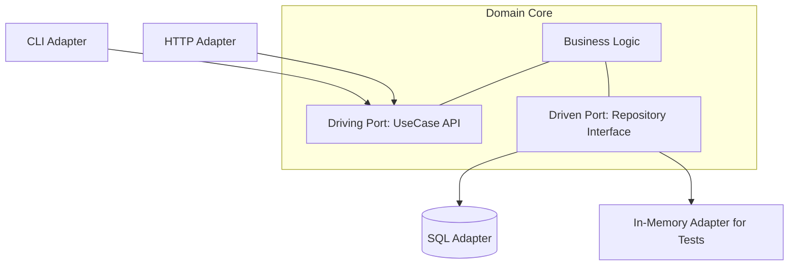
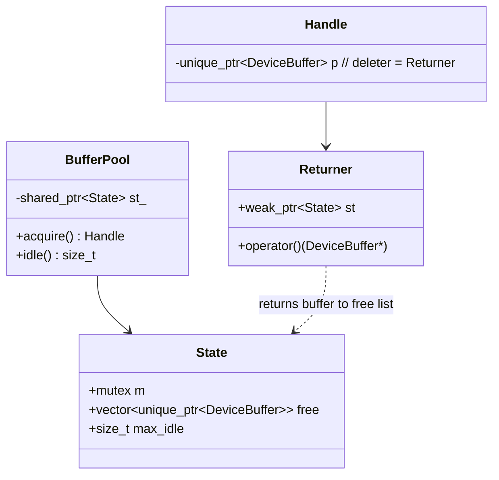

# Design Patterns in C++ -- Comprehensive Reference

> A deep-dive, interview-focused reference covering software design patterns with idiomatic, modern C++ (C++11 through C++20). Covers the design principles behind patterns, all 23 Gang of Four (GoF) patterns, C++-specific idioms (RAII, CRTP, pImpl, type erasure, policy-based design), architectural and concurrency patterns, and systems/performance patterns (object pools, plugin registries, lock-free ring buffers, double buffering, work stealing, RCU). Each section includes intent, structure, runnable code, trade-offs, common pitfalls, and interview questions. Complements the *C++ Fundamentals*, *CS Fundamentals*, and *DSA Fundamentals* guides.

---

## Table of Contents

### Part 1: Foundations

1. [What Design Patterns Are (and Are Not)](#1-what-design-patterns-are-and-are-not)
2. [Design Principles: SOLID and Beyond](#2-design-principles-solid-and-beyond)
3. [Pattern Categories and How to Choose](#3-pattern-categories-and-how-to-choose)

### Part 2: Creational Patterns

4. [Singleton](#4-singleton)
5. [Factory Method](#5-factory-method)
6. [Abstract Factory](#6-abstract-factory)
7. [Builder](#7-builder)
8. [Prototype](#8-prototype)

### Part 3: Structural Patterns

9. [Adapter](#9-adapter)
10. [Bridge](#10-bridge)
11. [Composite](#11-composite)
12. [Decorator](#12-decorator)
13. [Facade](#13-facade)
14. [Flyweight](#14-flyweight)
15. [Proxy](#15-proxy)

### Part 4: Behavioral Patterns

16. [Chain of Responsibility](#16-chain-of-responsibility)
17. [Command](#17-command)
18. [Interpreter](#18-interpreter)
19. [Iterator](#19-iterator)
20. [Mediator](#20-mediator)
21. [Memento](#21-memento)
22. [Observer](#22-observer)
23. [State](#23-state)
24. [Strategy](#24-strategy)
25. [Template Method](#25-template-method)
26. [Visitor](#26-visitor)

### Part 5: Idiomatic Modern C++ Patterns

27. [RAII -- Resource Acquisition Is Initialization](#27-raii----resource-acquisition-is-initialization)
28. [CRTP -- Curiously Recurring Template Pattern](#28-crtp----curiously-recurring-template-pattern)
29. [pImpl -- Pointer to Implementation](#29-pimpl----pointer-to-implementation)
30. [Rule of 0/3/5 and Copy-and-Swap](#30-rule-of-035-and-copy-and-swap)
31. [Type Erasure](#31-type-erasure)
32. [Policy-Based Design and Tag Dispatch](#32-policy-based-design-and-tag-dispatch)
33. [NVI -- Non-Virtual Interface](#33-nvi----non-virtual-interface)

### Part 6: Architectural Patterns

34. [MVC, MVP, and MVVM](#34-mvc-mvp-and-mvvm)
35. [Layered and Hexagonal Architecture](#35-layered-and-hexagonal-architecture)
36. [Repository Pattern](#36-repository-pattern)
37. [Dependency Injection and IoC](#37-dependency-injection-and-ioc)
38. [Event-Driven and Publish-Subscribe](#38-event-driven-and-publish-subscribe)

### Part 7: Concurrency Patterns

39. [Producer-Consumer](#39-producer-consumer)
40. [Thread Pool](#40-thread-pool)
41. [Active Object](#41-active-object)
42. [Monitor Object](#42-monitor-object)
43. [Future/Promise](#43-futurepromise)
44. [Reactor](#44-reactor)
45. [Actor Model](#45-actor-model)

### Part 8: Systems and Performance Patterns

46. [Object Pool and Resource Pools](#46-object-pool-and-resource-pools)
47. [Null Object](#47-null-object)
48. [Plugin and Registry Architecture](#48-plugin-and-registry-architecture)
49. [Lock-Free SPSC Ring Buffer](#49-lock-free-spsc-ring-buffer)
50. [Double Buffering](#50-double-buffering)
51. [Work Stealing](#51-work-stealing)
52. [RCU and Read-Mostly Patterns](#52-rcu-and-read-mostly-patterns)

### Part 9: Quick Reference

53. [Pattern Cheat Sheet](#53-pattern-cheat-sheet)
54. [Anti-Patterns](#54-anti-patterns)
55. [Decision Guide](#55-decision-guide)

---

# Part 1: Foundations

---

# 1. What Design Patterns Are (and Are Not)

A **design pattern** is a named, reusable solution to a commonly recurring problem in software design within a given context. Patterns are *descriptions* of how to structure objects and their interactions -- not copy-paste code, not libraries, and not finished designs. They were popularized by the 1994 book *Design Patterns: Elements of Reusable Object-Oriented Software* by the "Gang of Four" (Gamma, Helm, Johnson, Vlissides).

**What a pattern gives you:**

- A shared vocabulary ("use a Strategy here") that compresses design discussions.
- A proven structure with documented trade-offs and consequences.
- Guidance on which parts of a design should vary independently.

**What a pattern is *not*:**

- A goal in itself. Patterns are tools; applying them where they are not needed adds accidental complexity ("patternitis").
- Language-agnostic boilerplate. Many GoF patterns exist to work around limitations of 1990s C++/Java. In modern C++, language features (lambdas, `std::function`, templates, `std::variant`) often subsume a pattern's intent with less code.

| Term | Meaning |
|---|---|
| **Idiom** | A low-level, language-specific pattern (e.g. RAII, copy-and-swap in C++). |
| **Design pattern** | A mid-level solution to an object-interaction problem (GoF). |
| **Architectural pattern** | A high-level structure for an entire system (MVC, layered, hexagonal). |
| **Anti-pattern** | A common "solution" that looks helpful but causes more harm than good. |

**The single most important question:** before reaching for a pattern, ask *"what is varying, and how do I isolate that variation?"* Every GoF pattern is fundamentally about encapsulating a specific axis of change.

---

# 2. Design Principles: SOLID and Beyond

Patterns are applications of deeper principles. Understanding the principles lets you *derive* patterns rather than memorize them.

## 2.1 SOLID

| Principle | Statement | C++ application |
|---|---|---|
| **S** -- Single Responsibility | A class should have one reason to change. | Split a `God` class into focused types; separate parsing from I/O from business logic. |
| **O** -- Open/Closed | Open for extension, closed for modification. | Add behavior via new derived classes or template policies, not by editing existing `switch` statements. |
| **L** -- Liskov Substitution | Subtypes must be usable through the base interface without surprises. | A derived class must not strengthen preconditions or weaken postconditions; avoid `throw` on overrides the base promised wouldn't. |
| **I** -- Interface Segregation | Many small interfaces beat one fat one. | Prefer small abstract base classes / concepts over a monolithic interface clients only partly use. |
| **D** -- Dependency Inversion | Depend on abstractions, not concretions. | High-level modules take an abstract `Logger&`/`std::function`, not a concrete `FileLogger`. |

## 2.2 Other key principles

- **Composition over inheritance.** Prefer assembling behavior from member objects over deep inheritance hierarchies. Inheritance is the tightest coupling in the language. Patterns like Strategy, Decorator, and Bridge are composition in disguise.
- **Program to an interface, not an implementation.** Clients should depend on an abstract type so concrete types can be swapped.
- **Encapsulate what varies.** Identify the aspect that changes and isolate it behind a stable interface.
- **Law of Demeter ("don't talk to strangers").** A method should call methods of: itself, its parameters, objects it creates, and its direct members -- avoid `a.getB().getC().doThing()` chains.
- **DRY** (Don't Repeat Yourself) and **YAGNI** (You Aren't Gonna Need It): balance abstraction against speculative generality.

```cpp
// Dependency Inversion in practice: depend on an abstraction.
struct ILogger {
    virtual void log(std::string_view msg) = 0;
    virtual ~ILogger() = default;
};

class OrderService {
    ILogger& logger_;                 // depends on abstraction, not FileLogger
public:
    explicit OrderService(ILogger& logger) : logger_(logger) {}
    void place() { logger_.log("order placed"); }
};
```

---

# 3. Pattern Categories and How to Choose

The GoF patterns split into three families by **what they organize**:

| Category | Concern | Patterns |
|---|---|---|
| **Creational** | *How objects are created* -- decouple construction from use. | Singleton, Factory Method, Abstract Factory, Builder, Prototype |
| **Structural** | *How objects are composed* into larger structures. | Adapter, Bridge, Composite, Decorator, Facade, Flyweight, Proxy |
| **Behavioral** | *How objects communicate* and distribute responsibility. | Chain of Responsibility, Command, Interpreter, Iterator, Mediator, Memento, Observer, State, Strategy, Template Method, Visitor |

**Quick selection heuristics:**

- Need to vary *which concrete object* is created? -> Factory Method / Abstract Factory.
- Need to vary *an algorithm* at runtime? -> Strategy.
- Need to vary *behavior with internal state*? -> State.
- Need to *add responsibilities dynamically*? -> Decorator.
- Need to *make incompatible interfaces work together*? -> Adapter.
- Need to *notify many objects of change*? -> Observer.
- Need to *separate an abstraction from its implementation* so both vary? -> Bridge.

**Modern C++ caveat:** evaluate whether a lambda, `std::function`, template, `std::variant`, or standard library facility already solves the problem before introducing a class hierarchy.

# Part 2: Creational Patterns

---

# 4. Singleton

**Intent:** Ensure a class has exactly one instance and provide a global access point to it.

**When to use:** A genuinely single shared resource -- a logging sink, a configuration registry, a hardware device handle. Use sparingly: Singletons are global state and complicate testing and lifetime.

**Modern C++ implementation -- the Meyers' Singleton.** A function-local `static` is initialized exactly once, lazily, and is thread-safe since C++11 (the standard guarantees the initialization is synchronized).

```cpp
class Logger {
public:
    static Logger& instance() {
        static Logger inst;   // thread-safe, lazy, destroyed at program exit
        return inst;
    }

    void log(std::string_view msg) { /* ... */ }

    // Forbid copying/moving so the single instance can't be duplicated.
    Logger(const Logger&) = delete;
    Logger& operator=(const Logger&) = delete;

private:
    Logger() = default;
    ~Logger() = default;
};

// usage
Logger::instance().log("started");
```

**Trade-offs and pitfalls:**

- **Hidden dependencies / testability.** Code that calls `Logger::instance()` has an invisible dependency that's hard to mock. Prefer injecting an `ILogger&` (Dependency Inversion) and reserve the Singleton for the composition root.
- **Static initialization order fiasco.** A non-local static in translation unit A that uses a non-local static in B has undefined init order. The Meyers' Singleton sidesteps this because initialization happens on first call.
- **Destruction order.** Function-local statics are destroyed in reverse order of completion of their construction; a Singleton using another during destruction can crash. The "Nifty Counter" / Schwarz counter idiom or leaking the instance intentionally avoids this.

| Approach | Thread-safe | Lazy | Notes |
|---|---|---|---|
| Meyers' (`static` local) | Yes (C++11+) | Yes | Preferred default |
| `std::call_once` + `std::once_flag` | Yes | Yes | More verbose; useful for complex init |
| Eager global object | Depends | No | Subject to init-order fiasco |

---

# 5. Factory Method

**Intent:** Define an interface for creating an object, but let subclasses decide which class to instantiate. Defers instantiation to subclasses.

**When to use:** A class can't anticipate the class of objects it must create, or you want subclasses to specify the created objects.

```cpp
struct Button { virtual void render() = 0; virtual ~Button() = default; };
struct WinButton : Button { void render() override { /* ... */ } };
struct MacButton : Button { void render() override { /* ... */ } };

class Dialog {
public:
    // The "factory method" -- overridden by subclasses.
    virtual std::unique_ptr<Button> createButton() = 0;

    void render() {                       // template-method-style use of the factory
        auto button = createButton();
        button->render();
    }
    virtual ~Dialog() = default;
};

class WinDialog : public Dialog {
    std::unique_ptr<Button> createButton() override {
        return std::make_unique<WinButton>();
    }
};
```

**Factory Method vs. a simple factory function.** A free function `make_button(Os)` that `switch`es is a *simple factory* (not a GoF pattern, but common and often sufficient). Factory Method specifically uses **polymorphism + inheritance** so the choice is encoded by the subclass, not a runtime tag.

**Pitfalls:** Returning raw pointers leaks ownership intent -- always return `std::unique_ptr<Base>`. A `switch` that grows with every new type violates Open/Closed; consider a registry (map from key to creator `std::function`).

---

# 6. Abstract Factory

**Intent:** Provide an interface for creating *families* of related objects without specifying their concrete classes.

**When to use:** Your system must be configured with one of multiple families of products that are designed to be used together (e.g. a UI toolkit producing matching `Button`, `Checkbox`, `Scrollbar` for one OS theme).

```cpp
struct Button   { virtual ~Button() = default; };
struct Checkbox { virtual ~Checkbox() = default; };

struct WinButton : Button {}; struct WinCheckbox : Checkbox {};
struct MacButton : Button {}; struct MacCheckbox : Checkbox {};

// Abstract factory: one method per product in the family.
struct GuiFactory {
    virtual std::unique_ptr<Button>   createButton()   = 0;
    virtual std::unique_ptr<Checkbox> createCheckbox() = 0;
    virtual ~GuiFactory() = default;
};

struct WinFactory : GuiFactory {
    std::unique_ptr<Button>   createButton()   override { return std::make_unique<WinButton>(); }
    std::unique_ptr<Checkbox> createCheckbox() override { return std::make_unique<WinCheckbox>(); }
};

void buildUi(GuiFactory& f) {            // client codes against the abstraction only
    auto btn = f.createButton();
    auto chk = f.createCheckbox();
}
```

**Factory Method vs Abstract Factory:** Factory Method creates *one* product via inheritance; Abstract Factory creates a *family* of products and is usually composed (the factory is an object you pass around). Abstract Factory is often *implemented using* several Factory Methods.

**Pitfall:** Adding a new product *type* to the family forces a change to every factory -- the pattern favors adding new *families* over new *product kinds*.

---

# 7. Builder

**Intent:** Separate the construction of a complex object from its representation so the same construction process can create different representations. Particularly good for objects with many optional parameters.

**When to use:** Telescoping constructors (many overloads) or long parameter lists where many arguments are optional or share a type (easy to transpose).

```cpp
class HttpRequest {
public:
    class Builder;
    // ... accessors ...
private:
    std::string url_, method_ = "GET", body_;
    std::map<std::string, std::string> headers_;
    int timeout_ms_ = 30000;
    friend class Builder;
    HttpRequest() = default;
};

class HttpRequest::Builder {
    HttpRequest req_;
public:
    explicit Builder(std::string url) { req_.url_ = std::move(url); }
    Builder& method(std::string m)   { req_.method_ = std::move(m); return *this; }
    Builder& header(std::string k, std::string v) { req_.headers_[std::move(k)] = std::move(v); return *this; }
    Builder& body(std::string b)     { req_.body_ = std::move(b); return *this; }
    Builder& timeout(int ms)         { req_.timeout_ms_ = ms; return *this; }
    HttpRequest build() { return std::move(req_); }   // optionally validate here
};

// Fluent usage -- readable and order-independent for optionals.
auto req = HttpRequest::Builder("https://api.example.com")
               .method("POST")
               .header("Content-Type", "application/json")
               .body(R"({"x":1})")
               .timeout(5000)
               .build();
```

**Director (optional):** A separate `Director` can encapsulate a fixed construction recipe and drive the builder, so the same steps produce different products with different builders.

**Modern alternatives:** Designated initializers (C++20) and aggregate-with-defaults structs cover many "many optional fields" cases without a builder:

```cpp
struct WindowConfig { int width = 800, height = 600; bool fullscreen = false; };
WindowConfig cfg{ .width = 1920, .height = 1080 };   // C++20 designated initializers
```

---

# 8. Prototype

**Intent:** Create new objects by copying an existing prototype rather than constructing from scratch -- useful when construction is expensive or the concrete type is known only at runtime.

**When to use:** You hold a `Base*`/`Base&` and need a copy of the *actual* dynamic type (the classic "virtual copy constructor" problem, since constructors can't be virtual).

```cpp
struct Shape {
    virtual std::unique_ptr<Shape> clone() const = 0;   // virtual constructor idiom
    virtual void draw() const = 0;
    virtual ~Shape() = default;
};

struct Circle : Shape {
    double r;
    explicit Circle(double r) : r(r) {}
    std::unique_ptr<Shape> clone() const override {
        return std::make_unique<Circle>(*this);          // copy the real type
    }
    void draw() const override { /* ... */ }
};

void duplicate(const Shape& s) {
    auto copy = s.clone();   // gets a Circle even though we only see Shape&
}
```

**Pitfalls:** Deep vs shallow copy -- if the object owns pointers, `clone()` must deep-copy. A **prototype registry** (map from key to a prototype instance) lets you spawn configured objects by name.

# Part 3: Structural Patterns

---

# 9. Adapter

**Intent:** Convert the interface of a class into another interface clients expect, letting otherwise-incompatible classes work together. Also called Wrapper.

**When to use:** You want to use an existing class but its interface doesn't match what your code needs (often a third-party or legacy type).

```cpp
// Target interface our code expects.
struct Renderer { virtual void drawLine(int x1,int y1,int x2,int y2) = 0; virtual ~Renderer() = default; };

// Adaptee: a library with an incompatible API we cannot change.
struct LegacyGraphics { void line(Point a, Point b); };

// Object adapter: holds an instance and translates calls (composition).
class GraphicsAdapter : public Renderer {
    LegacyGraphics legacy_;
public:
    void drawLine(int x1,int y1,int x2,int y2) override {
        legacy_.line({x1,y1}, {x2,y2});   // translate the call
    }
};
```

**Object adapter (composition) vs class adapter (multiple/private inheritance):** The object adapter is preferred in C++ because it's more flexible and avoids the rigidity of inheriting from the adaptee. A class adapter uses `private` inheritance from the adaptee plus public inheritance from the target.

**Adapter vs Decorator vs Proxy:** Adapter *changes* an interface; Decorator *adds behavior* keeping the same interface; Proxy keeps the same interface to *control access*.

---

# 10. Bridge

**Intent:** Decouple an abstraction from its implementation so the two can vary independently. Replaces a combinatorial inheritance explosion with two orthogonal hierarchies connected by composition.

**When to use:** You have two (or more) independent dimensions of variation -- e.g. `Shape` x `Renderer`. Inheritance would force `RasterCircle`, `VectorCircle`, `RasterSquare`, ... (N x M classes). Bridge gives N + M.

```cpp
// Implementation hierarchy (the "bridge" target).
struct DrawingApi {
    virtual void drawCircle(double x,double y,double r) = 0;
    virtual ~DrawingApi() = default;
};
struct RasterApi : DrawingApi { void drawCircle(double,double,double) override {/*...*/} };
struct VectorApi : DrawingApi { void drawCircle(double,double,double) override {/*...*/} };

// Abstraction hierarchy holds a pointer to the implementation.
class Shape {
protected:
    DrawingApi& api_;
public:
    explicit Shape(DrawingApi& api) : api_(api) {}
    virtual void draw() = 0;
    virtual ~Shape() = default;
};

class Circle : public Shape {
    double x_, y_, r_;
public:
    Circle(DrawingApi& api,double x,double y,double r) : Shape(api), x_(x), y_(y), r_(r) {}
    void draw() override { api_.drawCircle(x_, y_, r_); }   // delegate across the bridge
};
```

**Bridge vs Strategy:** Structurally similar (both delegate to an interface), but intent differs: Bridge is a *structural* decision spanning two whole hierarchies that vary independently; Strategy is a *behavioral* swap of one algorithm. Bridge is decided at design time; Strategy often at runtime.

---

# 11. Composite

**Intent:** Compose objects into tree structures to represent part-whole hierarchies, letting clients treat individual objects and compositions uniformly.

**When to use:** Recursive tree structures -- filesystem (files/directories), GUI widgets (controls/containers), scene graphs, arithmetic expressions.

```cpp
struct FsNode {
    virtual int size() const = 0;            // uniform interface for leaf and composite
    virtual ~FsNode() = default;
};

struct File : FsNode {                        // leaf
    int bytes;
    explicit File(int b) : bytes(b) {}
    int size() const override { return bytes; }
};

struct Directory : FsNode {                    // composite
    std::vector<std::unique_ptr<FsNode>> children;
    void add(std::unique_ptr<FsNode> n) { children.push_back(std::move(n)); }
    int size() const override {
        int total = 0;
        for (const auto& c : children) total += c->size();  // recurse uniformly
        return total;
    }
};
```

**Design choice:** Where to put `add`/`remove`? Putting them in the base type gives transparency (uniform interface) but lets clients call `add` on a leaf (must error). Putting them only in `Directory` is type-safe but loses uniformity. Prefer the safe variant unless transparency is essential.

---

# 12. Decorator

**Intent:** Attach additional responsibilities to an object dynamically. A flexible alternative to subclassing for extending behavior.

**When to use:** You need to add combinations of optional behaviors at runtime (e.g. a stream that can be buffered, encrypted, and compressed in any combination). Subclassing would need a class per combination.

```cpp
struct DataSource {
    virtual std::string read() = 0;
    virtual void write(const std::string&) = 0;
    virtual ~DataSource() = default;
};

class FileSource : public DataSource { /* concrete component */ };

// Base decorator wraps another DataSource and forwards by default.
class SourceDecorator : public DataSource {
protected:
    std::unique_ptr<DataSource> wrapped_;
public:
    explicit SourceDecorator(std::unique_ptr<DataSource> s) : wrapped_(std::move(s)) {}
    std::string read() override { return wrapped_->read(); }
    void write(const std::string& d) override { wrapped_->write(d); }
};

class EncryptionDecorator : public SourceDecorator {
public:
    using SourceDecorator::SourceDecorator;
    void write(const std::string& d) override { wrapped_->write(encrypt(d)); }
    std::string read() override { return decrypt(wrapped_->read()); }
};

// Compose at runtime, in any order:
std::unique_ptr<DataSource> src =
    std::make_unique<EncryptionDecorator>(
        std::make_unique<CompressionDecorator>(
            std::make_unique<FileSource>("data.bin")));
```

**Decorator vs inheritance:** Inheritance is static and multiplies classes for each feature combination; decorators stack at runtime. **Decorator vs Strategy:** Decorator changes the *skin* (wraps the object); Strategy changes the *guts* (an internal algorithm). The standard library's `std::pmr` and stream buffers are decorator-like.

---

# 13. Facade

**Intent:** Provide a unified, simplified interface to a set of interfaces in a subsystem, making the subsystem easier to use.

**When to use:** A complex subsystem (many classes, intricate setup) where clients only need a few common operations and shouldn't depend on internal details.

```cpp
// Complex subsystem: codecs, mixers, file readers...
class VideoConverter {                 // the facade
    AudioMixer mixer_;
    CodecFactory codecs_;
public:
    File convert(const std::string& filename, const std::string& format) {
        auto file = FileReader::read(filename);
        auto codec = codecs_.extract(file);
        auto result = BitrateReader::process(file, codec);
        return mixer_.fix(result, format);   // hides all the orchestration
    }
};

// Client just calls one method:
auto mp4 = VideoConverter{}.convert("clip.ogg", "mp4");
```

**Facade vs Adapter:** Adapter makes one interface match another; Facade defines a *new, simpler* interface over many classes. A Facade doesn't prevent direct access to the subsystem -- it's a convenience, not an encapsulation boundary (unlike a strict module API).

---

# 14. Flyweight

**Intent:** Use sharing to support large numbers of fine-grained objects efficiently by separating intrinsic (shared) state from extrinsic (context) state.

**When to use:** Huge numbers of objects with much duplicated state -- characters in a document (the glyph for 'a' is shared; position is extrinsic), tiles in a game, particle systems.

```cpp
// Intrinsic, shared, immutable state.
struct GlyphData { char symbol; const Font* font; /* metrics... */ };

class GlyphFactory {                          // returns shared flyweights
    std::unordered_map<char, std::shared_ptr<const GlyphData>> pool_;
public:
    std::shared_ptr<const GlyphData> get(char c, const Font* font) {
        auto& slot = pool_[c];
        if (!slot) slot = std::make_shared<const GlyphData>(GlyphData{c, font});
        return slot;                          // reuse the same object
    }
};

// Extrinsic state (position) is passed in at use time, not stored per glyph.
struct PlacedGlyph { std::shared_ptr<const GlyphData> data; int x, y; };
```

**Pitfalls:** Flyweights must be immutable (they're shared). The savings come only when extrinsic state can be computed/passed rather than stored. `std::shared_ptr` to `const` is the natural C++ vehicle; interning strings is a real-world example.

---

# 15. Proxy

**Intent:** Provide a surrogate or placeholder for another object to control access to it.

**Common variants:**

| Variant | Purpose |
|---|---|
| **Virtual proxy** | Lazy creation/loading of an expensive object on first use. |
| **Protection proxy** | Access control / permission checks before delegating. |
| **Remote proxy** | Local stand-in for an object in another address space (RPC). |
| **Smart reference** | Adds bookkeeping (ref-counting, logging) -- `std::shared_ptr` is essentially this. |

```cpp
struct Image { virtual void display() = 0; virtual ~Image() = default; };

class RealImage : public Image {
    std::string file_;
public:
    explicit RealImage(std::string f) : file_(std::move(f)) { loadFromDisk(); }   // expensive
    void display() override { /* ... */ }
};

class LazyImageProxy : public Image {       // virtual proxy: defers the expensive load
    std::string file_;
    std::unique_ptr<RealImage> real_;
public:
    explicit LazyImageProxy(std::string f) : file_(std::move(f)) {}
    void display() override {
        if (!real_) real_ = std::make_unique<RealImage>(file_);  // create on first use
        real_->display();
    }
};
```

**Proxy vs Decorator:** both wrap and share the interface, but Proxy *controls access/lifetime* (often manages the wrapped object itself) while Decorator *adds behavior* (and is given the object). Proxy usually creates/owns its subject; a Decorator is handed one.

# Part 4: Behavioral Patterns

---

# 16. Chain of Responsibility

**Intent:** Pass a request along a chain of handlers; each decides to handle it or forward it to the next. Decouples sender from receiver.

**When to use:** Multiple objects may handle a request and the handler isn't known a priori -- event bubbling, middleware pipelines, logging levels, approval workflows.

```cpp
class Handler {
protected:
    std::shared_ptr<Handler> next_;
public:
    std::shared_ptr<Handler> setNext(std::shared_ptr<Handler> n) { next_ = n; return n; }
    virtual std::optional<std::string> handle(const Request& r) {
        return next_ ? next_->handle(r) : std::nullopt;   // forward by default
    }
    virtual ~Handler() = default;
};

class AuthHandler : public Handler {
public:
    std::optional<std::string> handle(const Request& r) override {
        if (!r.authenticated) return "401 Unauthorized";  // handle and stop
        return Handler::handle(r);                         // or pass along
    }
};
```

**Modern alternative:** a `std::vector<std::function<bool(Request&)>>` iterated until one returns "handled" expresses the same idea without a linked-list hierarchy. **Pitfall:** a request may fall off the end unhandled -- decide whether that's allowed.

---

# 17. Command

**Intent:** Encapsulate a request as an object, letting you parameterize clients with different requests, queue or log requests, and support undo.

**When to use:** Undo/redo, transactional operations, job queues, macro recording, decoupling the invoker (button) from the action.

```cpp
struct Command {
    virtual void execute() = 0;
    virtual void undo() = 0;
    virtual ~Command() = default;
};

class InsertTextCommand : public Command {
    Document& doc_;
    std::string text_;
    size_t pos_;
public:
    InsertTextCommand(Document& d, std::string t, size_t p)
        : doc_(d), text_(std::move(t)), pos_(p) {}
    void execute() override { doc_.insert(pos_, text_); }
    void undo() override    { doc_.erase(pos_, text_.size()); }
};

class History {                                    // invoker with undo stack
    std::vector<std::unique_ptr<Command>> done_;
public:
    void run(std::unique_ptr<Command> c) { c->execute(); done_.push_back(std::move(c)); }
    void undo() { if (!done_.empty()) { done_.back()->undo(); done_.pop_back(); } }
};
```

**Modern alternative:** for fire-and-forget commands with no undo, `std::function<void()>` *is* the Command pattern -- store callables in a `std::queue<std::function<void()>>`. The full class form earns its keep when you need `undo`, serialization, or logging.

---

# 18. Interpreter

**Intent:** Given a language, define a representation for its grammar plus an interpreter that uses the representation to evaluate sentences in the language.

**When to use:** Simple, stable grammars -- arithmetic expressions, boolean rules, query filters, regular expressions. For complex grammars, use a parser generator instead.

```cpp
struct Expr { virtual int eval() const = 0; virtual ~Expr() = default; };

struct Num : Expr { int v; explicit Num(int v):v(v){} int eval() const override { return v; } };

struct Add : Expr {
    std::unique_ptr<Expr> l, r;
    Add(std::unique_ptr<Expr> a, std::unique_ptr<Expr> b): l(std::move(a)), r(std::move(b)) {}
    int eval() const override { return l->eval() + r->eval(); }   // recurse over the AST
};

// (3 + 4)
auto tree = std::make_unique<Add>(std::make_unique<Num>(3), std::make_unique<Num>(4));
int result = tree->eval();   // 7
```

**Relation to Composite:** the abstract syntax tree is a Composite; the Interpreter adds the `eval` operation over it. **Pitfall:** a class per grammar rule grows fast -- Interpreter is best for small DSLs.

---

# 19. Iterator

**Intent:** Provide a way to access the elements of an aggregate sequentially without exposing its underlying representation.

**When to use:** Almost always handled for you in C++. The STL iterator concept *is* this pattern; `begin()`/`end()` and range-based `for` are the idiomatic form.

```cpp
template <typename T>
class RingBuffer {
    std::vector<T> data_;
    // ... head_, tail_ ...
public:
    class iterator {                       // model a forward iterator
        RingBuffer* buf_; size_t idx_;
    public:
        T& operator*()  { return buf_->data_[idx_ % buf_->data_.size()]; }
        iterator& operator++() { ++idx_; return *this; }
        bool operator!=(const iterator& o) const { return idx_ != o.idx_; }
    };
    iterator begin() { return {this, head_}; }
    iterator end()   { return {this, head_ + count_}; }
};

RingBuffer<int> rb;
for (int x : rb) { /* range-for uses begin()/end() */ }
```

**Modern C++:** prefer modeling the standard iterator concepts (or C++20 `std::ranges` and the `std::input_iterator`/`std::forward_iterator` concepts) so your type composes with `<algorithm>` and views. Coroutines (C++20) make lazy generators easy.

---

# 20. Mediator

**Intent:** Define an object that encapsulates how a set of objects interact, promoting loose coupling by keeping objects from referring to each other explicitly.

**When to use:** Many-to-many object communication that would otherwise become a tangled web -- dialog controls that affect each other, chat rooms, air-traffic control.

```cpp
class Mediator;
struct Component { Mediator* m = nullptr; };

class ChatRoom : public Mediator {           // hub all participants talk through
    std::vector<User*> users_;
public:
    void join(User* u) { users_.push_back(u); u->m = this; }
    void broadcast(const std::string& msg, User* from) {
        for (auto* u : users_) if (u != from) u->receive(msg);   // central routing
    }
};
```

**Mediator vs Observer:** both reduce direct coupling. Observer is a one-to-many *notification* with a generic subscribe mechanism; Mediator centralizes *complex bidirectional* interaction logic in one place. Mediator can become a God object -- keep its responsibility focused.

---

# 21. Memento

**Intent:** Capture and externalize an object's internal state without violating encapsulation, so the object can be restored to this state later (undo/snapshots).

**When to use:** Snapshots, checkpoints, undo where Command's incremental undo is awkward, save/restore of editor state.

```cpp
class Editor {
    std::string text_;
public:
    class Memento {                          // opaque snapshot; only Editor can read it
        std::string state_;
        explicit Memento(std::string s) : state_(std::move(s)) {}
        friend class Editor;
    };
    Memento save() const { return Memento{text_}; }
    void restore(const Memento& m) { text_ = m.state_; }
    void type(const std::string& s) { text_ += s; }
};

Editor e;
e.type("hello");
auto snapshot = e.save();
e.type(" world");
e.restore(snapshot);   // back to "hello"
```

**Roles:** *Originator* (Editor) creates/uses mementos; *Caretaker* (e.g. a history stack) stores them without inspecting their contents. The `friend` relationship preserves encapsulation -- only the originator sees the state.

---

# 22. Observer

**Intent:** Define a one-to-many dependency so that when one object (the subject) changes state, all its dependents (observers) are notified automatically.

**When to use:** Event systems, MVC (model notifies views), reactive data binding, signals.

```cpp
class Subject {
    std::vector<std::weak_ptr<class Observer>> observers_;   // weak: don't keep observers alive
public:
    void subscribe(std::shared_ptr<Observer> o) { observers_.push_back(o); }
    void notify(int value) {
        for (auto it = observers_.begin(); it != observers_.end();) {
            if (auto obs = it->lock()) { obs->onChanged(value); ++it; }
            else it = observers_.erase(it);                  // prune dead observers
        }
    }
};

struct Observer {
    virtual void onChanged(int value) = 0;
    virtual ~Observer() = default;
};
```

**Pitfalls:**

- **Lifetime / dangling.** If the subject holds raw pointers and an observer dies, you get a dangling call. Use `weak_ptr` or explicit unsubscribe in the observer's destructor.
- **Re-entrancy.** An observer that modifies the subscriber list during `notify` can invalidate iterators -- iterate over a copy or use erase-safe iteration.
- **Modern form:** `boost::signals2` or a simple `std::vector<std::function<void(Event)>>` "signal" type is the idiomatic lightweight Observer.

---

# 23. State

**Intent:** Allow an object to alter its behavior when its internal state changes -- it will appear to change its class. Replaces large state-dependent `switch` statements with polymorphism.

**When to use:** An object's behavior depends on its state and it has many states with distinct behavior and transitions -- TCP connection, vending machine, document workflow.

```cpp
class Document;
struct State {
    virtual void publish(Document& doc) = 0;
    virtual ~State() = default;
};

class Document {
    std::unique_ptr<State> state_;
public:
    explicit Document(std::unique_ptr<State> s) : state_(std::move(s)) {}
    void setState(std::unique_ptr<State> s) { state_ = std::move(s); }
    void publish() { state_->publish(*this); }
};

struct Draft : State {
    void publish(Document& doc) override { doc.setState(std::make_unique<Moderation>()); }
};
struct Moderation : State {
    void publish(Document& doc) override { doc.setState(std::make_unique<Published>()); }
};
struct Published : State {
    void publish(Document&) override { /* already published: no-op */ }
};
```

**State vs Strategy:** identical structure (delegate to a swappable object) but different intent. Strategy's algorithms are independent and chosen by the client; State's states *know about each other* and drive their own transitions. A `std::variant` of state structs + `std::visit` is a modern, allocation-free alternative.

---

# 24. Strategy

**Intent:** Define a family of interchangeable algorithms, encapsulate each one, and make them swappable at runtime independently of the clients that use them.

**When to use:** Multiple ways to do one thing chosen at runtime -- sorting orders, compression algorithms, pricing rules, route planners.

```cpp
// Classic OO form:
struct SortStrategy { virtual void sort(std::vector<int>&) = 0; virtual ~SortStrategy() = default; };
struct QuickSort : SortStrategy { void sort(std::vector<int>& v) override { /*...*/ } };

class Sorter {
    std::unique_ptr<SortStrategy> strategy_;
public:
    explicit Sorter(std::unique_ptr<SortStrategy> s) : strategy_(std::move(s)) {}
    void run(std::vector<int>& v) { strategy_->sort(v); }
};

// Idiomatic modern form: the strategy is just a callable.
class Sorter2 {
    std::function<void(std::vector<int>&)> strategy_;
public:
    explicit Sorter2(std::function<void(std::vector<int>&)> s) : strategy_(std::move(s)) {}
    void run(std::vector<int>& v) { strategy_(v); }
};

Sorter2 s([](std::vector<int>& v){ std::ranges::sort(v); });   // lambda as strategy
```

**Key insight:** in modern C++, Strategy is most often a `std::function` or a template parameter (like the `Compare` in `std::sort`). The class hierarchy is only needed when strategies carry significant state or must be enumerable/serializable.

---

# 25. Template Method

**Intent:** Define the skeleton of an algorithm in a base method, deferring some steps to subclasses. Subclasses redefine steps without changing the algorithm's structure.

**When to use:** Several algorithms share the same overall steps but differ in specific steps -- parsing pipelines, game turn loops, build processes.

```cpp
class DataMiner {
public:
    void mine(const std::string& path) {     // the template method: fixed skeleton
        auto raw = openFile(path);
        auto data = extractData(raw);         // step varies by subclass
        auto analysis = analyze(data);        // common
        report(analysis);                     // common
    }
    virtual ~DataMiner() = default;
protected:
    virtual std::string extractData(const std::string& raw) = 0;  // primitive operation (hook)
    std::string openFile(const std::string&) { /* common */ return {}; }
    std::string analyze(const std::string&)  { /* common */ return {}; }
    void report(const std::string&)          { /* common */ }
};

struct PdfMiner : DataMiner {
    std::string extractData(const std::string& raw) override { /* PDF-specific */ return {}; }
};
```

**Hollywood Principle:** "Don't call us, we'll call you" -- the base class controls flow and calls down into subclass hooks. **Template Method vs Strategy:** Template Method uses inheritance (compile-time, one varying step); Strategy uses composition (runtime, whole algorithm). The C++ NVI idiom (Section 33) is a refined Template Method.

---

# 26. Visitor

**Intent:** Represent an operation to be performed on the elements of an object structure, letting you define a new operation without changing the classes of the elements.

**When to use:** A stable set of element classes but many distinct operations over them (e.g. an AST visited by type-checker, optimizer, pretty-printer). Visitor moves the operation out of the elements.

```cpp
struct Circle; struct Square;
struct Visitor {
    virtual void visit(Circle&) = 0;
    virtual void visit(Square&) = 0;
    virtual ~Visitor() = default;
};

struct Shape { virtual void accept(Visitor& v) = 0; virtual ~Shape() = default; };
struct Circle : Shape { void accept(Visitor& v) override { v.visit(*this); } };  // double dispatch
struct Square : Shape { void accept(Visitor& v) override { v.visit(*this); } };

struct AreaVisitor : Visitor {
    double area = 0;
    void visit(Circle&) override { /* compute */ }
    void visit(Square&) override { /* compute */ }
};
```

This achieves **double dispatch**: the called method depends on both the element's dynamic type *and* the visitor's type.

**Modern alternative -- `std::variant` + `std::visit`:** if the element set is closed and known, a variant avoids the verbose accept/visit boilerplate:

```cpp
using Shape = std::variant<Circle, Square>;
double area(const Shape& s) {
    return std::visit([](const auto& shape){ return shape.area(); }, s);
}
```

**Trade-off:** Visitor makes adding *operations* easy but adding *element types* hard (every visitor must change) -- the dual of the "expression problem". Use it when types are stable and operations grow.

# Part 5: Idiomatic Modern C++ Patterns

These are C++-specific idioms -- low-level patterns that exploit the language's value semantics, templates, and deterministic destruction. Mastering them matters more for real C++ code than the GoF catalog.

---

# 27. RAII -- Resource Acquisition Is Initialization

**Intent:** Tie a resource's lifetime to the lifetime of an object. Acquire in the constructor, release in the destructor. The single most important idiom in C++.

**Why it matters:** Destructors run deterministically -- at scope exit, including during stack unwinding from exceptions. RAII makes leaks and double-frees structurally impossible and is the foundation of exception safety.

```cpp
class FileHandle {
    std::FILE* f_;
public:
    explicit FileHandle(const char* path, const char* mode) : f_(std::fopen(path, mode)) {
        if (!f_) throw std::runtime_error("open failed");
    }
    ~FileHandle() { if (f_) std::fclose(f_); }      // released no matter how we leave scope

    FileHandle(const FileHandle&) = delete;          // non-copyable: single ownership
    FileHandle& operator=(const FileHandle&) = delete;
    FileHandle(FileHandle&& o) noexcept : f_(std::exchange(o.f_, nullptr)) {}  // movable

    std::FILE* get() const { return f_; }
};
```

**Standard RAII types:** `std::unique_ptr`/`std::shared_ptr` (memory), `std::lock_guard`/`std::scoped_lock`/`std::unique_lock` (mutexes), `std::fstream` (files), `std::jthread` (threads, C++20). Generic cleanup: `std::unique_ptr<T, Deleter>` or a `scope_guard`/`std::experimental::scope_exit`.

```cpp
{
    std::scoped_lock lock(mtx);   // acquires mutex; releases at end of scope automatically
    // critical section -- exception-safe
}
```

---

# 28. CRTP -- Curiously Recurring Template Pattern

**Intent:** A base class template parameterized on its derived class, enabling **static (compile-time) polymorphism** -- the dispatch is resolved at compile time with no virtual call overhead.

**When to use:** Mixins that inject behavior, static interfaces, the "Barton-Nackman" trick, and replacing virtual dispatch in hot paths.

```cpp
template <typename Derived>
struct Comparable {
    bool operator!=(const Derived& o) const {
        return !static_cast<const Derived&>(*this).operator==(o);   // call into derived
    }
    bool operator>(const Derived& o) const {
        return o < static_cast<const Derived&>(*this);
    }
};

struct Version : Comparable<Version> {       // derive, passing self as the template arg
    int major, minor;
    bool operator==(const Version& o) const { return major==o.major && minor==o.minor; }
    bool operator<(const Version& o) const  { return std::tie(major,minor) < std::tie(o.major,o.minor); }
};
// Version now gets != and > for free, with zero runtime overhead.
```

**Static polymorphism example (no vtable):**

```cpp
template <typename Derived>
struct Shape {
    double area() const { return static_cast<const Derived&>(*this).areaImpl(); }
};
struct Circle : Shape<Circle> { double r; double areaImpl() const { return 3.14159*r*r; } };
```

**Trade-offs:** zero-overhead and inlinable, but no runtime polymorphism (can't store heterogeneous `Shape<...>*` in one container) and produces longer compile errors. C++20 *concepts* often provide a cleaner way to express static interfaces.

---

# 29. pImpl -- Pointer to Implementation

**Intent:** Hide a class's implementation details (and the headers they require) behind an opaque pointer, decoupling interface from implementation. Also called the "compilation firewall" or "Cheshire Cat".

**Benefits:** Faster builds (clients don't recompile when the impl changes), stable ABI (the class size doesn't change), and true encapsulation of private members.

```cpp
// widget.hpp -- no implementation headers leak here
class Widget {
public:
    Widget();
    ~Widget();                       // must be declared (defined in .cpp where Impl is complete)
    Widget(Widget&&) noexcept;
    Widget& operator=(Widget&&) noexcept;
    void draw();
private:
    struct Impl;                     // forward declaration only
    std::unique_ptr<Impl> impl_;     // opaque pointer
};
```

```cpp
// widget.cpp
struct Widget::Impl {                // full definition hidden here
    std::vector<int> heavyState;
    void draw() { /* ... */ }
};
Widget::Widget() : impl_(std::make_unique<Impl>()) {}
Widget::~Widget() = default;         // defined here, where Impl is complete
Widget::Widget(Widget&&) noexcept = default;
Widget& Widget::operator=(Widget&&) noexcept = default;
void Widget::draw() { impl_->draw(); }
```

**Pitfalls:** The destructor (and move ops) must be defined in the `.cpp` where `Impl` is complete -- a defaulted destructor in the header fails because `unique_ptr` needs the complete type to delete. Costs: one heap allocation and a pointer indirection per object.

---

# 30. Rule of 0/3/5 and Copy-and-Swap

**Rule of Zero:** Prefer to write *no* special member functions. Use RAII members (`std::vector`, `std::string`, `std::unique_ptr`) so the compiler-generated copy/move/destroy are correct. This is the default you should aim for.

**Rule of Three:** If you define any of destructor, copy constructor, or copy assignment, you almost certainly need all three (they manage a resource).

**Rule of Five:** With move semantics, the set is destructor, copy ctor, copy assign, move ctor, move assign. Defining or deleting one suppresses some others, so be explicit.

| You declare... | Compiler still generates... |
|---|---|
| Destructor | Copy ops (deprecated), no move ops |
| Copy constructor | No move ops |
| Move constructor | No copy ops (they're deleted) |

**Copy-and-swap idiom:** implement assignment in terms of copy construction + `swap` for strong exception safety and to unify copy/move assignment:

```cpp
class Buffer {
    std::size_t n_; int* data_;
public:
    Buffer(const Buffer& o) : n_(o.n_), data_(new int[o.n_]) { std::copy(o.data_, o.data_+n_, data_); }
    Buffer(Buffer&& o) noexcept : n_(o.n_), data_(o.data_) { o.data_ = nullptr; o.n_ = 0; }
    ~Buffer() { delete[] data_; }

    friend void swap(Buffer& a, Buffer& b) noexcept {
        using std::swap; swap(a.n_, b.n_); swap(a.data_, b.data_);
    }
    // One assignment operator handles both copy and move (by-value parameter).
    Buffer& operator=(Buffer rhs) noexcept { swap(*this, rhs); return *this; }
};
```

Taking the parameter **by value** means the caller's copy/move constructor does the work; `swap` is `noexcept` and cannot leave the object in a broken state.

---

# 31. Type Erasure

**Intent:** Provide a single non-template type that can hold any object satisfying a given interface, without a common base class -- combining value semantics with runtime polymorphism. This is how `std::function`, `std::any`, and `std::shared_ptr`'s deleter work.

**When to use:** You want duck typing / interface-based storage but cannot or don't want to require types to inherit from a common base.

```cpp
class Drawable {
    // Internal abstract interface (the only place virtuals live).
    struct Concept {
        virtual void draw() const = 0;
        virtual std::unique_ptr<Concept> clone() const = 0;
        virtual ~Concept() = default;
    };
    // Templated model wraps any T that has a draw() member.
    template <typename T>
    struct Model : Concept {
        T obj;
        explicit Model(T o) : obj(std::move(o)) {}
        void draw() const override { obj.draw(); }
        std::unique_ptr<Concept> clone() const override { return std::make_unique<Model>(*this); }
    };
    std::unique_ptr<Concept> self_;
public:
    template <typename T>
    Drawable(T obj) : self_(std::make_unique<Model<T>>(std::move(obj))) {}   // accept anything drawable
    Drawable(const Drawable& o) : self_(o.self_->clone()) {}
    void draw() const { self_->draw(); }
};

struct Circle { void draw() const { /*...*/ } };
struct Text   { void draw() const { /*...*/ } };

std::vector<Drawable> scene;     // heterogeneous, value-semantic, no shared base class
scene.emplace_back(Circle{});
scene.emplace_back(Text{});
for (const auto& d : scene) d.draw();
```

**Trade-offs:** value semantics + polymorphism + no inheritance requirement, at the cost of a heap allocation and a virtual call internally. This is the technique behind the standard library's most flexible types.

---

# 32. Policy-Based Design and Tag Dispatch

**Policy-based design** composes class behavior from orthogonal template parameters ("policies"), each plugging in one aspect (threading model, allocation, checking). Pioneered by Andrei Alexandrescu's *Modern C++ Design*.

```cpp
template <typename T, typename CheckingPolicy = NoCheck>
class Vector {
    T* data_; std::size_t size_;
public:
    T& operator[](std::size_t i) {
        CheckingPolicy::check(i, size_);   // policy injects bounds-checking or not
        return data_[i];
    }
};

struct NoCheck   { static void check(std::size_t, std::size_t) {} };
struct RangeCheck{ static void check(std::size_t i, std::size_t n){ if (i>=n) throw std::out_of_range{"i"}; } };

Vector<int, RangeCheck> safe;   // checked at zero cost when NoCheck is used
```

**Tag dispatch** selects an overload at compile time using empty "tag" types -- the technique behind `std::advance` choosing O(1) vs O(n) based on iterator category:

```cpp
template <typename It>
void advance_impl(It& it, int n, std::random_access_iterator_tag) { it += n; }   // O(1)
template <typename It>
void advance_impl(It& it, int n, std::forward_iterator_tag) { while (n--) ++it; } // O(n)

template <typename It>
void advance(It& it, int n) {
    advance_impl(it, n, typename std::iterator_traits<It>::iterator_category{});
}
```

In C++17+, `if constexpr` and in C++20 *concepts* / requires-clauses are often a clearer alternative to tag dispatch.

---

# 33. NVI -- Non-Virtual Interface

**Intent:** Make the public interface non-virtual and the customization points private/protected virtual. The public method wraps the virtual call with invariants, logging, or locking. A disciplined form of Template Method.

```cpp
class Task {
public:
    void run() {                 // public, non-virtual: stable contract
        logStart();
        doRun();                 // the actual variation point
        logEnd();
    }
    virtual ~Task() = default;
private:
    virtual void doRun() = 0;     // private virtual: subclasses override behavior, not the contract
    void logStart() { /*...*/ }
    void logEnd()   { /*...*/ }
};

struct BackupTask : Task {
private:
    void doRun() override { /* perform backup */ }
};
```

**Why private virtuals work:** in C++ a derived class can override a private virtual of the base even though it can't call it -- overriding and access control are independent. NVI lets the base enforce pre/post-conditions around every override and keeps the public interface from changing as behavior varies.

# Part 6: Architectural Patterns

Architectural patterns organize an entire application rather than a few objects. They build on the GoF patterns (Observer, Strategy, Facade, etc.).

---

# 34. MVC, MVP, and MVVM

These separate the **domain/data**, the **UI**, and the **glue** so each can change independently and be tested in isolation.

| Pattern | Parts | Who updates the view | Typical use |
|---|---|---|---|
| **MVC** | Model, View, Controller | View observes Model (Observer); Controller handles input | Classic web/server frameworks |
| **MVP** | Model, View, Presenter | Presenter pushes data to a passive View via an interface | Desktop apps, testable UIs |
| **MVVM** | Model, View, ViewModel | Data binding syncs View <-> ViewModel automatically | Declarative/data-binding UIs (Qt/QML) |

```cpp
// MVC sketch: the View observes the Model; the Controller mutates the Model.
class Model {                          // domain data + Observer subject
    int value_ = 0;
    std::vector<std::function<void(int)>> observers_;
public:
    void onChange(std::function<void(int)> f) { observers_.push_back(std::move(f)); }
    void set(int v) { value_ = v; for (auto& o : observers_) o(v); }
    int get() const { return value_; }
};

class View {
public:
    explicit View(Model& m) { m.onChange([](int v){ /* re-render with v */ }); }
};

class Controller {                     // translates user input into model changes
    Model& model_;
public:
    explicit Controller(Model& m) : model_(m) {}
    void onUserInput(int v) { model_.set(v); }
};
```

**Key benefit:** the Model has no dependency on the UI, so business logic is unit-testable without a GUI. MVVM's data binding reduces boilerplate but needs a binding mechanism (signals/properties).

---

# 35. Layered and Hexagonal Architecture

**Layered (n-tier):** organize code into horizontal layers -- typically Presentation -> Application/Service -> Domain -> Infrastructure (DB, network). Each layer depends only on the one below. Simple and ubiquitous, but risks leaking infrastructure concerns upward.

**Hexagonal (Ports and Adapters):** put the domain at the center; it defines **ports** (interfaces) and the outside world connects via **adapters** that implement them. Dependencies point *inward* (Dependency Inversion at architectural scale), so the domain knows nothing about databases, HTTP, or frameworks.



```cpp
// Driven port (interface) lives in the domain; adapters implement it.
struct UserRepository {                       // port
    virtual std::optional<User> findById(int id) = 0;
    virtual void save(const User&) = 0;
    virtual ~UserRepository() = default;
};

class RegisterUser {                          // domain use case depends only on the port
    UserRepository& repo_;
public:
    explicit RegisterUser(UserRepository& r) : repo_(r) {}
    void execute(const User& u) { repo_.save(u); }
};

// Adapters (infrastructure) -- swapped freely, including a fake for tests.
class SqlUserRepository : public UserRepository { /* talks to a real DB */ };
class InMemoryUserRepository : public UserRepository { /* std::map for unit tests */ };
```

**Payoff:** the core is testable with in-memory adapters and the technology choices (DB, framework) are deferrable and replaceable.

---

# 36. Repository Pattern

**Intent:** Mediate between the domain and data-mapping layers, providing a collection-like interface for accessing domain objects and hiding persistence details (SQL, ORM, file, network).

```cpp
struct ProductRepository {
    virtual std::optional<Product> get(int id) = 0;
    virtual std::vector<Product> findByCategory(std::string_view cat) = 0;
    virtual void add(const Product&) = 0;
    virtual void remove(int id) = 0;
    virtual ~ProductRepository() = default;
};
```

**Benefits:** domain code uses `repo.get(id)` and never sees SQL; you can swap storage, add caching transparently (a Decorator/Proxy over the repository), and unit-test against an in-memory implementation. **Pitfall:** leaking query specifics (e.g. raw SQL strings) through the interface defeats the abstraction; use a Specification object or typed query methods.

---

# 37. Dependency Injection and IoC

**Inversion of Control (IoC):** a class does not create its own dependencies; they are *supplied from outside*. **Dependency Injection (DI)** is the most common form -- pass collaborators in rather than newing them up internally. This is Dependency Inversion made concrete and is the key enabler of testability.

```cpp
// Without DI: hard-wired, untestable dependency.
class ReportService_Bad {
    SqlDatabase db_;                       // created internally -> can't substitute a fake
public:
    Report build() { return Report{db_.query("...")}; }
};

// With constructor injection: depend on an abstraction passed in.
class ReportService {
    Database& db_;                          // injected; could be SqlDatabase or a mock
public:
    explicit ReportService(Database& db) : db_(db) {}
    Report build() { return Report{db_.query("...")}; }
};
```

**Forms of injection:**

| Form | How | Notes |
|---|---|---|
| Constructor injection | Pass via constructor | Preferred -- dependencies explicit and object always valid |
| Setter injection | Pass via setter | For optional dependencies; object can be half-initialized |
| Interface/method injection | Pass per-call | When the dependency varies per operation |

**Composition root:** wire everything together in one place (e.g. `main`). C++ has no dominant DI container (unlike Java/C#); manual wiring or a small factory is idiomatic. Inject by reference, `unique_ptr`, `shared_ptr`, or `std::function` depending on ownership.

---

# 38. Event-Driven and Publish-Subscribe

**Intent:** Components communicate by emitting and reacting to events rather than calling each other directly. Pub/Sub generalizes Observer: publishers and subscribers don't know each other; an **event bus / broker** routes messages by topic.

```cpp
class EventBus {
    std::unordered_map<std::type_index, std::vector<std::function<void(const void*)>>> subs_;
public:
    template <typename Event>
    void subscribe(std::function<void(const Event&)> handler) {
        subs_[typeid(Event)].push_back(
            [h = std::move(handler)](const void* e){ h(*static_cast<const Event*>(e)); });
    }
    template <typename Event>
    void publish(const Event& e) {
        auto it = subs_.find(typeid(Event));
        if (it != subs_.end()) for (auto& h : it->second) h(&e);
    }
};

struct OrderPlaced { int id; };
EventBus bus;
bus.subscribe<OrderPlaced>([](const OrderPlaced& e){ /* send email */ });
bus.publish(OrderPlaced{42});
```

**Observer vs Pub/Sub:** Observer is direct (subject holds its observers); Pub/Sub adds a broker so publishers and subscribers are fully decoupled (and can be in different processes). **Trade-offs:** great decoupling and extensibility, at the cost of harder-to-follow control flow and debugging; ordering and error handling need explicit design.

# Part 7: Concurrency Patterns

Patterns for structuring concurrent and parallel programs. C++ provides `std::thread`/`std::jthread`, `std::mutex`, `std::condition_variable`, `std::atomic`, `std::future`/`std::promise`, and `std::async` as building blocks.

---

# 39. Producer-Consumer

**Intent:** Decouple work production from work consumption via a thread-safe queue, smoothing bursty workloads and balancing throughput between producers and consumers.

```cpp
template <typename T>
class BlockingQueue {
    std::queue<T> q_;
    std::mutex m_;
    std::condition_variable cv_;
    bool done_ = false;
public:
    void push(T item) {
        { std::lock_guard lk(m_); q_.push(std::move(item)); }
        cv_.notify_one();
    }
    std::optional<T> pop() {                       // blocks until item or shutdown
        std::unique_lock lk(m_);
        cv_.wait(lk, [&]{ return !q_.empty() || done_; });
        if (q_.empty()) return std::nullopt;       // woken by shutdown
        T item = std::move(q_.front()); q_.pop();
        return item;
    }
    void shutdown() { { std::lock_guard lk(m_); done_ = true; } cv_.notify_all(); }
};
```

**Pitfalls:** always wait with a predicate (guards against spurious wakeups and lost notifications); provide a shutdown path so consumers don't block forever; consider a bounded queue (second condition variable for "not full") to apply backpressure.

---

# 40. Thread Pool

**Intent:** Reuse a fixed set of worker threads to execute many short tasks, avoiding the cost of creating/destroying a thread per task.

```cpp
class ThreadPool {
    std::vector<std::jthread> workers_;
    BlockingQueue<std::function<void()>> tasks_;   // from Section 39
public:
    explicit ThreadPool(unsigned n = std::thread::hardware_concurrency()) {
        for (unsigned i = 0; i < n; ++i)
            workers_.emplace_back([this]{ while (auto task = tasks_.pop()) (*task)(); });
    }
    template <typename F>
    auto submit(F f) -> std::future<std::invoke_result_t<F>> {
        auto task = std::make_shared<std::packaged_task<std::invoke_result_t<F>()>>(std::move(f));
        auto fut = task->get_future();
        tasks_.push([task]{ (*task)(); });          // wrap into a void() and enqueue
        return fut;                                  // caller awaits the result
    }
    ~ThreadPool() { tasks_.shutdown(); }            // jthread joins automatically
};
```

**Notes:** `std::packaged_task` + `std::future` lets callers retrieve results/exceptions. Size the pool to cores for CPU-bound work, higher for I/O-bound. Beware deadlock if pool tasks block waiting on other pool tasks.

---

# 41. Active Object

**Intent:** Decouple method invocation from method execution. Each call is turned into a request object placed on a queue and executed by the object's own dedicated thread, so callers never block on the object's internals.

```cpp
class ActiveCounter {
    int value_ = 0;
    BlockingQueue<std::function<void()>> queue_;
    std::jthread worker_;
public:
    ActiveCounter() : worker_([this]{ while (auto job = queue_.pop()) (*job)(); }) {}

    void increment() { queue_.push([this]{ ++value_; }); }       // async, returns immediately
    std::future<int> get() {                                     // async query
        auto p = std::make_shared<std::promise<int>>();
        auto f = p->get_future();
        queue_.push([this, p]{ p->set_value(value_); });
        return f;
    }
    ~ActiveCounter() { queue_.shutdown(); }
};
```

All access to `value_` happens on one thread, so no locking is needed inside. This is the OO ancestor of the Actor model (Section 45).

---

# 42. Monitor Object

**Intent:** Synchronize concurrent method execution so that only one method runs on an object at a time, and let methods cooperatively wait for conditions. The object encapsulates its own mutex and condition variable.

```cpp
class BoundedBuffer {
    std::vector<int> buf_;
    std::size_t cap_, count_ = 0, head_ = 0, tail_ = 0;
    std::mutex m_;
    std::condition_variable notFull_, notEmpty_;
public:
    explicit BoundedBuffer(std::size_t cap) : buf_(cap), cap_(cap) {}
    void put(int x) {
        std::unique_lock lk(m_);
        notFull_.wait(lk, [&]{ return count_ < cap_; });    // guarded wait
        buf_[tail_] = x; tail_ = (tail_+1)%cap_; ++count_;
        notEmpty_.notify_one();
    }
    int take() {
        std::unique_lock lk(m_);
        notEmpty_.wait(lk, [&]{ return count_ > 0; });
        int x = buf_[head_]; head_ = (head_+1)%cap_; --count_;
        notFull_.notify_one();
        return x;
    }
};
```

**Monitor vs Active Object:** the Monitor runs methods in the *caller's* thread under a lock (synchronous, shared lock); the Active Object runs them in its *own* thread (asynchronous, message queue).

---

# 43. Future/Promise

**Intent:** Represent a value that will become available later. A **promise** is the write end (producer sets the value/exception); a **future** is the read end (consumer waits for it). Decouples producing a result from consuming it.

```cpp
std::promise<int> prom;
std::future<int> fut = prom.get_future();

std::jthread producer([&prom]{
    int result = computeExpensive();
    prom.set_value(result);            // or prom.set_exception(...) on failure
});

int value = fut.get();                 // blocks until the producer sets it

// Higher-level: std::async runs a task and hands back a future directly.
std::future<int> f = std::async(std::launch::async, []{ return computeExpensive(); });
int v = f.get();                       // exceptions thrown in the task re-throw here
```

**Notes:** futures propagate exceptions across threads. `std::shared_future` allows multiple waiters. C++20 coroutines (`co_await`) and upcoming `std::execution` (senders/receivers) build on this model for composable async.

---

# 44. Reactor

**Intent:** Handle many concurrent I/O sources with a single (or few) threads by demultiplexing events and dispatching them to handlers. A synchronous event loop waits on many file descriptors (via `epoll`/`kqueue`/`select`) and calls the registered handler for whichever is ready.

```cpp
struct EventHandler {
    virtual void onReadable(int fd) = 0;
    virtual ~EventHandler() = default;
};

class Reactor {
    std::unordered_map<int, EventHandler*> handlers_;   // fd -> handler
public:
    void registerHandler(int fd, EventHandler* h) { handlers_[fd] = h; }
    void run() {
        for (;;) {
            auto ready = waitForEvents(handlers_);       // epoll_wait / select
            for (int fd : ready) handlers_[fd]->onReadable(fd);   // dispatch (non-blocking)
        }
    }
};
```

**Reactor vs Proactor:** Reactor notifies when I/O is *ready* and the handler performs the (non-blocking) operation; Proactor (e.g. Windows IOCP, `io_uring`) notifies when the I/O has *completed*. The Reactor underlies event-loop libraries (libuv, Boost.Asio, Node.js).

---

# 45. Actor Model

**Intent:** Structure a concurrent system as independent **actors** that own private state and communicate *only* by asynchronous message passing. No shared mutable state means no locks and no data races.

```cpp
class Actor {
    BlockingQueue<std::function<void()>> mailbox_;     // messages as closures over state
    std::jthread thread_;
protected:
    virtual void onMessage(std::function<void()>& msg) { msg(); }
public:
    Actor() : thread_([this]{ while (auto m = mailbox_.pop()) onMessage(*m); }) {}
    void send(std::function<void()> msg) { mailbox_.push(std::move(msg)); }   // async, non-blocking
    ~Actor() { mailbox_.shutdown(); }
};
```

Each actor processes one message at a time on its own thread, so its state needs no synchronization (compare Active Object -- the Actor model scales it to a system of communicating entities). **Trade-offs:** eliminates data races and scales across cores/machines, but introduces message-ordering, backpressure, and supervision concerns. Mature implementations: CAF (C++ Actor Framework), Erlang/Elixir, Akka.

# Part 8: Systems and Performance Patterns

These patterns rarely appear in GoF-style catalogs, but they come up all the time in systems C++, HPC runtimes, GPU tooling (profilers, tracers, allocators), and ML infrastructure. They are mostly about **resource cost** (allocations, syscalls, driver calls), **contention** (locks, shared cache lines), and **extensibility without recompiling**. Unlike Parts 2-7, every code block here is a complete program (or, in Section 48.2, a set of files with build commands) that compiles warning-free with `g++ -std=c++20 -pthread -Wall -Wextra`, except blocks marked `// fragment`.

> See also: [C++ atomics and memory orderings](../languages/Cpp_Fundamentals.md#124-atomic-operations) · [Classic concurrency problems](../computer-science/CS_Fundamentals.md#65-classic-concurrency-problems) · [Concurrency coding problems](../computer-science/Concurrency_Coding_Problems.md) · [Performance engineering (caches, false sharing)](../computer-science/Performance_Engineering.md) · [HIP streams and events](../ml-gpu/Parallel_GPU_Programming.md#28-hip-streams-events-and-synchronization)

---

# 46. Object Pool and Resource Pools

**Intent:** Keep a set of already-initialized, expensive-to-create objects and **lend** them out instead of creating and destroying one per use. Releasing an object returns it to the pool for the next borrower.

**Why it matters in GPU/HPC code:** some resources are far more expensive to create than to reuse:

| Resource | Why creation is expensive | Typical pool |
|---|---|---|
| Device memory (`hipMalloc`/`hipFree`) | Driver call, page-table mapping; per the HIP API reference, `hipFree` performs an implicit `hipDeviceSynchronize()` and stalls every stream | Caching allocator (PyTorch's CUDA/HIP caching allocator), stream-ordered `hipMallocAsync` + `hipMemPool_t` |
| Pinned host memory (`hipHostMalloc`) | Page-locks memory in the OS; `hipHostFree` also synchronizes the device | Staging-buffer pool for async copies |
| Threads | `clone()`, stack allocation, scheduler bookkeeping | Thread pool (Section 40) |
| DB/RPC connections | TCP + TLS handshake, auth | Connection pool |
| Network packet buffers | Allocation on the hot path | DPDK `rte_mempool`, kernel `skb` caches |

**Structure:**



The key C++ move is that the **handle is RAII**: it is a `std::unique_ptr` whose custom deleter puts the buffer back on the free list instead of freeing it. Callers cannot forget to release, and early returns or exceptions still release.

```cpp
// Object pool for expensive buffers (stand-in for hipMalloc'd device memory).
// Handles are RAII: destroying a handle returns the buffer to the pool.
#include <cstddef>
#include <cstdio>
#include <memory>
#include <mutex>
#include <vector>

struct DeviceBuffer {                       // pretend this wraps hipMalloc/hipFree
    explicit DeviceBuffer(std::size_t bytes) : size(bytes), data(new std::byte[bytes]) {
        std::printf("  [alloc %zu bytes]\n", bytes);   // the expensive call we want to avoid
    }
    std::size_t size;
    std::unique_ptr<std::byte[]> data;
};

class BufferPool {
    // State lives in a shared_ptr so handles that outlive the BufferPool object
    // can still return (or free) their buffer safely.
    struct State {
        std::mutex m;
        std::vector<std::unique_ptr<DeviceBuffer>> free;   // idle buffers, LIFO (cache-warm)
        std::size_t bytes;
        std::size_t max_idle;
        bool closed = false;
    };
    std::shared_ptr<State> st_;

    struct Returner {                        // custom deleter = "give it back"
        std::weak_ptr<State> st;
        void operator()(DeviceBuffer* b) const {
            std::unique_ptr<DeviceBuffer> owned(b);
            if (auto s = st.lock()) {
                std::lock_guard lk(s->m);
                if (!s->closed && s->free.size() < s->max_idle) {
                    s->free.push_back(std::move(owned));   // recycled, not freed
                    return;
                }
            }
            // pool gone or full: `owned` frees the buffer here
        }
    };

public:
    using Handle = std::unique_ptr<DeviceBuffer, Returner>;

    BufferPool(std::size_t bytes, std::size_t prealloc, std::size_t max_idle)
        : st_(std::make_shared<State>()) {
        st_->bytes = bytes;
        st_->max_idle = max_idle;
        for (std::size_t i = 0; i < prealloc; ++i)
            st_->free.push_back(std::make_unique<DeviceBuffer>(bytes));
    }
    ~BufferPool() { std::lock_guard lk(st_->m); st_->closed = true; st_->free.clear(); }
    BufferPool(const BufferPool&) = delete;
    BufferPool& operator=(const BufferPool&) = delete;

    Handle acquire() {
        std::unique_ptr<DeviceBuffer> b;
        {
            std::lock_guard lk(st_->m);
            if (!st_->free.empty()) { b = std::move(st_->free.back()); st_->free.pop_back(); }
        }
        if (!b) b = std::make_unique<DeviceBuffer>(st_->bytes);  // grow outside the lock
        return Handle(b.release(), Returner{st_});
    }
    std::size_t idle() const { std::lock_guard lk(st_->m); return st_->free.size(); }
};

int main() {
    BufferPool pool(1 << 20, /*prealloc=*/2, /*max_idle=*/4);
    for (int iter = 0; iter < 3; ++iter) {
        auto a = pool.acquire();             // reused from the free list
        auto b = pool.acquire();
        auto c = pool.acquire();             // only the first iteration allocates
        std::printf("iter %d: using %zu-byte buffers, idle=%zu\n", iter, a->size, pool.idle());
    }                                        // a, b, c return to the pool here
    std::printf("idle after loop: %zu\n", pool.idle());
}
```

Output: three `[alloc ...]` lines (two preallocated, one growth on the first iteration), then `idle=0` on every iteration and `idle after loop: 3`. After warm-up, the steady state performs **zero** allocations.

**Design choices and variants:**

| Choice | Options | Trade-off |
|---|---|---|
| Size handling | One size per pool; **size classes** (round up to a power of two or a 512 B multiple, one free list per class); best-fit with block splitting/coalescing | Power-of-two classes waste up to ~50% internally; splitting saves memory but fragments |
| Growth | Fixed capacity (block or fail when empty); grow on demand; grow with a cap | Fixed capacity also acts as **admission control** (for example a bounded connection count) |
| Trimming | `max_idle` cap; trim on memory pressure; explicit `empty_cache()` | Holding idle memory makes `rocm-smi`/`nvidia-smi` show "used" memory that the app is not actually using |
| Concurrency | One mutex (shown); per-thread caches plus a global pool (tcmalloc/jemalloc style); lock-free free list | Lock-free free lists need ABA protection (tagged pointers, hazard pointers) |
| Reset policy | Reset on release; reset on acquire; no reset | Skipping the reset is fastest, but leaks the previous user's data |

**Pitfalls:**

1. **Pool lifetime < handle lifetime.** If the deleter holds a raw `BufferPool*`, a handle destroyed after the pool is a use-after-free. The code above holds a `weak_ptr<State>`, so late handles simply free their buffer.
2. **Stale state.** A recycled object still holds the previous user's data. Reset it, or document that contents are undefined (like `malloc`).
3. **GPU stream-ordering hazard.** Returning a device buffer to the pool when the host is done with it does not mean the GPU is done with it. If a kernel queued on stream A still reads the buffer and the pool hands it to stream B, you get silent corruption. Caching allocators tie each block to the stream it was used on and record an event before reusing it on another stream (PyTorch's `Tensor.record_stream()` exists for exactly this case).
4. **Sanitizers go blind.** ASan cannot see a use-after-release when the memory was never actually freed. In debug builds, poison idle objects (`ASAN_POISON_MEMORY_REGION`) or add a "bypass pool" switch.
5. **Unbounded growth.** A burst creates N objects that are never returned to the system. Cap `max_idle` or trim periodically.
6. **Pooling cheap objects.** Modern `malloc` already uses per-thread caches, and small allocations cost tens of nanoseconds. Pooling a 32-byte struct usually adds a lock and makes things *slower*. Measure first.

**When to use:** creation cost is much higher than reuse cost (driver calls, syscalls, handshakes, implicit synchronization); churn is high; peak concurrent usage is bounded; or you need to *cap* how many resources exist. **When not to:** cheap objects, or objects whose reset is as expensive as building a new one.

**Object Pool vs Flyweight (Section 14):** a pool lends an object to *one* user at a time and then recycles it (exclusive, mutable). A flyweight is shared by *many* users at once (shared, immutable intrinsic state).

### Interview Q&A -- Object Pool

**Q1.** Design a device-memory caching allocator for a GPU framework.

Requirements: `alloc(bytes, stream)` and `free(ptr, stream)` that rarely call `hipMalloc`/`hipFree`. Design: (1) **Round sizes** to reduce the number of distinct sizes (PyTorch rounds to 512-byte multiples and keeps separate small (<= 1 MiB) and large pools). (2) Keep **free lists per (size class, stream)**, so a block freed on stream S can be reused on S immediately: stream order guarantees the earlier kernel finished first. (3) For **cross-stream reuse**, record an event on each stream that used the block, and reuse it only after `hipEventQuery` reports all of those events complete. (4) **Split** large cached blocks to serve smaller requests and **coalesce** neighbors on free, to limit fragmentation. (5) On OOM, release all cached-but-free blocks back to the driver (`hipFree`, which synchronizes) and retry once before failing. (6) Expose stats (allocated vs reserved bytes, number of driver calls, fragmentation) because users will ask why memory looks full. Follow-ups: fragmentation from many odd sizes (answer: size classes, or virtual-memory "expandable segments" that remap physical pages), and multi-GPU (one allocator per device).

**Q2.** Why return a `std::unique_ptr<T, Deleter>` handle instead of a raw pointer plus `release(T*)`?

RAII: the buffer goes back to the pool on every exit path, including exceptions and early returns, and ownership is explicit in the type (move-only, exactly one owner). The deleter is stateful (it carries the `weak_ptr` to the pool), which costs a few atomic refcount operations per borrow/return (weak_ptr copy, `lock()`, destruction). That is cheap next to `hipMalloc`. If even that matters, hold a raw pointer to pool state that is guaranteed to outlive every handle. Use `std::shared_ptr` with a custom deleter only if several owners genuinely share the borrowed object. Note that the deleter type is part of the `unique_ptr` type, so expose a `Handle` alias.

**Q3.** Your pool's mutex shows up hot in a profile with 64 threads. What do you do?

Add **per-thread (or per-core) caches**. Each thread keeps a small local free list with no lock and refills from or spills to the global pool in batches (for example 32 objects at a time), which cuts global lock acquisitions by about 32x. This is what tcmalloc and jemalloc do. Alternatively, shard the pool by `thread_id % K`. A lock-free Treiber-stack free list is possible, but it has the ABA problem: between your load of `head` and your CAS, another thread can pop A, pop B, and push A back, so the CAS succeeds with a stale `next`. Fixes are a version-tagged pointer (double-width CAS) or hazard pointers.

---

# 47. Null Object

**Intent:** Instead of passing a null pointer to mean "no collaborator", pass an object that implements the interface with **neutral, do-nothing behavior**. Clients call it unconditionally, so `if (ptr)` checks disappear from every call site.

**Typical uses:** a `NullTracer`/`NullProfiler` when profiling is disabled, a null logger, a no-op metrics sink, a `null_mutex` for single-threaded builds of policy-based classes (Section 32), and a `NullCommand` for unbound keys in Command (Section 17). `/dev/null` is the OS-level version.

```cpp
// Null Object: a do-nothing implementation that removes `if (tracer)` checks.
#include <cstdio>
#include <string_view>

struct Tracer {
    virtual void begin(std::string_view region) = 0;
    virtual void end(std::string_view region) = 0;
    virtual ~Tracer() = default;
};

struct StdoutTracer final : Tracer {
    void begin(std::string_view r) override { std::printf("begin %.*s\n", int(r.size()), r.data()); }
    void end(std::string_view r) override { std::printf("end   %.*s\n", int(r.size()), r.data()); }
};

struct NullTracer final : Tracer {            // the Null Object
    void begin(std::string_view) override {}
    void end(std::string_view) override {}
    static NullTracer& instance() { static NullTracer t; return t; }   // stateless: share one
};

class Solver {
    Tracer& tracer_;                           // never null -> no branches at call sites
public:
    explicit Solver(Tracer& t = NullTracer::instance()) : tracer_(t) {}
    double run(int n) {
        tracer_.begin("solve");
        double s = 0;
        for (int i = 1; i <= n; ++i) s += 1.0 / i;
        tracer_.end("solve");
        return s;
    }
};

// Compile-time variant: a no-op policy that the optimizer deletes entirely.
struct NoTrace { void begin(std::string_view) {} void end(std::string_view) {} };
template <typename TracePolicy = NoTrace>
double run_static(int n, TracePolicy t = {}) {
    t.begin("solve");
    double s = 0;
    for (int i = 1; i <= n; ++i) s += 1.0 / i;
    t.end("solve");
    return s;
}

int main() {
    Solver quiet;                              // tracing disabled: NullTracer
    StdoutTracer out;
    Solver loud(out);
    std::printf("%.4f\n", quiet.run(1000));
    std::printf("%.4f\n", loud.run(1000));
    std::printf("%.4f\n", run_static(1000));  // zero-overhead null policy
}
```

**Runtime vs compile-time null objects:**

| | Runtime (`NullTracer` via virtual) | Compile-time (`NoTrace` policy) |
|---|---|---|
| Switchable at runtime (env var, CLI flag) | Yes | No (needs a rebuild or a second instantiation) |
| Cost when disabled | One indirect call per hook (a few ns, branch-predicted) and no inlining across the call | Zero: the empty calls inline away |
| Code size | One copy of `Solver` | One instantiation per policy |

**Pitfalls:**

1. **Hiding real errors.** A null object is right only when "do nothing" is a *valid* behavior. If a missing database connection is a bug, failing loudly is better than silently dropping writes.
2. **Neutral return values are not always obvious.** What should `NullCache::get()` return? If "absent" is meaningful, return `std::optional`, not a fake default that callers cannot tell apart from real data.
3. **Arguments are still evaluated.** `tracer.log(format_expensive_string())` builds the string even when the tracer is a no-op. Pass a lambda and evaluate it lazily, or check an `enabled()` flag for expensive payloads. That one check is fine; the point is not to scatter null checks everywhere.
4. **Identity checks leak through.** If clients write `if (&tracer == &NullTracer::instance())`, the pattern has failed. They are back to branching on "null".

**When to use:** optional collaborators with a sensible no-op (logging, tracing, metrics, callbacks, observers). **When not to:** when absence must be handled differently by the caller (use `std::optional`/`std::expected`), or when silent no-ops would mask a configuration error.

### Interview Q&A -- Null Object

**Q1.** Null Object vs `std::optional<T>` vs a null pointer: when do you use each?

A **null pointer** forces every caller to check, and forgetting the check crashes. Use it only for a non-owning "maybe" in low-level code. Use **`std::optional<T>`** (or `std::expected<T,E>`) when absence is *information* the caller must act on, such as "key not found". Use a **null object** when absence should be *invisible* to the caller because a correct do-nothing behavior exists. A disabled tracer is the canonical example. The question to ask: should the caller's code differ when the thing is missing? If yes, use optional; if no, use a null object.

**Q2.** How would you make tracing hooks in a hot GPU-dispatch loop free when profiling is off, while still allowing it to be enabled at runtime?

There are three layers. (1) A runtime null object behind a function pointer or virtual: a predictable indirect call of about 1-2 ns per hook, acceptable for per-dispatch hooks. (2) A single `if (tracing_enabled) [[unlikely]]` branch around the hook, so the disabled path is one well-predicted branch and no call. Profiling runtimes intercept APIs this way, swapping dispatch-table entries only when a tool registers. (3) For per-element inner loops, compile-time policies (`NoTrace`), so the disabled build contains literally nothing. In every case, avoid evaluating expensive arguments when disabled.

---

# 48. Plugin and Registry Architecture

**Intent:** Let new implementations of an interface (exporters, backends, counters, passes, file formats) be added **without editing a central `switch` or factory**. There are three levels of decoupling:

| Level | Mechanism | Adding a new implementation requires | Example |
|---|---|---|---|
| 1. Explicit registry | `main()` calls `registry.add("csv", ...)` | Edit the registration list and rebuild | Small apps |
| 2. Static self-registration | Each `.cpp` registers itself from a static initializer | Add a file to the build and rebuild | Google Benchmark `BENCHMARK()`, GoogleTest `TEST()` macros, LLVM pass/target registries |
| 3. Dynamic plugins | Host `dlopen`s shared libraries found at runtime | Drop a `.so` in a directory or name it in an env var; no host rebuild | ROCprofiler-SDK tool libraries, Python C extensions, GStreamer, Vulkan layers |

This is Factory Method (Section 5) plus a lookup table: the registry maps a **key** (string or enum) to a **factory**.

### 48.1 Factory registry with static self-registration

```cpp
// Factory registry with static self-registration (normally one Register per .cpp file).
#include <cstdio>
#include <functional>
#include <map>
#include <memory>
#include <stdexcept>
#include <string>
#include <vector>

struct Exporter {                               // the plugin interface
    virtual std::string name() const = 0;
    virtual void write(const std::vector<double>& samples) = 0;
    virtual ~Exporter() = default;
};

class ExporterRegistry {
public:
    using Factory = std::function<std::unique_ptr<Exporter>()>;

    // Function-local static: constructed on first use, so registration from other
    // translation units' static initializers is safe (no static-init-order fiasco).
    static ExporterRegistry& instance() { static ExporterRegistry r; return r; }

    bool add(const std::string& key, Factory f) {
        auto [it, inserted] = factories_.emplace(key, std::move(f));
        if (!inserted) throw std::logic_error("duplicate exporter: " + key);
        return true;
    }
    std::unique_ptr<Exporter> create(const std::string& key) const {
        auto it = factories_.find(key);
        if (it == factories_.end()) throw std::out_of_range("unknown exporter: " + key);
        return it->second();
    }
    std::vector<std::string> keys() const {
        std::vector<std::string> k;
        for (auto& [name, _] : factories_) k.push_back(name);
        return k;
    }
private:
    ExporterRegistry() = default;
    std::map<std::string, Factory> factories_;
};

// Helper: one line per implementation registers it during static initialization.
template <typename T>
struct RegisterExporter {
    explicit RegisterExporter(const char* key) {
        ExporterRegistry::instance().add(key, [] { return std::make_unique<T>(); });
    }
};

// ---- csv_exporter.cpp -------------------------------------------------------
struct CsvExporter final : Exporter {
    std::string name() const override { return "csv"; }
    void write(const std::vector<double>& s) override {
        for (std::size_t i = 0; i < s.size(); ++i) std::printf("%s%.1f", i ? "," : "", s[i]);
        std::printf("\n");
    }
};
static RegisterExporter<CsvExporter> reg_csv("csv");   // runs before main()

// ---- json_exporter.cpp ------------------------------------------------------
struct JsonExporter final : Exporter {
    std::string name() const override { return "json"; }
    void write(const std::vector<double>& s) override {
        std::printf("[");
        for (std::size_t i = 0; i < s.size(); ++i) std::printf("%s%.1f", i ? ", " : "", s[i]);
        std::printf("]\n");
    }
};
static RegisterExporter<JsonExporter> reg_json("json");

// ---- main.cpp: knows only the interface and the registry ---------------------
int main() {
    for (const auto& k : ExporterRegistry::instance().keys()) std::printf("available: %s\n", k.c_str());
    auto e = ExporterRegistry::instance().create("json");   // key from CLI/config in real code
    e->write({1.0, 2.5, 4.0});
}
```

**Self-registration pitfalls (asked often):**

1. **Static initialization order fiasco.** If the registry were a namespace-scope global, another TU's `RegisterExporter` might run before the registry's constructor. The function-local static (`instance()`) is constructed on first use, which fixes this. Its initialization is thread-safe since C++11.
2. **The linker silently drops your plugin.** When implementations live in a **static library** (`.a`), the linker pulls in an object file only if something references one of its symbols. Nothing references `reg_csv`, so `csv_exporter.o` and its registration vanish, with no error. Fixes: link with `-Wl,--whole-archive libexporters.a -Wl,--no-whole-archive`, use a CMake `OBJECT` library, use `$<LINK_LIBRARY:WHOLE_ARCHIVE,exporters>` (CMake >= 3.24), or add an explicit "force link" function that `main` calls. Shared libraries avoid the archive-member problem because their initializers run when the library is loaded. Watch out for `-Wl,--as-needed` though (the default on Ubuntu/Debian): it drops a linked `.so` whose symbols are never referenced, so the library is never loaded (`readelf -d` shows no `NEEDED` entry for it). Wrap it in `-Wl,--no-as-needed ... -Wl,--as-needed`, reference a symbol from it, or `dlopen` it explicitly.
3. **Code runs before `main()`.** Logging is not configured yet, and an exception thrown from a static initializer calls `std::terminate`. Keep registration trivial: insert a factory and nothing else.
4. **Registration order across TUs is unspecified.** Never depend on it. Iterate a sorted map, or give plugins an explicit priority.

### 48.2 Dynamic plugins with `dlopen`

Three files: a shared C-ABI header, a plugin built as a `.so`, and a host that loads plugins by path.

```cpp
// plugin_api.h -- the ONLY header shared by host and plugins. C types only (C ABI).
#pragma once
#include <cstdint>

extern "C" {
constexpr std::uint32_t kPluginApiVersion = 2;

struct PluginV2 {                         // a C vtable: plain function pointers
    std::uint32_t api_version;
    const char* name;
    void* (*create)();                    // returns an opaque instance
    double (*process)(void* self, const double* data, std::uint64_t n);
    void (*destroy)(void* self);          // memory freed by the module that allocated it
};

// Every plugin exports exactly this symbol (unmangled thanks to extern "C").
const PluginV2* plugin_entry();
}
```

```cpp
// mean_plugin.cpp -- built as libmean_plugin.so
#include "plugin_api.h"
#include <numeric>

namespace {
struct MeanImpl { std::uint64_t calls = 0; };   // C++ internals stay private to the .so

void* create() { return new MeanImpl{}; }
double process(void* self, const double* d, std::uint64_t n) {
    ++static_cast<MeanImpl*>(self)->calls;
    return n ? std::accumulate(d, d + n, 0.0) / static_cast<double>(n) : 0.0;
}
void destroy(void* self) { delete static_cast<MeanImpl*>(self); }

constexpr PluginV2 kPlugin{kPluginApiVersion, "mean", &create, &process, &destroy};
}  // namespace

extern "C" __attribute__((visibility("default"))) const PluginV2* plugin_entry() { return &kPlugin; }
```

```cpp
// host.cpp -- loads plugins named on the command line with dlopen/dlsym.
#include "plugin_api.h"
#include <dlfcn.h>
#include <cstdio>
#include <memory>
#include <vector>

struct DlCloser { void operator()(void* h) const { if (h) dlclose(h); } };
using LibHandle = std::unique_ptr<void, DlCloser>;   // RAII for the library itself

int main(int argc, char** argv) {
    const std::vector<double> samples{2.0, 4.0, 9.0};
    for (int i = 1; i < argc; ++i) {
        LibHandle lib(dlopen(argv[i], RTLD_NOW | RTLD_LOCAL));   // resolve all symbols now
        if (!lib) { std::fprintf(stderr, "dlopen: %s\n", dlerror()); continue; }

        using EntryFn = const PluginV2* (*)();
        auto entry = reinterpret_cast<EntryFn>(dlsym(lib.get(), "plugin_entry"));
        if (!entry) { std::fprintf(stderr, "dlsym: %s\n", dlerror()); continue; }

        const PluginV2* p = entry();
        if (p->api_version != kPluginApiVersion) {           // refuse ABI mismatches
            std::fprintf(stderr, "%s: api %u != %u\n", argv[i], p->api_version, kPluginApiVersion);
            continue;
        }
        void* inst = p->create();
        std::printf("%s -> %.3f\n", p->name, p->process(inst, samples.data(), samples.size()));
        p->destroy(inst);          // destroy every instance BEFORE lib's dlclose runs
    }
}
```

```bash
g++ -std=c++20 -fPIC -shared -fvisibility=hidden -o libmean_plugin.so mean_plugin.cpp
g++ -std=c++20 -pthread -o host host.cpp -ldl     # -ldl is a harmless no-op on glibc >= 2.34
./host ./libmean_plugin.so                           # prints: mean -> 5.000
nm -D libmean_plugin.so | grep ' T '                 # only plugin_entry is exported
```

**Why a C ABI at the boundary?** C++ has no stable ABI across compilers, standard-library versions, or flags. `std::string` layout differs between the old and new libstdc++ ABI (`_GLIBCXX_USE_CXX11_ABI`), vtable layout can change when someone adds a virtual function, and exceptions crossing a `.so` built with a different runtime are undefined territory. A struct of function pointers plus opaque `void*` handles, with a **version field** (or a `struct_size` field so it can be extended compatibly), is what long-lived plugin systems use.

**`dlopen` pitfalls:**

1. **Unloading while code is still referenced.** After `dlclose`, any surviving vtable pointer, function pointer, `std::function`, or `thread_local` destructor from that library points into unmapped memory and crashes later, far from the cause. Destroy all instances first; many hosts simply never `dlclose`.
2. **Symbol collisions.** With `RTLD_GLOBAL`, two plugins that each bundle a different version of the same library can interpose each other's symbols. Prefer `RTLD_LOCAL`, build with `-fvisibility=hidden`, and export only the entry point.
3. **Cross-module allocation.** Memory must be freed by the module that allocated it, hence `destroy()` in the plugin's table.
4. **`RTLD_LAZY` defers failures.** An undefined symbol then fails at first call instead of at load time. `RTLD_NOW` fails fast at load.

**Real-world example (ROCm):** ROCprofiler-SDK tool libraries use this model. A tool is a shared library exporting an `extern "C"` `rocprofiler_configure(...)` function, declared in `rocprofiler-sdk/registration.h` with attributes that keep it publicly visible. When the ROCm runtimes initialize, the helper library `rocprofiler-register` looks for that symbol in the process or in libraries listed in the `ROCP_TOOL_LIBRARIES` environment variable. The tool returns a struct of `initialize`/`finalize` callbacks, and the SDK calls them. `rocprofv3` is a Python launcher that `LD_PRELOAD`s its tool library (`librocprofiler-sdk-tool.so`) and `librocprofiler-sdk.so` and adds the tool to `ROCP_TOOL_LIBRARIES`, then execs the application. Older designs relied on runtime-specific variables such as `HSA_TOOLS_LIB`.

> See also: [CMake fundamentals (shared vs static libraries, visibility)](../tools/CMake_Fundamentals.md) · [rocprof-compute project deep dive](../career/Project_Deep_Dive_rocprof-compute.md)

**When to use:** an open set of implementations, third-party extensions, optional heavy dependencies that should not be linked into the core (for example a backend that needs a vendor SDK), or selecting an implementation by name from config or a CLI flag. **When not to:** a small, closed set of types. There, a `switch` or `std::variant` is simpler and type-checked.

### Interview Q&A -- Plugin and Registry

**Q1.** Your profiler supports `--format csv|json|parquet` through self-registering exporters. After moving the exporters into a static library, `--format csv` says "unknown exporter". Why?

The linker includes an object file from a `.a` only if it resolves an undefined symbol. The exporters are reached only through their static `RegisterExporter` objects, so nothing references them, their `.o` files are dropped, and their static initializers never run. Fix it with `--whole-archive` (or CMake's `WHOLE_ARCHIVE` link feature, or an `OBJECT` library), or have `main` call an explicit `register_builtin_exporters()`. The explicit function is the most robust and debuggable option. Follow-up: shared libraries avoid the dead-stripping problem because initializers run at load time, provided the library actually gets loaded (beware `--as-needed` dropping an unreferenced `.so`).

**Q2.** Why does a plugin entry point need `extern "C"`, and what would break if the interface were a C++ abstract class?

`extern "C"` disables name mangling, so `dlsym(handle, "plugin_entry")` can find the symbol by a predictable name. An abstract-class interface works if host and plugin use the same compiler, standard library, and flags. It breaks silently when they differ: vtable layout changes when someone adds a virtual function, `std::string`/`std::vector` layouts differ across library ABIs, and exceptions thrown across the boundary may not be catchable. A versioned C struct of function pointers keeps the ABI explicit and evolvable, and you can still wrap it in a C++ class on the host side.

**Q3.** How do you evolve a plugin API without breaking old plugins?

Version the struct: put `api_version` or `struct_size` as the first field. Only **append** fields, so old plugins have a smaller `struct_size` and the host does not read past it. Never reorder or remove fields. The host can support versions N and N-1 simultaneously. Optionally pass the host's version to the entry point (`plugin_entry(host_version)`) so plugins can refuse to load. This is exactly why ROCprofiler-SDK's `rocprofiler_configure` receives a version argument and returns a sized result struct.

---

# 49. Lock-Free SPSC Ring Buffer

**Intent:** Pass items from **exactly one producer thread** to **exactly one consumer thread** through a fixed-size circular buffer, with no locks, no syscalls, and no allocation on the hot path. This is the fastest correct inter-thread queue, and a classic systems interview question.

**Where it shows up:**

- **Profilers and tracers.** An instrumented thread pushes trace records and a writer thread drains them to disk, so the application thread never blocks on I/O.
- **GPU command submission.** HSA/AQL queues on AMD GPUs are user-mode ring buffers of 64-byte AQL packets with a write index and a read index. The host writes a packet, publishes its header with a release store, and rings a doorbell signal. The GPU's packet processor consumes packets in order.
- **Linux `io_uring`.** The submission and completion queues are SPSC rings shared between user space and the kernel.
- Also: audio pipelines, market-data feeds (LMAX Disruptor), and logging back-ends.

**Why it can be lock-free without CAS:** each index has a **single writer**. Only the producer writes `tail_` and only the consumer writes `head_`. Each side just needs to *see* the other's index in the right order, which acquire/release provides.

```cpp
// Lock-free single-producer / single-consumer ring buffer.
#include <array>
#include <atomic>
#include <cstddef>
#include <cstdint>
#include <cstdio>
#include <optional>
#include <thread>
#include <type_traits>

template <typename T, std::size_t N>
class SpscRing {
    static_assert(N >= 2 && (N & (N - 1)) == 0, "N must be a power of two");
    static_assert(std::is_nothrow_move_assignable_v<T> && std::is_default_constructible_v<T>);
    static constexpr std::size_t kMask = N - 1;
    static constexpr std::size_t kLine = 64;        // typical cache line (x86-64); see pitfalls

    // Monotonic counters: index = counter & kMask; size = tail - head (unsigned wrap is fine).
    alignas(kLine) std::atomic<std::size_t> head_{0};  // next slot to read  (written by consumer)
    alignas(kLine) std::size_t tail_cache_ = 0;        // consumer's stale copy of tail_
    alignas(kLine) std::atomic<std::size_t> tail_{0};  // next slot to write (written by producer)
    alignas(kLine) std::size_t head_cache_ = 0;        // producer's stale copy of head_
    alignas(kLine) std::array<T, N> buf_{};

public:
    // Producer thread only.
    bool try_push(T v) {
        const std::size_t t = tail_.load(std::memory_order_relaxed);  // we own tail_
        if (t - head_cache_ == N) {                                   // looks full: refresh cache
            head_cache_ = head_.load(std::memory_order_acquire);      // sync with consumer's release
            if (t - head_cache_ == N) return false;                   // really full
        }
        buf_[t & kMask] = std::move(v);                               // 1. write the slot
        tail_.store(t + 1, std::memory_order_release);                // 2. publish it
        return true;
    }
    // Consumer thread only.
    std::optional<T> try_pop() {
        const std::size_t h = head_.load(std::memory_order_relaxed);  // we own head_
        if (h == tail_cache_) {                                       // looks empty: refresh cache
            tail_cache_ = tail_.load(std::memory_order_acquire);      // sync with producer's release
            if (h == tail_cache_) return std::nullopt;                // really empty
        }
        T v = std::move(buf_[h & kMask]);                             // 1. read the slot
        head_.store(h + 1, std::memory_order_release);                // 2. hand slot back
        return v;
    }
};

int main() {
    constexpr std::uint64_t kCount = 10'000'000;
    static SpscRing<std::uint64_t, 1024> ring;      // static: 8 KiB buffer + padding off the stack
    std::uint64_t sum = 0;

    std::jthread consumer([&] {
        for (std::uint64_t got = 0; got < kCount;) {
            if (auto v = ring.try_pop()) { sum += *v; ++got; }
            else std::this_thread::yield();         // real code: spin a bit, then back off/wait
        }
    });
    std::jthread producer([&] {
        for (std::uint64_t i = 1; i <= kCount;)
            if (ring.try_push(i)) ++i; else std::this_thread::yield();
    });
    producer.join();
    consumer.join();
    std::printf("sum=%llu expected=%llu\n", (unsigned long long)sum,
                (unsigned long long)(kCount * (kCount + 1) / 2));
}
```

**The three design decisions, explained:**

**1. Memory ordering (the core of the question).**

| Step | Thread | Operation | Why this ordering |
|---|---|---|---|
| P1 | Producer | write `buf_[t]` | plain write |
| P2 | Producer | `tail_.store(t+1, release)` | **release**: P1 cannot be reordered after P2, so anyone who sees `t+1` also sees the slot data |
| C1 | Consumer | `tail_.load(acquire)` returns `t+1` | **acquire** pairs with P2 and creates a *happens-before* edge, so C2 sees P1's data |
| C2 | Consumer | read `buf_[t]` | safe |
| C3 | Consumer | `head_.store(h+1, release)` | C2's read happens before the producer may overwrite the slot |
| P0 | Producer | `head_.load(acquire)` | pairs with C3, so the slot is really free before P1 reuses it |

Loading your *own* index can be `relaxed`, because you are its only writer. Using `relaxed` for the publish step (P2) is a real bug. On ARM/POWER the consumer can observe the new tail before the slot contents. On x86 (TSO) the hardware hides it, but the *compiler* is still free to reorder, so the code is wrong everywhere. `seq_cst` everywhere would be correct but slower: on x86 a `seq_cst` store compiles to `xchg` (or `mov` + `mfence`), a full barrier, while a release store is a plain `mov`.

**2. Power-of-two capacity and monotonic counters.** `t & (N-1)` replaces `t % N`: one AND instruction vs a hardware integer divide of roughly 10-90 cycles, depending on CPU and operand width. (When `N` is a compile-time power of two, the compiler already turns unsigned `% N` into an AND; the requirement really pays off when the capacity is chosen at runtime, which is also why the capacity is rounded up to a power of two.) With counters that only increase, `tail - head` is the exact element count. Full is `== N` and empty is `== 0`, so no slot is wasted (the classic "one empty slot" ring can hold only N-1). Unsigned overflow at 2^64 is harmless: subtraction is modulo 2^64, and N divides 2^64.

**3. Cache-line separation and cached indices.** `head_` is written constantly by the consumer and `tail_` by the producer. If they share a 64-byte line, every write invalidates the other core's copy (**false sharing**): the line bounces between cores at tens of nanoseconds per transfer. `alignas(64)` puts each on its own line. The `*_cache_` copies go further: the producer re-reads the consumer's `head_` only when the ring *looks* full, so cross-core traffic happens about once per N items instead of once per item.

**Pitfalls:**

1. **Using it with two producers or two consumers.** Two producers both read `tail_ = t`, both write slot `t`, and one item is lost. Multi-producer queues need a CAS to reserve a slot plus a per-slot sequence number (Dmitry Vyukov's bounded MPMC queue), or one SPSC ring per producer.
2. **The cache-line size is not always 64.** Apple M-series uses 128-byte lines, and Intel's adjacent-line prefetcher pulls in 128-byte pairs, so some libraries pad to 128 (Folly does). `std::hardware_destructive_interference_size` exists (C++17), but GCC warns about using it in headers (`-Winterference-size`) because its value can change with `-mtune`, which would silently change struct layout (ABI).
3. **Busy-waiting burns a core.** Spinning with `yield()` is fine for latency-critical pinned threads. Otherwise spin briefly, then block: use C++20 `std::atomic::wait`/`notify_one` on the index, or an `eventfd`/futex.
4. **Non-trivial `T`.** Moved-from objects stay in the slots until they are overwritten, so a `std::string` keeps its heap buffer alive. For large or non-trivial `T`, store pointers or indices, or use raw storage with placement-new and explicit destruction.
5. **Testing.** Run it under ThreadSanitizer (`-fsanitize=thread`). It understands acquire/release on atomics and will flag a missing ordering as a data race on the slot. Also test on ARM if you can: x86 hides reordering bugs.

**When to use:** exactly one producer and one consumer, a hot path, and a bounded buffer is acceptable (drop or back off when full). **When not to:** many producers or consumers (use a mutex queue from Section 39 first, then a proven MPMC queue), or low message rates where a mutex is simpler and fast enough.

### Interview Q&A -- SPSC Ring Buffer

**Q1.** Implement a lock-free SPSC queue and justify every memory order.

Use the code above. Justification: each index has a single writer, so no RMW/CAS is needed. The producer writes the slot and then `store(release)`s the tail. The consumer `load(acquire)`s the tail, which synchronizes-with that release, and then reads the slot. Symmetrically, the consumer releases `head_` after reading, and the producer acquires `head_` before overwriting. Loads of a thread's own index are `relaxed`. Mention the padding against false sharing and the power-of-two mask. Expected follow-up: "What breaks with `relaxed` everywhere?" The consumer can see the incremented tail before the slot's contents, and read garbage or a partially constructed `T`.

**Q2.** Why does the producer cache `head_`, and what does it buy?

Without the cache, every `push` loads `head_`, a cache line the consumer writes on every `pop`, so the line ping-pongs between the two cores on nearly every operation. With the cache, the producer touches `head_` only when the ring *appears* full. In steady state that is about once per N pushes, which can multiply throughput several times on multi-core CPUs. The same trick is used on the consumer side with `tail_cache_`.

**Q3.** How would you detect false sharing in a real program?

On Linux, `perf c2c record` / `perf c2c report` lists cache lines with high HITM counts (loads that hit a *modified* line in another core's cache), along with the offsets and code locations touching them. Symptoms: throughput that drops as threads are added, and hot atomics in unrelated fields. Fix: align or pad the hot, independently written fields onto separate lines, or give each thread its own copy and combine at the end.

**Q4.** The ring is full and the producer is an application thread you must not block (for example, a profiler hook). What are your options?

(a) **Drop** the record and increment a `dropped` counter that you report, which keeps the overhead bounded; tracers commonly do this. (b) Overwrite the oldest entry ("flight recorder" mode), which needs the consumer to detect overwrites with sequence numbers. (c) Grow by chaining a new, larger ring. (d) Size the ring from the measured rate: capacity >= peak rate x worst-case consumer stall. For example, 2 M events/s x 50 ms stall = 100 K entries, so round up to 2^17. The important part is to choose one deliberately and make the loss visible.

---

# 50. Double Buffering

**Intent:** Use **two** buffers so that one can be *produced* (written, filled, transferred) while the other is *consumed* (read, displayed, computed on), then **swap** their roles at a synchronization point. Readers never see a half-written state, and production overlaps consumption.

**Variants:**

| Variant | Front buffer (read) | Back buffer (write) | Swap point |
|---|---|---|---|
| Ping-pong stencil (Jacobi, Game of Life, explicit PDE solvers) | grid at step k | grid at step k+1 | end of each iteration (swap pointers) |
| Graphics swap chain | frame on screen | frame being rendered | vsync / `present()` |
| Copy/compute overlap on a GPU | chunk i (kernel runs on it) | chunk i+1 (H2D copy in flight) | stream/event ordering |
| LDS/shared-memory double buffering in a GEMM kernel | tile k (MFMA/FMA operate on it) | tile k+1 (loaded from global memory) | `__syncthreads()` per K-step |
| Configuration or state snapshot | live config | config being built | atomic pointer swap (Section 52) |

```cpp
// Double buffering two ways:
//  (a) ping-pong arrays for an iterative stencil (read old, write new, swap);
//  (b) a producer fills one buffer while the consumer processes the other.
#include <array>
#include <cstdio>
#include <numeric>
#include <semaphore>
#include <thread>
#include <utility>
#include <vector>

// (a) 1-D Jacobi smoothing: every new value depends only on OLD values,
// so we must not update in place. Swap is O(1): it exchanges pointers, not data.
std::vector<double> jacobi(std::vector<double> cur, int iters) {
    std::vector<double> next(cur.size());
    for (int it = 0; it < iters; ++it) {
        next.front() = cur.front();
        next.back() = cur.back();                       // fixed boundary values
        for (std::size_t i = 1; i + 1 < cur.size(); ++i)
            next[i] = 0.5 * (cur[i - 1] + cur[i + 1]);
        std::swap(cur, next);                           // the "flip"
    }
    return cur;
}

// (b) Producer/consumer overlap with exactly two buffers.
// empty: how many buffers the producer may fill; full: how many the consumer may drain.
int main() {
    auto r = jacobi({0, 0, 0, 0, 100}, 200);
    std::printf("jacobi: %.1f %.1f %.1f %.1f %.1f\n", r[0], r[1], r[2], r[3], r[4]);

    constexpr int kChunks = 8, kChunkSize = 1 << 16;
    std::array<std::vector<int>, 2> bufs{std::vector<int>(kChunkSize), std::vector<int>(kChunkSize)};
    std::counting_semaphore<2> empty(2), full(0);
    long long total = 0;

    std::jthread producer([&] {                          // e.g. "read next file chunk" / H2D copy
        for (int c = 0; c < kChunks; ++c) {
            empty.acquire();                             // wait until buffer c%2 is free
            auto& b = bufs[c % 2];
            std::iota(b.begin(), b.end(), c * kChunkSize);
            full.release();                              // publish it (release->acquire edge)
        }
    });
    std::jthread consumer([&] {                          // e.g. "run kernel on chunk"
        for (int c = 0; c < kChunks; ++c) {
            full.acquire();
            const auto& b = bufs[c % 2];
            total += std::accumulate(b.begin(), b.end(), 0LL);
            empty.release();                             // give buffer back to producer
        }
    });
    producer.join();
    consumer.join();
    const long long n = 1LL * kChunks * kChunkSize;
    std::printf("total=%lld expected=%lld\n", total, n * (n - 1) / 2);
}
```

Output: `jacobi: 0.0 25.0 50.0 75.0 100.0` (it converges to the linear steady state) and matching totals. Part (b) is really a 2-slot bounded queue: the semaphores enforce "the producer never writes the buffer the consumer is reading".

**GPU version: overlapping transfers with compute.** With two device buffers and two streams, the copy for chunk i+1 runs on the DMA engine while the kernel for chunk i runs on the compute units:

```cpp
// fragment -- HIP: double-buffered H2D copy + compute across two streams
for (int i = 0; i < nChunks; ++i) {
    const int s = i % 2;                                     // buffer + stream for this chunk
    hipMemcpyAsync(d_in[s], h_pinned + i * chunk, chunk * sizeof(float),
                   hipMemcpyHostToDevice, stream[s]);         // needs pinned memory (hipHostMalloc)
    process<<<grid, block, 0, stream[s]>>>(d_in[s], d_out + i * chunk, chunk);
}   // reuse of d_in[s] two chunks later is safe: same stream => ordered after the previous kernel
hipDeviceSynchronize();
```

**Speedup arithmetic:** with n chunks, copy time `c`, and compute time `k` per chunk, sequential time is `n(c + k)`. Pipelined time is `c + k + (n - 1) * max(c, k)`: fill the pipeline once, then each further chunk costs only the slower stage. With `c = k`, that is `(n + 1)c` vs `2nc`, so the speedup approaches **2x**. With `c = 3k`, it approaches only `(c + k)/c = 1.33x`, because the slower stage bounds the pipeline. Profile *before* restructuring: if the timeline (`rocprofv3 --kernel-trace --memory-copy-trace` or Perfetto) shows copies at 5% of runtime, double buffering buys at most 5%.

**Pitfalls:**

1. **Updating in place by accident.** Writing `cur[i] = 0.5*(cur[i-1]+cur[i+1])` reads an already-updated left neighbor. That is Gauss-Seidel, a different algorithm with different results, and on a GPU it is also a race.
2. **Missing synchronization at the swap.** The swap must wait for both sides to finish: the writer has fully produced the back buffer, and no reader still uses the front buffer. Otherwise you get tearing, a mix of old and new data.
3. **Pageable host memory.** `hipMemcpyAsync` from pageable memory is staged through an internal pinned buffer and does not overlap fully. Use `hipHostMalloc`/`hipHostRegister`.
4. **2x memory**, which reduces LDS occupancy for in-kernel double buffering. Doubling the LDS per workgroup can halve the number of resident workgroups per CU, so measure whether the latency hiding beats the occupancy loss.
5. **One extra frame/chunk of latency.** The consumer always works on slightly old data.

**Triple buffering:** add a third buffer when the producer must **never block**. A renderer always has a free buffer to draw into, and the display takes the newest *completed* one. It costs one more buffer and possibly more latency, and smooths out rate jitter between the two sides.

### Interview Q&A -- Double Buffering

**Q1.** Why does a Jacobi stencil need two arrays while Gauss-Seidel does not, and which parallelizes better on a GPU?

Jacobi computes step k+1 entirely from step k, so writes must go to a separate array, or a thread would read neighbors that were already overwritten. Gauss-Seidel deliberately uses freshly updated values in place. It converges in fewer iterations, but it carries a sequential dependency, so parallelizing it needs red-black ordering or wavefronts. Jacobi is embarrassingly parallel: every point updates independently, and the swap is a pointer exchange between kernel launches. So on GPUs, Jacobi (or red-black Gauss-Seidel) wins.

**Q2.** You double-buffered H2D copies, but the timeline shows no overlap. What do you check?

(1) Host memory is **pinned**; pageable copies are synchronous or staged. (2) Copies and kernels are on **different, non-default streams**; on the legacy default stream everything serializes. (3) Nothing calls `hipDeviceSynchronize`, `hipMalloc`, or `hipFree` (implicit sync) inside the loop. (4) The kernel is long enough to hide the copy, and the next chunk's copy is issued *before* waiting on anything. (5) Copy-engine contention: H2D and D2H normally use separate DMA engines, but two copies in the same direction serialize behind each other. Confirm with a trace (`rocprofv3` with kernel and memory-copy tracing, viewed in Perfetto).

**Q3.** Explain double buffering inside a GEMM kernel.

Each workgroup loops over K in tiles. With one LDS buffer, the loop is: load tile k from global memory into LDS, barrier, compute on it, barrier, repeat. Global-memory latency (hundreds of cycles) is exposed on every iteration. With two LDS buffers, iteration k issues the global loads for tile k+1 (into registers or the second buffer) *before* computing on tile k, so the memory latency overlaps the math. The cost is 2x LDS and extra registers, which can reduce occupancy. That trade-off is why high-performance kernels tune the tile size and the pipeline depth (2-3 stages) together.

> See also: [HIP streams and events](../ml-gpu/Parallel_GPU_Programming.md#28-hip-streams-events-and-synchronization) · [GPU kernel case studies](../ml-gpu/GPU_Kernel_Case_Studies.md)

---

# 51. Work Stealing

**Intent:** Balance irregular parallel work dynamically. Each worker owns a **deque** of tasks. It pushes and pops its own work at one end, and when it runs dry it **steals** from the *other* end of a random victim's deque. There is no central queue to fight over, and idle workers find work themselves.

**Why not the simple thread pool from Section 40?** A single shared queue becomes a contention point once tasks are small and threads are many: every push and pop hits the same lock and cache line. Static partitioning (split N items into P equal ranges) avoids the lock, but it load-imbalances when work per item varies, as in recursive divide-and-conquer, tree or graph traversal, or sparse data. Work stealing gives each worker a mostly uncontended local queue *and* dynamic balance.

| Operation | Who | End | Order | Why |
|---|---|---|---|---|
| `push` | owner | bottom | -- | newly spawned subtask |
| `pop` | owner | bottom | **LIFO** | the newest task is cache-hot and depth-first, which bounds memory at about the recursion depth |
| `steal` | thieves | top | **FIFO** | the oldest task is nearest the root of the recursion, so it is usually the *largest* chunk; one steal gets a lot of work, and thieves rarely collide with the owner |

**Who uses it:** Cilk/OpenCilk, Intel oneTBB, Java `ForkJoinPool`, the Go runtime (each P has a local run queue; an idle P steals half of a victim's queue), Rust's Rayon and Tokio, and .NET's thread pool. Theory: Cilk's randomized work stealing runs in expected time `T_P <= T_1/P + O(T_inf)`, where `T_1` is total work and `T_inf` is the critical-path length (span). So you get near-linear speedup whenever there is enough parallel slack (`T_1/T_inf >> P`).

### 51.1 Simple mutex-based work-stealing pool

Per-worker `std::deque` + `std::mutex`: easy to get right, and already much better than one global queue, because each lock is almost always uncontended (only an occasional thief touches it).

```cpp
// Work-stealing thread pool with simple mutex-protected per-worker deques.
// Owner pushes/pops at the BACK (LIFO: hot cache, depth-first);
// thieves steal from the FRONT (FIFO: oldest task, usually the biggest chunk).
#include <algorithm>
#include <atomic>
#include <condition_variable>
#include <cstdint>
#include <cstdio>
#include <deque>
#include <functional>
#include <memory>
#include <mutex>
#include <optional>
#include <random>
#include <thread>
#include <vector>

class WorkStealingPool {
    using Task = std::function<void()>;
    struct alignas(64) WorkerQueue {          // padded: one lock per cache line
        std::mutex m;
        std::deque<Task> dq;
    };

    std::vector<std::unique_ptr<WorkerQueue>> queues_;
    std::atomic<std::size_t> queued_{0};      // tasks sitting in deques
    std::atomic<std::size_t> pending_{0};     // submitted but not yet finished
    std::atomic<std::size_t> next_{0};        // round-robin for external submits
    std::atomic<bool> stop_{false};
    std::mutex sleep_m_;
    std::condition_variable sleep_cv_, idle_cv_;
    std::vector<std::jthread> threads_;       // declared last: joined first in the destructor

    static thread_local WorkStealingPool* tl_pool_;
    static thread_local std::size_t tl_index_;

    std::optional<Task> pop_local(std::size_t i) {
        auto& q = *queues_[i];
        std::lock_guard lk(q.m);
        if (q.dq.empty()) return std::nullopt;
        Task t = std::move(q.dq.back());
        q.dq.pop_back();
        return t;
    }
    std::optional<Task> steal(std::size_t self, std::mt19937& rng) {
        const std::size_t n = queues_.size();
        const std::size_t start = rng() % n;              // random victim spreads contention
        for (std::size_t k = 0; k < n; ++k) {
            const std::size_t v = (start + k) % n;
            if (v == self) continue;
            auto& q = *queues_[v];
            std::unique_lock lk(q.m, std::try_to_lock);  // don't queue up behind the owner
            if (!lk || q.dq.empty()) continue;
            Task t = std::move(q.dq.front());
            q.dq.pop_front();
            return t;
        }
        return std::nullopt;
    }
    void worker(std::size_t i) {
        tl_pool_ = this;
        tl_index_ = i;
        std::mt19937 rng(static_cast<std::uint32_t>(i) * 7919u + 1u);
        while (!stop_.load()) {
            auto t = pop_local(i);
            if (!t) t = steal(i, rng);
            if (t) {
                queued_.fetch_sub(1);
                (*t)();
                if (pending_.fetch_sub(1) == 1) {         // last outstanding task finished
                    std::lock_guard lk(sleep_m_);
                    idle_cv_.notify_all();
                }
                continue;
            }
            std::unique_lock lk(sleep_m_);                // nothing anywhere: sleep
            sleep_cv_.wait(lk, [&] { return stop_.load() || queued_.load() > 0; });
        }
    }

public:
    explicit WorkStealingPool(std::size_t n = std::max(1u, std::thread::hardware_concurrency())) {
        for (std::size_t i = 0; i < n; ++i) queues_.push_back(std::make_unique<WorkerQueue>());
        for (std::size_t i = 0; i < n; ++i) threads_.emplace_back([this, i] { worker(i); });
    }
    ~WorkStealingPool() {
        { std::lock_guard lk(sleep_m_); stop_ = true; }
        sleep_cv_.notify_all();
    }                                                     // jthreads join; unrun tasks are dropped

    void submit(Task t) {
        pending_.fetch_add(1);
        // From a worker: push to OWN deque (fork-join locality). From outside: round-robin.
        const std::size_t i = (tl_pool_ == this) ? tl_index_ : next_.fetch_add(1) % queues_.size();
        { std::lock_guard lk(sleep_m_); queued_.fetch_add(1); }   // under sleep_m_: no lost wakeup
        { std::lock_guard lk(queues_[i]->m); queues_[i]->dq.push_back(std::move(t)); }
        sleep_cv_.notify_one();
    }
    void wait_idle() {
        std::unique_lock lk(sleep_m_);
        idle_cv_.wait(lk, [&] { return pending_.load() == 0; });
    }
};
thread_local WorkStealingPool* WorkStealingPool::tl_pool_ = nullptr;
thread_local std::size_t WorkStealingPool::tl_index_ = 0;

// Recursive fork-join: split the range, push one half as a task, keep the other half.
void parallel_sum(WorkStealingPool& pool, const std::vector<int>& v, std::size_t lo, std::size_t hi,
                  std::atomic<long long>& out) {
    while (hi - lo > 4096) {                              // grain size: amortize task overhead
        const std::size_t mid = lo + (hi - lo) / 2;
        pool.submit([&pool, &v, mid, hi, &out] { parallel_sum(pool, v, mid, hi, out); });
        hi = mid;                                         // continue on the left half ourselves
    }
    long long s = 0;
    for (std::size_t i = lo; i < hi; ++i) s += v[i];
    out.fetch_add(s, std::memory_order_relaxed);
}

int main() {
    std::vector<int> v(10'000'000);
    for (std::size_t i = 0; i < v.size(); ++i) v[i] = static_cast<int>(i % 1000);
    std::atomic<long long> total{0};

    WorkStealingPool pool(8);
    pool.submit([&] { parallel_sum(pool, v, 0, v.size(), total); });
    pool.wait_idle();                                     // all spawned subtasks done
    long long expected = 0;
    for (int x : v) expected += x;
    std::printf("total=%lld expected=%lld\n", total.load(), expected);
}
```

Walkthrough: the first task lands on some worker W. W splits the range repeatedly, pushing the *right halves* onto its own deque: [5M,10M), then [2.5M,5M), and so on, while it keeps working on the leftmost piece. Idle workers steal from the *front* of W's deque, so the first thief gets [5M,10M), half of all the work, in a single steal. Thieves then split their stolen ranges the same way, and work spreads in O(log) steals.

**Correctness details worth saying out loud:** `queued_` is incremented under `sleep_m_` *before* `notify_one`, so a worker cannot check the predicate, miss the new task, and then sleep forever (the lost-wakeup bug). Thieves use `try_to_lock`, so a busy victim is skipped instead of serializing thieves behind its owner. `pending_` counts submitted-but-not-yet-finished tasks. It is decremented after a task runs, not when it is dequeued, so `wait_idle` also waits for subtasks that are still executing.

### 51.2 The Chase-Lev lock-free deque (concept + code)

Production schedulers replace the mutex with the **Chase-Lev deque** (Chase and Lev, SPAA 2005; the C11-memory-model version is from Le, Pop, Cohen, and Zappa Nardelli, PPoPP 2013). The insight: the owner and the thieves touch *different ends*, so they conflict only when **one element is left**. Therefore:

- `push` uses no CAS: write the slot, then release-publish `bottom`.
- `pop` uses no CAS in the common case: decrement `bottom`, then check `top`. Only when exactly one item remains does the owner race thieves with a CAS on `top`.
- `steal` always CASes `top` forward. A failed CAS means another thief (or the owner) won, and the thief just tries another victim.

```cpp
// Chase-Lev work-stealing deque (fixed capacity, no resize), following the C11
// formulation of Le, Pop, Cohen, Zappa Nardelli (PPoPP 2013). T must be trivially
// copyable (e.g. a Task*), because slots are read racily and validated by the CAS.
#include <atomic>
#include <cstdint>
#include <cstdio>
#include <optional>
#include <thread>
#include <type_traits>
#include <vector>

template <typename T, std::int64_t N>
class ChaseLevDeque {
    static_assert(std::is_trivially_copyable_v<T> && (N & (N - 1)) == 0);
    alignas(64) std::atomic<std::int64_t> top_{0};     // thieves CAS here
    alignas(64) std::atomic<std::int64_t> bottom_{0};  // only the owner writes here
    alignas(64) std::atomic<T> buf_[N];                 // atomic slots: racy reads are not UB
public:
    // Owner only. Returns false when full (a production version grows the array).
    bool push(T x) {
        const std::int64_t b = bottom_.load(std::memory_order_relaxed);
        const std::int64_t t = top_.load(std::memory_order_acquire);
        if (b - t >= N) return false;
        buf_[b & (N - 1)].store(x, std::memory_order_relaxed);
        std::atomic_thread_fence(std::memory_order_release);   // slot write before bottom bump
        bottom_.store(b + 1, std::memory_order_relaxed);
        return true;
    }
    // Owner only. LIFO end.
    std::optional<T> pop() {
        const std::int64_t b = bottom_.load(std::memory_order_relaxed) - 1;
        bottom_.store(b, std::memory_order_relaxed);            // reserve the bottom slot...
        std::atomic_thread_fence(std::memory_order_seq_cst);    // ...then look at top (StoreLoad!)
        std::int64_t t = top_.load(std::memory_order_relaxed);
        if (t > b) {                                            // deque was empty
            bottom_.store(b + 1, std::memory_order_relaxed);
            return std::nullopt;
        }
        T x = buf_[b & (N - 1)].load(std::memory_order_relaxed);
        if (t == b) {                                           // last item: race thieves for it
            const bool won = top_.compare_exchange_strong(t, t + 1, std::memory_order_seq_cst,
                                                          std::memory_order_relaxed);
            bottom_.store(b + 1, std::memory_order_relaxed);
            if (!won) return std::nullopt;
        }
        return x;
    }
    // Any thread. FIFO end. nullopt = empty or lost a race (caller just tries elsewhere).
    std::optional<T> steal() {
        std::int64_t t = top_.load(std::memory_order_acquire);
        std::atomic_thread_fence(std::memory_order_seq_cst);
        const std::int64_t b = bottom_.load(std::memory_order_acquire);
        if (t >= b) return std::nullopt;
        T x = buf_[t & (N - 1)].load(std::memory_order_relaxed);
        if (!top_.compare_exchange_strong(t, t + 1, std::memory_order_seq_cst,
                                          std::memory_order_relaxed))
            return std::nullopt;                                // another thief or the owner won
        return x;
    }
};

int main() {                    // stress test: every pushed value is consumed exactly once
    constexpr int kItems = 1'000'000, kThieves = 3;
    static ChaseLevDeque<int, 1 << 12> dq;
    std::vector<std::atomic<int>> seen(kItems);
    std::atomic<bool> done{false};
    std::vector<std::jthread> thieves;
    for (int k = 0; k < kThieves; ++k)
        thieves.emplace_back([&] {
            while (!done.load())
                if (auto v = dq.steal()) seen[*v].fetch_add(1);
        });
    for (int i = 0; i < kItems; ++i) {
        while (!dq.push(i))
            if (auto v = dq.pop()) seen[*v].fetch_add(1);       // full: owner drains a bit
        if (i % 3 == 0)
            if (auto v = dq.pop()) seen[*v].fetch_add(1);
    }
    while (auto v = dq.pop()) seen[*v].fetch_add(1);
    done = true;
    for (auto& t : thieves) t.join();
    int bad = 0;
    for (auto& s : seen) bad += (s.load() != 1);
    std::printf("items consumed != once: %d\n", bad);
}
```

**Why the `seq_cst` fence in `pop` is essential.** The owner *stores* `bottom = b` and then *loads* `top`, while a thief *loads* `top`, then *loads* `bottom`, and CASes `top`. Without a full StoreLoad barrier, the owner's load of `top` can be satisfied before its store to `bottom` is visible to the thief. Both sides then believe the last element is theirs, and the item is executed **twice**. Release/acquire does not order a store before a later load; only `seq_cst` (on x86, `mfence` or a locked instruction) does. This is the most common subtle question about the deque.

**What the fixed-size version omits:** real implementations **grow** the circular array when full. The owner allocates a bigger array, copies the live range `[top, bottom)`, and publishes the new array pointer. Thieves may still be reading the old array, so it cannot be freed immediately. That is a safe-memory-reclamation problem (epochs or hazard pointers, Section 52), and why many implementations simply leak old arrays until shutdown.

**Pitfalls (both versions):**

1. **Task granularity.** If a task does less work than the scheduling overhead (tens to hundreds of ns for push/pop/steal plus a `std::function` allocation), parallelism makes things slower. Use a grain size (4096 elements above) so each task does at least a few microseconds of work.
2. **Blocking inside a task.** If a task waits on a future produced by another task in the same pool, workers can all end up waiting: deadlock or starvation. Fork-join runtimes make `join` *help*: while waiting, the worker runs other tasks from its deque or steals (TBB's `task_group::wait`, Java `ForkJoinTask.join`).
3. **Exceptions.** An exception escaping a task in a `std::jthread` calls `std::terminate`. Wrap tasks in `std::packaged_task` or catch and forward the exception to the joiner.
4. **Idle spinning vs sleeping.** Pure spinning wastes cores and power; pure sleeping adds wake-up latency (microseconds). Real schedulers spin briefly, then park.
5. **Tooling blind spots.** ThreadSanitizer does not model standalone `atomic_thread_fence` (GCC warns `-Wtsan`), so fence-based algorithms like Chase-Lev can produce false reports, or miss real bugs, under TSan. Stress tests (as above), model checkers (CDSChecker, GenMC), and ARM hardware are the real validation.

**When to use:** recursive or irregular parallelism (divide-and-conquer, graph and tree traversal, parallel build systems, task graphs), and many small tasks spawned *from within* tasks. **When not to:** uniform data-parallel loops, where static chunking (`#pragma omp parallel for schedule(static)`) has lower overhead, or a few long-running tasks, where a plain pool is enough.

### Interview Q&A -- Work Stealing

**Q1.** Why does the owner pop LIFO while thieves steal FIFO?

LIFO for the owner gives depth-first execution: the most recently spawned task touches data that is still in cache, and the deque never holds more than about one task per recursion level (memory O(depth) per worker, versus exponential growth for breadth-first). FIFO for thieves takes the *oldest* task, which in divide-and-conquer is the largest remaining subproblem, so each (expensive, cross-core) steal transfers a lot of work and steals stay rare: O(P * T_inf) expected in Cilk's analysis. Working at opposite ends also means owner and thief contend only when one item is left.

**Q2.** Compare a global-queue thread pool, static partitioning, and work stealing for a parallel quicksort.

Static partitioning cannot work: the subproblem sizes are only known at runtime and pivots make them uneven. A global queue works, but every recursive spawn takes the global lock, and with fine-grained tasks on 64+ cores the lock and its cache line dominate. Work stealing pushes and pops locally (uncontended), balances automatically when one partition turns out larger, and keeps cache locality. Use a cutoff, for example a sequential sort below about 10K elements, so task overhead stays negligible.

**Q3.** In Chase-Lev, what goes wrong if you replace the `seq_cst` fence in `pop` with release/acquire?

The store-then-load sequence (store `bottom`, load `top`) can be reordered, because release/acquire forbids only load->load, load->store, and store->store reordering in specific directions, not store->load. With one item left, the owner might read an old `top` that does not yet reflect a thief's CAS, while the thief reads the old `bottom` that does not yet reflect the owner's decrement. Both take the same item, which then executes twice. A `seq_cst` fence between the store and the load restores StoreLoad ordering. Alternatively, make both the bottom update and the top load `seq_cst` operations (for example `bottom.exchange(b, seq_cst)` plus `top.load(seq_cst)`). A `seq_cst` RMW followed by a relaxed load is enough on x86 but is not guaranteed by the C++ model.

---

# 52. RCU and Read-Mostly Patterns

**Intent:** Make **reads almost free** for data that is read constantly and changed rarely: configuration, routing tables, metric/counter catalogs, feature flags, symbol tables. Readers grab an **immutable snapshot** without taking a lock. Writers **copy** the current version, **update** the copy, and atomically **publish** it (Read-Copy-Update). An old version is reclaimed only after every reader that might still be using it has finished.

**Why not `std::shared_mutex`?** A reader-writer lock still makes every reader *write* to the lock's shared counter. With 64 reader threads, that cache line bounces between cores on every read, so read throughput can get *worse* as you add cores, even with zero writers. RCU-style designs avoid shared writes on the read path entirely (true RCU), or confine them to a reference count (`shared_ptr` snapshots).

### 52.1 Copy-on-write config with `std::atomic<std::shared_ptr>` (C++20)

```cpp
// Read-mostly config via copy-on-write + atomic snapshot publication (RCU-style).
// Readers: one atomic load, then use an immutable snapshot with no lock held.
// Writers: copy the current snapshot, modify the copy, atomically publish it.
#include <atomic>
#include <cstdio>
#include <map>
#include <memory>
#include <mutex>
#include <string>
#include <thread>
#include <vector>

struct Config {                                  // immutable once published
    int sample_rate_hz = 1000;
    std::map<std::string, bool> counters_enabled;
    int version = 0;
};

class ConfigStore {
    std::atomic<std::shared_ptr<const Config>> current_;   // C++20
    std::mutex write_m_;                                    // serializes writers only
public:
    explicit ConfigStore(Config c) : current_(std::make_shared<const Config>(std::move(c))) {}

    // Readers: never block on writers; the snapshot stays valid as long as they hold it.
    std::shared_ptr<const Config> snapshot() const {
        return current_.load(std::memory_order_acquire);
    }

    // Writers: read-copy-update. The mutex prevents two writers from losing each
    // other's changes (alternative: compare_exchange loop, retrying on conflict).
    template <typename Fn>
    void update(Fn&& mutate) {
        std::lock_guard lk(write_m_);
        auto next = std::make_shared<Config>(*current_.load(std::memory_order_relaxed));  // copy
        mutate(*next);                                                                     // update
        ++next->version;
        current_.store(std::move(next), std::memory_order_release);                       // publish
        // The old Config is freed when the LAST reader drops its shared_ptr:
        // shared_ptr reference counting plays the role of RCU's "grace period".
    }
};

int main() {
    ConfigStore store(Config{1000, {{"SQ_WAVES", true}}, 0});
    std::atomic<bool> stop{false};
    std::atomic<long> reads{0}, torn{0};

    std::vector<std::jthread> readers;
    for (int r = 0; r < 4; ++r)
        readers.emplace_back([&] {
            while (!stop.load(std::memory_order_relaxed)) {
                auto cfg = store.snapshot();                 // consistent view of ALL fields
                // Invariant maintained by every writer: sample_rate == 1000 + 10 * version
                if (cfg->sample_rate_hz != 1000 + 10 * cfg->version) torn.fetch_add(1);
                reads.fetch_add(1, std::memory_order_relaxed);
            }
        });

    for (int i = 0; i < 1000; ++i)
        store.update([](Config& c) {
            c.sample_rate_hz += 10;
            c.counters_enabled["GRBM_COUNT"] = true;
        });
    stop = true;
    for (auto& t : readers) t.join();

    auto final_cfg = store.snapshot();
    std::printf("version=%d rate=%d reads=%ld torn=%ld lock_free=%d\n", final_cfg->version,
                final_cfg->sample_rate_hz, reads.load(), torn.load(),
                int(std::atomic<std::shared_ptr<const Config>>::is_always_lock_free));
}
```

Output: `version=1000 rate=11000 ... torn=0 lock_free=0`. Readers never observe a half-applied update, because each sees one complete immutable `Config`. Note `lock_free=0`: libstdc++ implements `atomic<shared_ptr>` with a tiny internal spin lock (a lock bit in the pointer), so it is *correct* but not lock-free, and every reader still increments a shared reference count. That is fine for configs read thousands of times per second, but not for a per-packet hot path on 100 cores.

**Key rules:**

1. **Published data is immutable** (`shared_ptr<const T>`). Mutating a published snapshot is a data race.
2. **Read the pointer once per logical operation.** Calling `snapshot()` twice may return two *different* versions. Take one snapshot and use it throughout.
3. **Serialize writers** (mutex), or use a CAS loop: `load`, copy, modify, `compare_exchange_strong(expected, next)`, retry on failure. Otherwise two concurrent writers both copy version 5, and one update is lost.
4. Long-lived snapshots pin old versions in memory. A reader that holds a snapshot for an hour keeps that version alive for an hour.
5. Prefer the member type `std::atomic<std::shared_ptr<T>>` over the pre-C++20 free functions `std::atomic_load(&sp)` / `std::atomic_store(&sp, ...)`, which are deprecated in C++20. The free functions are easy to bypass by accident with a plain read of the same `shared_ptr`, which is a data race.

### 52.2 The read-mostly toolbox

| Technique | Reader cost | Writer cost | Readers block writers? | Notes |
|---|---|---|---|---|
| `std::mutex` | lock + unlock (shared cache line) | same | Yes | Simplest; fine at low contention |
| `std::shared_mutex` | atomic RMW on the shared lock word | exclusive lock | Yes | Readers still bounce a cache line; can starve writers |
| **Seqlock** (sequence counter) | 2 loads of the counter, **no writes**; retry if a write happened | increment counter, write, increment | No | Data must be trivially copyable; readers may see torn data and must discard it; Linux uses it for timekeeping |
| `atomic<shared_ptr<const T>>` (COW) | atomic load + refcount inc/dec | copy whole object + publish | No | Easy, safe reclamation; refcount line is shared |
| **RCU** (Linux kernel, liburcu, Folly) | ~zero: `rcu_read_lock()` is preempt-disable or a per-thread counter | copy + publish + wait for a **grace period** (`synchronize_rcu`) or defer the free (`call_rcu`) | No | Fastest reads; needs a reclamation runtime |
| **Hazard pointers** | publish "I'm using p" in a per-thread slot, then re-validate | retire; scan hazards before freeing | No | Bounded garbage; good for lock-free containers |
| Per-thread copies / sharding | local, uncontended | update all shards | No | Great for counters: sum the shards on read |

C++26 adds `<rcu>` (P2545) and `<hazard_pointer>` (P2530), both modeled on Folly. Standard-library support is still catching up, so Folly or liburcu are the practical choices today.

**Grace period, in one sentence:** after a writer unlinks the old version, it waits until every thread has passed through a *quiescent state* (it is outside any read-side critical section). After that, no reader can still hold the old pointer, so freeing it is safe. In the `shared_ptr` version, the reference count tracks this precisely per object, at the cost of shared writes.

### 52.3 Related pitfall: double-checked locking

Lazy initialization of a read-mostly singleton is the classic case of trying to "skip the lock on reads". The naive version is broken:

```cpp
// fragment -- BROKEN double-checked locking (data race = undefined behavior)
static Expensive* p = nullptr;                          // plain pointer
Expensive* get() {
    if (!p) {                                           // unsynchronized read races with the write
        std::lock_guard lk(m);
        if (!p) p = new Expensive;                      // compiler/CPU may publish p before construction
    }
    return p;                                           // other thread may see a half-built object
}
```

`p = new Expensive` is (1) allocate, (2) construct, (3) store the pointer. Nothing stops the store from becoming visible to another core before the constructor's writes, and the unsynchronized read is a data race (undefined behavior) in the C++ memory model anyway. The fixes:

```cpp
// Double-checked locking: the broken version, the fixed version, and what to use instead.
#include <atomic>
#include <cstdio>
#include <mutex>

struct Expensive { int value = 42; };

// BROKEN (data race = undefined behavior): the unsynchronized first read of `p` can
// observe a non-null pointer before the constructor's writes are visible.
//   static Expensive* p = nullptr;
//   if (!p) { std::lock_guard lk(m); if (!p) p = new Expensive; }   // DON'T

// CORRECT DCL: atomic pointer, acquire on the fast path, release on publish.
Expensive* get_dcl() {
    static std::atomic<Expensive*> p{nullptr};
    static std::mutex m;
    Expensive* e = p.load(std::memory_order_acquire);    // fast path: one load
    if (!e) {
        std::lock_guard lk(m);
        e = p.load(std::memory_order_relaxed);           // re-check under the lock
        if (!e) {
            e = new Expensive;                           // intentionally leaked singleton
            p.store(e, std::memory_order_release);       // publish fully-built object
        }
    }
    return e;
}

// PREFERRED: let the language do it. Function-local statics are thread-safe since C++11.
Expensive& get_static() { static Expensive e; return e; }

// Or std::call_once when the state isn't a function-local static.
Expensive* get_once() {
    static std::once_flag flag;
    static Expensive* p = nullptr;
    std::call_once(flag, [] { p = new Expensive; });
    return p;
}

int main() { std::printf("%d %d %d\n", get_dcl()->value, get_static().value, get_once()->value); }
```

In practice, **use a function-local static** (Meyers' singleton, Section 4). Compilers implement it with exactly this acquire-load fast path plus a guarded slow path (`__cxa_guard_acquire` in the Itanium ABI).

**When to use RCU/COW:** reads outnumber writes by orders of magnitude, readers are latency-sensitive or very numerous, and an update can be expressed as "build a new version, swap it in". **When not to:** write-heavy data, or very large objects that change frequently (each write copies the whole object; split it into smaller independently published pieces), or when readers must always see the very latest value at the instant of a write (RCU readers may briefly use the previous version).

### Interview Q&A -- RCU and Read-Mostly

**Q1.** A config object is read on every request by 64 threads and updated about once a minute. It is protected by `std::shared_mutex`, and profiling shows time spent in `lock_shared`. Why, and what do you change?

`lock_shared` performs an atomic read-modify-write on the lock word, so all 64 cores write the same cache line on every request. The line ping-pongs, and each acquisition costs a cross-core transfer even though there are no writers. Replace it with copy-on-write snapshots: `std::atomic<std::shared_ptr<const Config>>` (readers do one load plus a refcount; writers copy, modify, and store). For the hottest paths, use true RCU or hazard pointers, or cache the snapshot per thread and refresh it when a global version counter changes. Then the read path has only a relaxed load of the version and no shared writes.

**Q2.** How does `std::atomic<std::shared_ptr>` solve the memory-reclamation problem that makes lock-free reads hard?

The hard part of lock-free reads is knowing when the old version can be freed while readers may still dereference it. With `shared_ptr`, a reader's `load()` atomically obtains a pointer *and* a reference, so the object cannot be destroyed between reading the pointer and incrementing the count. The `atomic<shared_ptr>` specialization exists to provide exactly that atomicity. The last owner (the store, or whichever reader finishes last) frees it. RCU provides the same guarantee with a grace period instead of per-object counts, trading precise per-object tracking for zero-cost reads.

**Q3.** Explain why classic double-checked locking is broken and give two correct alternatives.

The unsynchronized first check reads `p` while another thread may be writing it, which is a data race and therefore undefined behavior. In practice, the pointer store can become visible before the object's constructor writes (compiler or CPU reordering), so a second thread can return a pointer to an uninitialized object. Correct alternatives: (1) a function-local `static` (thread-safe initialization is guaranteed since C++11); (2) `std::call_once`; (3) if you really need DCL, make `p` a `std::atomic<T*>`, load it with `acquire` on the fast path, and store it with `release` after construction, re-checking under the mutex.

**Q4.** What is a seqlock, and why can readers not just read the protected struct normally?

A writer increments a sequence counter (it becomes odd), writes the data, and increments it again (even). A reader reads the counter, copies the data, and re-reads the counter; if the value was odd or changed, it retries. Readers never write shared memory, which makes it ideal for small, frequently read, rarely written data such as timestamps. The catch: the reader's copy races with the writer, so in standard C++ the fields must be accessed as atomics (relaxed loads plus fences, or `std::atomic_ref`), or the program has undefined behavior even though the torn result is discarded. The data must also be trivially copyable: you cannot follow a pointer that a writer is concurrently freeing.

---

# Part 9: Quick Reference

---

# 53. Pattern Cheat Sheet

| Pattern | Category | Intent (one line) | Modern C++ note |
|---|---|---|---|
| Singleton | Creational | One instance, global access | Meyers' `static` local |
| Factory Method | Creational | Subclass decides what to create | Return `unique_ptr<Base>` |
| Abstract Factory | Creational | Create families of products | Composed factory object |
| Builder | Creational | Step-by-step construction of complex objects | Fluent interface; C++20 designated init |
| Prototype | Creational | Clone existing objects | Virtual `clone()` |
| Adapter | Structural | Make incompatible interfaces work | Object adapter (composition) |
| Bridge | Structural | Separate abstraction from implementation | Two hierarchies + pointer |
| Composite | Structural | Tree of part-whole, treated uniformly | `vector<unique_ptr<Node>>` |
| Decorator | Structural | Add responsibilities dynamically | Stack wrappers at runtime |
| Facade | Structural | Simple interface over a subsystem | A plain wrapper class |
| Flyweight | Structural | Share fine-grained objects | `shared_ptr<const T>` pool |
| Proxy | Structural | Control access to an object | Smart pointers are proxies |
| Chain of Responsibility | Behavioral | Pass request along handlers | `vector<function>` pipeline |
| Command | Behavioral | Request as object; undo/queue | `std::function` if no undo |
| Interpreter | Behavioral | Evaluate sentences of a grammar | AST + recursive eval |
| Iterator | Behavioral | Sequential access without exposing internals | STL `begin()`/`end()` |
| Mediator | Behavioral | Centralize complex interactions | Hub object |
| Memento | Behavioral | Capture/restore state | Opaque snapshot + `friend` |
| Observer | Behavioral | One-to-many change notification | `vector<function>` signal |
| State | Behavioral | Behavior changes with state | `variant` + `visit` |
| Strategy | Behavioral | Interchangeable algorithms | `std::function` / template param |
| Template Method | Behavioral | Algorithm skeleton, subclass steps | NVI idiom |
| Visitor | Behavioral | New operations over a fixed type set | `variant` + `visit` |

| Idiom | Purpose |
|---|---|
| RAII | Tie resource lifetime to object lifetime |
| CRTP | Static polymorphism / mixins, zero overhead |
| pImpl | Compilation firewall, stable ABI |
| Rule of 0/3/5 | Correct special member functions |
| Copy-and-swap | Strong exception-safe assignment |
| Type erasure | Polymorphism + value semantics without a base class |
| Policy-based design | Compose behavior from template policies |
| NVI | Stable public interface around private virtuals |

| Systems / performance pattern | Intent (one line) | Modern C++ note | Section |
|---|---|---|---|
| Object Pool | Reuse expensive objects instead of create/destroy | `unique_ptr<T, Returner>` handle returns to pool; `weak_ptr` to pool state | 46 |
| Null Object | Do-nothing implementation instead of null checks | Shared stateless instance, or an empty policy type for zero cost | 47 |
| Plugin / Registry | Add implementations without editing a central factory | Meyers-static registry; beware static-lib dead stripping; `extern "C"` + versioned C struct for `dlopen` | 48 |
| SPSC Ring Buffer | Lock-free queue for one producer and one consumer | Release store / acquire load of indices; `alignas(64)`; power-of-two mask | 49 |
| Double Buffering | Produce into one buffer while consuming the other, then swap | `std::swap` pointers; semaphores or streams/events at the swap point | 50 |
| Work Stealing | Per-worker deques; idle workers steal oldest tasks | Owner LIFO / thief FIFO; Chase-Lev needs a `seq_cst` fence in `pop` | 51 |
| RCU / Copy-on-write | Lock-free reads of immutable snapshots; writers copy and publish | `std::atomic<std::shared_ptr<const T>>` (C++20); C++26 `<rcu>`, `<hazard_pointer>` | 52 |

---

# 54. Anti-Patterns

Recognizing what *not* to do is as valuable as knowing the patterns.

| Anti-pattern | Symptom | Fix |
|---|---|---|
| **God Object** | One class knows/does everything | Split by responsibility (SRP) |
| **Singleton abuse** | Singletons everywhere as global state | Dependency injection |
| **Patternitis** | Patterns applied for their own sake | Use the simplest thing that works |
| **Spaghetti code** | No structure; tangled control flow | Layering, clear modules |
| **Lava flow** | Dead/unclear code kept "just in case" | Delete with tests in place |
| **Premature optimization** | Complex code for unmeasured gains | Profile first |
| **Magic numbers/strings** | Unexplained literals | Named constants/enums |
| **Reinventing the wheel** | Hand-rolled containers/algorithms | Use the STL |
| **Object orgy** | Objects expose all internals | Encapsulate; Law of Demeter |
| **Yo-yo problem** | Deep inheritance forces constant up/down reading | Prefer composition |

**C++-specific traps:** returning references/pointers to locals, owning raw `new`/`delete` (use smart pointers), slicing (copying a derived object into a base value), forgetting `virtual` destructors on polymorphic bases, and data races from shared mutable state without synchronization.

---

# 55. Decision Guide

Start from the problem, not the pattern:

```mermaid
flowchart TD
    Start[What is varying?] --> Create{Object creation?}
    Create -->|"single shared instance"| Singleton
    Create -->|"one product type, via subclass"| FactoryMethod[Factory Method]
    Create -->|"family of products"| AbstractFactory[Abstract Factory]
    Create -->|"many optional params"| Builder
    Create -->|"clone at runtime"| Prototype

    Start --> Structure{Object composition?}
    Structure -->|"mismatched interface"| Adapter
    Structure -->|"two independent dimensions"| Bridge
    Structure -->|"tree / part-whole"| Composite
    Structure -->|"add behavior at runtime"| Decorator
    Structure -->|"simplify a subsystem"| Facade
    Structure -->|"control access / lazy"| Proxy
    Structure -->|"many shared small objects"| Flyweight

    Start --> Behavior{Object behavior?}
    Behavior -->|"swap an algorithm"| Strategy
    Behavior -->|"behavior depends on state"| State
    Behavior -->|"notify many on change"| Observer
    Behavior -->|"undo / queue requests"| Command
    Behavior -->|"new ops over fixed types"| Visitor
    Behavior -->|"fixed steps, varying details"| TemplateMethod[Template Method]
    Behavior -->|"optional collaborator, no-op is valid"| NullObject[Null Object]

    Start --> Systems{Cost, contention, or extensibility?}
    Systems -->|"creation is expensive, reuse is cheap"| ObjectPool[Object Pool]
    Systems -->|"open set of implementations / third-party"| Plugin[Plugin / Registry]
    Systems -->|"one producer, one consumer, hot path"| SPSC[SPSC Ring Buffer]
    Systems -->|"overlap produce and consume / no torn reads"| DoubleBuffer[Double Buffering]
    Systems -->|"irregular or recursive parallel tasks"| WorkStealing[Work Stealing]
    Systems -->|"read-mostly shared data"| RCU[RCU / Copy-on-Write snapshot]
```



**Systems-pattern quick rules:**

| Symptom in a profile or design review | Reach for |
|---|---|
| `hipMalloc`/`hipFree` (or `malloc`, `connect`) in the hot loop; implicit device syncs | Object Pool / caching allocator (Section 46) |
| `if (tracer) tracer->...` scattered everywhere | Null Object (Section 47) |
| A growing `switch` over backend/format names; vendor SDK dependencies in the core | Plugin / Registry (Section 48) |
| A mutex-protected queue between exactly two threads shows up hot | SPSC ring (Section 49) |
| Copies and compute serialized on the timeline; readers seeing half-updated arrays | Double Buffering (Section 50) |
| Some cores idle while others still work on uneven recursive tasks; global queue lock hot | Work Stealing (Section 51) |
| `lock_shared` hot with almost no writers | RCU / COW snapshots (Section 52) |

**Final guidance:**

1. **Prefer the simplest tool.** A free function, lambda, `std::function`, template parameter, or `std::variant` often beats a class hierarchy in C++.
2. **Encapsulate what varies** and depend on abstractions (Dependency Inversion) -- most patterns are this principle in a specific shape.
3. **Composition over inheritance.** Strategy, Decorator, Bridge, and State all favor "has-a" over "is-a".
4. **Reach for a pattern when the problem appears, not preemptively.** Refactor *to* patterns as duplication and change-pressure reveal the axis of variation.
5. **Master the C++ idioms first** (RAII, Rule of 0/5, value semantics) -- they matter more for day-to-day C++ than the GoF catalog.


