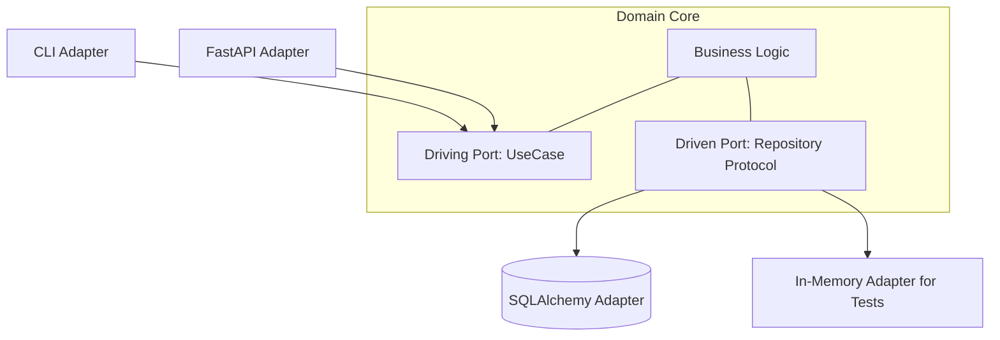
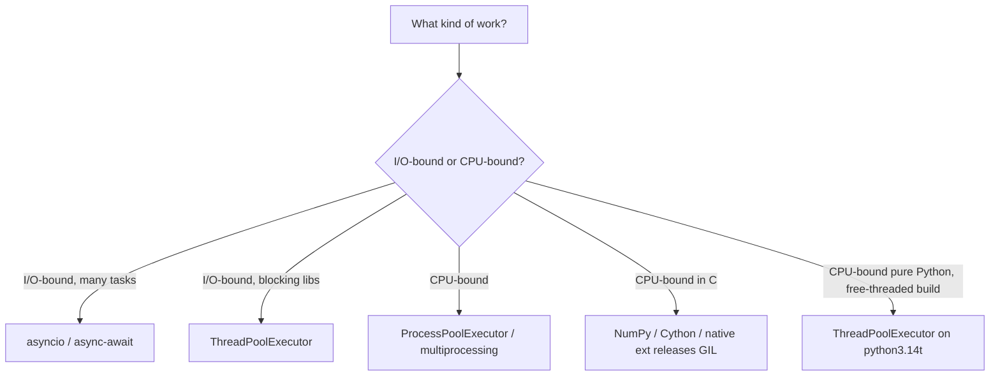
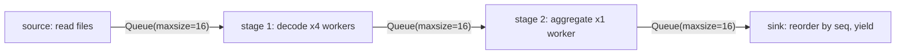
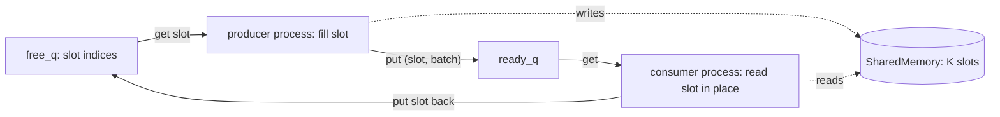

# Design Patterns in Python -- Comprehensive Reference

> A deep-dive, interview-focused reference covering software design patterns with idiomatic, modern Python (3.10+). Covers the design principles behind patterns, all 23 Gang of Four (GoF) patterns, Pythonic idioms that often replace classic patterns (first-class functions, decorators, Protocols, dataclasses, `functools`), and architectural and concurrency patterns. A recurring theme: Python's dynamic typing and first-class functions make many GoF patterns near-trivial or unnecessary. Each section includes intent, runnable code, the Pythonic alternative, trade-offs, and interview questions. Complements the *Python Fundamentals* and *CS Fundamentals* guides.

> **Related guides:** the language mechanisms that replace most patterns here are explained in [Python Fundamentals](../languages/Python_Fundamentals.md): [descriptors](../languages/Python_Fundamentals.md#121-the-descriptor-protocol), [metaclasses](../languages/Python_Fundamentals.md#123-metaclasses), [context managers](../languages/Python_Fundamentals.md#14-context-managers), [decorators](../languages/Python_Fundamentals.md#15-decorators), [`Protocol`](../languages/Python_Fundamentals.md#113-structural-subtyping-with-protocol-python-38), [iterators and generators](../languages/Python_Fundamentals.md#7-iterators--generators), and [the GIL](../languages/Python_Fundamentals.md#19-the-gil--threading). The same pattern catalogue in C++, with the same section numbers for the 23 GoF patterns, is [Design Patterns in C++](Design_Patterns_Cpp.md). Patterns applied to full machine-coding problems are in [Low Level Design Interview Prep](Low_Level_Design_Interview_Prep.md). Runnable concurrency exercises are in [Concurrency Coding Problems](../computer-science/Concurrency_Coding_Problems.md).

---

## Table of Contents

### Part 1: Foundations

1. [What Design Patterns Are (and Are Not)](#1-what-design-patterns-are-and-are-not)
2. [Design Principles: SOLID and Beyond](#2-design-principles-solid-and-beyond)
3. [Why Python Changes the Pattern Calculus](#3-why-python-changes-the-pattern-calculus)

### Part 2: Creational Patterns

4. [Singleton](#4-singleton)
5. [Factory Method](#5-factory-method)
6. [Abstract Factory](#6-abstract-factory)
7. [Builder](#7-builder)
8. [Prototype](#8-prototype)

### Part 3: Structural Patterns

9. [Adapter](#9-adapter)
10. [Bridge](#10-bridge)
11. [Composite](#11-composite)
12. [Decorator](#12-decorator)
13. [Facade](#13-facade)
14. [Flyweight](#14-flyweight)
15. [Proxy](#15-proxy)

### Part 4: Behavioral Patterns

16. [Chain of Responsibility](#16-chain-of-responsibility)
17. [Command](#17-command)
18. [Interpreter](#18-interpreter)
19. [Iterator](#19-iterator)
20. [Mediator](#20-mediator)
21. [Memento](#21-memento)
22. [Observer](#22-observer)
23. [State](#23-state)
24. [Strategy](#24-strategy)
25. [Template Method](#25-template-method)
26. [Visitor](#26-visitor)

### Part 5: Pythonic Idioms and Alternatives

27. [Duck Typing and Protocols](#27-duck-typing-and-protocols)
28. [Decorators (Function and Class)](#28-decorators-function-and-class)
29. [Context Managers](#29-context-managers)
30. [Descriptors and Properties](#30-descriptors-and-properties)
31. [Metaclasses](#31-metaclasses)
32. [functools: singledispatch, lru_cache, partial](#32-functools-singledispatch-lru_cache-partial)
33. [Dataclasses and First-Class Functions](#33-dataclasses-and-first-class-functions)

### Part 6: Architectural Patterns

34. [MVC, MVP, and MVVM](#34-mvc-mvp-and-mvvm)
35. [Layered and Hexagonal Architecture](#35-layered-and-hexagonal-architecture)
36. [Repository Pattern](#36-repository-pattern)
37. [Dependency Injection and IoC](#37-dependency-injection-and-ioc)
38. [Event-Driven and Publish-Subscribe](#38-event-driven-and-publish-subscribe)

### Part 7: Concurrency Patterns

39. [Producer-Consumer](#39-producer-consumer)
40. [Thread and Process Pools](#40-thread-and-process-pools)
41. [Future and Async/Await](#41-future-and-asyncawait)
42. [Actor Model](#42-actor-model)
43. [The GIL and Choosing a Concurrency Model](#43-the-gil-and-choosing-a-concurrency-model)
44. [Free-Threaded Python: What Changes for Patterns](#44-free-threaded-python-what-changes-for-patterns)
45. [Pipeline (Staged) Concurrency](#45-pipeline-staged-concurrency)
46. [Shared-Memory Buffer Pool Across Processes](#46-shared-memory-buffer-pool-across-processes)

### Part 8: Quick Reference

47. [Pattern Cheat Sheet](#47-pattern-cheat-sheet)
48. [Anti-Patterns](#48-anti-patterns)
49. [Decision Guide](#49-decision-guide)

---

# Part 1: Foundations

---

# 1. What Design Patterns Are (and Are Not)

A **design pattern** is a named, reusable solution to a commonly recurring design problem in a particular context. Patterns describe *how to structure objects and their interactions*; they are not code you copy, libraries you import, or finished designs. They were popularized by the 1994 "Gang of Four" (GoF) book *Design Patterns: Elements of Reusable Object-Oriented Software*.

**What a pattern gives you:**

- A shared vocabulary ("use a Strategy here") that compresses design discussions.
- A proven structure with documented trade-offs.
- Guidance on which parts of a design should vary independently.

**What a pattern is *not*:**

- A goal in itself -- forcing patterns where they aren't needed ("patternitis") adds accidental complexity.
- Language-neutral. The GoF examples target 1990s C++/Smalltalk. In Python, first-class functions, dynamic typing, and rich built-ins make many patterns trivial, one-liners, or unnecessary. Peter Norvig famously observed that 16 of the 23 GoF patterns are "invisible or simpler" in dynamic languages.

| Term | Meaning |
|---|---|
| **Idiom** | A low-level, language-specific pattern (e.g. context managers, comprehensions in Python). |
| **Design pattern** | A mid-level solution to an object-interaction problem (GoF). |
| **Architectural pattern** | A high-level structure for an entire system (MVC, layered, hexagonal). |
| **Anti-pattern** | A common "solution" that causes more harm than good. |

**The key question** before reaching for a pattern: *"what is varying, and how do I isolate that variation?"* In Python, the answer is frequently "pass a function" rather than "build a class hierarchy".

---

# 2. Design Principles: SOLID and Beyond

> See also: [SOLID in CS Fundamentals](../computer-science/CS_Fundamentals.md#42-solid-principles) · [the same principles in C++](Design_Patterns_Cpp.md#2-design-principles-solid-and-beyond) · [applying them in LLD interviews](Low_Level_Design_Interview_Prep.md#3-design-principles-and-modeling-tools).

Patterns are applications of deeper principles. Understanding the principles lets you derive patterns rather than memorize them.

## 2.1 SOLID

| Principle | Statement | Python application |
|---|---|---|
| **S** -- Single Responsibility | A class should have one reason to change. | Split modules/classes by concern; keep functions focused. |
| **O** -- Open/Closed | Open for extension, closed for modification. | Add behavior via new functions/subclasses or registration, not by editing `if/elif` chains; `functools.singledispatch`. |
| **L** -- Liskov Substitution | Subtypes must be usable through the base interface. | Honor the base class/Protocol contract; don't surprise callers with new exceptions or stricter inputs. |
| **I** -- Interface Segregation | Many small interfaces beat one fat one. | Small `Protocol`s / ABCs; rely on duck typing for narrow needs. |
| **D** -- Dependency Inversion | Depend on abstractions, not concretions. | Take a callable or a `Protocol`-typed dependency; inject it rather than importing a concrete class. |

## 2.2 Other key principles

- **Composition over inheritance.** Assemble behavior from collaborators and functions rather than deep class trees.
- **Program to an interface (Protocol), not an implementation.** In Python the "interface" is often just a duck-typed expectation or a `typing.Protocol`.
- **Encapsulate what varies.** Isolate the changing aspect behind a stable boundary (often a function parameter).
- **Law of Demeter.** Avoid long `a.b.c.d` chains; talk only to immediate collaborators.
- **DRY** and **YAGNI:** balance abstraction against speculative generality. Python's flexibility makes over-engineering especially easy and especially costly to read.
- **EAFP over LBYL:** "Easier to Ask Forgiveness than Permission" -- the Pythonic style of trying an operation and catching exceptions rather than pre-checking, which influences how patterns like Proxy and Chain are written.

```python
from typing import Protocol

class Logger(Protocol):              # structural interface -- no inheritance required
    def log(self, msg: str) -> None: ...

class OrderService:
    def __init__(self, logger: Logger) -> None:   # depend on the abstraction
        self._logger = logger
    def place(self) -> None:
        self._logger.log("order placed")
```

---

# 3. Why Python Changes the Pattern Calculus

> See also (the language features this section relies on): [first-class functions](../languages/Python_Fundamentals.md#51-function-basics--first-class-functions) · [closures](../languages/Python_Fundamentals.md#54-closures) · [decorators](../languages/Python_Fundamentals.md#15-decorators) · [`Protocol` structural typing](../languages/Python_Fundamentals.md#113-structural-subtyping-with-protocol-python-38) · [`dataclasses`](../languages/Python_Fundamentals.md#174-dataclasses).

Before each pattern, ask whether a Python feature already solves it. Recurring substitutions:

| GoF pattern | Pythonic replacement |
|---|---|
| Strategy | Pass a function (functions are first-class objects). |
| Command | A callable, `functools.partial`, or a closure. |
| Factory Method / Abstract Factory | A function returning objects; classes are first-class and callable. |
| Iterator | Generators and the iterator protocol (`__iter__`/`__next__`). |
| Template Method | Pass hook functions, or use ABCs with abstract methods. |
| Decorator (add behavior) | The `@decorator` syntax (function/class decorators). |
| Singleton | A module (modules are singletons), or a metaclass. |
| Visitor | `functools.singledispatch` (dispatch on type). |
| Adapter | Duck typing -- often no adapter class needed at all. |
| Prototype | `copy.copy` / `copy.deepcopy` built in. |
| Observer | A list of callbacks; or libraries (`blinker`). |

This does not make the patterns worthless -- knowing them clarifies *intent* and aids communication -- but idiomatic Python expresses most of them with far less ceremony than C++ or Java. The sections below show both the "classic" form (for recognition) and the Pythonic form (for real code).

# Part 2: Creational Patterns

---

# 4. Singleton

> See also: [modules are imported once and cached in `sys.modules`](../languages/Python_Fundamentals.md#181-module-basics) · [metaclasses](../languages/Python_Fundamentals.md#123-metaclasses) · [locks for thread-safe lazy init](../languages/Python_Fundamentals.md#193-synchronization-primitives) · [C++ Singleton (Meyers)](Design_Patterns_Cpp.md#4-singleton).

**Intent:** Ensure a class has exactly one instance with a global access point.

**The most Pythonic singleton is a module.** A module is imported once and cached in `sys.modules`; its top-level objects are effectively singletons with lazy, thread-safe initialization handled by the import system.

```python
# config.py  -- the module IS the singleton
_settings = {"debug": False}
def get(key): return _settings[key]
def set(key, value): _settings[key] = value
```

**Metaclass singleton** (when you truly need a single object of a class):

```python
class SingletonMeta(type):
    _instances: dict = {}
    def __call__(cls, *args, **kwargs):
        if cls not in cls._instances:
            cls._instances[cls] = super().__call__(*args, **kwargs)
        return cls._instances[cls]

class Database(metaclass=SingletonMeta):
    def __init__(self) -> None:
        self.connection = "connected"

a = Database()
b = Database()
assert a is b           # same instance
```

**Other approaches:** a decorator that caches the instance, or overriding `__new__`. For thread safety, guard creation with a `threading.Lock` (double-checked; the race and the fix are demonstrated in [Section 44.3](#443-lazy-initialization-double-checked-locking-in-python), and they matter on both the default and free-threaded builds).

**Trade-offs:** Singletons are global state -- they hide dependencies and complicate testing (tests can't easily reset or substitute them). Prefer dependency injection and pass the shared object explicitly; reserve the singleton for the composition root.

---

# 5. Factory Method

**Intent:** Define an interface for creating an object but let subclasses (or a function) decide which class to instantiate.

**Pythonic form -- a function, since classes are first-class callables:**

```python
from typing import Protocol

class Button(Protocol):
    def render(self) -> None: ...

class WinButton: 
    def render(self) -> None: ...
class MacButton:
    def render(self) -> None: ...

def make_button(os: str) -> Button:        # simple factory function
    registry = {"win": WinButton, "mac": MacButton}
    return registry[os]()                   # classes are callable -> instantiate
```

**Registry pattern (Open/Closed):** new types register themselves without editing the factory:

```python
_REGISTRY: dict[str, type] = {}
def register(name):
    def deco(cls):
        _REGISTRY[name] = cls
        return cls
    return deco

@register("png")
class PngExporter: ...

def create_exporter(fmt: str):
    return _REGISTRY[fmt]()
```

**Classic OO form** (for recognition): a base class with an abstract `create_button()` overridden by subclasses, used inside a template method. Rarely needed in Python.

---

# 6. Abstract Factory

**Intent:** Create *families* of related objects without specifying concrete classes.

```python
from typing import Protocol

class Button(Protocol): ...
class Checkbox(Protocol): ...

class GuiFactory(Protocol):
    def create_button(self) -> Button: ...
    def create_checkbox(self) -> Checkbox: ...

class WinFactory:
    def create_button(self) -> Button: return WinButton()
    def create_checkbox(self) -> Checkbox: return WinCheckbox()

class MacFactory:
    def create_button(self) -> Button: return MacButton()
    def create_checkbox(self) -> Checkbox: return MacCheckbox()

def build_ui(factory: GuiFactory) -> None:   # client codes against the Protocol
    button = factory.create_button()
    checkbox = factory.create_checkbox()
```

A factory in Python can even be a simple object or module grouping the related constructors. **Factory Method vs Abstract Factory:** Factory Method makes one product (via inheritance); Abstract Factory makes a coordinated *family* (via a composed object). Adding a new product *kind* forces changing every factory.

---

# 7. Builder

**Intent:** Construct a complex object step by step; useful when there are many optional parameters.

**Python often needs no builder** thanks to keyword arguments with defaults and dataclasses:

```python
from dataclasses import dataclass, field

@dataclass
class HttpRequest:
    url: str
    method: str = "GET"
    headers: dict[str, str] = field(default_factory=dict)
    body: str = ""
    timeout_ms: int = 30000

req = HttpRequest("https://api.example.com", method="POST", timeout_ms=5000)
```

**Fluent builder** when construction has steps/validation or you want a chainable DSL:

```python
class QueryBuilder:
    def __init__(self) -> None:
        self._table = ""
        self._wheres: list[str] = []
        self._limit: int | None = None
    def table(self, t: str) -> "QueryBuilder":
        self._table = t; return self
    def where(self, cond: str) -> "QueryBuilder":
        self._wheres.append(cond); return self
    def limit(self, n: int) -> "QueryBuilder":
        self._limit = n; return self
    def build(self) -> str:
        sql = f"SELECT * FROM {self._table}"
        if self._wheres: sql += " WHERE " + " AND ".join(self._wheres)
        if self._limit is not None: sql += f" LIMIT {self._limit}"
        return sql

sql = QueryBuilder().table("users").where("age > 18").limit(10).build()
```

Each method returns `self` to enable chaining. Prefer keyword args/dataclasses unless you need staged construction or validation logic.

---

# 8. Prototype

> See also: [copy semantics: assignment vs shallow vs deep copy](../languages/Python_Fundamentals.md#25-copy-semantics) · [`__deepcopy__` and the memo dict](../languages/Python_Fundamentals.md#253-deep-copy) · [C++ Prototype](Design_Patterns_Cpp.md#8-prototype).

**Intent:** Create new objects by copying an existing instance.

**Python has this built in** via the `copy` module -- no `clone()` method needed:

```python
import copy

class Sprite:
    def __init__(self, image, position, tags):
        self.image = image
        self.position = position
        self.tags = tags

original = Sprite("hero.png", [0, 0], ["player"])
shallow = copy.copy(original)        # new object, shared nested references
deep = copy.deepcopy(original)       # fully independent copy
```

**Shallow vs deep:** `copy.copy` copies the top object but shares nested mutable objects; `copy.deepcopy` recursively copies everything. Customize with `__copy__` and `__deepcopy__` if needed (e.g. to avoid copying a DB connection). A **prototype registry** maps keys to pre-configured instances you `deepcopy` on demand.

# Part 3: Structural Patterns

---

# 9. Adapter

**Intent:** Convert one interface into another that clients expect, so incompatible classes work together.

**Often unnecessary in Python** -- duck typing means an object only needs the right methods, not the right base class. When you genuinely must translate an API:

```python
class FahrenheitSensor:                 # adaptee with the "wrong" interface
    def get_fahrenheit(self) -> float:
        return 98.6

class CelsiusSensor:                     # target interface our code expects
    def get_celsius(self) -> float: ...

class FahrenheitToCelsiusAdapter:        # object adapter via composition
    def __init__(self, sensor: FahrenheitSensor) -> None:
        self._sensor = sensor
    def get_celsius(self) -> float:
        return (self._sensor.get_fahrenheit() - 32) * 5 / 9
```

A lighter adapter is sometimes just a function or a `functools.partial`. **Adapter vs Decorator vs Proxy:** Adapter *changes* an interface; Decorator *adds behavior* with the same interface; Proxy *controls access* with the same interface.

---

# 10. Bridge

**Intent:** Decouple an abstraction from its implementation so both vary independently, avoiding a combinatorial class explosion.

```python
from typing import Protocol

class DrawingAPI(Protocol):              # implementation side
    def draw_circle(self, x: float, y: float, r: float) -> None: ...

class RasterAPI:
    def draw_circle(self, x, y, r) -> None: ...   # pixel rendering
class VectorAPI:
    def draw_circle(self, x, y, r) -> None: ...   # svg rendering

class Shape:                              # abstraction holds an implementation
    def __init__(self, api: DrawingAPI) -> None:
        self._api = api
    def draw(self) -> None: ...

class Circle(Shape):
    def __init__(self, api: DrawingAPI, x, y, r) -> None:
        super().__init__(api)
        self.x, self.y, self.r = x, y, r
    def draw(self) -> None:
        self._api.draw_circle(self.x, self.y, self.r)   # delegate across the bridge
```

With N shapes and M renderers, Bridge needs N + M classes instead of N x M. **Bridge vs Strategy:** structurally similar (both delegate to an injected object), but Bridge is a design-time split of two whole hierarchies; Strategy is a runtime swap of one algorithm.

---

# 11. Composite

**Intent:** Compose objects into trees and treat individual objects and compositions uniformly.

```python
from typing import Protocol

class FsNode(Protocol):
    def size(self) -> int: ...

class File:                              # leaf
    def __init__(self, bytes_: int) -> None:
        self._bytes = bytes_
    def size(self) -> int:
        return self._bytes

class Directory:                          # composite
    def __init__(self) -> None:
        self._children: list[FsNode] = []
    def add(self, node: FsNode) -> None:
        self._children.append(node)
    def size(self) -> int:
        return sum(child.size() for child in self._children)   # recurse uniformly

root = Directory()
root.add(File(100))
sub = Directory(); sub.add(File(50)); root.add(sub)
print(root.size())   # 150
```

Both `File` and `Directory` satisfy `FsNode`, so client code treats them identically. Examples: DOM trees, GUI widget trees, expression ASTs, JSON-like nested structures.

---

# 12. Decorator

> See also: [function decorators in depth](../languages/Python_Fundamentals.md#15-decorators) · [`functools.wraps`](../languages/Python_Fundamentals.md#152-preserving-metadata-with-wraps) · [C++ Decorator](Design_Patterns_Cpp.md#12-decorator).

**Intent:** Attach additional responsibilities to an object dynamically -- a flexible alternative to subclassing.

**Python has two distinct things called "decorator":** the GoF object-wrapping pattern, and the `@` syntax (a language feature). The `@` decorator is the idiomatic way to add behavior to *functions/methods*:

```python
import functools, time

def timed(func):                          # function decorator
    @functools.wraps(func)                # preserve name/docstring/signature
    def wrapper(*args, **kwargs):
        start = time.perf_counter()
        result = func(*args, **kwargs)
        print(f"{func.__name__} took {time.perf_counter()-start:.4f}s")
        return result
    return wrapper

@timed
def crunch(n: int) -> int:
    return sum(range(n))
```

The **GoF object decorator** wraps an object to extend it, stacking at runtime:

```python
class DataSource(Protocol):
    def write(self, data: str) -> None: ...
    def read(self) -> str: ...

class FileSource: ...                      # concrete component

class CompressionDecorator:                # wraps another DataSource
    def __init__(self, wrapped: DataSource) -> None:
        self._wrapped = wrapped
    def write(self, data: str) -> None:
        self._wrapped.write(compress(data))
    def read(self) -> str:
        return decompress(self._wrapped.read())

source = CompressionDecorator(EncryptionDecorator(FileSource()))   # stack in any order
```

`@functools.wraps` is essential so the wrapper keeps the original metadata. Decorators that take arguments are decorator factories (a function returning a decorator).

---

# 13. Facade

**Intent:** Provide a simplified, unified interface to a complex subsystem.

```python
class VideoConverter:                      # facade over codecs, readers, mixers
    def convert(self, filename: str, fmt: str) -> "File":
        file = FileReader.read(filename)
        codec = CodecFactory.extract(file)
        result = BitrateReader.process(file, codec)
        return AudioMixer().fix(result, fmt)   # client never sees the internals

mp4 = VideoConverter().convert("clip.ogg", "mp4")
```

A facade is often just a function or a module that wraps a sequence of lower-level calls. **Facade vs Adapter:** Adapter makes an existing interface match an expected one; Facade defines a *new, simpler* interface over many classes. The facade doesn't forbid direct subsystem access -- it's a convenience layer.

---

# 14. Flyweight

> See also: [`__slots__` for memory optimization](../languages/Python_Fundamentals.md#233-__slots__-for-memory-optimization) · [what `__slots__` really saves](../languages/Python_Fundamentals.md#247-shallow-vs-deep-size-and-what-__slots__-really-saves) · [interning and small-int caching (CPython's own flyweights)](../languages/Python_Fundamentals.md#15-interning-and-caching) · [C++ Flyweight](Design_Patterns_Cpp.md#14-flyweight).

**Intent:** Share many fine-grained objects efficiently by separating shared (intrinsic) state from per-use (extrinsic) state.

```python
import sys

class Glyph:                               # intrinsic, shared, immutable
    __slots__ = ("char", "font")           # __slots__ shrinks per-instance memory
    def __init__(self, char: str, font: str) -> None:
        self.char = char
        self.font = font

class GlyphFactory:
    def __init__(self) -> None:
        self._pool: dict[tuple[str, str], Glyph] = {}
    def get(self, char: str, font: str) -> Glyph:
        key = (char, font)
        if key not in self._pool:
            self._pool[key] = Glyph(char, font)    # create once, reuse forever
        return self._pool[key]
```

**Python built-ins already do this:** small integers (-5..256) and short interned strings are cached/shared by CPython (`a = 256; b = 256; a is b` is `True`). Use `__slots__` to cut memory for many small objects, and a pool/cache (`functools.lru_cache`) to share immutable flyweights.

---

# 15. Proxy

> See also: [`__getattr__` / `__getattribute__` (how a transparent proxy forwards)](../languages/Python_Fundamentals.md#107-attribute-access-methods) · [`weakref.proxy`](../languages/Python_Fundamentals.md#243-weak-references) · [C++ Proxy](Design_Patterns_Cpp.md#15-proxy).

**Intent:** Provide a surrogate for another object to control access to it.

| Variant | Purpose |
|---|---|
| **Virtual proxy** | Lazy creation/loading of an expensive object |
| **Protection proxy** | Permission checks before delegating |
| **Remote proxy** | Local stand-in for a remote object (RPC) |
| **Caching proxy** | Memoize expensive results |

```python
class ExpensiveImage:
    def __init__(self, path: str) -> None:
        self._path = path
        self._load()                        # heavy work
    def display(self) -> None: ...

class LazyImageProxy:                        # virtual proxy
    def __init__(self, path: str) -> None:
        self._path = path
        self._real: ExpensiveImage | None = None
    def display(self) -> None:
        if self._real is None:
            self._real = ExpensiveImage(self._path)   # create on first use
        self._real.display()
```

`__getattr__` makes transparent proxies easy -- forward any unknown attribute to the wrapped object:

```python
class LoggingProxy:
    def __init__(self, target) -> None:
        object.__setattr__(self, "_target", target)
    def __getattr__(self, name):
        print(f"accessing {name}")
        return getattr(self._target, name)   # delegate everything else
```

**Proxy vs Decorator:** both wrap and keep the interface, but Proxy *controls access/lifetime* (often creating the subject itself) while Decorator *adds behavior* to an object handed to it.

# Part 4: Behavioral Patterns

---

# 16. Chain of Responsibility

**Intent:** Pass a request along a chain of handlers; each handles it or forwards it. Decouples sender from receiver.

```python
from typing import Callable, Optional

Handler = Callable[[dict], Optional[str]]   # returns a result, or None to pass on

def make_chain(*handlers: Handler) -> Handler:
    def run(request: dict) -> Optional[str]:
        for handler in handlers:
            result = handler(request)
            if result is not None:           # handled -> stop
                return result
        return None
    return run

def auth(req):  return "401" if not req.get("user") else None
def validate(req): return "400" if not req.get("body") else None
def process(req): return "200 OK"

pipeline = make_chain(auth, validate, process)
print(pipeline({"user": "ann", "body": "x"}))   # 200 OK
```

The classic OO form links handler objects via a `next` reference, but a list of functions is the Pythonic expression. Used for middleware (WSGI/ASGI), event bubbling, and validation pipelines.

---

# 17. Command

**Intent:** Encapsulate a request as an object to parameterize, queue, log, or undo it.

**A callable is a command in Python.** Use closures or `functools.partial` for fire-and-forget commands:

```python
import functools

def insert_text(doc, text, pos): ...
command = functools.partial(insert_text, doc, "hello", 0)   # a deferred call
command()                                                    # execute later
```

**Full command with undo** (when you need reversibility) -- use callables or a small protocol:

```python
from dataclasses import dataclass

@dataclass
class InsertCommand:
    doc: list
    text: str
    pos: int
    def execute(self) -> None: self.doc.insert(self.pos, self.text)
    def undo(self) -> None:    del self.doc[self.pos]

class History:
    def __init__(self) -> None:
        self._done: list = []
    def run(self, cmd) -> None:
        cmd.execute(); self._done.append(cmd)
    def undo(self) -> None:
        if self._done: self._done.pop().undo()
```

Queue commands as `list[Callable]`, or for undo/redo/serialization use the object form. The `__call__` dunder lets a command object also behave like a plain function.

---

# 18. Interpreter

**Intent:** Define a representation for a grammar plus an interpreter to evaluate sentences of the language.

```python
from dataclasses import dataclass
from typing import Union

@dataclass
class Num:
    value: int
    def eval(self) -> int: return self.value

@dataclass
class Add:
    left: "Expr"
    right: "Expr"
    def eval(self) -> int: return self.left.eval() + self.right.eval()

Expr = Union[Num, Add]

tree = Add(Num(3), Add(Num(4), Num(5)))
print(tree.eval())   # 12
```

The AST is a Composite; the Interpreter adds `eval`. For real languages use `ast`, `lark`, or `pyparsing` rather than hand-rolling. Best reserved for small, stable DSLs (filter rules, calculators).

---

# 19. Iterator

> See also: [the iterator protocol](../languages/Python_Fundamentals.md#71-the-iterator-protocol) · [generator functions](../languages/Python_Fundamentals.md#72-generator-functions) · [`itertools`](../languages/Python_Fundamentals.md#75-the-itertools-module) · [C++ Iterator](Design_Patterns_Cpp.md#19-iterator).

**Intent:** Access elements of a collection sequentially without exposing its internals.

**Python builds this in** via the iterator protocol (`__iter__`/`__next__`) and especially **generators**:

```python
class Fibonacci:
    def __init__(self, n: int) -> None:
        self._n = n
    def __iter__(self):                      # generator-based iterator
        a, b = 0, 1
        for _ in range(self._n):
            yield a
            a, b = b, a + b

for x in Fibonacci(8):
    print(x)                                  # 0 1 1 2 3 5 8 13
```

A generator function returns an iterator automatically; `yield` suspends/resumes state. This is the canonical Iterator in Python -- you almost never implement `__next__` by hand. Generators are also lazy (compute on demand) and composable (`itertools`).

---

# 20. Mediator

**Intent:** Centralize complex many-to-many interactions in one object so components don't reference each other directly.

```python
class ChatRoom:                              # mediator
    def __init__(self) -> None:
        self._users: list["User"] = []
    def register(self, user: "User") -> None:
        self._users.append(user); user.room = self
    def broadcast(self, msg: str, sender: "User") -> None:
        for user in self._users:
            if user is not sender:
                user.receive(msg)            # central routing

class User:
    def __init__(self, name: str) -> None:
        self.name = name; self.room: ChatRoom | None = None
    def send(self, msg: str) -> None:
        self.room.broadcast(msg, self)
    def receive(self, msg: str) -> None: ...
```

**Mediator vs Observer:** Observer is generic one-to-many notification; Mediator encapsulates *specific bidirectional* coordination logic. Keep the mediator focused or it becomes a God object.

---

# 21. Memento

**Intent:** Capture and restore an object's internal state without breaking encapsulation.

```python
import copy

class Editor:
    def __init__(self) -> None:
        self._text = ""
    def type(self, s: str) -> None:
        self._text += s
    def save(self) -> dict:                   # produce an opaque snapshot
        return copy.deepcopy(self.__dict__)
    def restore(self, memento: dict) -> None:
        self.__dict__.update(memento)

editor = Editor()
editor.type("hello")
snapshot = editor.save()
editor.type(" world")
editor.restore(snapshot)                       # back to "hello"
```

Roles: *Originator* (Editor) creates/uses mementos; *Caretaker* (a history stack) stores them without inspecting them. Snapshots can be a `dataclass`, a dict, or a `copy.deepcopy` of state. Combine with Command for undo/redo.

---

# 22. Observer

> See also: [weak references](../languages/Python_Fundamentals.md#243-weak-references) and [`weakref` patterns for breaking cycles](../languages/Python_Fundamentals.md#249-cycles-__del__-and-weakref-patterns) (a subject holding strong references keeps every observer alive) · [C++ Observer](Design_Patterns_Cpp.md#22-observer) · [LLD: Notification Service](Low_Level_Design_Interview_Prep.md#12-worked-design-notification-service).

**Intent:** One-to-many dependency: when the subject changes, all observers are notified.

**A list of callbacks is the Pythonic Observer:**

```python
from typing import Callable

class Observable:
    def __init__(self) -> None:
        self._observers: list[Callable[[int], None]] = []
    def subscribe(self, callback: Callable[[int], None]) -> Callable[[], None]:
        self._observers.append(callback)
        return lambda: self._observers.remove(callback)   # return an unsubscribe handle
    def notify(self, value: int) -> None:
        for cb in list(self._observers):                  # iterate a copy (re-entrancy safe)
            cb(value)

stock = Observable()
unsubscribe = stock.subscribe(lambda price: print(f"price={price}"))
stock.notify(100)
unsubscribe()
```

**Pitfalls:** iterate over a *copy* of the observer list so callbacks can subscribe/unsubscribe during notification; beware holding strong references that prevent garbage collection (use `weakref` for long-lived subjects). Libraries: `blinker`, Qt signals, RxPY for reactive streams.

---

# 23. State

> See also: [`enum` for state names](../languages/Python_Fundamentals.md#307-enum-module) · [`match`/`case` for small state machines](../languages/Python_Fundamentals.md#44-structural-pattern-matching-matchcase-python-310) · [C++ State](Design_Patterns_Cpp.md#23-state) · [LLD: Vending Machine (State in a worked design)](Low_Level_Design_Interview_Prep.md#7-worked-design-vending-machine).

**Intent:** Let an object change behavior when its internal state changes, replacing large `if/elif` state machines with polymorphism.

```python
from typing import Protocol

class State(Protocol):
    def publish(self, doc: "Document") -> None: ...

class Draft:
    def publish(self, doc): doc.state = Moderation()
class Moderation:
    def publish(self, doc): doc.state = Published()
class Published:
    def publish(self, doc): pass               # already published

class Document:
    def __init__(self) -> None:
        self.state: State = Draft()
    def publish(self) -> None:
        self.state.publish(self)               # delegate to current state

doc = Document()
doc.publish()   # Draft -> Moderation
doc.publish()   # Moderation -> Published
```

For simple machines, an `enum` plus a transition table (dict) is often clearer; libraries like `transitions` handle complex FSMs. **State vs Strategy:** identical structure, but State objects drive their own transitions and know about each other, whereas Strategy algorithms are independent and chosen by the client.

---

# 24. Strategy

> See also: [first-class functions](../languages/Python_Fundamentals.md#51-function-basics--first-class-functions) · [closures](../languages/Python_Fundamentals.md#54-closures) · [late-binding closure pitfall](../languages/Python_Fundamentals.md#272-late-binding-closures) · [C++ Strategy](Design_Patterns_Cpp.md#24-strategy).

**Intent:** Define interchangeable algorithms and swap them at runtime.

**Pass a function -- this is the canonical example of "functions replace patterns" in Python:**

```python
from typing import Callable

def quicksort(data): return sorted(data)
def reverse_sort(data): return sorted(data, reverse=True)

class Sorter:
    def __init__(self, strategy: Callable[[list], list]) -> None:
        self._strategy = strategy
    def run(self, data: list) -> list:
        return self._strategy(data)

Sorter(reverse_sort).run([3, 1, 2])           # [3, 2, 1]
```

The built-in `sorted(data, key=...)` already takes a strategy (the `key` function). Use the class-based form only when strategies carry significant state or must be enumerated/serialized. `functools.partial` parameterizes a strategy without writing a class.

---

# 25. Template Method

**Intent:** Define an algorithm skeleton, deferring specific steps to subclasses.

```python
from abc import ABC, abstractmethod

class DataMiner(ABC):
    def mine(self, path: str) -> None:        # template method: fixed skeleton
        raw = self._open(path)
        data = self._extract(raw)             # varies by subclass
        self._report(self._analyze(data))     # common steps

    @abstractmethod
    def _extract(self, raw: str) -> list: ... # hook

    def _open(self, path): ...                 # shared
    def _analyze(self, data): ...              # shared
    def _report(self, analysis): ...           # shared

class CsvMiner(DataMiner):
    def _extract(self, raw): return raw.split(",")
```

**Hollywood Principle** -- "don't call us, we'll call you": the base controls flow and calls down into hooks. The Pythonic alternative is to pass the varying step as a *function* argument (composition over inheritance), turning Template Method into Strategy.

---

# 26. Visitor

> See also: [`functools` (`singledispatch`)](../languages/Python_Fundamentals.md#162-functools-module) · [`match`/`case` class patterns](../languages/Python_Fundamentals.md#44-structural-pattern-matching-matchcase-python-310) · [C++ Visitor and `std::variant`](Design_Patterns_Cpp.md#26-visitor).

**Intent:** Add new operations over a fixed set of element types without modifying those types.

**`functools.singledispatch` is the Pythonic Visitor** -- it dispatches on the type of the first argument:

```python
from functools import singledispatch
from dataclasses import dataclass

@dataclass
class Circle: radius: float
@dataclass
class Square: side: float

@singledispatch
def area(shape) -> float:
    raise NotImplementedError(f"no area for {type(shape)}")

@area.register
def _(shape: Circle) -> float:
    return 3.14159 * shape.radius ** 2

@area.register
def _(shape: Square) -> float:
    return shape.side ** 2

print(area(Circle(2)))   # 12.566...
```

This adds a new *operation* (`area`, then `perimeter`, ...) without touching the shape classes -- exactly Visitor's intent -- and avoids the verbose `accept`/`visit` double-dispatch boilerplate. **Trade-off:** like Visitor, easy to add operations but adding a new *type* means updating each dispatched function. The classic `accept(visitor)` form still appears in AST libraries (`ast.NodeVisitor`).

# Part 5: Pythonic Idioms and Alternatives

These are Python-specific patterns -- language features and idioms that frequently replace classic GoF patterns or express them with far less code.

---

# 27. Duck Typing and Protocols

> See also: [abstract base classes](../languages/Python_Fundamentals.md#111-abstract-base-classes-abc-module) · [virtual subclasses](../languages/Python_Fundamentals.md#112-virtual-subclasses) · [`Protocol` structural subtyping](../languages/Python_Fundamentals.md#113-structural-subtyping-with-protocol-python-38) · [type hints and static typing](../languages/Python_Fundamentals.md#17-type-hints--static-typing).

**Duck typing:** "If it walks like a duck and quacks like a duck, it's a duck." Python cares about whether an object *has the required methods*, not its class. This eliminates the need for many Adapter and interface declarations.

```python
def render_all(items):                 # works with ANY object that has .render()
    for item in items:
        item.render()                  # no common base class required
```

**Protocols (PEP 544, structural subtyping):** `typing.Protocol` gives you static type checking for duck typing -- a class satisfies a Protocol just by having the right methods, with no explicit inheritance:

```python
from typing import Protocol, runtime_checkable

@runtime_checkable
class Drawable(Protocol):
    def draw(self) -> None: ...

class Circle:
    def draw(self) -> None: ...        # satisfies Drawable without inheriting it

def paint(d: Drawable) -> None:        # type checker enforces the structural contract
    d.draw()

paint(Circle())                         # OK
isinstance(Circle(), Drawable)          # True (with @runtime_checkable)
```

**ABCs vs Protocols:** Abstract Base Classes (`abc.ABC`) use *nominal* subtyping (you must inherit and they can enforce method implementation at instantiation); Protocols use *structural* subtyping (no inheritance, ideal for duck typing and third-party types you can't modify). Prefer Protocols for interfaces, ABCs when you want shared implementation or runtime enforcement.

---

# 28. Decorators (Function and Class)

> See also: [decorators in Python Fundamentals](../languages/Python_Fundamentals.md#15-decorators) · [decorators with arguments](../languages/Python_Fundamentals.md#153-decorators-with-arguments) · [class decorators](../languages/Python_Fundamentals.md#154-class-decorators) · [stacking order](../languages/Python_Fundamentals.md#155-stacking-decorators).

A **decorator** is a callable that takes a function/class and returns a replacement -- the language's built-in tool for adding cross-cutting behavior (the Decorator pattern, AOP-style).

```python
import functools

def retry(times: int):                  # decorator factory (takes arguments)
    def decorator(func):
        @functools.wraps(func)
        def wrapper(*args, **kwargs):
            for attempt in range(times):
                try:
                    return func(*args, **kwargs)
                except Exception:
                    if attempt == times - 1:
                        raise
        return wrapper
    return decorator

@retry(times=3)
def fetch(url): ...
```

**Class decorators** modify or wrap classes (`@dataclass`, `@functools.total_ordering`):

```python
@functools.total_ordering             # generates <=, >, >= from __eq__ and __lt__
class Version:
    def __init__(self, major, minor):
        self.major, self.minor = major, minor
    def __eq__(self, o): return (self.major, self.minor) == (o.major, o.minor)
    def __lt__(self, o): return (self.major, self.minor) < (o.major, o.minor)
```

Always use `@functools.wraps` to preserve the wrapped object's metadata. Decorators stack bottom-up. Common uses: caching, logging, timing, access control, registration, validation.

---

# 29. Context Managers

> See also: [context managers in depth](../languages/Python_Fundamentals.md#14-context-managers) · [`contextlib` utilities (`ExitStack`, `suppress`)](../languages/Python_Fundamentals.md#144-contextlib-utilities) · [async context managers](../languages/Python_Fundamentals.md#215-async-iteration-and-context-managers) · [C++ RAII](Design_Patterns_Cpp.md#27-raii----resource-acquisition-is-initialization).

**Intent:** Guarantee setup/teardown around a block -- Python's equivalent of C++ RAII. Implemented via `__enter__`/`__exit__` or the `@contextmanager` generator decorator.

```python
from contextlib import contextmanager

class FileResource:                    # class-based context manager
    def __init__(self, path: str) -> None:
        self._path = path
    def __enter__(self):
        self._f = open(self._path)
        return self._f
    def __exit__(self, exc_type, exc_val, tb):
        self._f.close()               # runs even if the block raises
        return False                   # don't suppress exceptions

@contextmanager
def timer(label: str):                 # generator-based context manager
    import time
    start = time.perf_counter()
    try:
        yield                          # the "with" body runs here
    finally:
        print(f"{label}: {time.perf_counter()-start:.4f}s")

with timer("work"):
    do_stuff()
```

`__exit__` runs on normal exit *and* on exceptions, making cleanup deterministic. `contextlib` offers `suppress`, `closing`, `ExitStack` (manage a dynamic number of contexts), and async context managers (`__aenter__`/`__aexit__`).

---

# 30. Descriptors and Properties

> See also: [the descriptor protocol](../languages/Python_Fundamentals.md#121-the-descriptor-protocol) · [how `property` works under the hood](../languages/Python_Fundamentals.md#122-how-property-works-under-the-hood) · [properties](../languages/Python_Fundamentals.md#83-properties).

**Descriptors** are objects defining `__get__`/`__set__`/`__delete__` that control attribute access -- the mechanism behind `property`, `classmethod`, `staticmethod`, and ORM fields. They underpin reusable, type-safe attribute behavior.

```python
class Positive:                         # reusable validating descriptor
    def __set_name__(self, owner, name):
        self._name = f"_{name}"
    def __get__(self, obj, objtype=None):
        return getattr(obj, self._name)
    def __set__(self, obj, value):
        if value <= 0:
            raise ValueError("must be positive")
        setattr(obj, self._name, value)

class Account:
    balance = Positive()                # validation reused declaratively
    def __init__(self, balance):
        self.balance = balance
```

**`property`** is the common, simpler case -- computed/validated attributes without a separate class:

```python
class Circle:
    def __init__(self, r): self._r = r
    @property
    def area(self) -> float:            # accessed like an attribute: c.area
        return 3.14159 * self._r ** 2
    @property
    def radius(self) -> float: return self._r
    @radius.setter
    def radius(self, value) -> None:
        if value < 0: raise ValueError
        self._r = value
```

Use `property` for one-off computed attributes; write a descriptor when the same access logic is reused across many attributes/classes.

---

# 31. Metaclasses

> See also: [metaclasses in Python Fundamentals](../languages/Python_Fundamentals.md#123-metaclasses) · [`__init_subclass__`, the simpler alternative](../languages/Python_Fundamentals.md#124-__init_subclass__-simpler-alternative-python-36) · [C++ plugin and registry architecture](Design_Patterns_Cpp.md#48-plugin-and-registry-architecture).

**Intent:** Control how *classes themselves* are created (a class is an instance of its metaclass, which defaults to `type`). The deepest customization hook -- "metaclasses are deeper magic than 99% of users should ever worry about" (Tim Peters).

```python
class RegistryMeta(type):
    registry: dict = {}
    def __new__(mcs, name, bases, namespace):
        cls = super().__new__(mcs, name, bases, namespace)
        if bases:                       # skip the base class itself
            RegistryMeta.registry[name] = cls   # auto-register every subclass
        return cls

class Plugin(metaclass=RegistryMeta):
    pass

class PdfPlugin(Plugin): pass           # automatically registered
print(RegistryMeta.registry)           # {'PdfPlugin': <class ...>}
```

**Use cases:** singletons (Section 4), auto-registration, enforcing class invariants, ORMs/serializers that build fields from class attributes. **Prefer simpler tools first:** `__init_subclass__` (customize subclass creation) and `__set_name__` (descriptor naming) handle most cases that historically needed metaclasses, with far less complexity. Class decorators are another lighter alternative.

---

# 32. functools: singledispatch, lru_cache, partial

> See also: [the `functools` module](../languages/Python_Fundamentals.md#162-functools-module) · [`operator` module](../languages/Python_Fundamentals.md#163-operator-module) · [`lru_cache` on a method keeps `self` alive (leak hunting)](../languages/Python_Fundamentals.md#248-leak-hunting-tracemalloc-diffs-gcget_referrers-objgraph).

The `functools` module provides several pattern-replacing tools:

```python
from functools import singledispatch, lru_cache, partial, reduce

# singledispatch -> Visitor / type-based dispatch (Section 26)
@singledispatch
def serialize(obj): raise NotImplementedError
@serialize.register
def _(obj: int): return str(obj)
@serialize.register
def _(obj: list): return "[" + ",".join(serialize(x) for x in obj) + "]"

# lru_cache -> memoization / Flyweight-style caching / virtual proxy
@lru_cache(maxsize=128)
def fib(n: int) -> int:
    return n if n < 2 else fib(n-1) + fib(n-2)

# partial -> pre-bound Command / Strategy
def log(level, msg): print(f"[{level}] {msg}")
error = partial(log, "ERROR")           # a specialized callable
error("disk full")                       # [ERROR] disk full
```

| Tool | Replaces / enables |
|---|---|
| `singledispatch` | Visitor, type-based polymorphism |
| `lru_cache` / `cache` | Memoization, caching proxy, flyweight |
| `partial` | Command, parameterized Strategy, currying |
| `reduce` | Fold/accumulate behavioral logic |
| `wraps` | Correct decorators |
| `total_ordering` | Generate comparison operators |
| `cached_property` | Lazy computed attribute (virtual proxy on an attribute) |

---

# 33. Dataclasses and First-Class Functions

> See also: [`dataclasses`](../languages/Python_Fundamentals.md#174-dataclasses) · [typed `NamedTuple`](../languages/Python_Fundamentals.md#175-namedtuple-typed) · [closures](../languages/Python_Fundamentals.md#54-closures) · [mutable default arguments (why `field(default_factory=list)` exists)](../languages/Python_Fundamentals.md#56-mutable-default-arguments-classic-pitfall).

**Dataclasses** (PEP 557) auto-generate `__init__`, `__repr__`, `__eq__`, and ordering, eliminating boilerplate for data-holding classes and replacing many Builder/value-object uses:

```python
from dataclasses import dataclass, field

@dataclass(frozen=True, order=True)     # frozen -> immutable & hashable; order -> comparisons
class Point:
    x: float
    y: float
    tags: list[str] = field(default_factory=list)   # mutable default done safely

p = Point(1.0, 2.0)
# p.x = 5  # raises -- frozen dataclass is immutable (good for value objects / flyweights)
```

**First-class functions** are the single biggest reason Python needs fewer patterns -- functions can be passed, returned, stored, and composed:

```python
# Functions as Strategy, stored in a dispatch table (replaces a switch/Factory):
operations = {
    "add": lambda a, b: a + b,
    "sub": lambda a, b: a - b,
    "mul": lambda a, b: a * b,
}
result = operations["add"](2, 3)        # 5

# Closures capture state (replace small Command/State objects):
def make_counter(start=0):
    count = start
    def increment():
        nonlocal count
        count += 1
        return count
    return increment

c = make_counter()
c(); c()                                  # 1, 2
```

When you find yourself writing a class with a single method, ask whether a function or closure would be clearer. When you write a class that's all data, reach for `@dataclass` (or `NamedTuple` / `attrs` / Pydantic for validation).

# Part 6: Architectural Patterns

Architectural patterns organize an entire application. They build on the GoF patterns (Observer, Strategy, Facade) at a larger scale.

---

# 34. MVC, MVP, and MVVM

These separate **domain/data**, **UI**, and the **glue** so each can change and be tested independently.

| Pattern | Parts | Who updates the view | Typical use |
|---|---|---|---|
| **MVC** | Model, View, Controller | View observes Model; Controller handles input | Django (MTV variant), Flask apps |
| **MVP** | Model, View, Presenter | Presenter pushes data to a passive View | Desktop/test-heavy UIs |
| **MVVM** | Model, View, ViewModel | Data binding syncs View <-> ViewModel | Declarative UIs |

```python
class Model:                            # domain data + observer subject
    def __init__(self) -> None:
        self._value = 0
        self._observers: list = []
    def subscribe(self, cb): self._observers.append(cb)
    def set(self, v: int) -> None:
        self._value = v
        for cb in self._observers: cb(v)

class View:
    def __init__(self, model: Model) -> None:
        model.subscribe(self.render)
    def render(self, value: int) -> None:
        print(f"value is {value}")

class Controller:                        # translates input into model changes
    def __init__(self, model: Model) -> None:
        self._model = model
    def on_input(self, value: int) -> None:
        self._model.set(value)
```

Note Django calls its variant **MTV** (Model-Template-View): the "view" is the controller-like function and the "template" is the presentation. The key win is that the Model has no UI dependency and is unit-testable on its own.

---

# 35. Layered and Hexagonal Architecture

**Layered (n-tier):** Presentation -> Application/Service -> Domain -> Infrastructure. Each layer depends only on the one below. Simple and common; risks leaking infrastructure concerns upward.

**Hexagonal (Ports and Adapters):** the domain sits at the center and defines **ports** (interfaces, in Python usually `Protocol`s or ABCs); the outside world plugs in via **adapters**. All dependencies point *inward*, so the domain knows nothing about web frameworks or databases.



```python
from typing import Protocol

class UserRepository(Protocol):          # port -- defined by the domain
    def find(self, user_id: int) -> "User | None": ...
    def save(self, user: "User") -> None: ...

class RegisterUser:                       # use case depends only on the port
    def __init__(self, repo: UserRepository) -> None:
        self._repo = repo
    def execute(self, user: "User") -> None:
        self._repo.save(user)

class SqlUserRepository:      ...          # adapter: real DB
class InMemoryUserRepository:             # adapter: fake for tests
    def __init__(self): self._data: dict = {}
    def find(self, user_id): return self._data.get(user_id)
    def save(self, user): self._data[user.id] = user
```

The core is testable with the in-memory adapter, and technology choices stay swappable and deferrable.

---

# 36. Repository Pattern

**Intent:** Provide a collection-like interface for accessing domain objects, hiding persistence (SQL, ORM, file, API) behind it.

```python
from typing import Protocol

class ProductRepository(Protocol):
    def get(self, product_id: int) -> "Product | None": ...
    def find_by_category(self, category: str) -> list["Product"]: ...
    def add(self, product: "Product") -> None: ...
    def remove(self, product_id: int) -> None: ...
```

**Benefits:** domain code calls `repo.get(id)` and never sees SQL; storage is swappable; caching can be added transparently (a decorator/proxy over the repository); tests use an in-memory implementation. **Pitfall:** leaking query details (raw SQL, ORM querysets) through the interface defeats the abstraction -- use typed query methods or a Specification object. Often paired with **Unit of Work** to manage transactions.

---

# 37. Dependency Injection and IoC

> See also: [mocking with `unittest.mock`](../languages/Python_Fundamentals.md#283-mocking) · [pytest fixtures as an injection mechanism](../languages/Python_Fundamentals.md#285-conftestpy-and-fixture-discovery) · [C++ Dependency Injection](Design_Patterns_Cpp.md#37-dependency-injection-and-ioc).

**Inversion of Control:** a class does not create its own dependencies; they are supplied from outside. **Dependency Injection** passes collaborators in -- the key enabler of testability and the practical form of the Dependency Inversion principle.

```python
# Without DI -- hard-wired, hard to test:
class ReportService_Bad:
    def __init__(self) -> None:
        self._db = SqlDatabase()          # created internally -> can't substitute

# With constructor injection -- depend on an abstraction passed in:
from typing import Protocol
class Database(Protocol):
    def query(self, sql: str) -> list: ...

class ReportService:
    def __init__(self, db: Database) -> None:
        self._db = db                      # injected; pass a real DB or a fake in tests
    def build(self) -> "Report":
        return Report(self._db.query("SELECT ..."))
```

| Form | How | Notes |
|---|---|---|
| Constructor injection | Pass via `__init__` | Preferred -- explicit, object always valid |
| Setter/attribute injection | Assign later | For optional dependencies |
| Parameter injection | Pass per call | When the dependency varies per operation |

**Composition root:** wire dependencies in one place (e.g. `main` or an app factory). Python's dynamic nature makes manual DI easy; frameworks like FastAPI provide built-in DI (`Depends`), and libraries like `dependency-injector` or `punq` offer containers when wiring grows large.

---

# 38. Event-Driven and Publish-Subscribe

**Intent:** Components communicate by emitting/reacting to events rather than calling each other directly. Pub/Sub generalizes Observer with a broker that routes messages by topic, so publishers and subscribers never reference each other.

```python
from collections import defaultdict
from typing import Callable

class EventBus:
    def __init__(self) -> None:
        self._subscribers: dict[str, list[Callable]] = defaultdict(list)
    def subscribe(self, event_type: str, handler: Callable) -> None:
        self._subscribers[event_type].append(handler)
    def publish(self, event_type: str, payload) -> None:
        for handler in self._subscribers[event_type]:
            handler(payload)               # broker routes to subscribers

bus = EventBus()
bus.subscribe("order_placed", lambda o: print(f"email for order {o}"))
bus.subscribe("order_placed", lambda o: print(f"update inventory for {o}"))
bus.publish("order_placed", 42)
```

**Observer vs Pub/Sub:** Observer is direct (the subject holds its observers); Pub/Sub adds a broker, fully decoupling the two sides and allowing cross-process messaging (Redis pub/sub, Kafka, RabbitMQ). **Trade-offs:** excellent decoupling and extensibility, but control flow is harder to trace; ordering, delivery guarantees, and error handling need explicit design.

# Part 7: Concurrency Patterns

Python concurrency is shaped by the **GIL** (Global Interpreter Lock). On the default build, choose the model by workload: threads/asyncio for I/O-bound, multiprocessing (or C extensions) for CPU-bound. The optional free-threaded build (3.13 experimental, 3.14 supported) changes that calculus (Sections 43-44). Building blocks: `threading`, `queue`, `concurrent.futures`, `multiprocessing`, `multiprocessing.shared_memory`, and `asyncio`.

> See also (Python mechanics): [GIL and threading](../languages/Python_Fundamentals.md#19-the-gil--threading) · [Free-threaded CPython](../languages/Python_Fundamentals.md#198-free-threaded-cpython-pep-703-pep-779) · [Multiprocessing start methods](../languages/Python_Fundamentals.md#206-start-methods-fork-vs-spawn-vs-forkserver) · [`multiprocessing.shared_memory`](../languages/Python_Fundamentals.md#209-multiprocessingshared_memory-38-zero-copy-sharing) · [Concurrency coding problems](../computer-science/Concurrency_Coding_Problems.md)

> See also (C++ systems/performance patterns): [Object Pool](Design_Patterns_Cpp.md#46-object-pool-and-resource-pools) · [Null Object](Design_Patterns_Cpp.md#47-null-object) · [Plugin and Registry](Design_Patterns_Cpp.md#48-plugin-and-registry-architecture) · [Lock-free SPSC ring buffer](Design_Patterns_Cpp.md#49-lock-free-spsc-ring-buffer) · [Double buffering](Design_Patterns_Cpp.md#50-double-buffering) · [Work stealing](Design_Patterns_Cpp.md#51-work-stealing) · [RCU and read-mostly patterns](Design_Patterns_Cpp.md#52-rcu-and-read-mostly-patterns)

---

# 39. Producer-Consumer

> See also: [thread-safe data structures (`queue.Queue`)](../languages/Python_Fundamentals.md#195-thread-safe-data-structures) · [`asyncio.Queue`](../languages/Python_Fundamentals.md#216-async-queue) · [Bounded Blocking Queue coding problem](../computer-science/Concurrency_Coding_Problems.md#8-bounded-blocking-queue-leetcode-1188) · [C++ Producer-Consumer](Design_Patterns_Cpp.md#39-producer-consumer).

**Intent:** Decouple work production from consumption via a thread-safe queue, balancing throughput between producers and consumers.

```python
import threading, queue

q: queue.Queue = queue.Queue(maxsize=10)   # thread-safe, bounded (backpressure)
_SENTINEL = object()

def producer():
    for i in range(100):
        q.put(i)                            # blocks if full
    q.put(_SENTINEL)

def consumer():
    while True:
        item = q.get()                      # blocks if empty
        if item is _SENTINEL:
            q.put(_SENTINEL)                # let other consumers stop too
            break
        process(item)
        q.task_done()

threads = [threading.Thread(target=consumer) for _ in range(4)]
for t in threads: t.start()
producer()
for t in threads: t.join()
```

`queue.Queue` handles all locking internally -- never hand-roll a lock around a list when `queue` exists. A sentinel signals shutdown. `q.join()` + `task_done()` lets the producer wait for all work to finish. For async code use `asyncio.Queue`.

---

# 40. Thread and Process Pools

> See also: [`concurrent.futures`](../languages/Python_Fundamentals.md#22-concurrentfutures) · [`multiprocessing.Pool`](../languages/Python_Fundamentals.md#202-pool-for-parallel-map) · [start methods: fork vs spawn vs forkserver](../languages/Python_Fundamentals.md#206-start-methods-fork-vs-spawn-vs-forkserver) · [`chunksize` and IPC overhead](../languages/Python_Fundamentals.md#2010-chunksize-and-ipc-overhead) · [Thread Pool with Futures coding problem](../computer-science/Concurrency_Coding_Problems.md#13-thread-pool-with-futures).

**Intent:** Reuse a pool of workers to run many tasks. `concurrent.futures` gives one API for both threads and processes.

```python
from concurrent.futures import ThreadPoolExecutor, ProcessPoolExecutor, as_completed

# I/O-bound -> threads (GIL released during I/O):
with ThreadPoolExecutor(max_workers=8) as pool:
    futures = [pool.submit(fetch_url, url) for url in urls]
    for fut in as_completed(futures):
        print(fut.result())                 # result or re-raised exception

# CPU-bound -> processes (sidestep the GIL with separate interpreters):
with ProcessPoolExecutor() as pool:
    results = list(pool.map(heavy_compute, range(100)))
```

| Executor | Best for | Why |
|---|---|---|
| `ThreadPoolExecutor` | I/O-bound (network, disk) | GIL is released during blocking I/O |
| `ProcessPoolExecutor` | CPU-bound | True parallelism across processes |

`submit` returns a `Future`; `as_completed` yields them as they finish; `map` preserves input order. Use the `with` block so the pool shuts down cleanly. Note process pools require picklable arguments and have IPC overhead.

---

# 41. Future and Async/Await

> See also: [asyncio and async/await](../languages/Python_Fundamentals.md#21-asyncio--asyncawait) · [the event loop, futures, and tasks](../languages/Python_Fundamentals.md#219-the-event-loop-futures-and-tasks) · [blocking code in an event loop](../languages/Python_Fundamentals.md#2111-blocking-code-in-an-event-loop) · [Async Web Crawler coding problem](../computer-science/Concurrency_Coding_Problems.md#16-async-web-crawler-with-bounded-concurrency).

**Intent:** Represent a value available later. `asyncio` provides cooperative single-threaded concurrency ideal for high-concurrency I/O, using `async`/`await`.

```python
import asyncio

async def fetch(url: str) -> str:
    await asyncio.sleep(1)                  # non-blocking I/O placeholder
    return f"data from {url}"

async def main() -> None:
    # gather runs coroutines concurrently and awaits all results
    results = await asyncio.gather(
        fetch("a"), fetch("b"), fetch("c"),
    )
    print(results)

asyncio.run(main())                          # 3 fetches finish in ~1s, not 3s
```

**Key concepts:** a coroutine is created by calling an `async def`; `await` yields control back to the event loop while waiting; `asyncio.gather`/`asyncio.TaskGroup` (3.11+) run many coroutines concurrently. Futures (`concurrent.futures.Future`, `asyncio.Future`) are the underlying "value-to-come" objects. **Pitfalls:** never call blocking code inside a coroutine (it stalls the whole loop -- use `run_in_executor` or async libraries); don't mix `asyncio` and threads carelessly.

---

# 42. Actor Model

> See also: [`asyncio.Queue`](../languages/Python_Fundamentals.md#216-async-queue) · [multiprocessing IPC](../languages/Python_Fundamentals.md#203-inter-process-communication) · [C++ Actor Model](Design_Patterns_Cpp.md#45-actor-model).

**Intent:** Independent actors own private state and communicate only via asynchronous messages -- no shared mutable state, hence no locks or data races.

```python
import threading, queue

class Actor(threading.Thread):
    def __init__(self) -> None:
        super().__init__(daemon=True)
        self._mailbox: queue.Queue = queue.Queue()
        self._running = True
    def send(self, message) -> None:
        self._mailbox.put(message)          # async, non-blocking
    def run(self) -> None:
        while self._running:
            message = self._mailbox.get()    # one message at a time
            self.on_message(message)
    def on_message(self, message) -> None:
        raise NotImplementedError

class Counter(Actor):
    def __init__(self) -> None:
        super().__init__()
        self._count = 0                      # private state -- no locking needed
    def on_message(self, message) -> None:
        if message == "inc":
            self._count += 1
```

Each actor processes messages sequentially on its own thread, so its state needs no synchronization. **Trade-offs:** eliminates data races and scales across cores/machines, but adds message-ordering, backpressure, and supervision concerns. Mature implementations: `pykka`, `thespian`, `ray`, and the Erlang/Akka ecosystems.

---

# 43. The GIL and Choosing a Concurrency Model

> See also: [the GIL and threading](../languages/Python_Fundamentals.md#19-the-gil--threading) · [when the GIL is released](../languages/Python_Fundamentals.md#197-when-the-gil-is-released-io-and-c-extensions) · [free-threaded CPython](../languages/Python_Fundamentals.md#198-free-threaded-cpython-pep-703-pep-779) · [subinterpreters](../languages/Python_Fundamentals.md#199-subinterpreters-per-interpreter-gil-pep-684-and-concurrentinterpreters-pep-734) · [releasing the GIL in native extensions](../languages/Python_Fundamentals.md#319-gil-rules-for-native-code-and-free-threaded-builds).

The **Global Interpreter Lock** allows only one thread to execute Python bytecode at a time in CPython, so threads do **not** give parallel speedup for CPU-bound pure-Python code. This single fact drives concurrency design in Python.



| Model | Parallelism | Best for | Notes |
|---|---|---|---|
| `threading` | No (GIL) for CPU; yes for I/O | I/O-bound with blocking APIs | Simple; GIL released during I/O and many C calls |
| `asyncio` | No (single thread) | Massive I/O concurrency | Needs async-aware libraries; very low overhead |
| `multiprocessing` | Yes (separate processes) | CPU-bound | IPC/pickling overhead; true parallelism |
| C extensions | Yes (release GIL) | Numeric/CPU work | NumPy, Cython, native code can release the GIL |
| `threading` on a free-threaded build (`python3.14t`) | Yes | CPU-bound pure Python that shares a lot of state | No pickling or IPC; every compound operation on shared state now needs a lock (Section 44) |
| Subinterpreters (`InterpreterPoolExecutor`, 3.14+) | Yes (one GIL per interpreter) | CPU-bound, isolated tasks | No shared objects; extensions must support multiple interpreters |

**Free-threading status (as of late 2026):**

| Version | Free-threaded (no-GIL) build |
|---|---|
| 3.12 and earlier | Not available; per-interpreter GIL exists only in the C API (PEP 684) |
| 3.13 (Oct 2024) | **Experimental** separate build (PEP 703), executable `python3.13t` |
| 3.14 (Oct 2025) | **Officially supported, still optional** (PEP 779). The 3.14 docs put the single-thread cost at about 1% (macOS aarch64) to 8% (x86-64 Linux) on pyperformance. `concurrent.interpreters` added (PEP 734) |
| 3.15 (Oct 2026) | Still opt-in: the default `python3` build keeps the GIL |

So the rule now depends on which interpreter you ship. On the **default build** nothing changes: I/O-bound work goes to `asyncio` or threads, and CPU-bound work goes to processes or native extensions. On a **free-threaded build**, threads become a real option for CPU-bound pure Python, but code that was "thread-safe because of the GIL" breaks (Section 44). Check at runtime with `sys._is_gil_enabled()`, because importing an extension that is not marked free-thread-safe silently turns the GIL back on.

### Interview Q&A -- Choosing a Concurrency Model

**Q1.** You have 10,000 HTTP calls to make and then a CPU-heavy pure-Python transform per response. What concurrency design do you use on the default build, and what changes on `python3.14t`?

On the default build, split the work by type. Do the I/O with `asyncio` (or a `ThreadPoolExecutor` if the client library blocks), limited by a semaphore to roughly the server's concurrency budget, for example 100 in flight. Hand the transforms to a `ProcessPoolExecutor` with `os.process_cpu_count()` workers and a `chunksize` large enough to amortize pickling. In asyncio, `loop.run_in_executor(process_pool, transform, body)` bridges the two. On a free-threaded build you can replace the process pool with a thread pool: there is no pickling, and responses are shared by reference. You must then lock any shared aggregation, and confirm at startup that `sys._is_gil_enabled()` is `False`. If an extension re-enabled the GIL, the "parallel" thread pool silently runs serially.

**Q2.** Threads, processes, or subinterpreters for CPU-bound work on 3.14?

Use **processes** when you need fault isolation (one crashing worker must not kill the service), or when you depend on extensions that support neither free-threading nor subinterpreters. The cost is pickling and IPC. **Subinterpreters** give parallelism with lower startup and memory cost than processes and isolate module state, but nothing is shared by reference and many C extensions cannot be imported in them yet. **Free-threaded threads** have the cheapest communication (shared memory, no copies), but the most correctness risk, because every shared mutable object needs explicit synchronization. They also cost a few percent of single-thread speed.

---

# 44. Free-Threaded Python: What Changes for Patterns

> See also: [Free-threaded CPython internals (biased refcounting, per-object locks)](../languages/Python_Fundamentals.md#198-free-threaded-cpython-pep-703-pep-779) · [GIL hand-off and the non-atomic `+=`](../languages/Python_Fundamentals.md#196-how-the-gil-is-handed-off-the-switch-interval) · [C++ double-checked locking](Design_Patterns_Cpp.md#523-related-pitfall-double-checked-locking) · [C++ RCU and read-mostly patterns](Design_Patterns_Cpp.md#52-rcu-and-read-mostly-patterns) · [Thread-safe LRU cache problem](../computer-science/Concurrency_Coding_Problems.md#11-thread-safe-lru-cache)

**Intent:** Know which Python concurrency idioms were only "correct by GIL accident", and make each pattern correct on **both** builds.

**The core fact:** the GIL never made *your* code thread-safe. It protects the interpreter's own state, and it makes single C-level operations (`list.append`, `d[k] = v`) atomic. The default build hands the GIL to another thread only at specific points (function entry, loop back-edges), so many read-modify-write races are rare enough to pass every test. A free-threaded build runs threads truly in parallel, so the same races appear immediately. The built-in containers stay **internally consistent** there: `dict`, `list`, and `set` use per-object locks, so they never crash or corrupt. **Compound operations** made of several steps are still racy.

### 44.1 Pattern-by-pattern audit

| Pattern or idiom | Hidden assumption | What can go wrong (both builds; much likelier when free-threaded) | Correct on both builds |
|---|---|---|---|
| Singleton via metaclass, `if cls not in _instances: create` (Section 4) | Check and create happen together | Several instances; `__init__` side effects (connections, files) run several times. Already happens on the GIL build whenever `__init__` blocks | Module-level instance created at import (import is serialized), or double-checked locking (44.3) |
| Lazy attribute, `functools.cached_property` | Getter runs once | Since **3.12** it has **no lock**, so concurrent first accesses may run the getter several times | Compute in `__init__`, or guard the getter with a lock |
| Memoization, `functools.lru_cache` / `cache` | Function runs once per key | The cache stays coherent (documented as thread-safe), but concurrent misses on the same key call the function more than once | Fine if idempotent and cheap; otherwise "single-flight": a per-key lock or a shared `Future` |
| Counters and stats, `self.n += 1` | `+=` is atomic | Lost updates (the demo below: about 300k of 1.6M on `python3.14t`) | `Lock`; or per-thread counters summed at the end |
| Registry or Flyweight cache, `if k not in d: d[k] = make()` | Check-then-act is atomic | Duplicate objects; the last writer wins and earlier holders keep a different instance | `d.setdefault(k, make())` (one locked operation on a built-in `dict` with `str`/`int` keys; a spare object may be built and discarded), or a lock around check and create |
| Observer (Section 22): iterate `self._observers` while another thread subscribes | Iteration is not interleaved with mutation | A list may skip or repeat callbacks; a `set`/`dict` raises `RuntimeError: ... changed size during iteration` | **Copy-on-write**: under a lock, replace an immutable `tuple` of observers; notify by iterating the current tuple with no lock (RCU-style) |
| Shared iterator or generator consumed by several threads | `next()` is serialized | Plain iterators may yield **duplicate or missing** items (3.14 docs); generators raise `ValueError: generator already executing` | Feed workers through a `queue.Queue` |
| Producer-consumer, Actor, Pipeline over `queue.Queue` (Sections 39, 42, 45) | None | Nothing: the queue does its own locking | Preferred design: share data by passing messages |
| `contextvars` and `warnings.catch_warnings` in threads | Thread context starts empty; filters are global | The free-threaded build defaults `thread_inherit_context` and `context_aware_warnings` to `True`, so a new thread copies its starter's context. The GIL build does not | Do not depend on the default: pass context explicitly (`contextvars.copy_context().run(fn)`) |
| C extension modules | The GIL guards their global C state | Importing an extension not marked free-thread-safe **re-enables the GIL for the whole process** (with a warning), so threads lose their parallelism | Check `sys._is_gil_enabled()` at startup; ship `cp314t` wheels; `PYTHON_GIL=0` only after auditing the extension |

The 3.15 documentation has a "Thread Safety Guarantees" page listing exactly which `dict`/`list` operations are atomic. Reads such as `d[k]`, `d.get(k)` and `k in d` are lock-free and atomic. Single-item writes such as `d[k] = v`, `d.pop(k)` and `d.setdefault(k, v)` hold the dict's lock. Caveat: a key whose `__eq__` is written in Python can run arbitrary code during the operation.

### 44.2 Demo: the same code on both builds

```python
# ft_demo.py -- run under both builds: python3.14 ft_demo.py  and  python3.14t ft_demo.py
import sys
import sysconfig
import threading
import time
from concurrent.futures import ThreadPoolExecutor

N_THREADS, N_INCR = 8, 200_000

class Counter:
    def __init__(self) -> None:
        self.value = 0
        self._lock = threading.Lock()

    def unsafe_inc(self) -> None:
        self.value += 1                  # load, add, store: three steps, not atomic

    def safe_inc(self) -> None:
        with self._lock:
            self.value += 1

def hammer(method_name: str) -> int:
    c = Counter()
    barrier = threading.Barrier(N_THREADS)   # release all threads at once
    def work() -> None:
        inc = getattr(c, method_name)
        barrier.wait()
        for _ in range(N_INCR):
            inc()
    threads = [threading.Thread(target=work) for _ in range(N_THREADS)]
    for t in threads: t.start()
    for t in threads: t.join()
    return c.value

def cpu_bound(n: int) -> int:            # pure Python, holds the GIL on a GIL build
    s = 0
    for i in range(n):
        s += i * i
    return s

def scaling(workers: int, n: int = 3_000_000) -> float:
    t0 = time.perf_counter()
    with ThreadPoolExecutor(max_workers=workers) as ex:
        list(ex.map(cpu_bound, [n] * workers))   # `workers` x the work
    return time.perf_counter() - t0

if __name__ == "__main__":
    print("free-threaded build:", sysconfig.get_config_var("Py_GIL_DISABLED") == 1)
    print("GIL enabled now:    ", getattr(sys, "_is_gil_enabled", lambda: True)())
    expected = N_THREADS * N_INCR
    print(f"unsafe: {hammer('unsafe_inc'):>9,} / {expected:,}")
    print(f"safe:   {hammer('safe_inc'):>9,} / {expected:,}")
    t1, t4 = scaling(1), scaling(4)
    print(f"4 threads doing 4x the work: {t4 / t1:.1f}x the time of 1 thread")
```

Measured with CPython 3.14 on a many-core x86-64 Linux machine:

```text
$ python3.14 ft_demo.py                 $ python3.14t ft_demo.py
free-threaded build: False              free-threaded build: True
GIL enabled now:     True               GIL enabled now:     False
unsafe: 1,600,000 / 1,600,000           unsafe:   301,753 / 1,600,000
safe:   1,600,000 / 1,600,000           safe:   1,600,000 / 1,600,000
4 threads doing 4x the work: 4.1x ...   4 threads doing 4x the work: 1.0x ...
```

Read it in two halves. (1) The unlocked counter is **correct by accident** on the GIL build: nothing between the load and the store of `self.value += 1` is a hand-off point. Free-threaded, about 80% of the updates are lost. (2) The CPU-bound threads scale **4x** on `python3.14t` and **not at all** on the GIL build. The free-threaded build gives you the speedup and the bugs together.

### 44.3 Lazy initialization: double-checked locking in Python

```python
# singleton_race.py -- check-then-act races exist on BOTH builds; free-threading only makes them likelier
import threading
import time
from concurrent.futures import ThreadPoolExecutor

class NaiveSingletonMeta(type):
    _instances: dict = {}
    def __call__(cls, *args, **kwargs):
        if cls not in cls._instances:                      # check ...
            cls._instances[cls] = super().__call__(*args, **kwargs)   # ... then act
        return cls._instances[cls]

class SafeSingletonMeta(type):
    _instances: dict = {}
    _lock = threading.Lock()
    def __call__(cls, *args, **kwargs):
        inst = cls._instances.get(cls)                     # fast path: one dict read, no lock
        if inst is None:
            with cls._lock:
                inst = cls._instances.get(cls)             # re-check under the lock
                if inst is None:
                    inst = super().__call__(*args, **kwargs)   # fully built ...
                    cls._instances[cls] = inst             # ... before it is published
        return inst

created: dict[str, list] = {"naive": [], "safe": []}   # list.append is atomic on both builds

class NaiveDB(metaclass=NaiveSingletonMeta):
    def __init__(self) -> None:
        created["naive"].append(1)
        time.sleep(0.01)                                   # slow init (connect, load); releases the GIL

class SafeDB(metaclass=SafeSingletonMeta):
    def __init__(self) -> None:
        created["safe"].append(1)
        time.sleep(0.01)

if __name__ == "__main__":
    with ThreadPoolExecutor(max_workers=8) as ex:
        list(ex.map(lambda _: NaiveDB(), range(8)))
        safe = list(ex.map(lambda _: SafeDB(), range(8)))
    print("naive: __init__ ran", len(created["naive"]), "times")   # typically 8, on BOTH builds
    print("safe:  __init__ ran", len(created["safe"]), "time;",
          len({id(x) for x in safe}), "distinct object")          # 1 time; 1 distinct object
```

**Why double-checked locking works in CPython, while the naive C++ version is broken:** in C++ the unsynchronized first read is a data race (undefined behavior). The compiler or CPU may also make the pointer visible before the constructor's writes are visible. In CPython, `inst = super().__call__(...)` finishes `__init__` before the store executes, and reading or writing a reference in a `dict` is atomic on both builds (on the free-threaded build, through the dict's lock-free read path and per-object lock). So a reader sees either "missing" or a fully built object. Python has no formal memory model, though, so the most robust choices remain: (1) create the object eagerly at module import, (2) take the lock on every call (an uncontended `with lock:` costs about 50 ns), or (3) use double-checked locking as above when profiling shows the lock matters.

### 44.4 What to change when you adopt a free-threaded build

1. **Inventory shared mutable state**: module globals, class attributes, caches, registries, and singletons. For each one, either make it immutable (tuples, `frozenset`, frozen dataclasses), confine it to one thread, or put a lock around every compound operation.
2. **Prefer message passing**: `queue.Queue` pipelines and actors (Sections 39, 42, 45) need no changes.
3. **Watch for contention, not just correctness**: many threads incrementing the reference count of one hot shared object, or locking one shared `dict`, serialize on that object's lock or cache line. Give each thread its own objects and merge the results at the end.
4. **Test properly**: stress tests with `threading.Barrier` to line threads up, and ThreadSanitizer-instrumented CPython builds for C extensions. As a temporary mitigation, `PYTHON_GIL=1` turns the GIL back on in a free-threaded build without code changes.

### Interview Q&A -- Free-Threaded Python

**Q1.** A service ran for years with threads and no explicit locks. On `python3.14t` its metrics totals come out wrong. Why, and how do you fix it systematically?

The code relied on the GIL's switching behavior. Operations like `stats[k] += 1` or `self.count += 1` are a load, a modify, and a store. On the GIL build a thread hand-off rarely falls between them, so updates were almost never lost; free-threaded threads run them truly concurrently. Fix: (1) list every piece of shared mutable state (grep for module-level dicts and lists, class attributes, `global`). (2) Replace each with a safe design: a lock around read-modify-write, per-thread accumulation merged at the end, or a single owner thread fed by a queue. (3) Add a stress test with a `Barrier` so threads collide, run it on both builds in CI, and assert exact totals. Short-term, `PYTHON_GIL=1` restores the old behavior while you fix it.

**Q2.** Is `list.append` thread-safe? `d[k] += 1`? `if k not in d: d[k] = v`?

`list.append` and a single `d[k] = v` are atomic on both builds: one C-level operation under the GIL, or under the object's lock on the free-threaded build. `d[k] += 1` is a get followed by a set, so increments can be lost. `if k not in d: d[k] = v` is check-then-act: two threads can both see "missing" and both insert, and the last writer wins. Use `d.setdefault(k, v)` (a single locked operation) if creating a spare `v` is harmless, or a lock otherwise. `collections.Counter` is a dict subclass whose `+=` path is also a read-modify-write, so it is not safe either.

**Q3.** Is double-checked locking safe in Python? In C++?

In CPython, yes in practice. The object is fully constructed before the reference is stored, reference reads and writes are atomic, and there is no reordering visible to Python code, so a fast-path reader sees either `None` or a complete object. In C++, the naive version with a plain pointer is a data race and is undefined behavior. You need `std::atomic<T*>` with acquire/release ordering, or better, a function-local `static` (thread-safe since C++11) or `std::call_once`. In both languages the simplest correct answer is eager initialization at startup.

**Q4.** With free-threading available, do you still need `multiprocessing` for CPU-bound Python?

Often not, but it is not automatic. Threads now scale (4x on 4 threads in the demo above) and share data without pickling. Reasons to keep processes: fault isolation; extensions that re-enable the GIL or are not thread-safe; avoiding a whole-codebase thread-safety audit; and the few-percent single-thread cost of the free-threaded build. Memory-bound code may also stop scaling early, because of allocator traffic or contention on shared objects, so measure before you switch.

---

# 45. Pipeline (Staged) Concurrency

> See also: [Producer-Consumer (Section 39)](#39-producer-consumer) · [Little's law and queueing](../computer-science/Performance_Engineering.md#4-littles-law-and-queueing) · [C++ lock-free SPSC ring buffer between stages](Design_Patterns_Cpp.md#49-lock-free-spsc-ring-buffer) · [C++ double buffering (copy/compute overlap)](Design_Patterns_Cpp.md#50-double-buffering) · [Bounded blocking queue problem](../computer-science/Concurrency_Coding_Problems.md#8-bounded-blocking-queue-leetcode-1188)

**Intent:** Split processing into **stages** connected by **bounded queues**, so that different items are in different stages at the same time. This is producer-consumer chained N times. It is the standard shape for ingest/ETL jobs, trace and profile processing, data loaders, and GPU copy-then-compute-then-copy loops.



### 45.1 The performance model

For stages with service times `t_1 ... t_k` per item and `w_i` workers on stage `i`:

- **Throughput** = `min_i (w_i / t_i)`: the slowest stage (the bottleneck) sets the rate.
- **Latency per item** is at least `sum_i t_i`, plus time spent waiting in queues.
- **Speedup over serial** is at most `sum_i t_i / max_i (t_i / w_i)`.
- **Items in flight**, by Little's law, are `throughput x latency`. A queue only needs to hold a few items to absorb jitter. A bigger buffer adds memory and latency, not throughput.

**Worked example** (the demo below): read 2 ms, decode 8 ms, aggregate 1 ms.

| Configuration | Bottleneck | Predicted | Measured |
|---|---|---|---|
| Serial | 11 ms per item | 91 items/s | 89 items/s |
| Pipeline, 1 worker per stage | decode, 8 ms | 125 items/s | 124 items/s |
| Pipeline, decode x4 | read, 2 ms (decode now 8/4 = 2 ms) | 500 items/s | 472 items/s |

Adding a fifth decode worker would gain nothing, because read is now co-bottleneck: **balance the stages, then replicate the bottleneck**. On the GIL build, replicating a stage only helps when its work releases the GIL (I/O, NumPy, compression in C). The `sleep` in the demo stands in for that. On a free-threaded build it also helps pure-Python stages. Process-based stages are the third option (Section 46).

### 45.2 Implementation

```python
# pipeline.py -- staged pipeline: bounded queues, replicated stages, ordered output, error propagation
import heapq
import queue
import threading
import time
from typing import Any, Callable, Iterable, Iterator

_DONE = object()                                   # end-of-stream marker

class _Failure:                                     # carries an exception downstream
    def __init__(self, exc: BaseException) -> None:
        self.exc = exc

class Pipeline:
    def __init__(self, stages: list[tuple[Callable[[Any], Any], int]], capacity: int = 8) -> None:
        self._stages = stages                       # [(fn, n_workers), ...]
        self._capacity = capacity                   # bound per queue -> backpressure

    def run(self, items: Iterable[Any]) -> Iterator[Any]:
        qs = [queue.Queue(maxsize=self._capacity) for _ in range(len(self._stages) + 1)]
        stop = threading.Event()                    # set on first error or early exit
        threads: list[threading.Thread] = []

        def source() -> None:
            try:
                for seq, item in enumerate(items):
                    if stop.is_set():
                        break
                    qs[0].put((seq, item))          # blocks when stage 1 falls behind
            except BaseException as e:              # a failing input iterator is an error too
                qs[0].put((-1, _Failure(e)))
            finally:
                qs[0].put(_DONE)

        def stage_worker(fn, q_in, q_out, n_workers, finished) -> None:
            while True:
                msg = q_in.get()
                if msg is _DONE:
                    q_in.put(_DONE)                 # let sibling workers see it too
                    with finished["lock"]:
                        finished["n"] += 1
                        last = finished["n"] == n_workers
                    if last:                        # only the LAST worker closes the next stage
                        q_out.put(_DONE)
                    return
                seq, payload = msg
                if not isinstance(payload, _Failure):
                    if stop.is_set():
                        continue                    # shutting down: drop work, keep draining
                    try:
                        payload = fn(payload)
                    except BaseException as e:
                        stop.set()
                        payload = _Failure(e)
                q_out.put((seq, payload))           # failures flow through to the sink

        threads.append(threading.Thread(target=source, daemon=True))
        for i, (fn, n) in enumerate(self._stages):
            finished = {"n": 0, "lock": threading.Lock()}
            for _ in range(n):
                threads.append(threading.Thread(
                    target=stage_worker, args=(fn, qs[i], qs[i + 1], n, finished), daemon=True))
        for t in threads:
            t.start()

        # Sink: replicated stages reorder items, so restore input order with a min-heap.
        pending: list[tuple[int, Any]] = []
        next_seq = 0
        msg: Any = None
        try:
            while (msg := qs[-1].get()) is not _DONE:
                seq, payload = msg
                if isinstance(payload, _Failure):
                    raise payload.exc
                heapq.heappush(pending, (seq, payload))
                while pending and pending[0][0] == next_seq:
                    yield heapq.heappop(pending)[1]
                    next_seq += 1
        finally:
            stop.set()                              # error, or the consumer stopped early
            while msg is not _DONE:                 # keep draining: workers now drop items,
                msg = qs[-1].get()                  # so end-of-stream arrives quickly
            for t in threads:
                t.join()

def read(i: int) -> int:                            # I/O-ish stage: 2 ms
    time.sleep(0.002); return i
def decode(i: int) -> int:                          # slow stage: 8 ms (sleep stands in for work
    time.sleep(0.008); return i * i                 # that releases the GIL, or a 3.14t build)
def aggregate(x: int) -> int:                       # 1 ms
    time.sleep(0.001); return x + 1

if __name__ == "__main__":
    n = 200
    t0 = time.perf_counter()
    serial = [aggregate(decode(read(i))) for i in range(n)]
    t_serial = time.perf_counter() - t0

    for decode_workers in (1, 4):
        p = Pipeline([(read, 1), (decode, decode_workers), (aggregate, 1)], capacity=16)
        t0 = time.perf_counter()
        out = list(p.run(range(n)))
        dt = time.perf_counter() - t0
        assert out == serial                        # same results, same order
        print(f"decode x{decode_workers}: {n / dt:6.0f} items/s   (serial: {n / t_serial:4.0f} items/s)")

    def boom(x: int) -> int:
        if x == 13:
            raise ValueError("bad record 13")
        return x
    try:
        list(Pipeline([(boom, 3)]).run(range(100)))
    except ValueError as e:
        print("propagated:", e)

    gen = Pipeline([(read, 2), (decode, 4)], capacity=2).run(range(10_000))
    first = [next(gen) for _ in range(3)]
    gen.close()                                     # early exit runs the finally block
    print("first:", first, "| threads left:", threading.active_count() - 1)   # [0, 1, 4] | 0
```

Output (identical on 3.12, 3.14 and 3.14t, because every stage sleeps):

```text
decode x1:    124 items/s   (serial:   89 items/s)
decode x4:    472 items/s   (serial:   89 items/s)
propagated: bad record 13
first: [0, 1, 4] | threads left: 0
```

### 45.3 The four design decisions an interviewer probes

| Decision | Choice made here | Why / alternative |
|---|---|---|
| **Backpressure** | Every queue is bounded (`maxsize`) | An unbounded queue in front of a slow stage grows without limit, so memory and latency grow without limit (arrival rate > service rate). Bounded queues push the slowdown back to the source |
| **Shutdown with N workers per stage** | One end-of-stream marker, re-put for sibling workers; a per-stage counter so that only the **last** worker to finish forwards it | Forwarding on the first marker would close the next stage while siblings still hold items (lost data). Alternative: send exactly N markers, one per worker |
| **Errors** | The exception travels down the data path as a value; a `stop` event makes upstream stages drop work; the sink re-raises in the caller | Exceptions in worker threads otherwise vanish (only printed by `threading.excepthook`) and the caller hangs waiting for results that never come |
| **Ordering** | Sequence numbers + a min-heap reorder buffer at the sink | Replicated stages finish out of order. If order does not matter, skip the buffer. Pitfall: one slow item lets the buffer grow; bound it by limiting items in flight (for example a semaphore of size W taken at the source and released at the sink) |

Early exit is handled too: if the consumer stops iterating, `gen.close()` runs the `finally` block, which sets `stop`, drains to end-of-stream, and joins every thread. No threads are left behind (the demo prints `threads left: 0`).

### 45.4 Variants

| Variant | When | Notes |
|---|---|---|
| **Generator pipeline** `slow(parse(read(lines)))` | One thread, lazy streaming | Pull-based and memory-bounded by construction; no parallelism ([Section 19](#19-iterator)) |
| Threads + `queue.Queue` (above) | I/O stages, GIL-releasing C stages, or any stage on a free-threaded build | Cheap hand-off (a few microseconds per item; about 1.5 us measured uncontended) |
| `asyncio.Queue(maxsize=...)` stages | Thousands of concurrent network calls per stage | Same structure with coroutines; `TaskGroup` for supervision |
| Process stages (`multiprocessing.Queue`) | CPU-bound pure Python on the GIL build | Every hop pickles: send slot indices, not data (Section 46) |
| C++ stages over SPSC ring buffers | Latency-critical native pipelines | Lock-free hand-off in tens of nanoseconds ([C++ Section 49](Design_Patterns_Cpp.md#49-lock-free-spsc-ring-buffer)) |
| GPU copy / compute / copy on streams | H2D transfer, kernel, D2H transfer overlap | A 3-stage pipeline: with chunks, total time approaches `max(copy, compute)` instead of the sum ([C++ Section 50](Design_Patterns_Cpp.md#50-double-buffering)) |

A minimal generator pipeline, for comparison:

```python
def read_lines(lines):
    for line in lines:
        yield line.rstrip("\n")

def parse(rows):
    for row in rows:
        name, ms = row.split(",")
        yield name, float(ms)

def slow_only(rows, threshold_ms):
    return ((name, ms) for name, ms in rows if ms > threshold_ms)

raw = ["gemm,1.5\n", "copy,0.2\n", "softmax,0.9\n"]
print(list(slow_only(parse(read_lines(raw)), 0.5)))   # [('gemm', 1.5), ('softmax', 0.9)]
```

**Pipeline vs thread pool:** a pool parallelizes *tasks* (each worker runs the whole function on one item). A pipeline parallelizes *stages*, so each stage can have its own concurrency, resource limits (for example 4 decoders but 1 writer to a single file), and private state (a stateful aggregator needs no lock if exactly one worker owns it).

### Interview Q&A -- Pipeline

**Q1.** Design a pipeline that ingests GPU profiler output: thousands of per-kernel CSV/trace files, parse, join with hardware-counter metadata, aggregate per kernel, write a report. Where are the bottlenecks, and how do you scale it?

Stages: (1) list and read files, which is I/O-bound (threads, about 4-8). (2) Parse and decode, which is CPU-bound: a process pool or free-threaded threads, or vectorized parsing (pandas/pyarrow release the GIL). (3) Join with metadata, which is cheap if the metadata is loaded once per worker. (4) Aggregate: one owner, or per-worker partial aggregates merged at the end, so no shared lock is needed. (5) Write once at the end. Measure each stage's per-item time first. Replicate the bottleneck until the next stage becomes the limit, and keep queues small (2-4x the worker count). Send file paths, not file contents, between process stages. If output order matters, sequence-number at the source. If one malformed file must not kill the run, convert per-item errors into "error records" counted in the report instead of stopping the pipeline.

**Q2.** Why must the queues be bounded?

If any stage is slower than the stage feeding it, an unbounded queue between them grows for as long as the input lasts. Memory grows linearly, and by Little's law each item's wait grows too (latency = queue length / throughput). With `maxsize`, a full queue blocks the producer, so the source naturally slows to the bottleneck's rate. That is backpressure. A size of a few items per consumer is enough to absorb jitter. Beyond that, a bigger queue only adds latency and memory, never throughput.

**Q3.** How do you shut down a stage that has N workers without losing items?

Every worker must see end-of-stream, and the next stage may be closed only after **all** N workers have finished their in-flight items. Either send N markers (one per worker), or re-put a single marker and count finished workers under a lock, with the last one forwarding the marker (as above). A common bug is forwarding on the first marker: the next stage then shuts down while siblings are still processing, and their outputs are lost or block forever on a queue nobody reads.

**Q4.** Throughput is fine but tail latency per item is high. What do you look at?

Queue waiting time. Per-item latency is the sum of service times plus time spent in queues, and full queues ahead of a bottleneck stage add `queue_length x bottleneck_time`. Shrink the queues, add workers to the bottleneck, or shed load at the source. Also check the reorder buffer: in-order delivery makes every item wait behind the slowest earlier item (head-of-line blocking). If consumers do not need order, emit items as they complete.

---

# 46. Shared-Memory Buffer Pool Across Processes

> See also: [`multiprocessing.shared_memory` API and rules](../languages/Python_Fundamentals.md#209-multiprocessingshared_memory-38-zero-copy-sharing) · [Start methods: fork vs spawn vs forkserver](../languages/Python_Fundamentals.md#206-start-methods-fork-vs-spawn-vs-forkserver) · [Pickling costs](../languages/Python_Fundamentals.md#208-pickling-what-crosses-the-process-boundary) · [C++ Object Pool](Design_Patterns_Cpp.md#46-object-pool-and-resource-pools) · [C++ double buffering](Design_Patterns_Cpp.md#50-double-buffering)

**Intent:** Move large buffers between processes **without pickling**. Split the design into two planes. The **data plane** is one shared-memory segment cut into K fixed-size slots. The **control plane** is tiny messages carrying slot indices over queues. A queue of free slot indices is an **Object Pool** that spans processes. K bounds the memory in flight and provides backpressure, and K = 2 is double buffering.



**Why bother:** on the machine used for this guide, putting a 2 MB `bytes` object through `multiprocessing.Queue` cost about **0.56 ms** (pickle, pipe write, read, unpickle: about 3.6 GB/s). A small integer slot index cost about **7 us**. With shared memory the bulk data is written once, in place, and the consumer reads it with no copy (wrap it as `np.ndarray(..., buffer=shm.buf)` for NumPy).

```python
# shm_slots.py -- shared-memory data plane + queue control plane (an inter-process buffer pool)
import multiprocessing as mp
from multiprocessing import shared_memory

SLOTS = 4                        # bounds memory in flight; SLOTS=2 is double buffering
SLOT_DOUBLES = 250_000           # 2 MB per slot
BATCHES = 40

def producer(shm_name: str, free_q, ready_q) -> None:
    shm = shared_memory.SharedMemory(name=shm_name)     # attach by name: nothing big is pickled
    view = shm.buf.cast("d")                             # flat memoryview of doubles
    try:
        for batch in range(BATCHES):
            slot = free_q.get()                          # blocks when all slots are in use (backpressure)
            base = slot * SLOT_DOUBLES
            for i in range(SLOT_DOUBLES):                # "fill a buffer": decode, read a file, ...
                view[base + i] = batch + i * 1e-6
            ready_q.put((slot, batch))                   # tiny control message: slot index only
        ready_q.put(None)                                # end of stream
    finally:
        view.release()                                   # release exported views before close()
        shm.close()

def main() -> None:
    ctx = mp.get_context("spawn")                        # explicit, portable start method
    shm = shared_memory.SharedMemory(create=True, size=SLOTS * SLOT_DOUBLES * 8)
    free_q, ready_q = ctx.Queue(), ctx.Queue()
    for s in range(SLOTS):
        free_q.put(s)                                    # all slots start free
    p = ctx.Process(target=producer, args=(shm.name, free_q, ready_q))
    p.start()
    view = shm.buf.cast("d")
    try:
        total = 0.0
        while (msg := ready_q.get()) is not None:
            slot, batch = msg
            chunk = view[slot * SLOT_DOUBLES:(slot + 1) * SLOT_DOUBLES]   # zero-copy slice
            total += chunk[0] + chunk[-1]                # "consume": reduce, copy to GPU, ...
            chunk.release()
            free_q.put(slot)                             # hand the slot back (ownership transfer)
        p.join()
        print(f"batches={BATCHES} checksum={total:.6f}")  # sum(2*b + 0.249999) over 40 batches
    finally:
        if p.is_alive():                                 # consumer failed: don't strand the producer
            p.terminate()
            p.join()
        view.release()
        shm.close()
        shm.unlink()                                     # the creator unlinks exactly once

if __name__ == "__main__":
    main()
```

Output: `batches=40 checksum=1569.999960`.

**Why there is no lock on the data:** correctness comes from an **ownership protocol**, not from locking the buffer. At every moment each slot index is in exactly one place: `free_q`, the producer, `ready_q`, or the consumer. Only the current owner touches that slot's bytes. The queue hand-off also orders memory: the producer finishes writing before it puts the index, and the consumer reads only after it gets the index. The queue's internal lock and pipe system calls act as the memory barrier. This is the same discipline as the C++ SPSC ring buffer and GPU staging-buffer rings, applied at process granularity.

### 46.1 Pitfalls

| Pitfall | Symptom | Fix |
|---|---|---|
| Nobody calls `unlink()` | Segments pile up in `/dev/shm` until reboot; `resource_tracker` "leaked shared_memory objects" warnings | The creator unlinks exactly once in `finally`; every process calls `close()`. `SharedMemoryManager` automates this |
| A process not started by `multiprocessing` attaches with the default `track=True` | Its own resource tracker **unlinks the segment when that process exits**, under the other processes' feet | Pass `track=False` (3.13+) in processes that only attach |
| `close()` while a `memoryview` or NumPy array still points into the buffer | `BufferError: cannot close exported pointers exist` | `view.release()` / `del arr` first |
| Assuming `shm.size == requested` | Size can be rounded up to the page size on some platforms | Track the logical length yourself (header or constructor argument) |
| Two writers on the same region | Torn or lost data: shared memory has **no synchronization** of its own, and Python has no atomic operations on it | Partition the buffer, hand off ownership through queues (above), or use a `multiprocessing.Lock` |
| Container default `/dev/shm` is 64 MB (Docker) | `Bus error` / "insufficient shared memory" from PyTorch `DataLoader` workers or large segments | `docker run --shm-size=8g` or `--ipc=host`; Kubernetes: mount an `emptyDir` with `medium: Memory` at `/dev/shm` |
| Windows | A segment disappears when the last handle closes; `unlink()` is a no-op | Keep the creator's handle open for the whole lifetime |

**Where this shows up in ML/GPU stacks:** PyTorch `DataLoader` workers return batches through shared memory (`torch.multiprocessing` moves tensor storage into it), which is why the Docker `/dev/shm` limit bites. Pinned host staging buffers for H2D copies (`hipHostMalloc`) are recycled with the same free-list-of-slots design, inside one process.

**Shared memory vs free-threaded threads:** on a free-threaded build, threads already share one address space, so the buffer pool shrinks to a `queue.Queue` of pre-allocated `bytearray`s. Keep processes plus shared memory when you need crash isolation, or GIL-bound extensions in the workers.

### Interview Q&A -- Shared Memory Across Processes

**Q1.** Workers produce 50 MB NumPy arrays and send them over `multiprocessing.Queue`. It is slow. Why, and what is the fix?

Each `put` pickles the array (one copy into a bytes buffer), writes it through a pipe whose kernel buffer is only 64 KiB on Linux (many system calls and context switches), and the reader reassembles and unpickles it (more copies). That is several full copies plus serialization per array, about 15 ms per 50 MB at the 3.6 GB/s measured above, and the parent's unpickling is serialized in one thread. Fix: pre-allocate a `SharedMemory` pool of slots sized for the arrays. Workers write directly into a slot through `np.ndarray(shape, dtype, buffer=shm.buf, offset=...)` and send only `(slot, shape, dtype)`. The consumer wraps the same slot with zero copies and returns the slot index when done. If the data comes from files, an alternative is to send the file path and let the consumer `np.load(..., mmap_mode="r")`.

**Q2.** A worker crashes while holding a slot. What happens, and how do you make the design robust?

The slot index is lost from the free list: the pool permanently shrinks by one, and if every slot leaks the producer blocks forever. Detect worker death (`Process.exitcode`, `sentinel` handles with `multiprocessing.connection.wait`), and reclaim slots by tracking "slot -> owner pid" in the parent, returning the dead worker's slots to `free_q` after restarting it. The segment itself is safe as long as the parent (the creator) survives and unlinks it in `finally`. If the parent dies abnormally, its `resource_tracker` process notices and unlinks the leaked segment with a warning, unless the tracker was killed too (for example, SIGKILL sent to the whole process group); then remove the leftover file from `/dev/shm` by hand.

**Q3.** When would you choose `Manager().dict()`, `Value`/`Array`, `shared_memory`, or plain `Queue` messages?

`Queue`: small messages and task descriptions; simple and safe. `Value`/`Array`: a few shared scalars or a small fixed ctypes array, with a built-in lock (counters, progress, flags). `Manager`: shared dicts and lists of arbitrary objects across processes, very flexible but **every access is an IPC round-trip** (tens of microseconds), so use it only for low-rate coordination. `shared_memory`: bulk numeric data (images, tensors, sample buffers) that must not be copied; you provide the synchronization protocol.

---

# Part 8: Quick Reference

---

# 47. Pattern Cheat Sheet

| Pattern | Category | Intent (one line) | Pythonic note |
|---|---|---|---|
| Singleton | Creational | One instance, global access | Use a module; or a metaclass |
| Factory Method | Creational | Defer which class to create | A function returning objects |
| Abstract Factory | Creational | Create families of products | Object/module of constructors |
| Builder | Creational | Step-by-step construction | Often just kwargs + dataclass |
| Prototype | Creational | Clone existing objects | `copy.copy` / `copy.deepcopy` |
| Adapter | Structural | Make interfaces compatible | Duck typing; often unneeded |
| Bridge | Structural | Separate abstraction/impl | Inject the implementation |
| Composite | Structural | Tree treated uniformly | `list` of nodes + recursion |
| Decorator | Structural | Add behavior dynamically | `@decorator` syntax |
| Facade | Structural | Simplify a subsystem | A wrapper function/module |
| Flyweight | Structural | Share many small objects | `__slots__`, `lru_cache`, interning |
| Proxy | Structural | Control access | `__getattr__`, `cached_property` |
| Chain of Responsibility | Behavioral | Pass request along handlers | List of functions |
| Command | Behavioral | Request as object; undo | Callable / `functools.partial` |
| Interpreter | Behavioral | Evaluate a grammar | AST classes + `eval`; use `ast` |
| Iterator | Behavioral | Sequential access | Generators / `yield` |
| Mediator | Behavioral | Centralize interactions | Hub object |
| Memento | Behavioral | Capture/restore state | `copy.deepcopy` of state |
| Observer | Behavioral | Notify many on change | List of callbacks |
| State | Behavioral | Behavior changes with state | State objects or enum + dict |
| Strategy | Behavioral | Interchangeable algorithms | Pass a function |
| Template Method | Behavioral | Skeleton with varying steps | ABC, or pass hook functions |
| Visitor | Behavioral | New ops over fixed types | `functools.singledispatch` |

| Pythonic idiom | Purpose |
|---|---|
| Duck typing / `Protocol` | Structural interfaces without inheritance |
| Function/class decorators | Cross-cutting behavior (the `@` syntax) |
| Context managers | Deterministic setup/teardown (RAII-like) |
| Descriptors / `property` | Reusable attribute access logic |
| Metaclasses / `__init_subclass__` | Customize class creation |
| `functools` | Dispatch, caching, partial application |
| Dataclasses | Boilerplate-free data/value objects |
| Generators | Lazy iteration and pipelines |

| Concurrency pattern | Python tool | Section |
|---|---|---|
| Producer-consumer | `queue.Queue(maxsize=...)` + sentinel | 39 |
| Worker pool | `ThreadPoolExecutor` / `ProcessPoolExecutor` | 40 |
| Future / async | `asyncio.gather`, `TaskGroup`, `concurrent.futures.Future` | 41 |
| Actor | Thread + private mailbox queue | 42 |
| Lazy init / singleton under threads | Eager module-level object, or double-checked `Lock` | 44 |
| Read-mostly shared list (observers, config) | Copy-on-write tuple swapped under a lock | 44 |
| Pipeline | Bounded queues between stages; replicate the bottleneck | 45 |
| Cross-process buffer pool | `SharedMemory` slots + free-index queue | 46 |

---

# 48. Anti-Patterns

> See also: [common Python gotchas and best practices](../languages/Python_Fundamentals.md#27-common-gotchas--best-practices) · [C++ anti-patterns](Design_Patterns_Cpp.md#54-anti-patterns).

| Anti-pattern | Symptom | Fix |
|---|---|---|
| **God Object** | One class does everything | Split by responsibility (SRP) |
| **Singleton abuse** | Global state everywhere | Dependency injection |
| **Patternitis** | Java-style class hierarchies in Python | Use functions, dataclasses, built-ins |
| **Reinventing built-ins** | Hand-rolled `copy`, queues, sorting | Use stdlib (`copy`, `queue`, `sorted`) |
| **Mutable default argument** | `def f(x, items=[])` shares state | Use `None` + `field(default_factory=...)` |
| **Catching bare `except`** | Hides bugs, swallows `KeyboardInterrupt` | Catch specific exceptions |
| **Premature optimization** | Complex code for unmeasured gains | Profile first (`cProfile`) |
| **Import side effects** | Modules do work on import | Keep imports cheap; guard with `__main__` |
| **Stringly-typed code** | Logic driven by magic strings | Enums / constants / dataclasses |
| **Deep inheritance** | Fragile MRO, yo-yo reading | Composition, mixins, Protocols |

**Python-specific traps:** mutable default arguments (evaluated once at definition), late-binding closures in loops (`lambda: i` capturing the final `i`), modifying a list while iterating it, confusing `is` with `==`, and blocking the event loop inside `asyncio`.

---

# 49. Decision Guide

Start from the problem, and prefer the simplest Python tool:

```mermaid
flowchart TD
    Start[What is varying?] --> Create{Object creation?}
    Create -->|"single shared instance"| Module[Module or metaclass Singleton]
    Create -->|"which class to build"| FuncFactory[Function / registry factory]
    Create -->|"family of products"| AbstractFactory[Abstract Factory object]
    Create -->|"many optional params"| Dataclass[dataclass / kwargs]
    Create -->|"copy an instance"| Copy[copy.deepcopy]

    Start --> Structure{Object composition?}
    Structure -->|"mismatched interface"| Duck[Duck typing / Adapter]
    Structure -->|"two independent dimensions"| Bridge
    Structure -->|"tree / part-whole"| Composite
    Structure -->|"add behavior"| Deco[Decorator / @decorator]
    Structure -->|"simplify subsystem"| Facade
    Structure -->|"control access / lazy"| Proxy
    Structure -->|"many shared small objects"| Flyweight[slots / lru_cache]

    Start --> Behavior{Object behavior?}
    Behavior -->|"swap an algorithm"| Strategy[Pass a function]
    Behavior -->|"behavior depends on state"| State
    Behavior -->|"notify many on change"| Observer[Callback list]
    Behavior -->|"undo / queue requests"| Command[Callable / partial]
    Behavior -->|"new ops over fixed types"| Visitor[singledispatch]
    Behavior -->|"sequential access"| Iterator[Generator]
```



**Final guidance:**

1. **Reach for a function before a class.** Strategy, Command, Factory, and Template Method often collapse to "pass a callable" in Python.
2. **Use the standard library.** `copy`, `functools`, `itertools`, `queue`, `dataclasses`, `contextlib`, and `concurrent.futures` already implement many patterns correctly.
3. **Encapsulate what varies and depend on abstractions** (`Protocol`s, injected callables) -- most patterns are this principle in a specific shape.
4. **Composition over inheritance**, and prefer `Protocol` (structural) over deep ABC hierarchies (nominal).
5. **Know the patterns for communication and recognition**, but write idiomatic Python -- a class hierarchy that mirrors a Java textbook is usually a smell. Apply patterns when change-pressure reveals the axis of variation, not preemptively.


