# Low Level Design Interview Preparation

> A practical, senior-level guide to object-oriented and component-level design interviews. It covers a repeatable interview method, language-neutral interfaces and pseudocode, Mermaid class, sequence, state, activity and component diagrams, trade-offs, twenty-two worked design problems with runnable reference implementations (C++20 and Python 3), and a playbook for timed machine-coding rounds.
>
> Every C++ listing builds with `g++ -std=c++20 -O2 -Wall -Wextra -pthread file.cpp` and every Python listing runs with `python3 file.py` (3.10+). Each ends in a demo driver whose `assert` checks are the tests; do not compile with `-DNDEBUG` or run Python with `-O`, which strip assertions.

## Table of Contents

1. [What Low Level Design Interviews Evaluate](#1-what-low-level-design-interviews-evaluate)
2. [A Repeatable Interview Method](#2-a-repeatable-interview-method)
3. [Design Principles and Modeling Tools](#3-design-principles-and-modeling-tools)
4. [Designing for Concurrency and Failure](#4-designing-for-concurrency-and-failure)
5. [Worked Design: Parking Lot](#5-worked-design-parking-lot)
6. [Worked Design: Elevator System](#6-worked-design-elevator-system)
7. [Worked Design: Vending Machine](#7-worked-design-vending-machine)
8. [Worked Design: Library Management](#8-worked-design-library-management)
9. [Worked Design: Splitwise Expense Sharing](#9-worked-design-splitwise-expense-sharing)
10. [Worked Design: Rate Limiter](#10-worked-design-rate-limiter)
11. [Worked Design: Cache](#11-worked-design-cache)
12. [Worked Design: Notification Service](#12-worked-design-notification-service)
13. [Worked Design: Task Scheduler](#13-worked-design-task-scheduler)
14. [Worked Design: Chess](#14-worked-design-chess)
15. [Worked Design: Tic-Tac-Toe](#15-worked-design-tic-tac-toe)
16. [Worked Design: Snake and Ladder](#16-worked-design-snake-and-ladder)
17. [Worked Design: Movie Ticket Booking (BookMyShow)](#17-worked-design-movie-ticket-booking-bookmyshow)
18. [Worked Design: ATM](#18-worked-design-atm)
19. [Worked Design: Logging Framework](#19-worked-design-logging-framework)
20. [Worked Design: Pub-Sub Message Broker](#20-worked-design-pub-sub-message-broker)
21. [Worked Design: In-Memory File System](#21-worked-design-in-memory-file-system)
22. [Worked Design: Hotel Booking](#22-worked-design-hotel-booking)
23. [Worked Design: Meeting Room Scheduler](#23-worked-design-meeting-room-scheduler)
24. [Worked Design: In-Memory Key-Value Store with Transactions](#24-worked-design-in-memory-key-value-store-with-transactions)
25. [Worked Design: Stack Overflow (Q&A Site)](#25-worked-design-stack-overflow-qa-site)
26. [Worked Design: Inventory and Order Management](#26-worked-design-inventory-and-order-management)
27. [Machine-Coding Round Playbook](#27-machine-coding-round-playbook)
28. [Interview Communication and Practice Checklist](#28-interview-communication-and-practice-checklist)

---

## 1. What Low Level Design Interviews Evaluate

Low Level Design (LLD) interviews ask you to turn a set of requirements into a maintainable design: the important objects or components, their responsibilities, their interfaces, and the way they collaborate. Some interviewers expect class-level detail; others use “LLD” for a component-level design that includes storage, concurrency, and external services. Clarify the expected depth before committing to a model.

Typical evaluation areas include:

- **Requirement discovery:** Do you distinguish core behavior, constraints, and out-of-scope features?
- **Modeling:** Are concepts and state represented clearly, without an oversized “manager” or “god” object?
- **Interfaces:** Can callers express useful operations while implementation details remain encapsulated?
- **Correctness:** Are invariants, state transitions, and failure cases explicit?
- **Changeability:** Can likely variations be added without rewriting unrelated behavior?
- **Communication:** Do you explain choices and trade-offs while leaving time to refine the design?

LLD is not a contest to draw the most classes or apply the most patterns. A small design that meets the stated requirements is usually stronger than a speculative framework. For senior-level discussions, connect local design choices to persistence, concurrency, reliability, and scale where those concerns change the component's behavior. Keep broad deployment topology and capacity planning at the level the interviewer requests.

## 2. A Repeatable Interview Method

Use this sequence as a guide, not a script. Share your reasoning and invite correction before investing in detailed class structure.

### Step 1: Clarify the problem

Ask about users, primary operations, constraints, and expected edge cases. Examples:

- Who calls the system, and what are their main use cases?
- Which behaviors are mandatory for this exercise?
- What scale, latency, consistency, or availability constraints affect the design?
- Are data persistence, external integrations, and concurrent requests in scope?
- Which policy choices are fixed, and which should be configurable?

Write down a small set of functional requirements and important non-functional requirements. Identify non-goals so the model stays bounded.

### Step 2: Define the public operations

List the operations the caller needs. Include inputs, results, and expected errors. This often reveals missing requirements earlier than drawing classes. For example, a reservation API needs a clear answer for “no space available” and for a duplicate request.

### Step 3: Establish invariants and domain concepts

An **invariant** is a condition that must remain true after every valid operation. Examples include “a parking space has at most one active vehicle” and “an expense's shares sum to its total.” Identify the concepts that own these rules.

Model identifiers, values, and state explicitly. Distinguish an entity with identity and lifecycle (such as a reservation) from a value object (such as a money amount or time interval).

### Step 4: Assign responsibilities and dependencies

Give each object one coherent responsibility. Separate policy from mechanism when policies vary. Introduce an interface at a boundary when it enables a concrete need, such as replacing a payment provider, clock, storage implementation, or delivery channel.

Prefer composition for assembling behavior. Avoid both extremes: a single object that owns every rule, and an abstract class for every noun in the prompt.

### Step 5: Draw the core model and walk through one flow

Use a class diagram for static relationships. Use a sequence diagram or concise pseudocode to explain one important operation end-to-end, and a state diagram when one entity's lifecycle carries the main invariant. [Choosing the right diagram](#choosing-the-right-diagram) in Section 3 covers which diagram to draw and what each must show. Walk through the flow in the order calls occur, including validation, state change, and response.

### Step 6: Challenge correctness

Ask what happens with duplicate, stale, invalid, simultaneous, or failed operations. Locate the point where an invariant is protected. If correctness depends on multiple records or services changing together, state the transaction or consistency boundary.

### Step 7: Discuss trade-offs and likely extensions

Name one or two alternatives and why the chosen design fits the stated constraints. Consider how a likely change (a new policy, channel, resource type, or storage backend) would affect the design. Do not add extension points for changes with no plausible requirement.

### Step 8: Summarize

Restate the design's main responsibilities, its key invariant, its main trade-off, and the most important unresolved assumption. A concise summary demonstrates that the model is coherent.

## 3. Design Principles and Modeling Tools

### SOLID in interview designs

| Principle | Practical question to ask |
|---|---|
| Single Responsibility | Does this type have one cohesive reason to change? |
| Open/Closed | Is a real variation point isolated, without making the design speculative? |
| Liskov Substitution | Can an implementation honor the full contract callers expect? |
| Interface Segregation | Does each caller depend only on operations it uses? |
| Dependency Inversion | Do high-level rules depend on stable contracts at replaceable boundaries? |

Other useful habits include encapsulating invariants, using composition over deep inheritance, keeping side effects at clear boundaries, and following the Law of Demeter. **YAGNI** still applies: defer abstractions that do not solve a stated or highly likely problem.

### Patterns as tools

Use a pattern when its intent matches the design pressure:

| Design pressure | Possible tool | Watch for |
|---|---|---|
| Several interchangeable policies | Strategy | The strategy contract should capture a genuine variation. |
| Constructing a complex object in stages | Builder or factory | Keep construction separate only when it has meaningful complexity. |
| A stateful object's behavior changes by state | State pattern or explicit state machine | Ensure invalid transitions are rejected in one clear place. |
| Notify independent subscribers | Observer or event publisher | Define delivery, ordering, and subscriber failure behavior. |
| Translate an external provider API | Adapter | Keep provider-specific details behind the boundary. |
| Wrap an operation with cross-cutting behavior | Decorator | Preserve the wrapped contract and avoid surprising ordering. |

Patterns name trade-offs; they do not replace requirement analysis. A small `switch` can be clearer than a class hierarchy when the set of cases is stable.

### Class, sequence, and state diagrams

- **Class diagrams** show types, ownership, and dependencies; they do not prove behavior is correct.
- **Sequence diagrams** show call ordering and collaboration for a specific flow.
- **State diagrams** help when an entity's legal behavior depends on its lifecycle.

Use composition and multiplicity deliberately. In Mermaid class diagrams, `*--` denotes composition (lifecycle ownership), `o--` denotes aggregation, `-->` denotes a directed association, and `..>` denotes a dependency. Mermaid support varies by renderer, so keep diagrams simple and explain important constraints in text.

### Choosing the right diagram

A class diagram answers "what exists and who owns what". Most bugs that interviewers probe are *behavioral*: the order of calls, where a lock is held, what happens when an external call fails halfway, and which transitions are legal. None of that is visible on a class diagram. Pick the diagram by the question you are answering:

| Question you are answering | Diagram | It must show | Skip it when |
|---|---|---|---|
| What are the pieces, and who owns what? | Class | Types, ownership (`*--`), interfaces at replaceable boundaries, multiplicity | Never skip it, but keep it to 6-10 types |
| What happens, in what order, when a user books, withdraws, or publishes? | Sequence | Call order, lock or transaction scope, external calls, idempotency keys, at least one failure branch | The operation is one method on one object |
| What can happen to this entity next? | State | States, events, guards, terminal states, and (by omission) every illegal transition | The entity has two states, so a boolean is enough |
| How does this one algorithm decide? | Activity (flowchart) | Decisions, loops, and early exits inside one operation | Five lines of pseudocode say the same thing |
| Which processes, stores, and queues exist? | Component | Process and network boundaries, data stores, queues, and who owns which data | A single-process machine-coding round |

A workable budget for a 45-60 minute LLD round is one class diagram (5-8 minutes) and one sequence diagram for the **riskiest flow** (3-5 minutes). The riskiest flow is the one where money moves, where a contended invariant is protected, or where an external system can fail mid-operation. Add a state diagram only for the entity whose lifecycle carries the main invariant (a seat, an order, a job). Drawing all five types wastes the clock. Drawing only the class diagram hides the parts interviewers actually push on.

### Sequence diagrams: notation and rules

| Mermaid syntax | Meaning | Typical use in an LLD answer |
|---|---|---|
| `A->>B: call(args)` | Synchronous call (the caller waits) | Method call, blocking RPC |
| `B-->>A: result` | Reply | Return value or a named domain error |
| `A-)B: event` | Asynchronous message (the caller does not wait) | Enqueue, publish, webhook, condition-variable notify |
| `A-xB: request` | Solid line ending in a cross | A request that fails or never gets a reply |
| `activate B` / `deactivate B` (or `->>+` and `-->>-`) | Activation bar | When B is busy on the caller's behalf |
| `alt cond` ... `else cond` ... `end` | Mutually exclusive branches | Approved versus declined |
| `opt cond` ... `end` | Optional fragment | Retry after a timeout |
| `loop cond` ... `end` | Repetition | Polling, per-record writes, backoff |
| `par label` ... `and label` ... `end` | Concurrent fragments | Two buyers racing for one seat |
| `critical label` ... `option label` ... `end` | Region that must run atomically, with alternative outcomes | Lock or transaction scope |
| `break cond` ... `end` | The flow stops here | Validation failure, early return |
| `Note over A,B: text` | Annotation | Invariant, "lock held", idempotency key |
| `autonumber` | Numbers every message | Lets you say "no lock is held at step 6" |

Rules that make a sequence diagram worth its time:

1. **One flow per diagram,** chosen for risk, not for being the most common. Split anything longer than about 15 messages.
2. **Participants left to right in call order:** actor, facade or service, domain objects, adapters, external systems. The trust boundary then appears as a vertical line between the adapter and the external system.
3. **Mark lock and transaction scope explicitly** with a `Note` or a `critical` fragment. The most common design bug interviewers look for is a lock or database transaction held across a network call. On a sequence diagram it is visible at a glance.
4. **Every call that crosses a network carries its idempotency key** in the message text, so the retry branch explains itself.
5. **Draw at least one failure branch** (`alt` or `break`): a decline, a timeout, or a crash between two steps, plus the compensating action. A happy-path-only diagram adds little over the method list.
6. **Draw reply arrows only when they carry information,** and name the domain error on the reply (`SeatUnavailable`, not "error").
7. **Keep it consistent with the class diagram.** Every participant is a type from the class diagram or an external system, and every message is an operation on its receiver's interface. A message that does not appear on the class diagram is a missing operation.

The skeleton below is shared by every reserve-then-pay design in this guide (parking exit, movie seats, hotel rooms, orders). Learn it once and adapt the names.

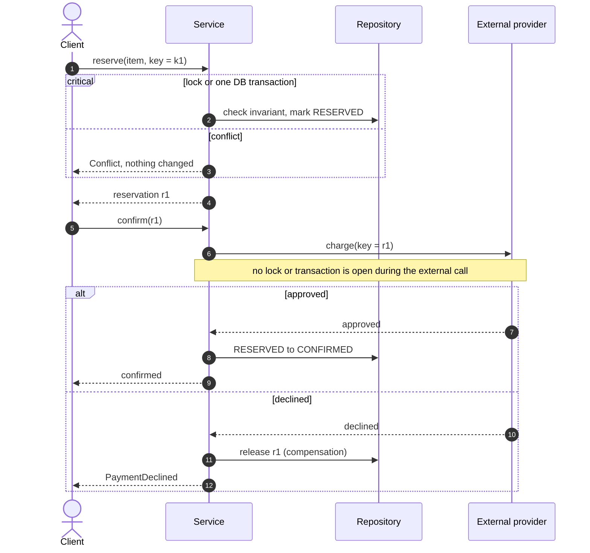

Two details carry most of the value. Step 6 runs with no lock held, which is why the reservation needs its own state (`RESERVED`) rather than a lock. Step 6 also uses the reservation id as the idempotency key, so a retry after a timeout cannot charge twice.

### State diagrams: notation and rules

| Mermaid syntax (`stateDiagram-v2`) | Meaning |
|---|---|
| `[*] --> Idle` | Initial state |
| `Done --> [*]` | Final (terminal) state |
| `A --> B : event [guard] / action` | Transition. The label is free text, so follow UML's `event [guard] / action` convention |
| `A --> A : event` | Self-transition, for example a wrong PIN with attempts left |
| `state Session { ... }` | Composite state: a transition shared by all substates (eject, cancel, fault) is drawn once from the outer box |
| `state check <<choice>>` | A branch on a guard |
| `note right of A : text` | Annotation |

Rules:

- **A state diagram specifies what is impossible.** Every (state, event) pair that is not drawn must be rejected by the code. Say this out loud in the interview; it is the property that makes the diagram worth drawing.
- **One diagram per entity whose lifecycle carries an invariant** (a seat, an order, a job), not one per class.
- **Separate states from attributes.** An elevator's direction and an ATM's count of PIN failures are attributes. Turning them into states multiplies the diagram (see the note on direction in [Section 6](#6-worked-design-elevator-system)).
- **Every non-terminal state needs an exit, including a timeout** (a hold that expires, a session that idles out). A state that can only be left by a user action leaks resources when the user disappears.
- **Implement it in exactly one place:** a transition table (`legal(from, to)` in [Section 26](#26-worked-design-inventory-and-order-management)), the State pattern ([Section 18](#18-worked-design-atm)), or a single `_go()` helper ([Section 7](#7-worked-design-vending-machine)). Scattered `if status == ...` checks drift away from the diagram.

Composite states and choice points shrink a diagram when many states share a transition. Here is the ATM from Section 18 redrawn with a `Session` composite, so `eject` is drawn once instead of once per state:

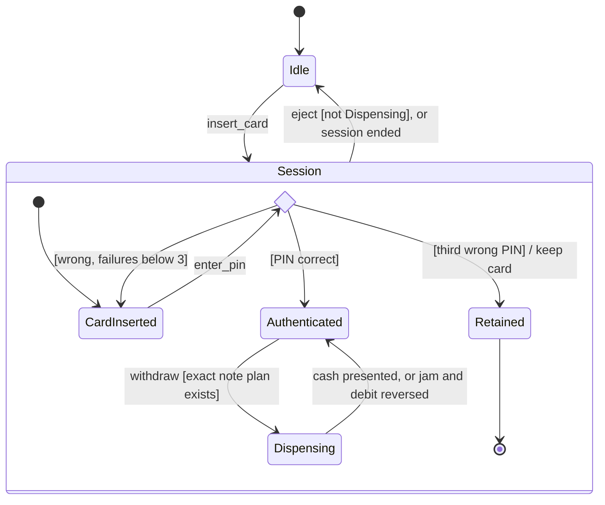

The guard on the outer transition, `[not Dispensing]`, is the one exception the composite hides. Make such exceptions explicit, because they are exactly where the code is likely to differ from the picture: in the Section 18 code, `Dispensing.eject()` raises `busy`.

### Activity and component diagrams

- **Activity diagram (Mermaid `flowchart`):** use it for the decision logic inside one operation, when branches and early exits matter more than collaborators. See the token-bucket `allow` flowchart in [Section 10](#10-worked-design-rate-limiter).
- **Component diagram:** use it once the design crosses process boundaries, for example when the interviewer asks "now split this into services". Mermaid's C4 and architecture diagram types are newer and renderer support varies, so a `flowchart` with one `subgraph` per process is the portable choice. See the distributed checkout in [Section 26](#26-worked-design-inventory-and-order-management).

See also: [State pattern (C++)](Design_Patterns_Cpp.md#23-state), [State pattern (Python)](Design_Patterns_Python.md#23-state), [Transactions applied to designs](../computer-science/High_Level_Design.md#510-transactions-applied-to-designs), [Distributed transactions and sagas](../computer-science/CS_Fundamentals.md#85-distributed-transactions).

### Diagram map for the worked designs

Use this table to practice: for each design, redraw what is listed from memory, then draw the "next diagram" column yourself and compare it with the reference code.

| Section | Design | Drawn in this guide | Next diagram to practice |
|---|---|---|---|
| [5](#5-worked-design-parking-lot) | Parking Lot | Class, sequence (exit with payment) | State for `Ticket` (`ACTIVE`, `CLOSED`, plus `LOST` as an extension) |
| [6](#6-worked-design-elevator-system) | Elevator | Class, state | Sequence: hall call, dispatcher picks a car, car arrives |
| [7](#7-worked-design-vending-machine) | Vending Machine | Class, state | Sequence: select, pay, dispense, and refund on a jam |
| [8](#8-worked-design-library-management) | Library | Class | State for a copy (available, on loan, held for a member, lost) and a sequence for "return a copy that has a waiting hold" |
| [9](#9-worked-design-splitwise-expense-sharing) | Splitwise | Class, sequence (settle-up) | None needed |
| [10](#10-worked-design-rate-limiter) | Rate Limiter | Class, activity (`allow`) | Sequence for the distributed version: gateway calls a shared store's atomic script |
| [11](#11-worked-design-cache) | Cache | Class | Sequence: miss, load from the backing store, `put`, eviction |
| [12](#12-worked-design-notification-service) | Notification Service | Class, sequence (send with retries) | State for a notification (`QUEUED`, `IN_PROGRESS`, `RETRY_SCHEDULED`, `DELIVERED`, `FAILED`) |
| [13](#13-worked-design-task-scheduler) | Task Scheduler | Class, state (job lifecycle) | Sequence: two workers, lease expiry, and a fenced completion |
| [14](#14-worked-design-chess) | Chess | Class | State for the game (active, check, checkmate, stalemate) |
| [15](#15-worked-design-tic-tac-toe) | Tic-Tac-Toe | Class | None needed; a two-line state description is enough |
| [16](#16-worked-design-snake-and-ladder) | Snake and Ladder | Class | None needed |
| [17](#17-worked-design-movie-ticket-booking-bookmyshow) | Movie Booking | Class, state (seat), sequence (hold and confirm) | Sequence for the multi-server version with conditional `UPDATE` |
| [18](#18-worked-design-atm) | ATM | Class, state (flat here, composite above), sequence (withdrawal) | Sequence for a deposit with a pending credit |
| [19](#19-worked-design-logging-framework) | Logging Framework | Class, sequence (async append and flush) | None needed |
| [20](#20-worked-design-pub-sub-message-broker) | Pub-Sub Broker | Class, sequence (publish, poll, commit, rebalance) | State for a group member (joining, assigned, fenced) |
| [21](#21-worked-design-in-memory-file-system) | File System | Class | Sequence for `mv` across directories, showing lock order |
| [22](#22-worked-design-hotel-booking) | Hotel Booking | Class, sequence (race and retry), state (reservation) | Sequence for the type-level inventory version |
| [23](#23-worked-design-meeting-room-scheduler) | Meeting Room Scheduler | Class | Sequence: book with a conflict, then notify attendees outside the lock |
| [24](#24-worked-design-in-memory-key-value-store-with-transactions) | Key-Value Store | Class | Sequence of `BEGIN`, `SET`, `BEGIN`, `SET`, `ROLLBACK`, `COMMIT` showing the undo log per layer |
| [25](#25-worked-design-stack-overflow-qa-site) | Stack Overflow | Class | Sequence: vote, reputation ledger entry, and notification |
| [26](#26-worked-design-inventory-and-order-management) | Inventory and Orders | Class, state (order), sequence (checkout saga), component (distributed version) | Sequence for a flash sale through sharded stock counters |

### API contracts

For each operation, specify enough to avoid ambiguity:

- Preconditions and validated input.
- Result or domain error.
- Whether retrying the same request is safe.
- State changes and externally visible side effects.
- Ordering or consistency guarantees when relevant.

Prefer domain results such as `ReservationConflict` or `InsufficientFunds` over leaking storage exceptions through the public API. Keep identifiers and money/time values explicit rather than using ambiguous strings or floating-point numbers.

### Interview Q&A

**Q1.** You have 45 minutes for an LLD round. Which diagrams do you draw, and when?

**A1.** After requirements and the public operations (around minute 10), draw one class diagram of 6-10 types, focused on ownership and on the interfaces at replaceable boundaries (payment, clock, storage). Before writing code or detailed pseudocode (around minute 20), draw one sequence diagram for the riskiest flow: the one where money moves, a contended invariant is protected, or an external call can fail. On that diagram, mark where the lock or transaction starts and ends, the idempotency key, and one failure branch. Draw a state diagram only if one entity's lifecycle carries the main invariant (seat, order, job); otherwise a sentence is enough. Whiteboard boxes and arrows are fine. Mermaid syntax matters only in a written or take-home format. What interviewers reward is that the diagrams agree with each other and with the code you then write.

**Q2.** A sequence diagram and a state diagram both describe behavior. What does each one catch that the other misses?

**A2.** A sequence diagram shows **one scenario across several objects over time**. A state diagram shows **all scenarios for one object**. Each one exposes a different class of bug. A lock held across a payment call shows up immediately on the sequence diagram (the lock note spans the external call) but is invisible on the state diagram. A missing transition, such as "what happens if the hold expires while payment is in flight?", shows up on the state diagram (there is no `Paying -> Available : expiry` edge, and you must decide whether there should be) but not on a happy-path sequence. The movie-booking design in Section 17 needs both: the sequence diagram shows the lock released before `charge`, and the state diagram shows that a `Paying` hold has no expiry exit. Together they rule out reselling a seat while the buyer's card is being charged.

**Q3.** The interviewer points at your `charge` arrow and asks, "What if this times out?" How do you use the diagram to answer?

**A3.** Name the three possible outcomes: succeeded, failed, or unknown. A timeout means unknown. The money may have moved even though the reply was lost. Add an `opt timed out` fragment that retries `charge` **with the same idempotency key**, so a retry cannot charge twice. If the outcome is still unknown after bounded retries, the entity must stay in an in-between state (`Paying`, `PAYMENT_PENDING`) that neither expires nor releases the resource. A reconciliation job later asks the provider for the result under that key and moves the entity to `Booked` or `Available`. Then update the state diagram: the in-between state needs exits driven by reconciliation, not by the user. The wrong answer is "release the seat on timeout", because the charge may have succeeded, and the customer would pay for a seat that is resold.

**Q4.** How do you keep a state diagram and the code from drifting apart, and how do you test it?

**A4.** Implement the transitions in exactly one place (a table, a `legal(from, to)` function, or State-pattern classes) and route every state change through it. Then test the whole matrix, not just the happy path. Transcribe the drawn edges as data and check every (from, to) pair: drawn pairs must be accepted and all others rejected. With 5 states that is 25 cases, which is cheap and catches the classic bug of a terminal state that accidentally allows a transition. The program below checks the order lifecycle from Section 26 this way:

```python
"""transition_table_test.py -- run: python3 transition_table_test.py"""
from enum import Enum, auto
from itertools import product


class Status(Enum):
    RESERVED = auto()
    PAID = auto()
    SHIPPED = auto()
    CANCELLED = auto()
    EXPIRED = auto()


# The order state diagram from Section 26, transcribed edge by edge.
DRAWN = {
    (Status.RESERVED, Status.PAID),
    (Status.RESERVED, Status.CANCELLED),
    (Status.RESERVED, Status.EXPIRED),
    (Status.PAID, Status.SHIPPED),
    (Status.PAID, Status.CANCELLED),
}


def legal(frm: Status, to: Status) -> bool:
    """Code under test: a hand-written version, as in the C++ reference."""
    if frm is Status.RESERVED:
        return to in (Status.PAID, Status.CANCELLED, Status.EXPIRED)
    if frm is Status.PAID:
        return to in (Status.SHIPPED, Status.CANCELLED)
    return False  # SHIPPED, CANCELLED, EXPIRED are terminal


def main() -> None:
    pairs = list(product(Status, repeat=2))
    assert len(pairs) == 25
    mismatches = [(f.name, t.name) for f, t in pairs if legal(f, t) != ((f, t) in DRAWN)]
    assert not mismatches, mismatches
    print(f"{len(pairs)} (from, to) pairs checked: {len(DRAWN)} legal, {len(pairs) - len(DRAWN)} rejected")


if __name__ == "__main__":
    main()
```

Output: `25 (from, to) pairs checked: 5 legal, 20 rejected`. The drawn edges are written out separately from `legal()` on purpose. Generating the test from the same table that the code uses would test nothing.

**Q5.** How do you show a race condition on a sequence diagram, and what does the diagram prove?

**A5.** Wrap the competing requests in a `par` fragment, then add a note at the **serialization point**: the mutex, the row lock, or the conditional `UPDATE`. After that point, draw the two outcomes in order: the first request wins, and the second re-checks and receives a named error. The hotel race in Section 22 is drawn this way. Be explicit about the limits. A sequence diagram shows **one interleaving**, so it illustrates the race but does not prove its absence. The proof is the invariant argument: every write that can break the invariant happens inside one critical section that re-checks the condition. The evidence is a stress test, for example 16 or 20 threads racing for one seat or room with exactly one winner asserted, as in the reference implementations. If the outcome depends on the order, draw both orders or state which request wins and why.

## 4. Designing for Concurrency and Failure

Concurrency and failures matter in LLD whenever two requests can act on the same state or an operation crosses a process boundary.

### Protect invariants at the write boundary

Identify the smallest operation that must appear atomic. For in-memory state, this may be a lock around validation and mutation. For persistent state, it may be a database transaction, compare-and-set, unique constraint, or conditional update. Avoid describing a check and a later write as safe unless their atomicity is explained.

Examples:

- Allocate a space only if it is still available.
- Debit and credit balances in one transaction, or record a durable transfer state that supports recovery.
- Claim a due task once even when multiple workers scan the queue.
- Enforce a rate limit consistently across the scope (process, host, or cluster) that the requirements demand.

### Make retries and side effects explicit

Networks fail after a request may have succeeded. If callers retry, use an idempotency key or a naturally idempotent operation where appropriate. Record durable intent before sending an external message, and consider an outbox or equivalent mechanism when a database update and event publication must stay aligned.

### Keep time and randomness injectable

Use a clock abstraction for expiration, scheduled execution, and time-based tests. Inject random-number generation when behavior depends on randomized backoff or sampling. This improves determinism and exposes hidden environmental dependencies.

### State the failure policy

For each dependency, consider timeout, retry, backoff, circuit breaking, and whether partial success is acceptable. Retries need limits and should be safe for the operation. Do not automatically retry validation errors or non-idempotent actions.

### Be clear about the consistency boundary

“Thread-safe” describes behavior within a process; it does not coordinate multiple processes. Name the scope of coordination and the mechanism that enforces it. If the exercise does not specify distributed deployment, state the assumption and describe the change needed for a multi-instance version without designing an entire platform.

---

## 5. Worked Design: Parking Lot

### Requirements and assumptions

- A lot contains levels and spaces of different vehicle-compatible sizes.
- Drivers enter, receive a ticket, and later pay and exit.
- The system assigns a compatible available space and computes a fee from the ticket's duration and pricing policy.
- A space cannot be assigned to two active tickets. Payment or exit retries must not charge or release twice.
- For this exercise, assume one logical lot service and a configured fee policy; payment processing is an external boundary.

### Core model

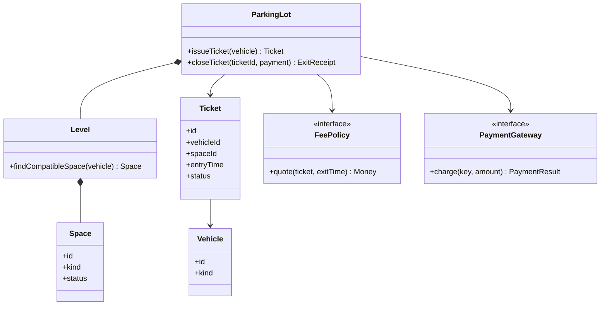

`ParkingLot` coordinates the use case. `Space` owns occupancy state; a `Ticket` records the assignment and lifecycle. `FeePolicy` captures pricing variation. `PaymentGateway` adapts an external payment provider. In a multi-entrance deployment, the actual allocation must be protected by a shared atomic reservation mechanism, not only an in-process lock.

### Important flows

```text
issueTicket(vehicle):
    validate vehicle
    atomically reserve one compatible AVAILABLE space
    create ACTIVE ticket with the space and entry time
    if ticket persistence fails, release the reservation
    return ticket

closeTicket(ticketId, paymentKey):
    load ACTIVE ticket
    amount = feePolicy.quote(ticket, clock.now())
    payment = paymentGateway.charge(paymentKey, amount)
    if payment failed: leave ticket and space active
    atomically mark ticket PAID/CLOSED and space AVAILABLE
    return exit receipt
```

The close operation needs a durable state transition and stable payment key so a retry after a timeout can discover the original payment result. In production, model payment-pending/reconciliation explicitly if payment and ticket storage cannot share a transaction.

### Trade-offs and follow-ups

- A scan is simple for small lots; indexed availability by level and space type helps larger lots.
- A single allocation lock is easy to reason about but may become a bottleneck. Partitioning by level can increase concurrency while preserving local exclusivity.
- Follow-ups: accessible or EV spaces, reservations, lost tickets, multiple payment methods, and live occupancy displays.

### Exit (closeTicket) sequence diagram

This diagram matches `closeTicket` in the reference implementation below. Entry (`issueTicket`) is a single critical section and needs no diagram. Exit is where the lock, the external payment, and retries interact.

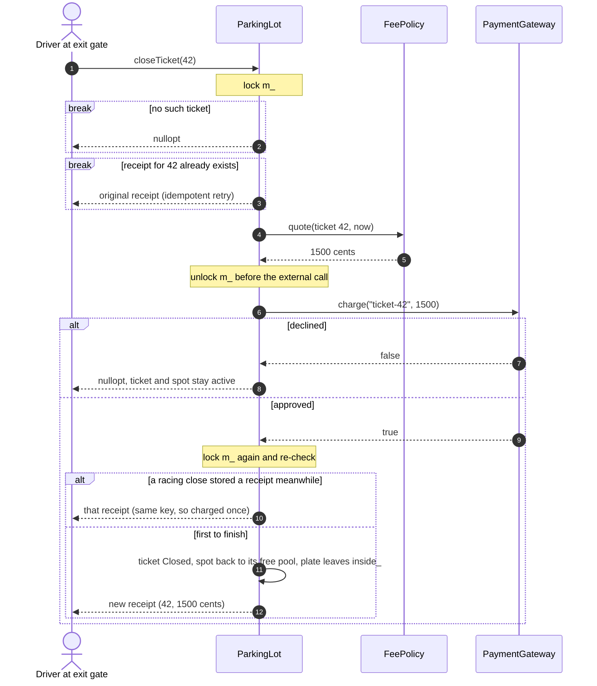

What to say while pointing at it:

- **Two short critical sections, none across `charge`** (step 6). Holding `m_` during a payment that takes 2 seconds would block every entry gate for those 2 seconds.
- **The re-check after re-locking** (the inner `alt`) is required because the state may have changed during the unlocked gap. Two gates (or a gate and a retry) can both reach step 6 for ticket 42. Both use the key `ticket-42`, so the idempotent gateway charges once, and the second re-lock finds the first one's receipt.
- **A decline changes nothing:** the ticket stays `Active` and the spot stays occupied, so the driver can retry with another card.

### Reference implementation (C++20)

Scope chosen for a 60-minute round: one process, in-memory state, three spot sizes, best-fit allocation, an injected clock, fee policy and payment gateway, and an idempotent `closeTicket`. The single invariant ("a spot has at most one active ticket") is protected by one mutex around check-and-reserve. The lock is released before the external payment call; the gateway is idempotent on a stable key, so two racing closes cannot charge twice.

```cpp
// parking_lot.cpp -- build: g++ -std=c++20 -O2 -Wall -Wextra -pthread parking_lot.cpp && ./a.out
#include <atomic>
#include <cassert>
#include <chrono>
#include <cstdint>
#include <iostream>
#include <map>
#include <memory>
#include <mutex>
#include <optional>
#include <set>
#include <string>
#include <thread>
#include <unordered_map>
#include <unordered_set>
#include <vector>

using Cents = std::int64_t;  // money as integer minor units, never double
using Clock = std::chrono::steady_clock;

enum class VehicleKind { Motorcycle, Car, Truck };
enum class SpotSize { Small = 0, Medium = 1, Large = 2 };

// Smallest spot size that can hold the vehicle; larger spots also fit.
constexpr SpotSize minSpotFor(VehicleKind k) {
    switch (k) {
        case VehicleKind::Motorcycle: return SpotSize::Small;
        case VehicleKind::Car:        return SpotSize::Medium;
        case VehicleKind::Truck:      return SpotSize::Large;
    }
    return SpotSize::Large;
}

struct Vehicle { std::string plate; VehicleKind kind; };

enum class TicketStatus { Active, Closed };
struct Ticket {
    std::uint64_t id;
    std::string plate;
    int spotId;
    Clock::time_point entry;
    TicketStatus status = TicketStatus::Active;
};
struct ExitReceipt { std::uint64_t ticketId; Cents charged; };

// ---- Injectable boundaries -------------------------------------------------
struct TimeSource {
    virtual ~TimeSource() = default;
    virtual Clock::time_point now() const = 0;
};
struct FakeTime : TimeSource {
    Clock::time_point t{};
    Clock::time_point now() const override { return t; }
    void advance(Clock::duration d) { t += d; }
};

struct FeePolicy {
    virtual ~FeePolicy() = default;
    virtual Cents quote(const Ticket&, Clock::time_point exit) const = 0;
};
// Every started hour is billed (ceil); first 15 minutes free.
struct HourlyFee : FeePolicy {
    Cents perHour;
    explicit HourlyFee(Cents c) : perHour(c) {}
    Cents quote(const Ticket& t, Clock::time_point exit) const override {
        using namespace std::chrono;
        auto mins = duration_cast<minutes>(exit - t.entry).count();
        if (mins <= 15) return 0;
        return ((mins + 59) / 60) * perHour;
    }
};

struct PaymentGateway {
    virtual ~PaymentGateway() = default;
    // Idempotent on key: a retry with the same key returns the original result.
    virtual bool charge(const std::string& key, Cents amount) = 0;
};
struct FakeGateway : PaymentGateway {
    std::mutex m;
    std::unordered_map<std::string, Cents> charged;  // key -> amount
    int calls = 0;
    bool charge(const std::string& key, Cents amount) override {
        std::lock_guard lk(m);
        ++calls;
        charged.try_emplace(key, amount);  // second call with same key is a no-op
        return true;
    }
};

// ---- Domain service --------------------------------------------------------
class ParkingLot {
public:
    ParkingLot(std::map<SpotSize, int> spotsPerSize, const TimeSource& clock,
               const FeePolicy& fee, PaymentGateway& pay)
        : clock_(clock), fee_(fee), pay_(pay) {
        int next = 1;
        for (auto [size, count] : spotsPerSize)
            for (int i = 0; i < count; ++i) {
                spotSize_[next] = size;
                free_[static_cast<int>(size)].insert(next++);
            }
    }

    // Returns nullopt when the lot is full or the vehicle is already inside.
    std::optional<Ticket> issueTicket(const Vehicle& v) {
        std::lock_guard lk(m_);  // check-and-reserve is one critical section
        if (inside_.contains(v.plate)) return std::nullopt;
        // Best fit: try the smallest compatible size first, keep big spots for trucks.
        for (int s = static_cast<int>(minSpotFor(v.kind)); s <= 2; ++s) {
            auto& pool = free_[s];
            if (pool.empty()) continue;
            int spot = *pool.begin();
            pool.erase(pool.begin());
            Ticket t{nextTicket_++, v.plate, spot, clock_.now()};
            tickets_[t.id] = t;
            inside_.insert(v.plate);
            return t;
        }
        return std::nullopt;
    }

    // Idempotent: closing an already-closed ticket returns the original receipt.
    std::optional<ExitReceipt> closeTicket(std::uint64_t ticketId) {
        std::unique_lock lk(m_);
        auto it = tickets_.find(ticketId);
        if (it == tickets_.end()) return std::nullopt;
        if (auto r = receipts_.find(ticketId); r != receipts_.end()) return r->second;
        Ticket t = it->second;
        Cents amount = fee_.quote(t, clock_.now());
        lk.unlock();  // never hold the lot lock across an external call

        std::string key = "ticket-" + std::to_string(ticketId);  // stable payment key
        if (amount > 0 && !pay_.charge(key, amount)) return std::nullopt;

        lk.lock();
        if (auto r = receipts_.find(ticketId); r != receipts_.end()) return r->second;  // lost a race
        auto& live = tickets_.at(ticketId);
        live.status = TicketStatus::Closed;
        free_[static_cast<int>(spotSize_.at(live.spotId))].insert(live.spotId);
        inside_.erase(live.plate);
        ExitReceipt rec{ticketId, amount};
        receipts_[ticketId] = rec;
        return rec;
    }

    std::size_t freeSpots() const {
        std::lock_guard lk(m_);
        std::size_t n = 0;
        for (auto& pool : free_) n += pool.size();
        return n;
    }
    SpotSize sizeOf(int spotId) const { return spotSize_.at(spotId); }  // immutable after ctor

private:
    const TimeSource& clock_;
    const FeePolicy& fee_;
    PaymentGateway& pay_;
    mutable std::mutex m_;
    std::set<int> free_[3];                      // free spot ids per size, ordered
    std::unordered_map<int, SpotSize> spotSize_;
    std::unordered_map<std::uint64_t, Ticket> tickets_;
    std::unordered_map<std::uint64_t, ExitReceipt> receipts_;
    std::unordered_set<std::string> inside_;
    std::uint64_t nextTicket_ = 1;
};

int main() {
    using namespace std::chrono_literals;
    FakeTime clock;
    HourlyFee fee(300);  // $3.00 per started hour
    FakeGateway gw;
    ParkingLot lot({{SpotSize::Small, 1}, {SpotSize::Medium, 2}, {SpotSize::Large, 1}}, clock, fee, gw);

    // Best fit and compatibility.
    auto moto = lot.issueTicket({"M1", VehicleKind::Motorcycle});
    assert(moto && lot.sizeOf(moto->spotId) == SpotSize::Small);
    auto car = lot.issueTicket({"C1", VehicleKind::Car});
    assert(car && lot.sizeOf(car->spotId) == SpotSize::Medium);
    assert(!lot.issueTicket({"C1", VehicleKind::Car}));  // duplicate entry rejected
    auto truck = lot.issueTicket({"T1", VehicleKind::Truck});
    assert(truck && lot.sizeOf(truck->spotId) == SpotSize::Large);
    assert(!lot.issueTicket({"T2", VehicleKind::Truck}));  // no large spot left

    // Fee: 2h10m -> 3 started hours -> 900 cents. Retry is idempotent.
    clock.advance(130min);
    auto r1 = lot.closeTicket(car->id);
    auto r2 = lot.closeTicket(car->id);
    assert(r1 && r2 && r1->charged == 900 && r2->charged == 900);
    assert(gw.calls == 1 && gw.charged.size() == 1);
    assert(lot.freeSpots() == 2);  // one medium freed + one medium never used

    // Concurrency: 16 cars race for the 2 free medium spots.
    std::atomic<int> granted{0};
    std::vector<std::jthread> ts;
    for (int i = 0; i < 16; ++i)
        ts.emplace_back([&, i] {
            if (lot.issueTicket({"R" + std::to_string(i), VehicleKind::Car})) ++granted;
        });
    ts.clear();  // jthread joins on destruction
    assert(granted == 2 && lot.freeSpots() == 0);
    std::cout << "parking lot: all assertions passed\n";
}
```

What to point out while presenting this code:

- **Data structures:** one `std::set<int>` of free spot ids per size gives O(log n) allocate/release and deterministic "lowest id first" choice. For thousands of spots a per-level free list (O(1)) or a bitmap is also fine; the interface does not change.
- **Best fit vs first fit:** trying the smallest compatible size first keeps large spots for trucks. A different allocation rule (nearest to the entrance, EV-first) is a `SpotAllocator` strategy extracted from `issueTicket`, which is the natural extensibility checkpoint.
- **Lock scope:** the mutex covers validation plus mutation, and nothing else. The payment call happens outside the lock, and correctness comes from the idempotent payment key plus the second receipt check after re-locking.
- **Multi-entrance or persistent version:** replace the mutex with a conditional update such as `UPDATE spot SET ticket_id = ? WHERE id = ? AND ticket_id IS NULL` (check that exactly one row changed) or a unique constraint on the active ticket per spot.
- **Asserts:** build without `-DNDEBUG` so the demo checks actually run. In a real repository the same checks become GoogleTest or Catch2 cases.

### Interview Q&A

**Q1.** Why not hold the mutex while calling the payment gateway?

**A1.** The gateway is a network call with unbounded latency. Holding the lot-wide lock across it would serialize every entry and exit behind the slowest payment, and a gateway hang would freeze the whole lot. The rule is: hold locks only across in-memory work. Correctness is preserved without the lock because (1) the payment key `ticket-<id>` is stable, so a racing or retried close cannot double-charge, and (2) after re-acquiring the lock the code re-checks `receipts_`, so only the first closer frees the spot. The cost is that two concurrent closes may both call the gateway; that is acceptable because the second call is a no-op on the provider side.

**Q2.** The interviewer adds "reserve a spot online for a time window". What changes?

**A2.** A spot is no longer simply free or occupied; it has a timeline. Add a `Reservation` entity (spot or spot class, `[start, end)`, status) and change availability from "is the spot free now?" to "is there a free spot of this class with no overlapping reservation for the window?". The usual trick is to reserve capacity per spot class (count of reserved Medium spots per time bucket) instead of a specific spot, and bind a concrete spot only at arrival. That keeps `issueTicket` almost unchanged: walk-ins can take a spot only if `free(class) > reservedNow(class)`. Also add a no-show expiry job and a grace period.

**Q3.** How would you test the concurrency claim instead of just asserting it?

**A3.** The demo races 16 threads for 2 spots and asserts exactly 2 wins. That is a smoke test; to make it meaningful, run it many times in a loop and under ThreadSanitizer (`g++ -std=c++20 -g -fsanitize=thread -pthread`), which reports data races even when the assertion happens to pass. For deterministic tests of interleavings, inject a hook (for example, a `std::latch` that the test releases) between "read state" and "write state" to force the bad ordering, and verify the lock prevents it.

## 6. Worked Design: Elevator System

### Requirements and assumptions

- Riders request travel from one floor to another.
- Elevators accept hall calls and car calls, move between floors, and report status.
- A dispatcher assigns hall calls; an elevator controller executes movement and door behavior.
- Safety rules override optimization: do not move with doors open, exceed capacity, or serve incompatible directions while moving.
- Assume a fixed building and a simplified deterministic dispatch policy; hardware integration is outside the exercise.

### Core model

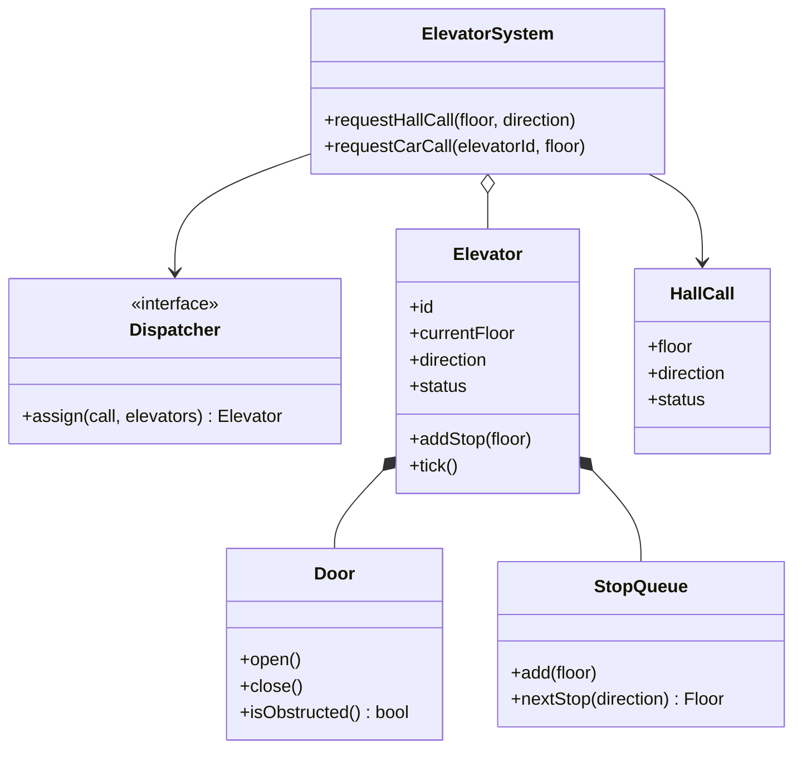

Separate dispatch decisions from one elevator's state machine. `Elevator` should validate transitions such as `IDLE -> MOVING -> DOORS_OPEN -> IDLE`; a hardware adapter can implement sensor and motor commands behind a controller boundary.

### Important flows

```text
requestHallCall(floor, direction):
    validate floor and direction
    call = create or reuse unassigned call for (floor, direction)
    elevator = dispatcher.assign(call, available elevators)
    atomically attach call to elevator's stop plan
    return accepted call status

elevator.tick():
    if faulted: stop and report fault
    if doors are open: close only when safe and unobstructed
    else if at a planned stop: open doors, serve matching calls
    else: move one safe step toward next stop
```

### Trade-offs and follow-ups

- A nearest-car policy is easy to explain; direction-aware collective control reduces reversals under normal traffic.
- Stop queues can be ordered by travel direction; destination dispatch can use declared destinations to improve grouping.
- Follow-ups: emergency mode, overload sensor, maintenance, peak-hour policies, fairness, and reassignment after elevator failure. Safety interlocks belong in the controller/hardware boundary and must not depend only on dispatch logic.

### Elevator state diagram

One car's lifecycle, matching the reference implementation below. Direction (`Up`, `Down`, `None`) is a separate attribute rather than separate states, which keeps the diagram small.

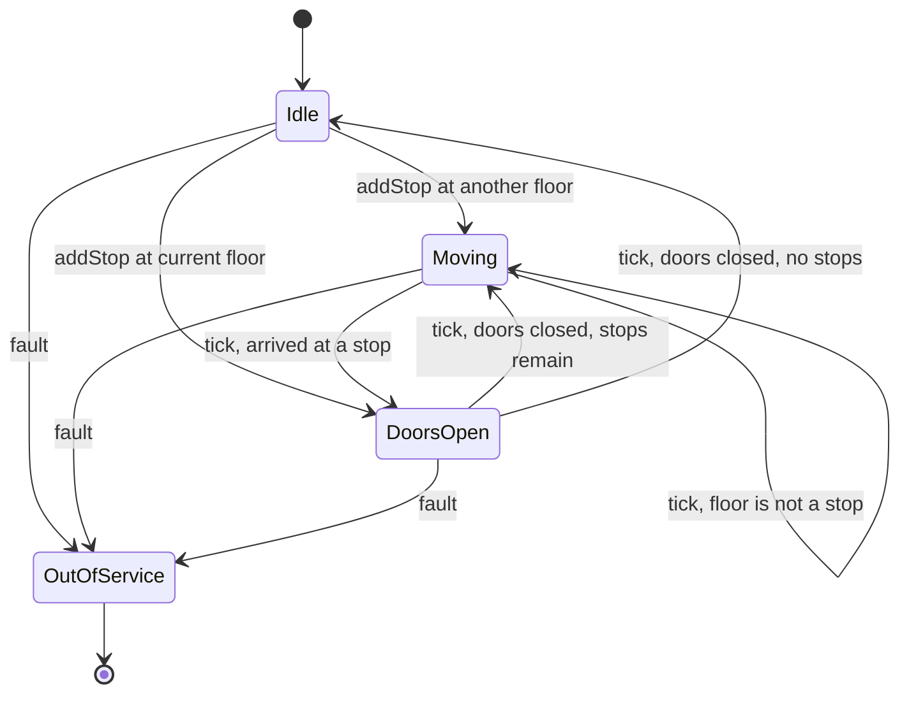

The safety rule "never move with doors open" is structural: the only way into `Moving` is from `Idle` or from `DoorsOpen` after the doors close, and the only way into `DoorsOpen` from `Moving` is on arrival at a floor.

### Reference implementation (C++20)

A discrete-time simulation: each `tick()` is one floor of travel or one door cycle. This makes behavior deterministic and testable without threads or sleeps; a real controller would drive `tick()` from sensor events. Each car runs the **LOOK** algorithm (keep moving in the current direction while stops remain ahead, then reverse). The dispatcher is a Strategy that scores cars by distance with a penalty for reversing.

```cpp
// elevator.cpp -- build: g++ -std=c++20 -O2 -Wall -Wextra -pthread elevator.cpp && ./a.out
// Discrete-time simulation: each tick() is one floor of travel or one door cycle.
#include <cassert>
#include <cstdlib>
#include <iostream>
#include <limits>
#include <memory>
#include <optional>
#include <set>
#include <string>
#include <utility>
#include <vector>

enum class Dir { Up, Down, None };
enum class State { Idle, Moving, DoorsOpen, OutOfService };

class Elevator {
public:
    Elevator(int id, int minFloor, int maxFloor)
        : id_(id), min_(minFloor), max_(maxFloor), floor_(minFloor) {}

    int id() const { return id_; }
    int floor() const { return floor_; }
    Dir dir() const { return dir_; }
    State state() const { return state_; }
    bool hasStops() const { return !stops_.empty(); }
    const std::vector<int>& servedLog() const { return served_; }

    bool addStop(int f) {
        if (f < min_ || f > max_ || state_ == State::OutOfService) return false;
        if (f == floor_ && state_ != State::Moving) {  // already here: just open
            state_ = State::DoorsOpen;
            served_.push_back(f);
            return true;
        }
        stops_.insert(f);
        if (state_ == State::Idle) { state_ = State::Moving; dir_ = f > floor_ ? Dir::Up : Dir::Down; }
        return true;
    }

    void addHallCall(int f, Dir d) { hallCalls_.insert({f, d}); }
    // Fault: stop serving; hand pending hall calls back so the system can reassign them.
    std::set<std::pair<int, Dir>> fault() {
        state_ = State::OutOfService;
        dir_ = Dir::None;
        stops_.clear();
        return std::exchange(hallCalls_, {});
    }

    // LOOK algorithm: keep going in the current direction while there are stops ahead.
    void tick() {
        switch (state_) {
            case State::OutOfService:
            case State::Idle:
                return;
            case State::DoorsOpen:  // doors close after one tick (obstruction check would go here)
                if (stops_.empty()) { state_ = State::Idle; dir_ = Dir::None; }
                else { state_ = State::Moving; dir_ = chooseDir(); }
                return;
            case State::Moving:
                floor_ += (dir_ == Dir::Up) ? 1 : -1;
                assert(floor_ >= min_ && floor_ <= max_);
                if (stops_.erase(floor_)) {
                    state_ = State::DoorsOpen;  // safety: we only open while stopped at a floor
                    served_.push_back(floor_);
                    std::erase_if(hallCalls_, [&](auto& hc) { return hc.first == floor_; });
                }
                return;
        }
    }

    // Cost estimate used by the dispatcher (floors to travel, with a penalty for reversing).
    int costTo(int f, Dir want) const {
        if (state_ == State::OutOfService) return std::numeric_limits<int>::max();
        int d = std::abs(f - floor_);
        if (state_ == State::Idle) return d;
        bool onTheWay = (dir_ == Dir::Up && f >= floor_ && want != Dir::Down) ||
                        (dir_ == Dir::Down && f <= floor_ && want != Dir::Up);
        return onTheWay ? d : d + 2 * (max_ - min_);  // reversal penalty
    }

private:
    Dir chooseDir() const {
        bool above = stops_.upper_bound(floor_) != stops_.end();
        bool below = !stops_.empty() && *stops_.begin() < floor_;
        if (dir_ == Dir::Up && above) return Dir::Up;
        if (dir_ == Dir::Down && below) return Dir::Down;
        return above ? Dir::Up : Dir::Down;
    }

    int id_, min_, max_, floor_;
    Dir dir_ = Dir::None;
    State state_ = State::Idle;
    std::set<int> stops_;
    std::set<std::pair<int, Dir>> hallCalls_;  // subset of stops that came from hall buttons
    std::vector<int> served_;
};

struct Dispatcher {  // Strategy: swap for destination dispatch, zoning, etc.
    virtual ~Dispatcher() = default;
    virtual Elevator* assign(int floor, Dir d, std::vector<std::unique_ptr<Elevator>>& cars) = 0;
};
struct LeastCostDispatcher : Dispatcher {
    Elevator* assign(int floor, Dir d, std::vector<std::unique_ptr<Elevator>>& cars) override {
        Elevator* best = nullptr;
        int bestCost = std::numeric_limits<int>::max();
        for (auto& c : cars)
            if (int cost = c->costTo(floor, d); cost < bestCost) { bestCost = cost; best = c.get(); }
        return best;  // nullptr when every car is out of service
    }
};

class ElevatorSystem {
public:
    ElevatorSystem(int cars, int minF, int maxF, std::unique_ptr<Dispatcher> d)
        : minF_(minF), maxF_(maxF), dispatcher_(std::move(d)) {
        for (int i = 0; i < cars; ++i) cars_.push_back(std::make_unique<Elevator>(i, minF, maxF));
    }
    std::optional<int> hallCall(int floor, Dir d) {
        if (floor < minF_ || floor > maxF_ || d == Dir::None) return std::nullopt;
        Elevator* e = dispatcher_->assign(floor, d, cars_);
        if (!e) return std::nullopt;
        bool servedNow = e->floor() == floor && e->state() != State::Moving;  // doors open on the spot
        if (!e->addStop(floor)) return std::nullopt;
        if (!servedNow) e->addHallCall(floor, d);  // track only pending calls for fault()
        return e->id();
    }
    bool carCall(int car, int floor) { return cars_.at(car)->addStop(floor); }
    void fault(int car) {  // reassign pending hall calls to healthy cars
        for (auto [f, d] : cars_.at(car)->fault()) hallCall(f, d);
    }
    void tick() { for (auto& c : cars_) c->tick(); }
    void runUntilIdle(int maxTicks = 1000) {
        for (int i = 0; i < maxTicks; ++i) {
            bool busy = false;
            for (auto& c : cars_) busy |= (c->state() == State::Moving || c->state() == State::DoorsOpen);
            if (!busy) return;
            tick();
        }
        assert(false && "simulation did not settle");
    }
    Elevator& car(int i) { return *cars_.at(i); }

private:
    int minF_, maxF_;
    std::unique_ptr<Dispatcher> dispatcher_;
    std::vector<std::unique_ptr<Elevator>> cars_;
};

int main() {
    ElevatorSystem sys(2, 0, 9, std::make_unique<LeastCostDispatcher>());

    // LOOK order: car 0 going up serves 3, 5, 8, then reverses for 1.
    assert(sys.carCall(0, 5));
    sys.tick();                      // floor 1
    sys.tick();                      // floor 2
    assert(sys.carCall(0, 3));
    assert(sys.carCall(0, 8));
    assert(sys.carCall(0, 1));       // behind us: served only after the reversal
    sys.runUntilIdle();
    assert((sys.car(0).servedLog() == std::vector<int>{3, 5, 8, 1}));
    assert(sys.car(0).floor() == 1 && sys.car(0).state() == State::Idle);

    // Dispatcher picks the cheaper car: car 0 at floor 1 (cost 6) beats car 1 at floor 0 (cost 7).
    auto who = sys.hallCall(7, Dir::Down);
    assert(who && *who == 0);
    sys.runUntilIdle();
    assert(sys.car(0).floor() == 7);

    // Failure: car 0 gets a hall call, faults before serving it; the call moves to car 1.
    auto who2 = sys.hallCall(9, Dir::Down);
    assert(who2 && *who2 == 0);      // car 0 at 7 is nearer than car 1 at 0
    sys.fault(0);
    assert(!sys.carCall(0, 4));      // out-of-service car rejects stops
    auto who3 = sys.hallCall(6, Dir::Up);
    assert(who3 && *who3 == 1);
    sys.runUntilIdle();
    assert((sys.car(1).servedLog() == std::vector<int>{6, 9}));  // reassigned call served
    assert(sys.car(1).floor() == 9 && sys.car(0).floor() == 7);

    // A hall call at the floor where an idle car stands is served on the spot and is not
    // left pending: a later fault of that car must not send another car for a phantom call.
    ElevatorSystem sys2(2, 0, 9, std::make_unique<LeastCostDispatcher>());
    assert(sys2.hallCall(0, Dir::Up) == 0);  // car 0 is idle at floor 0: doors open now
    sys2.runUntilIdle();
    sys2.fault(0);
    assert(sys2.car(1).state() == State::Idle && sys2.car(1).servedLog().empty());
    std::cout << "elevator: all assertions passed\n";
}
```

What to point out while presenting this code:

- **Why simulate ticks:** a tick-driven state machine is deterministic, so you can assert the exact service order (`{3, 5, 8, 1}`) instead of sleeping and hoping. Real hardware events (arrived, door closed, obstruction) map to the same transitions.
- **LOOK vs SCAN vs FCFS:** FCFS causes zig-zagging; SCAN travels to the end floor even with no requests there; LOOK reverses at the last requested floor. A `std::set<int>` gives the "any stop above or below me?" query in O(log n).
- **Hall calls vs car calls:** only hall calls are reassigned on a fault. A hall call answered on the spot (an idle car already at that floor opens its doors) is never recorded as pending, so a later fault cannot re-dispatch a call that was already served; the last block of the demo checks this. Car calls belong to passengers inside the failed car, so reassigning them would send another car to floors nobody is waiting at.
- **Thread safety:** this version is single-threaded by design (one control loop). If button presses arrive on other threads, put them on a queue that the control loop drains each tick, rather than locking inside `Elevator`. That is the Active Object idea.

### Interview Q&A

**Q1.** How would you make the dispatcher smarter during the morning up-peak?

**A1.** Keep `Dispatcher` as the extension point and add a policy that recognizes the peak (for example, more than N lobby calls per minute, or a configured time window). Typical tactics: park idle cars at the lobby, assign zones (car 0 serves floors 1-5 express, car 1 serves 6-9), or use destination dispatch, where riders enter their destination at the lobby and the system groups riders by destination, which reduces stops per trip. None of this touches `Elevator`, which only executes stops. That separation is the main design point.

**Q2.** What does the reversal penalty in `costTo` approximate, and what is its weakness?

**A2.** It approximates the extra travel when a moving car must finish its current sweep before coming back. Twice the building height is an upper bound on that detour. Its weakness is that it ignores load (number of pending stops, each costing a door cycle) and capacity. A better cost is estimated time to arrival: travel floors × floor time + pending stops × dwell time, plus a large penalty if the car is near full. The interface stays the same.

**Q3.** How do you guarantee a hall call is never lost?

**A3.** Track it explicitly until served. Here each car keeps a `hallCalls_` set. It is removed only when the car opens its doors at that floor and returned by `fault()` for reassignment. In a production system the call should also have a timeout: if it is not served within T seconds, the supervisor re-dispatches it even without a fault signal, because a car can be stuck without reporting a fault.

## 7. Worked Design: Vending Machine

### Requirements and assumptions

- Customers select an item, pay, and receive the item and any applicable change.
- The machine tracks stock, accepted payment, and dispensing outcome.
- A failed dispense must not silently lose the customer's payment; refunds or reconciliation are possible.
- Assume cashless payment for the main flow; cash handling can be an alternate payment adapter.

### Core model

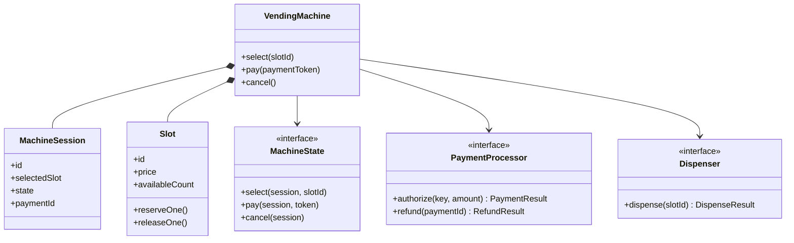

An explicit state machine prevents invalid operation order. Example states are `Idle`, `Selected`, `PaymentPending`, `Paid`, `Dispensing`, `Completed`, and `NeedsReconciliation`. Keep inventory reservation and session state coordinated so concurrent customers cannot buy the last unit twice.

### Important flow

```text
pay(session, token):
    require session.state == Selected
    reserve one unit from selected slot
    mark PaymentPending with stable idempotency key
    result = paymentProcessor.authorize(key, selected price)
    if declined: release unit; mark Selected; return PaymentDeclined
    mark Paid with provider payment id
    result = dispenser.dispense(selected slot)
    if dispensed: decrement reserved stock; mark Completed
    else: refund or record NeedsReconciliation; do not claim success
```

The real implementation needs durable recovery for a crash between payment and dispensing. A provider webhook or reconciliation job can resolve uncertain payment outcomes.

### Trade-offs and follow-ups

- State pattern can keep a complex lifecycle readable; an enum with guarded transitions may be enough for a small machine.
- Follow-ups: cash/change, age-restricted items, out-of-stock races, refund failures, service mode, restocking, and disconnected operation.

### Vending machine state diagram

The diagram matches the `TRANSITIONS` table in the reference implementation. `Completed` from the prose is folded into the return to `Idle`.

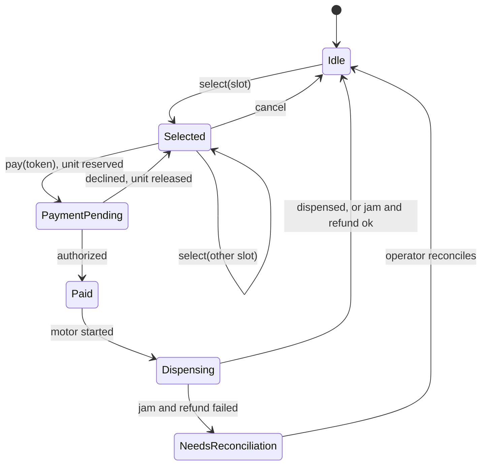

### Reference implementation (Python 3)

The transition table is the single source of truth: every state change goes through `_go()`, so an illegal call order (pay before select, select while unreconciled) fails in one place. Stock is reserved before money is taken and released on any failure path.

```python
"""vending_machine.py -- run: python3 vending_machine.py"""
from __future__ import annotations

import threading
from dataclasses import dataclass
from enum import Enum, auto
from typing import Protocol


class State(Enum):
    IDLE = auto()
    SELECTED = auto()
    PAYMENT_PENDING = auto()
    PAID = auto()
    DISPENSING = auto()
    NEEDS_RECONCILIATION = auto()


# Single source of truth for legal transitions; every state change goes through _go().
TRANSITIONS: dict[State, set[State]] = {
    State.IDLE: {State.SELECTED},
    State.SELECTED: {State.IDLE, State.SELECTED, State.PAYMENT_PENDING},
    State.PAYMENT_PENDING: {State.SELECTED, State.PAID},
    State.PAID: {State.DISPENSING},
    State.DISPENSING: {State.IDLE, State.NEEDS_RECONCILIATION},
    State.NEEDS_RECONCILIATION: {State.IDLE},  # operator clears after reconciling
}


class InvalidTransition(Exception):
    pass


@dataclass
class Slot:
    slot_id: str
    price_cents: int
    count: int
    reserved: int = 0

    @property
    def available(self) -> int:
        return self.count - self.reserved


class PaymentProcessor(Protocol):
    def authorize(self, key: str, amount_cents: int) -> str | None: ...  # payment id or None
    def refund(self, payment_id: str) -> bool: ...


class Dispenser(Protocol):
    def dispense(self, slot_id: str) -> bool: ...


class VendingMachine:
    def __init__(self, slots: list[Slot], payments: PaymentProcessor, dispenser: Dispenser):
        self._slots = {s.slot_id: s for s in slots}
        self._payments = payments
        self._dispenser = dispenser
        self._lock = threading.Lock()  # one physical keypad, but sensors/network callbacks are concurrent
        self.state = State.IDLE
        self._selected: str | None = None
        self._session = 0
        self.log: list[str] = []

    def _go(self, new: State) -> None:
        if new not in TRANSITIONS[self.state]:
            raise InvalidTransition(f"{self.state.name} -> {new.name}")
        self.state = new

    def select(self, slot_id: str) -> None:
        with self._lock:
            slot = self._slots.get(slot_id)
            if slot is None or slot.available <= 0:
                raise ValueError(f"slot {slot_id} unavailable")
            self._go(State.SELECTED)
            if self._selected is None:
                self._session += 1
            self._selected = slot_id

    def cancel(self) -> None:
        with self._lock:
            self._go(State.IDLE)  # only legal from SELECTED; paid sessions cannot be cancelled
            self._selected = None

    def pay(self, token: str) -> str:
        with self._lock:
            if self.state is not State.SELECTED or self._selected is None:
                raise InvalidTransition(f"pay() in {self.state.name}")
            slot = self._slots[self._selected]
            if slot.available <= 0:
                raise ValueError("sold out")
            slot.reserved += 1                      # reserve before taking money
            self._go(State.PAYMENT_PENDING)
            key = f"session-{self._session}-{token}"  # same card retried -> same key; new card -> new key
            payment_id = self._payments.authorize(key, slot.price_cents)
            if payment_id is None:
                slot.reserved -= 1
                self._go(State.SELECTED)
                return "DECLINED"
            self._go(State.PAID)
            self._go(State.DISPENSING)
            if self._dispenser.dispense(slot.slot_id):
                slot.reserved -= 1
                slot.count -= 1
                self._finish()
                return "DISPENSED"
            slot.reserved -= 1                      # item did not leave the machine
            if self._payments.refund(payment_id):
                self._finish()
                return "REFUNDED"
            self._go(State.NEEDS_RECONCILIATION)    # never claim success; operator follows up
            self.log.append(f"reconcile payment {payment_id}")
            return "NEEDS_RECONCILIATION"

    def _finish(self) -> None:
        self._go(State.IDLE)
        self._selected = None

    def reconcile(self) -> None:
        with self._lock:
            self._go(State.IDLE)
            self._selected = None


# ---- test doubles ------------------------------------------------------------
class FakePayments:
    def __init__(self, decline: bool = False, refund_ok: bool = True):
        self.decline, self.refund_ok = decline, refund_ok
        self.authorized: dict[str, int] = {}
        self.refunded: list[str] = []

    def authorize(self, key: str, amount_cents: int) -> str | None:
        if self.decline:
            return None
        self.authorized.setdefault(key, amount_cents)  # idempotent per key
        return "pay-" + key

    def refund(self, payment_id: str) -> bool:
        if self.refund_ok:
            self.refunded.append(payment_id)
        return self.refund_ok


class FakeDispenser:
    def __init__(self, fail_next: int = 0):
        self.fail_next = fail_next

    def dispense(self, slot_id: str) -> bool:
        if self.fail_next:
            self.fail_next -= 1
            return False
        return True


def main() -> None:
    pay, disp = FakePayments(), FakeDispenser()
    vm = VendingMachine([Slot("A1", 150, count=1), Slot("B2", 200, count=5)], pay, disp)

    # Happy path; the last unit cannot be selected again.
    vm.select("A1")
    assert vm.pay("tok") == "DISPENSED" and vm.state is State.IDLE
    try:
        vm.select("A1")
        raise AssertionError("sold-out slot was selectable")
    except ValueError:
        pass

    # Invalid order is rejected by the transition table.
    try:
        vm.pay("tok")
        raise AssertionError("pay before select")
    except InvalidTransition:
        pass

    # Re-select and cancel before paying.
    vm.select("B2")
    vm.cancel()
    assert vm.state is State.IDLE

    # Decline: reservation released, user may retry another card.
    pay.decline = True
    vm.select("B2")
    assert vm.pay("bad") == "DECLINED" and vm.state is State.SELECTED
    assert vm._slots["B2"].reserved == 0
    pay.decline = False

    # Dispense jam -> automatic refund, stock unchanged.
    disp.fail_next = 1
    assert vm.pay("tok") == "REFUNDED" and vm._slots["B2"].count == 5
    assert pay.refunded == ["pay-session-3-tok"]

    # Jam + refund failure -> NEEDS_RECONCILIATION blocks new sales until an operator clears it.
    disp.fail_next, pay.refund_ok = 1, False
    vm.select("B2")
    assert vm.pay("tok") == "NEEDS_RECONCILIATION"
    try:
        vm.select("B2")
        raise AssertionError("machine accepted a sale while unreconciled")
    except InvalidTransition:
        pass
    vm.reconcile()
    assert vm.state is State.IDLE and vm.log == ["reconcile payment pay-session-4-tok"]
    print("vending machine: all assertions passed")


if __name__ == "__main__":
    main()
```

What to point out while presenting this code:

- **Table-driven state machine vs State pattern:** six states and about ten transitions fit in one dict that reviewers can check against the diagram. Switch to one class per state (GoF State) when per-state behavior grows, for example cash handling with coin counting in `Selected` only.
- **Reserve, then charge, then dispense:** this order means a concurrent path (a second keypad, a remote "buy" API) can never sell the last unit twice. Every failure path releases the reservation.
- **Idempotency key:** `session-<n>-<token>` makes a network retry of the same card safe while a different card in the same session gets a new authorization.
- **Holding the lock across I/O:** acceptable here because a physical machine serves one customer at a time and the lock is per machine. In a shared service (the parking lot), release it before external calls.

### Interview Q&A

**Q1.** The machine crashes after `authorize` succeeds but before `dispense` returns. What happens on reboot?

**A1.** In-memory state is lost, so the real design persists the session state transition before each external call: write `PAYMENT_PENDING(key)` before authorizing and `DISPENSING(payment_id)` before starting the motor. On boot, a recovery routine scans for non-terminal sessions. For `PAYMENT_PENDING`, query the provider by idempotency key and refund if authorized. For `DISPENSING`, check the drop sensor if one exists; otherwise refund or flag for reconciliation. The key principle: never infer "dispensed" from missing evidence.

**Q2.** Add cash with change. Where does the logic go?

**A2.** Behind the existing `PaymentProcessor` boundary, using a `CashPayment` adapter with a coin inventory. The new rule is that change must be available before accepting the sale. Making change is the coin-change problem: with canonical denominations (1, 5, 10, 25), greedy works; for arbitrary denominations with limited coin counts use DP (bounded coin change). If change cannot be made, return the inserted cash and stay in `Selected`.

## 8. Worked Design: Library Management

### Requirements and assumptions

- Members search the catalog, borrow available copies, return them, and place holds.
- A title can have multiple physical copies; a hold applies to a title/edition, while a loan applies to a specific copy.
- Due dates, renewals, and overdue fees follow configurable policies.
- Assume a member's eligibility and copy reservation are checked atomically when a loan or hold is created.

### Core model

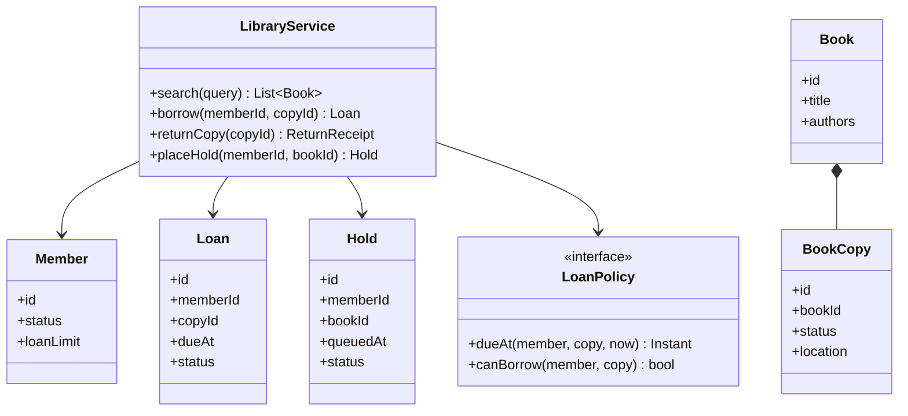

Separate catalog metadata from copy inventory. Search reads catalog/index data; lending commands enforce copy and member rules transactionally. `LoanPolicy` handles membership tiers or item-specific rules without making `Member` responsible for loan calculations.

### Important flows

```text
borrow(memberId, copyId):
    begin transaction
    lock or conditionally update copy where status == AVAILABLE
    verify member eligibility and active-loan limit
    if a queued hold has priority, assign according to hold policy
    create loan with due date from loanPolicy
    mark copy ON_LOAN
    commit and return loan
```

Returning a copy closes the active loan, calculates any fee, and either assigns the copy to the next eligible hold or marks it available. These related updates should share a transaction or a recoverable workflow.

### Trade-offs and follow-ups

- Normalize title, edition, and copy data for integrity; maintain a search index separately for flexible search.
- Follow-ups: renewals, lost/damaged copies, inter-branch transfers, notifications, digital books, and hold expiration.

### Reference implementation (Python 3)

In-memory repositories (plain dicts) behind one `LibraryService`. The re-entrant lock stands in for a database transaction: every check-then-act (copy available, member under limit, hold priority) happens inside it. `LoanPolicy` is the Strategy for tiers and fees, and the clock is injected so due dates and late fees are testable.

```python
"""library.py -- run: python3 library.py"""
from __future__ import annotations

import itertools
import threading
from collections import deque
from dataclasses import dataclass, field
from datetime import datetime, timedelta
from enum import Enum, auto


class CopyStatus(Enum):
    AVAILABLE = auto()
    ON_LOAN = auto()
    ON_HOLD_SHELF = auto()  # reserved for a specific member's hold
    LOST = auto()


class LibraryError(Exception):
    pass


@dataclass(frozen=True)
class Book:
    book_id: str
    title: str
    authors: tuple[str, ...]


@dataclass
class BookCopy:
    copy_id: str
    book_id: str
    status: CopyStatus = CopyStatus.AVAILABLE
    held_for: str | None = None


@dataclass
class Member:
    member_id: str
    tier: str = "standard"
    active_loans: set[str] = field(default_factory=set)  # loan ids


@dataclass
class Loan:
    loan_id: str
    member_id: str
    copy_id: str
    due_at: datetime
    returned_at: datetime | None = None
    fee_cents: int = 0


class LoanPolicy:
    """Strategy: tiers change limits and durations without touching LibraryService."""
    LIMITS = {"standard": 3, "premium": 10}
    DAYS = {"standard": 14, "premium": 28}
    FEE_PER_DAY_CENTS = 25
    MAX_FEE_CENTS = 1000

    def can_borrow(self, m: Member) -> bool:
        return len(m.active_loans) < self.LIMITS[m.tier]

    def due_at(self, m: Member, now: datetime) -> datetime:
        return now + timedelta(days=self.DAYS[m.tier])

    def fee(self, loan: Loan, returned: datetime) -> int:
        late_days = max(0, (returned - loan.due_at).days)
        return min(late_days * self.FEE_PER_DAY_CENTS, self.MAX_FEE_CENTS)


class LibraryService:
    def __init__(self, clock, policy: LoanPolicy | None = None):
        self._clock = clock                   # injectable: callable returning datetime
        self._policy = policy or LoanPolicy()
        self._lock = threading.RLock()        # in-memory stand-in for a DB transaction
        self.books: dict[str, Book] = {}
        self.copies: dict[str, BookCopy] = {}
        self.members: dict[str, Member] = {}
        self.loans: dict[str, Loan] = {}
        self._active_by_copy: dict[str, str] = {}  # copy_id -> loan_id (index, O(1) return)
        self._holds: dict[str, deque[str]] = {}  # book_id -> FIFO of member ids
        self._ids = itertools.count(1)

    # -- catalog ---------------------------------------------------------------
    def add_book(self, book: Book, copies: int) -> list[str]:
        with self._lock:
            self.books[book.book_id] = book
            ids = [f"{book.book_id}-c{i}" for i in range(1, copies + 1)]
            for cid in ids:
                self.copies[cid] = BookCopy(cid, book.book_id)
            return ids

    def search(self, text: str) -> list[Book]:
        q = text.lower()
        return [b for b in self.books.values()
                if q in b.title.lower() or any(q in a.lower() for a in b.authors)]

    # -- lending ---------------------------------------------------------------
    def borrow(self, member_id: str, copy_id: str) -> Loan:
        with self._lock:  # check-then-act on copy + member must be atomic
            member, copy = self.members[member_id], self.copies[copy_id]
            if copy.status is CopyStatus.ON_HOLD_SHELF and copy.held_for != member_id:
                raise LibraryError("copy is held for another member")
            if copy.status not in (CopyStatus.AVAILABLE, CopyStatus.ON_HOLD_SHELF):
                raise LibraryError(f"copy not available ({copy.status.name})")
            if not self._policy.can_borrow(member):
                raise LibraryError("loan limit reached")
            if copy.held_for == member_id:
                self._holds[copy.book_id].remove(member_id)  # hold fulfilled
            loan = Loan(f"L{next(self._ids)}", member_id, copy_id,
                        self._policy.due_at(member, self._clock()))
            copy.status, copy.held_for = CopyStatus.ON_LOAN, None
            member.active_loans.add(loan.loan_id)
            self.loans[loan.loan_id] = loan
            self._active_by_copy[copy_id] = loan.loan_id
            return loan

    def return_copy(self, copy_id: str) -> Loan:
        with self._lock:
            loan_id = self._active_by_copy.pop(copy_id, None)
            if loan_id is None:
                raise LibraryError("no active loan for copy")  # duplicate scan -> clear error
            loan = self.loans[loan_id]
            now = self._clock()
            loan.returned_at, loan.fee_cents = now, self._policy.fee(loan, now)
            self.members[loan.member_id].active_loans.discard(loan.loan_id)
            copy = self.copies[copy_id]
            queue = self._holds.get(copy.book_id)
            if queue:  # next hold gets the copy; it is not generally available
                copy.status, copy.held_for = CopyStatus.ON_HOLD_SHELF, queue[0]
            else:
                copy.status, copy.held_for = CopyStatus.AVAILABLE, None
            return loan

    def place_hold(self, member_id: str, book_id: str) -> int:
        """Holds are per title, not per copy. Returns queue position (1-based)."""
        with self._lock:
            if any(self.copies[c].status is CopyStatus.AVAILABLE
                   for c in self.copies if self.copies[c].book_id == book_id):
                raise LibraryError("a copy is available; borrow it instead")
            q = self._holds.setdefault(book_id, deque())
            if member_id in q:
                return q.index(member_id) + 1  # idempotent
            q.append(member_id)
            return len(q)


def main() -> None:
    now = [datetime(2026, 1, 1, 10, 0)]
    lib = LibraryService(clock=lambda: now[0])
    for m in ("ann", "bob", "cat"):
        lib.members[m] = Member(m)
    lib.members["cat"].tier = "premium"
    (c1,) = lib.add_book(Book("ddia", "Designing Data-Intensive Applications", ("Kleppmann",)), 1)
    sicp = lib.add_book(Book("sicp", "SICP", ("Abelson", "Sussman")), 3)

    assert [b.book_id for b in lib.search("kleppmann")] == ["ddia"]

    loan = lib.borrow("ann", c1)
    assert loan.due_at == datetime(2026, 1, 15, 10, 0)
    try:
        lib.borrow("bob", c1)
        raise AssertionError("double loan")
    except LibraryError:
        pass

    # Holds queue FIFO; returning assigns the copy to the head of the queue.
    assert lib.place_hold("bob", "ddia") == 1
    assert lib.place_hold("cat", "ddia") == 2
    assert lib.place_hold("bob", "ddia") == 1  # idempotent
    now[0] += timedelta(days=17)              # 3 days late
    returned = lib.return_copy(c1)
    assert returned.fee_cents == 75
    assert lib.copies[c1].status is CopyStatus.ON_HOLD_SHELF and lib.copies[c1].held_for == "bob"
    try:
        lib.borrow("cat", c1)                 # cat is second in line
        raise AssertionError("hold bypassed")
    except LibraryError:
        pass
    lib.borrow("bob", c1)
    try:
        lib.return_copy(sicp[0])               # never borrowed
        raise AssertionError("returned a copy that was not on loan")
    except LibraryError:
        pass
    assert lib._holds["ddia"] == deque(["cat"])

    # Loan limit from policy (standard = 3).
    for cid in sicp:
        lib.borrow("ann", cid)
    (c2,) = lib.add_book(Book("tcpl", "The C Programming Language", ("Kernighan", "Ritchie")), 1)
    try:
        lib.borrow("ann", c2)
        raise AssertionError("limit not enforced")
    except LibraryError as e:
        assert "limit" in str(e)

    # Concurrency: many members race for one copy; exactly one wins.
    (race,) = lib.add_book(Book("taocp", "TAOCP", ("Knuth",)), 1)
    for i in range(20):
        lib.members[f"m{i}"] = Member(f"m{i}")
    wins: list[str] = []

    def attempt(mid: str) -> None:
        try:
            lib.borrow(mid, race)
            wins.append(mid)
        except LibraryError:
            pass

    threads = [threading.Thread(target=attempt, args=(f"m{i}",)) for i in range(20)]
    for t in threads:
        t.start()
    for t in threads:
        t.join()
    assert len(wins) == 1
    print("library: all assertions passed")


if __name__ == "__main__":
    main()
```

What to point out while presenting this code:

- **Title vs copy:** holds attach to `book_id` (any copy will do), loans attach to `copy_id`. Mixing them up is the most common modeling error in this problem.
- **Hold shelf:** a returned copy goes to `ON_HOLD_SHELF` for the head of the queue instead of `AVAILABLE`. Otherwise a walk-in borrower could take it between the return and the hold notification.
- **Index for the hot path:** `_active_by_copy` makes `return_copy` O(1) instead of scanning all loans. Call out such secondary indexes explicitly; in SQL they are a unique partial index on `loan(copy_id) WHERE returned_at IS NULL`, which also enforces "one active loan per copy".
- **Python and the GIL:** the GIL does not make `borrow` atomic. The check and the update are separate bytecodes and a thread switch can happen in between, so the explicit lock is required. The 20-thread race test demonstrates this.

### Interview Q&A

**Q1.** How do you expire holds that are never picked up?

**A1.** Add `hold_expires_at` when a copy moves to `ON_HOLD_SHELF` (for example, now + 3 days) and a periodic sweeper (or the scheduler from Section 13) that, under the same lock or transaction, pops the expired member from the queue and either re-assigns the copy to the next member or marks it `AVAILABLE`. Make the sweep idempotent: compare the copy's `held_for` and expiry before changing anything, because a pickup can race with the sweep.

**Q2.** Why is the late fee computed from `(returned - due).days` and capped?

**A2.** `timedelta.days` floors to whole days, so returning 23 hours late is free. That is a policy choice worth stating aloud; ceil is the alternative. The cap (`MAX_FEE_CENTS`) is typical library policy and bounds disputes. Both live in `LoanPolicy`, so changing them does not touch the service. Money stays in integer cents throughout.

## 9. Worked Design: Splitwise Expense Sharing

### Requirements and assumptions

- Users create groups and record shared expenses with participants and a split rule.
- Split types include equal, exact amounts, and percentages; each split must reconcile exactly to the expense total.
- The system computes net balances and suggests a settlement plan.
- Recording an expense changes the ledger; an actual money transfer is a separate payment-provider workflow.
- Store money as integer minor units plus currency, never binary floating-point values.

### Core model

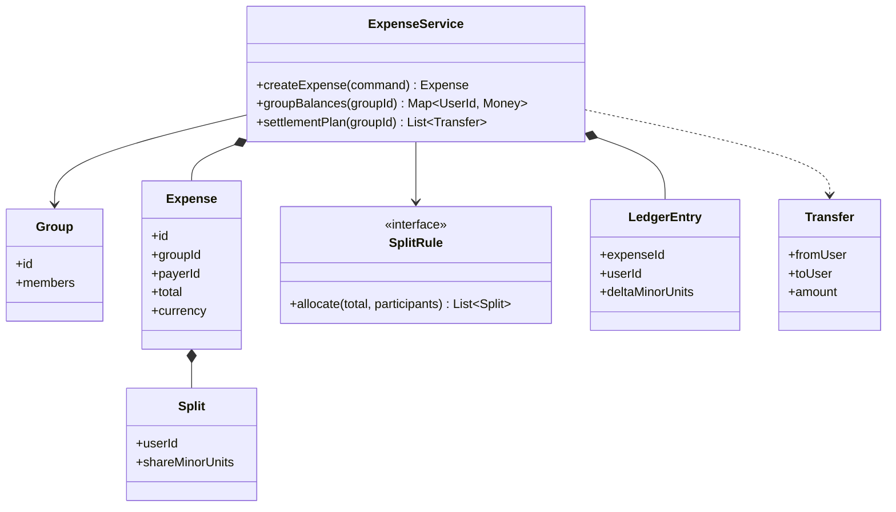

An expense and its splits are immutable facts once recorded, except through an explicit edit/reversal flow. The ledger is the source for balances; do not update a cached balance without also defining how it stays consistent with ledger entries.

### Important flow

```text
createExpense(command):
    validate group membership, payer, participants, currency, and total
    splits = splitRule.allocate(total, participants)
    require sum(splits.shareMinorUnits) == total.minorUnits
    begin transaction
    insert expense and split details with an idempotency key
    append ledger entries:
        payer receives +total
        each participant owes -their share
    commit and return expense
```

For rounding equal splits, distribute leftover minor units deterministically (for example, by stable user-id order) so the sum always equals the total. Balance queries aggregate ledger deltas. A settlement algorithm can repeatedly match debtors and creditors; this minimizes the number of transfers heuristically but is not necessarily the unique or globally optimal solution.

### Trade-offs and follow-ups

- Immutable ledger entries simplify audit and correction through compensating entries; materialized balances make reads cheaper but require replay/reconciliation strategy.
- Follow-ups: multiple currencies, expense edits, group closure, transfer confirmation, privacy, and minimizing transfer count.

### Settle-up sequence diagram

The plan is advice computed from the current ledger. What gets recorded is the transfer the payment provider actually confirmed, so a plan that went stale (a new expense arrived) never corrupts balances.

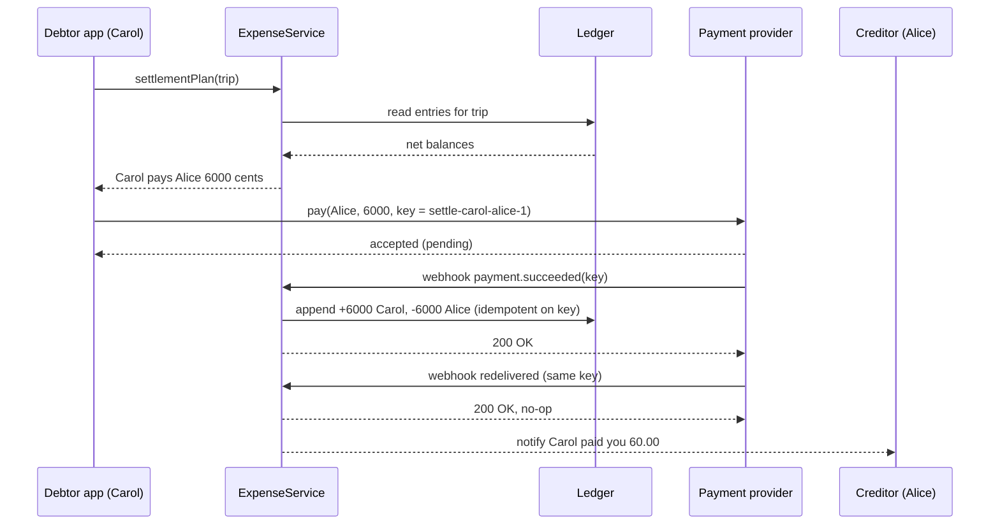

### Reference implementation (Python 3)

An append-only ledger per group is the source of truth. Balances are derived by summing deltas, and the invariant "the sum of all balances is zero" is asserted on every read. Split rules are Strategies that must return integer shares summing exactly to the total. Debt simplification is the greedy heap algorithm (at most n-1 transfers), with an exact backtracking solver (LeetCode 465, Optimal Account Balancing) for comparison.

```python
"""splitwise.py -- run: python3 splitwise.py"""
from __future__ import annotations

import heapq
import itertools
import threading
from dataclasses import dataclass
from typing import Protocol

Cents = int  # integer minor units; never float for money


@dataclass(frozen=True)
class Transfer:
    debtor: str
    creditor: str
    amount: Cents


@dataclass(frozen=True)
class LedgerEntry:
    ref: str            # expense or settlement id
    user: str
    delta: Cents        # + means the group owes this user, - means this user owes the group


class SplitRule(Protocol):
    def allocate(self, total: Cents, participants: list[str]) -> dict[str, Cents]: ...


def _spread_remainder(base: dict[str, Cents], remainder: int, order: list[str]) -> dict[str, Cents]:
    # Deterministic: leftover cents go one each to users in stable (sorted id) order.
    for user in sorted(order)[:remainder]:
        base[user] += 1
    return base


class EqualSplit:
    def allocate(self, total: Cents, participants: list[str]) -> dict[str, Cents]:
        q, r = divmod(total, len(participants))
        return _spread_remainder({p: q for p in participants}, r, participants)


class ExactSplit:
    def __init__(self, amounts: dict[str, Cents]):
        self.amounts = amounts

    def allocate(self, total: Cents, participants: list[str]) -> dict[str, Cents]:
        if set(self.amounts) != set(participants) or sum(self.amounts.values()) != total:
            raise ValueError("exact amounts must cover all participants and sum to the total")
        return dict(self.amounts)


class PercentSplit:
    """Percentages in basis points (1% = 100 bp) so 33.33% is exact."""
    def __init__(self, bps: dict[str, int]):
        if sum(bps.values()) != 10_000:
            raise ValueError("percentages must sum to 100%")
        self.bps = bps

    def allocate(self, total: Cents, participants: list[str]) -> dict[str, Cents]:
        base = {p: total * self.bps[p] // 10_000 for p in participants}
        return _spread_remainder(base, total - sum(base.values()), participants)


class ExpenseService:
    def __init__(self) -> None:
        self._lock = threading.Lock()
        self._ledger: dict[str, list[LedgerEntry]] = {}   # group -> append-only entries
        self._groups: dict[str, set[str]] = {}
        self._seen: dict[str, str] = {}                     # idempotency key -> ref
        self._ids = itertools.count(1)

    def create_group(self, group: str, members: set[str]) -> None:
        with self._lock:
            self._groups[group] = set(members)
            self._ledger[group] = []

    def add_expense(self, key: str, group: str, payer: str, total: Cents,
                    participants: list[str], rule: SplitRule) -> str:
        if total <= 0:
            raise ValueError("total must be positive")
        shares = rule.allocate(total, participants)
        assert sum(shares.values()) == total, "split invariant violated"
        with self._lock:
            if key in self._seen:
                return self._seen[key]                       # retried request: no double-count
            members = self._groups[group]
            if payer not in members or not set(participants) <= members:
                raise ValueError("payer and participants must be group members")
            ref = f"E{next(self._ids)}"
            entries = [LedgerEntry(ref, payer, total)]
            entries += [LedgerEntry(ref, u, -s) for u, s in shares.items()]
            self._ledger[group].extend(entries)              # one atomic append
            self._seen[key] = ref
            return ref

    def record_settlement(self, key: str, group: str, t: Transfer) -> str:
        """Called after the payment provider confirms money moved debtor -> creditor."""
        with self._lock:
            if key in self._seen:
                return self._seen[key]
            ref = f"S{next(self._ids)}"
            self._ledger[group] += [LedgerEntry(ref, t.debtor, +t.amount),
                                    LedgerEntry(ref, t.creditor, -t.amount)]
            self._seen[key] = ref
            return ref

    def balances(self, group: str) -> dict[str, Cents]:
        with self._lock:
            net = {u: 0 for u in self._groups[group]}
            for e in self._ledger[group]:
                net[e.user] += e.delta
        assert sum(net.values()) == 0, "ledger must always balance"
        return net

    def settlement_plan(self, group: str) -> list[Transfer]:
        return simplify_debts(self.balances(group))


def simplify_debts(net: dict[str, Cents]) -> list[Transfer]:
    """Greedy: repeatedly match the largest debtor with the largest creditor.
    Each step zeroes at least one person, so it emits at most n-1 transfers.
    O(n log n). Not always the minimum count (that problem is NP-hard)."""
    creditors = [(-amt, u) for u, amt in net.items() if amt > 0]
    debtors = [(amt, u) for u, amt in net.items() if amt < 0]
    heapq.heapify(creditors)
    heapq.heapify(debtors)
    plan: list[Transfer] = []
    while creditors and debtors:
        c_amt, c = heapq.heappop(creditors)
        d_amt, d = heapq.heappop(debtors)
        pay = min(-c_amt, -d_amt)
        plan.append(Transfer(d, c, pay))
        if -c_amt > pay:
            heapq.heappush(creditors, (c_amt + pay, c))
        if -d_amt > pay:
            heapq.heappush(debtors, (d_amt + pay, d))
    return plan


def min_transfers_exact(net: dict[str, Cents]) -> int:
    """Exact minimum (LeetCode 465): backtracking over non-zero balances.
    Exponential -- fine for a dozen people, not for large groups."""
    bal = [v for v in net.values() if v != 0]

    def dfs(i: int) -> int:
        while i < len(bal) and bal[i] == 0:
            i += 1
        if i == len(bal):
            return 0
        best, tried = float("inf"), set()
        for j in range(i + 1, len(bal)):
            if bal[i] * bal[j] < 0 and bal[j] not in tried:   # opposite signs; skip duplicate values
                tried.add(bal[j])
                bal[j] += bal[i]
                best = min(best, 1 + dfs(i + 1))
                bal[j] -= bal[i]
                if bal[j] + bal[i] == 0:                      # perfect match is optimal locally
                    break
        return best

    return dfs(0)


def apply(net: dict[str, Cents], plan: list[Transfer]) -> dict[str, Cents]:
    out = dict(net)
    for t in plan:
        out[t.debtor] += t.amount
        out[t.creditor] -= t.amount
    return out


def main() -> None:
    # Rounding: 100 cents three ways -> 34/33/33, deterministic by user id.
    assert EqualSplit().allocate(100, ["c", "a", "b"]) == {"c": 33, "a": 34, "b": 33}
    assert PercentSplit({"a": 3333, "b": 3333, "c": 3334}).allocate(1000, ["a", "b", "c"]) \
        == {"a": 334, "b": 333, "c": 333}

    svc = ExpenseService()
    svc.create_group("trip", {"alice", "bob", "carol", "dave"})
    svc.add_expense("k1", "trip", "alice", 12_000, ["alice", "bob", "carol", "dave"], EqualSplit())
    svc.add_expense("k1", "trip", "alice", 12_000, ["alice", "bob", "carol", "dave"], EqualSplit())  # retry
    svc.add_expense("k2", "trip", "bob", 4_000, ["bob", "carol"], ExactSplit({"bob": 1_000, "carol": 3_000}))
    net = svc.balances("trip")
    assert net == {"alice": 9_000, "bob": 0, "carol": -6_000, "dave": -3_000}

    plan = svc.settlement_plan("trip")
    assert set(plan) == {Transfer("carol", "alice", 6_000), Transfer("dave", "alice", 3_000)}
    for i, t in enumerate(plan):
        svc.record_settlement(f"settle-{i}", "trip", t)
        svc.record_settlement(f"settle-{i}", "trip", t)  # webhook delivered twice
    assert all(v == 0 for v in svc.balances("trip").values())

    # Greedy is <= n-1 transfers but can miss the optimum: a->b (7) is a zero-sum pair that
    # greedy breaks up, because it first pairs the largest debtor (a, -7) with the largest
    # creditor (f, +13).
    tricky = {"a": -7, "b": 7, "c": -4, "d": -4, "e": -5, "f": 13}
    g = simplify_debts(tricky)
    assert all(v == 0 for v in apply(tricky, g).values())
    assert len(g) == 5 == len(tricky) - 1
    assert min_transfers_exact(tricky) == 4      # a->b, then 3 transfers among {c, d, e, f}
    print("splitwise: all assertions passed")


if __name__ == "__main__":
    main()
```

What to point out while presenting this code:

- **Worked numbers:** Alice pays 120.00 split four ways (each owes 30.00), so Alice's net is +120.00 - 30.00 = +90.00. Bob pays 40.00 split 10.00/30.00 with Carol, so Bob's net is -30.00 + 40.00 - 10.00 = 0. Carol owes 30.00 + 30.00 = 60.00 and Dave owes 30.00. Two transfers settle everything.
- **Why greedy is at most n-1 transfers:** each step settles min(debt, credit), which drives at least one person to zero. With n non-zero people, at most n-1 steps remain because the last person is forced to zero by the zero-sum invariant.
- **Why the exact minimum is hard:** the optimum equals n minus the maximum number of disjoint zero-sum subgroups, because each subgroup of size k needs k-1 transfers. Finding that partition is NP-hard (it generalizes subset-sum), so exact search is only for small groups. A cheap improvement to greedy is to first match exact opposite pairs, which fixes the demo case.
- **Rounding:** `divmod` plus deterministic remainder distribution guarantees that shares sum to the total. Percentages use basis points so that 33.33% is an integer.

### Interview Q&A

**Q1.** A user edits an expense from 120.00 to 100.00 after people have settled. How do you handle it?

**A1.** Never mutate ledger entries. Append a reversal (the exact negation of the original entries, referencing the same expense id) and then the new entries, ideally as one atomic append, and bump the expense version. Balances recompute naturally, and some users may now have small positive or negative balances again. The audit trail shows who changed what. If a materialized balance table exists, update it in the same transaction as the ledger append.

**Q2.** How do you support multiple currencies?

**A2.** Keep each ledger entry in its original currency and compute balances per (user, currency). Either settle per currency (simplest and auditable) or convert at settle time with an explicit, recorded exchange rate and rounding rule. Do not convert at expense time and store only the converted figure: the rate changes and the original amount is lost.

**Q3.** Is `balances()` O(total entries) on every call acceptable?

**A3.** For a group with thousands of entries, yes. For long-lived groups, maintain a materialized balance per (group, user) updated in the same transaction as each append, plus periodic snapshots (balance as of entry N) so that a rebuild replays only the tail. That is the event sourcing pattern: the log is the truth and the balances are a cache that can be rebuilt.

## 10. Worked Design: Rate Limiter

### Requirements and assumptions

- Decide whether a request may proceed based on a key such as user, API key, or route.
- Support a configurable limit and time interval, and return useful retry information on denial.
- Make policy and clock controllable for testing.
- Start with a token bucket, which allows short bursts while limiting long-term average rate. State whether enforcement is process-local or shared across service instances.

### Core model

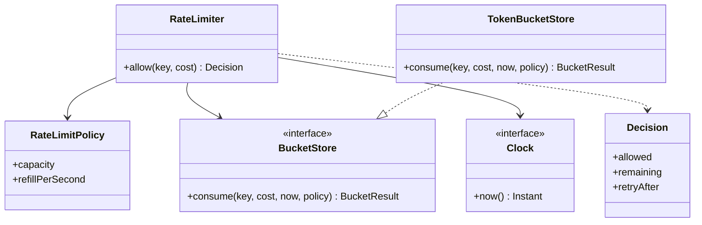

For each key, store available tokens and the time of the last refill. Refill by elapsed time, cap at capacity, then consume cost if enough tokens remain. A distributed implementation needs an atomic read-refill-check-write, commonly implemented by a server-side script or atomic datastore operation.

### Important flow

```text
allow(key, cost):
    require cost > 0 and cost <= policy.capacity
    now = clock.now()
    result = bucketStore.consume(key, cost, now, policy)  // one atomic operation
    if result.allowed: return Allowed(result.remaining)
    return Denied(retryAfter = result.timeUntilEnoughTokens)
```

### Trade-offs and follow-ups

- Fixed window is simple but permits boundary bursts; sliding log is precise but stores more events; sliding counter approximates the latter; token bucket permits controlled bursts.
- Define behavior when the shared store is unavailable: fail open, fail closed, or use a bounded local fallback, based on endpoint risk.
- Follow-ups: hierarchical limits, dynamic policy updates, key eviction, clock skew, metrics, and fairness.

### `allow` decision flowchart (activity diagram)

A rate limiter has one interesting operation and few collaborators, so a flowchart of its decision logic says more than a sequence diagram. This one matches `TokenBucketLimiter::allow` in the reference implementation below.

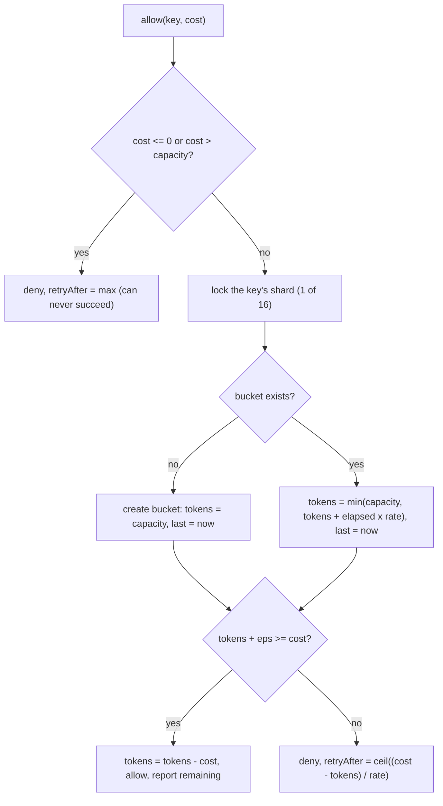

Worked numbers for capacity 50 and 10 tokens per second: a client bursts 50 requests at one instant, all allowed, and `tokens` reaches 0. Request 51 at the same instant takes the right-hand branch with `retryAfter = ceil((1 - 0) / 10 s) = 100 ms`. The top `cost > capacity` check matters: without it, a request for 51 tokens would always be denied with a finite `retryAfter`, and a well-behaved client would retry forever. Everything below the lock box is the read-refill-check-write step that must be atomic per key. In the distributed version, that same subgraph becomes one server-side script in the shared store.

### Reference implementation (C++20, thread-safe token bucket)

Each key has a bucket `{tokens, lastRefill}`. On every request: refill by `elapsed * rate`, cap at `capacity`, then consume `cost` if enough tokens remain; otherwise report `retryAfter = (cost - tokens) / rate`. The read-refill-check-write sequence must be atomic per key. Lock striping (16 shards, each with its own mutex and map) means unrelated keys rarely contend, while one key is always serialized.

See also: [distributed rate limiter design](../computer-science/High_Level_Design.md#62-rate-limiter), [concurrency coding problems](../computer-science/Concurrency_Coding_Problems.md).

```cpp
// rate_limiter.cpp -- build: g++ -std=c++20 -O2 -Wall -Wextra -pthread rate_limiter.cpp && ./a.out
#include <algorithm>
#include <array>
#include <atomic>
#include <cassert>
#include <chrono>
#include <cmath>
#include <functional>
#include <iostream>
#include <mutex>
#include <string>
#include <thread>
#include <unordered_map>
#include <vector>

using Clock = std::chrono::steady_clock;  // monotonic: immune to NTP/wall-clock jumps
using std::chrono::duration;
using std::chrono::duration_cast;
using Seconds = duration<double>;

struct TimeSource {
    virtual ~TimeSource() = default;
    virtual Clock::time_point now() const = 0;
};
struct SteadyTime : TimeSource {
    Clock::time_point now() const override { return Clock::now(); }
};
struct FakeTime : TimeSource {
    std::atomic<Clock::rep> ticks{0};
    Clock::time_point now() const override { return Clock::time_point(Clock::duration(ticks.load())); }
    void advance(Clock::duration d) { ticks += d.count(); }
};

struct Policy {
    double capacity;         // max burst, in tokens
    double refillPerSecond;  // long-run average rate
};

struct Decision {
    bool allowed;
    double remaining;       // tokens left after this decision
    Clock::duration retryAfter;  // zero when allowed
};

class TokenBucketLimiter {
public:
    TokenBucketLimiter(Policy p, const TimeSource& clock) : policy_(p), clock_(clock) {
        assert(p.capacity > 0 && p.refillPerSecond > 0);
    }

    Decision allow(const std::string& key, double cost = 1.0) {
        if (cost <= 0 || cost > policy_.capacity)  // could never succeed: reject, don't wait forever
            return {false, 0, Clock::duration::max()};
        Shard& sh = shardFor(key);
        std::lock_guard lk(sh.m);  // read-refill-check-write is one atomic step per key
        auto now = clock_.now();
        auto [it, inserted] = sh.buckets.try_emplace(key, Bucket{policy_.capacity, now});
        Bucket& b = it->second;
        if (!inserted) {
            double elapsed = std::max(0.0, Seconds(now - b.last).count());
            b.tokens = std::min(policy_.capacity, b.tokens + elapsed * policy_.refillPerSecond);
            b.last = now;
        }
        if (b.tokens + kEps >= cost) {  // kEps absorbs floating-point rounding in the refill
            b.tokens = std::max(0.0, b.tokens - cost);
            return {true, b.tokens, Clock::duration::zero()};
        }
        double wait = (cost - b.tokens) / policy_.refillPerSecond;
        // Round up: duration_cast truncates, and a client that waits a truncated hint is denied again.
        return {false, b.tokens, std::chrono::ceil<Clock::duration>(Seconds(wait))};
    }

    // Idle buckets that would be full anyway carry no information: drop them to bound memory.
    std::size_t evictIdle() {
        std::size_t n = 0;
        auto now = clock_.now();
        auto fullAfter = Seconds(policy_.capacity / policy_.refillPerSecond);
        for (auto& sh : shards_) {
            std::lock_guard lk(sh.m);
            n += std::erase_if(sh.buckets, [&](auto& kv) { return now - kv.second.last >= fullAfter; });
        }
        return n;
    }

private:
    struct Bucket { double tokens; Clock::time_point last; };
    struct Shard {
        std::mutex m;
        std::unordered_map<std::string, Bucket> buckets;
    };
    static constexpr double kEps = 1e-9;     // in tokens; far below any real cost
    static constexpr std::size_t kShards = 16;  // lock striping: unrelated keys rarely contend

    Shard& shardFor(const std::string& key) { return shards_[std::hash<std::string>{}(key) % kShards]; }

    Policy policy_;
    const TimeSource& clock_;
    std::array<Shard, kShards> shards_;
};

int main() {
    using namespace std::chrono_literals;
    FakeTime clock;
    TokenBucketLimiter rl({/*capacity=*/50, /*refillPerSecond=*/10}, clock);

    // 1) Burst: 8 threads x 100 requests on one key at a frozen instant -> exactly capacity succeed.
    std::atomic<int> ok{0};
    {
        std::vector<std::jthread> ts;
        for (int t = 0; t < 8; ++t)
            ts.emplace_back([&] { for (int i = 0; i < 100; ++i) ok += rl.allow("alice").allowed; });
    }
    assert(ok == 50);

    // 2) Denial carries retry-after: need 1 token at 10 tokens/s -> 100 ms.
    auto d = rl.allow("alice");
    assert(!d.allowed && d.retryAfter == 100ms);

    // 3) Refill: after 1 s, 10 more tokens (not 50 -- the long-run rate is enforced).
    clock.advance(1s);
    int more = 0;
    for (int i = 0; i < 20; ++i) more += rl.allow("alice").allowed;
    assert(more == 10);

    // 4) Keys are independent; cost > 1 and impossible costs.
    assert(rl.allow("bob", 50).allowed);
    assert(!rl.allow("bob", 1).allowed);
    assert(rl.allow("carol", 51).retryAfter == Clock::duration::max());

    // 5) Refill is capped at capacity; idle full buckets are evicted.
    clock.advance(1h);
    assert(rl.evictIdle() == 2);  // alice, bob ("carol" was rejected before a bucket existed)
    assert(rl.allow("alice", 50).allowed && !rl.allow("alice").allowed);

    // Smoke test with the real clock.
    SteadyTime real;
    TokenBucketLimiter live({5, 1000}, real);
    int liveOk = 0;
    for (int i = 0; i < 5; ++i) liveOk += live.allow("k").allowed;
    assert(liveOk == 5);
    std::cout << "rate limiter: all assertions passed\n";
}
```

What to point out while presenting this code:

- **Worked numbers:** capacity 50 and refill 10/s means a client can burst 50 requests instantly but sustain only 10/s. After the burst, one more token takes 1/10 s, so `retryAfter = 100 ms`; that value maps directly to an HTTP `429` response with a `Retry-After` header (rounded up to whole seconds). Always round retry hints **up**: `duration_cast` truncates toward zero, so a hint of 333,333,333 ns for a 1/3 s wait makes a client that waits exactly that long get denied again. `std::chrono::ceil` fixes the hint, and the tiny `kEps` tolerance in the comparison absorbs the remaining floating-point rounding when the refill is recomputed (without it, 147 of about 200,000 boundary retries in a sweep were still denied).
- **Monotonic clock:** `steady_clock` never jumps backwards. With `system_clock`, an NTP correction could produce negative elapsed time; the `std::max(0.0, ...)` guard is defense in depth.
- **Lazy refill:** there is no background thread adding tokens. Refill is computed on access from elapsed time, so idle keys cost nothing except memory, and `evictIdle()` reclaims that memory because a bucket idle for `capacity / rate` seconds is full and indistinguishable from a new one.
- **Floating point:** `double` tokens are fine here (rounding error is far below one token). An exact alternative is fixed-point integer micro-tokens, or GCRA, which stores a single "theoretical arrival time" per key and needs no token count at all.
- **Distributed version:** the same refill-and-consume logic runs as one atomic server-side operation in a shared store (for example, a script executed atomically by the store), keyed by client. The local mutex becomes the store's per-key atomicity.

### Interview Q&A

**Q1.** Why lock striping instead of one global mutex or a `std::shared_mutex`?

**A1.** Every `allow()` mutates its bucket, so readers and writers are the same callers and a reader-writer lock buys nothing. One global mutex serializes all keys and becomes the bottleneck at high QPS across many cores. Striping into 16 shards cuts contention by roughly 16x for uniformly distributed keys while keeping the code trivial. A single hot key is still serialized on its shard, but that is inherent: its updates must be linearizable anyway. A lock-free alternative packs `(tokens, timestamp)` into one 64-bit word and updates it with a compare-and-swap loop.

**Q2.** Token bucket vs leaky bucket vs sliding window counter. When would you pick each?

**A2.** Token bucket allows bursts up to capacity with a bounded average rate, which suits APIs. Leaky bucket (as a queue) smooths output to a constant rate, which suits shaping traffic toward a fragile downstream; it adds queueing latency. Sliding window counter estimates the count in the last window as `curr + prev * (1 - elapsed_fraction)`, which is cheap (two counters per key) and avoids the fixed-window boundary burst, where up to 2x the limit can pass around a window edge. Sliding log is exact but stores one timestamp per request.

**Q3.** How do you test a rate limiter without `sleep()`?

**A3.** Inject the clock. `FakeTime` lets the test freeze time (to prove that exactly `capacity` requests pass in a burst, even across 8 threads) and then advance it precisely (to prove that exactly 10 tokens refill in 1 s). Tests with sleeps are slow and flaky on loaded CI machines; tests with a fake clock are instant and deterministic.

## 11. Worked Design: Cache

### Requirements and assumptions

- Provide `get`, `put`, and `delete` for keys and values.
- Support a capacity bound, expiration, and a documented eviction policy.
- Start with an in-process LRU cache that is safe for concurrent callers.
- Cache misses are distinct from a cached null-like value; use an explicit result type.

### Core model

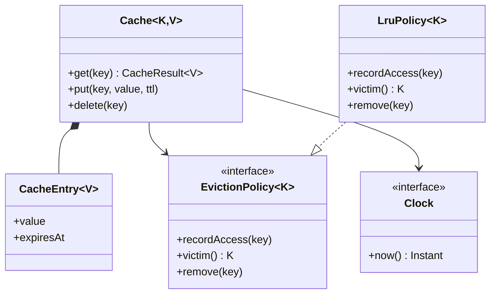

An LRU policy can use a hash map from key to a doubly linked list node plus a list ordered by recency. `Cache` owns storage and synchronizes changes; `EvictionPolicy` captures replacement behavior. TTL checks should use a monotonic time source when available.

### Important flow

```text
get(key):
    lock cache
    if key absent: return Miss
    if entry expired at clock.now(): remove entry and return Miss
    evictionPolicy.recordAccess(key)
    return Hit(entry.value)

put(key, value, ttl):
    lock cache
    insert/update with expiration
    evictionPolicy.recordAccess(key)
    while size > capacity:
        remove evictionPolicy.victim()
```

This coarse-lock version favors clarity. For higher contention, shard by key or choose a concurrent cache design, while being explicit about eviction accuracy and per-shard capacity.

### Trade-offs and follow-ups

- Lazy expiration on access is simple; a background sweeper prevents expired entries from occupying capacity indefinitely.
- Define whether values are copied, immutable, or shared; shared mutable values can be mutated outside the cache's lock.
- Follow-ups: write-through/write-back, cache stampede protection, negative caching, size-based capacity, distributed invalidation, and metrics.

### Reference implementation (C++20, thread-safe O(1) LRU with TTL)

This is LeetCode 146 (LRU Cache) made production-shaped: a `std::list` holds entries in recency order (front = most recent) and an `std::unordered_map` maps each key to its list iterator. `splice` moves a node to the front in O(1) without allocating, and `std::list` iterators stay valid when other nodes are inserted, moved, or erased, which is what makes storing them in the map safe. A single mutex guards both structures because they must change together.

```cpp
// lru_cache.cpp -- build: g++ -std=c++20 -O2 -Wall -Wextra -pthread lru_cache.cpp && ./a.out
#include <atomic>
#include <cassert>
#include <chrono>
#include <cstddef>
#include <functional>
#include <iostream>
#include <list>
#include <mutex>
#include <optional>
#include <stdexcept>
#include <string>
#include <thread>
#include <unordered_map>
#include <vector>

using Clock = std::chrono::steady_clock;

// O(1) get/put/erase: the list keeps recency order (front = most recent) and the map
// points at list nodes. std::list iterators stay valid across splice/insert/erase of OTHER nodes.
template <typename K, typename V, typename Hash = std::hash<K>>
class LruCache {
public:
    using NowFn = std::function<Clock::time_point()>;

    explicit LruCache(std::size_t capacity, NowFn now = [] { return Clock::now(); })
        : cap_(capacity), now_(std::move(now)) {
        if (cap_ == 0) throw std::invalid_argument("capacity must be > 0");
    }

    // Returns a copy: handing out a reference would escape the lock.
    std::optional<V> get(const K& key) {
        std::lock_guard lk(m_);  // exclusive even for reads: get() mutates recency order
        auto it = index_.find(key);
        if (it == index_.end()) { ++misses_; return std::nullopt; }
        auto node = it->second;
        if (node->expiresAt && *node->expiresAt <= now_()) {  // lazy TTL expiry
            items_.erase(node);
            index_.erase(it);
            ++misses_;
            return std::nullopt;
        }
        items_.splice(items_.begin(), items_, node);  // move to front, O(1), no allocation
        ++hits_;
        return node->value;
    }

    void put(const K& key, V value, std::optional<Clock::duration> ttl = std::nullopt) {
        std::lock_guard lk(m_);
        std::optional<Clock::time_point> exp;
        if (ttl) exp = now_() + *ttl;
        if (auto it = index_.find(key); it != index_.end()) {
            it->second->value = std::move(value);
            it->second->expiresAt = exp;
            items_.splice(items_.begin(), items_, it->second);
            return;
        }
        if (items_.size() == cap_) {  // evict least-recently-used (back)
            index_.erase(items_.back().key);
            items_.pop_back();
            ++evictions_;
        }
        items_.push_front(Entry{key, std::move(value), exp});
        index_.emplace(key, items_.begin());
    }

    bool erase(const K& key) {
        std::lock_guard lk(m_);
        auto it = index_.find(key);
        if (it == index_.end()) return false;
        items_.erase(it->second);
        index_.erase(it);
        return true;
    }

    std::size_t size() const { std::lock_guard lk(m_); return items_.size(); }
    struct Stats { std::size_t hits, misses, evictions; };
    Stats stats() const { std::lock_guard lk(m_); return {hits_, misses_, evictions_}; }

    // Test hook: verifies the two structures agree (call from tests only).
    bool consistent() const {
        std::lock_guard lk(m_);
        if (items_.size() != index_.size() || items_.size() > cap_) return false;
        for (auto it = items_.begin(); it != items_.end(); ++it)
            if (auto f = index_.find(it->key); f == index_.end() || f->second != it) return false;
        return true;
    }

private:
    struct Entry {
        K key;  // stored so eviction can erase the map entry
        V value;
        std::optional<Clock::time_point> expiresAt;
    };
    const std::size_t cap_;
    NowFn now_;
    mutable std::mutex m_;
    std::list<Entry> items_;
    std::unordered_map<K, typename std::list<Entry>::iterator, Hash> index_;
    std::size_t hits_ = 0, misses_ = 0, evictions_ = 0;
};

int main() {
    using namespace std::chrono_literals;

    // LeetCode 146 sequence.
    LruCache<int, int> c(2);
    c.put(1, 1);
    c.put(2, 2);
    assert(c.get(1) == 1);        // order now: 1, 2
    c.put(3, 3);                  // evicts 2 (least recently used)
    assert(!c.get(2));
    c.put(4, 4);                  // evicts 1
    assert(!c.get(1));
    assert(c.get(3) == 3 && c.get(4) == 4);
    c.put(3, 30);                 // update does not evict
    assert(c.size() == 2 && c.get(3) == 30);
    assert(c.erase(4) && !c.erase(4) && c.size() == 1);
    auto s = c.stats();
    assert(s.evictions == 2 && s.hits == 4 && s.misses == 2);

    // TTL with an injected fake clock.
    Clock::time_point fake{};
    LruCache<std::string, std::string> t(4, [&] { return fake; });
    t.put("session", "abc", 30s);
    t.put("config", "v1");        // no TTL
    fake += 29s;
    assert(t.get("session") == "abc");
    fake += 1s;                   // expiresAt <= now -> expired
    assert(!t.get("session") && t.get("config") == "v1" && t.size() == 1);

    // Concurrency: 8 threads hammer a small cache; invariants must hold.
    LruCache<int, int> shared(64);
    {
        std::vector<std::jthread> ts;
        for (int tid = 0; tid < 8; ++tid)
            ts.emplace_back([&, tid] {
                for (int i = 0; i < 20000; ++i) {
                    int k = (i * 7 + tid) % 200;
                    if (i % 3 == 0) shared.put(k, k * 2);
                    else if (auto v = shared.get(k)) assert(*v == k * 2);  // never a torn/mismatched value
                    if (i % 101 == 0) shared.erase(k);
                }
            });
    }
    assert(shared.size() <= 64 && shared.consistent());
    std::cout << "lru cache: all assertions passed\n";
}
```

What to point out while presenting this code:

- **Why the entry stores its key:** eviction starts from the list tail and must also erase the map entry, so the node needs its key. Forgetting this is the most common bug when writing LRU from memory.
- **Why `get` takes an exclusive lock:** a hit reorders the list, so a "read" is a write to recency state. A `shared_mutex` would allow two readers to splice concurrently and corrupt the list.
- **Return by value:** returning `V&` or `V*` would let callers read the value after the lock is released while another thread evicts it (use-after-free). For large values, store `std::shared_ptr<const V>` so the copy is a refcount bump.
- **Scaling:** one mutex is fine up to moderate contention. Beyond that, shard into N independent LRUs by key hash (each with capacity/N; eviction becomes approximately LRU), or use designs that batch recency updates (record hits in a per-thread buffer and apply them under the lock later), or switch to CLOCK, which needs only a reference bit per entry.
- **Testing:** the demo checks exact LC 146 behavior, TTL boundary (`expiresAt <= now` means expired at exactly 30 s), and a stress test followed by `consistent()`. Run the stress test under `-fsanitize=thread` as well.

### Interview Q&A

**Q1.** Implement LFU instead. What changes?

**A1.** LFU evicts the least frequently used key, breaking ties by least recently used. The O(1) design (LeetCode 460) keeps `key -> (value, freq, iterator)`, `freq -> list of keys` (each list in LRU order), and a `minFreq` integer. On access, move the key from list `freq` to list `freq+1`; if list `minFreq` became empty, increment `minFreq`. On insert, the new key goes to list 1 and `minFreq = 1`. Eviction pops the back of list `minFreq`. A known weakness of LFU: old popular keys never age out, so production variants add decay (for example, halving counters periodically, as TinyLFU-style admission policies do).

**Q2.** What is a cache stampede and how would you prevent it in this cache?

**A2.** When a hot key expires, many concurrent misses all recompute the value and hammer the backing store at the same moment. Fixes: (1) request coalescing (single-flight), where the first miss installs a "loading" placeholder holding a `std::shared_future<V>` and later callers wait on that future instead of recomputing; (2) early probabilistic refresh, where a request refreshes the value with increasing probability as expiry approaches; (3) TTL jitter, so keys written together do not expire together. Coalescing is the one to code: a `get_or_load(key, loader)` that releases the cache lock before running the loader.

**Q3.** Why is the TTL check lazy, and what is the downside?

**A3.** Lazy expiry (check on access) costs nothing when entries are not touched and needs no background thread. The downside is that expired-but-unread entries keep occupying capacity and memory until LRU eventually evicts them. If many short-TTL entries are written once and never read, add a sweeper that periodically scans a time-ordered index (for example, a min-heap or ordered set keyed by `expiresAt`) and removes expired entries under the lock in small batches to bound pause time.

## 12. Worked Design: Notification Service

### Requirements and assumptions

- Callers submit a notification to one or more recipients with a message and delivery preference.
- Channels such as email, SMS, and push use different providers.
- Delivery is asynchronous, retriable, and observable; duplicate delivery should be reduced through stable message and attempt identifiers, while acknowledging that external providers may not guarantee exactly-once delivery.
- Assume durable queueing and worker execution are in scope at the component level.

### Core model

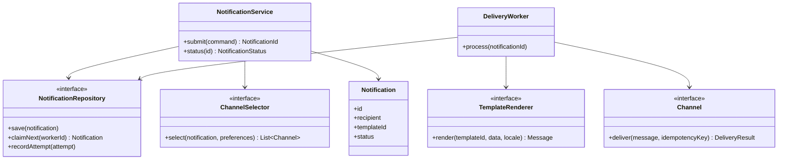

The submission path validates, stores durable intent, and returns an identifier. Workers claim due work, render content, call a channel adapter, and record the outcome. A channel is an adapter for a provider; channel selection is a policy and can account for user preferences, locale, and urgency.

### Important flow

```text
submit(command):
    validate recipient, template, and permission to send
    begin transaction
    save notification as QUEUED with stable id
    write outbox event for worker queue
    commit
    return notification id

worker.process(id):
    claim queued or retry-due notification with a lease
    select eligible channel and render message
    record attempt as IN_PROGRESS
    result = channel.deliver(message, key = notificationId + channel)
    record DELIVERED, RETRY_SCHEDULED, or PERMANENT_FAILURE
```

Use bounded exponential backoff with jitter for transient failures, a maximum attempt/age policy, and a dead-letter or review path. Treat provider callbacks as duplicate and potentially out-of-order events.

### Trade-offs and follow-ups

- Persisting the outbox alongside the notification avoids losing work between database commit and queue publication.
- Define whether channel fallback can send duplicates if the first provider's result is uncertain.
- Follow-ups: rate limiting per recipient, quiet hours, consent, template versioning, delivery receipts, prioritization, and privacy of message content in logs.

### Notification send sequence diagram

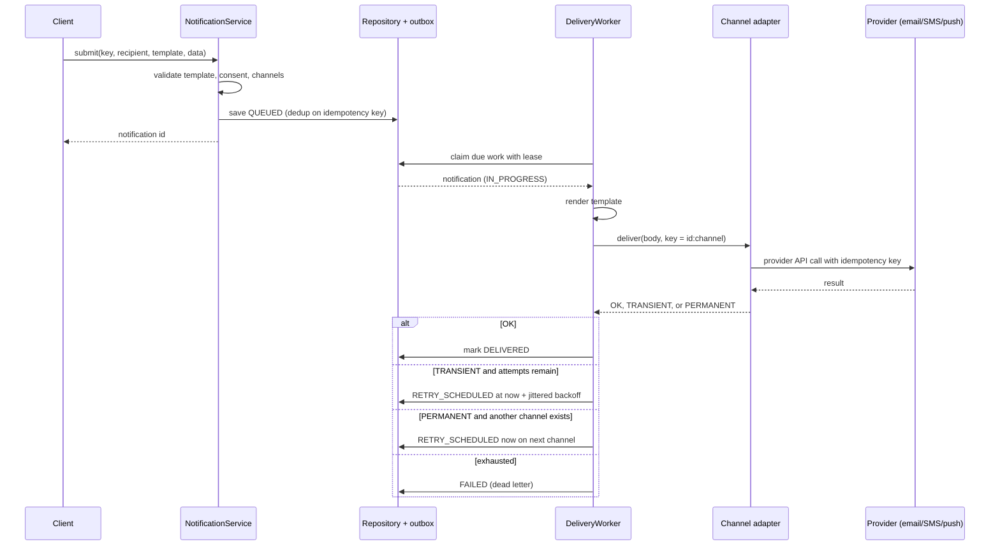

### Reference implementation (Python 3)

The submit path only validates and records durable intent; delivery happens in a worker that claims work with a lease. Outcomes are classified as `OK`, `TRANSIENT` (retry with full-jitter exponential backoff) or `PERMANENT` (fall back to the next preferred channel, never retry). The idempotency key `nid:channel` is identical across retries, so a provider that deduplicates on it delivers at most one message even when an acknowledgement is lost.

```python
"""notification_service.py -- run: python3 notification_service.py"""
from __future__ import annotations

import itertools
import random
import threading
from dataclasses import dataclass, field
from enum import Enum, auto
from string import Template
from typing import Callable, Protocol


class Status(Enum):
    QUEUED = auto()
    IN_PROGRESS = auto()
    RETRY_SCHEDULED = auto()
    DELIVERED = auto()
    FAILED = auto()          # dead letter: exhausted attempts or no usable channel


class Outcome(Enum):
    OK = auto()
    TRANSIENT = auto()       # timeout, 429, 5xx -> retry with backoff
    PERMANENT = auto()       # invalid address, unsubscribed -> try next channel, never retry


@dataclass
class Notification:
    nid: str
    recipient: str
    template_id: str
    data: dict[str, str]
    channels: list[str]                  # ordered by preference, chosen at submit time
    status: Status = Status.QUEUED
    channel_idx: int = 0
    attempts: int = 0
    next_attempt_at: float = 0.0
    lease_until: float = 0.0
    history: list[str] = field(default_factory=list)


class Channel(Protocol):
    def deliver(self, recipient: str, body: str, idempotency_key: str) -> Outcome: ...


class InMemoryRepo:
    """Stand-in for a table + outbox. claim() is the atomic 'UPDATE ... WHERE status IN (...)'."""
    def __init__(self) -> None:
        self._lock = threading.Lock()
        self._rows: dict[str, Notification] = {}

    def save(self, n: Notification) -> None:
        with self._lock:
            self._rows[n.nid] = n

    def get(self, nid: str) -> Notification:
        with self._lock:
            return self._rows[nid]

    def claim(self, now: float, lease: float) -> Notification | None:
        with self._lock:
            for n in self._rows.values():
                due = n.status in (Status.QUEUED, Status.RETRY_SCHEDULED) and n.next_attempt_at <= now
                expired = n.status is Status.IN_PROGRESS and n.lease_until <= now  # crashed worker
                if due or expired:
                    n.status, n.lease_until = Status.IN_PROGRESS, now + lease
                    return n
            return None


class NotificationService:
    TEMPLATES = {"welcome": "Hi $name, welcome aboard!", "otp": "Your code is $code"}

    def __init__(self, repo: InMemoryRepo, preferences: dict[str, list[str]]):
        self._repo, self._prefs = repo, preferences
        self._keys: dict[str, str] = {}
        self._lock = threading.Lock()
        self._ids = itertools.count(1)

    def submit(self, idempotency_key: str, recipient: str, template_id: str, data: dict[str, str]) -> str:
        if template_id not in self.TEMPLATES:
            raise ValueError("unknown template")
        channels = self._prefs.get(recipient, [])
        if not channels:
            raise ValueError("recipient has no consented channel")
        with self._lock:
            if idempotency_key in self._keys:          # client retry -> same notification
                return self._keys[idempotency_key]
            nid = f"N{next(self._ids)}"
            self._repo.save(Notification(nid, recipient, template_id, data, list(channels)))
            self._keys[idempotency_key] = nid
            return nid

    def status(self, nid: str) -> Status:
        return self._repo.get(nid).status


class DeliveryWorker:
    def __init__(self, repo: InMemoryRepo, channels: dict[str, Channel], clock: Callable[[], float],
                 rng: random.Random, max_attempts: int = 4, base: float = 1.0, cap: float = 60.0,
                 lease: float = 30.0):
        self._repo, self._channels, self._clock, self._rng = repo, channels, clock, rng
        self._max, self._base, self._cap, self._lease = max_attempts, base, cap, lease

    def backoff(self, attempt: int) -> float:
        # "Full jitter": uniform in [0, min(cap, base * 2^attempt)] spreads retries apart.
        return self._rng.uniform(0, min(self._cap, self._base * 2 ** attempt))

    def process_once(self) -> str | None:
        now = self._clock()
        n = self._repo.claim(now, self._lease)
        if n is None:
            return None
        # A DB-backed repo would persist each update below with
        # "WHERE nid = ? AND lease_until = ?" so a worker whose lease expired cannot overwrite.
        body = Template(NotificationService.TEMPLATES[n.template_id]).substitute(n.data)
        name = n.channels[n.channel_idx]
        n.attempts += 1
        # Same key for every attempt on this channel: the provider can drop duplicates.
        outcome = self._channels[name].deliver(n.recipient, body, f"{n.nid}:{name}")
        n.history.append(f"{name}:{outcome.name}")
        if outcome is Outcome.OK:
            n.status = Status.DELIVERED
        elif outcome is Outcome.PERMANENT and n.channel_idx + 1 < len(n.channels):
            n.channel_idx, n.attempts = n.channel_idx + 1, 0      # fall back to next channel now
            n.status, n.next_attempt_at = Status.RETRY_SCHEDULED, now
        elif outcome is Outcome.TRANSIENT and n.attempts < self._max:
            n.status, n.next_attempt_at = Status.RETRY_SCHEDULED, now + self.backoff(n.attempts)
        else:
            n.status = Status.FAILED
        return n.nid


class FakeChannel:
    def __init__(self, script: dict[str, list[Outcome]] | None = None):
        self.script = script or {}
        self.sent: dict[str, str] = {}               # idempotency key -> body (provider-side dedup)
        self.calls = 0

    def deliver(self, recipient: str, body: str, idempotency_key: str) -> Outcome:
        self.calls += 1
        queue = self.script.get(recipient)
        outcome = queue.pop(0) if queue else Outcome.OK
        if outcome is Outcome.OK:
            self.sent.setdefault(idempotency_key, body)
        return outcome


def main() -> None:
    now = [0.0]
    repo = InMemoryRepo()
    prefs = {"alice": ["email"], "bob": ["sms"], "carol": ["email", "sms"], "dave": ["push"]}
    T, P = Outcome.TRANSIENT, Outcome.PERMANENT
    email = FakeChannel({"carol": [P]})
    sms = FakeChannel({"bob": [T, T]})
    push = FakeChannel({"dave": [T] * 10})
    svc = NotificationService(repo, prefs)
    worker = DeliveryWorker(repo, {"email": email, "sms": sms, "push": push},
                            clock=lambda: now[0], rng=random.Random(42))

    a = svc.submit("req-1", "alice", "welcome", {"name": "Alice"})
    assert svc.submit("req-1", "alice", "welcome", {"name": "Alice"}) == a   # idempotent submit
    b = svc.submit("req-2", "bob", "otp", {"code": "123456"})
    c = svc.submit("req-3", "carol", "welcome", {"name": "Carol"})
    d = svc.submit("req-4", "dave", "otp", {"code": "999"})

    def drain(until: float) -> None:
        while now[0] <= until:
            while worker.process_once():
                pass
            now[0] += 0.5                       # simulated time passes

    drain(until=120)
    assert svc.status(a) is Status.DELIVERED and email.sent[f"{a}:email"] == "Hi Alice, welcome aboard!"
    assert repo.get(b).history == ["sms:TRANSIENT", "sms:TRANSIENT", "sms:OK"]
    assert repo.get(c).history == ["email:PERMANENT", "sms:OK"]            # channel fallback
    assert svc.status(d) is Status.FAILED and len(repo.get(d).history) == 4  # dead-lettered

    # Crash recovery: a worker claims, then dies before recording. Lease expiry lets another
    # worker retry; the provider dedups on the idempotency key so the user gets one message.
    e = svc.submit("req-5", "alice", "otp", {"code": "42"})
    stuck = repo.claim(now[0], lease=30.0)
    assert stuck is not None and stuck.nid == e
    email.deliver("alice", "Your code is 42", f"{e}:email")   # send happened, ack was lost
    assert worker.process_once() is None                      # lease still held
    now[0] += 31
    assert worker.process_once() == e and svc.status(e) is Status.DELIVERED
    assert email.calls == 4                                    # alice, carol, lost-ack send, retry
    assert [k for k in email.sent if k.startswith(f"{e}:")] == [f"{e}:email"]  # one user-visible message
    print("notification service: all assertions passed")


if __name__ == "__main__":
    main()
```

What to point out while presenting this code:

- **Error classification drives everything:** transient errors retry on the same channel with backoff, permanent errors fail over to the next channel immediately, and exhaustion dead-letters. Misclassifying a permanent error as transient wastes retries; the reverse loses messages.
- **Full jitter backoff:** `uniform(0, min(cap, base * 2^attempt))`. With base 1 s the windows are [0, 2], [0, 4], [0, 8] seconds and so on, capped at 60 s. Jitter prevents synchronized retry waves when a provider recovers from an outage.
- **Leases recover crashed workers:** `claim()` also returns `IN_PROGRESS` rows whose lease expired. This produces at-least-once delivery; the stable idempotency key is what turns it into at-most-one visible message, but only if the provider honors keys. For providers that do not, record "sent" before calling them and accept rare loss, or accept rare duplicates. State which one you chose.
- **Simplifications to name aloud:** `claim()` scans all rows (a real store uses an index on `(status, next_attempt_at)`), and the in-memory objects are mutated outside the repository lock, which is safe only because a lease grants exclusive ownership.

### Interview Q&A

**Q1.** How do you add per-recipient rate limiting and quiet hours?

**A1.** Both are policies evaluated in the worker after `claim()` and before `deliver()`. If the recipient is in quiet hours (in their time zone) or over their rate limit (reuse the token bucket from Section 10 keyed by `recipient:channel`), reschedule the notification for the earliest allowed time without counting it as a delivery attempt. Urgent categories (OTP, security alerts) bypass quiet hours, which is a field on the template or category, not a special case in code.

**Q2.** Why not just call the provider synchronously inside `submit()`?

**A2.** Because the caller's latency and availability would then depend on the slowest external provider, retries would block request threads, and a crash between "provider accepted" and "we recorded it" would lose state. Recording intent first (transactional outbox) and delivering asynchronously gives durability, retry control, backpressure (workers drain at a controlled rate), and a status API. The cost is eventual delivery and a more complex status model.

## 13. Worked Design: Task Scheduler

### Requirements and assumptions

- Clients submit one-time or recurring jobs with a scheduled time and payload.
- Workers claim due jobs, execute handlers, and record success or failure.
- Support retries and prevent two workers from owning the same active attempt.
- Assume persistent job state and at-least-once execution; exactly-once effects require idempotent handlers or deduplication at the effect boundary.

### Core model

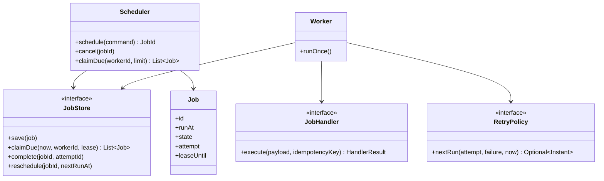

Jobs move through states such as `SCHEDULED`, `RUNNING`, `SUCCEEDED`, `FAILED`, and `CANCELLED`. Claiming must atomically set a lease and attempt identifier. A worker whose lease expired must not overwrite a newer attempt's result; use a fencing token or compare-and-set on attempt identity.

### Important flow

```text
worker.runOnce():
    jobs = jobStore.claimDue(clock.now(), workerId, leaseDuration)
    for job in jobs:
        try:
            handler = handlerRegistry.forType(job.type)
            result = handler.execute(job.payload, idempotencyKey = job.id)
            jobStore.complete(job.id, job.attemptId)
        catch failure:
            next = retryPolicy.nextRun(job.attempt, failure, clock.now())
            if next exists:
                jobStore.reschedule(job.id, next, expectedAttempt = job.attemptId)
            else:
                jobStore.fail(job.id, expectedAttempt = job.attemptId)
```

Recurring jobs should compute the next occurrence from an explicit schedule/time-zone policy. Decide whether missed runs are skipped, coalesced, or replayed after downtime.

### Trade-offs and follow-ups

- A due-time index or time wheel can support efficient scheduling; a simple ordered query is easier at low volume.
- Leases recover from crashed workers, but lease duration and heartbeat policy affect duplicate work and recovery time.
- Follow-ups: priorities, tenant fairness, cancellation after claim, long-running jobs, workflow dependencies, poison tasks, and scheduler failover.

### Job lifecycle state diagram

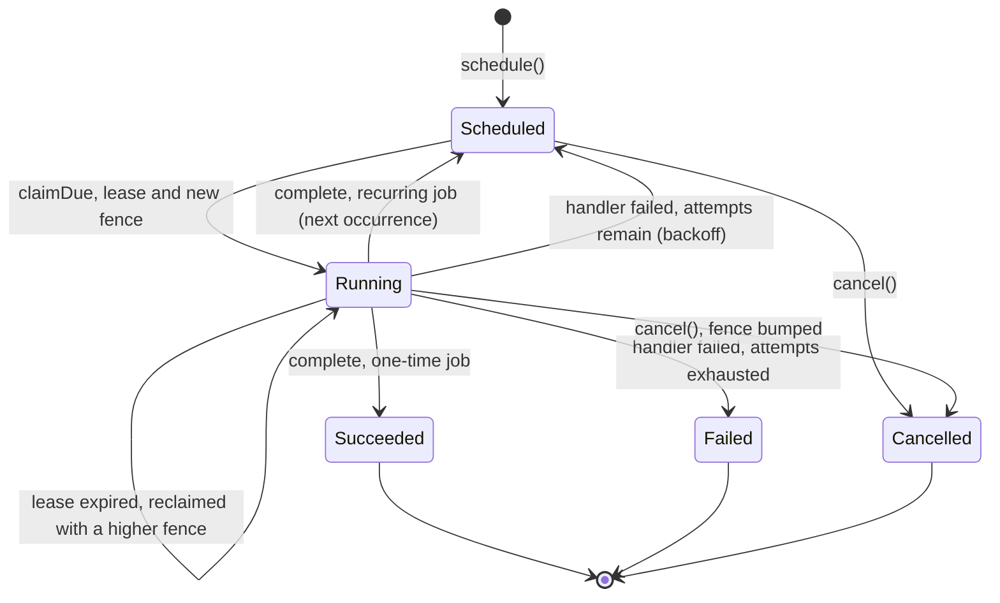

### Reference implementation (C++20)

An in-memory `JobStore` with two ordered indexes: `due_` (run time, job id) for claiming and `leases_` (lease expiry, job id) for recovering crashed workers. Every claim increments a per-job **fence** token, and `complete`/`fail` are compare-and-set on that fence, so a worker whose lease expired cannot overwrite the result of the worker that took over. Retries use capped exponential backoff, and recurring jobs compute the next run from the schedule, not from completion time.

```cpp
// task_scheduler.cpp -- build: g++ -std=c++20 -O2 -Wall -Wextra -pthread task_scheduler.cpp && ./a.out
// In-memory job store with due-time index, leases, fencing tokens, retries, and recurring jobs.
#include <algorithm>
#include <atomic>
#include <cassert>
#include <chrono>
#include <cstdint>
#include <functional>
#include <iostream>
#include <map>
#include <mutex>
#include <optional>
#include <set>
#include <stdexcept>
#include <string>
#include <thread>
#include <unordered_map>
#include <utility>
#include <vector>

using Clock = std::chrono::steady_clock;
using TimePoint = Clock::time_point;
using JobId = std::uint64_t;
using namespace std::chrono_literals;

enum class JobState { Scheduled, Running, Succeeded, Failed, Cancelled };

struct Job {
    JobId id;
    std::string type;
    std::string payload;
    TimePoint runAt;
    std::optional<Clock::duration> every;  // recurring interval
    int maxAttempts = 3;
    JobState state = JobState::Scheduled;
    int attempt = 0;                // attempts started for the current occurrence
    std::uint64_t fence = 0;        // increments on every claim; stale workers lose
    TimePoint leaseUntil{};
};

struct Claim { JobId id; std::string type; std::string payload; int attempt; std::uint64_t fence; };

class JobStore {
public:
    JobId schedule(std::string type, std::string payload, TimePoint runAt,
                   std::optional<Clock::duration> every = std::nullopt, int maxAttempts = 3) {
        std::lock_guard lk(m_);
        JobId id = nextId_++;
        jobs_[id] = Job{id, std::move(type), std::move(payload), runAt, every, maxAttempts};
        due_.insert({runAt, id});
        return id;
    }

    // Atomically claims up to `limit` due jobs, including RUNNING jobs whose lease expired.
    std::vector<Claim> claimDue(TimePoint now, std::size_t limit, Clock::duration lease) {
        std::lock_guard lk(m_);
        // Recover crashed/slow workers: expired leases go back to the due index.
        while (!leases_.empty() && leases_.begin()->first <= now) {
            JobId id = leases_.begin()->second;
            leases_.erase(leases_.begin());
            due_.insert({now, id});
        }
        std::vector<Claim> out;
        while (out.size() < limit && !due_.empty() && due_.begin()->first <= now) {
            JobId id = due_.begin()->second;
            due_.erase(due_.begin());
            Job& j = jobs_.at(id);
            j.state = JobState::Running;
            ++j.attempt;
            ++j.fence;
            j.leaseUntil = now + lease;
            leases_.insert({j.leaseUntil, id});
            out.push_back({id, j.type, j.payload, j.attempt, j.fence});
        }
        return out;
    }

    // Compare-and-set on the fence: a worker whose lease was taken over cannot record a result.
    bool complete(JobId id, std::uint64_t fence, TimePoint now) {
        std::lock_guard lk(m_);
        Job* j = owned(id, fence);
        if (!j) return false;
        if (j->every) {  // recurring: next occurrence from the schedule, not from "now" (no drift)
            j->runAt += *j->every;
            while (j->runAt <= now) j->runAt += *j->every;  // policy: skip missed runs (coalesce)
            j->state = JobState::Scheduled;
            j->attempt = 0;
            due_.insert({j->runAt, id});
        } else {
            j->state = JobState::Succeeded;
        }
        return true;
    }

    bool fail(JobId id, std::uint64_t fence, std::optional<TimePoint> retryAt) {
        std::lock_guard lk(m_);
        Job* j = owned(id, fence);
        if (!j) return false;
        if (retryAt && j->attempt < j->maxAttempts) {
            j->state = JobState::Scheduled;
            j->runAt = *retryAt;
            due_.insert({j->runAt, id});
        } else {
            j->state = JobState::Failed;  // dead-letter: a human or a repair job looks at it
        }
        return true;
    }

    bool cancel(JobId id) {
        std::lock_guard lk(m_);
        auto it = jobs_.find(id);
        if (it == jobs_.end()) return false;
        Job& j = it->second;
        if (j.state == JobState::Scheduled) due_.erase({j.runAt, id});
        else if (j.state == JobState::Running) leases_.erase({j.leaseUntil, id});
        else return false;  // terminal states are final
        j.state = JobState::Cancelled;
        ++j.fence;  // a running worker's later complete()/fail() is rejected
        return true;
    }

    Job get(JobId id) const { std::lock_guard lk(m_); return jobs_.at(id); }

private:
    Job* owned(JobId id, std::uint64_t fence) {
        auto it = jobs_.find(id);
        if (it == jobs_.end() || it->second.state != JobState::Running || it->second.fence != fence)
            return nullptr;
        leases_.erase({it->second.leaseUntil, id});
        return &it->second;
    }

    mutable std::mutex m_;
    std::unordered_map<JobId, Job> jobs_;
    std::set<std::pair<TimePoint, JobId>> due_;     // ordered by run time: O(log n) claim
    std::set<std::pair<TimePoint, JobId>> leases_;  // ordered by lease expiry
    JobId nextId_ = 1;
};

struct RetryPolicy {  // exponential backoff: base * 2^(attempt-1), capped
    Clock::duration base = 100ms, cap = 10s;
    TimePoint nextRun(int attempt, TimePoint now) const {
        auto d = base * (1LL << std::min(attempt - 1, 20));
        return now + std::min<Clock::duration>(d, cap);
    }
};

class Worker {
public:
    using Handler = std::function<void(const Claim&)>;  // throws on failure
    Worker(JobStore& s, std::function<TimePoint()> now) : store_(s), now_(std::move(now)) {}
    void on(const std::string& type, Handler h) { handlers_[type] = std::move(h); }

    std::size_t runOnce(std::size_t batch = 8, Clock::duration lease = 30s) {
        auto claims = store_.claimDue(now_(), batch, lease);
        for (auto& c : claims) {
            try {
                handlers_.at(c.type)(c);  // idempotency key for side effects: (c.id, occurrence)
                store_.complete(c.id, c.fence, now_());
            } catch (const std::exception&) {
                store_.fail(c.id, c.fence, retry_.nextRun(c.attempt, now_()));
            }
        }
        return claims.size();
    }

private:
    JobStore& store_;
    std::function<TimePoint()> now_;
    std::unordered_map<std::string, Handler> handlers_;
    RetryPolicy retry_;
};

int main() {
    TimePoint now{};  // fake clock
    auto clock = [&] { return now; };
    JobStore store;
    Worker w(store, clock);

    int flakyCalls = 0, ticks = 0;
    w.on("ok", [](const Claim&) {});
    w.on("flaky", [&](const Claim&) { if (++flakyCalls == 1) throw std::runtime_error("transient"); });
    w.on("broken", [](const Claim&) { throw std::runtime_error("permanent"); });
    w.on("tick", [&](const Claim&) { ++ticks; });

    JobId ok = store.schedule("ok", "", now);
    JobId flaky = store.schedule("flaky", "", now);
    JobId broken = store.schedule("broken", "", now, std::nullopt, /*maxAttempts=*/3);
    JobId cron = store.schedule("tick", "", now, 1s);
    JobId later = store.schedule("ok", "", now + 1h);

    assert(w.runOnce() == 4);  // `later` is not due
    assert(store.get(ok).state == JobState::Succeeded);
    assert(store.get(flaky).state == JobState::Scheduled);   // retry at +100 ms
    now += 100ms;
    w.runOnce();
    assert(store.get(flaky).state == JobState::Succeeded && store.get(flaky).attempt == 2);
    now += 200ms;  // broken: attempt 2 was at +100 ms, attempt 3 due at +300 ms
    w.runOnce();
    assert(store.get(broken).state == JobState::Failed && store.get(broken).attempt == 3);

    now += 2s;     // t = 2.3 s: the 1 s and 2 s occurrences were missed -> run once (coalesced)
    w.runOnce();
    assert(ticks == 2 && store.get(cron).state == JobState::Scheduled);
    assert(store.get(cron).runAt == TimePoint{} + 3s);  // schedule-anchored, no drift
    assert(store.cancel(later) && store.get(later).state == JobState::Cancelled);
    assert(!store.cancel(ok));

    // Lease expiry + fencing: worker A claims, stalls; worker B takes over; A's late result is rejected.
    JobId leased = store.schedule("ok", "", now);
    auto a = store.claimDue(now, 1, 5s);
    assert(a.size() == 1 && a[0].id == leased);
    now += 6s;
    auto b = store.claimDue(now, 10, 5s);
    auto bi = std::find_if(b.begin(), b.end(), [&](auto& c) { return c.id == leased; });
    assert(bi != b.end() && bi->fence > a[0].fence);
    assert(!store.complete(leased, a[0].fence, now));  // stale worker loses
    assert(store.complete(leased, bi->fence, now));

    // Concurrency: 4 workers drain 2000 due jobs; each job runs exactly once (no lease expiry here).
    JobStore big;
    std::vector<std::atomic<int>> runs(2001);
    for (int i = 0; i < 2000; ++i) big.schedule("count", std::to_string(i + 1), TimePoint{});
    {
        std::vector<std::jthread> ts;
        for (int t = 0; t < 4; ++t)
            ts.emplace_back([&] {
                Worker wk(big, [] { return TimePoint{}; });
                wk.on("count", [&](const Claim& c) { ++runs[std::stoi(c.payload)]; });
                while (wk.runOnce(16) > 0) {}
            });
    }
    for (int i = 1; i <= 2000; ++i) assert(runs[i] == 1);
    std::cout << "task scheduler: all assertions passed\n";
}
```

What to point out while presenting this code:

- **Worked timeline (fake clock):** at t = 0 four jobs are due; `flaky` fails once and retries at 100 ms (backoff 100 ms × 2^0); `broken` fails at 0, 100 ms and 300 ms (backoffs of 100 ms and 200 ms) and is dead-lettered after its third attempt; the recurring job runs at 0, its 1 s and 2 s occurrences coalesce into one run at 2.3 s, and its next run is anchored at exactly 3 s.
- **Why fencing matters:** a lease is a timeout guess. A worker paused by GC, swapping, or a network partition can wake up after its lease expired and another worker re-ran the job. Without the fence check, its late `complete()` would overwrite newer state. The same fence value should be passed to downstream side effects (for example, a storage write that rejects lower fences), because the scheduler alone cannot stop a stale worker from writing elsewhere.
- **Claim is a batch under one lock:** a database version is `UPDATE jobs SET state='RUNNING', fence=fence+1, lease_until=? WHERE id IN (SELECT id FROM jobs WHERE state='SCHEDULED' AND run_at <= ? ORDER BY run_at LIMIT ? FOR UPDATE SKIP LOCKED) RETURNING ...`. `SKIP LOCKED` (PostgreSQL, MySQL 8+) lets workers claim disjoint rows without blocking each other.
- **Handler run outside the store lock:** handlers can be slow; the store lock is held only for index updates.

### Interview Q&A

**Q1.** Why is execution at-least-once, and how do handlers achieve "effectively once"?

**A1.** A worker can finish the side effect and crash before `complete()` is recorded; after the lease expires the job runs again. Preventing that would require the side effect and the completion record to commit atomically, which is impossible across independent systems without a shared transaction. Handlers therefore make effects idempotent: use `(jobId, occurrence)` as an idempotency key at the effect boundary (a unique constraint, a provider idempotency key, or an "already applied" check in the same transaction as the effect).

**Q2.** How would you replace the ordered set with something faster for millions of timers?

**A2.** A hierarchical timing wheel: an array of buckets per granularity (for example, 1 ms × 256, 256 ms × 64, and so on). Inserting is O(1) (compute the bucket from the delay), and advancing the clock drains one bucket and cascades coarser buckets down into finer ones. The Linux kernel timer subsystem and Kafka's request purgatory use timing wheels. The trade-off is resolution: timers fire at bucket granularity, which is fine for job scheduling. An ordered set or heap remains simpler and is O(log n) per operation.

**Q3.** Cancellation arrives while the job is running. What should happen?

**A3.** The store marks the job `Cancelled` and bumps the fence, so the running worker's `complete()` or `fail()` returns `false` and cannot resurrect the job. The handler itself keeps running unless it cooperates: pass a cancellation token (for example, `std::stop_token` with `std::jthread`) that the handler checks between steps, or have the worker check the job state on heartbeat and stop early. Side effects already performed are not undone automatically; compensation is a business decision.

## 14. Worked Design: Chess

### Requirements and assumptions

- Two players share a standard 8x8 board and alternate turns, starting with White. Moves arrive in coordinate notation (`"e2e4"`).
- Reject illegal moves with a specific reason: no piece on the square, not your turn, the piece cannot move that way or its path is blocked, capturing your own piece, or leaving your own king in check.
- Detect check, checkmate, and stalemate after every move. Support undo.
- Assume castling, en passant, under-promotion (pawns always promote to a queen), and draw rules (50-move, threefold repetition) are out of scope for the first version. Name the seam for each so the interviewer sees where they go.

### Core model

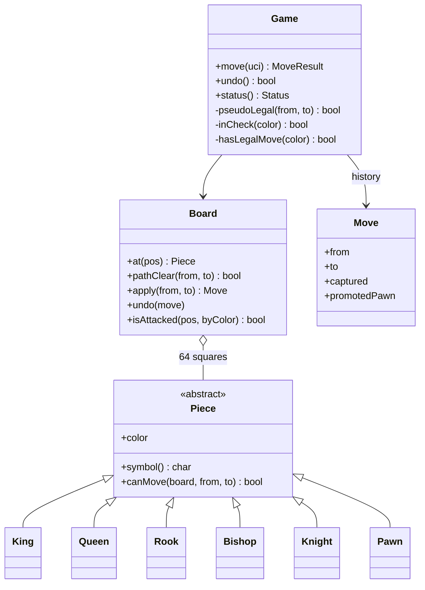

The central decision is splitting validation into two layers:

| Layer | Owner | Knows about | Examples |
|---|---|---|---|
| Pseudo-legal (geometry) | Each `Piece` subclass | Its own movement rule and the squares between `from` and `to` | Bishop moves diagonally, rook path is clear, pawn captures diagonally |
| Legal (game rules) | `Game` | Turn order, both colors, the king, history | Not your turn, own-piece capture, king left in check, game over |

King safety cannot live in a piece, because it depends on every enemy piece. Putting it in `Game` keeps each piece class a few lines long and makes adding a new piece type a purely local change.

### Key patterns used

| Pattern | Where | Why |
|---|---|---|
| Polymorphism (each piece is a movement Strategy) | `Piece::canMove` | Open/closed: a fairy piece or a variant is a new subclass; `Game` does not change |
| Command with undo data | `Board::Move` stores the captured piece and the pre-promotion pawn | Exact undo, replay, move list export, and engine search (apply/undo is far cheaper than copying the board) |
| Factory | `Game::setup()` | Swap in Chess960 or puzzle positions without touching rules |
| Composition over inheritance | `Queen` reuses `Rook` and `Bishop` rules | No diamond inheritance; the queen is literally "rook or bishop" |

### Concurrency and failure concerns

- One game is a sequential state machine. Serialize moves per game (one mutex per game, or one actor or event-loop task per game). Different games share nothing and scale horizontally.
- In an online game the **server is authoritative**: it validates every move, because a client can send anything. Each move carries the expected move number (`ply`). A move for a stale ply is rejected, which makes retries idempotent and resolves the race between a move and a resignation or flag fall.
- Persist the game as an append-only move list (event sourcing). The board is derived state and can be rebuilt by replaying moves, which also gives audit and replay for free.
- Clocks are server-side. Charge each player the elapsed time between the server receiving the opponent's move and receiving theirs, and optionally compensate for measured network lag.

### Reference implementation (C++20)

Pieces implement only geometry. `Game::move` runs a fixed validation pipeline, then applies the move, checks whether the mover's king is attacked, and undoes the move if it is. Checkmate and stalemate both mean "no legal move"; they differ only in whether the side to move is in check.

See also: [Command pattern](Design_Patterns_Cpp.md#17-command), [Strategy pattern](Design_Patterns_Cpp.md#24-strategy), [Memento pattern](Design_Patterns_Cpp.md#21-memento).

```cpp
// chess.cpp -- build: g++ -std=c++20 -O2 -Wall -Wextra chess.cpp && ./a.out
#include <array>
#include <cassert>
#include <cstdlib>
#include <iostream>
#include <memory>
#include <optional>
#include <string>
#include <vector>

enum class Color { White, Black };
constexpr Color opponent(Color c) { return c == Color::White ? Color::Black : Color::White; }

struct Pos {
    int r, c;  // r = rank index 0..7 (rank 1 = 0), c = file index 0..7 (file a = 0)
    bool operator==(const Pos&) const = default;
};
constexpr bool onBoard(Pos p) { return p.r >= 0 && p.r < 8 && p.c >= 0 && p.c < 8; }

class Board;

// Each piece knows only its own movement geometry ("pseudo-legal" moves).
// Turn order, own-piece captures and king safety are game rules, enforced by Game.
class Piece {
public:
    explicit Piece(Color c) : color_(c) {}
    virtual ~Piece() = default;
    Color color() const { return color_; }
    virtual char symbol() const = 0;  // uppercase; a renderer would lowercase black
    virtual bool canMove(const Board& b, Pos from, Pos to) const = 0;
private:
    Color color_;
};

class Board {
public:
    const Piece* at(Pos p) const { return sq_[p.r][p.c].get(); }
    void place(Pos p, std::unique_ptr<Piece> pc) { sq_[p.r][p.c] = std::move(pc); }

    // True if every square strictly between from and to is empty (straight or diagonal line).
    bool pathClear(Pos from, Pos to) const {
        int dr = (to.r > from.r) - (to.r < from.r), dc = (to.c > from.c) - (to.c < from.c);
        for (Pos p{from.r + dr, from.c + dc}; !(p == to); p = {p.r + dr, p.c + dc})
            if (at(p)) return false;
        return true;
    }

    // Command-style record so a move can be undone exactly (captures and promotion included).
    struct Move {
        Pos from, to;
        std::unique_ptr<Piece> captured;
        std::unique_ptr<Piece> promotedPawn;  // non-null if the move promoted
    };
    Move apply(Pos from, Pos to);   // defined after Queen
    void undo(Move& m) {
        auto piece = std::move(sq_[m.to.r][m.to.c]);
        if (m.promotedPawn) piece = std::move(m.promotedPawn);
        sq_[m.from.r][m.from.c] = std::move(piece);
        sq_[m.to.r][m.to.c] = std::move(m.captured);
    }

    std::optional<Pos> findKing(Color c) const {
        for (int r = 0; r < 8; ++r)
            for (int f = 0; f < 8; ++f)
                if (auto* p = at({r, f}); p && p->color() == c && p->symbol() == 'K') return Pos{r, f};
        return std::nullopt;
    }

    bool isAttacked(Pos target, Color by) const {
        for (int r = 0; r < 8; ++r)
            for (int f = 0; f < 8; ++f)
                if (auto* p = at({r, f}); p && p->color() == by && p->canMove(*this, {r, f}, target))
                    return true;
        return false;
    }

private:
    std::array<std::array<std::unique_ptr<Piece>, 8>, 8> sq_{};
};

// ---- concrete pieces: one class per movement rule (open for new fairy pieces) ----
class Rook : public Piece {
public:
    using Piece::Piece;
    char symbol() const override { return 'R'; }
    bool canMove(const Board& b, Pos f, Pos t) const override {
        return (f.r == t.r) != (f.c == t.c) && b.pathClear(f, t);
    }
};
class Bishop : public Piece {
public:
    using Piece::Piece;
    char symbol() const override { return 'B'; }
    bool canMove(const Board& b, Pos f, Pos t) const override {
        return std::abs(f.r - t.r) == std::abs(f.c - t.c) && f.r != t.r && b.pathClear(f, t);
    }
};
class Queen : public Piece {
public:
    using Piece::Piece;
    char symbol() const override { return 'Q'; }
    bool canMove(const Board& b, Pos f, Pos t) const override {
        return Rook(color()).canMove(b, f, t) || Bishop(color()).canMove(b, f, t);
    }
};
class Knight : public Piece {
public:
    using Piece::Piece;
    char symbol() const override { return 'N'; }
    bool canMove(const Board&, Pos f, Pos t) const override {
        int dr = std::abs(f.r - t.r), dc = std::abs(f.c - t.c);
        return dr * dc == 2;  // (1,2) or (2,1)
    }
};
class King : public Piece {
public:
    using Piece::Piece;
    char symbol() const override { return 'K'; }
    bool canMove(const Board&, Pos f, Pos t) const override {
        return !(f == t) && std::abs(f.r - t.r) <= 1 && std::abs(f.c - t.c) <= 1;  // no castling
    }
};
class Pawn : public Piece {
public:
    using Piece::Piece;
    char symbol() const override { return 'P'; }
    bool canMove(const Board& b, Pos f, Pos t) const override {
        int dir = color() == Color::White ? 1 : -1, start = color() == Color::White ? 1 : 6;
        if (t.c == f.c && !b.at(t)) {
            if (t.r == f.r + dir) return true;
            return f.r == start && t.r == f.r + 2 * dir && !b.at({f.r + dir, f.c});
        }
        // Diagonal capture only (no en passant). Target color is checked by Game.
        return std::abs(t.c - f.c) == 1 && t.r == f.r + dir && b.at(t) != nullptr;
    }
};

Board::Move Board::apply(Pos from, Pos to) {
    Move m{from, to, std::move(sq_[to.r][to.c]), nullptr};
    auto piece = std::move(sq_[from.r][from.c]);
    int lastRank = piece->color() == Color::White ? 7 : 0;
    if (piece->symbol() == 'P' && to.r == lastRank) {  // auto-promote to queen
        m.promotedPawn = std::move(piece);
        piece = std::make_unique<Queen>(m.promotedPawn->color());
    }
    sq_[to.r][to.c] = std::move(piece);
    return m;
}

enum class MoveResult { Ok, BadInput, NoPiece, NotYourTurn, IllegalMove, LeavesKingInCheck, GameOver };
enum class Status { InProgress, Check, Checkmate, Stalemate };

class Game {
public:
    Game() { setup(); }

    MoveResult move(const std::string& uci) {  // "e2e4"
        if (status_ == Status::Checkmate || status_ == Status::Stalemate) return MoveResult::GameOver;
        auto parsed = parse(uci);
        if (!parsed) return MoveResult::BadInput;
        auto [from, to] = *parsed;
        const Piece* p = board_.at(from);
        if (!p) return MoveResult::NoPiece;
        if (p->color() != turn_) return MoveResult::NotYourTurn;
        if (!pseudoLegal(from, to)) return MoveResult::IllegalMove;
        auto m = board_.apply(from, to);
        if (inCheck(turn_)) { board_.undo(m); return MoveResult::LeavesKingInCheck; }
        history_.push_back(std::move(m));
        turn_ = opponent(turn_);
        refreshStatus();
        return MoveResult::Ok;
    }

    bool undo() {
        if (history_.empty()) return false;
        board_.undo(history_.back());
        history_.pop_back();
        turn_ = opponent(turn_);
        refreshStatus();
        return true;
    }

    Status status() const { return status_; }
    Color turn() const { return turn_; }
    const Board& board() const { return board_; }

private:
    static std::optional<std::pair<Pos, Pos>> parse(const std::string& s) {
        if (s.size() != 4) return std::nullopt;
        Pos f{s[1] - '1', s[0] - 'a'}, t{s[3] - '1', s[2] - 'a'};
        if (!onBoard(f) || !onBoard(t) || f == t) return std::nullopt;
        return std::pair{f, t};
    }
    bool pseudoLegal(Pos from, Pos to) const {
        const Piece* p = board_.at(from);
        const Piece* target = board_.at(to);
        if (target && target->color() == p->color()) return false;  // cannot capture own piece
        return p->canMove(board_, from, to);                        // polymorphic geometry check
    }
    bool inCheck(Color c) const {
        auto k = board_.findKing(c);
        return k && board_.isAttacked(*k, opponent(c));
    }
    bool hasLegalMove(Color c) {
        for (int i = 0; i < 64; ++i) {
            Pos from{i / 8, i % 8};
            if (auto* p = board_.at(from); !p || p->color() != c) continue;
            for (int j = 0; j < 64; ++j) {
                Pos to{j / 8, j % 8};
                if (from == to || !pseudoLegal(from, to)) continue;
                auto m = board_.apply(from, to);
                bool ok = !inCheck(c);
                board_.undo(m);
                if (ok) return true;
            }
        }
        return false;
    }
    void refreshStatus() {
        bool check = inCheck(turn_), canMove = hasLegalMove(turn_);
        status_ = canMove ? (check ? Status::Check : Status::InProgress)
                          : (check ? Status::Checkmate : Status::Stalemate);
    }
    void setup() {
        for (Color c : {Color::White, Color::Black}) {
            int back = c == Color::White ? 0 : 7, pawns = c == Color::White ? 1 : 6;
            board_.place({back, 0}, std::make_unique<Rook>(c));
            board_.place({back, 1}, std::make_unique<Knight>(c));
            board_.place({back, 2}, std::make_unique<Bishop>(c));
            board_.place({back, 3}, std::make_unique<Queen>(c));
            board_.place({back, 4}, std::make_unique<King>(c));
            board_.place({back, 5}, std::make_unique<Bishop>(c));
            board_.place({back, 6}, std::make_unique<Knight>(c));
            board_.place({back, 7}, std::make_unique<Rook>(c));
            for (int f = 0; f < 8; ++f) board_.place({pawns, f}, std::make_unique<Pawn>(c));
        }
    }

    Board board_;
    Color turn_ = Color::White;
    Status status_ = Status::InProgress;
    std::vector<Board::Move> history_;
};

int main() {
    using R = MoveResult;
    {   // 1) Input and rule validation, including an absolute pin.
        Game g;
        assert(g.move("e2e5") == R::IllegalMove);        // pawn cannot advance 3
        assert(g.move("e7e5") == R::NotYourTurn);
        assert(g.move("a1a3") == R::IllegalMove);        // rook blocked by its own pawn
        assert(g.move("e3e4") == R::NoPiece);
        assert(g.move("z9e4") == R::BadInput);
        assert(g.move("g1f3") == R::Ok);                 // knight jumps over pieces
        assert(g.move("e7e5") == R::Ok);
        assert(g.move("f3e5") == R::Ok);                 // knight captures
        assert(g.move("d8h4") == R::Ok);                 // queen on the h4-e1 diagonal
        assert(g.move("f2f3") == R::LeavesKingInCheck);  // f2 pawn is pinned to the king
        assert(g.move("g2g3") == R::Ok);                 // blocking is fine
    }
    {   // 2) Fool's mate: checkmate detection, game over, undo.
        Game g;
        for (auto m : {"f2f3", "e7e5", "g2g4", "d8h4"}) assert(g.move(m) == R::Ok);
        assert(g.status() == Status::Checkmate);
        assert(g.move("a2a3") == R::GameOver);
        assert(g.undo() && g.status() == Status::InProgress && g.turn() == Color::Black);
    }
    {   // 3) Check must be answered.
        Game g;
        for (auto m : {"e2e4", "f7f5", "d1h5"}) assert(g.move(m) == R::Ok);
        assert(g.status() == Status::Check);
        assert(g.move("a7a6") == R::LeavesKingInCheck);
        assert(g.move("g7g6") == R::Ok && g.status() == Status::InProgress);
    }
    {   // 4) Promotion with capture, and exact undo of it.
        Game g;
        for (auto m : {"a2a4", "b7b5", "a4b5", "h7h6", "b5b6", "h6h5", "b6c7", "h5h4", "c7d8"})
            assert(g.move(m) == R::Ok);
        const Piece* q = g.board().at({7, 3});
        assert(q->symbol() == 'Q' && q->color() == Color::White && g.status() == Status::Check);
        assert(g.undo());
        assert(g.board().at({6, 2})->symbol() == 'P' && g.board().at({7, 3})->color() == Color::Black);
    }
    std::cout << "chess: all assertions passed\n";
}
```

What to point out while presenting this code:

- **Apply, test, undo** is the simplest correct way to enforce "you may not leave your king in check". It handles pins, discovered checks, and moving the king into an attacked square with one rule instead of three special cases.
- **Cost:** `hasLegalMove` tries at most 16 pieces x 64 targets, and each candidate runs an attack scan over 64 squares, so the worst case is about 65,000 cheap `canMove` calls per move. That is instant for a game server. A chess engine instead generates moves per piece and uses 64-bit bitboards with precomputed attack tables, because it evaluates millions of positions per second.
- **Pawn is the hard piece:** direction depends on color, a forward move needs an empty target but a capture needs an occupied one, and the double step needs both squares empty. Interviewers often probe exactly this.
- **Ownership:** the board owns pieces through `unique_ptr`. A capture moves ownership into `Move::captured`, so undo restores the very same object and nothing leaks or dangles. (The sanitizers confirm it: build with `-fsanitize=address,undefined`.)
- **`isAttacked` reuses `canMove`.** That works because the attacked square is occupied by the king, so the pawn's capture rule applies. It would be wrong for castling, where the king passes over empty squares that must not be attacked; a dedicated `attacks()` method is the fix.

### Extension questions

- **Castling:** needs `hasMoved` for king and rooks, empty squares between them, and the king not in check or passing through an attacked square. It moves two pieces, so it is a game rule in `Game`, recorded in `Move` (rook from/to) so undo works.
- **En passant:** legal only immediately after an enemy double-step. That is why validation needs history (`lastMove`), which pieces do not have. Store the en passant target square in game state, as FEN does.
- **Threefold repetition and the 50-move rule:** keep a halfmove clock and a map from position hash to count. Zobrist hashing (XOR of a random 64-bit key per piece-square, plus side to move, castling rights, and en passant file) updates incrementally in O(1) per move.
- **Bots and analysis:** a `Player` interface with `HumanPlayer` and `EnginePlayer`. Minimax with alpha-beta pruning uses `apply`/`undo` directly.
- **Variants:** Chess960 is a different factory for the start position (plus castling rules). New pieces are new subclasses.

### Interview Q&A

**Q1.** Why not make `canMove` check whether the king ends up in check?

**A1.** Because that rule depends on the whole position (every enemy piece), not on the moving piece's geometry. Putting it in each subclass duplicates the same apply-check-undo logic six times and couples every piece to the king. It also breaks `isAttacked`, which calls `canMove` on enemy pieces: if `canMove` also checked king safety, a pinned enemy piece would appear not to attack your king, which is wrong (a pinned piece still gives check). Keep pieces to pseudo-legal geometry and enforce legality once in `Game`.

**Q2.** Polymorphic piece classes or an enum plus a `switch`? Which would you defend?

**A2.** Both are defensible; say why you chose. Subclasses localize each rule and make adding a piece a new class with no edits elsewhere, which is what an LLD interviewer usually wants to see. An enum with a `switch` (or a table of direction vectors: rook `{(0,1),(1,0),...}`, sliding vs non-sliding) is more compact, avoids heap allocation per piece, and is what performance code uses. The variation in chess is small and closed (six piece types for centuries), so the enum is not an OCP violation in practice. A good answer: "classes for clarity in the interview; a direction table or bitboards if this became an engine".

**Q3.** Two clients send a move for the same game at the same time. What happens?

**A3.** The server serializes per game (lock or single-threaded actor) and each move request carries the ply number it was made against. The first request with `ply == current` is validated and applied, which increments the ply. The second sees a stale ply and is rejected with the current position, so the client re-syncs. The same mechanism handles a move racing with a resignation or a timeout, and it makes a client retry after a network error idempotent: the retried move carries the old ply, so it is either recognized as already applied or rejected.

## 15. Worked Design: Tic-Tac-Toe

### Requirements and assumptions

- Two players alternate placing marks on an N x N board (N = 3 by default). A player wins by filling a full row, column, or one of the two main diagonals. The game is a draw when the board fills with no winner.
- Reject moves that are off the board or on an occupied cell without consuming the turn.
- Players are pluggable: a human, a scripted replay, or a bot.
- The win check must be O(1) per move (this is LeetCode 348, "Design Tic-Tac-Toe", and the usual follow-up to the naive O(N) scan).

### Core model

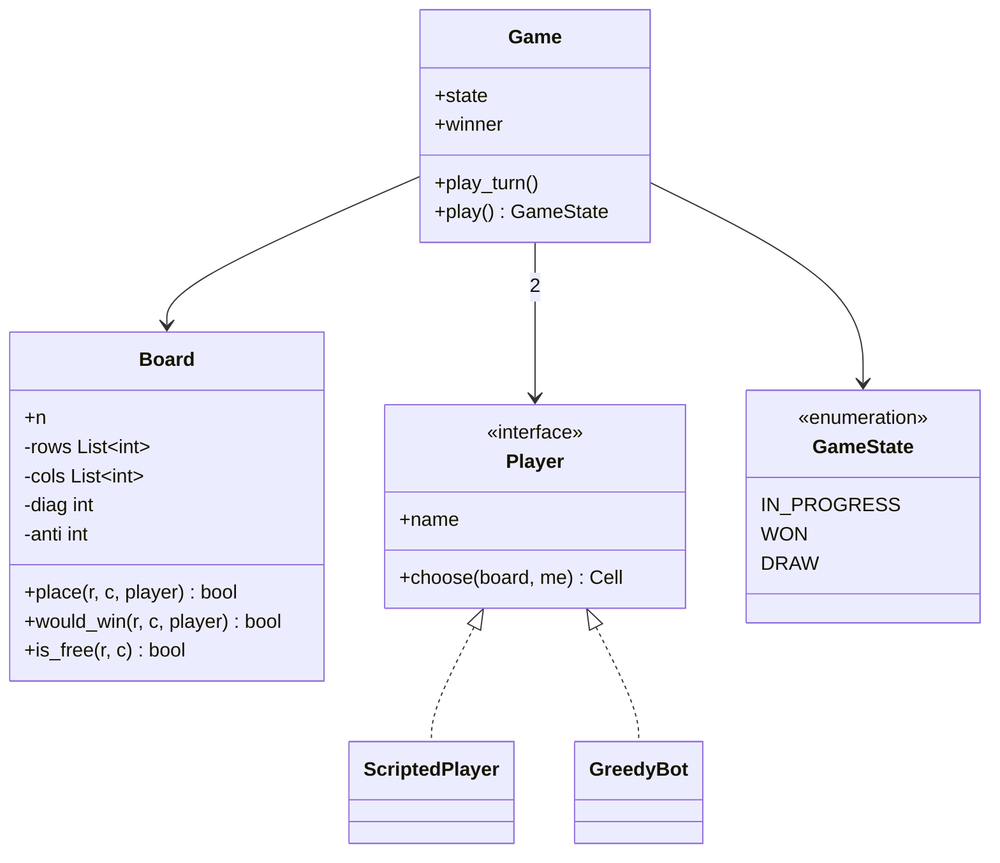

**The O(1) win check.** Keep one counter per row, per column, and for the two diagonals: 2N + 2 integers. Player 0 adds +1 and player 1 adds -1 to every line through the cell. A line is complete for one player exactly when its counter reaches +N or -N, because reaching N in absolute value requires N same-sign contributions and a line has only N cells.

Worked example on 3x3, X = +1, O = -1:

| Move | Cell | rows | cols | diag | anti | Result |
|---|---|---|---|---|---|---|
| X | (0,0) | [1,0,0] | [1,0,0] | 1 | 0 | |
| O | (1,1) | [1,-1,0] | [1,-1,0] | 0 | -1 | |
| X | (0,1) | [2,-1,0] | [1,0,0] | 0 | -1 | |
| O | (2,2) | [2,-1,-1] | [1,0,-1] | -1 | -1 | |
| X | (0,2) | [3,-1,-1] | [1,0,0] | -1 | 0 | row 0 = 3: X wins |

### Key patterns used

| Pattern | Where | Why |
|---|---|---|
| Strategy | `Player.choose` | Human input, replay, and bots are interchangeable; the game loop never changes |
| Enum state | `GameState` | Three states with trivial transitions do not justify full State classes |
| Incremental bookkeeping | Line counters in `Board` | O(1) per move instead of rescanning; the same idea as maintaining aggregates instead of recomputing |
| Test double | `ScriptedPlayer` | Deterministic games in tests and replays |

### Concurrency and failure concerns

- Single game, single thread. For an online version, each game is serialized (one lock or one actor per game) and every move carries the expected move number, so out-of-turn and duplicate moves are rejected. The server validates; the client only renders.
- Validation happens before any mutation in `place`, so a rejected move leaves the board and counters untouched. In the game loop, the turn advances only after a successful placement.
- A disconnect is a timeout policy (forfeit after T seconds), not a board state.

### Reference implementation (Python 3)

`Board.place` validates, computes the post-move line values without mutating, then commits. `would_win` uses the same O(1) arithmetic, which lets the greedy bot test every free cell cheaply.

See also: [Strategy pattern](Design_Patterns_Python.md#24-strategy), [LeetCode design problems](../computer-science/LeetCode_Patterns.md#26-design-problems).

```python
"""tictactoe.py -- run: python3 tictactoe.py"""
from __future__ import annotations

from dataclasses import dataclass
from enum import Enum
from typing import Iterator, Protocol


class GameState(Enum):
    IN_PROGRESS = "in progress"
    WON = "won"
    DRAW = "draw"


class InvalidMove(Exception): ...


class Board:
    """N x N board with O(1) win detection (LeetCode 348).

    Player 0 adds +1 and player 1 adds -1 to the counters of the row, the column
    and (if applicable) the two diagonals of each move. A line is won exactly when
    its counter reaches +n or -n, because only one player can have contributed.
    """

    def __init__(self, n: int = 3) -> None:
        if n < 1:
            raise ValueError("n must be >= 1")
        self.n = n
        self._cells: list[list[int | None]] = [[None] * n for _ in range(n)]
        self._rows = [0] * n
        self._cols = [0] * n
        self._diag = 0
        self._anti = 0
        self.moves = 0

    def is_free(self, r: int, c: int) -> bool:
        return 0 <= r < self.n and 0 <= c < self.n and self._cells[r][c] is None

    def free_cells(self) -> Iterator[tuple[int, int]]:
        return ((r, c) for r in range(self.n) for c in range(self.n) if self._cells[r][c] is None)

    def _lines(self, r: int, c: int, v: int) -> list[int]:
        """Counter values of every line through (r, c) after adding v (does not mutate)."""
        vals = [self._rows[r] + v, self._cols[c] + v]
        if r == c:
            vals.append(self._diag + v)
        if r + c == self.n - 1:
            vals.append(self._anti + v)
        return vals

    def would_win(self, r: int, c: int, player: int) -> bool:
        v = 1 if player == 0 else -1
        return self.is_free(r, c) and any(abs(x) == self.n for x in self._lines(r, c, v))

    def place(self, r: int, c: int, player: int) -> bool:
        """Place a mark; return True if this move wins. O(1)."""
        if not self.is_free(r, c):
            raise InvalidMove(f"cell ({r},{c}) is occupied or off the board")
        v = 1 if player == 0 else -1
        won = any(abs(x) == self.n for x in self._lines(r, c, v))
        self._cells[r][c] = player
        self._rows[r] += v
        self._cols[c] += v
        if r == c:
            self._diag += v
        if r + c == self.n - 1:
            self._anti += v
        self.moves += 1
        return won


class Player(Protocol):
    name: str
    def choose(self, board: Board, me: int) -> tuple[int, int]: ...


@dataclass
class ScriptedPlayer:
    """Test double / replay of a recorded game."""
    name: str
    script: list[tuple[int, int]]

    def choose(self, board: Board, me: int) -> tuple[int, int]:
        return self.script.pop(0)


@dataclass
class GreedyBot:
    """Strategy: win now, else block the opponent's win, else centre, else first free cell."""
    name: str

    def choose(self, board: Board, me: int) -> tuple[int, int]:
        free = list(board.free_cells())
        for who in (me, 1 - me):                       # O(n^2) candidates, O(1) check each
            for r, c in free:
                if board.would_win(r, c, who):
                    return r, c
        centre = (board.n // 2, board.n // 2)
        return centre if centre in free else free[0]


class Game:
    def __init__(self, p0: Player, p1: Player, n: int = 3) -> None:
        self.board = Board(n)
        self.players = (p0, p1)
        self.turn = 0
        self.state = GameState.IN_PROGRESS
        self.winner: Player | None = None

    def play_turn(self) -> None:
        if self.state is not GameState.IN_PROGRESS:
            raise InvalidMove("game is over")
        player = self.players[self.turn]
        r, c = player.choose(self.board, self.turn)
        if self.board.place(r, c, self.turn):           # raises on invalid move; turn unchanged
            self.state, self.winner = GameState.WON, player
        elif self.board.moves == self.board.n ** 2:
            self.state = GameState.DRAW
        else:
            self.turn = 1 - self.turn

    def play(self) -> GameState:
        while self.state is GameState.IN_PROGRESS:
            self.play_turn()
        return self.state


def main() -> None:
    # 1) Row win for X on move 5.
    g = Game(ScriptedPlayer("X", [(0, 0), (0, 1), (0, 2)]), ScriptedPlayer("O", [(1, 0), (1, 1)]))
    assert g.play() is GameState.WON and g.winner.name == "X" and g.board.moves == 5

    # 2) Anti-diagonal win for O on a 4x4 board.
    g = Game(ScriptedPlayer("X", [(0, 0), (1, 1), (2, 2), (3, 1)]),
             ScriptedPlayer("O", [(0, 3), (1, 2), (2, 1), (3, 0)]), n=4)
    assert g.play() is GameState.WON and g.winner.name == "O"

    # 3) Draw: X O X / X O O / O X X
    g = Game(ScriptedPlayer("X", [(0, 0), (0, 2), (1, 0), (2, 1), (2, 2)]),
             ScriptedPlayer("O", [(0, 1), (1, 1), (2, 0), (1, 2)]))
    assert g.play() is GameState.DRAW and g.winner is None

    # 4) Invalid move is rejected and does not consume the turn.
    g = Game(ScriptedPlayer("X", [(1, 1), (0, 0)]), ScriptedPlayer("O", [(1, 1), (2, 2)]))
    g.play_turn()
    try:
        g.play_turn()
        raise AssertionError("expected InvalidMove")
    except InvalidMove:
        assert g.turn == 1 and g.board.moves == 1
    g.play_turn()                                       # O retries with (2, 2)
    assert g.turn == 0 and g.board.moves == 2

    # 5) The bot blocks a row, creates its own threat, then blocks again.
    g = Game(ScriptedPlayer("X", [(0, 0), (0, 1), (2, 0)]), GreedyBot("bot"))
    g.play_turn(); g.play_turn()                        # X (0,0), bot takes centre
    g.play_turn(); g.play_turn()                        # X (0,1), bot blocks at (0,2)
    assert g.board.would_win(2, 0, 1)                   # bot now threatens the anti-diagonal
    g.play_turn(); g.play_turn()                        # X blocks (2,0), bot blocks column 0
    assert not g.board.is_free(1, 0) and g.state is GameState.IN_PROGRESS
    print("tic-tac-toe: all assertions passed")


if __name__ == "__main__":
    main()
```

What to point out while presenting this code:

- **Complexity:** `place` and `would_win` are O(1) time; the counters are O(N) extra space on top of the O(N^2) grid. The grid is still needed to reject occupied cells; if the interviewer guarantees valid moves (as LeetCode 348 does), the grid can be dropped entirely.
- **Draw detection** is a move counter compared with N^2, also O(1). Detecting an *inevitable* draw early (every line already contains both marks) is possible with a per-line "blocked" flag, which is a good follow-up.
- **Win check before mutation:** `place` computes the result from the would-be counter values, then commits. The same helper powers `would_win`, so the bot logic and the game logic cannot disagree.

### Extension questions

- **K in a row on an M x N board (Gomoku, Connect Four):** the counter trick only works when a line must be completely filled. For K < N, check the four directions through the last move and count consecutive same marks in both directions: O(K) per move, still independent of board size.
- **Undo:** subtract the move's contribution from its counters and clear the cell; keep a move stack. This is also what a minimax search needs.
- **Unbeatable bot:** minimax over the 3x3 game tree with memoization by board state. There are only 5,478 legal positions, so the full table fits trivially; perfect play from both sides is a draw.
- **Many concurrent games on a server:** represent a 3x3 board as two 9-bit masks (one per player) and check a win as `any((mask & w) == w for w in 8 win masks)`. That is O(1), branch-light, and cache-friendly for millions of games.

### Interview Q&A

**Q1.** Why can't a counter that reaches +N be a mix of both players' marks?

**A1.** Each cell contributes exactly once, either +1 or -1, and a line has N cells. The sum of N values from {+1, -1} equals N only if all N values are +1. Any O mark in the line contributes -1 and caps the sum at N - 2. So `abs(counter) == N` is equivalent to "the whole line belongs to one player", with no false positives. This argument is also why the trick fails for K-in-a-row with K < N: a line can hold K consecutive X marks and still have a sum below K.

**Q2.** The interviewer says "now support 3 players". What changes?

**A2.** Signed counters no longer work because three players cannot be encoded as +1/-1. Use per-player counters (`rows[player][r]`, and so on), which costs O(P x N) space and keeps the check O(1), or keep the grid and do the O(K) directional scan from the last move. Turn order becomes `(turn + 1) % P`, and `Player`, `Game`, and the bot strategy stay the same, which demonstrates that the seams were in the right places.

**Q3.** How would you make the greedy bot smarter without exploding the code?

**A3.** Keep the `Player` interface and add a `MinimaxBot`. On 3x3 it searches the whole tree (at most 9! = 362,880 move sequences, far fewer with memoization over the 5,478 positions) and never loses. On larger boards, use depth-limited minimax with alpha-beta pruning and a heuristic (open lines weighted by how many of your marks they contain). The game loop is unchanged; only a new Strategy is registered in `main()`.

## 16. Worked Design: Snake and Ladder

### Requirements and assumptions

- A board of `size` squares (100 by default) with snakes (move down) and ladders (move up). Two or more players start off the board (square 0) and take turns in a fixed order.
- A turn rolls the dice, moves forward, and follows a snake or ladder if the player lands on its start. The first player to reach the last square wins.
- Rule variants are configurable: one or more dice, and "exact finish" (a roll that overshoots the last square forfeits the move) or "bounce to finish".
- Validate the board once: jumps must stay on the board, cannot start on the first or last square, and cannot chain (a jump may not end where another starts), which also rules out cycles.
- Games must be reproducible in tests (injectable dice).

### Core model

```mermaid
classDiagram
    class Game {
        +play_turn() Player
        +play() Player
        +exact_finish
        +listeners
    }
    class Board {
        +size
        +resolve(square) int
    }
    class Jump {
        +start
        +end
        +kind()
    }
    class Dice {
        <<interface>>
        +roll() int
    }
    class RandomDice
    class FixedDice
    class Player {
        +name
        +position
    }
    Game --> Board
    Game --> Dice
    Game --> Player : turn queue
    Board o-- Jump
    Dice <|.. RandomDice
    Dice <|.. FixedDice
```

Snakes and ladders have identical behavior ("landing on `start` moves you to `end`"), so they are one `Jump` type; the direction is derived, not a subclass. The board stores jumps as a dict from start square to end square, so resolving a landing square is O(1).

### Key patterns used

| Pattern | Where | Why |
|---|---|---|
| Strategy | `Dice` (`RandomDice`, `FixedDice`) | Deterministic tests, loaded or multi-dice variants, server-side RNG |
| Observer | `listeners` receive event strings | UI, logging, replay, and analytics without touching game logic |
| Queue for turn order | `deque` of players | Rotation is `popleft` then `append`; a winner simply is not re-queued |
| Validate at construction | `Board.__init__` | Invalid boards are impossible to play, so the game loop has no defensive checks |

### Concurrency and failure concerns

- A game is a single-threaded loop. Many games run independently, so scale by sharding games across workers; nothing is shared except the dice implementation, and each game should own its RNG (a shared `random.Random` across threads is a contention point and makes games non-reproducible).
- In a multiplayer service, the **server rolls the dice**. A client-reported roll is trivially cheatable. Persist each roll as an event so a disputed game can be replayed exactly.
- Turn timeouts (a player who stops responding) are a policy: auto-roll for them or skip them after T seconds.

### Reference implementation (Python 3)

The game loop is about fifteen lines because the board validated everything up front and the dice are injected. `min_rolls` answers the classic follow-up (LeetCode 909, "Snakes and Ladders") with a breadth-first search.

See also: [Observer pattern](Design_Patterns_Python.md#22-observer), [BFS patterns](../computer-science/LeetCode_Patterns.md#7-bfs-breadth-first-search).

```python
"""snake_ladder.py -- run: python3 snake_ladder.py"""
from __future__ import annotations

import random
from collections import deque
from dataclasses import dataclass, field
from typing import Callable, Protocol


@dataclass(frozen=True)
class Jump:
    """A snake (end < start) or a ladder (end > start). Same behaviour, so one type."""
    start: int
    end: int

    @property
    def kind(self) -> str:
        return "ladder" if self.end > self.start else "snake"


class Board:
    def __init__(self, size: int, jumps: list[Jump]) -> None:
        self.size = size
        self.jumps: dict[int, int] = {}
        for j in jumps:                                   # validate once, at construction
            if not (1 < j.start < size and 1 <= j.end <= size) or j.start == j.end:
                raise ValueError(f"bad jump {j}")
            if j.start in self.jumps:
                raise ValueError(f"two jumps start at {j.start}")
            self.jumps[j.start] = j.end
        ends = set(self.jumps.values())
        if ends & self.jumps.keys():                      # forbid chains (and therefore cycles)
            raise ValueError("a jump may not end where another starts")

    def resolve(self, square: int) -> int:
        return self.jumps.get(square, square)


class Dice(Protocol):
    def roll(self) -> int: ...


class RandomDice:
    def __init__(self, count: int = 1, faces: int = 6, seed: int | None = None) -> None:
        self.count, self.faces, self._rng = count, faces, random.Random(seed)

    def roll(self) -> int:
        return sum(self._rng.randint(1, self.faces) for _ in range(self.count))


class FixedDice:
    """Deterministic test double."""
    def __init__(self, rolls: list[int]) -> None:
        self._rolls = deque(rolls)

    def roll(self) -> int:
        return self._rolls.popleft()


@dataclass
class Player:
    name: str
    position: int = 0                                     # 0 = off the board


@dataclass
class Game:
    board: Board
    dice: Dice
    players: list[Player]
    exact_finish: bool = True                             # rule variant: overshoot means stay
    listeners: list[Callable[[str], None]] = field(default_factory=list)
    winner: Player | None = None

    def __post_init__(self) -> None:
        if len(self.players) < 2:
            raise ValueError("need at least two players")
        self._queue = deque(self.players)

    def _emit(self, event: str) -> None:                  # Observer: UI, logging, replay
        for listener in self.listeners:
            listener(event)

    def play_turn(self) -> Player:
        if self.winner:
            raise RuntimeError("game over")
        player = self._queue.popleft()
        roll = self.dice.roll()
        target = player.position + roll
        if target > self.board.size:
            target = player.position if self.exact_finish else self.board.size
        landed = self.board.resolve(target)
        if landed != target:
            self._emit(f"{player.name} hit {Jump(target, landed).kind} {target}->{landed}")
        self._emit(f"{player.name} rolled {roll}: {player.position}->{landed}")
        player.position = landed
        if landed == self.board.size:
            self.winner = player
            self._emit(f"{player.name} wins")
        else:
            self._queue.append(player)
        return player

    def play(self, max_turns: int = 100_000) -> Player:
        for _ in range(max_turns):
            if self.winner:
                return self.winner
            self.play_turn()
        if self.winner:
            return self.winner
        raise RuntimeError("no winner within max_turns")


def min_rolls(board: Board, faces: int = 6) -> int:
    """BFS over squares (LeetCode 909 idea): fewest rolls to reach the last square, or -1."""
    dist = {0: 0}
    q = deque([0])
    while q:
        sq = q.popleft()
        for d in range(1, faces + 1):
            nxt = sq + d
            if nxt > board.size:
                break
            nxt = board.resolve(nxt)
            if nxt not in dist:
                dist[nxt] = dist[sq] + 1
                if nxt == board.size:
                    return dist[nxt]
                q.append(nxt)
    return -1


def main() -> None:
    jumps = [Jump(3, 22), Jump(5, 8), Jump(11, 26), Jump(20, 29),     # ladders
             Jump(27, 1), Jump(21, 9), Jump(17, 4), Jump(19, 7)]      # snakes
    board = Board(30, jumps)

    # 1) Scripted game: ladders, a snake, an overshoot, and a win.
    log: list[str] = []
    a, b = Player("ann"), Player("bob")
    g = Game(board, FixedDice([3, 2, 5, 6, 3, 5, 5]), [a, b], listeners=[log.append])
    g.play_turn()                                   # ann 0 -> 3 -> ladder 22
    g.play_turn()                                   # bob 0 -> 2
    g.play_turn()                                   # ann 22 -> 27 -> snake 1
    assert (a.position, b.position) == (1, 2)
    g.play_turn()                                   # bob 2 -> 8
    g.play_turn()                                   # ann 1 -> 4
    g.play_turn()                                   # bob 8 -> 13
    assert "ann hit snake 27->1" in log and (a.position, b.position) == (4, 13)

    # 2) Exact finish: 28 + 5 overshoots 30, so the player stays.
    c, d = Player("cat", 28), Player("dan")
    g = Game(board, FixedDice([5, 1, 2]), [c, d])
    g.play_turn()
    assert c.position == 28
    g.play_turn(); g.play_turn()                    # dan 1, cat 28 + 2 = 30
    assert g.winner is c

    # 3) Validation rejects chains and jumps from the last square.
    for bad in ([Jump(3, 22), Jump(22, 2)], [Jump(30, 5)], [Jump(4, 4)]):
        try:
            Board(30, bad)
            raise AssertionError(f"accepted {bad}")
        except ValueError:
            pass

    # 4) BFS answer and a seeded random game that terminates.
    assert min_rolls(board) == 3                    # 0 -3-> 22 -6-> 28 -2-> 30 (3 rolls)
    assert min_rolls(Board(100, [])) == 17          # ceil(100 / 6)
    w = Game(board, RandomDice(seed=7), [Player("p1"), Player("p2"), Player("p3")]).play()
    assert w.position == 30
    print("snake and ladder: all assertions passed")


if __name__ == "__main__":
    main()
```

What to point out while presenting this code:

- **Why BFS for minimum rolls:** every roll costs 1, so the squares form an unweighted graph with up to 6 out-edges each; BFS finds the shortest path in O(size x faces). Dynamic programming over squares in increasing order fails because snakes create backward edges.
- **Why the board forbids chains:** with chains, landing on a ladder's end that is also a snake's head raises "do we follow both?" questions, and two jumps can form a cycle (A to B, B to A) that never terminates. Rejecting chains at construction is simpler than defining and testing chain semantics.
- **`max_turns` guard:** with exact finish and snakes near the end, a game can take many turns. The guard turns an unexpected infinite loop into a clear error instead of a hung test.

### Extension questions

- **"Roll a 6, roll again; three 6s in a row forfeits the turn":** keep the player at the head of the queue and a per-turn six counter inside `play_turn`. It is a rule change local to the turn method (or a `TurnPolicy` strategy if there are several such variants).
- **Expected game length:** model the board as a Markov chain (state = square, transition = roll distribution then jump) and solve for expected steps to absorption, or estimate by simulating many seeded games.
- **Fairness of `RandomDice`:** roll it 60,000 times and run a chi-square goodness-of-fit test against the uniform distribution. Never test randomness with exact equality.
- **Leaderboards and persistence:** the event stream from the listeners already contains everything needed to store and replay games.

### Interview Q&A

**Q1.** Would you create `Snake` and `Ladder` subclasses of `Jump`?

**A1.** No, not unless they behave differently. Both do exactly one thing: map a start square to an end square. Subclasses would add two classes and a polymorphic call for behavior that is identical, and the only difference (up or down) is derivable from the data. If a variant appears where snakes can be blocked by a shield power-up while ladders cannot, that is the moment to introduce polymorphism, and the change is local because the board only calls `resolve`.

**Q2.** How do you make a test for "player hits a snake" deterministic?

**A2.** Inject the dice. `FixedDice([3, 2, 5])` makes the sequence of positions exact, so the test asserts both the final position and the emitted event. The production `RandomDice` takes an optional seed, so even a full random game is reproducible for a bug report. Never patch `random.randint` globally; that couples the test to implementation details and leaks between tests.

**Q3.** Where would you put the "exact finish" rule, and why is a boolean acceptable here?

**A3.** It is a property of the game's rules, so it lives on `Game` (or a `Rules` object passed to it), not on `Player` or `Board`. A boolean is fine for one binary variant. When a second or third variant appears (bounce back by the excess, extra turn on 6, power-ups), replace the flags with a `MovePolicy` strategy that maps `(position, roll)` to a target square, so the variants do not multiply into nested `if` statements.

## 17. Worked Design: Movie Ticket Booking (BookMyShow)

### Requirements and assumptions

- Users browse movies by city, pick a show (movie + screen + start time), see the seat map, and select one or more seats.
- Selected seats are **held** for a fixed time (10 minutes here) while the user pays. A hold is all-or-nothing: either every requested seat is held, or none is.
- Payment success converts the hold into a booking. Payment failure, user cancellation, or hold expiry returns the seats to sale.
- A seat can never be booked twice for the same show, even under heavy concurrent demand (a blockbuster's opening).
- Prices depend on seat category (and later on time, day, and demand). Money is in integer cents.
- Assume one service process for the coding round; discuss the multi-server version with a database.

### Core model

```mermaid
classDiagram
    class BookingService {
        +hold(showId, user, seats) HoldId
        +confirm(showId, holdId) Booking
        +release(showId, holdId) bool
        +sweepExpired() int
        +available(showId) List~SeatId~
    }
    class Movie {
        +id
        +title
        +durationMin
    }
    class Theater {
        +id
        +city
    }
    class Screen {
        +id
        +seatLayout
    }
    class Show {
        +id
        +movieId
        +screenId
        +startsAt
        -seats Map~SeatId, ShowSeat~
        -holds Map~HoldId, Hold~
    }
    class ShowSeat {
        +seatId
        +category
        +priceCents
        +state
        +holdId
    }
    class Hold {
        +id
        +user
        +seats
        +expiresAt
        +paying
    }
    class Booking {
        +id
        +user
        +seats
        +totalCents
    }
    class PaymentGateway {
        <<interface>>
        +charge(idempotencyKey, cents) bool
    }
    class TimeSource {
        <<interface>>
        +now() Instant
    }
    Theater *-- Screen
    Show --> Movie
    Show --> Screen
    Show *-- ShowSeat
    Show *-- Hold
    BookingService --> Show
    BookingService --> PaymentGateway
    BookingService --> TimeSource
    BookingService ..> Booking : creates
```

The key modeling choice is **`ShowSeat`**: the physical `Seat` belongs to a `Screen` and never changes, but its availability is per show. Every booking-related invariant is about `(showId, seatId)`, so that pair is the unit of locking (or the primary key of the row that is conditionally updated).

```mermaid
stateDiagram-v2
    [*] --> Available
    Available --> Held : hold() (all-or-nothing)
    Held --> Available : release() or expiry (lazy or sweeper)
    Held --> Paying : confirm() starts payment
    Paying --> Booked : charge succeeded
    Paying --> Available : charge declined
    Booked --> Available : cancellation with refund (extension)
```

### Key patterns used

| Pattern | Where | Why |
|---|---|---|
| State | `ShowSeat.state` and `Hold.paying` | Legal transitions are explicit; illegal ones (book an available seat without a hold) are impossible |
| Adapter | `PaymentGateway` | Isolates the external provider; the fake makes declines testable |
| Strategy | Pricing per seat category (extension: dynamic pricing) | Price rules change often and independently of booking logic |
| Injected clock | `TimeSource` | Hold expiry is tested by advancing a fake clock, not by sleeping |
| Repository (implicit) | `shows_` map | Becomes a `show_seat` table; the service logic does not change |

### Concurrency and failure concerns

- **Unit of serialization:** one mutex per show. Different shows never contend, and a hold for several seats in one show is atomic because all checks and all writes happen under that one lock (validate every seat first, then mutate; the mutate phase cannot fail).
- **No I/O under the lock:** `confirm` marks the hold as `paying`, releases the lock, calls the payment provider (which can take seconds), then re-locks to finalize. Holding a per-show lock across a network call would serialize every buyer for that show behind the slowest payment.
- **Expiry:** checked lazily (an expired hold counts as free when someone else asks for the seat) and by a periodic sweeper that cleans up abandoned holds. Lazy expiry makes the sweeper optional for correctness; the sweeper keeps memory and the seat map tidy.
- **Payment in flight vs expiry:** once payment starts, the hold is no longer expirable or cancellable, otherwise the seat could be resold while the user's card is being charged. A crash during payment leaves a `paying` hold; a reconciliation job queries the provider using the same idempotency key (the hold id) and either finalizes or releases it.
- **Across multiple servers** the in-process lock becomes the database's row-level atomicity. A conditional update is the standard approach:

```sql
-- Hold seats A1 and A2 for show 42, all-or-nothing (PostgreSQL syntax).
BEGIN;
UPDATE show_seat
   SET status = 'HELD', hold_id = 'H17', hold_expires_at = now() + interval '10 minutes'
 WHERE show_id = 42
   AND seat_id IN ('A1', 'A2')
   AND (status = 'AVAILABLE' OR (status = 'HELD' AND hold_expires_at < now()));
-- The application checks the affected row count: 2 means success -> COMMIT;
-- anything less means another buyer won at least one seat -> ROLLBACK.
COMMIT;
```

Two concurrent transactions that target the same row serialize on its row lock. Under PostgreSQL's default READ COMMITTED level, the second one re-evaluates the `WHERE` clause against the committed row, sees `HELD`, updates zero rows for it, and rolls back. The anti-pattern is "`SELECT` the seats, check in application code, then `UPDATE`" without `FOR UPDATE`: two buyers can both see the seat as available and both write, a lost-update race. As a final safety net, add a unique constraint on `booking_seat(show_id, seat_id)`.

With several seats per statement, two buyers with overlapping sets can deadlock: the `UPDATE` locks rows in scan order, so buyer 1 can lock A1 and wait for A2 while buyer 2 holds A2 and waits for A1. PostgreSQL detects the cycle and aborts one transaction (SQLSTATE `40P01`, `deadlock_detected`). Either lock the rows in a deterministic order first (`SELECT ... FROM show_seat WHERE show_id = 42 AND seat_id IN (...) ORDER BY seat_id FOR UPDATE`, then `UPDATE`), or treat `40P01` as retryable and retry the whole transaction a bounded number of times. Most production code does both, since the retry also covers serialization failures (`40001`) under stricter isolation levels.

### Hold and confirm sequence diagram

The riskiest flow in this design: a hold, minutes of user think-time, then a payment that runs outside the per-show lock. The diagram matches `hold` and `confirm` in the reference implementation below.

```mermaid
sequenceDiagram
    autonumber
    actor U as User app (ann)
    participant B as BookingService
    participant S as Show S1 (one mutex)
    participant P as PaymentGateway
    U->>B: hold("S1", "ann", [A1, A2])
    B->>S: lock m_
    Note over B,S: phase 1 validates every seat (no duplicates, known, free or expired hold). phase 2 marks them Held by H1 and cannot fail.
    B->>S: holds_[H1] = {ann, [A1, A2], expiresAt = now + 10 min}, unlock
    B-->>U: H1
    Note over U: user types card details for a few minutes
    U->>B: confirm("S1", "H1")
    B->>S: lock m_, find H1
    break H1 missing, already paying, or expired
        B-->>U: UnknownHold, PaymentInProgress, or HoldExpired (expired seats released)
    end
    B->>S: paying = true, total = 3000 cents, unlock
    Note over B,P: no lock held. Sweeper and lazy expiry skip holds that are paying.
    B->>P: charge(key = "H1", 3000)
    P-->>B: approved or declined
    B->>S: lock m_, find H1 again (never assume it survived the gap)
    alt approved
        B->>S: A1 and A2 Booked, erase H1, unlock
        B-->>U: Booking B1 (A1, A2, 3000 cents)
    else declined
        B->>S: release H1 (A1 and A2 Available), unlock
        B-->>U: PaymentDeclined
    end
```

Reading the diagram aloud covers most of the follow-up questions:

- **Three short lock regions** (steps 2-3, steps 6-8, and step 11 onward), none of which spans the payment call at step 9. Holding the per-show mutex for a 2-second charge would queue every other buyer for that show behind it.
- **The `paying` flag set at step 8 is the handoff.** It is why the state diagram above has no expiry edge out of `Paying`. A second `confirm` (double click) hits the `break` with `PaymentInProgress` instead of charging again.
- **The idempotency key is the hold id.** If the process crashes after step 9, a reconciliation job asks the provider about `H1` and either books or releases. A retried `charge("H1", ...)` cannot double-charge.
- **Step 11 looks the hold up again** rather than keeping an iterator or reference from step 6. Nothing that was true before the unlock may be assumed after it.

### Reference implementation (C++20)

One mutex per `Show`. `hold` validates every seat, then mutates. `confirm` follows lock, mark, unlock, pay, lock, finalize. Results are `std::variant<T, Error>` so callers must handle domain errors explicitly. The demo covers all-or-nothing, duplicate-seat rejection, expiry with a fake clock, a declined payment, idempotent release, the sweeper, and a 16-thread race for one seat.

See also: [HLD: Ticket Booking](../computer-science/High_Level_Design.md#615-ticket-booking-seat-reservation), [Transactions and isolation levels](../computer-science/CS_Fundamentals.md#35-transactions-and-acid), [State pattern](Design_Patterns_Cpp.md#23-state).

```cpp
// movie_booking.cpp -- build: g++ -std=c++20 -O2 -Wall -Wextra -pthread movie_booking.cpp && ./a.out
#include <atomic>
#include <cassert>
#include <chrono>
#include <cstdint>
#include <iostream>
#include <map>
#include <memory>
#include <mutex>
#include <set>
#include <string>
#include <thread>
#include <unordered_map>
#include <variant>
#include <vector>

using namespace std::chrono_literals;
using Clock = std::chrono::steady_clock;

struct TimeSource {
    virtual ~TimeSource() = default;
    virtual Clock::time_point now() const = 0;
};
struct FakeTime : TimeSource {
    Clock::time_point now() const override { std::lock_guard g(m); return t; }
    void advance(Clock::duration d) { std::lock_guard g(m); t += d; }
    mutable std::mutex m;
    Clock::time_point t{};
};

struct PaymentGateway {  // Adapter boundary; idempotent on the key
    virtual ~PaymentGateway() = default;
    virtual bool charge(const std::string& idempotencyKey, std::int64_t cents) = 0;
};
struct FakeGateway : PaymentGateway {
    std::atomic<bool> decline{false};
    std::atomic<int> calls{0};
    bool charge(const std::string&, std::int64_t) override { ++calls; return !decline; }
};

enum class Error {
    UnknownShow, UnknownSeat, DuplicateSeat, SeatUnavailable,
    UnknownHold, HoldExpired, PaymentInProgress, PaymentDeclined
};
struct Booking { std::string id, showId, user; std::vector<std::string> seats; std::int64_t cents; };
template <class T> using Result = std::variant<T, Error>;

class Show {
public:
    Show(std::string id, std::map<std::string, std::int64_t> seatPrices) : id_(std::move(id)) {
        for (auto& [seat, price] : seatPrices) seats_[seat] = Seat{price, State::Available, {}};
    }
private:
    friend class BookingService;
    enum class State { Available, Held, Booked };
    struct Seat { std::int64_t cents; State state = State::Available; std::string holdId; };
    struct Hold {
        std::string user; std::vector<std::string> seats;
        Clock::time_point expiresAt; bool paying = false;
    };
    std::string id_;
    std::mutex m_;  // one lock per show: shows never contend with each other
    std::map<std::string, Seat> seats_;
    std::unordered_map<std::string, Hold> holds_;
};

class BookingService {
public:
    BookingService(const TimeSource& t, PaymentGateway& pg, Clock::duration holdTtl)
        : time_(t), pay_(pg), ttl_(holdTtl) {}

    void addShow(std::shared_ptr<Show> s) { shows_[s->id_] = std::move(s); }  // setup only

    // All-or-nothing: either every requested seat becomes Held by this hold, or none does.
    Result<std::string> hold(const std::string& showId, const std::string& user,
                             const std::vector<std::string>& seats) {
        auto show = find(showId);
        if (!show) return Error::UnknownShow;
        std::lock_guard g(show->m_);
        auto now = time_.now();
        // phase 1: validate everything. {"A1","A1"} would store A1 twice and charge it twice.
        if (std::set<std::string>(seats.begin(), seats.end()).size() != seats.size()) return Error::DuplicateSeat;
        for (auto& s : seats) {
            auto it = show->seats_.find(s);
            if (it == show->seats_.end()) return Error::UnknownSeat;
            if (!isFree(*show, it->second, now)) return Error::SeatUnavailable;
        }
        std::string holdId = "H" + std::to_string(++seq_);
        for (auto& s : seats) {  // phase 2: mutate (cannot fail)
            auto& seat = show->seats_[s];
            if (seat.state == Show::State::Held) releaseLocked(*show, seat.holdId);  // expired: free all its seats
            seat.state = Show::State::Held;
            seat.holdId = holdId;
        }
        show->holds_[holdId] = {user, seats, now + ttl_, false};
        return holdId;
    }

    // Lock -> mark paying -> unlock -> charge (slow I/O) -> lock -> finalize.
    Result<Booking> confirm(const std::string& showId, const std::string& holdId) {
        auto show = find(showId);
        if (!show) return Error::UnknownShow;
        std::int64_t total = 0;
        {
            std::lock_guard g(show->m_);
            auto it = show->holds_.find(holdId);
            if (it == show->holds_.end()) return Error::UnknownHold;
            if (it->second.paying) return Error::PaymentInProgress;  // duplicate confirm (double click, retry)
            if (time_.now() >= it->second.expiresAt) { releaseLocked(*show, holdId); return Error::HoldExpired; }
            it->second.paying = true;  // sweeper and lazy expiry must not steal it now
            for (auto& s : it->second.seats) total += show->seats_[s].cents;
        }
        bool paid = pay_.charge(holdId, total);  // idempotency key = holdId (safe to retry)
        std::lock_guard g(show->m_);
        auto it = show->holds_.find(holdId);  // never .at(): do not assume the hold survived the unlocked gap
        if (it == show->holds_.end()) return Error::UnknownHold;
        auto& h = it->second;
        if (!paid) { releaseLocked(*show, holdId); return Error::PaymentDeclined; }
        Booking b{"B" + holdId.substr(1), showId, h.user, h.seats, total};
        for (auto& s : h.seats) show->seats_[s].state = Show::State::Booked;
        show->holds_.erase(holdId);
        return b;
    }

    // User cancels. A hold whose payment is in flight belongs to confirm() and cannot be released.
    bool release(const std::string& showId, const std::string& holdId) {
        auto show = find(showId);
        if (!show) return false;
        std::lock_guard g(show->m_);
        auto it = show->holds_.find(holdId);
        if (it == show->holds_.end() || it->second.paying) return false;
        releaseLocked(*show, holdId);
        return true;
    }

    // Periodic sweeper (e.g. every few seconds); lazy expiry in hold() makes it optional for correctness.
    int sweepExpired() {
        int n = 0;
        auto now = time_.now();
        for (auto& [_, show] : shows_) {
            std::lock_guard g(show->m_);
            std::vector<std::string> dead;
            for (auto& [id, h] : show->holds_) if (!h.paying && now >= h.expiresAt) dead.push_back(id);
            for (auto& id : dead) { releaseLocked(*show, id); ++n; }
        }
        return n;
    }

    std::vector<std::string> available(const std::string& showId) {
        std::vector<std::string> out;
        if (auto show = find(showId)) {
            std::lock_guard g(show->m_);
            for (auto& [id, seat] : show->seats_) if (isFree(*show, seat, time_.now())) out.push_back(id);
        }
        return out;
    }

private:
    std::shared_ptr<Show> find(const std::string& id) const {
        auto it = shows_.find(id);
        return it == shows_.end() ? nullptr : it->second;
    }
    static bool isFree(const Show& show, const Show::Seat& seat, Clock::time_point now) {
        if (seat.state == Show::State::Available) return true;
        if (seat.state == Show::State::Booked) return false;
        const auto& h = show.holds_.at(seat.holdId);
        return !h.paying && now >= h.expiresAt;  // lazy expiry
    }
    // holdId by value: callers may pass seat.holdId, which this function overwrites (aliasing).
    static void releaseLocked(Show& show, std::string holdId) {
        auto it = show.holds_.find(holdId);
        if (it == show.holds_.end()) return;  // idempotent
        for (auto& s : it->second.seats) {
            auto& seat = show.seats_[s];
            if (seat.state == Show::State::Held && seat.holdId == holdId) seat = {seat.cents, Show::State::Available, {}};
        }
        show.holds_.erase(it);
    }

    const TimeSource& time_;
    PaymentGateway& pay_;
    Clock::duration ttl_;
    std::unordered_map<std::string, std::shared_ptr<Show>> shows_;  // read-only after setup
    std::atomic<std::uint64_t> seq_{0};
};

template <class T> bool ok(const Result<T>& r) { return std::holds_alternative<T>(r); }
template <class T> Error err(const Result<T>& r) { return std::get<Error>(r); }

int main() {
    FakeTime clock;
    FakeGateway gateway;
    BookingService svc(clock, gateway, 10min);
    svc.addShow(std::make_shared<Show>("S1", std::map<std::string, std::int64_t>{
        {"A1", 1500}, {"A2", 1500}, {"A3", 1500}, {"B1", 2500}, {"B2", 2500}}));

    // 1) Hold then confirm; booked seats disappear from availability.
    auto h = svc.hold("S1", "ann", {"A1", "A2"});
    assert(ok(h) && svc.available("S1").size() == 3);
    auto b = svc.confirm("S1", std::get<std::string>(h));
    assert(ok(b) && std::get<Booking>(b).cents == 3000);

    // 2) All-or-nothing: A3 is free but A2 is booked, so nothing is held. Duplicates are rejected.
    assert(err(svc.hold("S1", "bob", {"A3", "A3"})) == Error::DuplicateSeat);
    assert(err(svc.hold("S1", "bob", {"A3", "A2"})) == Error::SeatUnavailable);
    assert(svc.available("S1").size() == 3);  // A3, B1, B2

    // 3) Expiry: bob's hold lapses after 10 min; carol takes B1; bob cannot confirm.
    auto hb = std::get<std::string>(svc.hold("S1", "bob", {"B1", "B2"}));
    assert(err(svc.hold("S1", "carol", {"B1"})) == Error::SeatUnavailable);
    clock.advance(10min);
    auto hc = svc.hold("S1", "carol", {"B1"});
    assert(ok(hc) && svc.available("S1").size() == 2);         // A3 and B2 (bob's other seat freed)
    assert(err(svc.confirm("S1", hb)) == Error::UnknownHold);  // reclaimed by carol's hold

    // 4) Payment declined releases the seats.
    gateway.decline = true;
    assert(err(svc.confirm("S1", std::get<std::string>(hc))) == Error::PaymentDeclined);
    gateway.decline = false;
    assert(svc.available("S1").size() == 3);

    // 5) Explicit release is idempotent; the sweeper reclaims abandoned holds.
    auto hd = std::get<std::string>(svc.hold("S1", "dan", {"A3"}));
    assert(svc.release("S1", hd) && !svc.release("S1", hd));
    (void)svc.hold("S1", "dan", {"B2"});
    clock.advance(11min);
    assert(svc.sweepExpired() == 1);

    // 6) Race: 16 threads try to hold A3 at once; exactly one succeeds.
    std::atomic<int> winners{0};
    {
        std::vector<std::jthread> ts;
        for (int i = 0; i < 16; ++i)
            ts.emplace_back([&, i] { winners += ok(svc.hold("S1", "u" + std::to_string(i), {"A3"})); });
    }
    assert(winners == 1);
    std::cout << "movie booking: all assertions passed\n";
}
```

What to point out while presenting this code:

- **Reclaiming an expired hold frees all of its seats,** not just the one being re-held. Otherwise bob's other seat (B2) would stay `Held` by a hold that no longer exists. Test 3 checks exactly this.
- **An aliasing bug worth mentioning:** `releaseLocked` takes the hold id by value. An earlier version took `const std::string&`, and the call `releaseLocked(show, seat.holdId)` passed a reference to a field that the function itself clears, so the comparison for the remaining seats silently failed and left B2 pointing at a deleted hold; the next availability query threw `std::out_of_range`. AddressSanitizer does not flag this (the referenced string object is still alive, only its value changed); only a test with a multi-seat hold caught it. This is a good story when asked about subtle C++ bugs.
- **Hold TTL is a business trade-off:** too short and users lose seats while typing card details; too long and popular shows look sold out while seats sit in abandoned carts. Ten minutes plus a visible countdown is typical.
- **Duplicate confirms and bad input:** a concurrent duplicate `confirm` (double-clicked Pay button, client retry while the first call is still charging) is rejected with `PaymentInProgress`, and the client polls for the booking instead of crashing or charging twice. After re-locking, `confirm` looks the hold up with `find`, not `.at()`, because nothing should assume state survived an unlocked gap. Duplicate seats in one request (`{"A1", "A1"}`) are rejected with `DuplicateSeat`; otherwise A1 would be stored twice and charged twice.
- **Lock granularity:** a per-show lock is coarse enough to make multi-seat holds trivially atomic and fine enough that different shows never contend. Per-seat locks would need lock ordering (sort seat ids) for multi-seat holds and buy little, because a hot show's buyers mostly want overlapping seats anyway.

### Extension questions

- **Virtual waiting room for a blockbuster on-sale:** admit users from a queue at a controlled rate so the booking service sees bounded load; this is an HLD concern (see the HLD link above).
- **"Best available N adjacent seats":** per row, slide a window of N over the seat states and score windows by distance from the screen center; O(seats) per request under the show lock.
- **Dynamic pricing:** a `PricingStrategy` keyed by show, category, and remaining inventory. Lock the price into the hold, so the user pays what they saw.
- **Cancellation and refunds:** `Booked` to `Available` plus a refund call with its own idempotency key; apply a cancellation policy (full refund until 2 hours before the show).
- **Seat-map freshness:** clients poll or subscribe (server-sent events) to seat-state changes for a show; stale maps are fine because `hold` is the source of truth.

### Interview Q&A

**Q1.** Why have a hold step at all? Why not lock the seats during payment?

**A1.** Payment takes seconds to minutes (3-D Secure challenges, UPI app switches), and it can fail or be abandoned. A database lock or mutex held that long would block every other buyer for that show and would leak if the client disappeared. A hold is a **lease**: a durable record with an expiry that reserves seats without holding any lock. The only critical sections are the short "hold" and "finalize" steps. Leases expire on their own, so an abandoned checkout releases its seats without any cleanup action from the client.

**Q2.** Lazy expiry, a sweeper, or a key-value store with TTL. Which would you use?

**A2.** Use lazy expiry for correctness: whenever someone asks for a seat, treat a `HELD` row with `hold_expires_at < now()` as free (the SQL `WHERE` clause above does this). Then nothing depends on a background job running on time. Add a sweeper for hygiene, so seat maps show seats as available and abandoned holds are cleaned up. A cache-side TTL (for example, holds as keys with an expiry) is fast, but then the hold lives in a different store from the booking, which reintroduces a two-store consistency problem at confirm time. If it is used, the final booking must still be a conditional write in the database.

**Q3.** Two app servers receive requests for seat A1 at the same millisecond. Walk through what prevents a double booking.

**A3.** Both run the conditional `UPDATE ... WHERE status = 'AVAILABLE' ...`. The database grants the row lock on `(show 42, A1)` to one of them; the other waits. The winner commits with one affected row. The loser then re-checks its `WHERE` clause against the committed row (`HELD`, not expired), matches zero rows, sees an affected-row count lower than requested, and rolls back, returning "seat unavailable". Neither server holds an application lock, and no distributed lock service is needed: the row is the lock. The unique constraint on `booking_seat(show_id, seat_id)` is a final guard against bugs in that logic.

## 18. Worked Design: ATM

### Requirements and assumptions

- A customer inserts a card, enters a PIN, checks the balance, withdraws cash, and ejects the card. One customer session at a time per machine.
- Three wrong PINs in a session retain (swallow) the card.
- The machine holds cassettes of notes with **limited counts** per denomination. A withdrawal must be payable exactly from the notes on hand, or it is refused before any money moves.
- Accounts live at the bank, an external system reached over a network. The ATM never stores balances.
- Money moves exactly once: no debit without cash, and no cash without a debit (with an explicit compensation when hardware fails).
- Deposits, daily limits, and multiple accounts per card are extensions.

### Core model

```mermaid
classDiagram
    class Atm {
        +insert_card(card)
        +enter_pin(pin)
        +balance() int
        +withdraw(cents) Plan
        +eject()
        -state State
    }
    class State {
        <<abstract>>
        +insert_card(card)
        +enter_pin(pin)
        +withdraw(cents)
        +balance()
        +eject()
    }
    class Idle
    class CardInserted
    class Authenticated
    class Dispensing
    class Bank {
        <<interface>>
        +verify_pin(card, pin) bool
        +balance(card) int
        +debit(card, cents, txnId) bool
        +reverse(txnId)
    }
    class CashDispenser {
        +plan(cents) Plan
        +dispense(plan)
    }
    class NoteHandler {
        +denom
        +count
        +next NoteHandler
        +plan(amount) Plan
        +commit(plan)
    }
    Atm --> State
    Atm --> Bank
    Atm --> CashDispenser
    State <|-- Idle
    State <|-- CardInserted
    State <|-- Authenticated
    State <|-- Dispensing
    CashDispenser --> NoteHandler : head of chain
    NoteHandler --> NoteHandler : next
```

```mermaid
stateDiagram-v2
    [*] --> Idle
    Idle --> CardInserted : insert_card
    CardInserted --> Authenticated : correct PIN
    CardInserted --> CardInserted : wrong PIN (attempts < 3)
    CardInserted --> Idle : third wrong PIN (card retained)
    CardInserted --> Idle : eject
    Authenticated --> Dispensing : withdraw (plan ok)
    Dispensing --> Authenticated : cash out, or failure (reversed)
    Authenticated --> Idle : eject
```

### Key patterns used

| Pattern | Where | Why |
|---|---|---|
| State | `Idle`, `CardInserted`, `Authenticated`, `Dispensing` | Each state allows only its own operations; "withdraw before PIN" is impossible by construction, not guarded by scattered `if` checks |
| Chain of Responsibility | `NoteHandler` per denomination | Each cassette handles what it can and passes the remainder on; adding a denomination is adding a link |
| Adapter | `Bank`, the dispenser hardware | The network protocol to the bank and the device driver are hidden behind small interfaces with fakes for tests |
| Facade | `Atm` | The UI calls five methods; it never sees states, chains, or the bank |
| Compensating action | `bank.reverse(txn)` | There is no distributed transaction between the bank and a cash dispenser |

### Concurrency and failure concerns

- **The ATM is single-session;** the shared resource is the account, which can also be debited by a card payment or another ATM at the same moment. The bank enforces "balance never negative" atomically (a conditional update such as `UPDATE account SET balance = balance - :x WHERE id = :id AND balance >= :x`), so the ATM does not lock anything remotely.
- **Order of operations:** plan the notes, then debit, then dispense. Planning first means "cannot dispense this amount" never touches the account. Debiting before dispensing means a failure leaves the customer with no cash and a debit that is reversed, never with free cash.
- **Idempotency:** every debit carries a transaction id unique to this ATM (`atm7-42`). If the response to a debit times out, the ATM retries with the same id; the bank recognizes it and does not debit twice. If the outcome is still unknown, the ATM sends a reversal for that id, which is also idempotent.
- **Hardware failure after debit:** the dispenser jams or presents fewer notes than planned. Sensors count the notes actually presented, the ATM reverses the difference, and every step is written to a local electronic journal first, so a power loss mid-transaction can be reconciled on restart.
- **Timeouts:** an idle session ejects the card after N seconds; uncollected cash is retracted and reported to the bank for a reversal.

### Withdrawal sequence diagram

The state diagram shows *when* a withdrawal is allowed. This diagram shows the order of side effects inside it, which is where the money-safety argument lives. It matches `Authenticated.withdraw` in the reference implementation below. The `opt` timeout fragment comes from the failure discussion above, since the in-process `FakeBank` never times out.

```mermaid
sequenceDiagram
    autonumber
    actor C as Customer
    participant A as Atm (Authenticated state)
    participant D as CashDispenser (note chain)
    participant K as Bank
    C->>A: withdraw(60000)
    A->>D: plan(60000)
    D-->>A: plan 3 x 20000 (backtracked past the 50000 note)
    break no exact plan from the notes on hand
        A-->>C: cannot dispense this amount (account untouched)
    end
    A->>A: set_state(Dispensing), txn = "atm7-1"
    A->>K: debit(c1, 60000, "atm7-1")
    opt no reply before the timeout
        A->>K: debit(c1, 60000, "atm7-1") again, same txn id
        Note right of K: ledger already holds atm7-1, so no second debit
    end
    K-->>A: True or False
    break False
        A-->>C: insufficient funds (cassettes untouched)
    end
    A->>D: dispense(plan)
    alt jam
        D-->>A: AtmError("dispenser jam")
        A->>K: reverse("atm7-1")
        A-->>C: error, balance restored
    else notes presented
        D-->>A: ok, cassette counts committed
        A-->>C: 3 x 20000
    end
    Note over A: finally block, set_state(Authenticated) on every path
```

Why this order and not another:

| Order | Failure between the two steps | Outcome |
|---|---|---|
| Plan, then debit, then dispense (chosen) | Dispenser jams after the debit | Customer has no cash and a debit that is reversed (step 12). The bank loses nothing, and the customer is made whole automatically |
| Debit, then plan | Notes cannot form the amount | A debit and a reversal for a request that could never succeed. Two extra bank round trips and a confusing statement entry |
| Dispense, then debit | Debit fails or times out after the cash is out | Free cash: the bank cannot claw it back. This is the order to rule out explicitly |

The idempotent debit (step 7) and the idempotent reversal are what make the unknown-outcome case safe. If the ATM still cannot learn whether `atm7-1` was applied, it sends `reverse("atm7-1")` and dispenses nothing. The bank's reversal must be idempotent and a no-op for an id it never applied. The `FakeBank` here does not model that case, and a production bank interface must.

### Reference implementation (Python 3)

The `Atm` facade delegates every call to its current state object. Withdrawal is plan, debit (idempotent), dispense, and compensate on failure. The dispenser's chain backtracks, because a pure greedy chain fails when note counts are limited.

See also: [State pattern](Design_Patterns_Python.md#23-state), [Chain of Responsibility](Design_Patterns_Python.md#16-chain-of-responsibility), [Vending Machine (Section 7)](#7-worked-design-vending-machine).

```python
"""atm.py -- run: python3 atm.py"""
from __future__ import annotations

import itertools
from abc import ABC
from typing import Protocol


class AtmError(Exception): ...


# ---------------- external systems (Adapter boundaries) ----------------
class Bank(Protocol):
    def verify_pin(self, card: str, pin: str) -> bool: ...
    def balance(self, card: str) -> int: ...
    def debit(self, card: str, cents: int, txn_id: str) -> bool: ...
    def reverse(self, txn_id: str) -> None: ...


class FakeBank:
    def __init__(self, accounts: dict[str, tuple[str, int]]) -> None:
        self.accounts = {card: [pin, bal] for card, (pin, bal) in accounts.items()}
        self.ledger: dict[str, tuple[str, int]] = {}         # txn_id -> (card, cents)

    def verify_pin(self, card: str, pin: str) -> bool:
        return card in self.accounts and self.accounts[card][0] == pin

    def balance(self, card: str) -> int:
        return self.accounts[card][1]

    def debit(self, card: str, cents: int, txn_id: str) -> bool:
        if txn_id in self.ledger:                             # idempotent retry
            return True
        if self.accounts[card][1] < cents:
            return False
        self.accounts[card][1] -= cents
        self.ledger[txn_id] = (card, cents)
        return True

    def reverse(self, txn_id: str) -> None:
        card, cents = self.ledger.pop(txn_id)
        self.accounts[card][1] += cents


# ---------------- cash dispenser: Chain of Responsibility ----------------
class NoteHandler:
    """One cassette per denomination. Each handler takes as many of its notes as it can
    and passes the remainder down the chain; if the rest of the chain cannot finish,
    it backtracks by taking one note fewer (greedy alone fails for limited stock)."""

    def __init__(self, denom: int, count: int, nxt: NoteHandler | None = None) -> None:
        self.denom, self.count, self.next = denom, count, nxt

    def plan(self, amount: int) -> dict[int, int] | None:
        for k in range(min(self.count, amount // self.denom), -1, -1):
            rest = amount - k * self.denom
            if rest == 0:
                return {self.denom: k} if k else {}
            if self.next and (sub := self.next.plan(rest)) is not None:
                return ({self.denom: k} | sub) if k else sub
        return None

    def commit(self, plan: dict[int, int]) -> None:
        self.count -= plan.get(self.denom, 0)
        if self.next:
            self.next.commit(plan)


class CashDispenser:
    def __init__(self, cassettes: dict[int, int], fail_next: bool = False) -> None:
        chain = None
        for denom in sorted(cassettes):                        # build largest-first chain
            chain = NoteHandler(denom, cassettes[denom], chain)
        self.chain = chain
        self.fail_next = fail_next                            # hardware fault injection for tests

    def plan(self, amount: int) -> dict[int, int] | None:
        return self.chain.plan(amount) if self.chain else None

    def dispense(self, plan: dict[int, int]) -> None:
        if self.fail_next:
            self.fail_next = False
            raise AtmError("dispenser jam")
        self.chain.commit(plan)


# ---------------- ATM: State pattern ----------------
class State(ABC):
    def __init__(self, atm: Atm) -> None:
        self.atm = atm

    def insert_card(self, card: str) -> None: raise AtmError(f"cannot insert card in {self}")
    def enter_pin(self, pin: str) -> None: raise AtmError(f"cannot enter PIN in {self}")
    def withdraw(self, cents: int) -> dict[int, int]: raise AtmError(f"cannot withdraw in {self}")
    def balance(self) -> int: raise AtmError(f"cannot check balance in {self}")

    def eject(self) -> None:
        self.atm.card = None
        self.atm.set_state(Idle)

    def __str__(self) -> str:
        return type(self).__name__


class Idle(State):
    def insert_card(self, card: str) -> None:
        self.atm.card, self.atm.pin_failures = card, 0
        self.atm.set_state(CardInserted)

    def eject(self) -> None:
        raise AtmError("no card")


class CardInserted(State):
    MAX_PIN_ATTEMPTS = 3

    def enter_pin(self, pin: str) -> None:
        if self.atm.bank.verify_pin(self.atm.card, pin):
            self.atm.set_state(Authenticated)
            return
        self.atm.pin_failures += 1
        if self.atm.pin_failures >= self.MAX_PIN_ATTEMPTS:
            self.atm.retained.append(self.atm.card)           # card swallowed
            self.atm.card = None
            self.atm.set_state(Idle)
            raise AtmError("card retained")
        raise AtmError("wrong PIN")


class Authenticated(State):
    def balance(self) -> int:
        return self.atm.bank.balance(self.atm.card)

    def withdraw(self, cents: int) -> dict[int, int]:
        atm = self.atm
        if cents <= 0:
            raise AtmError("amount must be positive")
        plan = atm.dispenser.plan(cents)                       # 1) can we pay out exactly?
        if plan is None:
            raise AtmError("cannot dispense this amount")
        txn = f"{atm.atm_id}-{next(atm.txn_seq)}"
        atm.set_state(Dispensing)
        try:
            if not atm.bank.debit(atm.card, cents, txn):         # 2) debit (idempotent on txn)
                raise AtmError("insufficient funds")
            try:
                atm.dispenser.dispense(plan)                      # 3) physical side effect
            except AtmError:
                atm.bank.reverse(txn)                             # 4) compensate
                raise
            return plan
        finally:
            atm.set_state(Authenticated)


class Dispensing(State):
    """Transient: every operation (including eject) is refused while cash is moving."""
    def eject(self) -> None:
        raise AtmError("busy")


class Atm:
    def __init__(self, atm_id: str, bank: Bank, dispenser: CashDispenser) -> None:
        self.atm_id, self.bank, self.dispenser = atm_id, bank, dispenser
        self.card: str | None = None
        self.pin_failures = 0
        self.retained: list[str] = []
        self.txn_seq = itertools.count(1)
        self.state: State = Idle(self)

    def set_state(self, cls: type[State]) -> None:
        self.state = cls(self)

    # The facade simply delegates; behaviour lives in the current state object.
    def insert_card(self, card: str) -> None: self.state.insert_card(card)
    def enter_pin(self, pin: str) -> None: self.state.enter_pin(pin)
    def withdraw(self, cents: int) -> dict[int, int]: return self.state.withdraw(cents)
    def balance(self) -> int: return self.state.balance()
    def eject(self) -> None: self.state.eject()


def expect_error(fn, *args, msg: str) -> None:
    try:
        fn(*args)
    except AtmError as e:
        assert msg in str(e), (msg, str(e))
        return
    raise AssertionError(f"expected AtmError({msg})")


def main() -> None:
    bank = FakeBank({"c1": ("1234", 100_000), "c2": ("0000", 50_000)})   # cents
    atm = Atm("atm7", bank, CashDispenser({50_000: 1, 20_000: 3, 10_000: 0}))

    # 1) State guards.
    expect_error(atm.withdraw, 10_000, msg="cannot withdraw in Idle")
    atm.insert_card("c1")
    expect_error(atm.balance, msg="cannot check balance in CardInserted")
    atm.enter_pin("1234")
    assert atm.balance() == 100_000

    # 2) Backtracking chain: 600.00 = 3 x 200.00 (greedy 500 + ? would fail).
    assert atm.withdraw(60_000) == {20_000: 3}
    assert bank.balance("c1") == 40_000

    # 3) Amount the cassettes cannot form; insufficient funds leaves cash untouched.
    expect_error(atm.withdraw, 30_000, msg="cannot dispense")
    expect_error(atm.withdraw, 50_000, msg="insufficient funds")
    assert atm.dispenser.plan(50_000) == {50_000: 1}
    atm.eject()

    # 4) Dispenser jam after debit -> compensating reversal.
    atm.dispenser.fail_next = True
    atm.insert_card("c2"); atm.enter_pin("0000")
    expect_error(atm.withdraw, 50_000, msg="jam")
    assert bank.balance("c2") == 50_000 and atm.dispenser.plan(50_000) == {50_000: 1}
    assert atm.withdraw(50_000) == {50_000: 1} and bank.balance("c2") == 0
    atm.eject()

    # 5) Three wrong PINs retain the card.
    atm.insert_card("c1")
    expect_error(atm.enter_pin, "1111", msg="wrong PIN")
    expect_error(atm.enter_pin, "2222", msg="wrong PIN")
    expect_error(atm.enter_pin, "3333", msg="retained")
    assert atm.retained == ["c1"] and str(atm.state) == "Idle"
    print("atm: all assertions passed")


if __name__ == "__main__":
    main()
```

What to point out while presenting this code:

- **Greedy fails with limited stock.** With one 500 note and three 200 notes, greedy takes the 500 for a 600 withdrawal and then cannot make 100. The backtracking chain retries the 500 cassette with zero notes and finds 3 x 200. With 3-5 denominations and small counts this search is tiny; for many denominations, use a bounded-knapsack DP over the amount in note units.
- **`plan` vs `commit`:** planning is side-effect free, so a refused withdrawal leaves cassette counts untouched. Counts change only after the bank debit succeeds and the hardware reports success.
- **`Dispensing` state:** while cash is moving, even `eject` is refused. In the real machine this state also persists to the journal, so a reboot knows a transaction was in flight.
- **States are created per transition** (`set_state(cls)`), so they hold no stale data; the shared session data (card, PIN failures) lives on `Atm`, which is the State pattern's "context".

### Extension questions

- **Deposits:** cash deposits are counted by the note acceptor and credited (often as pending until verified); cheque deposits are a separate pending flow. Add `deposit` to `Authenticated` and an `Accepting` state.
- **Daily withdrawal limit:** a bank-side policy (the ATM cannot see other ATMs' withdrawals), returned as a specific decline reason.
- **Low-cash alerts:** an Observer on the dispenser that notifies operations when a cassette drops below a threshold.
- **Multiple accounts per card:** a `SelectingAccount` state between `Authenticated` and the transaction.
- **Receipts and audit:** every state transition and bank call is appended to the electronic journal before acting (write-ahead), which is what reconciles disputes.

### Interview Q&A

**Q1.** Why use the State pattern here instead of an enum and `if` checks in each method?

**A1.** The ATM has five operations and four states, and the legal combinations are sparse: `withdraw` is valid only in `Authenticated`, `enter_pin` only in `CardInserted`. With an enum, every method starts with a state check and the transition rules are spread over all methods; forgetting one check is a security bug (withdrawing without a PIN). With State classes, each class lists only what it allows, the base class rejects everything else by default, and adding a state (`SelectingAccount`) is a new class plus one transition. For a three-state toggle an enum is fine; with this many security-relevant guards, the pattern pays for itself.

**Q2.** The debit request times out. Did the money leave the account? What do you do?

**A2.** The ATM cannot know: the request may have been lost, or the debit may have succeeded and the response lost. It must not dispense, because the debit is unconfirmed. It retries the debit with the **same transaction id** a bounded number of times; the bank's idempotency makes a duplicate harmless. If it still gets no answer, it records "unknown" in the journal, sends a reversal for that transaction id (also idempotent: reversing a debit that never happened is a no-op), tells the customer the transaction failed, and lets end-of-day reconciliation between the ATM journal and the bank ledger settle any discrepancy.

**Q3.** Why does the chain of responsibility here need backtracking, and is it still that pattern?

**A3.** Classic chain of responsibility passes a request along until a handler deals with it. Here every handler handles part of the amount and forwards the rest, and the request can fail downstream. Greedy forwarding (take the maximum, pass the remainder) is correct only when every amount that can be paid at all can be paid greedily, which unlimited canonical denominations guarantee but limited counts do not. Adding "if the rest of the chain fails, take one fewer note and ask again" keeps the structure (each handler knows only its denomination and its successor) while making it complete. It is still a chain; the handlers just return a result instead of fire-and-forget.

## 19. Worked Design: Logging Framework

### Requirements and assumptions

- Applications get named loggers and log at levels `TRACE < DEBUG < INFO < WARN < ERROR`. Each logger has a threshold that can change at runtime; records below it are discarded.
- A record can go to several destinations (**appenders**): console, file, in-memory buffer for tests, network collector. Each appender formats records with a pluggable **formatter**.
- Logging is thread-safe and must not interleave partial lines.
- Optional asynchronous mode: the calling thread enqueues and returns; a background thread does the I/O. Memory is bounded, with a configurable overflow policy (block the caller or drop and count).
- Flush on demand and on shutdown, so no accepted record is silently lost at a clean exit.
- Disabled log statements must be nearly free, because they sit in hot loops.

### Core model

```mermaid
classDiagram
    class Logger {
        +name
        +setLevel(level)
        +enabled(level) bool
        +log(level, msg, location)
        +addAppender(appender)
    }
    class LogRecord {
        +level
        +logger
        +message
        +file
        +line
        +thread
        +when
    }
    class Appender {
        <<interface>>
        +append(record)
        +flush()
    }
    class ConsoleAppender
    class MemoryAppender
    class FileAppender
    class AsyncAppender {
        -queue
        -worker thread
        +dropped() int
    }
    class Formatter {
        <<interface>>
        +format(record) string
    }
    class PatternFormatter
    Logger --> Appender : 1..*
    Logger ..> LogRecord : creates
    Appender <|.. ConsoleAppender
    Appender <|.. MemoryAppender
    Appender <|.. FileAppender
    Appender <|.. AsyncAppender
    AsyncAppender --> Appender : wraps
    ConsoleAppender --> Formatter
    Formatter <|.. PatternFormatter
```

### Key patterns used

| Pattern | Where | Why |
|---|---|---|
| Strategy | `Formatter` | Plain text, JSON, or key-value output without touching appenders |
| Decorator | `AsyncAppender` wraps any `Appender` | Asynchrony is orthogonal to the destination; no `AsyncFileAppender`/`AsyncConsoleAppender` class explosion |
| Observer-style fan-out | `Logger` with many appenders | One record, many sinks |
| Producer-consumer | Bounded queue plus worker thread | Moves slow I/O off the caller's thread |
| Registry (instead of a hard Singleton) | `getLogger(name)` returning shared loggers | Global lookup is convenient, but tests inject a logger with a `MemoryAppender` |

### Concurrency and failure concerns

| Concern | Synchronous appender | Asynchronous appender |
|---|---|---|
| Caller latency | Includes formatting plus I/O (microseconds for a buffered file, milliseconds for a slow disk or network) | Enqueue only (lock plus copy) |
| Ordering | Global order follows the appender's lock acquisition | Per-thread order preserved; global order is enqueue order |
| Crash safety | Record is written (or at least in the OS buffer) before `log()` returns | Queued records are lost on a hard crash |
| Backpressure | Slow sink slows every caller | Bounded queue: block (no loss, latency spikes) or drop (no latency spikes, counted loss) |

- **Never throw from logging** into application code. A failed write (disk full) is counted and reported through a fallback channel (stderr), not propagated.
- **Format outside locks** when possible, and **never hold the queue lock during I/O.** The worker swaps the whole queue out under the lock and writes the batch without it.
- **Shutdown:** the destructor sets `stopping_`, wakes the worker, and joins after the queue drains. Crash handlers (for `SIGSEGV`) cannot safely use this path, because mutexes and `malloc` are not async-signal-safe; production loggers write a minimal message with `write(2)` from the handler instead.

### Asynchronous append and flush sequence diagram

Two threads share the `AsyncAppender`'s mutex and queue. The diagram shows which work happens on which thread and where the lock is dropped. It matches `Logger::log`, `AsyncAppender::append`, `run`, and `flush` in the reference implementation below.

```mermaid
sequenceDiagram
    autonumber
    participant T as App thread
    participant L as Logger
    participant AA as AsyncAppender
    participant W as Worker thread
    participant F as Inner appender (file)
    T->>L: debug("x=" + s)
    L-->>T: return at once (level below threshold, no LogRecord built)
    T->>L: info("order placed")
    L->>L: build LogRecord (file, line, thread id, time)
    L->>AA: append(record)
    Note over AA: lock m_
    break queue full and policy DropNewest
        AA-->>L: ++dropped_, return
    end
    opt queue full and policy Block
        AA->>AA: wait on notFull_ (caller stalls, m_ released while waiting)
    end
    AA->>AA: push record, ++enqueued_
    AA-)W: notEmpty_.notify_one()
    AA-->>L: return (no I/O on the caller's thread)
    W->>W: wake, lock m_, swap whole queue into batch, notify notFull_, unlock
    loop each record in the batch, no lock held
        W->>F: append(record)
    end
    W->>W: lock m_, written_ += batch size
    W-)AA: drained_.notify_all()
    T->>AA: flush()
    AA->>AA: target = enqueued_, wait on drained_ until written_ >= target
    AA->>F: flush() after unlocking m_
    AA-->>T: return
```

What the diagram makes easy to defend:

- **The caller pays for a lock, a copy, and a notify** (steps 5-10), never for formatting or I/O. Disabled levels stop at step 2, before a `LogRecord` is built. The argument string was already built by the caller, which is the cost Q1 below removes.
- **The worker holds `m_` only to swap the queue and to update `written_`.** The slow `append` calls in the `loop` run unlocked, so producers keep enqueuing while the disk is busy.
- **`flush()` waits for a count, not for an empty queue.** Other threads keep logging during the flush, so "queue empty" might never be observed. `written_ >= target` is reached as soon as everything enqueued before the call has been written.
- **The drop path returns before touching the queue** and only increments a counter. Report that counter, for example as a periodic "dropped N records" line, so loss is visible rather than silent.

### Reference implementation (C++20)

Synchronous appenders each own a mutex. `AsyncAppender` is a decorator with a bounded `std::deque`, three condition variables (not empty, not full, drained), a `flush()` that waits until everything enqueued so far has been written, and a deterministic test for the drop policy.

See also: [Decorator pattern](Design_Patterns_Cpp.md#12-decorator), [Singleton pattern (and why to avoid a hard one)](Design_Patterns_Cpp.md#4-singleton), [Producer-consumer](Design_Patterns_Cpp.md#39-producer-consumer), [Bounded blocking queue](../computer-science/Concurrency_Coding_Problems.md#8-bounded-blocking-queue-leetcode-1188), [HLD: Metrics, Logging, and Monitoring](../computer-science/High_Level_Design.md#613-metrics-logging-and-monitoring-system).

```cpp
// logger.cpp -- build: g++ -std=c++20 -O2 -Wall -Wextra -pthread logger.cpp && ./a.out
#include <atomic>
#include <cassert>
#include <chrono>
#include <condition_variable>
#include <cstdint>
#include <deque>
#include <future>
#include <iostream>
#include <memory>
#include <mutex>
#include <source_location>
#include <sstream>
#include <string>
#include <thread>
#include <vector>

enum class Level { Trace, Debug, Info, Warn, Error, Off };
constexpr const char* name(Level l) {
    constexpr const char* n[] = {"TRACE", "DEBUG", "INFO", "WARN", "ERROR", "OFF"};
    return n[static_cast<int>(l)];
}

struct LogRecord {
    Level level;
    std::string logger, message, file;
    unsigned line;
    std::thread::id thread;
    std::chrono::system_clock::time_point when;
};

// Strategy: how a record becomes text.
struct Formatter {
    virtual ~Formatter() = default;
    virtual std::string format(const LogRecord& r) const = 0;
};
struct PatternFormatter : Formatter {
    std::string format(const LogRecord& r) const override {
        std::ostringstream os;
        os << '[' << name(r.level) << "] " << r.logger << ": " << r.message;
        return os.str();
    }
};

// Appender = output target. Implementations must be safe to call from many threads.
struct Appender {
    virtual ~Appender() = default;
    virtual void append(const LogRecord& r) = 0;
    virtual void flush() {}
};

class ConsoleAppender : public Appender {
public:
    explicit ConsoleAppender(std::shared_ptr<Formatter> f) : fmt_(std::move(f)) {}
    void append(const LogRecord& r) override {
        auto line = fmt_->format(r);  // format outside the lock
        std::lock_guard g(m_);
        std::clog << line << '\n';
    }
    void flush() override { std::lock_guard g(m_); std::clog.flush(); }
private:
    std::shared_ptr<Formatter> fmt_;
    std::mutex m_;
};

class MemoryAppender : public Appender {  // test double
public:
    void append(const LogRecord& r) override { std::lock_guard g(m_); lines_.push_back(fmt_.format(r)); }
    std::vector<std::string> lines() { std::lock_guard g(m_); return lines_; }
private:
    PatternFormatter fmt_;
    std::mutex m_;
    std::vector<std::string> lines_;
};

// Decorator: makes any appender asynchronous via a bounded queue and one worker thread.
class AsyncAppender : public Appender {
public:
    enum class Overflow { Block, DropNewest };
    AsyncAppender(std::shared_ptr<Appender> inner, std::size_t capacity, Overflow policy)
        : inner_(std::move(inner)), cap_(capacity), policy_(policy), worker_([this] { run(); }) {}

    ~AsyncAppender() override {  // graceful shutdown: drain everything, then join
        { std::lock_guard g(m_); stopping_ = true; }
        notEmpty_.notify_one();
        worker_.join();
    }

    void append(const LogRecord& r) override {
        std::unique_lock lk(m_);
        if (q_.size() >= cap_) {
            if (policy_ == Overflow::DropNewest) { ++dropped_; return; }
            notFull_.wait(lk, [&] { return q_.size() < cap_ || stopping_; });
        }
        q_.push_back(r);
        ++enqueued_;
        notEmpty_.notify_one();
    }

    void flush() override {  // wait until everything enqueued so far has been written
        std::unique_lock lk(m_);
        auto target = enqueued_;
        drained_.wait(lk, [&] { return written_ >= target; });
        lk.unlock();
        inner_->flush();
    }

    std::uint64_t dropped() const { std::lock_guard g(m_); return dropped_; }

private:
    void run() {
        std::unique_lock lk(m_);
        for (;;) {
            notEmpty_.wait(lk, [&] { return !q_.empty() || stopping_; });
            if (q_.empty()) return;  // stopping and drained
            std::deque<LogRecord> batch;
            batch.swap(q_);          // take everything: one lock round trip per batch
            notFull_.notify_all();
            lk.unlock();
            for (auto& r : batch) inner_->append(r);  // slow I/O happens without the lock
            lk.lock();
            written_ += batch.size();
            drained_.notify_all();
        }
    }

    std::shared_ptr<Appender> inner_;
    const std::size_t cap_;
    const Overflow policy_;
    mutable std::mutex m_;
    std::condition_variable notEmpty_, notFull_, drained_;
    std::deque<LogRecord> q_;
    std::uint64_t enqueued_ = 0, written_ = 0, dropped_ = 0;
    bool stopping_ = false;
    std::thread worker_;  // declared last: starts after all other members are initialised
};

class Logger {
public:
    Logger(std::string name, Level level) : name_(std::move(name)), level_(level) {}
    void addAppender(std::shared_ptr<Appender> a) { appenders_.push_back(std::move(a)); }  // setup only
    void setLevel(Level l) { level_.store(l, std::memory_order_relaxed); }  // runtime reconfig
    bool enabled(Level l) const { return l >= level_.load(std::memory_order_relaxed); }

    void log(Level l, std::string msg, std::source_location loc = std::source_location::current()) {
        if (!enabled(l)) return;  // cheap check first: no formatting, no allocation for filtered logs
        LogRecord r{l, name_, std::move(msg), loc.file_name(), static_cast<unsigned>(loc.line()),
                    std::this_thread::get_id(), std::chrono::system_clock::now()};
        for (auto& a : appenders_) a->append(r);
    }
    void info(std::string m, std::source_location loc = std::source_location::current()) { log(Level::Info, std::move(m), loc); }
    void debug(std::string m, std::source_location loc = std::source_location::current()) { log(Level::Debug, std::move(m), loc); }
    void error(std::string m, std::source_location loc = std::source_location::current()) { log(Level::Error, std::move(m), loc); }

private:
    std::string name_;
    std::atomic<Level> level_;
    std::vector<std::shared_ptr<Appender>> appenders_;
};

// Blocks inside append() until released: lets the test fill the queue deterministically.
struct GateAppender : Appender {
    std::promise<void> entered;
    std::shared_future<void> release;
    std::atomic<int> count{0};
    bool first = true;  // only touched by the single worker thread
    void append(const LogRecord&) override {
        if (first) { first = false; entered.set_value(); release.wait(); }
        ++count;
    }
};

int main() {
    // 1) Level filtering and formatting.
    auto mem = std::make_shared<MemoryAppender>();
    Logger log("app", Level::Info);
    log.addAppender(mem);
    log.debug("hidden");
    log.info("started");
    log.setLevel(Level::Debug);
    log.debug("now visible");
    assert((mem->lines() == std::vector<std::string>{"[INFO] app: started", "[DEBUG] app: now visible"}));

    // 2) Async appender: 4 threads x 1000 records, nothing lost, per-thread order preserved.
    auto sink = std::make_shared<MemoryAppender>();
    {
        auto async = std::make_shared<AsyncAppender>(sink, 256, AsyncAppender::Overflow::Block);
        Logger alog("worker", Level::Info);
        alog.addAppender(async);
        {
            std::vector<std::jthread> ts;
            for (int t = 0; t < 4; ++t)
                ts.emplace_back([&, t] { for (int i = 0; i < 1000; ++i) alog.info(std::to_string(t) + ":" + std::to_string(i)); });
        }
        async->flush();
        auto lines = sink->lines();
        assert(lines.size() == 4000);
        int next[4] = {0, 0, 0, 0};
        for (auto& l : lines) {  // "[INFO] worker: t:i"
            auto body = l.substr(l.find(": ") + 2);
            int t = std::stoi(body.substr(0, body.find(':'))), i = std::stoi(body.substr(body.find(':') + 1));
            assert(i == next[t]++);
        }
    }

    // 3) DropNewest: worker stuck on record 0, queue holds 2, the rest are dropped and counted.
    auto gate = std::make_shared<GateAppender>();
    std::promise<void> open;
    gate->release = open.get_future().share();
    auto entered = gate->entered.get_future();
    {
        AsyncAppender drop(gate, 2, AsyncAppender::Overflow::DropNewest);
        LogRecord r{Level::Info, "x", "m", "f", 1, {}, {}};
        drop.append(r);
        entered.wait();                          // worker now holds record 0 outside the queue
        for (int i = 0; i < 5; ++i) drop.append(r);
        assert(drop.dropped() == 3);
        open.set_value();
    }                                            // destructor drains and joins
    assert(gate->count == 3);

    // 4) Console output for humans.
    Logger console("logger", Level::Info);
    console.addAppender(std::make_shared<ConsoleAppender>(std::make_shared<PatternFormatter>()));
    console.info("all assertions passed");
}
```

What to point out while presenting this code:

- **Batching:** the worker takes the entire queue with one `swap`, so under load it pays one lock round trip per batch rather than per record, and producers are blocked only for the duration of a pointer swap.
- **`flush()` semantics:** it waits for a *count* (`written_ >= enqueued_ at call time`), not for an empty queue. Waiting for "queue empty" can starve forever while other threads keep logging.
- **Member order matters:** `worker_` is declared last, so the thread starts only after the mutex, condition variables, and counters are constructed. Declaring it first is a classic data race on uninitialized members.
- **Testing a drop policy deterministically:** `GateAppender` signals when the worker is inside `append` and blocks it there. The queue then holds exactly `capacity` records and the next three are dropped, with no sleeps. The same gate technique works for any "slow consumer" test.
- **`std::source_location`** (C++20) captures file and line at the call site through a default argument, replacing the `__FILE__`/`__LINE__` macro trick.

### Extension questions

- **File rotation** by size or time: a `RollingFileAppender` that closes, renames, and reopens under its own lock; keep N old files. Rotation must not lose or duplicate lines.
- **Structured logging:** records carry key-value fields (`request_id`, `user`), and a JSON formatter emits one object per line for log pipelines.
- **Context (MDC):** a thread-local (or coroutine-local) map of fields, such as the request id, automatically attached to every record.
- **Hierarchical loggers:** `app.db.pool` inherits level and appenders from `app.db` and `app` unless overridden, as in Python's `logging` and Log4j. Implement as a parent pointer with propagation (a chain of responsibility).
- **Rate limiting and sampling:** "log this at most 10 times per second", reusing the token bucket from Section 10, to prevent a failure loop from flooding the disk.
- **Lower overhead:** replace the mutex queue with a lock-free multi-producer ring buffer, or defer formatting entirely by logging a format id plus raw arguments (binary logging) and formatting offline.

### Interview Q&A

**Q1.** `log.debug("x=" + expensive())` is in a hot loop and debug is disabled. What does it cost, and how do you make it free?

**A1.** With a function API, the argument is evaluated before the call: `expensive()` runs and a string is allocated and concatenated, only to be discarded by the level check inside `log`. Three fixes: (1) a macro that checks first, `#define LOG_DEBUG(lg, expr) do { if ((lg).enabled(Level::Debug)) (lg).debug(expr); } while (0)`, so the argument is not evaluated when disabled; (2) an API that takes a format string and arguments and formats lazily (the `std::format`/`fmt` style), so only cheap captures happen; (3) compile-time removal (`if constexpr` on a minimum level), so trace logs vanish from release builds. The level check itself should be a relaxed atomic load, which costs about as much as a plain load.

**Q2.** The process crashes with 5,000 records in the async queue. How do you reduce what is lost?

**A2.** Accept that asynchronous logging trades durability for latency, and narrow the window: flush on `ERROR` and above (synchronously write the record, and everything before it, before returning), use a small queue and short worker wakeup interval, and install a crash handler that writes a final message with async-signal-safe calls only. For must-not-lose records (audit logs), use a synchronous appender to a file opened with appropriate durability (`fsync` policy), or put records into a shared-memory ring buffer that a separate process or a post-mortem tool can read after the crash. That is how some flight-recorder style loggers work.

**Q3.** Should the logger be a Singleton?

**A3.** A global registry of named loggers (`getLogger("db")`) is the industry norm and is fine, because logging is a cross-cutting concern that every module needs and threading a logger through every constructor is noise. What to avoid is a hard Singleton whose configuration cannot be replaced: tests then cannot capture output, and two tests running in parallel fight over global state. The compromise is the registry plus the ability to reconfigure it (attach a `MemoryAppender` in tests) and, for core business classes, constructor injection of a logger interface.

## 20. Worked Design: Pub-Sub Message Broker

### Requirements and assumptions

- Producers publish messages to named **topics**. A message has an optional key and a value.
- Independent subscribers each receive every message (fan-out). Within one subscriber **group**, messages are load-balanced across the group's members, and each message is processed by one member.
- Messages with the same key are delivered in publish order.
- Delivery is **at-least-once:** a consumer commits its progress (an **offset**) after processing. If it crashes before committing, the messages are redelivered to whoever takes over.
- Consumers can **long-poll** (block until data arrives or a timeout passes) and can replay from an earlier offset.
- Old messages are deleted by a retention policy. A consumer that falls behind retention resumes at the oldest available message.
- In-memory, single process for the coding round; durability and replication are discussion points.

This is the log-based (Kafka-style) model. The classic in-process Observer "event bus" (callbacks registered per topic) is the simpler variant and is covered in the Design Patterns guides linked below.

### Core model

```mermaid
classDiagram
    class Broker {
        +create_topic(name, partitions)
        +publish(topic, value, key) PartitionAndOffset
        +join(group, member, topic)
        +leave(group, member)
        +poll(group, member, max, timeout) List~Record~
        +commit(group, member, topic, partition, nextOffset)
        +lag(group, topic) int
    }
    class Topic {
        +name
        +partitions List~Partition~
    }
    class Partition {
        +base_offset
        +end_offset
        +append(key, value) offset
        +read(offset, limit) List~Message~
        +truncate_before(offset)
    }
    class Message {
        +offset
        +key
        +value
    }
    class Group {
        +members
        +assignment Map~member, List~TopicPartition~~
        +committed Map~TopicPartition, offset~
        +position Map~TopicPartition, offset~
    }
    Broker *-- Topic
    Topic *-- Partition
    Partition *-- Message
    Broker *-- Group
```

Three ideas carry the design:

1. **The log is the source of truth.** A partition is an append-only list; consuming does not delete anything. That makes fan-out free (each group has its own cursor) and replay trivial (move the cursor back).
2. **Partitions are the unit of ordering and parallelism.** `hash(key) % partitions` sends a key to one partition, so per-key order holds. Each partition is owned by at most one member of a group, so a group can use at most `partitions` consumers in parallel.
3. **Two offsets per group and partition:** `position` (what has been handed out) and `committed` (what has been processed). A rebalance resets positions to committed, which is exactly what produces at-least-once redelivery.

### Key patterns used

| Pattern | Where | Why |
|---|---|---|
| Observer, decoupled through a Mediator | `Broker` sits between publishers and groups | Publishers do not know who consumes; consumers come and go |
| Strategy | Partitioner (key hash vs rotation) and assignor (round-robin over partitions) | Both are common interview follow-ups and are swapped independently |
| Iterator (cursor) | Per-group `position` | Pull-based consumption at the consumer's own pace |
| Guarded suspension | `poll` waits on a condition variable | Long polling without busy-waiting |

| Delivery mode | Push (broker calls subscriber) | Pull (subscriber polls) |
|---|---|---|
| Latency | Lowest | Long poll gets close |
| Backpressure | Broker must track per-subscriber capacity, retries, and acks | Natural: a slow consumer simply polls less often (its lag grows) |
| Replay | Hard | Move the offset |
| Batching | Broker decides | Consumer asks for `max_records` |

### Concurrency and failure concerns

- One `threading.Condition` guards the whole broker in this version. The scaling step is a lock per partition (publish and fetch on different partitions never contend) plus a separate lock for group metadata.
- **Delivery semantics come from commit order:** commit before processing gives at-most-once (a crash loses messages); process then commit gives at-least-once (a crash causes redelivery); exactly-once *effects* need an idempotent consumer (deduplicate on `(partition, offset)` or a business key) or an atomic "write result and offset together" in the consumer's own database.
- **Zombie consumers:** a member that was presumed dead (missed heartbeats) and lost its partitions may wake up and try to commit. `commit` checks that the member still owns the partition; real brokers use a group *generation* number as a fencing token for the same purpose.
- **Retention vs slow consumers:** retention deletes by age or size regardless of consumers. A consumer whose position fell below `base_offset` skips ahead and has silently lost data, so lag must be monitored and alerted on.
- **Durability (discussion):** append to segment files with an offset index, fsync policy per topic, and replicate each partition to followers; acknowledge the producer after the in-sync replicas have the record.

### Publish, poll, commit, and redelivery sequence diagram

At-least-once delivery is a statement about an ordering of events across four parties, so a sequence diagram is the clearest way to argue it. Topic `orders` has two partitions. Group `billing` has members `b1` and `b2`; round-robin assignment over sorted members gives `b1` partition 0 and `b2` partition 1. `zlib.crc32(b"cust-7") % 2 == 0`, so key `cust-7` lives in partition 0. The calls match the `Broker` API in the reference implementation below.

```mermaid
sequenceDiagram
    autonumber
    participant P as Producer
    participant B as Broker
    participant C1 as b1 (billing)
    participant C2 as b2 (billing)
    C1->>B: poll("billing", "b1", timeout = 5 s)
    Note over B: nothing past b1's position, so wait on the condition (long poll)
    P->>B: publish("orders", "paid", key = "cust-7")
    B->>B: crc32("cust-7") % 2 = partition 0, append at offset 0, notify_all
    B-->>P: (0, 0)
    B-->>C1: [orders p0 offset 0], position p0 = 1
    C1->>C1: process offset 0
    C1->>B: commit("billing", "b1", "orders", 0, next_offset = 1)
    Note over P,C2: three more cust-7 records land at offsets 1, 2, 3 of partition 0
    C1->>B: poll("billing", "b1")
    B-->>C1: offsets 1-3, position p0 = 4
    C1-xC1: processes 1-3, then crashes before commit
    B->>B: session timeout calls leave("billing", "b1"), then rebalance
    Note over B: b2 now owns p0 and p1. position p0 is reset to committed p0 = 1
    C2->>B: poll("billing", "b2")
    B-->>C2: offsets 1-3 of p0 again (at-least-once redelivery)
    C2->>C2: process 1-3, deduplicating on (partition, offset) or a business key
    C2->>B: commit("billing", "b2", "orders", 0, next_offset = 4)
    C1->>B: commit("billing", "b1", "orders", 0, next_offset = 4) after the zombie wakes up
    B-->>C1: PermissionError, partition not owned
```

Points to make from the diagram:

- **Two cursors per (group, partition).** `position` advances when records are handed out (steps 5 and 9). `committed` advances only on `commit` (step 7). The rebalance at step 11 copies `committed` into `position`, which by itself creates the redelivery at step 13. No explicit "redeliver" logic is needed.
- **Offsets 1-3 are processed twice** (steps 10 and 14). That is the at-least-once contract, so the consumer's side effects must be idempotent. Committing *before* processing would turn the crash at step 10 into silent loss (at-most-once).
- **Fencing.** The zombie's commit at step 16 would move `committed` for a partition it no longer owns. The ownership check rejects it. Real brokers compare a group generation number, so even a member that rejoins cannot commit with a stale generation.
- **Ordering survives the handover** because all `cust-7` records are in one partition and one partition has one owner per group at a time.

### Reference implementation (Python 3)

A Kafka-like broker in under 200 lines: partitions with stable key hashing, consumer groups with round-robin assignment, separate position and committed offsets, fenced commits, long polling, lag, and retention.

See also: [Event-driven and publish-subscribe pattern](Design_Patterns_Python.md#38-event-driven-and-publish-subscribe), [Observer pattern](Design_Patterns_Python.md#22-observer), [Message queues](../computer-science/CS_Fundamentals.md#55-message-queues), [Notification Service (Section 12)](#12-worked-design-notification-service).

```python
"""pubsub.py -- run: python3 pubsub.py"""
from __future__ import annotations

import threading
import time
import zlib
from dataclasses import dataclass, field


@dataclass(frozen=True)
class Message:
    offset: int
    key: str | None
    value: str


@dataclass
class Partition:
    """Append-only log. Offsets are never reused; retention only advances base_offset."""
    base_offset: int = 0
    log: list[Message] = field(default_factory=list)

    @property
    def end_offset(self) -> int:                          # next offset to be written
        return self.base_offset + len(self.log)

    def append(self, key: str | None, value: str) -> int:
        off = self.end_offset
        self.log.append(Message(off, key, value))
        return off

    def read(self, offset: int, limit: int) -> list[Message]:
        start = offset - self.base_offset
        return self.log[start:start + limit]

    def truncate_before(self, offset: int) -> None:
        drop = max(0, min(offset, self.end_offset) - self.base_offset)
        del self.log[:drop]
        self.base_offset += drop


@dataclass
class Group:
    members: list[str] = field(default_factory=list)
    assignment: dict[str, list[tuple[str, int]]] = field(default_factory=dict)
    committed: dict[tuple[str, int], int] = field(default_factory=dict)  # durable progress
    position: dict[tuple[str, int], int] = field(default_factory=dict)   # in-flight fetch cursor
    topics: set[str] = field(default_factory=set)


class Broker:
    def __init__(self) -> None:
        self._topics: dict[str, list[Partition]] = {}
        self._groups: dict[str, Group] = {}
        self._cv = threading.Condition()                  # one lock; partitions are the scale-out unit

    # ---------------- producer side ----------------
    def create_topic(self, name: str, partitions: int) -> None:
        with self._cv:
            if name in self._topics:
                raise ValueError(f"topic {name} exists")
            self._topics[name] = [Partition() for _ in range(partitions)]

    def publish(self, topic: str, value: str, key: str | None = None) -> tuple[int, int]:
        with self._cv:
            parts = self._topics[topic]
            if key is None:                               # no key: spread load round-robin
                p = sum(x.end_offset for x in parts) % len(parts)
            else:                                         # stable hash -> per-key ordering
                p = zlib.crc32(key.encode()) % len(parts)
            off = parts[p].append(key, value)
            self._cv.notify_all()                         # wake long-polling consumers
            return p, off

    # ---------------- consumer-group side ----------------
    def join(self, group: str, member: str, topic: str) -> None:
        with self._cv:
            g = self._groups.setdefault(group, Group())
            g.topics.add(topic)
            if member not in g.members:
                g.members.append(member)
            self._rebalance(g)

    def leave(self, group: str, member: str) -> None:     # also called on session timeout
        with self._cv:
            g = self._groups[group]
            g.members.remove(member)
            self._rebalance(g)

    def _rebalance(self, g: Group) -> None:
        tps = [(t, p) for t in sorted(g.topics) for p in range(len(self._topics[t]))]
        members = sorted(g.members)
        g.assignment = {m: tps[i::len(members)] for i, m in enumerate(members)} if members else {}
        # Uncommitted progress is discarded: the new owner resumes from the last commit.
        g.position = {tp: g.committed.get(tp, 0) for tp in tps}

    def poll(self, group: str, member: str, max_records: int = 100,
             timeout: float = 0.0) -> list[tuple[str, int, Message]]:
        deadline = time.monotonic() + timeout
        with self._cv:
            while True:
                g = self._groups[group]
                out: list[tuple[str, int, Message]] = []
                for t, p in g.assignment.get(member, []):
                    part = self._topics[t][p]
                    pos = max(g.position[(t, p)], part.base_offset)   # fell behind retention
                    batch = part.read(pos, max_records - len(out))
                    out += [(t, p, m) for m in batch]
                    g.position[(t, p)] = pos + len(batch)
                remaining = deadline - time.monotonic()
                if out or remaining <= 0:
                    return out
                self._cv.wait(remaining)                  # long poll; re-check after wakeup

    def commit(self, group: str, member: str, topic: str, partition: int, next_offset: int) -> None:
        with self._cv:
            g = self._groups[group]
            if (topic, partition) not in g.assignment.get(member, []):
                raise PermissionError("partition not owned (stale member after rebalance)")
            g.committed[(topic, partition)] = max(g.committed.get((topic, partition), 0), next_offset)

    def lag(self, group: str, topic: str) -> int:
        with self._cv:
            g = self._groups[group]
            return sum(p.end_offset - g.committed.get((topic, i), 0)
                       for i, p in enumerate(self._topics[topic]))

    def apply_retention(self, topic: str, keep_last: int) -> None:
        with self._cv:
            for p in self._topics[topic]:
                p.truncate_before(p.end_offset - keep_last)


def commit_all(b: Broker, group: str, member: str, recs: list[tuple[str, int, Message]]) -> None:
    last: dict[tuple[str, int], int] = {}
    for t, p, m in recs:
        last[(t, p)] = m.offset + 1                       # commit the NEXT offset to read
    for (t, p), off in last.items():
        b.commit(group, member, t, p, off)


def main() -> None:
    b = Broker()
    b.create_topic("orders", partitions=3)

    # 1) Same key -> same partition -> ordered offsets.
    placements = [b.publish("orders", f"o{i}", key="user42") for i in range(5)]
    assert len({p for p, _ in placements}) == 1 and [o for _, o in placements] == [0, 1, 2, 3, 4]
    for i in range(7):
        b.publish("orders", f"x{i}")                      # keyless, spread across partitions

    # 2) Two groups each see everything (fan-out); members of one group split partitions.
    b.join("billing", "b1", "orders")
    b.join("billing", "b2", "orders")
    b.join("audit", "a1", "orders")
    r1, r2 = b.poll("billing", "b1"), b.poll("billing", "b2")
    assert len(r1) + len(r2) == 12 and not {(t, p) for t, p, _ in r1} & {(t, p) for t, p, _ in r2}
    assert len(b.poll("audit", "a1")) == 12

    # 3) At-least-once: b2 crashes before committing -> b1 re-reads b2's records.
    commit_all(b, "billing", "b1", r1)
    b.leave("billing", "b2")
    redelivered = b.poll("billing", "b1")
    assert sorted(m.value for *_, m in redelivered) == sorted(m.value for *_, m in r2)
    commit_all(b, "billing", "b1", redelivered)
    assert b.lag("billing", "orders") == 0
    try:
        commit_all(b, "billing", "b2", r2)                # zombie commit is fenced
        raise AssertionError("stale commit accepted")
    except PermissionError:
        pass

    # 4) Long poll wakes up on publish.
    got: list = []
    t = threading.Thread(target=lambda: got.extend(b.poll("billing", "b1", timeout=5)))
    t.start()
    time.sleep(0.05)
    b.publish("orders", "late", key="k")
    t.join(timeout=5)
    assert [m.value for *_, m in got] == ["late"]

    # 5) Retention: audit fell behind; it resumes at the oldest retained offset.
    for i in range(30):
        b.publish("orders", f"bulk{i}", key="user42")
    b.apply_retention("orders", keep_last=5)
    p42 = placements[0][0]
    audit = [m for t_, p, m in b.poll("audit", "a1", max_records=1000) if p == p42]
    assert [m.value for m in audit] == [f"bulk{i}" for i in range(25, 30)]   # older ones expired
    assert audit[0].offset == audit[-1].offset - 4 and audit[0].offset > 5  # offsets never reused
    print("pub-sub: all assertions passed")


if __name__ == "__main__":
    main()
```

What to point out while presenting this code:

- **Commit the next offset to read** (`last processed + 1`), the same convention Kafka uses. Committing the last processed offset is an off-by-one that redelivers one message per partition after every restart.
- **`committed` only moves forward** (`max(...)`), so a delayed commit from an earlier batch cannot rewind progress.
- **Long poll correctness:** `wait` can wake spuriously or because another partition received data, so the loop re-reads and recomputes the remaining timeout instead of assuming data is present.
- **Rebalance cost:** this version rebalances the whole group on every join or leave (a "stop the world" rebalance). Incremental (cooperative) rebalancing moves only the partitions that must change owner.

### Extension questions

- **Dead-letter queue:** after N failed processing attempts for one message, the consumer publishes it to `orders.DLQ` and commits past it, so one poison message does not block its partition forever.
- **Delayed and scheduled messages:** a separate timer structure (a heap or timing wheel keyed by due time) that publishes into the real topic when due.
- **Message filtering per subscriber:** broker-side filters reduce network traffic but complicate the broker; consumer-side filtering is simpler and usually good enough.
- **Push subscribers:** a dispatcher per group calls the subscriber's endpoint, waits for an ack, and retries with backoff; offsets advance on ack. This rebuilds pull semantics inside the broker.
- **Exactly-once processing:** see the delivery-semantics bullet above; the broker alone cannot make side effects exactly-once.

### Interview Q&A

**Q1.** How is ordering guaranteed, and what breaks it?

**A1.** Order is guaranteed only within a partition, because a partition is one append-only log consumed by one group member at a time. Keys map to partitions by a stable hash, so all messages for `user42` are ordered relative to each other; there is no global order across partitions (and providing one would cap throughput at one partition). Things that break per-key order: changing the partition count (the `hash % n` mapping changes, so new messages for a key land in a different partition while old ones are still unconsumed), producer retries without idempotence (a retried earlier message can land after a later one), and consumers that process a batch concurrently with a thread pool without keying the pool by message key.

**Q2.** Why does the code use `zlib.crc32` rather than Python's built-in `hash()` for partitioning?

**A2.** Python randomizes `str` hashes per process (`PYTHONHASHSEED`) to defend against hash-flooding attacks. Two producer processes would therefore send the same key to different partitions, silently breaking per-key ordering, and a restart would remap every key. Partitioning needs a hash that is stable across processes, machines, and versions, such as CRC32 or murmur2 (which Kafka's default partitioner uses). The same pitfall applies to `std::hash` in C++, which is not specified to be stable across implementations.

**Q3.** A consumer processes a message, then crashes before committing. Walk through what happens.

**A3.** The broker stops receiving its heartbeats; after the session timeout it removes the member and rebalances. The partition is assigned to another member, and its position is reset to the last *committed* offset, which is before the processed-but-uncommitted message. The new owner receives that message again, which is at-least-once delivery. If the crashed consumer comes back and tries to commit, the ownership check (generation fencing in real brokers) rejects it. The consumer's side effects must therefore be idempotent: an `INSERT ... ON CONFLICT DO NOTHING` keyed by message id, or storing the offset in the same database transaction as the result.

## 21. Worked Design: In-Memory File System

### Requirements and assumptions

The LeetCode 588 ("Design In-Memory File System") contract, plus the usual follow-ups:

- `ls(path)`: for a directory, its entry names in lexicographic order; for a file, a list containing just the file name.
- `mkdir(path)`: create the directory and any missing parents (like `mkdir -p`).
- `addContentToFile(path, content)`: create the file (and missing parent directories) if needed, otherwise append.
- `readContentFromFile(path)`: return the file's content.
- Extensions: `rm` (recursive), `du` (total size of a subtree), `mv`, permissions, and `find`.
- Paths are absolute (`/a/b/c`). Errors (writing to a directory, creating a directory under a file, reading a missing path) are reported explicitly, not ignored.
- Many readers and occasional writers may call concurrently.

### Core model

```mermaid
classDiagram
    class FileSystem {
        +ls(path) List~string~
        +mkdir(path)
        +addContentToFile(path, content)
        +readContentFromFile(path) string
        +rm(path)
        +du(path) size
        -resolve(parts) Node
        -split(path) List~string~
    }
    class Node {
        <<abstract>>
        +name
        +isDir() bool
        +size() size
    }
    class Directory {
        -children Map~string, Node~
        +child(name) Node
        +add(name) Node
        +remove(name) bool
        +list() List~string~
    }
    class File {
        -content
        +append(text)
        +content() string
    }
    FileSystem *-- Directory : root
    Node <|-- Directory
    Node <|-- File
    Directory o-- Node : children
```

**Data structure choice.** Each directory stores its children in an ordered map keyed by name.

| Children container | Lookup per path component | `ls` of k entries | Notes |
|---|---|---|---|
| `std::map` (balanced tree) | O(log k) | O(k), already sorted | Best fit for "ls must be sorted" |
| `std::unordered_map` | O(1) average | O(k log k) (sort on every `ls`) | Better when lookups dominate and `ls` is rare |
| Sorted `std::vector` | O(log k) | O(k) | Cache-friendly, but O(k) inserts |

A path of depth d costs O(d log k) to resolve (each comparison is a string compare, so strictly O(d x L log k) for name length L).

### Key patterns used

| Pattern | Where | Why |
|---|---|---|
| Composite | `Node`, `Directory`, `File` | Operations such as `size()` recurse naturally; callers treat files and directories uniformly |
| Facade | `FileSystem` | Callers speak in paths; the tree, parsing, and locking stay hidden |
| Visitor (extension) | `find`, `du`, serialization | Adds tree-wide operations without growing `Node` |
| Iterator (extension) | Recursive directory walk | `os.walk`-style traversal without exposing internals |

### Concurrency and failure concerns

- **Readers-writer lock:** `ls`, `readContentFromFile`, and `du` take a shared lock; mutations take an exclusive lock. With mostly-read workloads, readers proceed in parallel.
- **Finer-grained locking** (the scaling step): a lock per directory, acquired top-down along the path (lock coupling, also called hand-over-hand). Every thread acquires locks in root-to-leaf order, which prevents deadlock. Cross-directory `mv` needs both parents locked; real kernels serialize cross-directory renames with a filesystem-wide rename lock to avoid lock-order inversions and to prevent moving a directory into its own subtree.
- **Partial failure:** `mkdir("/x/y/file/z")` fails at `file`, but `x` and `y` have already been created. Either validate the whole path first, then create (two passes under the same lock), or document the `mkdir -p` behavior (real `mkdir -p` also leaves created parents behind on failure).
- **Large files** would not be one contiguous string: an inode points to fixed-size blocks, which makes appends and random writes O(block) instead of O(file).

### Reference implementation (C++20)

The tree owns its nodes through `unique_ptr` in `std::map`, so `rm` of a directory frees the whole subtree automatically. A `std::shared_mutex` gives concurrent readers. Errors are a dedicated exception type.

See also: [Composite pattern](Design_Patterns_Cpp.md#11-composite), [Reader-writer lock](../computer-science/Concurrency_Coding_Problems.md#9-reader-writer-lock), [File systems (OS view)](../computer-science/CS_Fundamentals.md#15-file-systems), [Trie](../computer-science/LeetCode_Patterns.md#17-trie-prefix-tree).

```cpp
// filesystem.cpp -- build: g++ -std=c++20 -O2 -Wall -Wextra -pthread filesystem.cpp && ./a.out
#include <cassert>
#include <cstddef>
#include <iostream>
#include <map>
#include <memory>
#include <mutex>
#include <shared_mutex>
#include <stdexcept>
#include <string>
#include <string_view>
#include <thread>
#include <vector>

struct FsError : std::runtime_error { using std::runtime_error::runtime_error; };

// Composite: a Directory holds Nodes, which are Files or Directories.
class Node {
public:
    explicit Node(std::string name) : name_(std::move(name)) {}
    virtual ~Node() = default;
    const std::string& name() const { return name_; }
    virtual bool isDir() const = 0;
    virtual std::size_t size() const = 0;  // recursive for directories
private:
    std::string name_;
};

class File : public Node {
public:
    using Node::Node;
    bool isDir() const override { return false; }
    std::size_t size() const override { return content_.size(); }
    void append(std::string_view s) { content_ += s; }
    const std::string& content() const { return content_; }
private:
    std::string content_;
};

class Directory : public Node {
public:
    using Node::Node;
    bool isDir() const override { return true; }
    std::size_t size() const override {
        std::size_t total = 0;
        for (auto& [_, child] : children_) total += child->size();
        return total;
    }
    Node* child(const std::string& n) const {
        auto it = children_.find(n);
        return it == children_.end() ? nullptr : it->second.get();
    }
    template <class T> T* add(const std::string& n) {
        auto node = std::make_unique<T>(n);
        T* raw = node.get();
        children_.emplace(n, std::move(node));
        return raw;
    }
    bool remove(const std::string& n) { return children_.erase(n) == 1; }
    std::vector<std::string> list() const {  // std::map keeps names sorted: ls is O(k)
        std::vector<std::string> out;
        for (auto& [n, _] : children_) out.push_back(n);
        return out;
    }
private:
    std::map<std::string, std::unique_ptr<Node>> children_;
};

class FileSystem {
public:
    // LeetCode 588 API.
    std::vector<std::string> ls(const std::string& path) const {
        std::shared_lock lk(m_);
        Node* n = resolve(split(path));
        if (!n) throw FsError("no such path: " + path);
        if (!n->isDir()) return {n->name()};
        return static_cast<Directory*>(n)->list();
    }
    void mkdir(const std::string& path) {  // like mkdir -p
        std::unique_lock lk(m_);
        Directory* d = &root_;
        for (auto& part : split(path)) d = descendOrCreate(d, part);
    }
    void addContentToFile(const std::string& path, std::string_view content) {
        std::unique_lock lk(m_);
        auto parts = split(path);
        if (parts.empty()) throw FsError("cannot write to /");
        auto fileName = parts.back();
        parts.pop_back();
        Directory* d = &root_;
        for (auto& part : parts) d = descendOrCreate(d, part);
        Node* n = d->child(fileName);
        if (n && n->isDir()) throw FsError(path + " is a directory");
        File* f = n ? static_cast<File*>(n) : d->add<File>(fileName);
        f->append(content);
    }
    std::string readContentFromFile(const std::string& path) const {
        std::shared_lock lk(m_);
        Node* n = resolve(split(path));
        if (!n || n->isDir()) throw FsError("not a file: " + path);
        return static_cast<File*>(n)->content();
    }
    // Extensions.
    void rm(const std::string& path) {  // like rm -r
        std::unique_lock lk(m_);
        auto parts = split(path);
        if (parts.empty()) throw FsError("refusing to remove /");
        auto last = parts.back();
        parts.pop_back();
        Node* parent = resolve(parts);
        if (!parent || !parent->isDir() || !static_cast<Directory*>(parent)->remove(last))
            throw FsError("no such path: " + path);
    }
    std::size_t du(const std::string& path) const {
        std::shared_lock lk(m_);
        Node* n = resolve(split(path));
        if (!n) throw FsError("no such path: " + path);
        return n->size();
    }

private:
    static std::vector<std::string> split(const std::string& path) {
        if (path.empty() || path[0] != '/') throw FsError("path must be absolute: " + path);
        std::vector<std::string> parts;
        std::size_t i = 1;
        while (i <= path.size()) {
            auto j = path.find('/', i);
            if (j == std::string::npos) j = path.size();
            std::string part = path.substr(i, j - i);
            if (part == "." || part == "..") throw FsError("relative components not supported");
            if (!part.empty()) parts.push_back(std::move(part));  // tolerate "//" and trailing "/"
            i = j + 1;
        }
        return parts;
    }
    Node* resolve(const std::vector<std::string>& parts) const {
        Node* n = const_cast<Directory*>(&root_);  // root_ is never a const object; const only for readers
        for (auto& p : parts) {
            if (!n->isDir()) return nullptr;
            n = static_cast<Directory*>(n)->child(p);
            if (!n) return nullptr;
        }
        return n;
    }
    static Directory* descendOrCreate(Directory* d, const std::string& part) {
        Node* n = d->child(part);
        if (!n) return d->add<Directory>(part);
        if (!n->isDir()) throw FsError(part + " is a file");
        return static_cast<Directory*>(n);
    }

    mutable std::shared_mutex m_;  // many concurrent readers (ls/read), one writer
    Directory root_{""};
};

template <class F> bool throws(F f) {
    try { f(); } catch (const FsError&) { return true; }
    return false;
}

int main() {
    using V = std::vector<std::string>;
    FileSystem fs;
    // LeetCode 588 example.
    assert(fs.ls("/") == V{});
    fs.mkdir("/a/b/c");
    fs.addContentToFile("/a/b/c/d", "hello");
    assert(fs.ls("/") == V{"a"});
    assert(fs.readContentFromFile("/a/b/c/d") == "hello");

    // Sorted listing, appends, file path in ls, parent creation.
    fs.addContentToFile("/a/b/c/d", " world");
    fs.addContentToFile("/a/b/c/apple", "x");
    fs.mkdir("/a/b/c/zeta");
    assert(fs.ls("/a/b/c") == (V{"apple", "d", "zeta"}));
    assert(fs.ls("/a/b/c/d") == V{"d"});
    assert(fs.readContentFromFile("/a/b/c/d") == "hello world");
    fs.addContentToFile("/logs/today.txt", "abc");          // creates /logs implicitly
    assert(fs.ls("/") == (V{"a", "logs"}));

    // Errors are explicit.
    assert(throws([&] { fs.mkdir("/a/b/c/d/e"); }));         // d is a file
    assert(throws([&] { fs.readContentFromFile("/a/b"); })); // directory
    assert(throws([&] { fs.ls("/nope"); }));
    assert(throws([&] { fs.addContentToFile("/a/b", "x"); }));
    assert(throws([&] { fs.ls("relative/path"); }));

    // Composite size and recursive remove.
    assert(fs.du("/") == 11 + 1 + 3);
    fs.rm("/a/b");
    assert(fs.ls("/a") == V{} && fs.du("/") == 3);

    // Concurrent writers to distinct files + readers: shared_mutex keeps it consistent.
    {
        std::vector<std::jthread> ts;
        for (int t = 0; t < 4; ++t)
            ts.emplace_back([&, t] {
                for (int i = 0; i < 500; ++i) {
                    fs.addContentToFile("/w/f" + std::to_string(t), "x");
                    (void)fs.ls("/w");
                }
            });
    }
    assert(fs.du("/w") == 2000 && fs.ls("/w") == (V{"f0", "f1", "f2", "f3"}));
    std::cout << "file system: all assertions passed\n";
}
```

What to point out while presenting this code:

- **`ls` on a file returns the file's name,** not its content and not an error. This is the most commonly missed detail of LeetCode 588.
- **Path parsing is its own function** with explicit rules: absolute only, empty components (`//`, trailing `/`) tolerated, `.` and `..` rejected. Interviewers like to ask "what about `..`?"; the answer is "resolve it during parsing against a stack of components, and do not let it go above the root".
- **Ownership:** `Directory` owns children through `unique_ptr`, so `rm -r` is one `erase`, and raw `Node*` pointers are used only transiently under the lock. Handing such pointers out of the class would dangle after an `rm`.
- **`du` is O(subtree size)** on every call. If it is frequent, cache the size in each directory and update ancestors on every write (O(depth) per write): the usual read-cost vs write-cost trade.

### Extension questions

- **`mv(src, dst)`:** detach the `unique_ptr` from the source parent and attach it under the destination; reject moving a directory into its own subtree (check that `dst` does not start with `src + "/"`). With per-directory locks, lock both parents in a global order.
- **Hard links and symlinks:** hard links turn the tree into a DAG of inodes with link counts (a name points to an inode; delete frees the inode when the count hits zero). Symlinks store a path and need a hop limit during resolution to stop cycles.
- **Permissions:** an owner and a mode on each node, checked during `resolve` (execute permission on every directory traversed, read or write on the target).
- **`find(dir, predicate)`:** a depth-first walk or a Visitor; return paths, not node pointers.
- **Persistence:** serialize the tree, or better, separate inodes from directory entries and write a journal of operations for crash recovery.

### Interview Q&A

**Q1.** Why not store every file in one hash map from full path to content?

**A1.** It makes `readContentFromFile` an O(1) lookup, but every directory operation becomes expensive: `ls /a` must scan all keys for the `/a/` prefix (or maintain a second index), `rm -r /a` must find and delete every descendant, and `mv` must rewrite every descendant key. A tree makes directory operations proportional to the directory (or subtree) touched. A flat map keyed by full path is how some object stores work (S3 "directories" are just key prefixes), which is exactly why listing and renaming "folders" there is slow or non-atomic.

**Q2.** How would you scale concurrency beyond one readers-writer lock?

**A2.** Lock per directory and traverse with lock coupling: lock the root, lock the child, release the root, and so on, holding at most two locks at a time and always top-down, so there are no cycles in the wait-for graph. Readers take shared locks along the path and a writer upgrades only the last directory to exclusive. `mv` across directories is the hard case: it needs two parents, and the safe approach is to take a global rename lock, then lock both parents in a consistent order (for example, ancestor first, otherwise by node id). This mirrors how Linux handles cross-directory renames.

**Q3.** `mkdir("/x/y/file/z")` fails because `file` is a file. What state is the system in, and should it be?

**A3.** As written, `/x` and `/x/y` were created before the failure was detected, so the operation is not atomic. That matches the behavior of `mkdir -p` on Linux, which can leave the parents it created behind. If the interviewer wants all-or-nothing, walk the path first without creating anything (under the same exclusive lock), detect the conflict, and only then create the missing suffix; or record the created directories and roll them back on failure. Mention that the lock is what makes the two-pass version correct: otherwise another thread could create a conflicting entry between the check and the create.

## 22. Worked Design: Hotel Booking

### Requirements and assumptions

- A hotel has rooms of several types (single, double, suite). Guests search for a room type over a date range and book it; they can cancel.
- A stay is the half-open date interval `[check_in, check_out)`: the guest occupies the nights from `check_in` up to but not including `check_out`. A checkout on the 12th and a check-in on the 12th do **not** conflict.
- A room is never booked for overlapping stays.
- Price is per night and depends on the room type and the night (Friday and Saturday nights cost 25% more). Money is in integer cents.
- Booking requests carry an **idempotency key** so a client retry after a timeout does not create a second reservation.
- Validation: check-in not in the past, 1 to 30 nights.

### Core model

```mermaid
classDiagram
    class HotelService {
        +search(type, checkIn, checkOut) List~Room~
        +book(guest, type, checkIn, checkOut, idemKey) Reservation
        +cancel(reservationId)
    }
    class Room {
        +number
        +type
    }
    class RoomType {
        <<enumeration>>
        SINGLE
        DOUBLE
        SUITE
    }
    class Reservation {
        +id
        +room
        +guest
        +checkIn
        +checkOut
        +priceCents
        +cancelled
    }
    class RoomCalendar {
        -starts List~date~
        -stays List~Stay~
        +is_free(a, b) bool
        +add(a, b, id)
        +remove(id)
    }
    class PricingStrategy {
        <<interface>>
        +price(room, checkIn, checkOut) int
    }
    class WeekendPricing
    HotelService --> Room
    HotelService --> RoomCalendar : one per room
    HotelService --> Reservation
    HotelService --> PricingStrategy
    Room --> RoomType
    PricingStrategy <|.. WeekendPricing
```

**The overlap rule.** Two half-open intervals `[a, b)` and `[c, d)` overlap if and only if `a < d and c < b`. Worked examples with stay `[10, 12)`:

| New stay | `10 < d` | `c < 12` | Overlap? |
|---|---|---|---|
| `[12, 14)` | yes | no | No (back-to-back) |
| `[11, 13)` | yes | yes | Yes |
| `[8, 10)` | no | yes | No (back-to-back) |
| `[9, 15)` | yes | yes | Yes (contains it) |

**Per-room calendar in O(log n).** Keep each room's stays sorted by start. Because the stays are disjoint, sorting by start also sorts by end. A new stay `[a, b)` can only conflict with the last existing stay that starts before `b`: every earlier one ends no later than that stay starts. So `is_free` is one binary search plus one comparison. Insertion into a Python list is O(n) for the shift, which is fine for a room's calendar (hundreds of entries); a balanced tree or `std::map` makes it O(log n).

### Key patterns used

| Pattern | Where | Why |
|---|---|---|
| Strategy | `PricingStrategy` (and, as an extension, room assignment) | Rates change constantly (seasons, promotions, rate plans) and must not touch booking logic |
| Repository (in-memory) | Reservations and calendars behind `HotelService` | Becomes tables with constraints; service code is unchanged |
| Idempotency key | `book(..., idem_key)` | Safe client retries |
| State (extension) | Reservation: `HELD`, `CONFIRMED`, `CHECKED_IN`, `CHECKED_OUT`, `CANCELLED`, `NO_SHOW` | Policies (cancellation fees, no-show charges) depend on the state |

### Concurrency and failure concerns

- **Check-then-act must be atomic.** `book` re-checks availability under the lock right before inserting; the result of an earlier `search` is only a hint, because another guest may book in between.
- **Database version:** two common models, chosen by how the business assigns rooms.

| Model | Store | Atomic booking | Used when |
|---|---|---|---|
| Room-level intervals | `reservation(room_id, stay daterange)` | Exclusion constraint: no two active rows for one room with overlapping ranges | The guest books a specific room (vacation rentals, meeting rooms) |
| Type-level inventory | `inventory(hotel, type, night, total, booked)` | One conditional `UPDATE` across all nights of the stay | Hotels and travel sites: sell "a double", assign the room number at check-in |

```sql
-- Room-level: PostgreSQL rejects any overlapping active reservation for the same room.
CREATE EXTENSION IF NOT EXISTS btree_gist;          -- lets GiST index the room_id equality
CREATE TABLE reservation (
    id        bigserial PRIMARY KEY,
    room_id   int       NOT NULL,
    stay      daterange NOT NULL,                   -- '[2026-11-10,2026-11-12)'
    status    text      NOT NULL,
    EXCLUDE USING gist (room_id WITH =, stay WITH &&) WHERE (status <> 'CANCELLED')
);

-- Type-level: book a double for nights 10 and 11 in one statement.
UPDATE inventory
   SET booked = booked + 1
 WHERE hotel_id = 7 AND room_type = 'DOUBLE'
   AND night >= DATE '2026-11-10' AND night < DATE '2026-11-12'
   AND booked < total;
-- Success only if the affected row count equals the number of nights (2); otherwise ROLLBACK.
```

- **Overbooking is a business policy, not a bug:** hotels deliberately sell slightly more than `total` because of no-shows. With the inventory model it is a one-character change (`booked < total + allowance`). With room-level intervals it is impossible by construction, which is another reason hotels prefer the inventory model.
- **Dates are hotel-local calendar dates,** not UTC instants: a "night of the 10th" is defined by the hotel's time zone. Store dates, not timestamps, for stays.

### Race and retry sequence diagram

Two guests both see the last suite as free and book it at the same moment. One of them then retries after a client timeout. The calls and results match the reference implementation below, with a hotel of one suite (room 201, 30000 cents per weekday night) and the stay Tuesday 2026-11-10 to Thursday 2026-11-12.

```mermaid
sequenceDiagram
    autonumber
    actor A as ann's app
    actor Bo as bob's app
    participant H as HotelService
    participant Cal as RoomCalendar (201)
    participant Pr as WeekendPricing
    A->>H: search(SUITE, Nov 10, Nov 12)
    H-->>A: [201]
    Bo->>H: search(SUITE, Nov 10, Nov 12)
    H-->>Bo: [201]
    Note over A,Bo: both saw 201 free. A search result is a hint, not a reservation.
    par ann books
        A->>H: book(ann, SUITE, Nov 10, Nov 12, key = k-ann)
    and bob books
        Bo->>H: book(bob, SUITE, Nov 10, Nov 12, key = k-bob)
    end
    Note over H: _lock serializes the two calls. Say ann's acquires it first.
    H->>Cal: is_free(Nov 10, Nov 12)
    Cal-->>H: true (no stay starts before Nov 12)
    H->>Pr: price(201, Nov 10, Nov 12)
    Pr-->>H: 60000 (two weekday nights)
    H->>Cal: add(Nov 10, Nov 12, R1)
    H-->>A: Reservation R1, room 201
    H->>Cal: is_free(Nov 10, Nov 12) for bob, re-checked under the lock
    Cal-->>H: false (predecessor stay ends Nov 12, after Nov 10)
    H-->>Bo: BookingError no SUITE available
    A->>H: book(ann, SUITE, Nov 10, Nov 12, key = k-ann) retried after a timeout
    H-->>A: R1 again (key already mapped, calendar untouched)
```

The serialization point is the `Note over H`. In the database version it is the exclusion constraint or the conditional `UPDATE` from the table above, and the second transaction gets a constraint violation or zero affected rows instead of `BookingError`. The final retry shows why the idempotency check must come **before** the availability check: re-checking availability first would reject ann's retry as "no SUITE available", because the room is now taken by her own booking.

### Reservation lifecycle state diagram (extension)

The reference code has only active and cancelled reservations. In an interview, the follow-up "what about check-in, no-shows, and cancellation fees?" calls for this lifecycle. Each policy then attaches to one transition.

```mermaid
stateDiagram-v2
    [*] --> HELD : book [room free] / add interval to the calendar
    HELD --> CONFIRMED : card guaranteed or deposit paid
    HELD --> CANCELLED : hold expired or guest cancels / remove interval
    CONFIRMED --> CANCELLED : cancel / fee if inside the cancellation window, remove interval
    CONFIRMED --> CHECKED_IN : front desk on the check-in date
    CONFIRMED --> NO_SHOW : night audit, guest never arrived / charge first night, free later nights
    CHECKED_IN --> CHECKED_IN : early departure / shorten the stay interval
    CHECKED_IN --> CHECKED_OUT : check-out / settle the folio
    CHECKED_OUT --> [*]
    CANCELLED --> [*]
    NO_SHOW --> [*]
```

Only `CANCELLED` and `NO_SHOW` give nights back to the calendar. The rule "a room is never booked for overlapping stays" therefore covers reservations in `HELD`, `CONFIRMED`, and `CHECKED_IN`, so the exclusion constraint's predicate becomes `WHERE (status NOT IN ('CANCELLED', 'NO_SHOW'))`. Early departure is the self-transition on `CHECKED_IN`. It is a common follow-up because it is the only transition that edits a stay in place: the interval shrinks, and the freed nights become sellable at once.

### Reference implementation (Python 3)

A per-room `RoomCalendar` with binary search, a weekend-surcharge pricing strategy, idempotent booking, idempotent cancel, and a 20-thread race for the last suite.

See also: [Line sweep and advanced intervals](../computer-science/LeetCode_Patterns.md#25-line-sweep--advanced-intervals), [Merge intervals](../computer-science/LeetCode_Patterns.md#4-merge-intervals), [Movie Ticket Booking (Section 17)](#17-worked-design-movie-ticket-booking-bookmyshow) for hold-with-expiry during payment, [Transactions and ACID](../computer-science/CS_Fundamentals.md#35-transactions-and-acid).

```python
"""hotel.py -- run: python3 hotel.py"""
from __future__ import annotations

import bisect
import itertools
import threading
from dataclasses import dataclass
from datetime import date, timedelta
from enum import Enum
from typing import Protocol


class RoomType(Enum):
    SINGLE = 8_000                                        # base nightly rate in cents
    DOUBLE = 12_000
    SUITE = 30_000


class BookingError(Exception): ...


@dataclass(frozen=True)
class Room:
    number: str
    type: RoomType


@dataclass
class Reservation:
    id: str
    room: Room
    guest: str
    check_in: date
    check_out: date                                       # exclusive: the morning the guest leaves
    price_cents: int
    cancelled: bool = False


class RoomCalendar:
    """Disjoint half-open stays [check_in, check_out) sorted by start.

    Because stays never overlap, sorting by start also sorts by end, so a new stay
    [a, b) conflicts iff the last stay starting before b ends after a: O(log n) check.
    """

    def __init__(self) -> None:
        self._starts: list[date] = []
        self._stays: list[tuple[date, date, str]] = []

    def is_free(self, a: date, b: date) -> bool:
        i = bisect.bisect_left(self._starts, b)          # stays with start < b are [0, i)
        return i == 0 or self._stays[i - 1][1] <= a

    def add(self, a: date, b: date, res_id: str) -> None:       # caller checked is_free
        i = bisect.bisect_left(self._starts, a)
        self._starts.insert(i, a)
        self._stays.insert(i, (a, b, res_id))

    def remove(self, res_id: str) -> None:
        i = next(k for k, s in enumerate(self._stays) if s[2] == res_id)
        del self._starts[i], self._stays[i]


class PricingStrategy(Protocol):
    def price(self, room: Room, check_in: date, check_out: date) -> int: ...


class WeekendPricing:
    """Friday and Saturday nights cost 25% more (integer cents, no floats)."""

    def price(self, room: Room, check_in: date, check_out: date) -> int:
        total, d = 0, check_in
        while d < check_out:
            rate = room.type.value
            total += rate * 5 // 4 if d.weekday() in (4, 5) else rate
            d += timedelta(days=1)
        return total


class HotelService:
    MAX_NIGHTS = 30

    def __init__(self, rooms: list[Room], pricing: PricingStrategy, today: date) -> None:
        self._rooms = sorted(rooms, key=lambda r: r.number)
        self._calendars = {r.number: RoomCalendar() for r in rooms}
        self._reservations: dict[str, Reservation] = {}
        self._by_idem_key: dict[str, str] = {}
        self._pricing, self._today = pricing, today
        self._ids = itertools.count(1)
        self._lock = threading.Lock()                    # stands in for a DB transaction

    def _validate(self, a: date, b: date) -> None:
        if a < self._today:
            raise BookingError("check-in in the past")
        if not 1 <= (b - a).days <= self.MAX_NIGHTS:
            raise BookingError("stay must be 1..30 nights")

    def search(self, room_type: RoomType, a: date, b: date) -> list[Room]:
        self._validate(a, b)
        with self._lock:
            return [r for r in self._rooms
                    if r.type is room_type and self._calendars[r.number].is_free(a, b)]

    def book(self, guest: str, room_type: RoomType, a: date, b: date, idem_key: str) -> Reservation:
        self._validate(a, b)
        with self._lock:
            if idem_key in self._by_idem_key:               # client retry: same answer, no new booking
                return self._reservations[self._by_idem_key[idem_key]]
            for room in self._rooms:                      # re-check availability under the lock
                if room.type is room_type and self._calendars[room.number].is_free(a, b):
                    res = Reservation(f"R{next(self._ids)}", room, guest, a, b,
                                      self._pricing.price(room, a, b))
                    self._calendars[room.number].add(a, b, res.id)
                    self._reservations[res.id] = res
                    self._by_idem_key[idem_key] = res.id
                    return res
            raise BookingError(f"no {room_type.name} available {a}..{b}")

    def cancel(self, res_id: str) -> None:
        with self._lock:
            res = self._reservations[res_id]
            if not res.cancelled:                         # idempotent
                res.cancelled = True
                self._calendars[res.room.number].remove(res_id)


def main() -> None:
    d = lambda day: date(2026, 11, day)                   # 2026-11-06 is a Friday
    hotel = HotelService([Room("101", RoomType.DOUBLE), Room("102", RoomType.DOUBLE),
                          Room("201", RoomType.SUITE)], WeekendPricing(), today=d(1))

    # 1) Back-to-back stays share a boundary day without overlapping.
    r1 = hotel.book("ann", RoomType.DOUBLE, d(10), d(12), "k1")
    r2 = hotel.book("bob", RoomType.DOUBLE, d(12), d(14), "k2")
    assert r1.room == r2.room                             # same room reused: checkout day == next checkin

    # 2) Overlap pushes the next guest to the other double, then the type is full.
    r3 = hotel.book("cat", RoomType.DOUBLE, d(11), d(13), "k3")
    assert r3.room.number == "102"
    try:
        hotel.book("dan", RoomType.DOUBLE, d(11), d(12), "k4")
        raise AssertionError("overbooked")
    except BookingError:
        pass
    assert hotel.search(RoomType.DOUBLE, d(14), d(15)) == [Room("101", RoomType.DOUBLE),
                                                           Room("102", RoomType.DOUBLE)]

    # 3) Cancel frees the interval; idempotency key returns the original booking.
    hotel.cancel(r3.id); hotel.cancel(r3.id)
    assert hotel.book("dan", RoomType.DOUBLE, d(11), d(12), "k4").room.number == "102"
    assert hotel.book("ann", RoomType.DOUBLE, d(10), d(12), "k1") is r1

    # 4) Pricing: Thu, Fri, Sat nights for a suite = 300 + 375 + 375.
    r = hotel.book("eve", RoomType.SUITE, d(5), d(8), "k5")
    assert r.price_cents == 30_000 + 37_500 + 37_500

    # 5) Validation.
    for a, b in ((d(3), d(3)), (date(2026, 10, 30), d(2)), (d(2), d(2) + timedelta(days=31))):
        try:
            hotel.search(RoomType.SINGLE, a, b)
            raise AssertionError("accepted bad dates")
        except BookingError:
            pass

    # 6) Race: 20 threads want the only suite for the same nights; exactly one wins.
    wins: list[str] = []
    def attempt(i: int) -> None:
        try:
            wins.append(hotel.book(f"g{i}", RoomType.SUITE, d(20), d(22), f"race{i}").id)
        except BookingError:
            pass
    threads = [threading.Thread(target=attempt, args=(i,)) for i in range(20)]
    for t in threads: t.start()
    for t in threads: t.join()
    assert len(wins) == 1
    print("hotel booking: all assertions passed")


if __name__ == "__main__":
    main()
```

What to point out while presenting this code:

- **Half-open intervals everywhere:** the night count is simply `(check_out - check_in).days`, back-to-back stays need no special case, and the overlap test is two strict comparisons. Closed intervals produce off-by-one bugs at every boundary.
- **First-fit room assignment** (lowest room number) is the simplest policy. Better policies minimize fragmentation (prefer the room whose adjacent free gaps are smallest), which leaves long free stretches for long stays; that is a `RoomAssignment` strategy.
- **Pricing per night, not per stay:** the loop prices each night, so a stay that crosses a weekend or a season boundary is priced correctly. `rate * 5 // 4` keeps integer cents.
- **Idempotency is checked under the same lock** as the booking, so two concurrent retries with the same key cannot both create reservations.

### Extension questions

- **Modify dates:** cancel plus re-book must be atomic and should keep the same room when possible: under one lock (or transaction), remove the old stay, try the same room first, and restore the old stay if nothing fits.
- **Hold during payment:** reuse the hold-with-expiry design from Section 17: a `HELD` reservation with `expires_at`, ignored by `is_free` once expired.
- **Rate plans and cancellation policies:** non-refundable vs flexible rates are separate products for the same room type; the policy is attached to the reservation at booking time.
- **Multi-room bookings** (a family booking two doubles): all-or-nothing across rooms, which the inventory model handles by updating `booked = booked + 2`.
- **Channel managers:** the same inventory is sold on several travel sites, each with a cached copy; overselling is handled by fast inventory push, small safety buffers, and walking the guest (rebooking at a nearby hotel) when it happens anyway.

### Interview Q&A

**Q1.** Prove that checking only the predecessor stay is enough.

**A1.** Let the existing stays be disjoint and sorted by start: `s1 < s2 < ... < sn`. Disjointness implies `e_k <= s_(k+1)` for each k, so ends are also sorted. For a new stay `[a, b)`, any stay with `s_k >= b` cannot overlap (it starts after the new stay ends). Among stays with `s_k < b`, the last one, `k = i - 1`, has the largest end. If its end is `<= a`, every earlier stay's end is also `<= a`, so none overlaps. If its end is `> a`, it overlaps (since `s_(i-1) < b` and `e_(i-1) > a`). One binary search for `i`, then one comparison: O(log n).

**Q2.** Your service runs on 10 servers sharing one PostgreSQL database. How do you stop double booking?

**A2.** Push the invariant into the database so that no interleaving of application servers can violate it. For room-level booking, an exclusion constraint (`EXCLUDE USING gist (room_id WITH =, stay WITH &&)`) makes the second overlapping insert fail with a constraint violation, which the service maps to "room no longer available" and then tries the next room. For type-level inventory, a single conditional `UPDATE ... SET booked = booked + 1 WHERE ... AND booked < total` across all nights, with a row-count check, is atomic per row and runs in one transaction. Avoid "`SELECT` availability, then `INSERT`" at READ COMMITTED: two transactions can both see the room free and both insert. That is write skew, and only constraints, row locks (`SELECT ... FOR UPDATE` on the inventory rows), or SERIALIZABLE isolation prevent it.

**Q3.** Why might a hotel *want* to model inventory by room type rather than by room?

**A3.** Because guests buy a room type, not a room number. Assigning room 101 at booking time fragments the calendar: a 3-night request can fail even though a double is free every night, just in different rooms (101 on night 1, 102 on nights 2-3). With type-level counters, the request succeeds whenever, for every night, fewer than `total` doubles are booked, and the front desk solves the assignment later (an interval-graph coloring problem that always succeeds when no night is over capacity). It also makes overbooking and channel distribution simple counter arithmetic.

## 23. Worked Design: Meeting Room Scheduler

### Requirements and assumptions

- An office has rooms with capacities. A user books a meeting for a time interval and a number of attendees; the system picks a suitable free room (or the user names one).
- A room never hosts overlapping meetings. Meetings are half-open intervals `[start, end)`, so a 10:00-11:00 meeting and an 11:00-12:00 meeting in the same room do not conflict.
- Users can cancel a meeting and ask for a room's free slots in a window (for example, "30-minute gaps between 08:00 and 12:00").
- Attendees are notified when a meeting is booked.
- Concurrent booking requests are expected (everyone books Monday 10:00).
- Recurring meetings, attendee availability, and time zones are extensions.

### Core model

```mermaid
classDiagram
    class Scheduler {
        +book(organizer, attendees, interval) Meeting
        +cancel(meetingId) bool
        +freeSlots(roomId, window, minLen) List~Interval~
    }
    class Room {
        +id
        +capacity
    }
    class Meeting {
        +id
        +roomId
        +organizer
        +when Interval
        +attendees
    }
    class Interval {
        +start
        +end
    }
    class RoomCalendar {
        -byStart Map~start, Meeting~
        -mutex
        +isFree(interval) bool
        +add(meeting)
        +remove(start)
        +freeSlots(window, minLen) List~Interval~
    }
    class RoomSelection {
        <<interface>>
        +order(rooms, attendees) List~Room~
    }
    class BestFit
    class BookingListener {
        <<interface>>
        +onBooked(meeting)
    }
    Scheduler --> Room
    Scheduler --> RoomCalendar : one per room
    Scheduler --> RoomSelection
    Scheduler --> BookingListener
    RoomCalendar o-- Meeting
    Meeting --> Interval
    RoomSelection <|.. BestFit
```

**Interval algorithms this design uses** (all are standard coding-round problems too):

| Question | Technique | Cost | LeetCode |
|---|---|---|---|
| Can this room take `[s, e)`? | Ordered map by start; check the successor (`next.start < e`) and the predecessor (`prev.end > s`) | O(log n) | 729 My Calendar I |
| Minimum rooms for a set of meetings | Sort by start; min-heap of end times; reuse the earliest-ending room if it is free | O(n log n) | 253 Meeting Rooms II |
| Free slots of one room in a window | Walk meetings in start order, emitting gaps of at least `minLen` | O(log n + k) | (merge-intervals family) |
| Common free time of several people | Merge all busy intervals (k-way merge), then take gaps | O(N log k) | 759 Employee Free Time |

### Key patterns used

| Pattern | Where | Why |
|---|---|---|
| Strategy | `RoomSelection` (`BestFit`; also first fit, nearest floor, has-video) | Room choice policy varies per company; the booking flow does not |
| Observer | `BookingListener` | Invitations and calendar sync are side effects; the scheduler does not know about email |
| Repository-style index | `index_` from meeting id to meeting | `cancel(id)` finds the room and start in O(1) |
| Value object | `Interval` | One place for half-open semantics |

### Concurrency and failure concerns

- **Lock per room.** A booking locks one room at a time while it checks and inserts, so requests for different rooms run in parallel. Because a booking never holds two room locks at once, no lock ordering is needed. If a feature ever needs two rooms (or a room plus attendees' calendars) atomically, lock them in a global order (sorted by id).
- **Room selection is optimistic:** the strategy proposes an order without locks; each candidate is re-checked under its own lock, and the booking moves to the next room if the check fails. Losers of a race simply land in the next adequate room.
- **Listeners run after the locks are released.** Sending email under a room lock would block every booking for that room on an SMTP server.
- **Crash between booking and notification:** the booking is the source of truth; notifications go through an outbox and retry (see the Notification Service, Section 12).
- **Time:** store UTC instants; convert at the edges. Recurring meetings are defined in the organizer's time zone, so "every Monday at 10:00" stays at 10:00 local time across daylight-saving changes, which means its UTC instant moves.

### Reference implementation (C++20)

Each room has a `std::map` from start time to meeting and its own mutex. `BestFit` tries the smallest room that fits first. The demo checks best fit, boundary touching, cancellation, free slots, a 16-thread race for 3 rooms, and LeetCode 253.

See also: [Line sweep and advanced intervals (My Calendar, Meeting Rooms II)](../computer-science/LeetCode_Patterns.md#25-line-sweep--advanced-intervals), [Observer pattern](Design_Patterns_Cpp.md#22-observer), [Strategy pattern](Design_Patterns_Cpp.md#24-strategy), [Hotel Booking (Section 22)](#22-worked-design-hotel-booking).

```cpp
// meeting_rooms.cpp -- build: g++ -std=c++20 -O2 -Wall -Wextra -pthread meeting_rooms.cpp && ./a.out
#include <algorithm>
#include <atomic>
#include <cassert>
#include <cstdint>
#include <iostream>
#include <iterator>
#include <map>
#include <memory>
#include <mutex>
#include <optional>
#include <queue>
#include <string>
#include <thread>
#include <unordered_map>
#include <utility>
#include <vector>

using Minute = std::int64_t;                 // minutes since epoch (UTC) in a real system
struct Interval { Minute start, end; };      // half-open [start, end)

struct Room { std::string id; int capacity; };
struct Meeting { std::uint64_t id; std::string roomId, organizer; Interval when; int attendees; };

// One room's calendar: start -> meeting, disjoint intervals (LeetCode 729, My Calendar I).
class RoomCalendar {
public:
    bool isFree(Interval iv) const {
        auto next = byStart_.lower_bound(iv.start);              // first meeting starting >= start
        if (next != byStart_.end() && next->first < iv.end) return false;
        if (next != byStart_.begin() && std::prev(next)->second.when.end > iv.start) return false;
        return true;
    }
    void add(const Meeting& m) { byStart_.emplace(m.when.start, m); }
    void remove(Minute start) { byStart_.erase(start); }
    std::vector<Interval> freeSlots(Interval w, Minute minLen) const {
        std::vector<Interval> out;
        Minute cursor = w.start;
        auto it = byStart_.lower_bound(w.start);
        if (it != byStart_.begin()) cursor = std::max(cursor, std::prev(it)->second.when.end);
        for (; it != byStart_.end() && it->first < w.end; ++it) {
            if (it->first - cursor >= minLen) out.push_back({cursor, it->first});
            cursor = std::max(cursor, it->second.when.end);
        }
        if (w.end - cursor >= minLen) out.push_back({cursor, w.end});
        return out;
    }
    mutable std::mutex m;                                         // per-room lock
private:
    std::map<Minute, Meeting> byStart_;
};

// Strategy: in which order to try the rooms that are big enough.
struct RoomSelection {
    virtual ~RoomSelection() = default;
    virtual std::vector<const Room*> order(const std::vector<Room>& rooms, int attendees) const = 0;
};
struct BestFit : RoomSelection {  // smallest adequate room first: keeps big rooms for big meetings
    std::vector<const Room*> order(const std::vector<Room>& rooms, int n) const override {
        std::vector<const Room*> out;
        for (auto& r : rooms) if (r.capacity >= n) out.push_back(&r);
        std::ranges::stable_sort(out, {}, &Room::capacity);
        return out;
    }
};

// Observer: invitations, calendar sync. Called after the lock is released.
struct BookingListener {
    virtual ~BookingListener() = default;
    virtual void onBooked(const Meeting& m) = 0;
};
struct CountingListener : BookingListener {
    std::atomic<int> booked{0};
    void onBooked(const Meeting&) override { ++booked; }
};

class Scheduler {
public:
    Scheduler(std::vector<Room> rooms, std::unique_ptr<RoomSelection> sel)
        : rooms_(std::move(rooms)), select_(std::move(sel)) {
        for (auto& r : rooms_) calendars_[r.id] = std::make_unique<RoomCalendar>();
    }
    void addListener(BookingListener* l) { listeners_.push_back(l); }  // setup only

    std::optional<Meeting> book(const std::string& organizer, int attendees, Interval iv) {
        if (iv.end <= iv.start || attendees <= 0) return std::nullopt;
        std::optional<Meeting> booked;
        for (const Room* r : select_->order(rooms_, attendees)) {
            auto& cal = *calendars_.at(r->id);
            std::lock_guard g(cal.m);                    // one room at a time: no lock ordering issue
            if (!cal.isFree(iv)) continue;
            booked = Meeting{++nextId_, r->id, organizer, iv, attendees};
            cal.add(*booked);
            break;
        }
        if (!booked) return std::nullopt;
        { std::lock_guard g(indexM_); index_[booked->id] = *booked; }
        for (auto* l : listeners_) l->onBooked(*booked);  // outside every lock
        return booked;
    }

    bool cancel(std::uint64_t meetingId) {
        Meeting m;
        {
            std::lock_guard g(indexM_);
            auto it = index_.find(meetingId);
            if (it == index_.end()) return false;
            m = it->second;
            index_.erase(it);
        }
        auto& cal = *calendars_.at(m.roomId);
        std::lock_guard g(cal.m);
        cal.remove(m.when.start);
        return true;
    }

    std::vector<Interval> freeSlots(const std::string& roomId, Interval window, Minute minLen) const {
        auto& cal = *calendars_.at(roomId);
        std::lock_guard g(cal.m);
        return cal.freeSlots(window, minLen);
    }

private:
    std::vector<Room> rooms_;                                          // immutable after construction
    std::unordered_map<std::string, std::unique_ptr<RoomCalendar>> calendars_;
    std::unique_ptr<RoomSelection> select_;
    std::vector<BookingListener*> listeners_;
    std::atomic<std::uint64_t> nextId_{0};
    std::mutex indexM_;
    std::unordered_map<std::uint64_t, Meeting> index_;
};

// LeetCode 253: minimum rooms so that no meetings overlap (sort + min-heap of end times).
int minRoomsNeeded(std::vector<Interval> v) {
    std::ranges::sort(v, {}, &Interval::start);
    std::priority_queue<Minute, std::vector<Minute>, std::greater<>> ends;
    for (auto& iv : v) {
        if (!ends.empty() && ends.top() <= iv.start) ends.pop();      // reuse the room freed earliest
        ends.push(iv.end);
    }
    return static_cast<int>(ends.size());
}

int main() {
    auto h = [](int hh, int mm = 0) { return Minute{hh * 60 + mm}; };
    Scheduler s({{"huddle", 4}, {"board", 20}, {"team", 8}}, std::make_unique<BestFit>());
    CountingListener listener;
    s.addListener(&listener);

    // 1) Best fit: 3 people -> huddle; 6 people -> team; 12 people -> board.
    auto a = s.book("ann", 3, {h(9), h(10)});
    assert(a && a->roomId == "huddle");
    assert(s.book("bob", 6, {h(9), h(10)})->roomId == "team");
    assert(s.book("cat", 12, {h(9), h(10)})->roomId == "board");

    // 2) Overlap with every adequate room is rejected; touching boundaries do not overlap.
    auto d = s.book("dan", 2, {h(9, 30), h(10, 30)});
    assert(!d);                                              // huddle, team and board all busy at 9:30
    assert(s.book("eve", 2, {h(10), h(11)})->roomId == "huddle");
    assert(!s.book("fay", 30, {h(13), h(14)}));              // nobody fits 30
    assert(!s.book("gus", 2, {h(15), h(15)}));               // empty interval

    // 3) Cancel frees the slot.
    assert(s.cancel(a->id) && !s.cancel(a->id));
    assert(s.book("dan", 2, {h(9, 30), h(10)})->roomId == "huddle");

    // 4) Free slots in the huddle room between 08:00 and 12:00, at least 30 minutes long.
    auto slots = s.freeSlots("huddle", {h(8), h(12)}, 30);
    assert(slots.size() == 2 && slots[0].start == h(8) && slots[0].end == h(9, 30)
           && slots[1].start == h(11) && slots[1].end == h(12));

    // 5) Race: 16 threads want 14:00-15:00 for 3 people; only 3 rooms exist.
    std::atomic<int> ok{0};
    {
        std::vector<std::jthread> ts;
        for (int i = 0; i < 16; ++i) ts.emplace_back([&] { ok += s.book("x", 3, {h(14), h(15)}).has_value(); });
    }
    assert(ok == 3 && listener.booked == 5 + 3);

    // 6) LeetCode 253.
    assert(minRoomsNeeded({{0, 30}, {5, 10}, {15, 20}}) == 2);
    assert(minRoomsNeeded({{7, 10}, {2, 4}}) == 1);
    std::cout << "meeting rooms: all assertions passed\n";
}
```

What to point out while presenting this code:

- **The two-neighbor check** is the whole trick of `isFree`: in a set of disjoint intervals keyed by start, only the first meeting starting at or after `s` and the one just before it can overlap `[s, e)`.
- **`minRoomsNeeded` pops at most one end per meeting.** It does not need to pop every finished room, because the heap size only has to track the peak number of concurrent meetings. Using `<=` (not `<`) is what lets a meeting starting at 10:00 reuse a room freed at 10:00.
- **Best fit is a heuristic.** It keeps large rooms free for large meetings, which usually reduces rejections, but it is not optimal for online arrivals; no online policy is. A company might prefer "nearest to the organizer's floor" instead, which is a new `RoomSelection` with no other changes.
- **The 16-thread race** asserts both the invariant (exactly 3 bookings for 3 rooms) and that listeners fired once per booking.

### Extension questions

- **Recurring meetings:** store the rule (for example, weekly on Monday 10:00-11:00 in `America/Los_Angeles`, until a date) plus exceptions. To book, expand occurrences within a horizon (say, one year) and check every one under the room lock; accept or reject the series as a whole, or book the free occurrences and report conflicts.
- **Attendee availability:** merge each attendee's busy intervals and intersect the free gaps with the room's free slots (LeetCode 759 style) to suggest times.
- **Buffers and cleanup time:** check `[start - buffer, end + buffer)` instead of the raw interval; it is a change in one place because `Interval` is a value object.
- **Auto-release of no-shows:** if nobody checks in within 10 minutes, a scheduled job (Section 13) cancels the booking and frees the room.
- **Priority bumping:** an executive meeting can displace a regular one, which is a cancel plus rebook plus notifications, done under both affected room locks in id order.

### Interview Q&A

**Q1.** Why is checking only the successor and predecessor in the ordered map sufficient?

**A1.** The existing meetings in one room are pairwise disjoint and keyed by start, so their ends are ordered the same way as their starts. Let `next` be the first meeting with `start >= s`. Any later meeting starts even later, so if `next` starts at or after `e`, all later ones do too and none overlaps. Let `prev` be the meeting just before `next`; it has the latest start (and therefore the latest end) among meetings starting before `s`. If `prev.end <= s`, every earlier meeting also ends by `s`. So two O(1) comparisons after one O(log n) `lower_bound` decide the question.

**Q2.** Two people book the last free room for the same slot at the same time. What happens with this code?

**A2.** Both threads compute the same candidate order. Both reach that room's mutex; one acquires it, sees the room free, inserts, and releases. The other then acquires the mutex, `isFree` now returns false, and it moves to the next candidate room or returns "no room available". The check and the insert are under the same lock, so there is no check-then-act window. In a database-backed version the same effect comes from a uniqueness or exclusion constraint on `(room_id, time range)`, or a conditional insert, so the loser's statement fails and it retries the next room.

**Q3.** How would you answer "what is the minimum number of rooms needed for tomorrow's meetings?" and how does it relate to the booking system?

**A3.** Sort meetings by start and sweep with a min-heap of end times (or, equivalently, sort all start and end points and track a running count of +1/-1 events): the answer is the maximum number of meetings in progress at any instant, O(n log n). For capacity planning it tells facilities how many rooms are needed. It is also a lower bound for the scheduler: if the peak overlap among accepted meetings ever exceeds the number of rooms, something is wrong. With capacities, it becomes a matching problem per time slice (meetings to rooms that fit), which greedy best fit approximates.

## 24. Worked Design: In-Memory Key-Value Store with Transactions

This is one of the most common machine-coding prompts (it circulated for years as the "simple database" challenge). It looks trivial until nested transactions arrive, and it tests whether you can pick a data structure for undo, keep a secondary index consistent under rollback, and reason about what "commit" means when transactions nest.

### Requirements and assumptions

- Commands: `SET key value`, `GET key` (prints the value or `NULL`), `UNSET key`, and `NUMEQUALTO value` (how many keys currently hold exactly that value).
- `BEGIN` opens a transaction. Transactions **nest**: `BEGIN` inside a transaction opens a child.
- `ROLLBACK` undoes every change made in the **innermost** open transaction and closes it. With no open transaction it prints `NO TRANSACTION`.
- `COMMIT` makes the innermost transaction's changes part of its parent (or permanent, if it is the outermost). Some statements of the problem instead say `COMMIT` closes **all** open transactions; ask which one is meant, and support both (both are cheap with the design below).
- Reads inside a transaction see that transaction's own writes and its ancestors' writes.
- Performance targets that the interviewer usually states or implies: `GET`, `SET`, `UNSET`, and `NUMEQUALTO` in O(1) average; `BEGIN` in O(1); `ROLLBACK` and `COMMIT` proportional to the number of keys the transaction touched, never to the size of the database.
- Single client, in memory. Multiple concurrent sessions and durability are follow-ups.

### Core model

```mermaid
classDiagram
    class KVStore {
        -data map~key, value~
        -counts map~value, int~
        -frames List~UndoFrame~
        +get(key) optional~value~
        +set(key, value)
        +del(key)
        +count(value) int
        +begin()
        +rollback() bool
        +commit() bool
        +commitAll() bool
    }
    class UndoFrame {
        -before map~key, optional value~
    }
    class CommandProcessor {
        +run(lines) List~string~
    }
    CommandProcessor --> KVStore
    KVStore --> UndoFrame : stack, innermost last
```

There are three standard ways to implement nested transactions. Name all three, then pick one:

| Approach | `GET` | `SET` | `BEGIN` | `ROLLBACK` | `COMMIT` (innermost) | `NUMEQUALTO` | Best when |
|---|---|---|---|---|---|---|---|
| **Undo log** (write in place, remember the old value) | O(1) | O(1) | O(1) | O(k) | O(k) merge into parent | O(1) with an index | Reads dominate; rollbacks are rare. This is what most databases do for in-place updates |
| **Overlay / redo layers** (each transaction writes into its own map; reads search from the innermost layer outward) | O(depth) | O(1) | O(1) | O(1): drop the top layer | O(k) merge into parent | O(depth) with per-layer count deltas | Many rollbacks; other sessions must not see uncommitted writes (see Q2) |
| **Snapshot copy** (copy the whole map on `BEGIN`) | O(1) | O(1) | O(n) | O(1) | O(1) swap | O(1) per snapshot | Tiny data only; excellent as a reference model in tests |

`k` = distinct keys touched by the transaction, `n` = keys in the store. The reference implementation uses the **undo log**, with one refinement that matters: each frame stores the value **before the first write** to each key in that transaction (a map, not a list of every write), so a transaction that sets the same key a million times has one undo entry.

**Worked trace.** `∅` means "the key was absent":

| Command | `data` after | Undo frames after (innermost last) | Output |
|---|---|---|---|
| `SET a 5` | `{a:5}` | none | |
| `BEGIN` | `{a:5}` | `[{}]` | |
| `SET a 30` | `{a:30}` | `[{a:5}]` | |
| `BEGIN` | `{a:30}` | `[{a:5}, {}]` | |
| `SET a 40` | `{a:40}` | `[{a:5}, {a:30}]` | |
| `SET b 1` | `{a:40, b:1}` | `[{a:5}, {a:30, b:∅}]` | |
| `COMMIT` | `{a:40, b:1}` | `[{a:5, b:∅}]`: parent keeps its older `a:5`, gains `b:∅` | |
| `GET a` | | | `40` |
| `ROLLBACK` | `{a:5}` | none | |
| `GET b` | | | `NULL` |

The `COMMIT` row is the key insight: when the child is merged, a key the parent already recorded keeps the parent's (older) value, because that is what the parent must restore if it rolls back. A key only the child touched is copied up, because its value at the child's `BEGIN` equals its value at the parent's `BEGIN` (nobody touched it in between).

### Key patterns used

| Pattern | Where | Why |
|---|---|---|
| Memento (compact) | `UndoFrame` stores prior values of touched keys only | Restores state without copying the whole store |
| Command | `CommandProcessor` parses lines into operations | Separates I/O from the engine; the same engine serves a REPL, tests, or a network protocol |
| Single mutation choke point | Every write and every undo goes through `apply()` | The `NUMEQUALTO` index can never drift from the data, even during rollback |
| Stack | Frames in a `vector` | Nesting is LIFO by definition |

### Concurrency and failure concerns

- **Undo-log writes are visible immediately.** That is fine for one session. With several sessions it means dirty reads: session B sees session A's uncommitted `SET`. For multi-session use, either serialize whole transactions (a global lock held from `BEGIN` to the outermost `COMMIT`, simple and correct but no concurrency), or switch to private overlay layers per session with validation at commit (optimistic concurrency), or keep multiple versions per key (MVCC). Q2 walks through this.
- **Failure during rollback.** Rollback must not fail halfway. Here it only performs map operations; in a persistent store the undo records themselves are logged so that recovery can finish an interrupted rollback.
- **Durability is a separate axis.** Nothing in this design survives a crash. Q3 covers a write-ahead log and snapshots.

### Reference implementation (C++20)

The undo-log engine with a value-count index, nested `commit()`, `commitAll()`, a command processor with the classic output format, and a randomized differential test against the copy-everything reference model (200,000 random operations).

See also: [Memento pattern](Design_Patterns_Cpp.md#21-memento), [Command pattern](Design_Patterns_Cpp.md#17-command), [Transactions and ACID](../computer-science/CS_Fundamentals.md#35-transactions-and-acid), [Snapshot isolation and its anomalies](../computer-science/CS_Fundamentals.md#snapshot-isolation-and-its-anomalies), [HLD: Distributed Key-Value Store](../computer-science/High_Level_Design.md#68-distributed-key-value-store), [Cache (Section 11)](#11-worked-design-cache).

```cpp
// kvstore.cpp -- build: g++ -std=c++20 -O2 -Wall -Wextra -pthread kvstore.cpp && ./a.out
#include <cassert>
#include <cstddef>
#include <iostream>
#include <map>
#include <optional>
#include <random>
#include <sstream>
#include <string>
#include <unordered_map>
#include <vector>

class KVStore {
public:
    using Value = std::string;

    std::optional<Value> get(const std::string& k) const {
        auto it = data_.find(k);
        if (it == data_.end()) return std::nullopt;
        return it->second;
    }
    void set(const std::string& k, Value v) { write(k, std::move(v)); }
    void del(const std::string& k) { write(k, std::nullopt); }
    std::size_t count(const Value& v) const {  // classic NUMEQUALTO: O(1) via a secondary index
        auto it = counts_.find(v);
        return it == counts_.end() ? 0 : it->second;
    }

    void begin() { frames_.emplace_back(); }

    bool rollback() {  // undo the innermost transaction; false = "NO TRANSACTION"
        if (frames_.empty()) return false;
        Frame f = std::move(frames_.back());
        frames_.pop_back();
        for (auto& [k, before] : f) apply(k, std::move(before));  // one entry per key: order irrelevant
        return true;
    }

    bool commit() {  // merge the innermost transaction into its parent
        if (frames_.empty()) return false;
        Frame f = std::move(frames_.back());
        frames_.pop_back();
        if (!frames_.empty()) {
            auto& parent = frames_.back();
            // If the parent already touched k, its recorded value is older and must win.
            for (auto& [k, before] : f) parent.try_emplace(k, std::move(before));
        }
        return true;  // outermost commit: the writes are already in data_, just forget the undo info
    }

    bool commitAll() {  // variant: COMMIT closes every open transaction
        if (frames_.empty()) return false;
        frames_.clear();
        return true;
    }

    std::size_t depth() const { return frames_.size(); }
    std::size_t undoEntries() const { return frames_.empty() ? 0 : frames_.back().size(); }

private:
    // key -> value before this transaction first wrote it (nullopt = key was absent)
    using Frame = std::unordered_map<std::string, std::optional<Value>>;

    void write(const std::string& k, std::optional<Value> v) {
        if (!frames_.empty() && !frames_.back().contains(k))
            frames_.back().emplace(k, get(k));  // only the FIRST write per key per transaction
        apply(k, std::move(v));
    }

    // Single choke point for every mutation, including undo, so the count index never drifts.
    void apply(const std::string& k, std::optional<Value> v) {
        if (auto it = data_.find(k); it != data_.end()) {
            if (--counts_[it->second] == 0) counts_.erase(it->second);
            data_.erase(it);
        }
        if (v) {
            ++counts_[*v];
            data_.emplace(k, std::move(*v));
        }
    }

    std::unordered_map<std::string, Value> data_;
    std::unordered_map<Value, std::size_t> counts_;
    std::vector<Frame> frames_;
};

// Classic machine-coding I/O: one command per line, output lines for GET / NUMEQUALTO / errors.
std::vector<std::string> run(KVStore& db, const std::vector<std::string>& script) {
    std::vector<std::string> out;
    for (const auto& line : script) {
        std::istringstream in(line);
        std::string cmd, a, b;
        in >> cmd >> a >> b;
        if (cmd == "SET" && !b.empty()) db.set(a, b);
        else if (cmd == "GET") out.push_back(db.get(a).value_or("NULL"));
        else if (cmd == "UNSET") db.del(a);
        else if (cmd == "NUMEQUALTO") out.push_back(std::to_string(db.count(a)));
        else if (cmd == "BEGIN") db.begin();
        else if (cmd == "ROLLBACK") { if (!db.rollback()) out.push_back("NO TRANSACTION"); }
        else if (cmd == "COMMIT") { if (!db.commit()) out.push_back("NO TRANSACTION"); }
        else out.push_back("ERROR " + line);
    }
    return out;
}

// Reference model for randomized testing: copy the whole map on BEGIN (obviously correct, O(n)).
struct NaiveStore {
    std::vector<std::map<std::string, std::string>> stack{{}};
    void set(const std::string& k, const std::string& v) { stack.back()[k] = v; }
    void del(const std::string& k) { stack.back().erase(k); }
    std::optional<std::string> get(const std::string& k) const {
        auto it = stack.back().find(k);
        return it == stack.back().end() ? std::nullopt : std::optional{it->second};
    }
    std::size_t count(const std::string& v) const {
        std::size_t n = 0;
        for (auto& [k, x] : stack.back()) n += (x == v);
        return n;
    }
    void begin() { stack.push_back(stack.back()); }
    bool rollback() { if (stack.size() == 1) return false; stack.pop_back(); return true; }
    bool commit() {
        if (stack.size() == 1) return false;
        auto top = std::move(stack.back());
        stack.pop_back();
        stack.back() = std::move(top);
        return true;
    }
};

int main() {
    using V = std::vector<std::string>;

    // 1) Nested rollback restores each level.
    KVStore db;
    assert((run(db, {"BEGIN", "SET a 10", "GET a", "BEGIN", "SET a 20", "GET a",
                     "ROLLBACK", "GET a", "ROLLBACK", "GET a", "ROLLBACK"})
            == V{"10", "20", "10", "NULL", "NO TRANSACTION"}));

    // 2) Inner COMMIT merges into the parent; rolling back the parent undoes both levels.
    KVStore db2;
    assert((run(db2, {"SET a 5", "BEGIN", "SET a 30", "BEGIN", "SET a 40", "SET b 1", "COMMIT",
                      "GET a", "GET b", "ROLLBACK", "GET a", "GET b", "COMMIT"})
            == V{"40", "1", "5", "NULL", "NO TRANSACTION"}));

    // 3) The count index survives deletes and rollbacks.
    KVStore db3;
    assert((run(db3, {"SET a 10", "SET b 10", "NUMEQUALTO 10", "UNSET a", "NUMEQUALTO 10",
                      "BEGIN", "SET b 30", "NUMEQUALTO 10", "NUMEQUALTO 30", "ROLLBACK",
                      "NUMEQUALTO 10", "NUMEQUALTO 30", "BEGIN", "UNSET b", "GET b", "ROLLBACK", "GET b"})
            == V{"2", "1", "0", "1", "1", "0", "NULL", "10"}));

    // 4) Repeated writes to one key inside a transaction keep exactly one undo entry.
    KVStore db4;
    db4.begin();
    for (int i = 0; i < 1000; ++i) db4.set("hot", std::to_string(i));
    assert(db4.undoEntries() == 1 && db4.get("hot") == "999");
    db4.rollback();
    assert(!db4.get("hot") && db4.count("999") == 0);

    // 5) commitAll closes every level in O(1) logical work.
    KVStore db5;
    db5.begin(); db5.set("x", "1"); db5.begin(); db5.set("x", "2");
    assert(db5.commitAll() && db5.depth() == 0 && !db5.rollback() && db5.get("x") == "2");

    // 6) Randomized differential test against the copy-everything model.
    std::mt19937 rng(42);
    KVStore fast;
    NaiveStore slow;
    const V keys{"a", "b", "c", "d"}, vals{"1", "2", "3"};
    for (int step = 0; step < 200000; ++step) {
        const auto& k = keys[rng() % keys.size()];
        const auto& v = vals[rng() % vals.size()];
        switch (rng() % 7) {
            case 0: case 1: fast.set(k, v); slow.set(k, v); break;
            case 2: fast.del(k); slow.del(k); break;
            case 3: fast.begin(); slow.begin(); break;
            case 4: assert(fast.rollback() == slow.rollback()); break;
            case 5: assert(fast.commit() == slow.commit()); break;
            default: break;
        }
        assert(fast.get(k) == slow.get(k));
        assert(fast.count(v) == slow.count(v));
    }
    std::cout << "kv store: all assertions passed\n";
}
```

What to point out while presenting this code:

- **First write wins in a frame.** `write()` records the old value only if the frame has not seen the key yet. Memory per transaction is O(distinct keys touched), not O(writes), and rollback is O(distinct keys).
- **Rollback order does not matter** because a frame holds at most one entry per key. With a plain list of every write (a classic undo log), you must replay it in reverse; forgetting to reverse is a common bug that the differential test catches immediately.
- **Outermost commit is free.** The data is already in place; committing just discards the undo information. This is the main reason undo logs suit commit-heavy workloads.
- **The count index goes through `apply()`.** Rollback calls the same function as `SET`, so `NUMEQUALTO` stays correct with no extra code. A separate "restore" path that writes `data_` directly would silently corrupt the index.
- **Differential testing** against an obviously correct but slow model (copy the whole map on `BEGIN`) is the fastest way to gain confidence in transactional code in a timed round: 10 lines of model, 15 lines of random driver, and it explores interleavings you would never write by hand.

### Extension questions

- **`UNDO` of the last command outside transactions:** keep a bounded history stack of inverse operations `(key, previous value)`; each `UNDO` pops and applies one through `apply()`. Inside a transaction, define whether `UNDO` reverts one statement (needs a per-statement marker in the frame) or is rejected.
- **TTL keys:** store `expires_at` beside the value, expire lazily on read plus a periodic sampler (Redis samples a few keys with TTLs per cycle). Rollback must restore the old TTL too, so the frame stores `(value, expires_at)`.
- **Range queries and prefix scans:** replace the hash map with an ordered map (`std::map`, a skip list, or a B-tree) to get O(log n + results).
- **Snapshots for long readers:** an analytics scan should not block writers; keep versions (MVCC) and let the reader see the snapshot at its start.
- **Memory limit:** add an eviction policy (LRU, see Section 11); decide whether keys touched by an open transaction are pinned.

### Interview Q&A

**Q1.** Why record only the first prior value per key per transaction, and what goes wrong in `commit()` if the parent's existing entry is overwritten instead of kept?

**A1.** Rollback must restore the state at `BEGIN`, which is the value before the transaction's first write; later intermediate values are irrelevant, so storing them wastes memory and time. In `commit()`, suppose the parent set `a` from 5 to 30 (frame `{a:5}`), and the child set `a` to 40 (frame `{a:30}`). If the merge overwrote the parent's entry with the child's `a:30`, a later parent `ROLLBACK` would restore 30 instead of 5, leaking the parent's own write past its rollback. `try_emplace` keeps the older value, which is exactly right. The randomized differential test fails within a few hundred operations if you replace `try_emplace` with `insert_or_assign`.

**Q2.** Now 100 clients each run their own transactions concurrently. What changes?

**A2.** The undo-log design writes uncommitted values into shared data, so other clients would see dirty reads, and two clients' undo logs would interfere on rollback. Three options, in increasing order of concurrency: (1) **Serial execution:** one global lock held from the outermost `BEGIN` to its `COMMIT`/`ROLLBACK`. Trivially serializable; fine for a single-threaded event loop like Redis, but a slow client blocks everyone. (2) **Optimistic concurrency:** each session writes into a private overlay (the redo approach from the table), records the version of every key it reads, and at commit validates under a short lock that those versions are unchanged before applying its overlay; on conflict it aborts and the client retries. Good when conflicts are rare. (3) **MVCC:** each key keeps a chain of `(commit_ts, value)` versions; readers see the newest version at or before their start timestamp, writers check for write-write conflicts at commit (first committer wins). That is snapshot isolation, which still allows write skew; preventing it needs read-set validation (serializable snapshot isolation) or locks. Worth noting: Redis `MULTI`/`EXEC` takes approach (1) without rollback; it queues commands and runs them atomically, and uses `WATCH` for optimistic checks.

**Q3.** How do you make committed data survive a crash?

**A3.** Append each committed transaction (only the outermost commit, as one record containing its final writes) to a write-ahead log and decide the `fsync` policy explicitly: `fsync` per commit (durable, a few hundred microseconds to milliseconds per commit on SSDs, mitigated by group commit), or every second (bounded loss, much faster). Periodically write a snapshot of the whole map (fork-and-copy-on-write or a background copy) and truncate the log up to the snapshot's position. Recovery loads the latest snapshot and replays the log after it; a checksum per record detects a torn final write, which is discarded. Uncommitted transactions never reach the log, so recovery needs no undo at all in this design; that is why an in-memory store can log redo only.

**Q4.** `COMMIT` closes the innermost transaction in your design. The interviewer says it should close all of them. What changes?

**A4.** Only the command mapping: `COMMIT` calls `commitAll()`, which clears every frame. Because writes were applied in place, there is nothing to merge; the operation is O(1) logically (plus freeing the frames). With the overlay design, by contrast, closing all levels means merging every layer down into the base, O(total keys touched). Asking which semantics the interviewer wants, and showing that the design supports both, is part of what this prompt is testing.

## 25. Worked Design: Stack Overflow (Q&A Site)

A Q&A site is a favorite LLD prompt because the entities are familiar, but the interesting part is the **rules**: privilege gates by reputation, reputation changes that must be exactly reversible when votes change, one vote per user per post, and accepted answers that can be switched. Interviewers watch for an append-only ledger, idempotent vote APIs, and a clean split between the content model and the policy.

### Requirements and assumptions

- Users ask questions (title, body, 1-5 tags), answer questions, and comment on questions and answers.
- Users vote up or down on questions and answers: at most one vote per user per post, changeable and retractable. No votes on your own posts.
- Reputation rules (Stack Overflow's current values; treat them as configuration): question or answer upvoted **+10** to the author; post downvoted **-2** to the author; downvoting an answer costs the voter **-1** (downvoting a question is free); answer accepted **+15** to the answerer and **+2** to the asker (nothing for accepting your own answer). New users start at 1, and displayed reputation never drops below 1.
- Privileges are gated by reputation: upvote at 15, comment anywhere at 50 (you can always comment on your own posts and on answers to your own questions), downvote at 125.
- The asker can accept one answer and can switch the acceptance later.
- Answers are listed accepted first, then by score, then oldest first. Questions are searchable by tags and keywords.
- The question author is notified when a new answer arrives.
- Out of scope for the coding round: the daily reputation cap (200 per day from votes; accepts and bounties are exempt), bounties, edits and revision history, close/reopen votes, and moderation. They are extension questions.

### Core model

```mermaid
classDiagram
    class QAService {
        +ask(user, title, body, tags) id
        +answer(user, questionId, body) id
        +comment(user, postId, body)
        +vote(user, postId, value)
        +accept(user, answerId)
        +answers(questionId) List
        +search(text, tags) List
        +reputation(user) int
    }
    class User {
        +id
        +name
        +rawRep
    }
    class Post {
        <<abstract>>
        +id
        +author
        +body
        +votes map~user, int~
        +comments List~Comment~
        +score() int
    }
    class Question {
        +title
        +tags
        +answerIds
        +acceptedId
    }
    class Answer {
        +questionId
    }
    class Comment {
        +author
        +body
    }
    class RepEvent {
        +user
        +delta
        +reason
        +post
    }
    class ReputationPolicy {
        +question_upvote
        +answer_upvote
        +post_downvote
        +answer_downvote_cost
        +accepted
        +acceptor
    }
    Post <|-- Question
    Post <|-- Answer
    Post --> Comment
    Question --> Answer : 0..*
    QAService --> Post
    QAService --> User
    QAService --> RepEvent : append-only ledger
    QAService --> ReputationPolicy
```

**Votes as state, not toggles.** The API is `vote(user, post, value)` with `value` in `{+1, -1, 0}`: "set my vote to this". A toggle API ("click upvote") is not idempotent: a client that retries after a timeout would undo its own vote. With set semantics, a retry is a no-op. A vote change is applied as **reverse the old vote exactly, then apply the new one**, so up-to-down is `-10` then `-2` (and `-1` to the voter for an answer), and every combination is correct with no special cases.

**Reputation as a ledger.** Every change is an append-only `RepEvent(user, delta, reason, post)`. The user's raw reputation is the sum of their events, and displayed reputation is `max(1, 1 + raw)`. Clamping on read rather than on write matters: a user at 1 who is downvoted (raw -2) and then has the downvote retracted (raw 0) must end at 1. Clamping on write would leave them at 1 after the downvote and then add 2 on retraction, producing 3 from nothing. The ledger also gives an audit trail ("why did my reputation change?") and lets you recompute everything if a rule changes or fraud votes are removed.

### Key patterns used

| Pattern | Where | Why |
|---|---|---|
| Strategy / policy object | `ReputationPolicy`, `Privilege` thresholds | Point values and thresholds differ per site and change over time; the service never hard-codes numbers |
| Template (inheritance) | `Post` base with `Question` and `Answer` | Voting and comments are identical on both; only reputation values and the accept rule differ |
| Observer | `subscribe(listener)` for "new answer on your question" | Notification channels (email, push, inbox) attach without touching `answer()` |
| Event ledger (event sourcing lite) | `RepEvent` list | Exactly reversible changes, auditability, recomputation |
| Inverted index | `tag -> question ids`, `word -> question ids` | Search without scanning every question |

### Concurrency and failure concerns

- **One vote per user per post** is the core invariant. In memory, the check (`old == value`) and the update happen under one lock. In a database it is a unique key on `vote(user_id, post_id)` with an upsert, in the same transaction as the reputation ledger insert and the cached score update.
- **Hot posts.** A viral question gets thousands of votes per minute, and a single `score` counter row becomes a contention point. Keep the source of truth in the `vote` table and update the cached score asynchronously or with sharded counters; a score that lags by a second is acceptable, a lost vote is not.
- **Notifications outside the lock.** `answer()` collects events under the lock and calls listeners after releasing it; a slow email sender must not block voting. In production, write the event to an outbox table in the same transaction and deliver it asynchronously (Section 12).
- **Search consistency.** The inverted index is updated in the same critical section here. At scale the index lives in a search engine that is updated asynchronously from a change stream, so a new question can take a second or two to appear in search. State that trade-off.

### Reference implementation (Python 3)

The content model, privilege checks, exactly reversible votes, accept and re-accept, reputation ledger with clamp-on-read, answer ordering, an inverted index with tag and keyword search, an observer for new answers, and a concurrency test with 40 distinct voters plus one voter retrying 20 times.

See also: [Strategy pattern](Design_Patterns_Python.md#24-strategy), [Observer pattern](Design_Patterns_Python.md#22-observer), [Event sourcing, CQRS, and the outbox](../computer-science/High_Level_Design.md#412-change-data-capture-event-sourcing-cqrs-and-the-outbox), [Notification Service (Section 12)](#12-worked-design-notification-service), [Fixing lost updates and write skew](../computer-science/CS_Fundamentals.md#fixing-lost-updates-and-write-skew).

```python
"""stackoverflow.py -- run: python3 stackoverflow.py"""
from __future__ import annotations

import itertools
import re
import threading
from collections import defaultdict
from dataclasses import dataclass, field
from enum import Enum
from typing import Callable, Iterable


class QAError(Exception): ...
class NotAllowed(QAError): ...


class Privilege(Enum):              # value = minimum reputation (Stack Overflow's current thresholds)
    UPVOTE = 15
    COMMENT_ANYWHERE = 50
    DOWNVOTE = 125


@dataclass(frozen=True)
class ReputationPolicy:
    """All point values in one place (Strategy): sites tune these without touching the service."""
    question_upvote: int = 10
    answer_upvote: int = 10
    post_downvote: int = -2         # to the post's author
    answer_downvote_cost: int = -1  # to the voter; downvoting questions is free
    accepted: int = 15              # to the answerer
    acceptor: int = 2               # to the question author (not for accepting your own answer)
    floor: int = 1                  # displayed reputation never drops below 1


@dataclass
class User:
    id: str
    name: str
    raw_rep: int = 0                # unclamped sum of ledger deltas


@dataclass
class Comment:
    author: str
    body: str


@dataclass
class Post:
    id: str
    author: str
    body: str
    votes: dict[str, int] = field(default_factory=dict)    # voter id -> +1 / -1
    comments: list[Comment] = field(default_factory=list)

    @property
    def score(self) -> int:
        return sum(self.votes.values())


@dataclass
class Answer(Post):
    question_id: str = ""


@dataclass
class Question(Post):
    title: str = ""
    tags: frozenset[str] = frozenset()
    answer_ids: list[str] = field(default_factory=list)
    accepted_id: str | None = None


@dataclass(frozen=True)
class RepEvent:                     # append-only ledger row: auditable, replayable, reversible
    user: str
    delta: int
    reason: str
    post: str


_WORD = re.compile(r"[a-z0-9+#]+")


class QAService:
    def __init__(self, policy: ReputationPolicy = ReputationPolicy()) -> None:
        self._p = policy
        self._users: dict[str, User] = {}
        self._posts: dict[str, Post] = {}
        self._by_tag: dict[str, set[str]] = defaultdict(set)      # tag -> question ids
        self._by_word: dict[str, set[str]] = defaultdict(set)     # token -> question ids
        self.ledger: list[RepEvent] = []
        self._ids = itertools.count(1)
        self._lock = threading.Lock()   # one lock = one DB transaction in the real system
        self._listeners: list[Callable[[str, str], None]] = []    # Observer: (user id, message)

    # ---- users and reputation ------------------------------------------------
    def add_user(self, uid: str, name: str, raw_rep: int = 0) -> None:
        self._users[uid] = User(uid, name, raw_rep)

    def reputation(self, uid: str) -> int:
        return max(self._p.floor, self._p.floor + self._users[uid].raw_rep)

    def _require(self, uid: str, priv: Privilege) -> None:
        if self.reputation(uid) < priv.value:
            raise NotAllowed(f"{uid} needs {priv.value} reputation to {priv.name.lower()}")

    def _credit(self, uid: str, delta: int, reason: str, post: str) -> None:
        if delta:
            self._users[uid].raw_rep += delta
            self.ledger.append(RepEvent(uid, delta, reason, post))

    def subscribe(self, fn: Callable[[str, str], None]) -> None:
        self._listeners.append(fn)

    # ---- posting --------------------------------------------------------------
    def ask(self, uid: str, title: str, body: str, tags: set[str]) -> str:
        if not 1 <= len(tags) <= 5:
            raise QAError("a question needs 1 to 5 tags")
        with self._lock:
            qid = f"q{next(self._ids)}"
            q = Question(qid, uid, body, title=title, tags=frozenset(t.lower() for t in tags))
            self._posts[qid] = q
            for t in q.tags:
                self._by_tag[t].add(qid)
            for w in set(_WORD.findall(f"{title} {body}".lower())):
                self._by_word[w].add(qid)
            return qid

    def answer(self, uid: str, qid: str, body: str) -> str:
        with self._lock:
            q = self._question(qid)
            aid = f"a{next(self._ids)}"
            self._posts[aid] = Answer(aid, uid, body, question_id=qid)
            q.answer_ids.append(aid)
            events = [] if q.author == uid else [(q.author, f"new answer on {qid}")]
        for who, msg in events:          # notify outside the lock: listeners may be slow
            for fn in self._listeners:
                fn(who, msg)
        return aid

    def comment(self, uid: str, post_id: str, body: str) -> None:
        with self._lock:
            post = self._post(post_id)
            owns_thread = uid == post.author or (
                isinstance(post, Answer) and self._posts[post.question_id].author == uid)
            if not owns_thread:
                self._require(uid, Privilege.COMMENT_ANYWHERE)
            post.comments.append(Comment(uid, body))

    # ---- voting ---------------------------------------------------------------
    def vote(self, uid: str, post_id: str, value: int) -> None:
        """Set this user's vote to +1, -1, or 0 (retract). Idempotent: retries are harmless."""
        if value not in (-1, 0, 1):
            raise QAError("vote must be -1, 0, or +1")
        with self._lock:
            post = self._post(post_id)
            if post.author == uid:
                raise NotAllowed("cannot vote on your own post")
            old = post.votes.get(uid, 0)
            if old == value:
                return                                       # duplicate request: no effect
            if value == 1:
                self._require(uid, Privilege.UPVOTE)
            elif value == -1:
                self._require(uid, Privilege.DOWNVOTE)
            self._apply_vote(uid, post, old, sign=-1)        # reverse the old vote exactly
            self._apply_vote(uid, post, value, sign=+1)
            if value:
                post.votes[uid] = value
            else:
                post.votes.pop(uid, None)

    def _apply_vote(self, voter: str, post: Post, value: int, sign: int) -> None:
        p, is_answer = self._p, isinstance(post, Answer)
        if value == 1:
            gain = p.answer_upvote if is_answer else p.question_upvote
            self._credit(post.author, sign * gain, "upvote", post.id)
        elif value == -1:
            self._credit(post.author, sign * p.post_downvote, "downvote", post.id)
            if is_answer:
                self._credit(voter, sign * p.answer_downvote_cost, "downvote cast", post.id)

    def accept(self, uid: str, aid: str) -> None:
        with self._lock:
            a = self._post(aid)
            if not isinstance(a, Answer):
                raise QAError(f"{aid} is not an answer")
            q = self._question(a.question_id)
            if q.author != uid:
                raise NotAllowed("only the asker can accept an answer")
            if q.accepted_id == aid:
                return                                       # idempotent
            if q.accepted_id is not None:                    # switching: reverse the previous accept
                self._accept_rep(q, self._posts[q.accepted_id], sign=-1)
            q.accepted_id = aid
            self._accept_rep(q, a, sign=+1)

    def _accept_rep(self, q: Question, a: Post, sign: int) -> None:
        if a.author != q.author:                             # self-accept earns nothing
            self._credit(a.author, sign * self._p.accepted, "accepted", a.id)
            self._credit(q.author, sign * self._p.acceptor, "accepted (asker)", a.id)

    # ---- reading --------------------------------------------------------------
    def answers(self, qid: str) -> list[str]:
        """Accepted answer first, then by score, then oldest first."""
        with self._lock:
            q = self._question(qid)
            order = {aid: i for i, aid in enumerate(q.answer_ids)}
            return sorted(q.answer_ids, key=lambda aid: (aid != q.accepted_id,
                                                         -self._posts[aid].score, order[aid]))

    def search(self, text: str = "", tags: Iterable[str] = ()) -> list[str]:
        """Questions containing every word and every tag, highest score first."""
        with self._lock:
            sets = [self._by_tag.get(t.lower(), set()) for t in tags]
            sets += [self._by_word.get(w, set()) for w in _WORD.findall(text.lower())]
            if not sets:
                return []
            hits = set.intersection(*sorted(sets, key=len))  # start from the smallest posting list
            return sorted(hits, key=lambda qid: (-self._posts[qid].score, qid))

    def score(self, post_id: str) -> int:
        with self._lock:
            return self._post(post_id).score

    def _post(self, pid: str) -> Post:
        try:
            return self._posts[pid]
        except KeyError:
            raise QAError(f"no post {pid}") from None

    def _question(self, qid: str) -> Question:
        q = self._post(qid)
        if not isinstance(q, Question):
            raise QAError(f"{qid} is not a question")
        return q


def expect(exc: type[Exception], fn: Callable[[], object]) -> None:
    try:
        fn()
    except exc:
        return
    raise AssertionError(f"expected {exc.__name__}")


def main() -> None:
    so = QAService()
    inbox: list[tuple[str, str]] = []
    so.subscribe(lambda who, msg: inbox.append((who, msg)))
    so.add_user("asker", "Ann")
    so.add_user("expert", "Bob", raw_rep=5_000)
    so.add_user("mod", "Cat", raw_rep=10_000)
    so.add_user("newbie", "Dan")

    q = so.ask("asker", "Segfault in std::vector push_back", "Iterator invalid after push_back?",
               {"c++", "stl"})
    a1 = so.answer("expert", q, "push_back may reallocate and invalidate iterators.")
    a2 = so.answer("mod", q, "Use reserve() first.")
    assert inbox == [("asker", f"new answer on {q}"), ("asker", f"new answer on {q}")]

    # 1) Privileges: a new user (rep 1) cannot upvote, downvote, or comment on others' posts.
    expect(NotAllowed, lambda: so.vote("newbie", a1, +1))
    expect(NotAllowed, lambda: so.comment("newbie", a1, "thanks"))
    so.comment("asker", a1, "thanks")          # commenting on answers to your own question is allowed
    expect(NotAllowed, lambda: so.vote("expert", a1, +1))    # no self-votes

    # 2) Reputation math: question upvote +10 to the asker; votes need 15 reputation.
    so.vote("expert", q, +1)
    assert so.reputation("asker") == 11
    expect(NotAllowed, lambda: so.vote("asker", a2, +1))     # 11 < 15
    so.vote("mod", q, +1)
    so.vote("mod", q, +1)                      # duplicate request: no double count
    assert so.reputation("asker") == 21 and so.score(q) == 2
    so.vote("asker", a2, +1)                   # now allowed
    assert so.reputation("mod") == 10_011

    # 3) Downvote an answer (-2 author, -1 voter), switch to upvote, then retract.
    so.vote("mod", a1, -1)
    assert (so.reputation("expert"), so.reputation("mod")) == (4_999, 10_010)
    so.vote("mod", a1, +1)                     # reverse -2/-1 exactly, then +10
    assert (so.reputation("expert"), so.reputation("mod")) == (5_011, 10_011)
    so.vote("mod", a1, 0)
    assert (so.reputation("expert"), so.reputation("mod")) == (5_001, 10_011)

    # 4) The floor is applied on read, so reversing a vote cannot mint reputation.
    a3 = so.answer("newbie", q, "Restart your computer.")
    so.vote("mod", a3, -1)
    assert so.reputation("newbie") == 1        # raw -2, displayed 1
    so.vote("mod", a3, 0)
    assert so.reputation("newbie") == 1        # raw 0; clamping on write would have produced 3

    # 5) Accepting: +15 answerer, +2 asker; switching reverses the old accept.
    expect(NotAllowed, lambda: so.accept("mod", a1))
    so.accept("asker", a1)
    assert (so.reputation("expert"), so.reputation("asker")) == (5_016, 23)
    so.accept("asker", a2)
    so.accept("asker", a2)                     # idempotent
    assert (so.reputation("expert"), so.reputation("mod"), so.reputation("asker")) == (5_001, 10_026, 23)

    # 6) Answer order: accepted first, then score, then age.
    so.vote("expert", a3, +1)                  # a3 score 1, a1 score 0, a2 score 1 (accepted)
    assert so.answers(q) == [a2, a3, a1]

    # 7) Search by tag and words; the ledger explains every point.
    q2 = so.ask("mod", "Vector of unique_ptr", "How to copy a vector of unique_ptr?", {"C++"})
    assert so.search(tags={"c++"}) == [q, q2]   # q has score 2
    assert so.search("vector", {"stl"}) == [q]
    assert so.search("unique_ptr vector") == [q2] and so.search("python") == []
    for uid in ("asker", "expert", "mod", "newbie"):
        start = {"expert": 5_000, "mod": 10_000}.get(uid, 0)
        assert start + sum(e.delta for e in so.ledger if e.user == uid) == so._users[uid].raw_rep

    # 8) Concurrency: 40 distinct voters plus one voter retrying 20 times -> exactly 41 votes.
    for i in range(40):
        so.add_user(f"u{i}", f"user{i}", raw_rep=100)
    before = so.reputation("expert")
    threads = [threading.Thread(target=so.vote, args=(f"u{i}", a1, +1)) for i in range(40)]
    threads += [threading.Thread(target=so.vote, args=("mod", a1, +1)) for _ in range(20)]
    for t in threads: t.start()
    for t in threads: t.join()
    assert so.score(a1) == 41 and so.reputation("expert") == before + 410
    print("stack overflow: all assertions passed")


if __name__ == "__main__":
    main()
```

What to point out while presenting this code:

- **Reverse-then-apply** makes every vote transition (none to up, up to down, down to none, and so on) correct with two calls and no case table. Six real transitions handled by one rule is the kind of simplification interviewers notice.
- **Privileges are checked only for the new vote, after the no-op check.** A user whose reputation fell below 15 can still retract an upvote (retracting needs no privilege), and a duplicate retry never fails on a privilege check.
- **`score` is derived from `votes`**, so it cannot disagree with them. At scale you cache it in a column and update it in the same transaction as the vote row, or asynchronously for hot posts.
- **Search intersects the smallest posting list first.** `set.intersection` iterates the first set and probes the others, so ordering by size makes a query like `"vector" + tag:stl` cost about the size of the rarer term's list.
- **The ledger check in the demo** (sum of events equals raw reputation for every user) is the invariant you would also run as a nightly reconciliation job in production.

### Extension questions

- **Daily cap of 200 from votes:** credit votes through a per-user, per-UTC-day counter; the ledger records both the earned and the capped amount so reversals stay exact (reversing a vote that was capped must not subtract points that were never granted).
- **Bounties:** the asker escrows 50-500 of their own reputation (a negative ledger event at creation); the award is a positive event to the answerer; expiry rules decide whether half is auto-awarded.
- **Edits and revision history:** store immutable revisions per post and point the post at the latest; show diffs between revisions. Suggested edits from low-reputation users go through a review queue (State: `PENDING`, `APPROVED`, `REJECTED`).
- **Voting fraud:** detect serial voting (one user upvoting many posts of one author in a short window) offline from the vote table, then reverse those votes with compensating ledger events. The ledger makes this a data job, not a schema change.
- **Hot questions ranking:** score by recent activity and votes with time decay, for example `(votes + answers * k) / (age_hours + 2)^1.5`, recomputed periodically and cached.
- **Duplicate detection:** when a question is posted, suggest similar existing questions using the same inverted index (or embeddings) before submission.

### Interview Q&A

**Q1.** A user changes their answer vote from up to down. Walk through every reputation change, and explain why your design gets it right.

**A1.** The old vote (+1 on an answer) is reversed: the author loses 10. The new vote (-1 on an answer) is applied: the author loses 2 and the voter loses 1. Net: author -12, voter -1. Each step is a separate ledger event (`-10 upvote`, `-2 downvote`, `-1 downvote cast`), so the user's history explains the change. The design gets it right because it never computes transition-specific deltas; it composes two operations that are each exact inverses or applications of a single rule. If instead you stored "net effect of the vote" and computed deltas per transition, there would be six cases (times two post types), and the up-to-down case on a question versus an answer is where people make mistakes (the voter cost applies only to answers).

**Q2.** How would you store votes and reputation in a relational database, and what must be in one transaction?

**A2.** Tables: `vote(user_id, post_id, value, created_at, PRIMARY KEY (user_id, post_id))`, `rep_event(id, user_id, delta, reason, post_id, created_at)`, and a cached `user.reputation` and `post.score`. One vote request is one transaction: `SELECT value FROM vote WHERE user_id=? AND post_id=? FOR UPDATE` (or an upsert returning the old value), compute the reverse-and-apply events, insert them into `rep_event`, upsert or delete the `vote` row, and update `post.score` and `user.reputation` with relative updates (`score = score + :delta`, not read-modify-write in the application). The primary key makes "one vote per user per post" hold even if two requests race; the row lock serializes changes to the same vote. For very hot posts, move the `post.score` update out of the transaction to an asynchronous aggregator to avoid a single hot row, and accept a slightly stale displayed score.

**Q3.** Why is `Privilege` checked against displayed reputation while the ledger stores raw values, and what are the edge cases?

**A3.** Privileges are a user-facing rule ("you need 15 reputation"), so they use the same number the user sees: `max(1, 1 + raw)`. The ledger stores raw deltas so that every change is exactly reversible and sums are associative. Edge cases: (1) a user can drop below a threshold after earning a privilege; Stack Overflow removes the privilege immediately, which this design does naturally because the check is evaluated on every action. (2) Retractions must not require the privilege that was needed to cast the vote, or users who lost reputation could not undo mistakes. (3) The floor applies only to the display, so a user far below zero raw needs many upvotes before the displayed number moves; that is a product decision worth stating.

## 26. Worked Design: Inventory and Order Management

The e-commerce core: stock per warehouse, orders with several lines, reservations that expire if the customer does not pay, and an order lifecycle. The invariant interviewers care about is **never oversell**, under concurrent buyers, with all-or-nothing reservation across several SKUs and without deadlocks.

### Requirements and assumptions

- Products are identified by SKU. Each warehouse holds stock per SKU as `onHand` (physically present) and `reserved` (promised to unpaid or unshipped orders). `available = onHand - reserved`.
- Invariant for every `(warehouse, SKU)`: `0 <= reserved <= onHand`. Overselling is never allowed (backorders are an extension).
- Placing an order with several lines reserves **all** lines or **none**. Duplicate lines for the same SKU are merged.
- Allocation policy: prefer a single warehouse that can ship the whole order (one parcel, lower shipping cost); otherwise split each line across warehouses. The policy must be swappable.
- Order lifecycle: `RESERVED -> PAID -> SHIPPED`; `RESERVED` or `PAID` can be `CANCELLED` (releasing the reservation; a paid order is also refunded); an unpaid reservation **expires** after a hold period (15 minutes here) and releases its stock.
- Shipping converts the reservation into a real decrement: `onHand -= q`, `reserved -= q`.
- `placeOrder` takes an idempotency key: a client retry returns the original order and does not reserve twice.
- Warehouse staff can restock. A low-stock alert fires when total availability of a SKU drops below its threshold.

### Core model

```mermaid
classDiagram
    class InventoryService {
        +placeOrder(customer, lines, idemKey) orderId
        +pay(orderId)
        +ship(orderId)
        +cancel(orderId)
        +expireReservations() int
        +restock(warehouse, sku, qty)
        +available(sku) int
        +onLowStock(listener)
    }
    class StockRecord {
        +onHand
        +reserved
        +available() int
        -mutex
    }
    class Order {
        +id
        +customer
        +allocations List~Allocation~
        +status
        +expiresAt
        -mutex
    }
    class Allocation {
        +warehouse
        +sku
        +qty
    }
    class AllocationStrategy {
        <<interface>>
        +plan(lines, available) optional~List~Allocation~~
    }
    class SingleWarehouseFirst
    InventoryService --> StockRecord : one per (warehouse, sku)
    InventoryService --> Order
    Order --> Allocation
    InventoryService --> AllocationStrategy
    AllocationStrategy <|.. SingleWarehouseFirst
```

```mermaid
stateDiagram-v2
    [*] --> RESERVED : placeOrder (stock reserved)
    RESERVED --> PAID : pay
    RESERVED --> EXPIRED : hold elapsed (release)
    RESERVED --> CANCELLED : cancel (release)
    PAID --> SHIPPED : ship (onHand and reserved decremented)
    PAID --> CANCELLED : cancel (release and refund)
    SHIPPED --> [*]
    EXPIRED --> [*]
    CANCELLED --> [*]
```

**Why reserve instead of decrementing on order?** If `placeOrder` decremented `onHand` directly, an abandoned checkout would have to "put back" stock, and physical counts (`onHand`) would no longer match the shelves. Separating `reserved` keeps `onHand` equal to physical stock until the parcel leaves, makes release a simple `reserved -= q`, and lets a warehouse system reconcile `onHand` against cycle counts independently of open orders.

### Key patterns used

| Pattern | Where | Why |
|---|---|---|
| State (as a transition table) | `legal(from, to)` and `transition()` | One place defines the lifecycle; illegal moves (ship before pay, cancel after ship) fail uniformly |
| Strategy | `AllocationStrategy` | Single-warehouse-first, nearest-to-customer, or cheapest-shipping without touching reservation code |
| Observer | `onLowStock` listeners | Purchasing, dashboards, and alerting subscribe independently |
| Idempotency key | `placeOrder(..., idemKey)` | Safe client retries after timeouts |
| Ordered locking | Stock records locked in `(warehouse, sku)` key order | All-or-nothing across records without deadlock |

### Concurrency and failure concerns

- **Check-then-reserve must be atomic per record.** Two buyers who both see `available = 1` must not both reserve. Here the read of availability, the plan, and the increments all happen while holding the locks of every record involved.
- **Multi-SKU orders lock several records.** Thread 1 orders `{A, B}`, thread 2 orders `{B, A}`. If each locks in line order, they can deadlock. Locking in one global order (the `std::map` key order) makes a cycle impossible. In SQL the same rule applies: update stock rows ordered by `(warehouse_id, sku)`.
- **Lock hierarchy.** `Order::m` (per order), then stock record locks in key order; `ordersMutex_` (the order index) is a leaf lock held only for lookups and inserts. Listeners are called with no locks held.
- **Database version:** the in-memory lock-plan-increment becomes one transaction of conditional updates, one per allocation, in key order:

```sql
-- Reserve 2 units of SKU 'A' in warehouse 'W2' only if they are available.
UPDATE stock
   SET reserved = reserved + 2
 WHERE warehouse_id = 'W2' AND sku = 'A'
   AND on_hand - reserved >= 2;
-- Affected rows must be 1 for every allocation; otherwise ROLLBACK the whole order.
-- Backstop: CHECK (reserved >= 0 AND reserved <= on_hand) on the stock table.
```

- **Payment is an external call.** Never hold stock locks or a database transaction open while calling the payment provider. The flow is a saga: reserve (local transaction), charge (external, idempotent with the order id as the key), confirm (local transaction). If the charge fails or times out past the hold, the reservation expires or is cancelled, which is the compensating action.
- **Expiry is enforced twice:** a periodic sweeper releases expired reservations, and `pay()` checks expiry lazily, so a payment that arrives one second after the hold cannot resurrect a reservation whose stock may already be sold to someone else.

### Checkout saga sequence diagram

`InventoryService` never calls the payment provider itself. A checkout orchestrator (the API layer, or a separate order service) runs the saga: reserve, charge, then confirm or compensate. The calls into `InventoryService` and their results match the reference implementation below.

```mermaid
sequenceDiagram
    autonumber
    actor Cu as Customer
    participant Co as Checkout orchestrator
    participant I as InventoryService
    participant St as StockRecords
    participant Al as Low-stock listeners
    participant P as Payment provider
    Cu->>Co: checkout(cart 2 x A, 1 x B)
    Co->>I: placeOrder(cust-9, [A x 2, B x 1], idemKey = cart-881)
    I->>I: idempotency miss, merge duplicate SKU lines
    I->>St: lock every record holding A or B, in (warehouse, sku) order
    I->>I: strategy.plan, W1 can ship both lines in one parcel
    break no plan
        I-->>Co: OutOfStock, nothing reserved
    end
    I->>St: reserved += qty per allocation, read SKU totals, unlock all
    opt a SKU total fell below its threshold
        I-)Al: onLowStock(sku, available), no locks held
    end
    I-->>Co: o17 (RESERVED, expiresAt = now + 15 min)
    Co->>P: charge(key = o17, amount)
    alt approved within the hold
        P-->>Co: approved
        Co->>I: pay(o17)
        I->>I: lock o17, not expired, RESERVED to PAID
        Co-->>Cu: order confirmed
    else declined
        P-->>Co: declined
        Co->>I: cancel(o17)
        I->>St: reserved -= qty, locks taken in sorted key order
        Co-->>Cu: payment failed, stock released
    else approved after the 15-minute hold
        P-->>Co: approved (late)
        Co->>I: pay(o17)
        I->>St: lazy expiry releases the stock, o17 becomes EXPIRED
        I-->>Co: InvalidTransition EXPIRED to PAID
        Co->>P: refund(key = o17) as the compensating action
        Co-->>Cu: reservation expired, payment refunded
    end
```

Points the interviewer will probe:

- **Steps 4-7 are the only stock critical section,** and they contain no I/O. The payment call at step 10 happens after every lock is released, so a slow provider cannot block other buyers of A or B.
- **Every step is retry-safe on its own key.** `placeOrder` deduplicates on `cart-881`, `charge` and `refund` on `o17`, and `pay`/`cancel` are state-machine transitions that reject repeats (`PAID -> PAID` is illegal). A crash between any two steps leaves a state that a retry or the expiry sweeper can finish.
- **The late-approval branch is the subtle one.** Stock released at expiry may already be reserved by someone else, so the late payment cannot simply be accepted. Refunding is the compensation. The alternative is to retry the reservation and accept the order only if stock is still available, which is a business decision to name rather than make silently.

### Component view of the distributed version

When the interviewer asks to split orders and inventory into separate services (the last extension question below), the saga's steps become messages, and a component diagram shows who owns which data:

```mermaid
flowchart LR
    subgraph OS["Order service"]
        OAPI["Checkout API and saga orchestrator"]
        ODB[("orders DB with outbox table")]
    end
    subgraph IS["Inventory service"]
        IAPI["Reserve and release handlers"]
        IDB[("stock DB, CHECK reserved <= on_hand")]
    end
    subgraph PS["Payment adapter"]
        PA["Payment adapter"]
    end
    MB[["Message broker"]]
    EXT["External payment provider"]
    OAPI -->|"order PENDING and outbox event, one local transaction"| ODB
    ODB -->|"outbox relay publishes OrderPlaced"| MB
    MB -->|"OrderPlaced"| IAPI
    IAPI -->|"conditional UPDATEs in key order, dedupe on order id"| IDB
    IAPI -->|"StockReserved or OutOfStock, via its own outbox"| MB
    MB -->|"StockReserved"| OAPI
    OAPI -->|"charge(key = order id)"| PA
    PA --> EXT
    OAPI -->|"ReleaseStock on decline or timeout"| MB
```

Each service writes only its own database. Every cross-service effect is a message published through an **outbox**: the event row is written in the same local transaction as the state change, and a relay publishes it afterwards. A crash therefore cannot commit the state without the event, or send the event without the state. Each consumer deduplicates on the order id, because the broker delivers at least once (see [Section 20](#20-worked-design-pub-sub-message-broker)).

### Reference implementation (C++20)

Per-record mutexes with ordered multi-locking, a swappable allocation strategy, the order state machine, an injected clock for reservation expiry, optimistic idempotency (on a lost race the duplicate reservation is released), low-stock alerts fired outside locks, a 100-buyer race for 10 units, and a deadlock test with opposite line orders.

See also: [State pattern](Design_Patterns_Cpp.md#23-state), [Strategy pattern](Design_Patterns_Cpp.md#24-strategy), [Observer pattern](Design_Patterns_Cpp.md#22-observer), [Transactions applied to designs](../computer-science/High_Level_Design.md#510-transactions-applied-to-designs), [Saga pattern and distributed transactions](../computer-science/CS_Fundamentals.md#85-distributed-transactions), [HLD: Ticket Booking](../computer-science/High_Level_Design.md#615-ticket-booking-seat-reservation), [Movie Ticket Booking (Section 17)](#17-worked-design-movie-ticket-booking-bookmyshow), [Dining philosophers and lock ordering](../computer-science/Concurrency_Coding_Problems.md#7-the-dining-philosophers-leetcode-1226).

```cpp
// inventory.cpp -- build: g++ -std=c++20 -O2 -Wall -Wextra -pthread inventory.cpp && ./a.out
#include <algorithm>
#include <atomic>
#include <cassert>
#include <functional>
#include <iostream>
#include <map>
#include <memory>
#include <mutex>
#include <optional>
#include <stdexcept>
#include <string>
#include <thread>
#include <unordered_map>
#include <utility>
#include <vector>

using Sku = std::string;
using WarehouseId = std::string;
using StockKey = std::pair<WarehouseId, Sku>;  // std::map orders keys: this IS the global lock order

struct OutOfStock : std::runtime_error { using std::runtime_error::runtime_error; };
struct InvalidTransition : std::runtime_error { using std::runtime_error::runtime_error; };

struct OrderLine { Sku sku; int qty; };
struct Allocation {
    WarehouseId wh; Sku sku; int qty;
    bool operator==(const Allocation&) const = default;
};

// Invariant per record: 0 <= reserved <= onHand. available = onHand - reserved.
struct StockRecord {
    std::mutex m;
    int onHand = 0;
    int reserved = 0;
    int available() const { return onHand - reserved; }
};

enum class Status { Reserved, Paid, Shipped, Cancelled, Expired };
constexpr const char* name(Status s) {
    constexpr const char* n[] = {"RESERVED", "PAID", "SHIPPED", "CANCELLED", "EXPIRED"};
    return n[static_cast<int>(s)];
}
// State machine as data: one place to read and change the legal transitions.
bool legal(Status from, Status to) {
    switch (from) {
        case Status::Reserved: return to == Status::Paid || to == Status::Cancelled || to == Status::Expired;
        case Status::Paid:     return to == Status::Shipped || to == Status::Cancelled;
        default:               return false;  // Shipped, Cancelled, Expired are terminal
    }
}

struct Order {
    std::mutex m;  // lock order: Order::m, then stock records in key order
    std::string id, customer;
    std::vector<Allocation> allocations;
    Status status = Status::Reserved;
    long long expiresAt = 0;
};

// Strategy: decide where each unit comes from, given a consistent view of availability.
struct AllocationStrategy {
    virtual ~AllocationStrategy() = default;
    virtual std::optional<std::vector<Allocation>> plan(const std::vector<OrderLine>& lines,
                                                        const std::map<StockKey, int>& available) const = 0;
};

// Prefer one warehouse that can ship everything (one parcel); otherwise split greedily by warehouse id.
struct SingleWarehouseFirst : AllocationStrategy {
    std::optional<std::vector<Allocation>> plan(const std::vector<OrderLine>& lines,
                                                const std::map<StockKey, int>& avail) const override {
        std::vector<WarehouseId> whs;
        for (auto& [key, n] : avail)
            if (whs.empty() || whs.back() != key.first) whs.push_back(key.first);
        auto have = [&](const WarehouseId& w, const Sku& s) {
            auto it = avail.find({w, s});
            return it == avail.end() ? 0 : it->second;
        };
        for (auto& w : whs) {
            if (std::all_of(lines.begin(), lines.end(), [&](auto& l) { return have(w, l.sku) >= l.qty; })) {
                std::vector<Allocation> out;
                for (auto& l : lines) out.push_back({w, l.sku, l.qty});
                return out;
            }
        }
        std::vector<Allocation> out;
        for (auto& l : lines) {
            int need = l.qty;
            for (auto& w : whs) {
                int take = std::min(need, have(w, l.sku));
                if (take > 0) { out.push_back({w, l.sku, take}); need -= take; }
            }
            if (need > 0) return std::nullopt;  // all-or-nothing: the caller changes nothing
        }
        return out;
    }
};

class InventoryService {
public:
    using Clock = std::function<long long()>;
    using LowStockListener = std::function<void(const Sku&, int available)>;

    InventoryService(std::unique_ptr<AllocationStrategy> s, Clock clock, long long holdSeconds)
        : strategy_(std::move(s)), now_(std::move(clock)), hold_(holdSeconds) {}

    // Setup-time only (single-threaded): the set of stock records is fixed afterwards.
    void addStock(const WarehouseId& w, const Sku& s, int qty) {
        auto& rec = stock_[{w, s}];
        if (!rec) rec = std::make_unique<StockRecord>();
        rec->onHand += qty;
    }
    void setLowStockThreshold(const Sku& s, int t) { threshold_[s] = t; }
    void onLowStock(LowStockListener fn) { lowStock_.push_back(std::move(fn)); }

    void restock(const WarehouseId& w, const Sku& s, int qty) {
        if (qty <= 0) throw std::invalid_argument("qty must be positive");
        auto& rec = record(w, s);
        std::lock_guard g(rec.m);
        rec.onHand += qty;
    }

    std::string placeOrder(const std::string& customer, const std::vector<OrderLine>& requested,
                           const std::string& idemKey) {
        if (auto existing = byIdemKey(idemKey)) return *existing;  // fast path for client retries
        const auto lines = normalize(requested);

        std::vector<Allocation> plan;
        std::vector<std::pair<Sku, int>> alerts;
        {
            // Lock every record that holds any requested SKU, in map (= global) order: no deadlock.
            std::vector<std::pair<const StockKey*, StockRecord*>> recs;
            for (auto& [key, rec] : stock_)
                if (std::any_of(lines.begin(), lines.end(), [&](auto& l) { return l.sku == key.second; }))
                    recs.push_back({&key, rec.get()});
            std::vector<std::unique_lock<std::mutex>> held;
            for (auto& [key, rec] : recs) held.emplace_back(rec->m);

            std::map<StockKey, int> avail;
            for (auto& [key, rec] : recs) avail[*key] = rec->available();
            auto p = strategy_->plan(lines, avail);
            if (!p) throw OutOfStock("insufficient stock for order");
            plan = std::move(*p);
            for (auto& a : plan) stock_.at({a.wh, a.sku})->reserved += a.qty;
            for (auto& l : lines) checkLow(l.sku, alerts);  // read totals while still locked
        }
        for (auto& [sku, avail] : alerts)                  // callbacks run with no locks held
            for (auto& fn : lowStock_) fn(sku, avail);

        auto order = std::make_shared<Order>();
        order->customer = customer;
        order->allocations = plan;
        order->expiresAt = now_() + hold_;
        std::string winner;
        {
            std::lock_guard g(ordersMutex_);
            if (auto it = idem_.find(idemKey); it != idem_.end()) {
                winner = it->second;
            } else {
                order->id = "o" + std::to_string(++nextId_);
                orders_[order->id] = order;
                idem_[idemKey] = order->id;
                return order->id;
            }
        }
        release(plan, /*shipped=*/false);  // lost a race with our own retry: undo ours, return the winner
        return winner;
    }

    void pay(const std::string& id)    { transition(id, Status::Paid); }
    void ship(const std::string& id)   { transition(id, Status::Shipped); }
    void cancel(const std::string& id) { transition(id, Status::Cancelled); }

    int expireReservations() {  // run periodically by the scheduler
        std::vector<std::shared_ptr<Order>> snapshot;
        {
            std::lock_guard g(ordersMutex_);
            for (auto& [id, o] : orders_) snapshot.push_back(o);
        }
        int n = 0;
        for (auto& o : snapshot) {
            std::lock_guard g(o->m);
            if (o->status == Status::Reserved && now_() >= o->expiresAt) {
                release(o->allocations, false);
                o->status = Status::Expired;
                ++n;
            }
        }
        return n;
    }

    Status status(const std::string& id) { auto o = find(id); std::lock_guard g(o->m); return o->status; }
    std::vector<Allocation> allocations(const std::string& id) { auto o = find(id); std::lock_guard g(o->m); return o->allocations; }

    int available(const Sku& s) {  // total across warehouses
        int total = 0;
        for (auto& [key, rec] : stock_)
            if (key.second == s) { std::lock_guard g(rec->m); total += rec->available(); }
        return total;
    }
    std::pair<int, int> stockLevel(const WarehouseId& w, const Sku& s) {  // {onHand, reserved}
        auto& r = record(w, s);
        std::lock_guard g(r.m);
        return {r.onHand, r.reserved};
    }
    bool invariantsHold() {
        for (auto& [key, rec] : stock_) {
            std::lock_guard g(rec->m);
            if (rec->reserved < 0 || rec->reserved > rec->onHand) return false;
        }
        return true;
    }

private:
    static std::vector<OrderLine> normalize(const std::vector<OrderLine>& lines) {
        std::map<Sku, int> merged;  // "2 x A" and "1 x A" become "3 x A"
        for (auto& l : lines) {
            if (l.qty <= 0) throw std::invalid_argument("qty must be positive");
            merged[l.sku] += l.qty;
        }
        if (merged.empty()) throw std::invalid_argument("empty order");
        std::vector<OrderLine> out;
        for (auto& [s, q] : merged) out.push_back({s, q});
        return out;
    }

    StockRecord& record(const WarehouseId& w, const Sku& s) {
        auto it = stock_.find({w, s});
        if (it == stock_.end()) throw std::out_of_range("unknown stock record " + w + "/" + s);
        return *it->second;
    }

    std::shared_ptr<Order> find(const std::string& id) {
        std::lock_guard g(ordersMutex_);
        auto it = orders_.find(id);
        if (it == orders_.end()) throw std::out_of_range("no order " + id);
        return it->second;
    }

    std::optional<std::string> byIdemKey(const std::string& k) {
        std::lock_guard g(ordersMutex_);
        auto it = idem_.find(k);
        return it == idem_.end() ? std::nullopt : std::optional{it->second};
    }

    // Caller holds every record lock for sku (placeOrder holds them all).
    void checkLow(const Sku& sku, std::vector<std::pair<Sku, int>>& alerts) {
        auto t = threshold_.find(sku);
        if (t == threshold_.end()) return;
        int total = 0;
        for (auto& [key, rec] : stock_) if (key.second == sku) total += rec->available();
        if (total < t->second) alerts.push_back({sku, total});
    }

    // Releases a reservation (cancel/expire) or converts it into a shipment (ship).
    void release(const std::vector<Allocation>& allocs, bool shipped) {
        std::vector<std::pair<StockKey, int>> sorted;
        for (auto& a : allocs) sorted.push_back({{a.wh, a.sku}, a.qty});
        std::sort(sorted.begin(), sorted.end());  // same global order as placeOrder
        std::vector<std::unique_lock<std::mutex>> held;
        for (auto& [key, q] : sorted) held.emplace_back(stock_.at(key)->m);
        for (auto& [key, q] : sorted) {
            auto& r = *stock_.at(key);
            r.reserved -= q;
            if (shipped) r.onHand -= q;
        }
    }

    void transition(const std::string& id, Status to) {
        auto o = find(id);
        std::lock_guard g(o->m);  // serializes pay/ship/cancel/expire for this order
        if (o->status == Status::Reserved && now_() >= o->expiresAt) {  // lazy expiry on access
            release(o->allocations, false);
            o->status = Status::Expired;
        }
        if (!legal(o->status, to))
            throw InvalidTransition(std::string(name(o->status)) + " -> " + name(to));
        if (to == Status::Shipped) release(o->allocations, /*shipped=*/true);
        if (to == Status::Cancelled) release(o->allocations, false);  // refund via payment adapter if Paid
        o->status = to;
    }

    std::unique_ptr<AllocationStrategy> strategy_;
    Clock now_;
    long long hold_;
    std::map<StockKey, std::unique_ptr<StockRecord>> stock_;  // structure immutable after setup
    std::unordered_map<Sku, int> threshold_;
    std::vector<LowStockListener> lowStock_;
    std::mutex ordersMutex_;  // guards orders_, idem_, nextId_; a leaf lock: nothing else is taken under it
    std::unordered_map<std::string, std::shared_ptr<Order>> orders_;
    std::unordered_map<std::string, std::string> idem_;
    long long nextId_ = 0;
};

template <class E, class F> void expectThrow(F f) {
    try { f(); } catch (const E&) { return; }
    assert(false && "expected exception");
}

int main() {
    std::atomic<long long> clock{0};
    InventoryService inv(std::make_unique<SingleWarehouseFirst>(), [&] { return clock.load(); }, 900);
    inv.addStock("W1", "A", 5);
    inv.addStock("W2", "A", 3);
    inv.addStock("W2", "B", 3);
    inv.addStock("W1", "C", 10);
    std::vector<std::pair<Sku, int>> alerts;
    inv.setLowStockThreshold("A", 3);
    inv.onLowStock([&](const Sku& s, int n) { alerts.push_back({s, n}); });

    // 1) One warehouse that can ship the whole order wins, even though W1 sorts first.
    auto o1 = inv.placeOrder("ann", {{"A", 2}, {"B", 2}}, "k1");
    assert((inv.allocations(o1) == std::vector<Allocation>{{"W2", "A", 2}, {"W2", "B", 2}}));

    // 2) Otherwise split: A x 6 = W1:5 + W2:1. Duplicate lines are merged first.
    auto o2 = inv.placeOrder("bob", {{"A", 4}, {"A", 2}}, "k2");
    assert((inv.allocations(o2) == std::vector<Allocation>{{"W1", "A", 5}, {"W2", "A", 1}}));
    assert(inv.available("A") == 0);
    assert((alerts == std::vector<std::pair<Sku, int>>{{"A", 0}}));  // o1 left 6 (>= 3), o2 crossed

    // 3) All-or-nothing: A is gone, so B must not be reserved either.
    expectThrow<OutOfStock>([&] { inv.placeOrder("cat", {{"B", 1}, {"A", 1}}, "k3"); });
    assert(inv.available("B") == 1);

    // 4) Lifecycle: ship needs payment; shipping consumes stock; terminal states are final.
    expectThrow<InvalidTransition>([&] { inv.ship(o1); });
    inv.pay(o1);
    inv.ship(o1);
    assert((inv.stockLevel("W2", "B") == std::pair{1, 0}));
    expectThrow<InvalidTransition>([&] { inv.cancel(o1); });

    // 5) Cancelling a paid order returns its units; idempotency key returns the same order.
    inv.pay(o2);
    inv.cancel(o2);
    assert(inv.available("A") == 6);
    auto o3 = inv.placeOrder("dan", {{"C", 4}}, "k4");
    const auto retry = inv.placeOrder("dan", {{"C", 4}}, "k4");
    assert(retry == o3 && inv.available("C") == 6);

    // 6) Unpaid reservations expire after the hold (15 min) and free the stock.
    clock += 899;
    assert(inv.expireReservations() == 0);
    clock += 1;
    assert(inv.expireReservations() == 1 && inv.status(o3) == Status::Expired && inv.available("C") == 10);
    expectThrow<InvalidTransition>([&] { inv.pay(o3); });

    // 7) Race for the last units: 100 buyers, 10 units of C, exactly 10 succeed.
    std::atomic<int> ok{0};
    {
        std::vector<std::jthread> ts;
        for (int i = 0; i < 100; ++i)
            ts.emplace_back([&, i] {
                try { inv.placeOrder("u" + std::to_string(i), {{"C", 1}}, "race" + std::to_string(i)); ++ok; }
                catch (const OutOfStock&) {}
            });
    }
    assert(ok == 10 && inv.available("C") == 0);

    // 8) Opposite line order from two threads cannot deadlock (locks follow key order, not line order).
    inv.restock("W1", "A", 100);
    inv.restock("W2", "B", 100);
    const std::vector<OrderLine> ab{{"A", 1}, {"B", 1}}, ba{{"B", 1}, {"A", 1}};
    {
        std::vector<std::jthread> ts;
        for (int t = 0; t < 2; ++t)
            ts.emplace_back([&, t] {
                for (int i = 0; i < 2000; ++i) {
                    auto id = inv.placeOrder("t", t == 0 ? ab : ba, std::to_string(t) + "-" + std::to_string(i));
                    inv.cancel(id);
                }
            });
    }
    assert(inv.available("A") == 106 && inv.available("B") == 101 && inv.invariantsHold());
    std::cout << "inventory: all assertions passed\n";
}
```

What to point out while presenting this code:

- **The plan runs on a consistent view.** All records for the requested SKUs are locked before availability is read, so the strategy's decision cannot be invalidated before the increments. The alternative (plan without locks, then lock and re-validate, retrying on failure) has more concurrency and is the right choice when orders touch many warehouses; mention it as the scaling step.
- **`std::scoped_lock` cannot help here** because it takes a fixed, compile-time list of mutexes. With a runtime-sized set, sort by a global key and lock in that order; the `std::map` iteration order provides it for free.
- **Optimistic idempotency.** The idempotency key is checked before reserving (cheap fast path) and again under `ordersMutex_` before publishing. If a concurrent retry with the same key won, this request releases its own reservation and returns the winner's id. The window costs a brief double reservation, never a double order.
- **Lazy expiry in `transition()`** closes the gap between sweeper runs: `pay()` at 15:01 finds the order expired, releases the stock, and fails, even if the sweeper has not run yet.
- **Low-stock alerts are computed under the locks but delivered after them**, so a slow listener (an email to purchasing) cannot stall checkout.

### Extension questions

- **Backorders and pre-orders:** allow `reserved > onHand` for designated SKUs up to a cap, with orders in a `BACKORDERED` state that are allocated FIFO when stock arrives (restock triggers allocation).
- **Partial shipment:** split an order into shipments per warehouse; each shipment has its own state, and the order is `SHIPPED` when all are. The allocation list already groups by warehouse.
- **Returns:** `DELIVERED -> RETURN_REQUESTED -> RETURNED`; returned items go to a `quarantine` bucket and only become `onHand` after inspection.
- **Inventory ledger:** record every change as a movement (`+5 restock`, `-2 shipment o17`, `+1 return o9`). `onHand` is then a cached sum that can be audited and rebuilt; the same idea as the reputation ledger in Section 25.
- **Flash sales:** 50,000 buyers for 1,000 units on one SKU makes a single stock row the bottleneck. Split the stock into N sub-buckets (sharded counters) and reserve from a random bucket, falling back to others; or admit buyers through a queue that hands out reservation tokens at the rate the system can absorb.
- **Distributed services:** with separate Order and Inventory services, reservation and order creation cannot share a transaction. Use a saga: the Order service records `PENDING`, Inventory reserves (idempotent on order id), Payment charges, and failures trigger compensations (release, refund). Events go through an outbox so a crash cannot lose them.

### Interview Q&A

**Q1.** Two customers try to buy the last unit at the same instant. Walk through what happens in your code and in the SQL version.

**A1.** In code, both threads compute the same record set and lock it in the same order, so one acquires the record's mutex first. It reads `available = 1`, plans, sets `reserved += 1`, and releases. The second then acquires the mutex, reads `available = 0`, the strategy returns no plan, and it throws `OutOfStock` without changing anything. In SQL, both transactions run `UPDATE stock SET reserved = reserved + 1 WHERE ... AND on_hand - reserved >= 1`. The first takes the row lock and updates one row. The second blocks on the row lock; after the first commits, PostgreSQL (at READ COMMITTED) re-evaluates the `WHERE` clause against the newly committed row version, finds `on_hand - reserved = 0`, and updates zero rows, which the application treats as out of stock. The pattern that fails is `SELECT available` then `UPDATE` in application code without a row lock: both see 1 and both reserve (a lost update).

**Q2.** Why do multi-SKU orders need a lock order, and what happens without one?

**A2.** Without an order, thread 1 handling `{A, B}` locks A and waits for B while thread 2 handling `{B, A}` locks B and waits for A: a cycle in the wait-for graph and a deadlock, which is the dining philosophers problem in miniature. A total order over resources (here, `(warehouse, sku)`) makes such a cycle impossible, because every thread acquires locks in increasing order and no thread can hold a higher lock while waiting for a lower one. Databases detect deadlocks and abort one transaction, so the SQL version would not hang, but it would see sporadic deadlock errors under load; ordering the `UPDATE` statements by key removes them. The test in the demo runs both orders 2,000 times each and would hang without the ordering.

**Q3.** Should inventory be reserved when the item goes into the cart, at checkout, or at payment?

**A3.** It is a business trade-off between overselling and hoarding. Reserving at add-to-cart blocks stock for users who never buy (carts are abandoned at very high rates), so most stores show availability at cart time without reserving. Reserving at checkout start, with a short hold (10-15 minutes), is the common middle ground: the customer who is paying will not be told "sold out" after entering a card, and abandoned checkouts release stock automatically. Reserving only at successful payment maximizes sell-through but means some customers are charged and then refunded or backordered when two payments race for the last unit. For scarce items (tickets, limited drops) hold at checkout; for deep stock, many systems skip holds and simply decrement at payment, accepting rare oversells that are resolved by customer service.

**Q4.** How do you make sure `onHand` never drifts from reality over months of operation?

**A4.** Treat `onHand` as derived from an append-only movement ledger (receipts, shipments, returns, adjustments), each movement tied to a document (purchase order, shipment, return authorization) and idempotent on that document id so retries cannot double-apply. Periodically reconcile: sum the ledger and compare with the cached counter, and compare the system count with physical cycle counts per bin; differences become explicit `ADJUSTMENT` movements with a reason code (damage, theft, miscount), never silent overwrites. Also add a database `CHECK (reserved <= on_hand AND reserved >= 0)` as a last line of defense, and alert on any shipment that would make `on_hand` negative, because that indicates a bug or a physical discrepancy.

## 27. Machine-Coding Round Playbook

A machine-coding round (also called an "LLD coding" or "implementation" round) gives you a written problem statement, typically 60-90 minutes (some companies allow up to 2 hours), and expects **working, runnable code** that the evaluator reads and often runs. Discussion-only LLD rewards a clean model; machine coding rewards a clean model that actually executes, handles the edge cases in the statement, and is easy to extend when the interviewer adds a requirement late in the round.

See also: [Concurrency coding problems](../computer-science/Concurrency_Coding_Problems.md), [Repository pattern in C++](Design_Patterns_Cpp.md#36-repository-pattern), [Repository pattern in Python](Design_Patterns_Python.md#36-repository-pattern), [State pattern](Design_Patterns_Cpp.md#23-state), [Strategy pattern](Design_Patterns_Cpp.md#24-strategy), [C++ testing](../languages/CPP_Testing.md).

### Time budget

| Phase | 60-minute round | 90-minute round | Output |
|---|---|---|---|
| Read the statement, ask questions, list requirements and non-goals | 5 min | 8 min | 5-8 bullet requirements, explicit assumptions written as comments |
| Model: entities, enums, service interfaces, key invariant | 7 min | 10 min | Type names and method signatures; no bodies yet |
| Minimal runnable skeleton: one end-to-end happy path + demo driver | 15 min | 20 min | Program that compiles and prints something meaningful |
| Fill in remaining features in priority order | 18 min | 30 min | Each feature added with a demo or assert line |
| Edge cases, validation, errors, concurrency (if asked) | 8 min | 12 min | Domain exceptions or result types; lock at the invariant |
| Tests or assertion-based demo, cleanup, walkthrough | 7 min | 10 min | Green run; you explain structure and one extension |

Two rules matter more than the exact numbers: **have something that runs by about minute 25-30**, and **stop adding features with 7-10 minutes left** so that the final state compiles. A complete program with three features beats a non-compiling program with six.

### Minimal runnable skeleton first

Start with the thinnest vertical slice: one model type, one in-memory repository, one service method, and a `main()` that calls it. Then grow outward. The layout that evaluators expect (single file is fine; keep sections in this order):

```text
models      -- enums, value objects (Money, Id), entities with their own invariants
repository  -- interfaces + in-memory implementations (dict / unordered_map)
strategies  -- interchangeable policies (pricing, allocation, split, dispatch)
services    -- use cases; validate input, enforce invariants, call repositories
exceptions  -- domain errors (NotFound, InvalidState, LimitExceeded)
main/demo   -- builds the object graph by hand (manual dependency injection), runs scenarios
```

A complete, runnable skeleton in Python showing the pattern (an in-memory repository, a service with one invariant, a strategy, a command-driven demo driver, and assertions):

```python
"""skeleton.py -- run: python3 skeleton.py"""
from __future__ import annotations

import threading
from dataclasses import dataclass
from typing import Generic, Protocol, TypeVar

T = TypeVar("T")


class NotFound(Exception): ...
class Conflict(Exception): ...


class Repository(Protocol[T]):
    def get(self, key: str) -> T: ...
    def put(self, key: str, item: T) -> None: ...


class InMemoryRepository(Generic[T]):
    """Swap for a DB-backed class later; services depend only on get/put."""
    def __init__(self) -> None:
        self._items: dict[str, T] = {}

    def get(self, key: str) -> T:
        try:
            return self._items[key]
        except KeyError:
            raise NotFound(key) from None

    def put(self, key: str, item: T) -> None:
        self._items[key] = item


@dataclass
class Room:
    room_id: str
    capacity: int
    booked_by: str | None = None


class PricingStrategy(Protocol):
    def price(self, room: Room, nights: int) -> int: ...


class FlatPricing:
    def price(self, room: Room, nights: int) -> int:
        return 10_000 * nights                      # cents


class BookingService:
    def __init__(self, rooms: Repository[Room], pricing: PricingStrategy):
        self._rooms, self._pricing = rooms, pricing
        self._lock = threading.Lock()               # guards the invariant: one booking per room

    def book(self, room_id: str, guest: str, nights: int) -> int:
        if nights <= 0:
            raise ValueError("nights must be positive")
        with self._lock:
            room = self._rooms.get(room_id)
            if room.booked_by is not None:
                raise Conflict(f"{room_id} already booked")
            room.booked_by = guest
            self._rooms.put(room_id, room)
            return self._pricing.price(room, nights)


def run_commands(svc: BookingService, lines: list[str]) -> list[str]:
    """Typical machine-coding I/O: parse simple commands, print results, never crash on bad input."""
    out = []
    for line in lines:
        cmd, *args = line.split()
        try:
            if cmd == "BOOK":
                out.append(f"BOOKED {args[0]} for {svc.book(args[0], args[1], int(args[2]))}")
            else:
                out.append(f"ERROR unknown command {cmd}")
        except (NotFound, Conflict, ValueError) as e:
            out.append(f"ERROR {type(e).__name__}: {e}")
    return out


def main() -> None:
    rooms: InMemoryRepository[Room] = InMemoryRepository()
    for rid in ("101", "102"):
        rooms.put(rid, Room(rid, capacity=2))
    svc = BookingService(rooms, FlatPricing())
    out = run_commands(svc, ["BOOK 101 ann 2", "BOOK 101 bob 1", "BOOK 999 cat 1", "FLY 1"])
    print("\n".join(out))
    assert out == ["BOOKED 101 for 20000", "ERROR Conflict: 101 already booked",
                   "ERROR NotFound: 999", "ERROR unknown command FLY"]


if __name__ == "__main__":
    main()
```

In C++, the same skeleton would put an abstract `Repository<T>` over a `std::unordered_map`, with `std::optional` or a small result type for lookups. All twenty-two reference implementations above follow the same overall shape: service-owned in-memory maps (the repository boundary, kept implicit to save time), injected fakes for clock and external systems, and an assert-based `main()` demo driver. In a longer round, extract the maps behind a small `Repository<T>` interface.

### In-memory repositories

- **Use them unless the statement demands persistence.** A `dict`/`unordered_map` behind a small interface shows you know where the storage boundary is without spending 20 minutes on files or SQL.
- **Keep the interface narrow:** `get`, `put`, `find_by_<index>`, `delete`. Add secondary indexes (for example, `active_loan_by_copy`) inside the repository, not in the service.
- **Return copies or immutable objects** when callers could otherwise mutate repository state without going through the service (Python dataclasses and C++ references both make this easy to get wrong).
- **Say the upgrade path out loud:** "this becomes a table with a unique index on X; the lock becomes a conditional update".

### Demo driver

- Build the object graph by hand in `main()`: this is manual dependency injection and shows the seams (fake clock, fake payment gateway).
- Script the scenarios in the order of the requirements, one block per requirement, each ending in an `assert` or a clearly labeled print. Evaluators often read `main()` first.
- If the statement specifies an input format (commands on stdin), write a tiny parser like `run_commands` above that never crashes on bad input and returns error lines instead.
- Inject time. A `FakeClock` makes expiry, fees, retries, and scheduling testable in microseconds and makes the demo deterministic.

### Extensibility checkpoints

Interviewers commonly add one requirement in the second half to test whether the design bends or breaks. Anticipate the likely ones and leave a seam (an interface, a strategy, or an enum plus a table), without implementing them early:

| Problem | Likely late requirement | Seam that absorbs it |
|---|---|---|
| Parking lot | New vehicle type (EV, bus), new pricing (weekend, per-minute) | `VehicleKind` → `SpotSize` compatibility function; `FeePolicy` |
| Elevator | New dispatch policy, VIP or service car | `Dispatcher` strategy |
| Vending machine | Cash with change, new product category | `PaymentProcessor` adapter; transition table |
| Library | Membership tiers, e-books | `LoanPolicy`; copy type |
| Splitwise | New split type (shares, adjustments), multi-currency | `SplitRule` strategy; currency on ledger entries |
| Rate limiter | Different algorithm per route, cluster-wide limits | Limiter interface; bucket store interface |
| Cache | LFU or TTL-only eviction, write-through | `EvictionPolicy`; loader/writer hooks |
| Notification | New channel, quiet hours, priority | `Channel` adapter; policy check before deliver |
| Task scheduler | Priorities, cron expressions, dependencies | Ordering key in the due index; `nextRun` policy |
| Chess | Castling, en passant, a variant piece | Game-level rule in `Game::move` (needs history); new `Piece` subclass |
| Tic-tac-toe | K-in-a-row, 3 players, smarter bot | Directional O(K) check in `Board`; new `Player` strategy |
| Snake and ladder | Extra turn on 6, power-ups | `MovePolicy` strategy replacing the boolean rule flags |
| Movie ticket booking | Dynamic pricing, "best N adjacent seats" | Pricing strategy locked into the hold; seat-selection helper under the show lock |
| ATM | Deposits, new denomination | New state (`Accepting`); one more `NoteHandler` in the chain |
| Logging framework | JSON output, rotation, sampling | `Formatter`; new appender or decorator |
| Pub-sub broker | Dead-letter queue, push delivery | Consumer-side retry policy; dispatcher per group on top of offsets |
| In-memory file system | `mv`, permissions, `find` | Detach/attach subtree; check in `resolve`; Visitor |
| Hotel booking | Rate plans, hold during payment | `PricingStrategy`; reservation state with expiry |
| Meeting room scheduler | Nearest-floor rooms, recurring meetings | `RoomSelection`; expand occurrences then reuse `isFree` |
| Key-value store with transactions | TTL keys, `UNDO`, multiple sessions | Frame stores `(value, expiry)`; history stack through `apply()`; per-session overlay instead of in-place undo |
| Stack Overflow | Daily reputation cap, bounties, new privilege | Ledger events through `_credit`; `ReputationPolicy`; new `Privilege` member |
| Inventory and orders | Nearest-warehouse allocation, backorders, partial shipment | `AllocationStrategy`; new state in `legal()`; shipments per allocation group |

A good checkpoint answer is short: "That is a new `SplitRule` implementation plus one line in the factory; nothing else changes." If the honest answer is "I would have to change the service", say what you would refactor and why.

### Concurrency in a machine-coding round

- Ask whether concurrent callers are in scope. If yes, protect the **invariant**, not every method: one lock around check-and-mutate in the service is usually right.
- Prefer one coarse lock first; mention striping or per-entity locks as the scaling step. If you take two locks, take them in a fixed global order (for example, by id) to avoid deadlock.
- Do not hold a lock across I/O or callbacks into unknown code.
- Prove it with a small race test: N threads compete for M < N resources and exactly M succeed. In C++, also mention running it under ThreadSanitizer.

### What to test

1. **Happy path per requirement**, in the order of the statement.
2. **Invariant violations:** double booking, overdraw, over-capacity, illegal state transition.
3. **Boundaries:** zero, one, capacity exactly reached, TTL exactly at expiry, rounding remainders (100 split 3 ways).
4. **Idempotency:** the same request or key twice produces one effect.
5. **Failure injection:** fake dependency returns an error once (payment declined, provider timeout) and the system recovers or reports it correctly.
6. **Concurrency (if in scope):** the race test above.

If the language allows it, a handful of `assert` lines in `main()` is acceptable; mention that you would move them into pytest or GoogleTest given more time. Do not spend more than about 10% of the round on test scaffolding.

### Common evaluator rubric

| Dimension | What a strong submission shows | Common deductions |
|---|---|---|
| Functional completeness | All mandatory requirements work in the demo | Features claimed but not demonstrated |
| Code runs | Compiles and runs first try; clear output | Compile errors at the end; missing `main()` |
| Modeling and separation | Entities own their state; services orchestrate; no god class | One 400-line class; logic in `main()` |
| Extensibility | Variation points behind small interfaces; late requirement absorbed with a small diff | `if/else` chains on type everywhere; speculative abstract classes with one implementation |
| Correctness and edge cases | Invariants enforced in one place; domain errors | Silent failures; floats for money; `None` returned for errors |
| Readability | Intention-revealing names; short methods; consistent style | Cryptic names; commented-out code |
| Concurrency (when asked) | Lock at the invariant; race test; no I/O under lock | Locks everywhere or nowhere; check-then-act races |
| Testing and demo | Scenario-based driver with assertions | Only prints, no checks |
| Communication | Explains trade-offs and what is deliberately left out | Silent coding; surprised by obvious follow-ups |

### Common pitfalls

- Designing 15 classes before anything compiles; running out of time with nothing runnable.
- Building a persistence layer, CLI framework, or plugin system that the statement did not ask for.
- Using inheritance for every variation (`CarParkingSpot`, `TruckParkingSpot`) when a size enum plus a compatibility function suffices.
- Swallowing exceptions in the demo so that failures look like success.
- Changing the problem statement silently instead of writing down the assumption.

### Interview Q&A

**Q1.** You are at minute 45 of 60 and two features are left. What do you do?

**A1.** Make sure the current state compiles and the demo runs, then tell the interviewer which feature you will do next and why (usually the one closest to the core invariant). Implement the smaller one fully rather than both halfway. For the remaining one, describe the change in two sentences ("new `SplitRule` implementation; register it in the factory"). Evaluators score working code and judgment; a half-implemented feature that breaks the build scores below an explicit, well-reasoned omission.

**Q2.** The interviewer says "no need for a database". Should you still write repository interfaces?

**A2.** Yes, but keep them tiny. A `Repository` interface with an in-memory implementation costs a few lines and shows where persistence would plug in. It also makes the services testable with prepared data. What you should not do is write generic CRUD frameworks, ORMs, or file serialization. One interface per aggregate (rooms, tickets, loans) with only the methods the services call is the right size.

**Q3.** How do you show extensibility without over-engineering?

**A3.** Introduce an interface only where the statement names a variation ("multiple pricing strategies", "different vehicle types") or where an external system sits (payment, notification provider, clock). Everywhere else use concrete classes and enums. Then, during the walkthrough, demonstrate one extension by adding a second implementation (for example, `WeekendPricing`) with a one-line change in `main()`. That proves the seam works, which is more convincing than five unused abstract classes.

## 28. Interview Communication and Practice Checklist

### How to present the design

- Start with the user-visible behavior and clarify assumptions out loud.
- Sketch only the central types first; label relationships and ownership.
- Walk through one high-value operation, naming each validation and state change.
- State the invariant and point to the transaction, lock, or conditional update that protects it.
- Call out one trade-off and one plausible evolution path.
- Invite the interviewer to choose a deeper area instead of guessing every possible requirement.

### Common pitfalls

- Coding immediately without agreeing on requirements or operation contracts.
- Treating every noun as a class and every variation as inheritance.
- Putting all behavior in a manager/service class with no domain ownership.
- Omitting lifecycle states, invalid transitions, duplicate requests, and concurrent updates.
- Claiming exactly-once delivery or execution across a network without explaining the mechanism and limits.
- Using floating-point values for currency or wall-clock time for elapsed-time calculations.
- Adding microservices, caches, or patterns that do not solve a stated problem.
- Drawing a diagram but failing to explain a key flow or failure path.

### Final checklist

- [ ] Core use cases and non-goals are clear.
- [ ] Public operations have inputs, results, and domain errors.
- [ ] Important entities, value objects, and ownership relationships are explicit.
- [ ] Invariants are stated and protected at a clear boundary.
- [ ] One success flow and at least one failure or retry flow are understandable.
- [ ] Concurrency and persistence assumptions are named.
- [ ] Interfaces exist at real policy or external-system boundaries.
- [ ] Trade-offs are explained without overbuilding the design.
- [ ] The design can be summarized in a few sentences.

