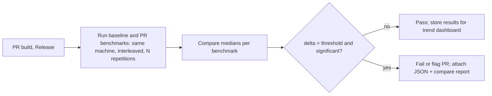

# C++ Testing -- Comprehensive Reference (GoogleTest and GoogleMock)

> A deep-dive reference for unit testing in modern C++ using GoogleTest and GoogleMock, plus the surrounding build, CI, coverage, sanitizer, and fuzz-testing tooling. Each section includes conceptual explanations, comparison tables, code examples, ASCII diagrams, common pitfalls, and interview questions with detailed answers. Complements the *C++ Fundamentals*, *CS Fundamentals*, and *DSA Fundamentals* guides.

---

## Table of Contents

### Part 1: Foundations

1. [Why Unit Testing in C++?](#1-why-unit-testing-in-c)
2. [GoogleTest Setup and Project Layout](#2-googletest-setup-and-project-layout)
3. [Test Anatomy](#3-test-anatomy)

### Part 2: Assertions and Matchers

4. [Assertions: ASSERT vs EXPECT](#4-assertions-assert-vs-expect)
5. [Built-in Assertions](#5-built-in-assertions)
6. [EXPECT_THAT and the Matcher Library](#6-expect_that-and-the-matcher-library)
7. [Custom Matchers](#7-custom-matchers)
8. [PrintTo and Pretty-Printing](#8-printto-and-pretty-printing)

### Part 3: Fixtures and Test Lifecycle

9. [Test Fixtures](#9-test-fixtures)
10. [Suite-level and Program-level Lifecycle](#10-suite-level-and-program-level-lifecycle)
11. [Sharing Resources Across Tests](#11-sharing-resources-across-tests)

### Part 4: Parameterized and Typed Tests

12. [Value-Parameterized Tests](#12-value-parameterized-tests)
13. [Typed Tests](#13-typed-tests)
14. [Type-Parameterized Tests](#14-type-parameterized-tests)

### Part 5: Advanced Test Features

15. [Death Tests](#15-death-tests)
16. [Exception-Based Tests](#16-exception-based-tests)
17. [SCOPED_TRACE, Skipping, and Disabled Tests](#17-scoped_trace-skipping-and-disabled-tests)
18. [Custom Main and Event Listeners](#18-custom-main-and-event-listeners)

### Part 6: GoogleMock

19. [Test Doubles](#19-test-doubles)
20. [Creating Mock Classes](#20-creating-mock-classes)
21. [Setting Expectations](#21-setting-expectations)
22. [Actions](#22-actions)
23. [Cardinalities](#23-cardinalities)
24. [Sequences and Ordering](#24-sequences-and-ordering)
25. [NiceMock, StrictMock, and NaggyMock](#25-nicemock-strictmock-and-naggymock)
26. [Mock Lifetime and Leak Detection](#26-mock-lifetime-and-leak-detection)

### Part 7: Build and CI Integration

27. [CMake Integration](#27-cmake-integration)
28. [Bazel Integration](#28-bazel-integration)
29. [CTest and Test Discovery](#29-ctest-and-test-discovery)
30. [GoogleTest Command-Line Interface](#30-googletest-command-line-interface)
31. [CI Reporters and JUnit XML](#31-ci-reporters-and-junit-xml)

### Part 8: Quality -- Coverage, Sanitizers, and Fuzzing

32. [Code Coverage](#32-code-coverage)
33. [Sanitizers with GoogleTest](#33-sanitizers-with-googletest)
34. [Valgrind](#34-valgrind)
35. [Fuzz Testing and Property-Based Approaches](#35-fuzz-testing-and-property-based-approaches)

### Part 9: Best Practices, Pitfalls, and Interview Questions

36. [Test Design Best Practices](#36-test-design-best-practices)
37. [Designing for Testability](#37-designing-for-testability)
38. [Common Pitfalls](#38-common-pitfalls)
39. [Interview Questions and Answers](#39-interview-questions-and-answers)

### Part 10: Specialized Testing -- Concurrency, GPU, Golden Files, Benchmarks, TDD, and Other Frameworks

40. [Testing Concurrent Code](#40-testing-concurrent-code)
41. [Testing GPU / HIP Code](#41-testing-gpu--hip-code)
42. [Golden-File, Snapshot, and Approval Testing](#42-golden-file-snapshot-and-approval-testing)
43. [Microbenchmarking with Google Benchmark](#43-microbenchmarking-with-google-benchmark)
44. [Test-Driven Development (TDD)](#44-test-driven-development-tdd)
45. [Catch2 v3 and doctest Compared with GoogleTest](#45-catch2-v3-and-doctest-compared-with-googletest)
46. [Mutation Testing with Mull](#46-mutation-testing-with-mull)

---

# Part 1: Foundations

---

# 1. Why Unit Testing in C++?

---

## 1.1 The Test Pyramid

Testing is most effective when structured as a pyramid -- many fast, focused tests at the base, fewer expensive end-to-end tests at the top:

```
                  /\
                 /  \         End-to-End / System Tests
                /____\        (slow, brittle, high-value coverage)
               /      \
              / Integ. \      Integration Tests
             /__________\     (component boundaries, real I/O)
            /            \
           /     Unit      \  Unit Tests
          /________________\  (fast, isolated, deterministic, abundant)
```

| Layer | Scope | Speed | Stability | Owner |
|---|---|---|---|---|
| **Unit** | One class/function, mocks for collaborators | < 1 ms each | Highest | Author of the code |
| **Integration** | Multiple components, real dependencies (DB, FS) | 10 ms - 1 s | Moderate | Author / team |
| **System / E2E** | Whole application, real environments | seconds - minutes | Lowest (flaky) | QA / SDETs |

GoogleTest targets **unit tests** primarily, but also serves integration tests effectively. End-to-end testing typically uses higher-level frameworks (Selenium, Cypress, Robot Framework) and uses GoogleTest only for test runners that invoke them.

## 1.2 FIRST Principles

Robert C. Martin's FIRST acronym captures what makes a good unit test:

| Letter | Property | Meaning |
|---|---|---|
| **F** | Fast | Milliseconds per test; the whole suite runs in seconds |
| **I** | Independent / Isolated | No ordering dependency; any subset can run alone |
| **R** | Repeatable | Same result every run; no clock, network, RNG, or environment leaks |
| **S** | Self-validating | Pass / fail is decided by the test, not a human eyeballing output |
| **T** | Timely / Thorough | Written close to the code under test; covers important behaviour |

GoogleTest enforces F (process exits with the test runner result), S (assertions fail the test), and I (each `TEST` runs in a fresh `Test` object). R and T are responsibilities of the test author.

## 1.3 xUnit Lineage

GoogleTest belongs to the **xUnit** family -- a lineage that began with Kent Beck's SUnit (Smalltalk, 1998) and spread to JUnit (Java), NUnit (.NET), PyTest/UnitTest (Python), and many more. Common xUnit ideas adopted by GoogleTest:

- **Test method** -- a small function with a single concern (`TEST(...)`)
- **Test fixture** -- a class whose members provide a fresh environment per test (`TEST_F(...)`)
- **Test suite** -- a group of related tests (the first argument to `TEST`)
- **Setup / teardown** -- before/after hooks (`SetUp()` / `TearDown()`)
- **Test runner** -- discovers and executes tests (`RUN_ALL_TESTS()`)
- **Assertions** -- statements that fail the test on mismatch

## 1.4 The C++ Framework Landscape

| Framework | Header-only | Style | Mocking | Maturity | Notable Strengths |
|---|---|---|---|---|---|
| **GoogleTest** | No (compiled lib) | xUnit | Yes (GoogleMock) | Very mature; industry standard | Death tests, parameterized/typed tests, rich matchers, IDE/CI tooling |
| **Catch2** | Header-only (v2) / compiled library (v3) | BDD-flavored macros (`SECTION`/`GIVEN`) | Trompeloeil (separate) | Mature | Easy to drop in, expressive macros, sections/generators, built-in micro-benchmarks |
| **doctest** | Header-only | xUnit | Trompeloeil (separate) | Mature | Fastest compile times, near-zero overhead, can live in production headers |
| **Boost.Test** | Both modes | xUnit | None built-in | Very mature | Tight Boost ecosystem fit, XML reports, comprehensive features |
| **CppUTest** | No | xUnit | CppUMock | Mature | Embedded / freestanding C, manual leak detection |
| **FakeIt / HippoMocks** | Header-only | Mock-only | Mocking only | Mature | Drop-in mocks without needing a virtual base |

For a side-by-side syntax comparison of GoogleTest, Catch2 v3, and doctest (SECTION/SUBCASE, BDD macros), see [Section 45](#45-catch2-v3-and-doctest-compared-with-googletest).

```text
GoogleTest's market position:
   - Used inside Chromium, Protobuf, gRPC, LLVM (some subprojects), TensorFlow, ROS, OpenCV, Envoy
   - Default in most large open-source C++ codebases since ~2010
   - Bundled with GoogleMock since 2016 (gtest/gmock merged into one repo)
```

## 1.5 What GoogleTest and GoogleMock Provide

```
+---------------------------------------------------------------+
|                     GoogleTest                                |
|  +------------------+   +-------------------+   +----------+  |
|  | Test discovery   |   | Assertion library |   | Listeners|  |
|  | (TEST, TEST_F,   |   | (EXPECT_*,        |   | (XML, TAP|  |
|  | TEST_P, etc.)    |   | ASSERT_*, _THAT)  |   | custom)  |  |
|  +------------------+   +-------------------+   +----------+  |
|  +------------------+   +-------------------+   +----------+  |
|  | Test fixtures &  |   | Death tests       |   | Flag /   |  |
|  | parameterization |   | (fork-based)      |   | env-var  |  |
|  +------------------+   +-------------------+   +----------+  |
+---------------------------------------------------------------+
|                     GoogleMock                                |
|  +------------------+   +-------------------+   +----------+  |
|  | MOCK_METHOD      |   | Matchers (Eq, Lt, |   | Actions  |  |
|  | (virtual & free) |   | ElementsAre, ...) |   | (Return, |  |
|  |                  |   |                   |   | Invoke)  |  |
|  +------------------+   +-------------------+   +----------+  |
|  +------------------+   +-------------------+   +----------+  |
|  | Cardinalities    |   | Sequences /       |   | Nice /   |  |
|  | (Times, AtLeast) |   | InSequence        |   | Strict / |  |
|  |                  |   |                   |   | Naggy    |  |
|  +------------------+   +-------------------+   +----------+  |
+---------------------------------------------------------------+
```

The two libraries are now shipped together (one repository, two CMake targets), but you can link only what you need.

---

# 2. GoogleTest Setup and Project Layout

---

## 2.1 Obtaining GoogleTest

There are three common ways to consume GoogleTest:

| Method | Pros | Cons | Best For |
|---|---|---|---|
| **CMake `FetchContent`** | Hermetic, pins exact version, no system deps | Adds compile time on first configure | Most modern projects |
| **System package** (`apt install libgtest-dev`, `brew install googletest`, `vcpkg install gtest`) | Fast install, version managed by OS / package manager | Version drift across machines, may not include `gmock` | Quick prototypes, CI with prebuilt images |
| **Git submodule** | Full source available for debugging; can patch | Manual update workflow | Long-lived codebases that vendor dependencies |

**FetchContent** is the most common choice today and is shown in detail in [Section 27](#27-cmake-integration).

## 2.2 Standard Project Layout

A conventional CMake-based layout that separates production code from tests:

```
project/
├── CMakeLists.txt
├── include/
│   └── widget.hpp                <- Public headers
├── src/
│   ├── CMakeLists.txt
│   └── widget.cpp                <- Implementation
├── tests/
│   ├── CMakeLists.txt
│   ├── widget_test.cpp           <- Unit tests for widget
│   ├── widget_param_test.cpp     <- Parameterized tests
│   ├── widget_mock_test.cpp      <- Tests using GoogleMock
│   ├── test_helpers.hpp          <- Shared fixtures / matchers
│   └── test_main.cpp             <- Optional custom main
└── third_party/
    └── googletest/               <- Submodule or FetchContent cache
```

Conventions:

- One test file per production translation unit, named `<name>_test.cpp`.
- Tests live in `tests/` outside the production library so they can be skipped in release builds.
- A single test executable per library is the simplest model; sharded executables only when the suite gets very large.

## 2.3 The Four Library Targets

GoogleTest's CMake build produces four imported targets:

| Target | Contains | Use When |
|---|---|---|
| `GTest::gtest` | Core GoogleTest, no `main` | You provide your own `main()` |
| `GTest::gtest_main` | Core + a default `main()` | You want the runner to start automatically |
| `GTest::gmock` | GoogleMock, no `main` | You also use mocks and provide your own main |
| `GTest::gmock_main` | GoogleMock + a default `main()` (initialises both gtest and gmock) | You use mocks and want a default main |

Rule of thumb: pick **one** `_main` target. Linking both `gtest_main` and `gmock_main` will give a duplicate-symbol error.

```cmake
# Plain GoogleTest, default main:
target_link_libraries(my_tests PRIVATE GTest::gtest_main)

# GoogleMock + default main (initialises both):
target_link_libraries(my_tests PRIVATE GTest::gmock_main)

# Custom main, both libraries available:
target_link_libraries(my_tests PRIVATE GTest::gtest GTest::gmock)
```

## 2.4 The Minimal Test Executable

The smallest working test file when linking against `gtest_main`:

```cpp
// widget_test.cpp
#include <gtest/gtest.h>

TEST(WidgetTest, ReturnsZeroByDefault) {
    int x = 0;
    EXPECT_EQ(x, 0);
}
```

No `main()` is needed. Build it and run:

```bash
$ ./widget_test
[==========] Running 1 test from 1 test suite.
[----------] Global test environment set-up.
[----------] 1 test from WidgetTest
[ RUN      ] WidgetTest.ReturnsZeroByDefault
[       OK ] WidgetTest.ReturnsZeroByDefault (0 ms)
[----------] 1 test from WidgetTest (0 ms total)
[----------] Global test environment tear-down.
[==========] 1 test from 1 test suite ran. (0 ms total)
[  PASSED  ] 1 test.
```

Exit code is `0` if all tests pass, non-zero otherwise -- which integrates cleanly with CTest and CI.

---

# 3. Test Anatomy

---

## 3.1 The `TEST` Macro

The simplest test macro creates a free-standing test:

```cpp
TEST(TestSuiteName, TestName) {
    // Arrange
    Widget w;
    // Act
    int result = w.compute(2, 3);
    // Assert
    EXPECT_EQ(result, 5);
}
```

| Argument | Meaning | Naming rule |
|---|---|---|
| `TestSuiteName` | Logical grouping (often the class under test) | Valid C++ identifier; **no underscores** (see 3.4) |
| `TestName` | Specific behaviour being tested | Valid C++ identifier; **no underscores** |

GoogleTest expands `TEST(A, B)` to a class `A_B_Test` deriving from `::testing::Test`, with the test body as its `TestBody()` override.

## 3.2 The Three Test Macros

| Macro | Base class | Use Case |
|---|---|---|
| `TEST` | `::testing::Test` (implicit) | Free-standing test, no shared state |
| `TEST_F` | Your fixture (must derive from `::testing::Test`) | Tests that share setup/teardown |
| `TEST_P` | Your parameterized fixture (derives from `WithParamInterface<T>`) | Same test logic run with multiple inputs |

```cpp
// TEST: no fixture
TEST(MathTest, Add) {
    EXPECT_EQ(2 + 3, 5);
}

// TEST_F: fixture
class StackTest : public ::testing::Test {
protected:
    std::stack<int> stack_;
};
TEST_F(StackTest, IsEmptyInitially) {
    EXPECT_TRUE(stack_.empty());
}

// TEST_P: parameterized
class AbsTest : public ::testing::TestWithParam<int> {};
TEST_P(AbsTest, AbsIsNonNegative) {
    EXPECT_GE(std::abs(GetParam()), 0);
}
INSTANTIATE_TEST_SUITE_P(Inputs, AbsTest, ::testing::Values(-3, -1, 0, 1, 5));
```

## 3.3 Test Suite vs Test Case Terminology

GoogleTest renamed "test case" to "test suite" in v1.10 to align with xUnit conventions:

| Old (pre-1.10) | New (1.10+) | What it means |
|---|---|---|
| Test case | **Test suite** | A group of related tests (first arg to `TEST`) |
| Test | **Test** | An individual `TestBody()` (second arg to `TEST`) |

Old macro names (`SetUpTestCase`, `TearDownTestCase`, `INSTANTIATE_TEST_CASE_P`) still exist as deprecated aliases. Prefer the new names: `SetUpTestSuite`, `TearDownTestSuite`, `INSTANTIATE_TEST_SUITE_P`.

## 3.4 Naming Rules

**Critical rule: no underscores in `TestSuiteName` or `TestName`.**

```cpp
// BAD: undefined behaviour (collides with internal name mangling)
TEST(Widget_Test, Adds_Two_Numbers) { ... }

// GOOD: PascalCase or camelCase
TEST(WidgetTest, AddsTwoNumbers) { ... }
```

Why: GoogleTest concatenates the two names with an underscore to build a class identifier. An underscore in either part can collide with the separator and produce ambiguous identifiers or clashes with internal helpers (e.g. names ending in `_Test`).

Other naming guidance:

- Suite names typically end with `Test` (`WidgetTest`, not just `Widget`).
- Test names describe the behaviour, not the method (`ReturnsZeroForEmptyInput`, not `TestCompute`).
- `DISABLED_` prefix temporarily disables a test (see [Section 17](#17-scoped_trace-skipping-and-disabled-tests)).

## 3.5 Test Discovery

You do not register tests manually. The `TEST` macros use static initialization to register each test with a global registry before `main()` runs. `RUN_ALL_TESTS()` then iterates the registry. This means:

- Tests in any linked translation unit are discovered automatically.
- A test file that is compiled but **not linked** into the test executable contributes nothing.
- If you use static libraries, you may need `--whole-archive` (GCC) or `/WHOLEARCHIVE` (MSVC) to prevent the linker from discarding "unused" translation units that contain tests.

```bash
# GCC/Clang: keep test registration symbols when linking against a static archive
g++ -o tests test_main.o -Wl,--whole-archive libtests.a -Wl,--no-whole-archive -lgtest
```

## 3.6 The Default `main()`

`gtest_main` provides:

```cpp
int main(int argc, char** argv) {
    ::testing::InitGoogleTest(&argc, argv);
    return RUN_ALL_TESTS();
}
```

`gmock_main` is identical but also calls `::testing::InitGoogleMock(&argc, argv)`. If you need extra setup (logging config, global environment, custom listeners), write your own main -- see [Section 18](#18-custom-main-and-event-listeners).

`RUN_ALL_TESTS()` returns `0` on success, `1` on any failure. You must return this value from `main()` -- ignoring it is a common bug that silently masks test failures.

```cpp
int main(int argc, char** argv) {
    ::testing::InitGoogleTest(&argc, argv);
    return RUN_ALL_TESTS();   // CORRECT
    // RUN_ALL_TESTS();       // BUG: ignored, main returns 0 even on failure
    // return 0;              // also a BUG
}
```

---

# Common Pitfalls and Interview Questions (Part 1)

---

## Pitfalls

- **Underscores in test names** -- `TEST(Widget_Test, Adds_Two)` collides with GoogleTest's internal name mangling. Use PascalCase: `TEST(WidgetTest, AddsTwo)`.
- **Linking both `_main` targets** -- `gtest_main` and `gmock_main` each define `main()`. Pick one.
- **Static-library test discovery** -- if tests live in a static archive, the linker may drop the translation units before their registration runs. Use `--whole-archive` (GCC), `/WHOLEARCHIVE` (MSVC), or `target_link_libraries(... PRIVATE ... -Wl,--whole-archive my_tests_lib -Wl,--no-whole-archive)`.
- **Ignoring `RUN_ALL_TESTS()` return value** -- `main()` then exits with `0`, hiding all failures from CI.
- **Same `TEST(Suite, Name)` in two TUs** -- a redefinition error; tests must have unique `(suite, name)` pairs.

## Interview Questions

**Q1: What does the "test pyramid" mean and how does GoogleTest fit?**

A: The pyramid prescribes many fast unit tests at the base, fewer integration tests in the middle, and very few slow end-to-end tests at the top. GoogleTest is primarily a unit-testing framework, though it scales up to integration-level tests within a process. End-to-end tests are usually driven by higher-level tools.

**Q2: What is the difference between a test suite and a test case in GoogleTest?**

A: Modern terminology (since v1.10) calls the group a **test suite** (first argument to `TEST`) and each individual entry a **test**. The legacy term was "test case", which is why you still see `SetUpTestCase` (deprecated) alongside `SetUpTestSuite`.

**Q3: When would you write your own `main()` instead of using `gtest_main`?**

A: When you need to install global setup (configure logging, parse extra flags, register environments via `AddGlobalTestEnvironment`), install custom listeners, or initialise dependencies (CUDA context, MPI runtime) before any tests run. See [Section 18](#18-custom-main-and-event-listeners).

**Q4: How are GoogleTest tests discovered?**

A: Each `TEST*` macro creates a static-storage-duration object whose constructor registers the test with a global registry. `RUN_ALL_TESTS()` iterates the registry. No manifest, no reflection -- it is pure C++ static initialisation.

**Q5: Why must test suite and test names be valid C++ identifiers without underscores?**

A: GoogleTest concatenates them with `_` to build internal class names. An underscore in either part can collide with the separator or with reserved suffix patterns (`_Test`, `_Test_`), producing duplicate-class errors or undefined behaviour at runtime.

---

# Part 2: Assertions and Matchers

---

# 4. Assertions: ASSERT vs EXPECT

---

## 4.1 Fatal vs Non-Fatal Failures

GoogleTest provides every assertion in two forms:

| Form | On Failure | Continues Test? | Use When |
|---|---|---|---|
| `ASSERT_*` | Reports the failure and **aborts the current function** | No | Continuing would crash, leak, or yield meaningless follow-up failures |
| `EXPECT_*` | Reports the failure and **continues the test** | Yes | You want to see *all* problems in one run |

```cpp
TEST(VectorTest, FrontAccess) {
    std::vector<int> v;
    ASSERT_FALSE(v.empty());      // Aborts if v is empty -- next line would UB
    EXPECT_EQ(v.front(), 42);     // Safe to continue: another assertion can run
    EXPECT_EQ(v.back(),  42);
}
```

If you use `EXPECT_FALSE(v.empty())` followed by `v.front()`, an empty vector will undefine-behaviour through the front access *before* GoogleTest can report the assertion. `ASSERT_*` exists exactly to prevent that.

## 4.2 How `ASSERT_*` Aborts

`ASSERT_*` expands to a `return` statement, **not** to `std::abort` or an exception. Consequences:

- It can only abort the **enclosing function** -- so if you call `ASSERT_*` inside a helper, only the helper returns, not the test.
- It cannot be used in functions returning anything other than `void` unless you use `ASSERT_*` from inside a `void` helper or wrap in `ASSERT_NO_FATAL_FAILURE`.

```cpp
// BUG: ASSERT_EQ in a non-void helper compiles only because gtest's macros are
//      void-friendly, but if you need a return value after the assertion, you
//      must use a different pattern.
int helper() {
    ASSERT_EQ(state(), Ready);   // returns from helper(), not from caller
    return state().value();
}

TEST(Foo, Bar) {
    int x = helper();            // helper returned early; x is uninitialised view
    EXPECT_EQ(x, 7);             // continues to run with garbage
}
```

To propagate fatal failures out of a helper, the test code should check with `HasFatalFailure()` or use the macro `ASSERT_NO_FATAL_FAILURE`:

```cpp
TEST(Foo, Bar) {
    ASSERT_NO_FATAL_FAILURE(helper());   // propagates abort from helper
    // ... use the helper's effects safely here
}
```

## 4.3 Streaming Custom Messages

Both forms support `<<` to attach a custom message to the failure report:

```cpp
EXPECT_EQ(actual, expected)
    << "Computation failed for input=" << input
    << " expected=" << expected
    << " actual="   << actual;
```

This produces output like:

```
my_test.cc:42: Failure
Expected equality of these values:
  actual
    Which is: 3
  expected
    Which is: 5
Computation failed for input=2 expected=5 actual=3
```

Streamed messages are evaluated **only on failure** -- they are zero-cost for passing tests, so you can include expensive `to_string` calls.

## 4.4 Exception Behaviour and `noexcept`

Assertions in GoogleTest do **not** throw -- they either return (`ASSERT_*`) or set a flag (`EXPECT_*`). This matters in two ways:

- Assertions are safe in `noexcept` functions and destructors (no exception propagation).
- They cannot interrupt code that catches them with `try/catch` -- the assertion's effect happens via control flow, not exceptions.

If your code under test throws, use the exception-aware assertions (`EXPECT_THROW`, `EXPECT_NO_THROW`, `EXPECT_ANY_THROW`) -- see [Section 5.6](#56-exception-assertions).

---

# 5. Built-in Assertions

---

## 5.1 General Comparisons

| Macro | Asserts | Notes |
|---|---|---|
| `ASSERT_EQ(a, b)` / `EXPECT_EQ(a, b)` | `a == b` | Works for any type with `operator==` and a pretty-printer |
| `ASSERT_NE(a, b)` | `a != b` | |
| `ASSERT_LT(a, b)` | `a < b` | |
| `ASSERT_LE(a, b)` | `a <= b` | |
| `ASSERT_GT(a, b)` | `a > b` | |
| `ASSERT_GE(a, b)` | `a >= b` | |

```cpp
EXPECT_EQ(actual, 5);
EXPECT_NE(error_code, 0);
EXPECT_LT(latency_ms, 100);
```

**Argument order convention:** Modern GoogleTest treats the two arguments symmetrically -- there is no `expected, actual` requirement. Older guidance suggested `EXPECT_EQ(expected, actual)`, but the reverse is equally valid. Failure messages label both as `Expected` and `Actual` from the macro arguments' positions, so pick a convention for your project and stick with it.

## 5.2 Boolean Assertions

| Macro | Asserts |
|---|---|
| `ASSERT_TRUE(cond)` / `EXPECT_TRUE(cond)` | `cond` is truthy |
| `ASSERT_FALSE(cond)` | `cond` is falsy |

`EXPECT_TRUE` is the catch-all for any boolean condition, but prefer the specific comparison macros (`EQ`, `LT`, ...) because they show both values in the failure message.

```cpp
// Worse:  on failure, you only see "false was true"
EXPECT_TRUE(size() == 5);

// Better: on failure, you see actual size and expected 5
EXPECT_EQ(size(), 5);
```

## 5.3 C-String Assertions

`EXPECT_EQ` on `const char*` compares **pointers**, not contents -- almost always a bug. Use the string-aware variants:

| Macro | Compares | Case-Sensitive |
|---|---|---|
| `ASSERT_STREQ(a, b)` | C-string contents | Yes |
| `ASSERT_STRNE(a, b)` | C-string contents not equal | Yes |
| `ASSERT_STRCASEEQ(a, b)` | C-string contents | No |
| `ASSERT_STRCASENE(a, b)` | C-string contents not equal | No |

```cpp
const char* name = "Alice";
EXPECT_STREQ(name, "Alice");        // contents
EXPECT_EQ(name, "Alice");           // pointer compare -- compiler-dependent!

std::string s = "Alice";
EXPECT_EQ(s, "Alice");              // OK: std::string has operator==(const char*)
```

For `std::string`, `EXPECT_EQ` is correct because `std::string::operator==` compares contents. The `STR*` family is specifically for C strings.

## 5.4 Floating-Point Assertions

Equality of floats is rarely meaningful because of rounding. GoogleTest provides three idioms:

| Macro | Tolerance | Use When |
|---|---|---|
| `ASSERT_FLOAT_EQ(a, b)` | 4 ULPs (units-in-last-place) for `float` | Mathematically-equal `float`s that may differ by tiny rounding |
| `ASSERT_DOUBLE_EQ(a, b)` | 4 ULPs for `double` | Same, for `double` |
| `ASSERT_NEAR(a, b, abs_error)` | User-supplied absolute tolerance | Domain-specific tolerance (e.g., 0.01 for percentages) |

```cpp
double r = std::sin(M_PI);           // not exactly 0
EXPECT_NEAR(r, 0.0, 1e-12);          // OK
EXPECT_DOUBLE_EQ(r, 0.0);            // FAILS: r is ~1.22e-16, way more than 4 ULPs from 0 in magnitude
EXPECT_DOUBLE_EQ(1.0 + 1.0, 2.0);    // OK: exact in IEEE-754
```

**ULP-based comparison gotcha:** `FLOAT_EQ`/`DOUBLE_EQ` work in terms of representable values, so they are unstable near zero. Use `NEAR` with an explicit absolute tolerance when you expect values close to zero.

## 5.5 Predicate Assertions

When you need a custom comparison, write a predicate that returns `::testing::AssertionResult`:

```cpp
::testing::AssertionResult IsPrime(int n) {
    if (n < 2) return ::testing::AssertionFailure() << n << " is not prime";
    for (int i = 2; i * i <= n; ++i) {
        if (n % i == 0)
            return ::testing::AssertionFailure() << n << " = " << i << " * " << (n / i);
    }
    return ::testing::AssertionSuccess();
}

TEST(PrimeTest, Seven) {
    EXPECT_TRUE(IsPrime(7));
    EXPECT_TRUE(IsPrime(8));   // FAILS with message: "8 = 2 * 4"
}
```

For predicates that take multiple arguments and you want both shown in the message, use `PRED1` through `PRED5`:

```cpp
bool MutuallyPrime(int a, int b) { return std::gcd(a, b) == 1; }

EXPECT_PRED2(MutuallyPrime, 6, 35);    // OK
EXPECT_PRED2(MutuallyPrime, 6, 9);     // FAILS with both args shown
```

For full control over the failure message and the predicate signature, use `PRED_FORMAT1`..`PRED_FORMAT5` and return `AssertionResult`:

```cpp
::testing::AssertionResult AssertMutuallyPrime(
    const char* a_expr, const char* b_expr, int a, int b) {
    if (std::gcd(a, b) == 1) return ::testing::AssertionSuccess();
    return ::testing::AssertionFailure()
        << a_expr << " and " << b_expr << " share factor "
        << std::gcd(a, b) << " (values: " << a << ", " << b << ")";
}

EXPECT_PRED_FORMAT2(AssertMutuallyPrime, 6, 9);
```

## 5.6 Exception Assertions

| Macro | Asserts |
|---|---|
| `ASSERT_THROW(stmt, ExType)` | `stmt` throws an exception of type `ExType` (or derived) |
| `ASSERT_ANY_THROW(stmt)` | `stmt` throws any exception |
| `ASSERT_NO_THROW(stmt)` | `stmt` does not throw |

```cpp
TEST(ParserTest, ThrowsOnBadInput) {
    EXPECT_THROW(parse("not json"), std::invalid_argument);
    EXPECT_NO_THROW(parse("{}"));
}
```

To inspect the exception's **message** (not just its type), catch manually and assert on the result:

```cpp
TEST(ParserTest, ErrorMessageMentionsLine) {
    try {
        parse("bad", /*line=*/42);
        FAIL() << "expected std::runtime_error";
    } catch (const std::runtime_error& e) {
        EXPECT_THAT(e.what(), ::testing::HasSubstr("line 42"));
    } catch (...) {
        FAIL() << "wrong exception type";
    }
}
```

## 5.7 Explicit Failures

| Macro | Effect |
|---|---|
| `FAIL()` | Fatal failure (like `ASSERT`) with a message |
| `ADD_FAILURE()` | Non-fatal failure (like `EXPECT`) with a message |
| `ADD_FAILURE_AT(file, line)` | Failure at a specific location (for table-driven tests) |
| `SUCCEED()` | Records a success message (rarely needed) |

```cpp
TEST(ParserTest, BadInputAlwaysThrows) {
    try {
        parse("invalid");
        FAIL() << "Expected an exception, got none";
    } catch (const std::exception&) {
        SUCCEED();
    }
}
```

## 5.8 Cheat Sheet -- When to Use Which

```
Need to check ...                          Use
------------------------------------------ -------------------------------------
Two integers / objects equal               EXPECT_EQ
Boolean condition                          EXPECT_TRUE / EXPECT_FALSE
C-string contents                          EXPECT_STREQ
std::string contents                       EXPECT_EQ
Float within tolerance                     EXPECT_NEAR or EXPECT_DOUBLE_EQ
Container shape / contents                 EXPECT_THAT + ElementsAre
Throws a specific exception                EXPECT_THROW
Does not throw                             EXPECT_NO_THROW
Custom binary predicate                    EXPECT_PRED2
Custom predicate with rich message         EXPECT_PRED_FORMAT2
Substring / regex / "looks like"           EXPECT_THAT + HasSubstr / MatchesRegex
Catastrophic, downstream code unsafe       ASSERT_* (otherwise prefer EXPECT_*)
```

---

# 6. EXPECT_THAT and the Matcher Library

---

## 6.1 The `EXPECT_THAT` Macro

`EXPECT_THAT(value, matcher)` is the gateway to GoogleMock's matcher library, usable in **all** tests, not just those that mock:

```cpp
#include <gmock/gmock.h>   // matchers come from gmock, not gtest
using ::testing::Eq;
using ::testing::Lt;
using ::testing::HasSubstr;

EXPECT_THAT(name, Eq("Alice"));
EXPECT_THAT(age,  Lt(120));
EXPECT_THAT(message, HasSubstr("error"));
```

The failure message for matchers is high-quality: it shows the value, the matcher description, and (for composite matchers) which sub-matcher failed.

## 6.2 Comparison Matchers

| Matcher | Equivalent | Notes |
|---|---|---|
| `Eq(v)` | `== v` | Default if you just write the value: `EXPECT_THAT(x, 5)` |
| `Ne(v)` | `!= v` | |
| `Lt(v)`, `Le(v)`, `Gt(v)`, `Ge(v)` | `<`, `<=`, `>`, `>=` | |
| `IsNull()`, `NotNull()` | pointer is/isn't null | |
| `Ref(x)` | reference identical to `x` | Same object, not just same value |
| `IsTrue()`, `IsFalse()` | boolean | Useful for explicit boolean coercion |

## 6.3 String Matchers

| Matcher | Matches When |
|---|---|
| `HasSubstr(s)` | the value contains `s` |
| `StartsWith(s)` | the value starts with `s` |
| `EndsWith(s)` | the value ends with `s` |
| `StrEq(s)` | exact equality (case-sensitive) |
| `StrCaseEq(s)` | exact equality, case-insensitive |
| `StrNe(s)` | not equal (case-sensitive) |
| `MatchesRegex(re)` | full-match against `re` (POSIX or RE2) |
| `ContainsRegex(re)` | regex matches somewhere in the value |

```cpp
EXPECT_THAT(error.what(), HasSubstr("file not found"));
EXPECT_THAT(version,      MatchesRegex(R"(\d+\.\d+\.\d+)"));
```

## 6.4 Composite Matchers

| Matcher | Meaning |
|---|---|
| `AllOf(m1, m2, ...)` | All sub-matchers pass |
| `AnyOf(m1, m2, ...)` | At least one sub-matcher passes |
| `Not(m)` | `m` does not pass |

```cpp
EXPECT_THAT(age, AllOf(Ge(0), Le(120)));
EXPECT_THAT(status, AnyOf(Eq("ok"), Eq("pending")));
EXPECT_THAT(name, Not(IsEmpty()));
```

## 6.5 Container Matchers

| Matcher | Meaning |
|---|---|
| `IsEmpty()` | `container.empty()` is true |
| `SizeIs(m)` | the size matches `m` (number or matcher) |
| `Contains(m)` | at least one element matches `m` |
| `Contains(m).Times(n)` | exactly `n` elements match `m` (`n` can be a matcher) |
| `Each(m)` | every element matches `m` |
| `ElementsAre(m1, m2, ...)` | size matches **and** each element matches in order |
| `ElementsAreArray(arr)` | same, but matchers come from a vector/array |
| `UnorderedElementsAre(m1, m2, ...)` | size matches **and** there is some permutation where each matches |
| `UnorderedElementsAreArray(arr)` | same, with array of matchers |
| `IsSupersetOf({m1, m2, ...})` | the container contains a permutation matching all listed matchers (extras OK) |
| `IsSubsetOf({m1, m2, ...})` | every element matches some listed matcher (some matchers may be unused) |
| `WhenSorted(m)` | sort the container, then match `m` |
| `WhenSortedBy(less, m)` | sort with `less`, then match |
| `BeginEndDistanceIs(m)` | for iterator pairs / ranges |

```cpp
std::vector<int> v = {3, 1, 4, 1, 5, 9, 2, 6};

EXPECT_THAT(v, Not(IsEmpty()));
EXPECT_THAT(v, SizeIs(8));
EXPECT_THAT(v, Contains(4));
EXPECT_THAT(v, Each(Lt(10)));
EXPECT_THAT(v, ElementsAre(3, 1, 4, 1, 5, 9, 2, 6));         // order-sensitive
EXPECT_THAT(v, UnorderedElementsAre(1, 1, 2, 3, 4, 5, 6, 9));
EXPECT_THAT(v, IsSupersetOf({1, 4, 9}));
EXPECT_THAT(v, WhenSorted(ElementsAre(1, 1, 2, 3, 4, 5, 6, 9)));
```

`std::map`-style containers expose key-value pairs; use `Pair(k, v)`:

```cpp
using ::testing::Pair;
std::map<std::string, int> m = {{"a", 1}, {"b", 2}};
EXPECT_THAT(m, UnorderedElementsAre(Pair("a", 1), Pair("b", 2)));
```

## 6.6 Pointer Matchers

| Matcher | Meaning |
|---|---|
| `Pointee(m)` | The pointed-to value matches `m` |
| `Address(m)` | The address (raw pointer) matches `m` (e.g., `Eq(&obj)`) |
| `WhenDynamicCastTo<T*>(m)` | `dynamic_cast<T*>(ptr)` matches `m` |
| `Optional(m)` | `std::optional` has value matching `m` |

```cpp
auto p = std::make_unique<int>(42);
EXPECT_THAT(p, Pointee(Eq(42)));
EXPECT_THAT(p, Pointee(Gt(0)));

std::optional<int> o = 7;
EXPECT_THAT(o, Optional(Lt(10)));
```

## 6.7 Field and Property Matchers

For structs/classes with multiple members, match individual members without writing custom equality:

```cpp
struct Point { int x, y; };

using ::testing::Field;
EXPECT_THAT(p, AllOf(
    Field(&Point::x, Eq(1)),
    Field(&Point::y, Gt(0))));
```

`Property` is similar but for getter methods:

```cpp
class Range {
public:
    int min() const { return min_; }
    int max() const { return max_; }
private:
    int min_, max_;
};

using ::testing::Property;
EXPECT_THAT(r, AllOf(
    Property(&Range::min, Eq(0)),
    Property(&Range::max, Le(100))));
```

C++17 lets you name the field for nicer failure messages:

```cpp
Field("x", &Point::x, Eq(1))
Property("min", &Range::min, Eq(0))
```

## 6.8 Result-Of and Truly

| Matcher | Meaning |
|---|---|
| `ResultOf(fn, m)` | `fn(value)` matches `m` |
| `Truly(pred)` | `pred(value)` is truthy |

```cpp
auto len = [](const std::string& s) { return s.size(); };
EXPECT_THAT(name, ResultOf(len, Gt(0)));

EXPECT_THAT(x, Truly([](int v) { return v % 2 == 0; }));
```

## 6.9 Floating-Point Matchers

| Matcher | Meaning |
|---|---|
| `FloatEq(v)`, `DoubleEq(v)` | Equal within 4 ULPs (same as `EXPECT_FLOAT_EQ`) |
| `FloatNear(v, eps)`, `DoubleNear(v, eps)` | Within absolute tolerance |
| `NanSensitiveFloatEq(v)` | Same as `FloatEq` but two NaNs compare equal |
| `IsNan()`, `IsInf()`, `IsFinite()` | Float classification (latest gtest) |

## 6.10 Variant and Optional Matchers

```cpp
std::variant<int, std::string> v = std::string("hi");
EXPECT_THAT(v, VariantWith<std::string>(Eq("hi")));

std::optional<int> o;
EXPECT_THAT(o, Eq(std::nullopt));    // or
EXPECT_THAT(o, Not(Optional(_)));
```

`_` (the underscore, from `using ::testing::_;`) is the wildcard matcher -- matches anything.

---

# 7. Custom Matchers

---

## 7.1 The `MATCHER` Macro

For simple custom matchers, the `MATCHER` macro defines a polymorphic matcher in one line:

```cpp
MATCHER(IsEven, "is even") {
    return arg % 2 == 0;
}

EXPECT_THAT(4, IsEven());
EXPECT_THAT(5, IsEven());   // FAILS: "Value of 5: 5 is even"
```

Inside the macro, `arg` is the value being matched. The trailing string is the matcher's description (used in failure messages).

## 7.2 `MATCHER_P` -- Parameterized Matchers

`MATCHER_P` through `MATCHER_P10` allow up to ten parameters:

```cpp
MATCHER_P(DivisibleBy, n, "is divisible by " + ::testing::PrintToString(n)) {
    return arg % n == 0;
}

EXPECT_THAT(15, DivisibleBy(3));
EXPECT_THAT(15, DivisibleBy(5));
EXPECT_THAT(15, DivisibleBy(2));   // FAILS
```

Inside the macro body, the parameters are available by their declared names (`n` above). The description can use `PrintToString` to embed parameter values.

```cpp
MATCHER_P2(InClosedRange, lo, hi,
           "is in [" + ::testing::PrintToString(lo) + ", " +
           ::testing::PrintToString(hi) + "]") {
    return lo <= arg && arg <= hi;
}

EXPECT_THAT(7, InClosedRange(1, 10));
```

## 7.3 Negation Description

To customise the message when wrapped in `Not()`, define the negation description after the positive one separated by an empty string:

```cpp
MATCHER(IsEven, "is even") { return arg % 2 == 0; }
// gtest auto-derives the negation as "isn't even"

// Explicit:
MATCHER(IsEven, std::string(negation ? "is odd" : "is even")) {
    return arg % 2 == 0;
}
```

Inside the description expression, `negation` is `true` when the matcher is being asked to describe the negated form.

## 7.4 Composing With Existing Matchers (`ExplainMatchResult`)

A custom matcher often delegates to existing matchers. Use `ExplainMatchResult` to inherit their failure messages:

```cpp
using ::testing::ExplainMatchResult;
using ::testing::HasSubstr;

MATCHER_P(MessageContains, fragment, "") {
    return ExplainMatchResult(HasSubstr(fragment), arg.what(), result_listener);
}

TEST(ErrorTest, ContainsLine) {
    EXPECT_THAT(SomeException("at line 42"), MessageContains("line"));
}
```

`result_listener` is an implicit parameter in `MATCHER`/`MATCHER_P` macros. Streaming to it (`*result_listener << "..."`) adds context to the failure message.

## 7.5 Full Matcher Class

For matchers that need more than one method, implement `::testing::MatcherInterface<T>`:

```cpp
class DivisibleByMatcher : public ::testing::MatcherInterface<int> {
    int divisor_;
public:
    explicit DivisibleByMatcher(int d) : divisor_(d) {}

    bool MatchAndExplain(int n, ::testing::MatchResultListener* l) const override {
        if (n % divisor_ != 0) {
            *l << "the remainder is " << (n % divisor_);
            return false;
        }
        return true;
    }
    void DescribeTo(std::ostream* os) const override {
        *os << "is divisible by " << divisor_;
    }
    void DescribeNegationTo(std::ostream* os) const override {
        *os << "is not divisible by " << divisor_;
    }
};

::testing::Matcher<int> DivisibleBy(int d) {
    return ::testing::MakeMatcher(new DivisibleByMatcher(d));
}
```

For matchers that work with **any** type, use `MatcherInterface<const T&>` and `MakePolymorphicMatcher` instead.

## 7.6 Best Practices for Custom Matchers

- Prefer `MATCHER_P` over a full class -- shorter and reads better.
- Make matchers **side-effect free** -- they may be called multiple times.
- Don't return `false` without writing to `result_listener` -- failure messages should tell the reader *why*.
- Name matchers as readable predicates: `IsEven`, `HasNoErrors`, `RepresentsValidUtf8`.

---

# 8. PrintTo and Pretty-Printing

---

## 8.1 The Built-in Printer

When an assertion fails, GoogleTest prints both values using the `PrintTo` machinery (in `<gtest/gtest-printers.h>`). It handles automatically:

- Arithmetic types, pointers, references
- `std::string`, `std::string_view`, char arrays
- All STL containers (recursively)
- `std::tuple`, `std::pair`, `std::optional`, `std::variant`
- Types with `operator<<(std::ostream&, ...)` (uses that)
- Types with neither -- prints as a hex dump of the bytes

```
Expected equality of these values:
  v
    Which is: { 3, 1, 4, 1, 5, 9, 2, 6 }
  expected
    Which is: { 1, 2, 3, 4, 5, 6, 9 }
```

## 8.2 Teaching the Printer About Your Type

For a custom type, add a `PrintTo` free function in the **same namespace** as the type (so ADL finds it):

```cpp
namespace mylib {

struct Point { int x, y; };

void PrintTo(const Point& p, std::ostream* os) {
    *os << "Point{x=" << p.x << ", y=" << p.y << "}";
}

}
```

Now failures involving `Point` show `Point{x=1, y=2}` instead of a hex dump.

If your type already has `operator<<`, the built-in printer uses it -- you typically do not need to write `PrintTo`. Define `PrintTo` only when you want **different** output during tests than in production (e.g., showing internal invariants).

## 8.3 `PrintToString` in Messages

`::testing::PrintToString(value)` returns the string form of any printable type:

```cpp
EXPECT_EQ(actual, expected)
    << "input vector was " << ::testing::PrintToString(input);
```

This is the recommended way to embed STL containers into custom failure messages -- `operator<<` is not defined for `std::vector` etc.

## 8.4 Printers for `EXPECT_THAT`

`EXPECT_THAT` failures also use `PrintTo`. A common pattern when you have a "fat" object with too much detail is to write a custom `PrintTo` that shows only the salient fields:

```cpp
void PrintTo(const HttpResponse& r, std::ostream* os) {
    *os << "HttpResponse{" << r.status_code()
        << ", " << r.headers().size() << " headers"
        << ", body[" << r.body().size() << "B]}";
}
```

This keeps failure messages readable without dumping 50 lines of HTTP headers.

## 8.5 Disabling the Built-in Printer

For sensitive types (e.g., printing them would leak secrets) provide a `PrintTo` that censors:

```cpp
void PrintTo(const ApiKey& key, std::ostream* os) {
    *os << "ApiKey{<redacted>}";
}
```

---

# Common Pitfalls and Interview Questions (Part 2)

---

## Pitfalls

- **Mixing `ASSERT_*` in helpers** -- `ASSERT_*` only returns from the helper, not from the test. Use `ASSERT_NO_FATAL_FAILURE(helper())` or check `HasFatalFailure()`.
- **`EXPECT_EQ` on `const char*`** -- compares pointer addresses, not contents. Use `EXPECT_STREQ` or `std::string`.
- **`EXPECT_DOUBLE_EQ` near zero** -- ULP-based comparison is unstable around zero; use `EXPECT_NEAR` with an absolute tolerance.
- **Forgetting `return RUN_ALL_TESTS()`** -- the suite "passes" silently even when tests fail because `main` returned `0`.
- **Argument order in `EXPECT_EQ`** -- modern gtest labels both as "Expected"/"Actual" from the arguments' positions; pick a convention (often `expected, actual` for clarity) and use it consistently.
- **`ElementsAre` with too few/too many** -- it asserts both order *and* size. Use `IsSupersetOf`/`Contains` for "contains at least these" semantics.
- **Custom matcher with side effects** -- matchers may be invoked multiple times in composite expressions; keep them pure.

## Interview Questions

**Q1: When should I use `ASSERT_*` vs `EXPECT_*`?**

A: Use `ASSERT_*` when continuing the test after a failure would cause undefined behaviour, crash, or produce meaningless follow-up errors (e.g., dereferencing a null pointer). Use `EXPECT_*` otherwise, so you see *all* failures in one run. Empirically, in a typical suite, > 90% of assertions are `EXPECT_*`.

**Q2: What's the difference between `EXPECT_EQ(a, b)` and `EXPECT_THAT(a, Eq(b))`?**

A: For simple equality, they are functionally equivalent. `EXPECT_EQ` produces a slightly nicer "Expected equality of these values" message and is the idiomatic choice. `EXPECT_THAT` shines when you want to combine matchers (`AllOf(Ge(0), Le(100))`), use container/string matchers, or write reusable matcher functions.

**Q3: Why doesn't `EXPECT_EQ(strA, strB)` work for two `char*` strings?**

A: `const char*` is a pointer, and `operator==` on pointers compares addresses, not contents. `EXPECT_STREQ` exists specifically to compare C-string contents. For `std::string`, `operator==` does the right thing and `EXPECT_EQ` is correct.

**Q4: How does `ASSERT_*` actually abort?**

A: It expands to a `return` statement. This means it only aborts the enclosing function -- if you call `ASSERT_*` inside a helper, the helper returns but the test continues. To propagate, wrap the helper call in `ASSERT_NO_FATAL_FAILURE(helper())`.

**Q5: Why is `EXPECT_DOUBLE_EQ(very_small_value, 0.0)` unreliable?**

A: It compares ULPs (representable steps), and near zero there are many representable values within a tiny absolute range. A `double` of `1e-300` is hundreds of ULPs from `0.0` despite being effectively zero. Use `EXPECT_NEAR(x, 0.0, 1e-12)` with an explicit absolute tolerance.

**Q6: How do I check that a function throws an exception with a specific message?**

A: `EXPECT_THROW` only checks the type. To check the message, use a `try/catch` with `EXPECT_THAT(e.what(), HasSubstr("..."))` (see [Section 5.6](#56-exception-assertions)).

**Q7: What's the difference between `ElementsAre` and `UnorderedElementsAre`?**

A: `ElementsAre` requires the elements in the **same order** as the matchers; `UnorderedElementsAre` finds some permutation of the matchers that matches the container. Both require the **size to match exactly**. For "contains at least these", use `IsSupersetOf`. For "any element matches", use `Contains`.

**Q8: How do I teach GoogleTest to print my custom type nicely?**

A: Define a `PrintTo(const MyType&, std::ostream* os)` free function in the same namespace as the type -- ADL will find it. Alternatively, define `operator<<(std::ostream&, const MyType&)` and the built-in printer will pick it up automatically.

**Q9: Can I use `EXPECT_THAT` without GoogleMock?**

A: `EXPECT_THAT` itself is in GoogleTest, but most matchers (`Eq`, `HasSubstr`, `ElementsAre`, etc.) live in GoogleMock's header `<gmock/gmock.h>`. In practice, you must link `gmock` to use the matcher library, even if you do not use mock objects. The library is small and there is no runtime cost.

**Q10: How do I write a matcher that compares only some fields of a struct?**

A: Use `Field` and `AllOf`:

```cpp
EXPECT_THAT(point, AllOf(Field(&Point::x, Eq(1)),
                         Field(&Point::y, Gt(0))));
```

For getters, use `Property`. To match optionally, combine with `Optional`/`Pointee`. For complex cases, define a custom `MATCHER_P` that delegates to these with `ExplainMatchResult`.

---

# Part 3: Fixtures and Test Lifecycle

---

# 9. Test Fixtures

---

## 9.1 What Is a Fixture?

A **test fixture** is a class that holds shared state and helper methods for a group of tests. Each test gets a **fresh instance** of the fixture, so changes in one test cannot leak into another. The fixture must:

- Derive (directly or indirectly) from `::testing::Test`
- Be a **default-constructible** class
- Have at least `protected` members for tests to access them

```cpp
class StackTest : public ::testing::Test {
protected:
    std::stack<int> stack_;
};

TEST_F(StackTest, IsEmptyInitially) {
    EXPECT_TRUE(stack_.empty());
}

TEST_F(StackTest, PushIncreasesSize) {
    stack_.push(42);
    EXPECT_EQ(stack_.size(), 1u);
}
```

`TEST_F(FixtureName, TestName)` creates a class deriving from `FixtureName`, with the test body as its `TestBody()`. Each test gets a brand-new `StackTest` object, so `stack_` is empty at the start of every test.

## 9.2 The Lifecycle of a Single Test

For each `TEST_F(Fixture, TestName)`, GoogleTest performs the following in order:

```
   1. Construct the fixture          (Fixture::Fixture())
   2. Call SetUp()                   (override of virtual SetUp)
   3. Run the test body              (TestBody)
   4. Call TearDown()                (override of virtual TearDown)
   5. Destruct the fixture           (~Fixture())
```

```cpp
class FileTest : public ::testing::Test {
protected:
    void SetUp() override {
        path_ = std::filesystem::temp_directory_path() / "gtest_tmp.txt";
        std::ofstream(path_) << "hello";   // create the file
    }
    void TearDown() override {
        std::filesystem::remove(path_);    // clean up after each test
    }
    std::filesystem::path path_;
};

TEST_F(FileTest, FileExists) {
    EXPECT_TRUE(std::filesystem::exists(path_));
}

TEST_F(FileTest, FileHasExpectedContent) {
    std::ifstream f(path_);
    std::string s; std::getline(f, s);
    EXPECT_EQ(s, "hello");
}
```

## 9.3 Constructor/Destructor vs `SetUp`/`TearDown`

Both forms work. There are three reasons to choose one over the other:

| Use ... | When ... |
|---|---|
| Constructor / destructor | Setup cannot fail or you do not need `ASSERT_*` to abort it |
| `SetUp` / `TearDown` | Setup uses `ASSERT_*` that should abort the test |
| `SetUp` / `TearDown` | The fixture is inherited and you want to call the base's setup explicitly |

```cpp
// Style 1: constructor (concise)
class WidgetTest : public ::testing::Test {
protected:
    WidgetTest() : w_("config.json") {}
    Widget w_;
};

// Style 2: SetUp (allows ASSERT_*)
class WidgetTest : public ::testing::Test {
protected:
    void SetUp() override {
        ASSERT_TRUE(std::filesystem::exists("config.json"));   // works
        w_ = std::make_unique<Widget>("config.json");
    }
    std::unique_ptr<Widget> w_;
};
```

**Why `ASSERT_*` in a constructor is problematic:** an `ASSERT_*` macro expands to `return;`, but a constructor cannot return early without leaving the object in an inconsistent state. GoogleTest forbids `ASSERT_*` in constructors and destructors -- you will get a compile error. `SetUp` is a regular `void` member function, so `return` is safe.

## 9.4 Destructor Pitfalls

Destructors run during stack unwinding. If a test fails partway through, GoogleTest still destructs the fixture, but assertions inside the destructor:

- Will **not** mark the current test as failed (the test has already concluded by the time the destructor runs).
- Will report the failure against a "synthetic" location, which makes debugging confusing.

Use `TearDown` for cleanup that may fail.

```cpp
class ResourceTest : public ::testing::Test {
protected:
    void TearDown() override {
        EXPECT_EQ(resource_.outstanding_borrows(), 0)
            << "test leaked borrowed references";
    }
    Resource resource_;
};
```

## 9.5 Accessing Fixture State

Members of the fixture are accessible inside `TEST_F` because the test body is a member function of a class deriving from the fixture:

```cpp
class DbTest : public ::testing::Test {
protected:
    void Insert(int id) { db_.insert(id); }    // helper visible in tests
    Database db_;
};

TEST_F(DbTest, InsertAndLookup) {
    Insert(42);                                 // calls fixture member
    EXPECT_TRUE(db_.contains(42));              // accesses fixture member
}
```

Make helpers `protected`, not `private`, or the derived test class cannot call them.

---

# 10. Suite-level and Program-level Lifecycle

---

## 10.1 `SetUpTestSuite` / `TearDownTestSuite`

When setup is **expensive** and identical for every test in a suite, share it across tests with the suite-level hooks. They run **once per test suite**, before/after all tests in that suite:

```cpp
class HeavyTest : public ::testing::Test {
protected:
    static void SetUpTestSuite() {
        big_corpus_ = LoadCorpus("data/large.txt");   // 30 seconds
    }
    static void TearDownTestSuite() {
        delete big_corpus_;
        big_corpus_ = nullptr;
    }
    void SetUp() override {
        cursor_ = big_corpus_->begin();               // per-test reset
    }

    static Corpus* big_corpus_;
    Corpus::Iterator cursor_;
};
Corpus* HeavyTest::big_corpus_ = nullptr;
```

Key constraints:

- These are `static` member functions; they cannot access non-static fixture members.
- Shared state must be `static` (one copy across all tests in the suite).
- They run **once** even if 50 tests use the fixture -- so individual tests must not mutate the shared state in incompatible ways.

```
        Time -->
        +------------------------------------------------------------+
        | SetUpTestSuite() (once)                                    |
        |                                                            |
        | [Test 1: ctor, SetUp, Body, TearDown, dtor]                |
        | [Test 2: ctor, SetUp, Body, TearDown, dtor]                |
        | [Test 3: ctor, SetUp, Body, TearDown, dtor]                |
        |                                                            |
        | TearDownTestSuite() (once)                                 |
        +------------------------------------------------------------+
```

## 10.2 Program-level Hooks via `Environment`

For setup that should run **once for the entire test program**, register an `::testing::Environment`:

```cpp
class LoggingEnv : public ::testing::Environment {
public:
    void SetUp() override {
        InitializeLogger("/tmp/test.log");
    }
    void TearDown() override {
        ShutdownLogger();
    }
};

int main(int argc, char** argv) {
    ::testing::InitGoogleTest(&argc, argv);
    ::testing::AddGlobalTestEnvironment(new LoggingEnv);   // gtest takes ownership
    return RUN_ALL_TESTS();
}
```

Multiple environments may be registered; they run in registration order on setup and reverse order on teardown -- analogous to nested RAII.

**Use cases:**
- Initialise loggers, metrics, telemetry
- Acquire scarce resources (a GPU context, MPI communicator)
- Spin up a test database or fake service
- Seed RNGs in a controllable way

## 10.3 Full Hook Ordering

A complete lifecycle for two tests in one suite, with two environments registered:

```
Program start
├── Env1::SetUp                     -- once
├── Env2::SetUp                     -- once
├── Suite::SetUpTestSuite           -- once per suite
│   ├── Fixture ctor                 \
│   │   SetUp                        |
│   │   TestBody (test 1)            |  per test
│   │   TearDown                     |
│   │   Fixture dtor                /
│   └── Fixture ctor                 \
│       SetUp                        |
│       TestBody (test 2)            |  per test
│       TearDown                     |
│       Fixture dtor                /
└── Suite::TearDownTestSuite        -- once per suite
├── Env2::TearDown                  -- reverse order
└── Env1::TearDown                  -- reverse order
Program exit
```

## 10.4 Sharing a Fixture Across Suites via Inheritance

You can factor a base fixture and derive multiple suites from it:

```cpp
class DatabaseFixture : public ::testing::Test {
protected:
    void SetUp() override { db_ = OpenInMemoryDb(); }
    void TearDown() override { db_.reset(); }
    std::unique_ptr<Database> db_;
};

class UserTableTest    : public DatabaseFixture {};
class OrderTableTest   : public DatabaseFixture {};
class AnalyticsTest    : public DatabaseFixture {};

TEST_F(UserTableTest, Insert) {
    db_->Insert("users", {"alice", 1});
    // ...
}

TEST_F(OrderTableTest, Insert) {
    // separate suite, separate (set of) fixture instance(s)
}
```

Each derived suite gets independent `SetUpTestSuite`/`TearDownTestSuite`. The base's `SetUp`/`TearDown` are inherited; if you override them in a derived suite, call the base explicitly:

```cpp
void SetUp() override {
    DatabaseFixture::SetUp();      // open db
    seed_table_with_users();       // suite-specific
}
```

---

# 11. Sharing Resources Across Tests

---

## 11.1 No Ordering Guarantees Between Tests

By default GoogleTest runs tests in the **order they are defined within a translation unit**, then across translation units in **link order** -- but you must not rely on this. With `--gtest_shuffle`, tests run in a random order each invocation. Cross-test dependencies are a major source of flaky suites.

```cpp
TEST(Counter, FirstIncrement) {
    static int n = 0;       // BAD: state leaks across tests
    EXPECT_EQ(++n, 1);
}
TEST(Counter, SecondIncrement) {
    static int n = 0;       // different static, same suite-but-test names
    EXPECT_EQ(++n, 1);
}
```

If you need true sharing, use the suite-level hooks ([Section 10.1](#101-setuptestsuite--teardowntestsuite)) which document the intent.

## 11.2 Static Members for Suite-Wide State

```cpp
class CacheTest : public ::testing::Test {
protected:
    static std::unique_ptr<Cache> cache_;   // single instance for the suite

    static void SetUpTestSuite() {
        cache_ = std::make_unique<Cache>(/*capacity=*/1024);
    }
    static void TearDownTestSuite() {
        cache_.reset();
    }

    void SetUp() override {
        cache_->Clear();    // reset state per test, even though the object lives
    }
};
std::unique_ptr<Cache> CacheTest::cache_;
```

Pattern: keep the **object** alive across tests, but **reset its observable state** in `SetUp` so each test starts clean.

## 11.3 Process-Wide Singletons

Some resources cannot be reset (third-party state machines, CUDA contexts, ALSA handles). For these, install a program-level `Environment` ([Section 10.2](#102-program-level-hooks-via-environment)) so the resource lives for the whole process.

If you need different process-wide state for different tests, the only safe option is **separate test executables** (sharding). CMake handles this naturally:

```cmake
add_executable(tests_with_gpu_v1 gpu_v1_test.cpp)
add_executable(tests_with_gpu_v2 gpu_v2_test.cpp)
target_link_libraries(tests_with_gpu_v1 PRIVATE GTest::gtest_main lib_v1)
target_link_libraries(tests_with_gpu_v2 PRIVATE GTest::gtest_main lib_v2)
```

## 11.4 Avoiding Hidden Coupling

Even within a single fixture, hidden state is dangerous:

```cpp
class ConfigTest : public ::testing::Test {
protected:
    void SetUp() override {
        SetGlobalConfig("path/to/config");        // BAD: process-global
    }
};

// Some other test that runs later:
TEST(UnrelatedTest, ChecksConfig) {
    EXPECT_EQ(GetGlobalConfig(), "");             // FAILS: leaked from above
}
```

Rules of thumb:

- A fixture's `TearDown` should leave the world the way it found it.
- Prefer dependency injection over globals (see [Section 37](#37-designing-for-testability)).
- If a global must change, save the old value in `SetUp` and restore in `TearDown`.

## 11.5 Trade-offs Summary

| Approach | Reset Per Test | Cost Per Test | Use When |
|---|---|---|---|
| Member of fixture (default) | Yes (new instance) | Cheap setup | Default for unit tests |
| `static` member + `SetUpTestSuite` | Object reused; reset state in `SetUp` | Expensive build, cheap reset | Heavy objects sharable safely |
| Process-level `Environment` | Never reset within process | One-time cost | Truly singleton resources |
| Sharded executables | Per process | Process startup overhead | Conflicting global state |

---

# Common Pitfalls and Interview Questions (Part 3)

---

## Pitfalls

- **`ASSERT_*` in a constructor or destructor** -- compile error. Use `SetUp`/`TearDown` for assertion-bearing setup.
- **Forgetting to define a static fixture member** -- `static int Foo::n_;` in the `.cpp` is required for ODR.
- **Relying on test order** -- shuffling exposes brittle suites. Ensure each test would pass alone.
- **State leak via globals** -- a test that mutates a singleton breaks unrelated tests later.
- **`SetUpTestSuite` reading instance members** -- it is `static`; it can only touch `static` state.

## Interview Questions

**Q1: When should I use `SetUp`/`TearDown` vs the constructor/destructor of the fixture?**

A: Use `SetUp`/`TearDown` when (a) you need `ASSERT_*` to abort setup, or (b) you have an inheritance chain where you want to call the base's setup explicitly. Otherwise the constructor/destructor is more concise. There is **no** functional difference in lifecycle for the common cases -- both run per test.

**Q2: What is the difference between `SetUpTestSuite` and `SetUp`?**

A: `SetUpTestSuite` runs **once** before the first test of a suite; `SetUp` runs **before every test**. The former is for expensive shared setup (a 100 MB corpus); the latter for cheap per-test reset. `SetUpTestSuite` is a `static` member, so it can only manipulate `static` data.

**Q3: How do I share an object across all tests in a binary, not just a suite?**

A: Register a `::testing::Environment` via `::testing::AddGlobalTestEnvironment(new MyEnv)` in `main` before `RUN_ALL_TESTS()`. The environment's `SetUp` runs once at the start of the test program and `TearDown` runs once at the end.

**Q4: Why might my tests pass individually but fail when run in a different order?**

A: Cross-test state leakage. Common culprits: process-global singletons mutated and not reset, modified `static` members, files left in `/tmp`, environment variables changed, working directory changed. Running `--gtest_shuffle` repeatedly is the easiest way to surface these.

**Q5: I have a test fixture with an expensive setup. How do I avoid paying for it in every test?**

A: Move the expensive part to `SetUpTestSuite` and keep cheap per-test reset in `SetUp`. The shared object is `static`; you reset its observable state (clear caches, reset counters) in `SetUp`. If reset is impossible, the only options are accepting the cost or sharding into separate executables.

**Q6: Can I have multiple `Environment` objects?**

A: Yes -- call `AddGlobalTestEnvironment` once per environment before `RUN_ALL_TESTS()`. They `SetUp` in registration order and `TearDown` in reverse, similar to nested RAII.

---

# Part 4: Parameterized and Typed Tests

---

# 12. Value-Parameterized Tests

---

## 12.1 Why Parameterize?

Suppose you want to test that `abs(x) >= 0` for many inputs. The naive approach is repetitive:

```cpp
TEST(AbsTest, NegThree) { EXPECT_GE(std::abs(-3), 0); }
TEST(AbsTest, Zero)     { EXPECT_GE(std::abs(0),  0); }
TEST(AbsTest, Five)     { EXPECT_GE(std::abs(5),  0); }
// ... ten more like this
```

Value-parameterized tests express **one test logic, many inputs**:

```cpp
class AbsTest : public ::testing::TestWithParam<int> {};

TEST_P(AbsTest, IsNonNegative) {
    int n = GetParam();
    EXPECT_GE(std::abs(n), 0) << "input=" << n;
}

INSTANTIATE_TEST_SUITE_P(
    Inputs,                                  // instantiation name (prefix)
    AbsTest,                                 // fixture
    ::testing::Values(-3, 0, 5, INT_MIN));   // values
```

This produces **four tests**, named `Inputs/AbsTest.IsNonNegative/0` through `Inputs/AbsTest.IsNonNegative/3`. The output shows each one individually, so a failure tells you exactly which input is broken.

## 12.2 The Three Required Pieces

```
   Step 1: Fixture class derived from ::testing::TestWithParam<T>
           class FooTest : public ::testing::TestWithParam<int> {};
                          
   Step 2: Test body using GetParam()
           TEST_P(FooTest, SomeBehaviour) { int x = GetParam(); ... }

   Step 3: One or more INSTANTIATE_TEST_SUITE_P calls
           INSTANTIATE_TEST_SUITE_P(InstName, FooTest, ::testing::Values(...));
```

Without an `INSTANTIATE_TEST_SUITE_P`, the test body is compiled but **never runs** -- and GoogleTest will print a warning that the suite was uninstantiated.

To silence the warning intentionally (e.g., in template-library tests where the user instantiates in their own file):

```cpp
GTEST_ALLOW_UNINSTANTIATED_PARAMETERIZED_TEST(AbsTest);
```

## 12.3 Generators

`INSTANTIATE_TEST_SUITE_P` accepts a **generator** as its third argument. The built-in generators:

| Generator | Produces | Example |
|---|---|---|
| `Values(v1, v2, ...)` | the listed values | `Values(1, 2, 3)` |
| `ValuesIn(container)` | every element of the container | `ValuesIn(std::vector{1, 2, 3})` |
| `ValuesIn(begin, end)` | elements from an iterator range | `ValuesIn(arr, arr + N)` |
| `Range(begin, end)` | `[begin, end)`, step 1 | `Range(0, 10)` -> 0..9 |
| `Range(begin, end, step)` | `[begin, end)`, custom step | `Range(0, 100, 10)` -> 0, 10, ..., 90 |
| `Bool()` | `{false, true}` | -- |
| `Combine(g1, g2, ...)` | Cartesian product, yields `std::tuple` | `Combine(Bool(), Values(1, 2))` -> 4 tuples |

```cpp
INSTANTIATE_TEST_SUITE_P(Powers, AbsTest, ::testing::Range(-10, 11));
INSTANTIATE_TEST_SUITE_P(Edge,   AbsTest, ::testing::Values(INT_MIN, INT_MAX));
```

Multiple `INSTANTIATE_TEST_SUITE_P` calls compose -- the suite runs once per generated value across all instantiations.

## 12.4 Tuple Parameters with `Combine`

For multi-axis tests (e.g., all combinations of compression level x file size), use `Combine` and a `tuple` parameter:

```cpp
class CompressTest
    : public ::testing::TestWithParam<std::tuple<int, std::size_t>> {};

TEST_P(CompressTest, RoundTrip) {
    auto [level, size] = GetParam();
    auto data = RandomBytes(size);
    auto encoded = Compress(data, level);
    EXPECT_EQ(Decompress(encoded), data);
}

INSTANTIATE_TEST_SUITE_P(
    Matrix,
    CompressTest,
    ::testing::Combine(
        ::testing::Values(1, 5, 9),                          // levels
        ::testing::Values(100u, 10'000u, 1'000'000u)));      // sizes
// produces 3 x 3 = 9 tests
```

## 12.5 Custom Generators

A generator is any callable returning a `::testing::internal::ParamGenerator<T>`. In practice, you compose the built-ins or build a `std::vector` and pass it through `ValuesIn`:

```cpp
std::vector<TestCase> LoadCorpus() { /* read from disk */ }

INSTANTIATE_TEST_SUITE_P(
    Corpus,
    ParserTest,
    ::testing::ValuesIn(LoadCorpus()));
```

This is the canonical way to run **table-driven** tests with data from files.

## 12.6 Naming the Generated Tests

By default, generated test names are `<InstantiationName>/<Suite>.<Test>/<Index>`. For a clearer name, pass a fourth argument to `INSTANTIATE_TEST_SUITE_P` -- a callable that maps a parameter to a name:

```cpp
INSTANTIATE_TEST_SUITE_P(
    Edge,
    AbsTest,
    ::testing::Values(INT_MIN, -1, 0, 1, INT_MAX),
    [](const ::testing::TestParamInfo<int>& info) {
        return info.param < 0 ? std::string("neg") + std::to_string(-info.param)
                              : std::to_string(info.param);
    });
```

Now the tests are named `Edge/AbsTest.IsNonNegative/neg2147483648` etc., which is much easier to filter with `--gtest_filter`.

The name function must return strings containing only ASCII alphanumerics and underscores; anything else triggers a runtime check.

## 12.7 Sharing Generator State

For expensive parameter sets (e.g., loading thousands of corpus entries from disk), build the vector once at static-init time:

```cpp
const std::vector<TestCase>& Corpus() {
    static const std::vector<TestCase>* c = new auto(LoadCorpus());
    return *c;
}

INSTANTIATE_TEST_SUITE_P(All, ParserTest, ::testing::ValuesIn(Corpus()));
```

`ValuesIn(Corpus())` evaluates `Corpus()` once and stores references; subsequent tests reuse the same vector.

---

# 13. Typed Tests

---

## 13.1 When to Use Typed Tests

Typed tests run the **same test logic with different types**. They are the go-to for testing template classes:

```cpp
template <typename T>
class StackTest : public ::testing::Test {
protected:
    std::stack<T> stack_;
};

using StackTypes = ::testing::Types<int, double, std::string>;
TYPED_TEST_SUITE(StackTest, StackTypes);

TYPED_TEST(StackTest, EmptyInitially) {
    EXPECT_TRUE(this->stack_.empty());
}

TYPED_TEST(StackTest, PushIncrementsSize) {
    this->stack_.push(TypeParam{});
    EXPECT_EQ(this->stack_.size(), 1u);
}
```

Each `TYPED_TEST` produces one test per type in `StackTypes`, named `StackTest/0.EmptyInitially`, `StackTest/1.EmptyInitially`, etc.

## 13.2 Critical Syntax Differences

In typed tests, **two things differ** from `TEST_F`:

1. Member access requires `this->` (because the base class is a template-dependent base).
2. Type access uses `TypeParam` (the current template parameter).

```cpp
TYPED_TEST(StackTest, PushSpecificValue) {
    TypeParam value{};                 // current type's default value
    this->stack_.push(value);          // 'this->' required
    EXPECT_EQ(this->stack_.top(), value);
}
```

Forgetting `this->` gives errors like:

```
error: there are no arguments to 'stack_' that depend on a template parameter,
so a declaration of 'stack_' must be available
```

The fix is always to add `this->`.

## 13.3 Type Helpers

For a type-name in error messages:

```cpp
using StackTypes = ::testing::Types<int, double, std::string>;
TYPED_TEST_SUITE(StackTest, StackTypes);
```

To register many types programmatically, the type list can be expanded with a typedef in another header so the user of a test library can extend it.

## 13.4 Choosing Between TEST_P and TYPED_TEST

| Aspect | `TEST_P` (parameterized) | `TYPED_TEST` (typed) |
|---|---|---|
| What varies | Values | Types |
| Best for | Table-driven testing of one type | Template class / concept testing |
| Inside test | `GetParam()` | `TypeParam`, `this->member_` |
| Instantiation | `INSTANTIATE_TEST_SUITE_P(name, suite, generator)` | `TYPED_TEST_SUITE(suite, type_list)` |
| Failure label | `Name/Suite.Test/Index` | `Suite/Index.Test` |

You can combine both: `TYPED_TEST` for the type axis and rely on each typed test to internally loop over values, or vice versa. There is no built-in "value-and-type-parameterized" macro.

---

# 14. Type-Parameterized Tests

---

## 14.1 Motivation: Test Library Authors

Sometimes a **library** wants to ship a typed-test template and let **users** plug in their own types. `TYPED_TEST_SUITE_P` and `REGISTER_TYPED_TEST_SUITE_P` enable this two-phase pattern.

This is how Abseil's container tests and many template-library test suites are structured.

## 14.2 The Three-Step Recipe

```cpp
// Step 1: define the parameterised suite and tests
template <typename T>
class StackConcept : public ::testing::Test {};

TYPED_TEST_SUITE_P(StackConcept);

TYPED_TEST_P(StackConcept, IsEmptyInitially) {
    TypeParam s;
    EXPECT_TRUE(s.empty());
}

TYPED_TEST_P(StackConcept, PushIncrementsSize) {
    TypeParam s;
    s.push({});
    EXPECT_EQ(s.size(), 1u);
}

// Step 2: register the test names
REGISTER_TYPED_TEST_SUITE_P(StackConcept,
                            IsEmptyInitially,
                            PushIncrementsSize);

// Step 3: in user code (same or different TU), instantiate with concrete types
using MyStackTypes = ::testing::Types<std::stack<int>, MyStack<int>>;
INSTANTIATE_TYPED_TEST_SUITE_P(MyInstance,         // prefix for naming
                               StackConcept,
                               MyStackTypes);
```

Steps 1 and 2 can live in a header that the library ships. Step 3 lives in each consumer's test code. Each consumer gets the full test suite run against its own types.

## 14.3 Comparison: All Three Macro Families

| Family | Suite Declaration | Body | Instantiation |
|---|---|---|---|
| `TEST`/`TEST_F` | Optional fixture class | `TEST(Suite, Name)` / `TEST_F(Fixture, Name)` | None |
| `TEST_P` | `::testing::TestWithParam<T>` | `TEST_P(Suite, Name)` | `INSTANTIATE_TEST_SUITE_P` |
| `TYPED_TEST` | `template<typename T> class Fixture : public ::testing::Test` + `TYPED_TEST_SUITE` | `TYPED_TEST(Suite, Name)` | (auto, via `TYPED_TEST_SUITE`) |
| `TYPED_TEST_P` | Same template fixture + `TYPED_TEST_SUITE_P` | `TYPED_TEST_P(Suite, Name)` + `REGISTER_TYPED_TEST_SUITE_P` | `INSTANTIATE_TYPED_TEST_SUITE_P` |

```text
Decision tree:
   varying values        --> TEST_P
   varying types,        --> TYPED_TEST
     known at TU time
   varying types,        --> TYPED_TEST_P  (+REGISTER + INSTANTIATE)
     plugged in by users
   neither               --> TEST or TEST_F
```

## 14.4 Disabled Tests in a Parameterized Suite

Disable an entire instantiation with `GTEST_ALLOW_UNINSTANTIATED_PARAMETERIZED_TEST(Suite)` (warning suppression) or filter at runtime:

```bash
./tests --gtest_filter='-Edge/AbsTest.*'           # exclude the Edge instantiation
./tests --gtest_filter='Powers/AbsTest.*'          # only the Powers instantiation
./tests --gtest_filter='*AbsTest.IsNonNegative/0'  # one specific value
```

To disable a specific test of a parameterized suite, prefix the test name with `DISABLED_`:

```cpp
TEST_P(AbsTest, DISABLED_KnownToFailOnPlatformX) { ... }
```

The disabled test is still listed (`./tests --gtest_list_tests` shows it with `[ DISABLED ]`) but does not run.

---

# Common Pitfalls and Interview Questions (Part 4)

---

## Pitfalls

- **Forgot `INSTANTIATE_TEST_SUITE_P`** -- the test body compiles but never runs. GoogleTest issues a warning; treat it as a bug.
- **Missing `this->` in `TYPED_TEST`** -- compile error about non-dependent name. Always use `this->member_`.
- **Reusing the same instantiation prefix** -- each `INSTANTIATE_TEST_SUITE_P` instantiation prefix must be unique within a suite.
- **Generated test names exceed character set** -- the custom name function must return ASCII alphanumerics and underscores; otherwise the test crashes at registration.
- **Heavy work in `ValuesIn(LoadCorpus())`** -- this is called during static initialisation (before `main`). Failures here are hard to debug. Wrap the loader in a function that throws a descriptive error, or load lazily.
- **`Combine` produces tuples** -- the parameter is `std::tuple<...>`, not the multiple original types. Use `std::get<I>(GetParam())` or structured bindings.

## Interview Questions

**Q1: When should I use `TEST_P` vs writing a loop inside a `TEST`?**

A: `TEST_P` is preferred whenever the inputs are independent test cases because:
- Each input is reported as a separate test (failures isolate to the bad input).
- They can be filtered, repeated, and shuffled individually.
- Names appear in CI dashboards, making regressions easy to track.

Use a loop inside `TEST` only when the iteration is part of the **test logic** (e.g., stress testing the same operation many times for flakiness).

**Q2: What's the difference between `TYPED_TEST` and `TYPED_TEST_P`?**

A: `TYPED_TEST` is a one-shot: you declare a fixture, type list, and tests in the same translation unit and they run. `TYPED_TEST_P` (the `P` stands for **parameterized** in the sense of "registration-based") splits this into three pieces (define, register, instantiate) so that the type list can be supplied by a different file -- typically by a library consumer.

**Q3: Why do typed tests require `this->` for member access?**

A: Inside a class template, names that are not dependent on a template parameter are looked up at the point of definition, not at instantiation. The fixture's members live in a base class template, making them "dependent" only when accessed via `this->`. Without `this->`, the compiler does not look in the base.

**Q4: Can I parameterize over both values and types at the same time?**

A: Not directly. The common patterns are: (a) iterate values inside a `TYPED_TEST` body, (b) use `TEST_P` with a `std::variant` parameter to encode "type plus value", or (c) generate the cross product manually with a code generator. For most cases, picking one axis at a time is cleaner.

**Q5: How are parameterized test names constructed?**

A: `<InstantiationPrefix>/<SuiteName>.<TestName>/<IndexOrCustomName>`. For example, `Edge/AbsTest.IsNonNegative/0`. With a custom name function, the trailing index is replaced by the function's return value, so `Edge/AbsTest.IsNonNegative/INT_MIN`.

**Q6: How do I run only one parameterized case from the command line?**

A: Use `--gtest_filter` with the full generated name (or a wildcard):

```bash
./tests --gtest_filter='Edge/AbsTest.IsNonNegative/0'
./tests --gtest_filter='*AbsTest*'
```

Custom names from `TestParamInfo` make this much easier than indices.

**Q7: My typed tests fail with "no member named X" -- what's wrong?**

A: You used `member_` instead of `this->member_`. Inside a class template, the base's members are dependent names; the compiler will not search the base unless you say `this->`. Other equivalents: `BaseT::member_` or `using BaseT::member_;` in the derived class.

---

# Part 5: Advanced Test Features

---

# 15. Death Tests

---

## 15.1 What Is a Death Test?

A **death test** verifies that a piece of code **terminates the process** -- by `abort()`, `exit(non-zero)`, an uncaught exception, a fatal signal, or `__builtin_trap()`. The classic use case is asserting that a precondition violation fires:

```cpp
TEST(SqrtTest, NegativeAborts) {
    EXPECT_DEATH(safe_sqrt(-1), "negative input");
}
```

The macro:

1. **Forks the process** (POSIX) or spawns a child (Windows).
2. Runs `safe_sqrt(-1)` in the child.
3. Captures the child's stderr and exit code.
4. Verifies the child died **and** the message matches the regex.

If the child returns normally, or the child's stderr does not match, the test fails.

## 15.2 The Death Test Macros

| Macro | Asserts |
|---|---|
| `ASSERT_DEATH(statement, regex)` / `EXPECT_DEATH(statement, regex)` | `statement` terminates *and* error output matches `regex` |
| `ASSERT_DEATH_IF_SUPPORTED(...)` | Like `ASSERT_DEATH`, but a no-op on platforms without death-test support |
| `ASSERT_EXIT(statement, predicate, regex)` | Exits with a value satisfying `predicate(exit_code)` |
| `EXPECT_DEBUG_DEATH(statement, regex)` | Acts as a death test in debug builds, runs the statement in opt builds |

Built-in predicates for `ASSERT_EXIT`:

| Predicate | Matches |
|---|---|
| `::testing::ExitedWithCode(n)` | Process called `exit(n)` |
| `::testing::KilledBySignal(sig)` | Process killed by signal `sig` (POSIX only) |

```cpp
EXPECT_EXIT(do_critical_thing(), ::testing::ExitedWithCode(7), "fatal: ");
EXPECT_EXIT(divide_by_zero(),    ::testing::KilledBySignal(SIGFPE), "");
```

## 15.3 Regex Matching

The `regex` argument is matched against the **stderr** of the child:

- On most platforms, GoogleTest's RE2 syntax is used (or POSIX BRE on some).
- An empty regex matches anything.
- The regex must match **somewhere** in stderr -- it does not need to anchor.

```cpp
EXPECT_DEATH(parse("bad"), "syntax error at line \\d+");
```

To match any termination without checking the message:

```cpp
EXPECT_DEATH(parse("bad"), "");
```

## 15.4 Death Test Styles: `fast` vs `threadsafe`

GoogleTest has two strategies for running the child process:

| Style | How it spawns the child | Speed | Multi-threaded callers |
|---|---|---|---|
| `fast` (default) | `fork()` without `exec` | Very fast | **Dangerous** in multi-threaded tests |
| `threadsafe` | `fork()` + `exec` of the test binary | Slower (re-runs static init) | Safe |

Why `fast` is dangerous in multi-threaded tests: after `fork`, only the calling thread exists in the child. If other threads were holding locks at fork time, those locks remain locked forever in the child, leading to deadlocks. `threadsafe` re-execs the binary, which initialises a fresh process state.

Switch styles:

```cpp
GTEST_FLAG_SET(death_test_style, "threadsafe");  // global default

// Or per test:
TEST(MyTest, MtSafe) {
    ::testing::FLAGS_gtest_death_test_style = "threadsafe";
    EXPECT_DEATH(do_thing(), "");
}
```

Or from the command line:

```bash
./tests --gtest_death_test_style=threadsafe
```

## 15.5 Constraints on Death Test Code

The statement passed to `EXPECT_DEATH` runs in a forked child. This has consequences:

- Side effects (writes to global state, files) happen in the child, not the parent.
- Mocks set up in the parent **are not** active in the child (the child re-initialises if `threadsafe`, or shares pre-fork state if `fast`).
- You cannot use `ASSERT_*` outside `EXPECT_DEATH` and expect those to abort the death test.

```cpp
TEST(Counter, IncrementCrashesOnOverflow) {
    int n = INT_MAX;
    EXPECT_DEATH(increment_clamped(n), "overflow");
    EXPECT_EQ(n, INT_MAX);   // parent's n is unchanged; child's was modified-and-died
}
```

## 15.6 When NOT to Use Death Tests

Death tests are expensive (a fork per test) and brittle (regex matching can break with logging changes). Consider alternatives:

- For preconditions: throw a typed exception instead of `abort`, then use `EXPECT_THROW`.
- For invariants: prefer `assert` in debug builds + `EXPECT_DEBUG_DEATH`, so production binaries do not pay.
- For "the code should never crash here": let the sanitizers ([Section 33](#33-sanitizers-with-googletest)) catch it -- they fail the test on actual misbehaviour.

---

# 16. Exception-Based Tests

---

## 16.1 Asserting on Throw Type

`EXPECT_THROW(stmt, ExType)` checks that `stmt` throws an exception convertible to `ExType`. Inheritance is honoured -- catching a derived type as a base works as in normal C++:

```cpp
class MyError : public std::runtime_error { using std::runtime_error::runtime_error; };

TEST(ParseTest, ThrowsMyError) {
    EXPECT_THROW(parse("bad"), MyError);
    EXPECT_THROW(parse("bad"), std::runtime_error);   // also passes (base)
    EXPECT_THROW(parse("bad"), std::exception);       // also passes (base)
}
```

## 16.2 Asserting on Exception Content

`EXPECT_THROW` does not inspect the exception object beyond its type. To check the message:

```cpp
TEST(ParseTest, MessageMentionsLine) {
    try {
        parse("bad", /*line=*/42);
        FAIL() << "expected MyError";
    } catch (const MyError& e) {
        EXPECT_THAT(e.what(), ::testing::HasSubstr("line 42"));
    } catch (...) {
        FAIL() << "wrong exception type";
    }
}
```

A more polished pattern uses `EXPECT_THROW`'s wrapping plus a helper:

```cpp
template <typename ExType, typename Fn>
ExType CaptureThrow(Fn&& fn) {
    try { fn(); }
    catch (const ExType& e) { return e; }
    throw std::logic_error("expected an exception, none thrown");
}

TEST(ParseTest, ContainsLineNumber) {
    auto e = CaptureThrow<MyError>([] { parse("bad", 42); });
    EXPECT_THAT(e.what(), ::testing::HasSubstr("line 42"));
    EXPECT_EQ(e.line(), 42);
}
```

## 16.3 No-Throw Assertions

`EXPECT_NO_THROW(stmt)` fails if `stmt` throws. It catches **any** exception and reports its type and message:

```cpp
TEST(JsonTest, EmptyObjectParsesCleanly) {
    EXPECT_NO_THROW(parse("{}"));
}
```

## 16.4 Behaviour Under `-fno-exceptions`

If exceptions are disabled, the `EXPECT_THROW` family compiles but typically reports failures because the throw is replaced by `abort` (which is caught by the death-test machinery only if used inside `EXPECT_DEATH`). In `-fno-exceptions` builds, prefer `EXPECT_DEATH` for "this should terminate" semantics.

```bash
g++ -fno-exceptions -DGTEST_HAS_EXCEPTIONS=0 ...
```

GoogleTest itself does not throw; it uses control flow for assertions.

---

# 17. SCOPED_TRACE, Skipping, and Disabled Tests

---

## 17.1 `SCOPED_TRACE` for Helper Diagnostics

When tests call a shared helper, a failure inside the helper does not tell you **which call site** triggered it. `SCOPED_TRACE` attaches a label that is appended to every failure message inside the current scope:

```cpp
void ExpectRoundTrip(const std::string& input) {
    SCOPED_TRACE("input=" + input);
    auto encoded = Encode(input);
    auto decoded = Decode(encoded);
    EXPECT_EQ(decoded, input);
}

TEST(CodecTest, BasicCases) {
    ExpectRoundTrip("");
    ExpectRoundTrip("hello");
    ExpectRoundTrip("\xff\x00");
}
```

A failure now reads:

```
Failed
Expected equality of these values:
  decoded: ""
  input:   "\xff\x00"
Google Test trace:
my_test.cc:7: input=
```

You can stack multiple `SCOPED_TRACE` calls; all of them appear in the failure message in nest order.

## 17.2 `RecordProperty` -- Custom XML Attributes

`RecordProperty("key", "value")` adds an attribute to the XML output (useful for CI dashboards):

```cpp
TEST(LatencyTest, P99IsBelowThreshold) {
    auto p99 = measure_p99();
    RecordProperty("p99_ms", std::to_string(p99));
    EXPECT_LT(p99, 100);
}
```

The XML report then contains `<testcase ... p99_ms="87">`.

## 17.3 Skipping Tests at Runtime

`GTEST_SKIP()` marks the current test as skipped. There is no `GTEST_SKIP_IF` macro; for a conditional skip write `if (cond) GTEST_SKIP() << "reason";`:

```cpp
TEST(GpuTest, KernelLaunch) {
    if (!HasCudaDevice()) GTEST_SKIP() << "no CUDA device available";
    LaunchKernel();
    EXPECT_TRUE(KernelSucceeded());
}
```

Skipped tests are reported as `[ SKIPPED ]` and do not count as failures. This is preferable to silently passing the test or printing a warning -- it makes coverage gaps visible. For a complete HIP fixture that skips without a device (and fails on GPU runners where a device is required), see [Section 41.3](#413-skipping-when-there-is-no-device).

## 17.4 Disabled Tests

Prefix the test name with `DISABLED_` to disable it at compile time:

```cpp
TEST(MathTest, DISABLED_KnownFailureBeingInvestigated) {
    EXPECT_EQ(0.1 + 0.2, 0.3);   // disabled until we figure out FP issue
}
```

Disabled tests:

- Are reported as `[ DISABLED ]` at run time -- visible in CI dashboards.
- Are listed by `--gtest_list_tests` (shown as disabled).
- Are excluded by default, included with `--gtest_also_run_disabled_tests`.

Disabled is a stronger signal than commenting the test out, because the reminder stays visible. **Re-enable promptly**; long-disabled tests rot.

## 17.5 `FRIEND_TEST` -- Testing Private Members

To access private members of a class under test, declare the test class as a friend:

```cpp
// widget.hpp
#include <gtest/gtest_prod.h>

class Widget {
private:
    FRIEND_TEST(WidgetTest, ComputesInternalState);
    int internal_;
};

// widget_test.cc
TEST(WidgetTest, ComputesInternalState) {
    Widget w;
    // can access w.internal_ here
    EXPECT_EQ(w.internal_, 0);
}
```

`FRIEND_TEST` expands to a friend declaration for the test class generated by `TEST`. You must list each test name explicitly.

The pragmatic alternative is to make the member `protected` and test through a derived class, but `FRIEND_TEST` is the standard pattern. See [Section 37](#37-designing-for-testability) for advice on minimising private testing.

## 17.6 Repeating, Filtering, and Shuffling

Helpful flags for debugging flakiness or focusing on a subset:

| Flag | Effect |
|---|---|
| `--gtest_filter=PATTERN` | Run only tests matching `PATTERN` (glob with `*`, `?`, `-`) |
| `--gtest_repeat=N` | Run each test `N` times |
| `--gtest_shuffle` | Randomize the order of test suites and of tests within each suite (seed printed; reproduce with `--gtest_random_seed=N`) |
| `--gtest_random_seed=N` | Seed the shuffle (0 = time-based) |
| `--gtest_break_on_failure` | `abort()` on the first failure (good for debuggers) |
| `--gtest_throw_on_failure` | Throw an exception on failure (interop with `try/catch` test runners) |
| `--gtest_fail_fast` | Stop the suite after the first failure |
| `--gtest_brief` | Suppress success output |
| `--gtest_color={yes,no,auto}` | Coloured output |

```bash
# Reproduce a flake: shuffle 50 times until you see it
./tests --gtest_shuffle --gtest_repeat=50 --gtest_break_on_failure
```

## 17.7 Test-Local State Inspection

Inside a test, you can ask about the current test's state:

| Function | Returns |
|---|---|
| `Test::HasFatalFailure()` | True if `ASSERT_*` already fired in this test |
| `Test::HasNonfatalFailure()` | True if `EXPECT_*` already fired |
| `Test::HasFailure()` | Either of the above |
| `::testing::UnitTest::GetInstance()->current_test_info()` | Pointer to a `TestInfo` (suite name, test name, file:line) |

```cpp
TEST(LoggingTest, FailureBubblesUp) {
    EXPECT_TRUE(false);
    EXPECT_TRUE(Test::HasFailure());
    EXPECT_TRUE(Test::HasNonfatalFailure());
    EXPECT_FALSE(Test::HasFatalFailure());
}
```

---

# 18. Custom Main and Event Listeners

---

## 18.1 When to Write Your Own `main`

The default `main` in `gtest_main` / `gmock_main` is fine for 90% of tests. Write your own when you need:

- Pre-test setup (configure logging, parse extra flags, initialise CUDA/MPI).
- Custom listeners (silenced output, JSON reporter, performance probes).
- Multiple `RUN_ALL_TESTS` invocations (with different environments).
- Conditional environment registration based on command-line flags.

```cpp
int main(int argc, char** argv) {
    ::testing::InitGoogleTest(&argc, argv);
    ::testing::InitGoogleMock(&argc, argv);

    if (FlagSet("--silent", argc, argv)) {
        delete ::testing::UnitTest::GetInstance()
            ->listeners().Release(
                ::testing::UnitTest::GetInstance()->listeners().default_result_printer());
    }

    ::testing::AddGlobalTestEnvironment(new MyEnv);
    return RUN_ALL_TESTS();
}
```

## 18.2 The Listener Interface

A listener implements `::testing::TestEventListener` (or extends the convenience base `EmptyTestEventListener`). The most common hooks:

```cpp
class MyListener : public ::testing::EmptyTestEventListener {
public:
    void OnTestProgramStart(const ::testing::UnitTest& ut) override {
        // before any tests run
    }
    void OnTestSuiteStart(const ::testing::TestSuite& ts) override { /* ... */ }
    void OnTestStart(const ::testing::TestInfo& ti) override { /* ... */ }
    void OnTestPartResult(const ::testing::TestPartResult& tr) override {
        // called per assertion (success or failure)
    }
    void OnTestEnd(const ::testing::TestInfo& ti) override { /* ... */ }
    void OnTestSuiteEnd(const ::testing::TestSuite& ts) override { /* ... */ }
    void OnTestProgramEnd(const ::testing::UnitTest& ut) override { /* ... */ }
};
```

Register the listener in `main`:

```cpp
auto& listeners = ::testing::UnitTest::GetInstance()->listeners();
listeners.Append(new MyListener);              // takes ownership
```

## 18.3 Replacing the Default Printer

`gtest_main` registers a default printer that produces the standard `[ RUN ]` / `[ OK ]` output. To replace it:

```cpp
auto& listeners = ::testing::UnitTest::GetInstance()->listeners();
delete listeners.Release(listeners.default_result_printer());
listeners.Append(new MyQuietPrinter);
```

`Release()` removes a listener without deleting it; you then either delete it yourself or transfer ownership elsewhere.

## 18.4 Useful Listener Recipes

### Print only failures

```cpp
class FailuresOnlyPrinter : public ::testing::EmptyTestEventListener {
    void OnTestEnd(const ::testing::TestInfo& info) override {
        if (info.result()->Failed())
            std::cerr << "FAIL: " << info.test_suite_name() << "." << info.name() << "\n";
    }
};
```

### Time every test

```cpp
class TimingListener : public ::testing::EmptyTestEventListener {
    std::chrono::steady_clock::time_point start_;
    void OnTestStart(const ::testing::TestInfo&) override {
        start_ = std::chrono::steady_clock::now();
    }
    void OnTestEnd(const ::testing::TestInfo& info) override {
        auto dt = std::chrono::steady_clock::now() - start_;
        auto ms = std::chrono::duration_cast<std::chrono::milliseconds>(dt).count();
        if (ms > 100)
            std::cerr << "SLOW " << info.name() << " " << ms << "ms\n";
    }
};
```

### JSON reporter

```cpp
class JsonReporter : public ::testing::EmptyTestEventListener {
    void OnTestProgramEnd(const ::testing::UnitTest& ut) override {
        // walk ut.test_suites() and ut.successful_test_count() etc.
        // emit a JSON file
    }
};
```

Most projects do not need a custom listener -- the built-in XML output (`--gtest_output=xml:results.xml`) covers CI integration. Listeners are for specialised reporting.

---

# Common Pitfalls and Interview Questions (Part 5)

---

## Pitfalls

- **Death test hang in multi-threaded code** -- `fast` style is the default; flip to `threadsafe` when other threads hold locks before the test.
- **Empty regex on death test** -- `EXPECT_DEATH(stmt, "")` passes on any termination, including the wrong message. Always supply a fragment of the expected stderr.
- **Death test mocks** -- mocks set up in the parent are not in effect inside the forked child (especially under `threadsafe`).
- **`FRIEND_TEST` overhead** -- each tested private member needs an explicit `FRIEND_TEST` declaration. Prefer testing through the public API.
- **Mass-disabled tests** -- disabled tests rot. Track them with a TODO and a date; review periodically.
- **Listener ownership** -- `listeners.Append(new X)` transfers ownership; do not call `delete x` later.

## Interview Questions

**Q1: What is a death test and how does it work internally?**

A: A death test checks that a statement terminates the process. GoogleTest forks (or re-execs in `threadsafe` mode), runs the statement in the child, captures its stderr and exit code, and verifies the termination and regex match. The parent test fails if the child returned normally or output did not match.

**Q2: Why is the `threadsafe` death-test style needed?**

A: After `fork()`, only the calling thread survives in the child. Mutexes held by other threads at fork time are stuck locked forever. The `threadsafe` style re-execs the test binary, giving a fresh process with no carried-over lock state. Pay the cost (slower) when your tests use multiple threads.

**Q3: How do I test that a function throws an exception with a specific message?**

A: Catch manually and assert on `e.what()`:

```cpp
try { f(); FAIL(); }
catch (const MyError& e) { EXPECT_THAT(e.what(), HasSubstr("expected")); }
```

`EXPECT_THROW` only checks the type. Captured-exception helpers (see 16.2) make this less verbose for repeated patterns.

**Q4: What's the difference between `DISABLED_` and `GTEST_SKIP`?**

A: `DISABLED_` is **compile-time** (the name itself) and never runs unless `--gtest_also_run_disabled_tests` is passed. `GTEST_SKIP` is **runtime** and is used when the test is valid but cannot run in the current environment (no GPU, missing library, wrong OS).

**Q5: How do I propagate context from a helper into failure messages?**

A: `SCOPED_TRACE("description")` at the top of the helper attaches the description to any failure reported inside the helper's scope. Multiple `SCOPED_TRACE`s nest.

**Q6: When would I use a custom event listener vs the built-in XML output?**

A: For machine-readable reporting (CI), `--gtest_output=xml:` is enough. For human-facing changes (suppress output, add timing, group by tag), write a custom listener. Listeners can also write JSON, send metrics to a dashboard, or interface with proprietary CI systems.

**Q7: How do I test code that calls `std::exit`?**

A: Use `EXPECT_EXIT(do_thing(), ::testing::ExitedWithCode(N), "stderr message")`. The death-test machinery forks the test, runs `do_thing()` in the child, and verifies the exit code and stderr.

**Q8: How can I test private members without using `FRIEND_TEST`?**

A: The cleanest alternative is **not** to. Private members are implementation details; if testing them is necessary, your public API may not be expressive enough. Other options: (a) test through a public method that exercises them, (b) make the member `protected` and test through a derived class, (c) move logic into a free function in an `internal` namespace, (d) use a `pimpl` and friend the test class to the impl.

---

# Part 6: GoogleMock

---

# 19. Test Doubles

---

## 19.1 The Test-Double Taxonomy

Gerard Meszaros' xUnit Test Patterns defines a vocabulary that applies to GoogleMock:

| Test Double | Purpose | Has Logic? | Records Calls? | Verifies Calls? |
|---|---|---|---|---|
| **Dummy** | Filler argument to satisfy a signature; never used | No | No | No |
| **Fake** | Working but simplified replacement (in-memory DB) | Yes | No | No |
| **Stub** | Returns canned answers to specific inputs | Minimal | No | No |
| **Spy** | A stub that also records how it was called | Minimal | Yes | Manually |
| **Mock** | A spy that **declaratively** asserts its expected calls | Programmable | Yes | Automatically |

GoogleMock's `MOCK_METHOD` produces **mocks** by default. The same class can act as a stub, spy, or dummy depending on how it is configured -- there is no separate API.

```
+-----------------------------------------+
|                  MOCK                   |   declarative expectations
|  +-----------------------------------+  |
|  |               SPY                 |  |   records every call
|  |  +-----------------------------+  |  |
|  |  |          STUB               |  |  |   returns canned values
|  |  |  +-----------------------+  |  |  |
|  |  |  |         FAKE          |  |  |  |   working in-memory logic
|  |  |  +-----------------------+  |  |  |
|  |  +-----------------------------+  |  |
|  +-----------------------------------+  |
+-----------------------------------------+
```

Each layer is a superset of the previous: a mock can also act as a spy, etc.

## 19.2 When to Use Each

| Choose ... | When ... | Example |
|---|---|---|
| Real object | Cheap, deterministic, fast | Pure-logic dependency |
| Fake | Real is too slow or has side effects | In-memory FS, in-memory DB |
| Stub | Behaviour needed but you do not care how many times | "Return user 42 if asked for ID 42" |
| Spy | You need to assert "was function called?" | "Did logger receive the message?" |
| Mock | You need exact protocol compliance | "Open then read then close, in that order" |

**Test-double abuse:** the common anti-pattern is **mocking everything**. Use real objects where you can. Mock at the boundary of the unit under test (the database, network, OS), not within it.

## 19.3 Two Kinds of Things You Can Mock

GoogleMock requires a **virtual** method to override -- it generates a class with overriding methods that intercept calls. Strategies:

1. **Mock the existing interface** -- if the dependency is already an abstract base, mock the abstract class directly.
2. **Introduce a seam** -- wrap a concrete dependency behind an abstract interface that you define in your code, then mock the interface.

```cpp
// Strategy 1: dependency already abstract
class IDatabase {
public:
    virtual ~IDatabase() = default;
    virtual std::optional<User> Find(int id) = 0;
};

class MockDatabase : public IDatabase {
public:
    MOCK_METHOD(std::optional<User>, Find, (int id), (override));
};

// Strategy 2: introduce a seam
class FileSystem {                       // your wrapper interface
public:
    virtual ~FileSystem() = default;
    virtual std::string Read(const std::string& path) = 0;
    virtual void Write(const std::string& path, const std::string& s) = 0;
};

class PosixFileSystem : public FileSystem { /* real impl using fopen */ };
class MockFileSystem : public FileSystem {
public:
    MOCK_METHOD(std::string, Read,  (const std::string& path), (override));
    MOCK_METHOD(void,        Write, (const std::string& path, const std::string& s), (override));
};
```

For mocking **non-virtual** or **free** functions, see "mocking the unmockable" patterns (template injection, link-seam, function-pointer override). GoogleMock does not directly support these -- they are language-level workarounds.

---

# 20. Creating Mock Classes

---

## 20.1 The `MOCK_METHOD` Macro

Modern GoogleMock (post-1.10) uses the unified `MOCK_METHOD` macro:

```cpp
MOCK_METHOD(return_type, method_name, (arg_types), (specs));
```

| Position | Meaning |
|---|---|
| `return_type` | The return type of the original method |
| `method_name` | The method name |
| `(arg_types)` | Comma-separated argument types, **in parentheses** |
| `(specs)` | Specifiers, **in parentheses**: `const`, `override`, `noexcept`, `ref`, calling conventions |

```cpp
class MockFoo : public IFoo {
public:
    MOCK_METHOD(int,    Add,     (int a, int b),          (const, override, noexcept));
    MOCK_METHOD(void,   Notify,  (const Event& e),        (override));
    MOCK_METHOD(Status, Process, (std::vector<int> data), (override));
};
```

## 20.2 Comma in Argument or Return Type

If the type contains a comma at the **top level** (e.g., `std::map<K, V>`), wrap it in extra parentheses:

```cpp
// WRONG: preprocessor sees three arguments separated by commas
MOCK_METHOD(std::map<int, std::string>, Lookup, (int key), (override));

// CORRECT: parentheses protect the comma
MOCK_METHOD((std::map<int, std::string>), Lookup, (int key), (override));
```

The same rule applies to argument lists with template types.

## 20.3 Specifying Specifiers

Common specs and their meaning:

| Spec | Effect |
|---|---|
| `const` | Method is `const` |
| `override` | Method overrides a virtual (compile-checked) |
| `noexcept` | Method is `noexcept` |
| `ref(&)` / `ref(&&)` | Method has the given ref-qualifier |
| `Calltype(STDMETHODCALLTYPE)` | Custom calling convention (Windows COM) |

**Always include `override` when mocking a virtual method.** If you misspell the method name or its signature, `override` makes the compiler tell you immediately.

## 20.4 Legacy Macros (Pre-1.10)

You may encounter the older `MOCK_METHODn` macros in existing codebases:

```cpp
MOCK_METHOD2(Add, int(int, int));            // n = number of args
MOCK_CONST_METHOD1(Get, int(const std::string&));
```

These are **deprecated** but still supported. New code should use `MOCK_METHOD(...)`. The new macro is uniform regardless of arity, supports `noexcept` and ref-qualifiers, and integrates `const`/`override`/etc. as specifiers rather than separate macros.

## 20.5 Mocking Overloaded Methods

C++ allows overloading; GoogleMock needs an unambiguous name. Declare one mock method per overload:

```cpp
class MockShape : public IShape {
public:
    MOCK_METHOD(void, Draw, (),               (override));
    MOCK_METHOD(void, Draw, (const Canvas&),  (override));
};
```

When setting expectations on overloaded methods, you may need to disambiguate:

```cpp
EXPECT_CALL(mock, Draw());                                 // 0-arg overload
EXPECT_CALL(mock, Draw(::testing::Matcher<const Canvas&>(_)));  // 1-arg overload
```

## 20.6 Mocking Templates

To mock a method on a class template, mock each instantiation you need:

```cpp
template <typename T>
class IRepo {
public:
    virtual ~IRepo() = default;
    virtual void Save(const T& item) = 0;
};

class MockUserRepo : public IRepo<User> {
public:
    MOCK_METHOD(void, Save, (const User& item), (override));
};
```

You cannot directly write a generic `MockRepo<T>` because `MOCK_METHOD` cannot live inside another template in a way that all instantiations succeed -- the macros expand at template-definition time, not instantiation. Specialise per type.

---

# 21. Setting Expectations

---

## 21.1 Anatomy of `EXPECT_CALL`

The full syntax:

```cpp
EXPECT_CALL(mock_obj, MethodName(arg_matchers))
    .With(multi_arg_matcher)
    .Times(cardinality)
    .InSequence(sequences...)
    .After(other_expectations...)
    .WillOnce(action)
    .WillOnce(action)
    .WillRepeatedly(default_action)
    .RetiresOnSaturation();
```

Each clause is optional, but the order is fixed: `With` < `Times` < `InSequence` < `After` < `WillOnce`s < `WillRepeatedly` < `RetiresOnSaturation`.

A minimal expectation:

```cpp
EXPECT_CALL(mock, Add(1, 2)).WillOnce(Return(3));
```

## 21.2 Argument Matchers

Every argument slot is a matcher. A raw value uses `Eq` implicitly:

```cpp
EXPECT_CALL(mock, Add(1, 2));               // Eq(1), Eq(2)
EXPECT_CALL(mock, Add(_, 2));               // _ matches anything
EXPECT_CALL(mock, Add(Lt(10), Ge(0)));      // a < 10 AND b >= 0
```

`_` (from `using ::testing::_;`) is the wildcard. All matchers from [Section 6](#6-expect_that-and-the-matcher-library) work as argument matchers.

```cpp
EXPECT_CALL(mock, Send(HasSubstr("error"), _));
EXPECT_CALL(mock, Push(AllOf(Ge(0), Le(100))));
```

## 21.3 `With` for Cross-Argument Matchers

`With` constrains relationships **between** arguments using a multi-argument matcher:

```cpp
EXPECT_CALL(mock, AddTo(_, _))
    .With(Args<0, 1>(Lt()));   // first arg < second arg
```

`Args<I, J, ...>` projects the named arguments into a tuple, then applies the matcher. Built-in multi-arg matchers include `Lt()`, `Gt()`, `Eq()`, `Ne()` (comparing two), and any matcher you build with `Truly` and a lambda over the tuple.

## 21.4 `WillOnce` and `WillRepeatedly`

| Clause | Effect |
|---|---|
| `WillOnce(action)` | Use `action` for the next call; consumed after one use |
| `WillRepeatedly(action)` | Use `action` for all calls **after** the `WillOnce`s are consumed |

```cpp
EXPECT_CALL(mock, Get())
    .WillOnce(Return(1))
    .WillOnce(Return(2))
    .WillRepeatedly(Return(3));   // 1, 2, 3, 3, 3, ...
```

If there is no `WillOnce`/`WillRepeatedly`, the **default action** for the return type is used:

- `void` -> nothing happens
- pointers -> `nullptr`
- arithmetic / `bool` -> `0` / `false`
- default-constructible types -> default-constructed value
- non-default-constructible -> compile error (you must provide an action)

Default actions are configured separately with `ON_CALL` (see [21.6](#216-on_call-for-defaults)).

## 21.5 Cardinality (`Times`)

`Times` controls how many calls the expectation satisfies. See [Section 23](#23-cardinalities) for full details. The default cardinality depends on what else is specified:

| Specification | Default Cardinality |
|---|---|
| `EXPECT_CALL(...)` (no `Will`/`WillRepeatedly`) | `Times(AtLeast(1))` |
| `EXPECT_CALL(...).WillOnce(a)` (one `WillOnce`, no `WillRepeatedly`) | `Times(1)` |
| `EXPECT_CALL(...).WillOnce(a).WillOnce(b)` (two `WillOnce`s, no `WillRepeatedly`) | `Times(2)` |
| `EXPECT_CALL(...).WillRepeatedly(a)` | `Times(AnyNumber())` |
| `EXPECT_CALL(...).WillOnce(a).WillRepeatedly(b)` | `Times(AtLeast(1))` |

Always specify `Times` explicitly when there is any doubt -- the defaults are subtle.

## 21.6 `ON_CALL` for Defaults

`ON_CALL` configures the **default behaviour** of a method without setting any expectations on the call count:

```cpp
ON_CALL(mock, Find(_)).WillByDefault(Return(std::nullopt));
ON_CALL(mock, Find(Eq(42))).WillByDefault(Return(MakeUser(42)));
```

`ON_CALL` differs from `EXPECT_CALL`:

| `ON_CALL` | `EXPECT_CALL` |
|---|---|
| Sets behaviour only | Sets behaviour **and** expects the call to happen |
| No failure if the method is never called | Verifies the call count at end of test |
| Use for "wiring" mocks for many tests | Use for the specific behaviour under test |

A common pattern: `ON_CALL` in the fixture's `SetUp` to give the mock sensible defaults, `EXPECT_CALL` in each test for the specific protocol being verified.

```cpp
class WidgetTest : public ::testing::Test {
protected:
    void SetUp() override {
        ON_CALL(db_, Find(_)).WillByDefault(Return(std::nullopt));
        ON_CALL(log_, IsEnabled(_)).WillByDefault(Return(true));
    }
    MockDatabase db_;
    MockLogger   log_;
};

TEST_F(WidgetTest, GreetsKnownUser) {
    EXPECT_CALL(db_, Find(42)).WillOnce(Return(User{"Alice", 42}));
    EXPECT_CALL(log_, Info(HasSubstr("Alice")));
    Greet(db_, log_, 42);
}
```

## 21.7 Expectation Matching Order: LIFO

When multiple `EXPECT_CALL`s match a single call, GoogleMock picks the **most recently declared** that has not yet been saturated -- last-in, first-out.

```cpp
EXPECT_CALL(mock, Get(_)).WillRepeatedly(Return(0));     // catch-all (declared first)
EXPECT_CALL(mock, Get(42)).WillOnce(Return(7));          // specific (declared after)

mock.Get(42);   // returns 7 (specific matches)
mock.Get(99);   // returns 0 (catch-all)
mock.Get(42);   // returns 0 (specific was saturated; falls back to catch-all)
```

Pattern: **declare the catch-all first**, then progressively specific overrides. Inverting the order makes the specific never match.

## 21.8 Saturation and `RetiresOnSaturation`

An expectation is **saturated** when its cardinality is fully satisfied. By default, a saturated expectation can still match more calls (and pass them up to less-recent expectations). `RetiresOnSaturation` removes it from consideration once saturated:

```cpp
EXPECT_CALL(mock, Get()).WillRepeatedly(Return(99));            // catch-all
EXPECT_CALL(mock, Get()).WillOnce(Return(1)).RetiresOnSaturation();
EXPECT_CALL(mock, Get()).WillOnce(Return(2)).RetiresOnSaturation();

mock.Get();   // returns 2 (most recent unsaturated)
mock.Get();   // returns 1 (Get(2) retired; Get(1) most recent)
mock.Get();   // returns 99 (both retired; falls to catch-all)
```

---

# 22. Actions

---

## 22.1 What Is an Action?

An **action** specifies what happens when an expectation matches a call: the return value, side effects, exceptions thrown, etc. Inside `.WillOnce(...)` and `.WillRepeatedly(...)`, the argument is an action.

## 22.2 Return Actions

| Action | Effect |
|---|---|
| `Return(value)` | Returns the value (copied) |
| `Return()` | For `void` methods (no value to return) |
| `ReturnRef(variable)` | Returns a reference to the variable |
| `ReturnPointee(ptr)` | Returns `*ptr` -- dereferenced at call time |
| `ReturnArg<I>()` | Returns argument `I` |
| `ReturnNew<T>(args...)` | Returns `new T(args...)` |
| `ReturnNull()` | Returns a null pointer |

```cpp
EXPECT_CALL(mock, Find(42)).WillOnce(Return(User{"Alice"}));
EXPECT_CALL(mock, GetRef()).WillOnce(ReturnRef(global_state));
EXPECT_CALL(mock, Compute(_, _)).WillOnce(ReturnArg<0>());   // returns first arg
```

`ReturnRef` requires the referent to **outlive the call**; the mock does not own it. For temporary results, prefer `Return` (it copies).

## 22.3 Side-Effect Actions

| Action | Effect |
|---|---|
| `SaveArg<I>(ptr)` | Stores argument `I` in `*ptr` for later inspection |
| `SaveArgPointee<I>(ptr)` | Stores `*arg_I` in `*ptr` (for pointer args) |
| `SetArgPointee<I>(value)` | Writes `value` to `*arg_I` (out-parameters) |
| `SetArgReferee<I>(value)` | Writes `value` to `arg_I` (reference out-parameters) |
| `SetArrayArgument<I>(begin, end)` | Copies `[begin, end)` into `arg_I` (array out-parameters) |
| `Throw(exception)` | Throws `exception` |
| `Assign(ptr, value)` | Writes `value` to `*ptr` (for general locations) |

```cpp
// C-style out-parameter: void GetName(char* buf);
EXPECT_CALL(mock, GetName(_)).WillOnce(SetArrayArgument<0>("Alice", "Alice" + 6));

// Save the argument for later inspection
Event captured;
EXPECT_CALL(mock, Notify(_)).WillOnce(SaveArg<0>(&captured));
fire_some_event();
EXPECT_EQ(captured.type, EventType::Connected);
```

## 22.4 Composing Actions: `DoAll`

`DoAll(a1, a2, ..., aN)` runs `a1` through `aN-1` for side effects, then `aN` for the return value:

```cpp
EXPECT_CALL(mock, Process(_, _))
    .WillOnce(DoAll(
        SaveArg<0>(&captured_input),
        SetArgPointee<1>(42),
        Return(Status::OK)));
```

Only the **last** action contributes the return value; earlier ones must be side-effect-only.

## 22.5 Custom Actions: `Invoke`

`Invoke` calls a free function, lambda, or functor with the mock method's arguments:

```cpp
int compute(int a, int b) { return a + b + 1; }
EXPECT_CALL(mock, Add(_, _)).WillOnce(Invoke(&compute));

EXPECT_CALL(mock, Add(_, _)).WillOnce(Invoke([](int a, int b) {
    return a * b;
}));
```

For lambdas you can also pass them directly (since C++17 they are implicitly convertible to actions):

```cpp
EXPECT_CALL(mock, Add(_, _)).WillOnce([](int a, int b) { return a + b; });
```

`InvokeWithoutArgs(fn)` is the same but discards arguments:

```cpp
int next_id() { static int n = 0; return ++n; }
EXPECT_CALL(mock, GetId()).WillRepeatedly(InvokeWithoutArgs(&next_id));
```

## 22.6 Forwarding to a Real Object

To call the real method (e.g., from a partial mock), use `InvokeMethod` or capture a real instance:

```cpp
RealDatabase real;
EXPECT_CALL(mock, Find(_))
    .WillRepeatedly([&real](int id) { return real.Find(id); });
```

## 22.7 Argument Selection: `WithArg`, `WithArgs`

`WithArgs<I, J, ...>(action)` calls `action` with a tuple containing only the named arguments:

```cpp
auto log = [](const std::string& msg) { std::cerr << msg << "\n"; };
EXPECT_CALL(mock, Process(_, _, _))
    .WillOnce(WithArg<1>(Invoke(log)));   // pass only arg 1 to `log`
```

`WithoutArgs(action)` discards all arguments.

## 22.8 Throwing Exceptions

```cpp
EXPECT_CALL(mock, Read()).WillOnce(Throw(std::runtime_error("EOF")));
```

The exception propagates out of the mocked call as if the real code had thrown it. Use this to simulate failure modes (network errors, parse failures, etc.) without setting up the real error condition.

## 22.9 Returning Different Values Over Time

For pre-canned sequences, chain `WillOnce`s:

```cpp
EXPECT_CALL(mock, NextEvent())
    .WillOnce(Return(EventType::Open))
    .WillOnce(Return(EventType::Data))
    .WillOnce(Return(EventType::Close))
    .WillRepeatedly(Return(EventType::Idle));
```

For programmatic generation, use a stateful lambda or `InvokeWithoutArgs`:

```cpp
auto counter = [n = 0]() mutable { return ++n; };
EXPECT_CALL(mock, NextId()).WillRepeatedly(counter);
```

---

# 23. Cardinalities

---

## 23.1 Built-in Cardinalities

| Cardinality | Matches |
|---|---|
| `Exactly(n)` / `Times(n)` | Exactly `n` calls |
| `AtLeast(n)` | `n` or more |
| `AtMost(n)` | Up to `n` (inclusive) |
| `Between(m, n)` | `[m, n]` |
| `AnyNumber()` | Zero or more (alias for `AtLeast(0)`) |

```cpp
EXPECT_CALL(mock, Log(_)).Times(0);                // never
EXPECT_CALL(mock, Log(_)).Times(1);                // exactly once
EXPECT_CALL(mock, Log(_)).Times(AtLeast(1));       // at least one
EXPECT_CALL(mock, Log(_)).Times(Between(2, 5));    // 2 to 5
EXPECT_CALL(mock, Log(_)).Times(AnyNumber());      // don't-care count
```

## 23.2 `Times(0)` -- "Must Not Be Called"

```cpp
EXPECT_CALL(mock, ShutdownReactor()).Times(0);
```

Any call to `ShutdownReactor()` fails the test immediately. Useful for verifying you do **not** trigger a side effect. Note: this only fires for calls that match the argument matchers; for "must not be called at all", use no matchers (or `_`):

```cpp
EXPECT_CALL(mock, ShutdownReactor(_)).Times(0);     // any args -> fail
```

For an exhaustive "no uninteresting calls", use `StrictMock` (see [Section 25](#25-nicemock-strictmock-and-naggymock)).

## 23.3 Custom Cardinalities

`MakeCardinality` lets you define your own, but in practice the built-ins cover everything:

```cpp
class EvenOnly : public ::testing::CardinalityInterface {
    bool IsSatisfiedByCallCount(int count) const override { return count % 2 == 0; }
    // ...
};
```

You almost certainly do not need this -- it is mentioned here only for completeness.

## 23.4 Verifying Cardinalities

Cardinality verification happens at the **end** of the test, in the mock's destructor or when `Mock::VerifyAndClearExpectations(&mock)` is called explicitly. If the test ends with an unsatisfied expectation, GoogleMock reports a failure pointing at the `EXPECT_CALL` location.

```
Actual function call count doesn't match EXPECT_CALL(mock, Log(_))...
         Expected: to be called twice
           Actual: called once
```

## 23.5 Cardinality Defaults Recap

A common source of confusion -- the implicit cardinality from `WillOnce` / `WillRepeatedly`:

```cpp
EXPECT_CALL(mock, F());                          // Times(AtLeast(1))
EXPECT_CALL(mock, F()).WillOnce(Return(1));      // Times(1)
EXPECT_CALL(mock, F())
    .WillOnce(Return(1))
    .WillOnce(Return(2));                        // Times(2)
EXPECT_CALL(mock, F()).WillRepeatedly(Return(0));// Times(AnyNumber())
EXPECT_CALL(mock, F())
    .WillOnce(Return(1))
    .WillRepeatedly(Return(0));                  // Times(AtLeast(1))
```

If in doubt, write `Times(...)` explicitly:

```cpp
EXPECT_CALL(mock, F()).Times(3).WillRepeatedly(Return(0));
```

---

# 24. Sequences and Ordering

---

## 24.1 Default Ordering: Unordered

Without explicit ordering, GoogleMock does **not** enforce any order between expectations. Calls can match expectations in any sequence, as long as each cardinality is eventually satisfied.

## 24.2 `InSequence` Scope

The simplest way to require an order is to wrap the expectations in an `InSequence` scope:

```cpp
{
    ::testing::InSequence seq;
    EXPECT_CALL(mock, Open());
    EXPECT_CALL(mock, Read()).WillOnce(Return("data"));
    EXPECT_CALL(mock, Close());
}

// Now actual calls must happen in this exact order.
```

`InSequence` is a stack-scoped object. Every `EXPECT_CALL` inside the scope is implicitly added to the same sequence. Calls must respect the order of declarations.

## 24.3 Named `Sequence` Objects

For partial ordering (some calls ordered, others independent), use named `Sequence` objects:

```cpp
::testing::Sequence write_seq, log_seq;

EXPECT_CALL(file, Open()).InSequence(write_seq);
EXPECT_CALL(file, Write("data")).InSequence(write_seq);
EXPECT_CALL(file, Close()).InSequence(write_seq);

EXPECT_CALL(log, Info("opened")).InSequence(log_seq);
EXPECT_CALL(log, Info("closed")).InSequence(log_seq);
```

`write_seq` and `log_seq` are independent; the actual calls can interleave any way, as long as the ordering within each sequence is honoured.

## 24.4 Multi-Sequence Membership

A single expectation can belong to multiple sequences:

```cpp
::testing::Sequence s1, s2;

EXPECT_CALL(mock, Init())   .InSequence(s1);
EXPECT_CALL(mock, ReadA())  .InSequence(s1, s2);   // both
EXPECT_CALL(mock, ReadB())  .InSequence(s2);
```

This expresses "Init happens before ReadA; ReadA happens before ReadB" while leaving ReadA / Init unrelated to one another via s2 alone.

## 24.5 `After`

For a direct "X happens after Y" without sequences, use `After`:

```cpp
auto& init = EXPECT_CALL(mock, Init());
EXPECT_CALL(mock, Work()).After(init);
```

`EXPECT_CALL` returns an `Expectation` object that can be used as a dependency.

```cpp
::testing::Expectation prerequisite = EXPECT_CALL(mock, Open());
EXPECT_CALL(mock, Read()).After(prerequisite);
EXPECT_CALL(mock, Write()).After(prerequisite);
```

`ExpectationSet` lets you group expectations and depend on the whole set:

```cpp
::testing::ExpectationSet setup;
setup += EXPECT_CALL(mock, ConfigA());
setup += EXPECT_CALL(mock, ConfigB());
EXPECT_CALL(mock, Start()).After(setup);
```

## 24.6 Choosing Between InSequence, Sequence, and After

| Pattern | Use Case |
|---|---|
| `InSequence seq;` scope | Single linear protocol -- the most common case |
| Named `Sequence` objects | Two or more independent linear protocols on the same mock |
| `After(expectation)` | Ad-hoc dependencies that do not fit a linear sequence |
| `ExpectationSet` | A single dependency on a group of prerequisites |

Start with `InSequence`. Reach for `Sequence`/`After` only when you genuinely have partial-order constraints.

---

# 25. NiceMock, StrictMock, and NaggyMock

---

## 25.1 The Three Mock Wrappers

What happens when a method is called that has no matching `EXPECT_CALL`? That's an **uninteresting call**. The behaviour depends on which wrapper you use:

| Wrapper | Uninteresting Call Behaviour |
|---|---|
| `NiceMock<T>` | Silent -- no message printed |
| `T` (raw, default) | `NaggyMock<T>` -- prints a warning, test passes |
| `NaggyMock<T>` | Prints a warning, test passes |
| `StrictMock<T>` | Fails the test |

```cpp
NiceMock<MockDatabase>   nice_db;
MockDatabase             default_db;     // same as NaggyMock<MockDatabase>
StrictMock<MockDatabase> strict_db;
```

## 25.2 When to Use Each

| Choose ... | When ... |
|---|---|
| `NiceMock` | Most of the time. You only care about specific calls; defaults handle the rest. |
| `NaggyMock` (default) | You are still exploring what methods the unit calls -- warnings help you discover them. |
| `StrictMock` | You want strict protocol compliance: only the configured calls may happen. |

`StrictMock` makes refactoring **painful**: adding a new method call to production code fails every test that uses the mock. Use it for **interfaces with truly narrow contracts** (e.g., a serial-port driver where extra calls would be wrong).

`NiceMock` is the modern default recommendation: pair it with `EXPECT_CALL` for what you do care about.

## 25.3 Configuring Defaults With `ON_CALL`

`NiceMock` silences warnings but still uses default values (zero, null, default-constructed). Combine with `ON_CALL` to give meaningful defaults:

```cpp
class TestBase : public ::testing::Test {
protected:
    void SetUp() override {
        ON_CALL(db_, Find(_)).WillByDefault(Return(std::nullopt));
        ON_CALL(log_, IsEnabled(_)).WillByDefault(Return(true));
    }
    ::testing::NiceMock<MockDatabase> db_;
    ::testing::NiceMock<MockLogger>   log_;
};
```

Now every test inherits sane defaults; individual tests add `EXPECT_CALL` for behaviours under verification.

## 25.4 Pitfall: `StrictMock` and Destructors

If the destructor of a class under test calls into the mock, a `StrictMock` will fail unless you have an `EXPECT_CALL` for that destructor-time call. Either:

- Reset the mock before destruction with `Mock::VerifyAndClearExpectations(&mock)`.
- Add `EXPECT_CALL` for the destructor-time call.
- Switch to `NiceMock` for that mock.

---

# 26. Mock Lifetime and Leak Detection

---

## 26.1 Verification at Destruction

When a mock object is destroyed, GoogleMock verifies that all its `EXPECT_CALL`s were satisfied. If any expectation was not fulfilled, the test is failed at that point.

```cpp
TEST(WidgetTest, OperatesCorrectly) {
    MockDatabase db;
    EXPECT_CALL(db, Insert(_)).Times(1);
    // ... test logic that never calls db.Insert(...)
}
// ^ destruction here triggers: "Expected call to Insert not satisfied"
```

This destructor-time check is why mocks should usually be **local variables** of the test (or fixture members) -- their lifetime aligns with the test.

## 26.2 Explicit Verification

To verify mid-test (e.g., between phases), use `Mock::VerifyAndClearExpectations`:

```cpp
TEST(StateMachineTest, MovesThroughStates) {
    MockListener listener;

    EXPECT_CALL(listener, OnStarted());
    sm.Start();
    ::testing::Mock::VerifyAndClearExpectations(&listener);

    EXPECT_CALL(listener, OnFinished());
    sm.Finish();
    // implicit verify at destruction
}
```

`VerifyAndClearExpectations` (a) verifies that all current expectations are satisfied, (b) clears them, allowing fresh expectations to follow. Useful for phased tests.

## 26.3 The Mock Leak Warning

A **leaked mock** is a mock object created with `new` and never destroyed. GoogleMock detects this at the end of the test and emits a warning:

```cpp
TEST(LeakyTest, MockLeaks) {
    auto* m = new MockFoo;
    EXPECT_CALL(*m, F());
    Use(m);
    // forgot to `delete m`
}
// ^ "Mock object .. has 1 leaked mock object."
```

To suppress this for tests where the leak is intentional (rare), use `Mock::AllowLeak(m)`. Generally, **fix the leak** instead.

## 26.4 Heap-Allocated Mocks

If the system under test takes ownership of a mock (e.g., a `std::unique_ptr<IFoo>`), the mock is heap-allocated and destroyed by the consumer:

```cpp
TEST(SinkTest, Forwards) {
    auto* mock = new MockSink;   // raw pointer
    EXPECT_CALL(*mock, Send(_));

    Pipeline p(std::unique_ptr<ISink>(mock));   // takes ownership
    p.Send(42);

    // mock is destroyed by ~Pipeline; expectations verified there
}
```

For shared ownership: prefer `std::shared_ptr<MockFoo>` and let the test hold a copy.

## 26.5 Mocks Across Fixtures and Suites

Mocks declared as fixture members behave as expected:

```cpp
class Test : public ::testing::Test {
protected:
    NiceMock<MockDb> db_;   // constructed per test, destroyed per test
};
```

Mocks declared `static` are **shared across tests** -- their state (and unverified expectations) bleeds. Avoid this pattern unless you really mean it and explicitly verify+clear in `SetUp`/`TearDown`.

## 26.6 Resetting a Mock Without Destruction

`Mock::VerifyAndClearExpectations(&mock)` clears `EXPECT_CALL`s. `Mock::VerifyAndClear(&mock)` clears both `EXPECT_CALL` and `ON_CALL`. Use these in `SetUp` of a fixture if you reuse the same mock across tests but want fresh state.

```cpp
void SetUp() override {
    ::testing::Mock::VerifyAndClear(&shared_mock_);
    ON_CALL(shared_mock_, Common(_)).WillByDefault(Return(0));
}
```

## 26.7 Diagnosing Mock Failures

GoogleMock failure messages include:

```
Mock function called more times than expected - returning default value.
    Function call: Send(0x7ffd "hello", 5)
          Expected: to be called once
            Actual: called twice - over-saturated and active
```

Key terms:

- **Over-saturated**: cardinality is already met, but the call still matched.
- **Active**: the expectation is still "in play" (not retired).
- **Leaked**: a mock that was destroyed without being verified, or never destroyed.

A common diagnostic pattern: run with `--gmock_verbose=info` to see every mock call (not just failures).

---

# Common Pitfalls and Interview Questions (Part 6)

---

## Pitfalls

- **Forgetting `override`** -- without it, a signature mistake creates a brand-new method that shadows the virtual, and the mock silently fails to intercept.
- **Comma in template type** -- `MOCK_METHOD(std::map<int, int>, F, (), (override));` confuses the preprocessor. Use extra parens: `MOCK_METHOD((std::map<int, int>), F, (), (override));`.
- **Wrong matcher order** -- LIFO matching means catch-all expectations must be declared **first**.
- **`EXPECT_CALL` after the action** -- `EXPECT_CALL` is **prospective** (must be set before the call under test). After-the-fact assertions on mocks do not exist.
- **`ReturnRef` to a temporary** -- the temporary is destroyed before the mock returns; UB. Use `Return` or store the value as a member.
- **`ON_CALL` without `EXPECT_CALL`** -- silently OK; setting `ON_CALL` does not assert the method is called.
- **`StrictMock` and destructor calls** -- if the SUT's destructor calls the mock, you must expect or clear before destruction.
- **Naked `EXPECT_CALL` with no `WillOnce`/`WillRepeatedly`** -- you get `Times(AtLeast(1))`, which is often surprisingly lax.

## Interview Questions

**Q1: What's the difference between `ON_CALL` and `EXPECT_CALL`?**

A: `ON_CALL(mock, F(...)).WillByDefault(action)` configures **default behaviour** without asserting the call count. `EXPECT_CALL(mock, F(...)).WillOnce(action)` configures behaviour **and** asserts that the call happens (according to its cardinality). Use `ON_CALL` to wire mocks for many tests; use `EXPECT_CALL` for the protocol under test.

**Q2: How does GoogleMock pick which `EXPECT_CALL` to use when multiple match?**

A: It uses **LIFO** order -- the most recently declared, unsaturated expectation matches first. To handle "general rule + exceptions", declare the catch-all first and the specific overrides after.

**Q3: When should I use `NiceMock`, `NaggyMock`, or `StrictMock`?**

A: 
- `NiceMock`: default choice. Silent on uninteresting calls; you specify only what you care about.
- `NaggyMock` (raw default): prints warnings for uninteresting calls; useful when exploring.
- `StrictMock`: every call must be expected; brittle but useful for verifying narrow contracts.

**Q4: How do I express "call A, then call B" in GoogleMock?**

A: Three ways: wrap both `EXPECT_CALL`s in an `::testing::InSequence` scope, use named `::testing::Sequence` objects with `.InSequence(s)`, or use `.After(prerequisite_expectation)`. `InSequence` is simplest for fully ordered protocols.

**Q5: How do I capture an argument for later assertion?**

A: Use `SaveArg<I>(&captured)`:

```cpp
Event e;
EXPECT_CALL(mock, Notify(_)).WillOnce(SaveArg<0>(&e));
fire_event();
EXPECT_EQ(e.type, EventType::Connected);
```

For pointer arguments where you want the **pointee**, use `SaveArgPointee<I>`.

**Q6: How do I make a mock simulate a sequence of return values?**

A: Chain `WillOnce`s:

```cpp
EXPECT_CALL(mock, Next())
    .WillOnce(Return(1))
    .WillOnce(Return(2))
    .WillOnce(Return(3));
```

Or use a stateful lambda with `Invoke`:

```cpp
EXPECT_CALL(mock, Next()).WillRepeatedly(
    [i = 0]() mutable { return ++i; });
```

**Q7: What is "mock leak detection"?**

A: GoogleMock tracks every mock object created. At the end of a test, if a mock was allocated with `new` and never destroyed (so its expectations were never verified), GoogleMock prints a leak warning. The fix is to manage mock lifetime properly (RAII, `unique_ptr`); `Mock::AllowLeak` exists to suppress the warning when the leak is intentional.

**Q8: How do I mock a non-virtual or free function?**

A: GoogleMock requires a virtual method to override. For non-virtuals or free functions:
- Introduce a wrapper interface and mock the interface.
- Use template parameter injection: parameterise the SUT on a "policy" type and pass a mock type in tests.
- Use link-time substitution: link a "mock" implementation of the free function in test builds.
- For C-style APIs, use a function-pointer indirection.

There is no zero-effort way; pick the wrapping pattern with least disruption.

**Q9: My mock fails with "Actual function call count doesn't match" -- what do I do?**

A: Either (a) the SUT did not invoke the method as expected (bug in SUT or wrong expectation), or (b) you set the wrong cardinality. Run with `--gmock_verbose=info` to see every mock call, and check the order in which expectations were declared.

**Q10: Why does my `WillOnce(ReturnRef(local))` produce UB?**

A: `ReturnRef` returns a reference to the bound value. If `local` is a local variable, it goes out of scope at the end of the `EXPECT_CALL` statement and the returned reference dangles. Bind to a member of the test fixture or use `Return` (copies).

**Q11: How does `EXPECT_CALL` consume `WillOnce`s when the call count exceeds them?**

A: `WillOnce`s are consumed in declaration order, one per call. After all `WillOnce`s are exhausted, further calls use the `WillRepeatedly` action if present. If neither is present, the mock returns the default value for the return type.

---

# Part 7: Build and CI Integration

---

# 27. CMake Integration

---

## 27.1 The Three Common Strategies

| Strategy | Lookup Mechanism | Source Location | Pros | Cons |
|---|---|---|---|---|
| **FetchContent** | Downloaded at configure time | CMake build cache | Hermetic, version-pinned, no system deps | Slower first configure; needs internet |
| **find_package(GTest)** | System / vcpkg / Conan | OS package / package manager | Fast incremental builds | Version drift across machines |
| **Git submodule** | Local checkout | `third_party/googletest/` | Full source, can patch | Manual update workflow |

Modern projects favour `FetchContent`. Mature projects with package-manager workflows often use `find_package`. Vendoring as a submodule is common in long-lived monorepos.

## 27.2 FetchContent Recipe

```cmake
cmake_minimum_required(VERSION 3.14)
project(my_project LANGUAGES CXX)
set(CMAKE_CXX_STANDARD 17)
set(CMAKE_CXX_STANDARD_REQUIRED ON)

include(FetchContent)
FetchContent_Declare(
  googletest
  GIT_REPOSITORY https://github.com/google/googletest.git
  GIT_TAG        v1.15.2          # pin a specific version
  GIT_SHALLOW    TRUE
)
# Tell gtest not to install or build its own gmock_main when not needed
set(gtest_force_shared_crt ON CACHE BOOL "" FORCE)   # Windows MSVC compatibility
FetchContent_MakeAvailable(googletest)

enable_testing()

add_library(widget STATIC src/widget.cpp)
target_include_directories(widget PUBLIC include)

add_executable(widget_test tests/widget_test.cpp)
target_link_libraries(widget_test PRIVATE
    widget
    GTest::gtest_main      # or GTest::gmock_main when using mocks
)

include(GoogleTest)
gtest_discover_tests(widget_test)
```

Three things this snippet does:

1. Downloads and builds googletest at configure time (cached afterwards).
2. Exposes the four imported targets: `GTest::gtest`, `GTest::gtest_main`, `GTest::gmock`, `GTest::gmock_main`.
3. Registers each `TEST` in the binary as a separate CTest test via `gtest_discover_tests`.

## 27.3 `gtest_discover_tests` vs `add_test`

The CMake module `GoogleTest` provides two helpers:

| Helper | When tests are discovered | Test names |
|---|---|---|
| `gtest_add_tests(...)` (legacy) | At configure time (parses C++ source) | Imprecise; macros may confuse the parser |
| `gtest_discover_tests(target)` | At post-build time (runs `target --gtest_list_tests`) | Precise; exactly the runtime names |

`gtest_discover_tests` is the modern default. Each `TEST` becomes a separate CTest entry named like `WidgetTest.AddsTwoNumbers`, which lets CTest parallelise and filter at test granularity.

```cmake
include(GoogleTest)
gtest_discover_tests(widget_test
    DISCOVERY_TIMEOUT 60               # bail if listing takes too long
    PROPERTIES LABELS "unit;fast"      # CTest labels for filtering
)
```

## 27.4 `find_package` Recipe

Useful when GoogleTest is provided by the system (Linux distros) or a package manager (vcpkg, Conan):

```cmake
find_package(GTest REQUIRED)
# vcpkg / Conan / system: produces GTest::gtest, GTest::gmock, etc.

add_executable(widget_test tests/widget_test.cpp)
target_link_libraries(widget_test PRIVATE GTest::gtest_main)

include(GoogleTest)
gtest_discover_tests(widget_test)
```

On Debian/Ubuntu you may need to install `libgtest-dev` and build it yourself; many distros ship sources rather than binaries.

## 27.5 Submodule Recipe

```bash
git submodule add https://github.com/google/googletest third_party/googletest
git submodule update --init --recursive
```

```cmake
add_subdirectory(third_party/googletest EXCLUDE_FROM_ALL)

add_executable(widget_test tests/widget_test.cpp)
target_link_libraries(widget_test PRIVATE gtest gtest_main)   # no GTest:: alias
```

Note that `add_subdirectory` exposes the raw library names (`gtest`, `gtest_main`, `gmock`, `gmock_main`) rather than the imported `GTest::` aliases (which `find_package`/`FetchContent_MakeAvailable` define). For new code, you can alias them yourself:

```cmake
add_library(GTest::gtest_main ALIAS gtest_main)
```

## 27.6 Test-Target Conventions

Common project conventions:

```cmake
# One test target per library:
add_executable(widget_tests tests/widget_test.cpp tests/widget_mock_test.cpp)

# Or one test target per source file, for parallel CTest discovery:
foreach(test_file IN ITEMS widget_test gizmo_test parser_test)
    add_executable(${test_file} tests/${test_file}.cpp)
    target_link_libraries(${test_file} PRIVATE my_lib GTest::gtest_main)
    gtest_discover_tests(${test_file})
endforeach()
```

Per-file targets parallelise better but compile slower (one main per file). Most projects use the per-library target until compilation becomes a bottleneck.

## 27.7 Windows Specifics

Two flags matter on MSVC:

```cmake
set(gtest_force_shared_crt ON CACHE BOOL "" FORCE)
```

Without this, GoogleTest builds with the static CRT (`/MT`) and your code with dynamic CRT (`/MD`), causing link errors. Setting this overrides GoogleTest to use the dynamic CRT, matching the default for most projects.

For UTF-8 source files:

```cmake
add_compile_options($<$<CXX_COMPILER_ID:MSVC>:/utf-8>)
```

---

# 28. Bazel Integration

---

## 28.1 Module-Based (Bzlmod) Setup

Modern Bazel uses `MODULE.bazel`:

```python
# MODULE.bazel
bazel_dep(name = "googletest", version = "1.15.2")
```

That's it. The `googletest` repository exposes `@googletest//:gtest`, `@googletest//:gtest_main`, `@googletest//:gmock`, `@googletest//:gmock_main`.

## 28.2 Workspace-Based Setup (Legacy)

Older projects use `WORKSPACE`:

```python
# WORKSPACE
load("@bazel_tools//tools/build_defs/repo:http_archive.bzl", "http_archive")

http_archive(
    name = "com_google_googletest",
    sha256 = "...",
    strip_prefix = "googletest-1.15.2",
    url = "https://github.com/google/googletest/archive/refs/tags/v1.15.2.tar.gz",
)
```

Targets are referenced as `@com_google_googletest//:gtest_main`.

## 28.3 The `cc_test` Rule

```python
# BUILD.bazel
cc_library(
    name = "widget",
    srcs = ["src/widget.cpp"],
    hdrs = ["include/widget.hpp"],
    includes = ["include"],
)

cc_test(
    name = "widget_test",
    srcs = ["tests/widget_test.cpp"],
    deps = [
        ":widget",
        "@googletest//:gtest_main",
    ],
)
```

Then:

```bash
bazel test //...                       # run all tests
bazel test //some/package:widget_test  # specific test
bazel test //... --test_output=errors  # quiet unless failure
```

## 28.4 Bazel-Specific Test Features

Each `cc_test` is its own sandboxed process. Useful flags:

| Flag | Effect |
|---|---|
| `--test_output=streamed` | Stream stdout/stderr live |
| `--test_output=errors` | Show output only for failing tests |
| `--cache_test_results=no` | Force re-run even if cached |
| `--runs_per_test=10` | Re-run each test N times (flaky test detection) |
| `--test_filter='Suite.Name'` | Translates to `--gtest_filter` |
| `--test_arg=--gtest_repeat=5` | Pass any arg through to the test binary |

```bash
bazel test //tests:widget_test --runs_per_test=20 --test_output=errors
```

Bazel handles test caching automatically: if no inputs changed since the last successful run, the test is not re-run.

---

# 29. CTest and Test Discovery

---

## 29.1 Enabling CTest

`enable_testing()` near the top of the top-level `CMakeLists.txt` activates CTest. Without it, no `add_test`/`gtest_discover_tests` will produce any output.

```cmake
enable_testing()
```

Then build and run:

```bash
cmake -B build
cmake --build build
cd build && ctest --output-on-failure
```

`--output-on-failure` is the most useful default: show stdout/stderr for failing tests only.

## 29.2 CTest Flags

| Flag | Effect |
|---|---|
| `-j N` | Run `N` tests in parallel |
| `-R PATTERN` | Run tests matching `PATTERN` (regex) |
| `-E PATTERN` | Exclude tests matching `PATTERN` |
| `-L LABEL` | Run only tests with this label |
| `-LE LABEL` | Exclude tests with this label |
| `--output-on-failure` | Show output on failure |
| `--verbose` / `-V` | Show output for all tests |
| `--repeat until-fail:N` | Repeat tests until one fails or N times |
| `--rerun-failed` | Re-run only tests that failed previously |
| `--timeout N` | Per-test timeout in seconds |

```bash
ctest -j 8 -R 'WidgetTest' --output-on-failure
ctest --rerun-failed --output-on-failure
ctest --repeat until-fail:50 -R 'FlakyTest'   # 50 attempts to reproduce
```

## 29.3 Labels and Filtering

Tag tests by characteristic for selective execution:

```cmake
gtest_discover_tests(unit_tests       PROPERTIES LABELS "unit;fast")
gtest_discover_tests(integration_tests PROPERTIES LABELS "integration;slow")
```

```bash
ctest -L 'fast'              # only fast tests
ctest -L 'unit' -LE 'gpu'    # unit tests but not gpu
```

## 29.4 Parallel Execution Caveats

`ctest -j N` runs **test binaries** in parallel; each binary's tests still run serially within it (or as `gtest_discover_tests` creates per-test entries). For maximum parallelism, ensure tests are independent:

- No shared writable files in `/tmp` without unique names
- No fixed port numbers
- No shared databases (use in-memory)

```cmake
# Mark a test as needing exclusive access (won't run with others)
set_tests_properties(database_test PROPERTIES RUN_SERIAL TRUE)

# Mark resources used; CTest schedules around contention
set_tests_properties(gpu_test PROPERTIES RESOURCE_GROUPS "gpus:1")
```

## 29.5 CTest Output and CI Integration

`ctest` produces `LastTest.log` in the build directory. For CI:

```bash
ctest --output-junit results.xml
```

`--output-junit` is supported in CMake 3.21+. For older CMake, run `ctest -T Test` to produce CDash XML, or have each `gtest` binary write its own XML via `--gtest_output=xml:`.

---

# 30. GoogleTest Command-Line Interface

---

## 30.1 Common Flags

| Flag | Env Var | Effect |
|---|---|---|
| `--gtest_filter=PATTERN` | `GTEST_FILTER` | Run only matching tests |
| `--gtest_repeat=N` | `GTEST_REPEAT` | Repeat each test N times |
| `--gtest_shuffle` | `GTEST_SHUFFLE` | Randomise test order |
| `--gtest_random_seed=N` | `GTEST_RANDOM_SEED` | Seed for shuffle |
| `--gtest_output=xml:PATH` | `GTEST_OUTPUT` | Emit XML report |
| `--gtest_output=json:PATH` | -- | Emit JSON report |
| `--gtest_brief` | `GTEST_BRIEF` | Suppress success output |
| `--gtest_color={yes,no,auto}` | `GTEST_COLOR` | Coloured output |
| `--gtest_list_tests` | -- | List tests without running |
| `--gtest_also_run_disabled_tests` | `GTEST_ALSO_RUN_DISABLED_TESTS` | Run `DISABLED_` tests |
| `--gtest_break_on_failure` | `GTEST_BREAK_ON_FAILURE` | `abort()` on first failure (debugger-friendly) |
| `--gtest_throw_on_failure` | -- | Throw on failure (interop with try/catch runners) |
| `--gtest_fail_fast` | `GTEST_FAIL_FAST` | Stop after first failure |
| `--gtest_death_test_style={fast,threadsafe}` | -- | Death-test fork strategy |

## 30.2 Filter Syntax

Patterns support `*`, `?`, and `-` for exclusion:

```bash
./tests --gtest_filter='WidgetTest.*'                    # all WidgetTest
./tests --gtest_filter='-*Slow*'                         # exclude anything matching *Slow*
./tests --gtest_filter='WidgetTest.*:GizmoTest.Adds'     # union (colon-separated)
./tests --gtest_filter='WidgetTest.*-WidgetTest.Heavy'   # all WidgetTest except Heavy
```

Filter is the standard way to focus on one test while debugging. Combine with `--gtest_break_on_failure` for fast debug iteration.

## 30.3 Listing Tests

```bash
./tests --gtest_list_tests
# WidgetTest.
#   AddsTwoNumbers
#   ReturnsZeroByDefault
#   DISABLED_KnownBug
# GizmoTest.
#   Spins
```

Useful to confirm a test is being discovered (especially for parameterised tests where names are generated).

## 30.4 XML / JSON Output

```bash
./tests --gtest_output=xml:results.xml
./tests --gtest_output=json:results.json
```

The XML follows the JUnit schema -- accepted by Jenkins, GitLab, GitHub Actions, Bamboo, etc. See [Section 31](#31-ci-reporters-and-junit-xml) for consumption examples.

## 30.5 Per-Run Configuration via Environment

All flags have `GTEST_*` environment variable equivalents. This is useful for CI configuration:

```bash
GTEST_OUTPUT=xml:results.xml GTEST_SHUFFLE=1 ./tests
```

CMake's `gtest_discover_tests` honours these (any flag set in the environment will affect the discovered tests).

---

# 31. CI Reporters and JUnit XML

---

## 31.1 The JUnit XML Format

GoogleTest's XML output mimics the JUnit/xUnit schema:

```xml
<?xml version="1.0" encoding="UTF-8"?>
<testsuites tests="5" failures="1" disabled="1" errors="0" time="0.421" name="AllTests">
  <testsuite name="WidgetTest" tests="2" failures="1" disabled="0" errors="0" time="0.012">
    <testcase name="AddsTwoNumbers" status="run" time="0.001" classname="WidgetTest"/>
    <testcase name="FailsLoudly" status="run" time="0.011" classname="WidgetTest">
      <failure message="my_test.cc:42&#x0A;Expected equality of these values:&#x0A;  actual: 3&#x0A;  expected: 5" type=""/>
    </testcase>
  </testsuite>
  ...
</testsuites>
```

Tools that consume this format directly:

- **Jenkins** (`junit` plugin)
- **GitLab CI** (`artifacts:reports:junit`)
- **GitHub Actions** (via the `dorny/test-reporter` action)
- **CircleCI** (`store_test_results`)
- **Bamboo, TeamCity, Azure DevOps** -- all support JUnit XML

## 31.2 GitHub Actions Example

```yaml
name: ci
on: [push, pull_request]
jobs:
  test:
    runs-on: ubuntu-latest
    steps:
      - uses: actions/checkout@v4
      - name: Configure
        run: cmake -B build -DCMAKE_BUILD_TYPE=Debug
      - name: Build
        run: cmake --build build --parallel
      - name: Test
        run: |
          cd build
          ctest --output-on-failure --output-junit results.xml -j $(nproc)
      - name: Upload test results
        if: always()
        uses: actions/upload-artifact@v4
        with:
          name: test-results
          path: build/results.xml
      - name: Publish test report
        if: always()
        uses: dorny/test-reporter@v1
        with:
          name: Tests
          path: build/results.xml
          reporter: java-junit
```

`if: always()` ensures results are uploaded even when tests fail.

## 31.3 GitLab CI Example

```yaml
test:
  stage: test
  script:
    - cmake -B build
    - cmake --build build
    - cd build && ctest --output-on-failure --output-junit results.xml
  artifacts:
    when: always
    reports:
      junit: build/results.xml
```

GitLab's UI then shows a Tests tab on each merge request with pass/fail counts and the names of regressed tests.

## 31.4 Jenkins Example

```groovy
pipeline {
    agent any
    stages {
        stage('Configure') { steps { sh 'cmake -B build' } }
        stage('Build')     { steps { sh 'cmake --build build --parallel' } }
        stage('Test') {
            steps {
                sh 'cd build && ctest --output-on-failure --output-junit results.xml'
            }
            post {
                always { junit 'build/results.xml' }
            }
        }
    }
}
```

`junit` is provided by the Jenkins JUnit plugin; it parses the XML and displays trends across builds.

## 31.5 Sharded Execution

For large test suites (10,000+ tests), CI systems often **shard** the run across machines:

```bash
GTEST_TOTAL_SHARDS=4 GTEST_SHARD_INDEX=0 ./tests --gtest_output=xml:shard0.xml &
GTEST_TOTAL_SHARDS=4 GTEST_SHARD_INDEX=1 ./tests --gtest_output=xml:shard1.xml &
GTEST_TOTAL_SHARDS=4 GTEST_SHARD_INDEX=2 ./tests --gtest_output=xml:shard2.xml &
GTEST_TOTAL_SHARDS=4 GTEST_SHARD_INDEX=3 ./tests --gtest_output=xml:shard3.xml &
wait
```

GoogleTest hashes test names and partitions them across shards. Combined with multi-machine CI, you get linear test-suite speedup.

Bazel does this automatically with the `shard_count` attribute:

```python
cc_test(
    name = "widget_test",
    shard_count = 4,
    srcs = ["widget_test.cpp"],
    deps = [":widget", "@googletest//:gtest_main"],
)
```

## 31.6 Aggregating Multiple XML Files

When sharding or running multiple binaries, CI tools usually accept globs:

```yaml
# GitLab
reports:
  junit: build/*-results.xml

# GitHub Actions (dorny/test-reporter)
path: 'build/results-*.xml'
```

If your tooling does not glob, merge with `junitparser` (Python) or similar:

```bash
pip install junitparser
junitparser merge build/results-*.xml build/combined.xml
```

---

# Common Pitfalls and Interview Questions (Part 7)

---

## Pitfalls

- **Forgetting `enable_testing()`** -- tests build but `ctest` reports "no tests were found". Add it before any `gtest_discover_tests`.
- **CRT mismatch on Windows** -- without `gtest_force_shared_crt ON`, linking fails. Set it once after `FetchContent_Declare`.
- **No `--output-on-failure`** -- CTest hides stdout; you see "FAIL" with no detail.
- **Custom test names with spaces/slashes** -- many CI dashboards mis-render names. Stick to ASCII alphanumerics + underscores.
- **`gtest_discover_tests` slow at config** -- it runs the binary to list tests. If your binary has expensive static init, listing is slow. Move heavy init into `Environment::SetUp` instead.
- **Caching test results in Bazel** -- if a test depends on a file not listed in `data = [...]`, Bazel will not re-run it when the file changes. Declare all inputs explicitly.
- **Shard imbalance** -- hashing distributes tests evenly only on average. If one test is 10x slower than others, sharding does not help. Run the slow tests in their own binary.

## Interview Questions

**Q1: How do you integrate GoogleTest into a CMake project?**

A: For modern projects: `FetchContent_Declare(googletest ...)` + `FetchContent_MakeAvailable(googletest)` to pull in the library, then `target_link_libraries(my_tests PRIVATE GTest::gtest_main)` and `gtest_discover_tests(my_tests)` to register each test with CTest. See [Section 27.2](#272-fetchcontent-recipe) for the full snippet.

**Q2: What does `gtest_discover_tests` do that `gtest_add_tests` does not?**

A: `gtest_discover_tests` runs the test binary after build to list tests (via `--gtest_list_tests`), so it always reports the exact runtime test names -- including parameterized and typed tests. `gtest_add_tests` parses C++ source at configure time and can miss macros or generated tests.

**Q3: How do you run tests in parallel with CTest?**

A: `ctest -j N` runs N test binaries in parallel. For per-test parallelism, use `gtest_discover_tests` (creates one CTest entry per `TEST`) so CTest can schedule them individually. Make sure tests do not share writable resources.

**Q4: How do you produce JUnit XML for CI?**

A: Either per-binary (`./tests --gtest_output=xml:results.xml`) or via CTest (`ctest --output-junit results.xml` since CMake 3.21). The XML format is consumed by Jenkins, GitLab, GitHub Actions, and most other CI platforms.

**Q5: What's the difference between `--gtest_filter` and CTest's `-R`?**

A: `--gtest_filter` filters tests **inside** a GoogleTest binary; CTest's `-R` filters **CTest entries**. If each GoogleTest is its own CTest entry (via `gtest_discover_tests`), `-R` is essentially `--gtest_filter` lifted to CTest. If you use `add_test` per binary (one CTest entry per binary), `-R` filters binaries while you would still use `--gtest_filter` to narrow within a binary.

**Q6: How do you shard a large test suite across CI machines?**

A: Set `GTEST_TOTAL_SHARDS=N` and `GTEST_SHARD_INDEX=i` (0-based) for each shard, then run each on a different machine. GoogleTest partitions tests by hash so the shards are roughly balanced. Bazel automates this via the `shard_count` attribute.

**Q7: My CI hangs intermittently on a death test -- why?**

A: Almost always a multi-threaded test running death tests in `fast` style. Switch to `--gtest_death_test_style=threadsafe`, or eliminate the threading.

---

# Part 8: Quality -- Coverage, Sanitizers, and Fuzzing

---

# 32. Code Coverage

---

## 32.1 What Coverage Measures

Code coverage tools instrument the binary to record which source lines, branches, or functions execute during a test run. The output is a percentage and a per-file map of covered/uncovered code.

**Coverage metrics:**

| Metric | Counts |
|---|---|
| **Line** | Source lines executed at least once |
| **Branch** | Both sides of each conditional (`if`/`else`, `&&`, `||`, `?:`, switches) |
| **Function** | Functions invoked at least once |
| **Region** (LLVM) | Compiler-generated basic blocks |
| **MC/DC** | Modified Condition / Decision Coverage (avionics-grade; rarely used) |

**What coverage does NOT measure:**

- Whether the tests **assert** anything useful
- Whether edge cases are tested
- Whether the test would catch a bug introduced into the executed code

A test that calls `foo()` and asserts nothing achieves 100% line coverage of `foo` but verifies nothing. Treat coverage as a **lower bound on testedness** -- if a line is uncovered, no test exercises it.

## 32.2 GCC / Clang: `--coverage`

Compile and link with `--coverage` (an alias for `-fprofile-arcs -ftest-coverage`):

```bash
g++ --coverage -O0 -g -o widget_test widget.cpp widget_test.cpp -lgtest -lgtest_main
./widget_test
# now widget.gcno (compile-time graph) and widget.gcda (runtime counters) exist
```

In CMake:

```cmake
if(CMAKE_BUILD_TYPE STREQUAL "Debug")
    target_compile_options(widget_test PRIVATE --coverage -O0 -g)
    target_link_options   (widget_test PRIVATE --coverage)
endif()
```

Always use `-O0` for coverage -- optimisation moves and inlines lines, making the report inaccurate.

## 32.3 Generating Reports With `lcov` + `genhtml`

```bash
# 1. Reset counters (in case of previous runs)
lcov --directory build --zerocounters

# 2. Run tests to generate .gcda files
ctest --test-dir build --output-on-failure

# 3. Capture coverage data
lcov --directory build --capture --output-file coverage.info

# 4. Filter out system headers and test code itself
lcov --remove coverage.info '/usr/*' '*/tests/*' '*/_deps/*' \
     --output-file coverage.info

# 5. Generate HTML
genhtml coverage.info --output-directory coverage_html
xdg-open coverage_html/index.html
```

The HTML report is per-file with line-by-line annotation (green = covered, red = not).

## 32.4 `gcovr` -- Modern Alternative to `lcov`

`gcovr` is a Python tool that does the same job with simpler invocation:

```bash
pip install gcovr
gcovr --root . --html-details -o coverage.html
gcovr --root . --xml-pretty -o coverage.xml      # Cobertura format for CI
gcovr --root . --txt                              # console summary
```

`gcovr` reads `.gcno`/`.gcda` directly (no `lcov info` step) and outputs HTML, XML (Cobertura), JSON, or SonarQube formats. It also supports filtering with `--exclude`/`--filter`.

```bash
gcovr --root . --exclude '_deps/.*' --exclude 'tests/.*' \
      --html-details -o coverage.html
```

## 32.5 LLVM Source-Based Coverage

Clang has a separate, more accurate coverage system based on **source regions**:

```bash
clang++ -fprofile-instr-generate -fcoverage-mapping -O0 -g \
        -o widget_test widget.cpp widget_test.cpp -lgtest -lgtest_main

LLVM_PROFILE_FILE="widget.profraw" ./widget_test
llvm-profdata merge -sparse widget.profraw -o widget.profdata
llvm-cov report ./widget_test -instr-profile=widget.profdata
llvm-cov show   ./widget_test -instr-profile=widget.profdata \
                -format=html -output-dir=coverage_html
```

LLVM's report includes:

- Line coverage (like gcov)
- Region coverage (more granular -- catches missed branches gcov misses)
- Branch coverage (with `-show-branches=count`)

For Clang users, `llvm-cov` produces more accurate reports than `gcov`. The price is a different toolchain.

## 32.6 Coverage in CI

Combine with a service like Codecov or Coveralls:

```yaml
# GitHub Actions
- name: Coverage
  run: |
    gcovr --root . --xml-pretty -o coverage.xml \
          --exclude '_deps/.*' --exclude 'tests/.*'
- name: Upload to Codecov
  uses: codecov/codecov-action@v4
  with:
    files: ./coverage.xml
```

These services track coverage over time, gate PRs on coverage delta, and inline annotations in PR diffs.

## 32.7 Coverage Goals

A pragmatic target:

| Coverage Type | Realistic Goal | Notes |
|---|---|---|
| Line | 70-90% for new code | 100% is rarely cost-effective; some lines (error handling for "this can't happen") are noise |
| Branch | 60-80% for new code | Harder to hit; some branches are defensive |
| Function | 80%+ overall | Easy to hit; uncovered functions are usually dead code |

A team that aims for "100% coverage" usually accumulates trivial tests that verify nothing. Aim for **meaningful coverage of meaningful behaviour**.

## 32.8 What Coverage Will Not Show

Even with 100% line coverage:

- An off-by-one in a loop bound may not be caught (both branches execute, but the bug is in the boundary).
- A wrong return value passed back undetected because no assertion checks it.
- Concurrency bugs (a thread interleaving never tried).
- Logic bugs in code that runs but produces wrong output.

Coverage is necessary, not sufficient. Pair it with mutation testing (e.g., Mull for C++) for a stronger signal -- see [Section 46](#46-mutation-testing-with-mull).

---

# 33. Sanitizers with GoogleTest

---

## 33.1 What Sanitizers Are

Sanitizers are compiler-inserted runtime instrumentation that detects categories of undefined or unsafe behaviour at the point it occurs. They turn "your tests pass but the code is wrong" into "your tests fail with a precise error message". Each sanitizer targets a specific class of bug:

| Sanitizer | Flag | Catches |
|---|---|---|
| AddressSanitizer | `-fsanitize=address` (ASan) | Heap/stack/global buffer overflows, use-after-free, use-after-return, double-free, leaks |
| UndefinedBehaviorSanitizer | `-fsanitize=undefined` (UBSan) | Signed overflow, null dereference, misaligned access, invalid enum, divide-by-zero, etc. |
| ThreadSanitizer | `-fsanitize=thread` (TSan) | Data races, deadlocks, lock-order inversions |
| MemorySanitizer | `-fsanitize=memory` (MSan, Clang only) | Reads of uninitialised memory |
| LeakSanitizer | `-fsanitize=leak` (LSan) | Memory leaks (subset of ASan) |

## 33.2 Building With Sanitizers

In CMake, define a build option per sanitizer and apply it globally:

```cmake
option(ENABLE_ASAN "Build with AddressSanitizer" OFF)
option(ENABLE_UBSAN "Build with UBSan" OFF)
option(ENABLE_TSAN "Build with ThreadSanitizer" OFF)

if(ENABLE_ASAN)
    add_compile_options(-fsanitize=address -fno-omit-frame-pointer -g -O1)
    add_link_options   (-fsanitize=address)
endif()
if(ENABLE_UBSAN)
    add_compile_options(-fsanitize=undefined -fno-sanitize-recover=undefined -g)
    add_link_options   (-fsanitize=undefined)
endif()
if(ENABLE_TSAN)
    add_compile_options(-fsanitize=thread -g -O1)
    add_link_options   (-fsanitize=thread)
endif()
```

`-fno-omit-frame-pointer` and `-g` are essential for readable stack traces. ASan and TSan are mutually exclusive in a single binary; build separate executables.

```bash
cmake -B build-asan  -DENABLE_ASAN=ON
cmake -B build-ubsan -DENABLE_UBSAN=ON
cmake -B build-tsan  -DENABLE_TSAN=ON
cmake --build build-asan && ctest --test-dir build-asan
cmake --build build-tsan && ctest --test-dir build-tsan
```

## 33.3 ASan Example

```cpp
// buggy.cpp
int* dangling() {
    int local = 42;
    return &local;          // returning pointer to stack
}

TEST(BugTest, UseAfterReturn) {
    int* p = dangling();
    EXPECT_EQ(*p, 42);      // UB; without ASan this may "pass"
}
```

With ASan:

```
==12345==ERROR: AddressSanitizer: stack-use-after-return on address 0x7ffd...
    #0 0x... in dangling buggy.cpp:3
    #1 0x... in BugTest_UseAfterReturn_Test::TestBody buggy.cpp:9
```

Without ASan, this test might pass because the stack slot still holds 42 -- a classic latent UB. ASan converts the UB into a deterministic failure.

## 33.4 UBSan Example

```cpp
TEST(MathTest, Overflow) {
    int a = INT_MAX;
    EXPECT_EQ(a + 1, INT_MIN);    // signed overflow is UB
}
```

With UBSan:

```
runtime error: signed integer overflow: 2147483647 + 1 cannot be represented in type 'int'
```

`-fno-sanitize-recover=undefined` makes UBSan **fail** the test (abort) rather than just print a warning. Without it, UBSan continues after the diagnostic and the test may still pass.

## 33.5 TSan Example

```cpp
int counter = 0;

TEST(RaceTest, IncrementFromTwoThreads) {
    std::thread t1([&] { for (int i = 0; i < 1000; ++i) ++counter; });
    std::thread t2([&] { for (int i = 0; i < 1000; ++i) ++counter; });
    t1.join(); t2.join();
    EXPECT_EQ(counter, 2000);   // race; result is undefined
}
```

With TSan:

```
WARNING: ThreadSanitizer: data race ...
  Write of size 4 at 0x... by thread T1:
    #0 RaceTest::IncrementFromTwoThreads ...
  Previous write of size 4 at 0x... by thread T2:
    ...
```

TSan slows the binary 5-15x and uses much more memory, but it is the only reliable way to find races.

## 33.6 LSan -- Leak Detection

LSan is part of ASan by default on Linux. To run it standalone:

```bash
clang++ -fsanitize=leak -g main.cpp
./a.out
```

At program exit, LSan reports unreachable allocations:

```
==12345==ERROR: LeakSanitizer: detected memory leaks
Direct leak of 24 byte(s) in 1 object(s) allocated from:
    #0 in operator new(unsigned long)
    #1 in main main.cpp:5
```

Use `LSAN_OPTIONS=suppressions=lsan.supp` to suppress known third-party leaks.

## 33.7 Combining Sanitizers

The combinations that work:

| Combination | Supported |
|---|---|
| ASan + UBSan | Yes (one binary) |
| ASan + LSan | Yes (LSan ships in ASan on Linux) |
| MSan + UBSan | Yes |
| TSan + UBSan | Yes |
| ASan + TSan | **No** (mutually exclusive) |
| ASan + MSan | **No** |

A typical CI configuration runs three test binaries:

```
1. asan_ubsan_test    -fsanitize=address,undefined
2. tsan_test          -fsanitize=thread
3. msan_test          -fsanitize=memory (clang only; expensive setup)
```

## 33.8 Runtime Configuration

| Env Var | Meaning |
|---|---|
| `ASAN_OPTIONS=detect_leaks=1:strict_string_checks=1` | Tune ASan behaviour |
| `UBSAN_OPTIONS=print_stacktrace=1:halt_on_error=1` | Stack traces and abort on first error |
| `TSAN_OPTIONS=halt_on_error=1:second_deadlock_stack=1` | Tune TSan |
| `LSAN_OPTIONS=suppressions=lsan.supp` | Apply leak suppressions |

```bash
ASAN_OPTIONS=detect_stack_use_after_return=1 ./tests
UBSAN_OPTIONS=halt_on_error=1:print_stacktrace=1 ./tests
```

## 33.9 Sanitizers and GoogleMock

GoogleMock plays well with sanitizers. Two pitfalls:

- **Mock destruction order**: if a mock's destructor triggers expectations during sanitiser teardown, you may see odd traces. Destroy mocks before global teardown.
- **`Return(std::string("..."))` and ASan**: `Return` copies; the copy is owned by GoogleMock, no leak. But `ReturnRef` to a temporary leaks the temporary's contents.

---

# 34. Valgrind

---

## 34.1 What Valgrind Provides

Valgrind is a binary instrumentation framework with multiple tools:

| Tool | Catches |
|---|---|
| `memcheck` (default) | Uninit reads, leaks, invalid free, out-of-bounds |
| `helgrind` | Data races |
| `callgrind` | Function-call profile |
| `massif` | Heap profile |

```bash
valgrind --tool=memcheck --leak-check=full --error-exitcode=1 ./widget_test
```

`--error-exitcode=1` makes the process exit non-zero on any detected error -- crucial for CI.

## 34.2 Valgrind vs Sanitizers

| Aspect | Sanitizers | Valgrind |
|---|---|---|
| Compile-time instrumentation | Yes | No |
| Run-time overhead | 2-10x | 10-50x |
| Catches uninit reads | Only MSan (clang) | Yes |
| Catches stack issues | Yes (ASan stack overflow) | Limited |
| Catches data races | TSan | Helgrind/DRD (weaker) |
| Platform support | Linux, macOS, Windows partial | Linux, macOS only |
| Works on unmodified binaries | No (need rebuild) | Yes |

**When to prefer Valgrind:**

- You cannot rebuild the binary (third-party closed-source).
- Need uninit-read detection but cannot use MSan (which requires recompiling all dependencies).
- One-off diagnostic on legacy code.

**Otherwise, prefer sanitizers** -- they are faster, more thorough, and integrate with the build.

## 34.3 CTest Integration

```bash
ctest -T memcheck
```

CTest runs each test under `valgrind` and aggregates results in `Testing/Temporary/MemoryChecker.*.log`. Set the tool:

```cmake
set(MEMORYCHECK_COMMAND /usr/bin/valgrind)
set(MEMORYCHECK_COMMAND_OPTIONS "--leak-check=full --error-exitcode=1")
```

## 34.4 Suppression Files

Third-party libraries sometimes leak intentionally (one-time global init). Suppress with a `.supp` file:

```
{
   leak_in_third_party
   Memcheck:Leak
   match-leak-kinds: definite
   ...
   fun:libthirdparty_init
}
```

Then:

```bash
valgrind --suppressions=my.supp ./tests
```

---

# 35. Fuzz Testing and Property-Based Approaches

---

## 35.1 Why Fuzz Testing?

Unit tests verify specific inputs. **Fuzz tests** generate random or systematically perturbed inputs and check that the code does not crash, hang, or violate invariants. They find bugs that no human would have thought to test:

- Malformed protocol messages
- Pathological inputs (depth, length, encoding edge cases)
- Cross-feature interactions
- Allocator-stress conditions

Fuzzers are responsible for thousands of CVEs in widely-deployed C/C++ code (OpenSSL, libxml, libpng, ImageMagick).

## 35.2 libFuzzer

libFuzzer is Clang's coverage-guided in-process fuzzer. You write a single entry point:

```cpp
// fuzz_parser.cpp
#include <cstdint>
#include <cstddef>

extern "C" int LLVMFuzzerTestOneInput(const uint8_t* data, size_t size) {
    parse(std::string(reinterpret_cast<const char*>(data), size));
    return 0;
}
```

Compile and run:

```bash
clang++ -g -O1 -fsanitize=fuzzer,address \
    fuzz_parser.cpp parser.cpp -o fuzz_parser
./fuzz_parser corpus/   # seeds + generated inputs accumulate here
```

libFuzzer mutates inputs (bit flips, splices, dictionary insertions), measures coverage, and keeps inputs that hit new code paths. A typical run finds the first crash in seconds to minutes for code with bugs.

## 35.3 FuzzTest -- GoogleTest's Fuzzing Framework

[FuzzTest](https://github.com/google/fuzztest) is the modern, GoogleTest-integrated way to write fuzzers. Tests look like normal `TEST`s but accept generated arguments:

```cpp
#include "fuzztest/fuzztest.h"

void RoundTripsAreLossless(const std::string& s) {
    EXPECT_EQ(Decode(Encode(s)), s);
}
FUZZ_TEST(EncoderTest, RoundTripsAreLossless);
```

FuzzTest:

- Runs as a normal unit test in **regression mode** with a small seed corpus.
- Runs as a coverage-guided fuzzer in **fuzz mode** (`--fuzz_for=10s`).
- Supports rich input generators: structs, vectors, ranges, enums, protocol buffers.

```cpp
FUZZ_TEST(MathTest, AbsIsNonNegative)
    .WithDomains(fuzztest::InRange(-1'000'000, 1'000'000));
```

FuzzTest unifies property-based testing and fuzzing -- write the invariant once; run it deterministically in CI and aggressively when seeking bugs.

## 35.4 Property-Based Testing (RapidCheck)

RapidCheck is QuickCheck for C++ -- it generates random inputs and shrinks failing cases:

```cpp
#include <rapidcheck.h>
#include <rapidcheck/gtest.h>

RC_GTEST_PROP(SortTest, IsIdempotent, (std::vector<int> v)) {
    std::vector<int> sorted = v;
    std::sort(sorted.begin(), sorted.end());
    std::vector<int> sorted_again = sorted;
    std::sort(sorted_again.begin(), sorted_again.end());
    RC_ASSERT(sorted == sorted_again);
}

RC_GTEST_PROP(SortTest, PreservesLength, (std::vector<int> v)) {
    auto original_size = v.size();
    std::sort(v.begin(), v.end());
    RC_ASSERT(v.size() == original_size);
}
```

When a property fails, RapidCheck **shrinks** the input to a minimal counterexample. This makes failures much easier to debug than raw random inputs.

| Tool | Style | Integration | Best For |
|---|---|---|---|
| libFuzzer | Coverage-guided binary fuzzing | Free function | Finding crashes, security bugs |
| FuzzTest | Property-based + coverage-guided | GoogleTest-native | Modern projects; the default choice |
| RapidCheck | Property-based (no coverage) | GoogleTest add-on | Pure logic invariants |
| AFL++ | Coverage-guided binary fuzzing | Free function | When libFuzzer is unavailable |

## 35.5 Practical Fuzz Test Pattern

A good fuzz target:

- Has a single deterministic entry point.
- Holds **invariants** that should hold for any input (decode-then-encode round-trips, no double-frees, no buffer overflows).
- Pairs with ASan + UBSan during fuzzing -- the sanitisers turn silent bugs into crashes.

Anti-patterns:

- Fuzzing the same code path repeatedly without coverage feedback.
- Asserting specific outputs for random inputs (almost always fails for trivial reasons).
- Fuzzing without a sanitizer (you only find crashes, missing the silent bugs).

---

# Common Pitfalls and Interview Questions (Part 8)

---

## Pitfalls

- **Coverage with optimisations on** -- `-O2` inlines/merges lines; the report shows nonsense. Build coverage targets with `-O0 -g`.
- **Stale `.gcda` files** -- run `lcov --zerocounters` between builds, or counters from a previous run leak in.
- **ASan with `_FORTIFY_SOURCE`** -- some distros enable fortified glibc by default; ASan and fortification can conflict. Disable fortification (`-U_FORTIFY_SOURCE`) for sanitiser builds.
- **TSan with `-O0`** -- slow; some races only appear at `-O1` or higher. Use `-O1` for TSan.
- **MSan and uninstrumented libraries** -- MSan reports false positives for memory written by libraries built without MSan. Use `-stdlib=libc++ -fsanitize-memory-use-after-dtor` and rebuild dependencies with MSan, or use `MSAN_OPTIONS=...`.
- **Fuzzer with no sanitisers** -- you only find SIGSEGVs. Always combine with ASan + UBSan.
- **Treating coverage as a goal** -- a 100% covered untested codebase is worse than a 70% well-tested one, because the 100% gives false confidence.

## Interview Questions

**Q1: How do I generate a coverage report for my GoogleTest suite?**

A: Compile with `--coverage -O0 -g`, run the tests (this produces `.gcda` files), then either (a) use `lcov --capture --output-file coverage.info && genhtml coverage.info -o html` or (b) `gcovr --root . --html-details -o coverage.html`. For Clang, the more accurate path is `-fprofile-instr-generate -fcoverage-mapping` + `llvm-profdata` + `llvm-cov`.

**Q2: What's the difference between line, branch, and function coverage?**

A: Line coverage counts source lines executed. Branch coverage counts each side of every conditional (catches "we never executed the `else`"). Function coverage counts functions invoked. Branch is strictest; line is most common in dashboards. 100% line does not imply 100% branch.

**Q3: When should I run sanitizers in CI?**

A: ASan+UBSan combined on every PR (cheap, finds memory and undefined-behaviour bugs). TSan on threaded code at least nightly (expensive, but catches races no other tool finds). MSan when feasible (requires instrumented stdlib). Coverage typically nightly or on main, not per-PR.

**Q4: ASan vs Valgrind -- which should I use?**

A: ASan, almost always. It is 5-10x faster, catches more bug classes (stack overflow, use-after-return), and integrates with the build. Valgrind remains useful when you cannot recompile (closed-source binaries) or need uninitialised-memory detection without MSan's all-deps requirement.

**Q5: What is fuzz testing and how is it different from property-based testing?**

A: Fuzz testing generates random or mutation-driven inputs and verifies the program does not crash, leak, or violate generic safety invariants -- it is **coverage-guided** (libFuzzer, AFL++) and finds crashes. Property-based testing generates structured random inputs and asserts user-specified properties hold (RapidCheck). FuzzTest combines both: write property-based tests that run as regression tests in CI and as coverage-guided fuzzers offline.

**Q6: Why combine fuzzing with sanitizers?**

A: A fuzzer without sanitizers detects only crashes (SIGSEGV, abort). With ASan, it detects use-after-free, buffer overflows, and leaks. With UBSan, it detects signed overflow, null deref, misaligned access. The combination converts silent bugs into actionable crashes. Without sanitizers, the fuzzer would miss most security-relevant defects.

**Q7: My tests pass cleanly but ASan reports a leak in third-party code. What do I do?**

A: Verify it's truly external (compare the leak stack to your code). Then add a suppression file:

```
# lsan.supp
leak:libthirdparty
```

Run with `LSAN_OPTIONS=suppressions=lsan.supp`. Document the suppression so it can be reviewed when the third-party library updates.

**Q8: TSan reports a race but I'm sure my code is thread-safe -- now what?**

A: TSan rarely produces false positives. Likely candidates:

- An "atomic" read that's not really atomic (`int counter` accessed from multiple threads without `std::atomic`).
- A lock-protected access where one path missed the lock.
- A signal handler racing with the main thread.
- A library you depend on has a race.

Annotate suppressed races with `__attribute__((no_sanitize("thread")))` only as a last resort, and document why.

---

# Part 9: Best Practices, Pitfalls, and Interview Questions

---

# 36. Test Design Best Practices

---

## 36.1 Arrange-Act-Assert (AAA)

Each test should have three visible phases:

```cpp
TEST(BankAccountTest, DepositIncreasesBalance) {
    // Arrange
    BankAccount acc(/*initial=*/100);

    // Act
    acc.Deposit(50);

    // Assert
    EXPECT_EQ(acc.balance(), 150);
}
```

Reading the test top-to-bottom answers "given X, when Y, then Z" -- the foundation of behaviour-driven testing.

## 36.2 One Logical Assertion Per Test

A test should verify **one behaviour**. Multiple assertions are fine **only if they all verify the same behaviour**:

```cpp
// GOOD: multiple assertions all describe "deposit result"
TEST(BankAccountTest, DepositReturnsNewBalance) {
    BankAccount acc(100);
    auto result = acc.Deposit(50);
    EXPECT_EQ(result.new_balance, 150);
    EXPECT_TRUE(result.success);
    EXPECT_EQ(result.error, "");
}

// BAD: two unrelated behaviours in one test
TEST(BankAccountTest, EverythingWorks) {
    BankAccount acc(100);
    acc.Deposit(50);
    EXPECT_EQ(acc.balance(), 150);
    acc.Withdraw(70);
    EXPECT_EQ(acc.balance(), 80);
    acc.Close();
    EXPECT_TRUE(acc.is_closed());
}
```

The "bad" test masks failures: if deposit is broken, withdraw and close are never tested.

## 36.3 Descriptive Test Names

Names are documentation. A failing test's name should tell the reader what is wrong without reading the code:

| Bad | Good |
|---|---|
| `TEST(WidgetTest, Test1)` | `TEST(WidgetTest, ReturnsEmptyVectorWhenInputIsEmpty)` |
| `TEST(WidgetTest, CornerCase)` | `TEST(WidgetTest, ThrowsWhenIndexIsNegative)` |
| `TEST(WidgetTest, Bug)` | `TEST(WidgetTest, HandlesUnicodeNamesWithCombiningAccents)` |

Some teams use BDD-style: `TEST(WidgetTest, GivenEmptyInput_WhenAsked_ReturnsEmpty)`.

## 36.4 Deterministic Tests

Tests must give the same result every time. Sources of nondeterminism:

| Source | Mitigation |
|---|---|
| Clock | Inject a clock; use a fake clock in tests |
| RNG | Seed with a fixed value or inject |
| Filesystem | Use a unique temp dir per test; clean up |
| Network | Mock or use a fake server |
| Iteration order | Sort before comparing (`UnorderedElementsAre`) |
| Threading | Avoid timing-based assertions; use synchronisation primitives |

```cpp
class FixedClock {
public:
    void Advance(std::chrono::seconds s) { now_ += s; }
    std::chrono::time_point<std::chrono::steady_clock> Now() const { return now_; }
private:
    std::chrono::time_point<std::chrono::steady_clock> now_ {std::chrono::steady_clock::time_point{}};
};

TEST(RateLimiterTest, AllowsTwoPerSecond) {
    FixedClock clock;
    RateLimiter rl(&clock, /*per_sec=*/2);
    EXPECT_TRUE(rl.TryAcquire());
    EXPECT_TRUE(rl.TryAcquire());
    EXPECT_FALSE(rl.TryAcquire());
    clock.Advance(std::chrono::seconds(1));
    EXPECT_TRUE(rl.TryAcquire());
}
```

## 36.5 Hermetic Tests

A test is **hermetic** when it does not depend on the environment around it:

- No network access (no `curl`, no DNS, no `0.0.0.0`).
- No shared `/tmp` files (use `std::filesystem::temp_directory_path() / unique_name`).
- No system locale, timezone, or current-working-directory assumptions.
- No environment variables expected to be set.

Hermetic tests are fast, parallelisable, and portable. The discipline pays off the first time someone debugs a test on a Tuesday in March that only fails for users in `tr_TR.UTF-8`.

## 36.6 Test the Behaviour, Not the Implementation

```cpp
// BAD: asserts the internal representation
TEST(StackTest, PushUsesInternalArray) {
    Stack s;
    s.Push(1);
    EXPECT_EQ(s.internal_array_[0], 1);   // fragile -- changes if rep changes
}

// GOOD: asserts the observable behaviour
TEST(StackTest, PushThenPopReturnsValue) {
    Stack s;
    s.Push(1);
    EXPECT_EQ(s.Pop(), 1);
}
```

Behaviour tests survive refactoring; implementation tests break with any change. The pragmatic rule: test through the **public API** wherever possible.

## 36.7 Table-Driven Tests

For exhaustive case coverage, define a table and iterate (or use parameterized tests):

```cpp
TEST(TrimTest, RemovesWhitespace) {
    struct Case { std::string input; std::string want; };
    std::vector<Case> cases = {
        {"hello",      "hello"},
        {"  hello",    "hello"},
        {"hello  ",    "hello"},
        {"  hello  ",  "hello"},
        {"",           ""},
        {"\t\n hi",    "hi"},
    };
    for (const auto& c : cases) {
        SCOPED_TRACE("input=" + c.input);
        EXPECT_EQ(Trim(c.input), c.want);
    }
}
```

`SCOPED_TRACE` tells you **which row** failed. For larger tables, prefer `TEST_P` so each row becomes its own test.

## 36.8 Fast Tests

A slow test suite gets run less often, masking bugs. Target:

- Unit tests: under 10 ms each, suite under 10 seconds total
- Integration tests: under 1 second each, suite under a minute
- E2E: minutes are acceptable but ideally < 5 minutes for CI

Sources of slowness: filesystem I/O (mock it), network (mock it), `sleep` (replace with synchronisation), expensive constructors (build smaller test fixtures).

## 36.9 Avoid Conditional Logic in Tests

```cpp
// BAD: branching in a test
TEST(WidgetTest, BehavesPerPlatform) {
    if (IsLinux()) {
        EXPECT_EQ(w.path(), "/etc/widget");
    } else {
        EXPECT_EQ(w.path(), "C:\\widget");
    }
}

// GOOD: separate tests with skips
#ifdef __linux__
TEST(WidgetTest, PathOnLinux) {
    EXPECT_EQ(w.path(), "/etc/widget");
}
#endif
```

A test with conditional logic is hard to understand and almost always has a bug in the rarely-executed branch.

---

# 37. Designing for Testability

---

## 37.1 Dependency Injection

Code that takes its dependencies as constructor parameters (or function arguments) is easy to test -- you pass fakes/mocks in tests, real implementations in production:

```cpp
// HARD TO TEST: hardcoded dependency
class Greeter {
public:
    void Greet(const std::string& name) {
        std::cout << "Hello, " << GetCurrentTime() << " " << name << "\n";
    }
};

// EASY TO TEST: dependency injected
class Greeter {
public:
    explicit Greeter(IClock& clock, std::ostream& out) : clock_(clock), out_(out) {}
    void Greet(const std::string& name) {
        out_ << "Hello, " << clock_.Now() << " " << name << "\n";
    }
private:
    IClock& clock_;
    std::ostream& out_;
};

TEST(GreeterTest, IncludesName) {
    FakeClock clock;
    std::stringstream out;
    Greeter g(clock, out);
    g.Greet("Alice");
    EXPECT_THAT(out.str(), ::testing::HasSubstr("Alice"));
}
```

Three common DI styles:

| Style | Example | Pros / Cons |
|---|---|---|
| Constructor injection | `Greeter(IClock&)` | Most common; dependencies visible in type |
| Setter injection | `g.set_clock(...)` | Allows mid-life changes; can leave fields unset |
| Method injection | `g.Greet(name, clock)` | Per-call flexibility; verbose at callsites |

## 37.2 Interfaces vs Templates for Substitution

Two ways to express "this depends on something abstract":

```cpp
// Style A: virtual interface (runtime polymorphism)
class IClock {
public:
    virtual ~IClock() = default;
    virtual int Now() = 0;
};
class Greeter {
    IClock& clock_;
public:
    explicit Greeter(IClock& c) : clock_(c) {}
};

// Style B: template (compile-time polymorphism)
template <typename Clock>
class Greeter {
    Clock& clock_;
public:
    explicit Greeter(Clock& c) : clock_(c) {}
};
```

| Aspect | Virtual Interface | Template |
|---|---|---|
| Runtime cost | One vtable dispatch | None (inlined) |
| Compile cost | Cheap | Re-instantiates per type |
| Header bloat | Forward-declarable | Needs full definition |
| Mock support | GoogleMock direct | Need template fake or wrapper |
| Code readability | Familiar OO | Concept-heavy if many params |

Virtual interfaces are the standard for testability. Templates win when performance is critical and the substitution is statically known.

## 37.3 Seams

A "seam" (Michael Feathers' term) is a place where you can change behaviour without changing the code. Types of seams:

| Seam | How to Insert |
|---|---|
| **Object** | Make a dependency abstract or templated; inject |
| **Link** | Compile different `.cpp` files in test vs production |
| **Preprocessor** | `#ifdef TESTING` to swap definitions (last resort) |

Most modern code uses **object seams** with constructor injection. Link seams are useful for replacing free functions (`malloc`, `gettimeofday`) without changing call sites.

## 37.4 Breaking Hard Dependencies in Legacy Code

Existing code rarely uses DI. Strategies:

- **Extract Interface**: take a concrete class, create an abstract base with its public methods, then mock the base.
- **Extract Method**: pull side-effecting code into a virtual method that tests override.
- **Adapter**: wrap a third-party class in your own interface.
- **Test-only constructor**: add a constructor that takes a dependency for tests (private + `friend`).

```cpp
// Existing legacy:
class LegacyOrder {
    Database db_;
public:
    void Process() {
        db_.Save(...);   // hard to test
    }
};

// After Extract Interface:
class IDatabase { /* virtual interface */ };
class Database  : public IDatabase { /* real impl */ };

class LegacyOrder {
    IDatabase& db_;
public:
    explicit LegacyOrder(IDatabase& db) : db_(db) {}
    void Process() {
        db_.Save(...);
    }
};

TEST(LegacyOrderTest, ProcessSaves) {
    MockDatabase mock;
    EXPECT_CALL(mock, Save(_));
    LegacyOrder o(mock);
    o.Process();
}
```

The investment pays off as the codebase becomes testable across the board.

## 37.5 Avoid Singletons and Globals

```cpp
// HARD TO TEST: global state
Logger& GetLogger() {
    static Logger l;
    return l;
}
void DoWork() {
    GetLogger().Info("starting");
}

// EASY TO TEST: instance passed in
void DoWork(Logger& log) {
    log.Info("starting");
}
```

Singletons are global state in disguise. They:

- Make tests order-dependent (state leaks between tests).
- Prevent running parallel tests with different config.
- Couple unrelated code through the global.

If you cannot avoid a singleton, expose a `Reset()` for tests, or use thread-local storage.

## 37.6 Pure Functions Where Possible

A pure function is the easiest thing to test: given the same input, it always returns the same output and has no side effects. Pure functions need no fixtures, mocks, or environment setup:

```cpp
// Easy to test
int Sum(const std::vector<int>& v) {
    int s = 0;
    for (int x : v) s += x;
    return s;
}

TEST(SumTest, EmptyIsZero)     { EXPECT_EQ(Sum({}), 0); }
TEST(SumTest, OneElement)      { EXPECT_EQ(Sum({5}), 5); }
TEST(SumTest, MultipleElements){ EXPECT_EQ(Sum({1,2,3}), 6); }
```

Architect for a pure-functional core surrounded by a thin imperative shell that handles I/O. The core is tested cheaply; the shell is tested with integration tests.

---

# 38. Common Pitfalls

---

## 38.1 Test-Level Pitfalls

- **Tests order-dependent** -- shuffling reveals coupling. Each test must pass alone.
- **Fixture too big** -- 30-line `SetUp` means tests are testing several things. Split the fixture.
- **No assertions** -- a test that calls a function and `EXPECT_TRUE(true)` proves nothing. Every test must verify behaviour.
- **Production code references test code** -- circular dependency. Tests depend on production, not the other way around.
- **`TEST(FooTest, *)` and a derived `TEST_F(FooTest, *)` in different files** -- name collision between a base test and a fixture-based one with the same suite name.

## 38.2 Mock-Related Pitfalls

- **Mocking what you don't own** -- mocking `std::vector` or a third-party API ties you to its implementation. Wrap third-party APIs in your own thin interface, then mock the interface.
- **Over-specified expectations** -- `EXPECT_CALL(mock, F(42)).Times(1)` for the exact call breaks every refactor that, say, calls `F(42)` twice. Use `AtLeast(1)` if the count is incidental.
- **Mocking the system under test** -- if you mock most of the class you're testing, you're testing the mock framework, not the class. Mock only the **collaborators** of the SUT.
- **Test mirrors implementation** -- if rearranging the order of two unrelated calls breaks a test, the test is asserting implementation, not behaviour.

## 38.3 Build / CI Pitfalls

- **Tests build but never run** -- usually missing `enable_testing()` or missing `gtest_discover_tests`.
- **Tests pass locally, fail in CI** -- almost always an environment issue: assumed paths, locale, timezone, CPU count, or implicit thread interleaving differences.
- **Flaky test ignored** -- "just re-run it" is the start of a death spiral. Triage flaky tests immediately or disable them with `DISABLED_` + a tracking ticket.

## 38.4 Assertion Pitfalls

- **`EXPECT_*` after fatal-ish problem** -- if a pointer is null, `EXPECT_EQ(*p, x)` crashes. Use `ASSERT_NE(p, nullptr); EXPECT_EQ(*p, x);`.
- **Floating point exact compare** -- `EXPECT_EQ(0.1 + 0.2, 0.3)` fails. Use `EXPECT_NEAR` with explicit tolerance, or `EXPECT_DOUBLE_EQ` (with caveats near zero).
- **`EXPECT_THAT(value, m)` with the wrong matcher type** -- type-mismatched matchers may compile but mean nothing useful.

## 38.5 Lifetime Pitfalls

- **`ReturnRef` to a temporary** -- the temporary dies; the reference dangles.
- **Mock outlives test fixture** -- destruction-time expectations verified at a confusing point.
- **Static mock across tests** -- bleed of expectations between tests; do not do this.

---

# 39. Interview Questions and Answers

A consolidated set of GoogleTest and GoogleMock interview questions covering everything in this reference.

---

**Q1: How do you write a basic GoogleTest test?**

A: Include `<gtest/gtest.h>`, define a test with `TEST(SuiteName, TestName) { ... }`, use `EXPECT_*` macros to assert behaviour, and link against `gtest_main` for the runner. Build, run the resulting binary -- it exits with non-zero on any failure.

**Q2: When should I use `ASSERT_*` instead of `EXPECT_*`?**

A: Use `ASSERT_*` when continuing the test after a failure would be unsafe (e.g., dereferencing a null pointer that the assertion just declared non-null). Use `EXPECT_*` otherwise so you see all problems in one run. Roughly 90% of assertions should be `EXPECT_*`.

**Q3: What's the difference between `TEST` and `TEST_F`?**

A: `TEST` creates a free-standing test with no shared setup. `TEST_F` runs the test as a member of a fixture class (deriving from `::testing::Test`), giving each test a fresh instance of the fixture with `SetUp` and `TearDown` hooks. Use `TEST_F` when multiple tests need the same arrangement.

**Q4: How does `TEST_P` differ from `TEST_F`?**

A: `TEST_P` is value-parameterized -- the same test logic runs with multiple input values. The fixture derives from `::testing::TestWithParam<T>`, the body calls `GetParam()`, and one or more `INSTANTIATE_TEST_SUITE_P` calls supply the values.

**Q5: How does `EXPECT_CALL` work in GoogleMock?**

A: `EXPECT_CALL(mock, Method(arg_matchers))` declares an expectation: when the mock's `Method` is called with arguments matching the matchers, the configured action runs (`WillOnce(Return(...))`, `WillRepeatedly(...)`, etc.), and the call counts toward the cardinality (`Times(n)`). At end of test, unsatisfied expectations fail the test.

**Q6: What's the difference between `ON_CALL` and `EXPECT_CALL`?**

A: `ON_CALL` sets a **default** action without asserting that the method is called; missing calls do not fail the test. `EXPECT_CALL` does **both**: it sets behaviour and asserts the call count. Use `ON_CALL` for wiring; `EXPECT_CALL` for the protocol under test.

**Q7: How do I assert that a function does not throw?**

A: `EXPECT_NO_THROW(stmt)`. To assert it throws a specific type: `EXPECT_THROW(stmt, ExType)`. To inspect the message, catch manually and `EXPECT_THAT(e.what(), HasSubstr(...))`.

**Q8: What's a "death test" and when do I need one?**

A: A death test verifies that a piece of code terminates the process (via `abort`, `exit`, fatal signal, or uncaught exception). It is implemented by forking and running the code in a child process. Use it to test precondition checks that call `assert`, abort, or `std::terminate`.

**Q9: What does `fast` vs `threadsafe` death-test style mean?**

A: `fast` (default) uses `fork()` without `exec`. `threadsafe` does `fork()` + re-exec of the test binary. `fast` is faster but unsafe with multi-threaded callers (locks held by other threads at fork stay locked forever in the child). Use `threadsafe` when other threads might hold locks.

**Q10: How does the matcher library (`EXPECT_THAT`) integrate with GoogleTest?**

A: `EXPECT_THAT(value, matcher)` is in GoogleTest; the matchers (`Eq`, `Lt`, `HasSubstr`, `ElementsAre`, etc.) come from GoogleMock's `<gmock/gmock.h>`. You can use matchers in any test, even without mocks -- just link `gmock`.

**Q11: How do I write a fixture that shares state across all tests in a suite?**

A: Static members + `SetUpTestSuite`/`TearDownTestSuite`. `SetUpTestSuite` runs once before the first test of the suite; `TearDownTestSuite` once after the last. Per-test `SetUp` typically resets the observable state of the shared object so each test starts clean.

**Q12: I have a templated class -- how do I test it for multiple types?**

A: Use typed tests:

```cpp
template <typename T>
class StackTest : public ::testing::Test {};
using StackTypes = ::testing::Types<int, double, std::string>;
TYPED_TEST_SUITE(StackTest, StackTypes);
TYPED_TEST(StackTest, EmptyInitially) { /* use TypeParam, this->member */ }
```

Each typed test runs once per type. Don't forget `this->` for member access in the body.

**Q13: How do I run tests in parallel with CTest?**

A: `gtest_discover_tests(target)` registers each test as its own CTest entry. Then `ctest -j N` runs `N` tests in parallel. Mark tests that need exclusive resources with `set_tests_properties(name PROPERTIES RUN_SERIAL TRUE)` or `RESOURCE_GROUPS`.

**Q14: How do I get JUnit-style XML output for CI?**

A: Per-binary: `./tests --gtest_output=xml:results.xml`. Via CTest (CMake 3.21+): `ctest --output-junit results.xml`. The result is a standard JUnit XML that Jenkins, GitLab, GitHub Actions, etc. parse natively.

**Q15: How do I integrate code coverage with my GoogleTest suite?**

A: Build with `--coverage -O0 -g`, run the tests (this produces `.gcda` files), then use `gcovr` or `lcov`+`genhtml` to produce HTML or XML reports. For Clang, the more accurate path is `-fprofile-instr-generate -fcoverage-mapping` + `llvm-cov`. Upload XML to a service like Codecov in CI.

**Q16: What's `NiceMock` and when should I use it?**

A: `NiceMock<T>` silences warnings for uninteresting calls (methods that have no `EXPECT_CALL`). Use it as the default in tests that care about specific calls only. `StrictMock<T>` is the opposite: any uninteresting call fails the test. `NaggyMock<T>` (the default for raw mocks) prints warnings without failing.

**Q17: My GoogleMock fails with "Actual function call count doesn't match" -- how do I debug?**

A: Run with `--gmock_verbose=info` to see every mock call. Common causes: (a) wrong cardinality (`Times` set incorrectly), (b) wrong matcher (the call arguments don't match), (c) LIFO ordering bit you (catch-all declared after specific), (d) the SUT actually has a bug and doesn't call the method.

**Q18: How do I run only one specific test from the command line?**

A: `./tests --gtest_filter='SuiteName.TestName'`. Wildcards work: `--gtest_filter='Widget*'`. Exclusion: `--gtest_filter='-Slow*'`. Composition: `--gtest_filter='WidgetTest.*:-WidgetTest.Heavy'`.

**Q19: What sanitizers should I run my tests under?**

A: At minimum AddressSanitizer + UndefinedBehaviorSanitizer (cheap, combinable, catch memory and UB bugs). Add ThreadSanitizer for any threaded code (run nightly, not per-PR). Add MemorySanitizer for the strongest detection of uninitialised reads (requires instrumented stdlib, more effort).

**Q20: How do I mock a function that isn't virtual or isn't a member function?**

A: GoogleMock requires a virtual method. For non-virtuals: introduce a thin abstract interface wrapping the dependency, mock the interface. For free functions: wrap them in a struct with virtual methods, or use template parameter injection (the SUT is templated on a "policy" type; pass a mock type in tests). For C-style APIs: function-pointer indirection or link-time substitution.

**Q21: My test sometimes passes, sometimes fails -- what should I do?**

A: First, **never re-run and ignore**. Triage immediately: (1) reproduce with `--gtest_repeat=100 --gtest_break_on_failure`, (2) look for shared state, timing, ordering, locale assumptions, (3) if not immediately fixable, disable with `DISABLED_` plus a tracking ticket. Long-running flaky tests train the team to ignore failures, which is dangerous.

**Q22: How do I cleanly capture an argument passed to a mock for later inspection?**

A: `SaveArg<I>(&captured)`:

```cpp
Event e;
EXPECT_CALL(mock, Notify(_)).WillOnce(SaveArg<0>(&e));
Trigger();
EXPECT_EQ(e.type, EventType::Connected);
```

For pointer arguments where you want the pointee, use `SaveArgPointee<I>`.

**Q23: How can I assert calls happen in a specific order?**

A: Three options:
- `InSequence` block: all `EXPECT_CALL`s in the scope must happen in declaration order.
- Named `Sequence` objects with `.InSequence(s)`: multiple independent linear sequences.
- `.After(other_expectation)`: ad-hoc dependencies.

`InSequence` is the most common.

**Q24: When is a coverage report actually useful?**

A: As a **lower bound on testedness** -- uncovered lines have no tests, period. As a **regression detector** -- if a change drops coverage, new untested code was added. Not as a quality score -- 100% covered code can still be broken; the assertions are what verify correctness.

**Q25: I have to add tests to a legacy C++ codebase with no abstraction. Where do I start?**

A: Start by adding **characterisation tests** -- tests that pin down current behaviour, even if it's wrong. Then refactor incrementally: extract interfaces, introduce dependency injection, mock at module boundaries. The first interface you introduce typically takes a week; subsequent ones take an hour. Resist the urge to rewrite -- you'll have no safety net.

---

## 39.1 Quick Reference Card

A condensed cheat sheet:

```text
TEST(Suite, Name)              -- standalone test
TEST_F(Fixture, Name)          -- test with shared SetUp/TearDown
TEST_P(Fixture, Name)          -- parameterized by value
TYPED_TEST(Fixture, Name)      -- parameterized by type

EXPECT_EQ / ASSERT_EQ          -- equality (continue / abort)
EXPECT_NE / EXPECT_LT / ...    -- other comparisons
EXPECT_STREQ                   -- C-string equality
EXPECT_NEAR                    -- float with absolute tolerance
EXPECT_DOUBLE_EQ               -- float within 4 ULPs
EXPECT_THROW / EXPECT_NO_THROW -- exception type assertions
EXPECT_DEATH / ASSERT_EXIT     -- termination assertions
EXPECT_THAT(value, matcher)    -- matcher-based assertion

Common matchers (require <gmock/gmock.h>):
  Eq, Ne, Lt, Le, Gt, Ge       -- comparison
  IsNull, NotNull, Ref          -- pointers/refs
  HasSubstr, StartsWith, MatchesRegex -- strings
  AllOf, AnyOf, Not             -- composition
  ElementsAre, UnorderedElementsAre, Contains, Each, SizeIs -- containers
  Pointee, Optional, VariantWith -- wrappers
  Field, Property               -- struct members
  Truly, ResultOf               -- predicates / projections
  _                             -- wildcard

GoogleMock:
  MOCK_METHOD(ret, name, (args), (specs));     -- create mock method
  EXPECT_CALL(mock, F(matchers))               -- expect a call
    .Times(cardinality)                        -- count
    .InSequence(seq).After(other)              -- ordering
    .WillOnce(action).WillRepeatedly(action);  -- behaviour
  ON_CALL(mock, F(matchers)).WillByDefault(a); -- default action

Actions:
  Return, ReturnRef, ReturnPointee, ReturnArg<I>
  SaveArg<I>, SetArgPointee<I>, SetArrayArgument<I>
  Throw, DoAll, Invoke, InvokeWithoutArgs, WithArg<I>

Lifecycle hooks:
  TEST_F fixture: SetUp / TearDown               (per test)
  Static methods:  SetUpTestSuite / TearDownTestSuite (per suite)
  ::testing::Environment::SetUp / TearDown      (per program)

CLI flags:
  --gtest_filter=PATTERN
  --gtest_repeat=N
  --gtest_shuffle [--gtest_random_seed=N]
  --gtest_output=xml:PATH
  --gtest_list_tests
  --gtest_break_on_failure
  --gtest_death_test_style={fast,threadsafe}

Sanitizers (combine with -O1 -g -fno-omit-frame-pointer):
  -fsanitize=address          AddressSanitizer
  -fsanitize=undefined        UBSan
  -fsanitize=thread           ThreadSanitizer (separate binary)
  -fsanitize=memory           MemorySanitizer (Clang)
  -fsanitize=fuzzer           libFuzzer harness

Coverage:
  Build:  --coverage -O0 -g
  Report: gcovr --root . --html-details -o coverage.html
          OR lcov --capture --output-file cov.info && genhtml cov.info -o html

Part 10 extras:
  std::latch start(N); start.arrive_and_wait();       -- stress-test "starting gun"
  ctest -L concurrency --repeat until-fail:50         -- flake hunting (also under TSan)
  GTEST_SKIP() in SetUp() when no HIP device          -- plus REQUIRE_GPU=1 on GPU runners
  |a - e| <= atol + rtol*|e|                          -- default GPU-vs-host comparison
  UPDATE_GOLDEN=1 ctest -R golden                     -- regenerate goldens; review the diff
  benchmark::DoNotOptimize(x); benchmark::ClobberMemory();
  --benchmark_repetitions=10 --benchmark_report_aggregates_only=true  -- gate on median
  Catch2: TEST_CASE/SECTION/REQUIRE/CHECK    doctest: TEST_CASE/SUBCASE/REQUIRE/CHECK
  mull-runner ./tests                                 -- mutation score (Clang-built only)
```

---

# Part 10: Specialized Testing -- Concurrency, GPU, Golden Files, Benchmarks, TDD, and Other Frameworks

> Last reviewed: 2026-11 · Versions assumed: GoogleTest 1.17/1.18, Google Benchmark 1.9/1.10, Catch2 3.x, doctest 2.4, ROCm/HIP 7.x, CMake 3.28+, C++20 (`std::latch`, `std::barrier`, `std::bit_cast`).

Parts 1-9 covered GoogleTest as a unit-test framework. This part covers the testing problems that come up in systems, GPU, and performance-tooling work: code with threads, code that runs on a device, tools whose output is a report, and code whose *speed* is the requirement. The complete programs in this part were compiled with GCC 15 / hipcc (ROCm 7.x) and run against GoogleTest, Google Benchmark, Catch2 v3, and doctest.

---

# 40. Testing Concurrent Code

## 40.1 Why Concurrent Tests Are Hard

A sequential test explores one execution. A concurrent test explores **one interleaving out of an astronomically large number**. Two threads each executing 10 atomic steps already have C(20,10) = 184,756 possible interleavings, and the OS scheduler will pick almost the same few on every run on an idle machine. That has three consequences:

| Problem | Consequence | Countermeasure (this section) |
|---|---|---|
| The buggy interleaving is rare | A test passes 999,999 times and fails once in CI | Stress loops + repetition, TSan (finds races that did not *manifest*) |
| The interesting interleaving is not reachable on demand | You cannot write a regression test for the bug you just fixed | Test seams + `std::latch` / `std::barrier` to force the interleaving |
| A bug shows up as a hang, not a failure | The CI job dies at the global timeout with no useful message | Per-operation timeouts, CTest `TIMEOUT`, TSan lock-order detection |
| Code depends on wall-clock time | `sleep_for`-based tests are slow *and* flaky | Inject a clock; advance a fake clock in the test |

The toolbox, from cheapest to most precise:

```text
  probabilistic                                                  deterministic
  <-------------------------------------------------------------------------->
  stress loop    --gtest_repeat    TSan (happens-before     latch/barrier at a
  + start latch  + shuffle         analysis: catches races  test seam: forces
                 + CPU pinning     that did not manifest)   ONE chosen interleaving
```

## 40.2 Stress Tests with a Start Latch

A stress test hammers a concurrent data structure from many threads and then checks an **invariant** that any correct execution must satisfy (no lost items, no duplicates, conserved sum). Two details make it far more effective:

1. **A start latch.** Creating a `std::thread` takes tens of microseconds; without a latch the first thread often finishes before the last one starts, so there is no contention at all. `std::latch` (C++20) is a single-use countdown: every thread calls `arrive_and_wait()`, and all are released together.
2. **Check an invariant, not an output.** The exact interleaving is unknown, so assert on properties that hold for every interleaving.

```cpp
#include <gtest/gtest.h>

#include <atomic>
#include <condition_variable>
#include <deque>
#include <latch>
#include <mutex>
#include <optional>
#include <thread>
#include <vector>

// ---------------- code under test ----------------
template <class T>
class BlockingQueue {
public:
    void push(T v) {
        { std::lock_guard lk(m_); q_.push_back(std::move(v)); }
        cv_.notify_one();
    }
    // Blocks until an item is available, or returns nullopt once closed and drained.
    std::optional<T> pop() {
        std::unique_lock lk(m_);
        cv_.wait(lk, [&] { return !q_.empty() || closed_; });
        if (q_.empty()) return std::nullopt;
        T v = std::move(q_.front());
        q_.pop_front();
        return v;
    }
    void close() {
        { std::lock_guard lk(m_); closed_ = true; }
        cv_.notify_all();
    }
private:
    std::mutex m_;
    std::condition_variable cv_;
    std::deque<T> q_;
    bool closed_ = false;
};

// ---------------- stress test ----------------
TEST(BlockingQueueStress, EveryItemDeliveredExactlyOnce) {
    constexpr int kProducers = 4, kConsumers = 4, kPerProducer = 20'000;
    constexpr int kTotal = kProducers * kPerProducer;
    BlockingQueue<int> q;
    std::vector<std::atomic<int>> seen(kTotal);      // value -> times popped
    std::latch start(kProducers + kConsumers);       // the "starting gun"

    std::vector<std::thread> consumers, producers;
    for (int c = 0; c < kConsumers; ++c)
        consumers.emplace_back([&] {
            start.arrive_and_wait();
            while (auto v = q.pop()) seen[*v].fetch_add(1, std::memory_order_relaxed);
        });
    for (int p = 0; p < kProducers; ++p)
        producers.emplace_back([&, p] {
            start.arrive_and_wait();                 // all 8 threads begin together
            for (int i = 0; i < kPerProducer; ++i) q.push(p * kPerProducer + i);
        });

    for (auto& t : producers) t.join();
    q.close();                                       // consumers drain, then exit
    for (auto& t : consumers) t.join();

    // Invariant: no item lost, none delivered twice.
    for (int v = 0; v < kTotal; ++v)
        ASSERT_EQ(seen[v].load(), 1) << "value " << v;
}
```

Notes:

- Use `ASSERT_*` (or `EXPECT_*`) only on the **main thread** after `join()`. GoogleTest assertions are thread-safe on POSIX (with pthreads), but a fatal `ASSERT_*` in a worker thread only returns from *that lambda*, it does not stop the test. Collect results into atomics or per-thread vectors and assert afterwards.
- Size the loop so the test runs in well under a second normally. Make it heavier under a separate label (`ctest -L stress`) or with an environment variable for nightly runs.
- Run the same test under TSan (Section 40.6). A stress test without TSan only catches races that corrupt the visible result; with TSan, *any* unsynchronized access in the executed interleaving is reported.

## 40.3 Deterministic Interleaving with `std::latch` and `std::barrier`

Stress loops are probabilistic. When you have found (or want to rule out) a specific bad interleaving, force it. The technique:

1. Add a **test seam** at the critical point in the code under test: an injectable callback (no-op in production), a template policy, or a macro that compiles away (RocksDB's `TEST_SYNC_POINT`, Chromium's test hooks).
2. In the test, make the seam block on a `std::latch` or `std::barrier` so that threads are held **exactly** where you want them.

| Primitive | Reusable? | Typical test use |
|---|---|---|
| `std::latch(n)` | No (single-use countdown) | "Start gun" for stress tests; "wait until thread B reached point X" |
| `std::barrier(n, completion)` | Yes (phases) | Hold N threads at the same point each round; the completion function runs once per phase (e.g., check an invariant between phases) |
| `std::promise` / `std::future` | No | Hand a single value or signal from one thread to another |
| `std::condition_variable` | Yes | Arbitrary predicates; more code and easy to get wrong in tests |

Example: a lock-free lazy initializer. The "lost the CAS race" path runs perhaps once in millions of real calls. A barrier in the seam guarantees that **both threads pass the null check before either creates**, so the contended path runs on every test run:

```cpp
#include <gtest/gtest.h>

#include <atomic>
#include <barrier>
#include <functional>
#include <thread>

struct Widget { int id; };

class LazyWidget {
public:
    // `after_check` is a test seam; production code passes nothing.
    explicit LazyWidget(std::function<void()> after_check = {})
        : after_check_(std::move(after_check)) {}
    ~LazyWidget() { delete ptr_.load(); }

    Widget* get() {
        if (Widget* p = ptr_.load(std::memory_order_acquire)) return p;
        if (after_check_) after_check_();           // the window between check and act
        auto* fresh = new Widget{created_.fetch_add(1) + 1};
        Widget* expected = nullptr;
        if (ptr_.compare_exchange_strong(expected, fresh,
                                         std::memory_order_acq_rel,
                                         std::memory_order_acquire))
            return fresh;                           // we published ours
        delete fresh;                               // lost the race: use the winner's
        discarded_.fetch_add(1);
        return expected;
    }
    int discarded() const { return discarded_.load(); }

private:
    std::function<void()> after_check_;
    std::atomic<Widget*> ptr_{nullptr};
    std::atomic<int> created_{0};
    std::atomic<int> discarded_{0};
};

TEST(LazyWidget, BothThreadsInsideRaceWindowStillAgreeOnOneInstance) {
    std::barrier sync(2);   // neither thread can create until BOTH passed the null check
    LazyWidget w([&] { sync.arrive_and_wait(); });

    Widget* r1 = nullptr;
    Widget* r2 = nullptr;
    std::thread t1([&] { r1 = w.get(); });
    std::thread t2([&] { r2 = w.get(); });
    t1.join();
    t2.join();

    EXPECT_EQ(r1, r2);              // one published instance
    EXPECT_EQ(w.discarded(), 1);    // the "lost CAS" path ran: every time, not 1 in 10^6
}
```

If someone "simplifies" `get()` to `if (!p) { p = new Widget; ptr_.store(p); }`, this test fails **deterministically** (`r1 != r2`), not once a month. That is the point: a regression test for a race must reproduce the race on every run.

Rules for seams:

- The seam must sit **outside** any lock the other thread needs, or the barrier deadlocks the test (thread A waits at the barrier while holding the mutex; thread B blocks on the mutex and never reaches the barrier). If the code under test holds a lock at the interesting point, use a `std::latch` that the *main thread* counts down after it has observed the expected state, or test the locked region's contract instead.
- Keep the seam cheap: an empty `std::function` check, or a compile-time policy, or `#ifdef`-ed out in release builds.
- Name the seam after the *point*, not after the test ("after_check", "before_publish"), so it is reusable.

## 40.4 Timeouts for Deadlock Detection

GoogleTest has **no per-test timeout**. A deadlocked test hangs the binary until the CI job's global timeout kills it, with no indication of which test hung. Use two layers:

1. **An outer timeout at the runner level** (always): `set_tests_properties(... PROPERTIES TIMEOUT 60)` or `gtest_discover_tests(... PROPERTIES TIMEOUT 60)`, `ctest --timeout 60`, or Bazel's `size`/`timeout`. CTest kills the process and reports *which* test timed out.
2. **An inner timeout around the operation** when the test is specifically about liveness:

```cpp
#include <gtest/gtest.h>

#include <chrono>
#include <future>
#include <memory>
#include <mutex>
#include <thread>

// Runs `fn` on a separate thread; fails (instead of hanging the whole suite)
// if it does not finish in time. State must be owned by shared_ptr because a
// hung thread is leaked and may outlive the test's stack frame.
template <class Fn>
::testing::AssertionResult CompletesWithin(std::chrono::milliseconds limit, Fn fn) {
    auto done = std::make_shared<std::promise<void>>();
    std::future<void> fut = done->get_future();
    std::thread([done, fn = std::move(fn)]() mutable {
        fn();
        done->set_value();
    }).detach();
    if (fut.wait_for(limit) == std::future_status::ready)
        return ::testing::AssertionSuccess();
    return ::testing::AssertionFailure()
           << "did not finish within " << limit.count() << " ms (deadlock?)";
}

struct Account {
    std::mutex m;
    long balance = 1'000'000;
};

// Correct: std::scoped_lock acquires both mutexes with a deadlock-avoidance algorithm.
// The classic bug is `std::lock_guard a(from.m); std::lock_guard b(to.m);`,
// which deadlocks when two threads transfer in opposite directions.
void Transfer(Account& from, Account& to, long amount) {
    std::scoped_lock lk(from.m, to.m);
    from.balance -= amount;
    to.balance += amount;
}

TEST(Transfer, OppositeDirectionTransfersDoNotDeadlock) {
    auto a = std::make_shared<Account>();
    auto b = std::make_shared<Account>();
    EXPECT_TRUE(CompletesWithin(std::chrono::seconds(10), [a, b] {
        std::thread t1([&] { for (int i = 0; i < 100'000; ++i) Transfer(*a, *b, 1); });
        std::thread t2([&] { for (int i = 0; i < 100'000; ++i) Transfer(*b, *a, 1); });
        t1.join();
        t2.join();
    }));
    EXPECT_EQ(a->balance + b->balance, 2'000'000);   // conservation invariant
}
```

Why not `std::async(...).wait_for(...)`? Because the `std::future` returned by `std::async` **blocks in its destructor** until the task finishes. On timeout, the test reports a failure and then hangs anyway when the future goes out of scope. The detached-thread + `std::promise` pattern avoids that; the price is a leaked thread on timeout, which is acceptable because the process is already broken. In CI, pair this with `--gtest_break_on_failure` or an outer timeout that captures stacks (`gdb -batch -ex "thread apply all bt" -p <pid>`, or `timeout --signal=QUIT`) so you know *where* it hung.

Choose generous limits (10-100x the normal runtime). Timeouts are for detecting "never finishes", not for performance assertions; tight limits make tests flaky on loaded CI machines and under sanitizers (TSan is 5-15x slower).

## 40.5 Injectable Time: Fake Clocks

Code that reads the clock (TTL caches, rate limiters, retry backoff, heartbeat/timeout detectors, sampling profilers) is untestable if it calls `std::chrono::steady_clock::now()` directly: tests must `sleep_for` real time, which makes them slow, and they still flake when the machine stalls. Inject the clock instead:

```cpp
#include <gtest/gtest.h>

#include <algorithm>
#include <chrono>

class Clock {
public:
    using time_point = std::chrono::steady_clock::time_point;
    virtual ~Clock() = default;
    virtual time_point now() const = 0;
};

class SteadyClock final : public Clock {     // production implementation
public:
    time_point now() const override { return std::chrono::steady_clock::now(); }
};

class FakeClock final : public Clock {       // test implementation
public:
    time_point now() const override { return now_; }
    void advance(std::chrono::nanoseconds d) { now_ += d; }
private:
    time_point now_{};    // the test controls time completely
};

// Token bucket: `rate` tokens per second, burst capacity `burst`.
class RateLimiter {
public:
    RateLimiter(const Clock& clock, double rate, double burst)
        : clock_(clock), rate_(rate), burst_(burst), tokens_(burst), last_(clock.now()) {}

    bool try_acquire() {
        auto now = clock_.now();
        std::chrono::duration<double> elapsed = now - last_;
        last_ = now;
        tokens_ = std::min(burst_, tokens_ + elapsed.count() * rate_);
        if (tokens_ < 1.0) return false;
        tokens_ -= 1.0;
        return true;
    }

private:
    const Clock& clock_;
    double rate_, burst_, tokens_;
    Clock::time_point last_;
};

TEST(RateLimiter, RefillsAtConfiguredRateWithoutSleeping) {
    using namespace std::chrono_literals;
    FakeClock clock;
    RateLimiter rl(clock, /*rate=*/10.0, /*burst=*/2.0);

    EXPECT_TRUE(rl.try_acquire());     // burst of 2
    EXPECT_TRUE(rl.try_acquire());
    EXPECT_FALSE(rl.try_acquire());    // empty

    clock.advance(99ms);               // 0.99 tokens: still not enough
    EXPECT_FALSE(rl.try_acquire());
    clock.advance(1ms);                // 1.00 token
    EXPECT_TRUE(rl.try_acquire());

    clock.advance(1h);                 // capped at burst, not 36,000 tokens
    EXPECT_TRUE(rl.try_acquire());
    EXPECT_TRUE(rl.try_acquire());
    EXPECT_FALSE(rl.try_acquire());
}
```

The test runs in microseconds, checks exact boundaries (99 ms vs 100 ms), and tests a one-hour gap without waiting an hour.

| Injection style | How | Trade-off |
|---|---|---|
| Virtual interface (above) | `const Clock&` constructor parameter | Simple, runtime-swappable; one virtual call per `now()` |
| Template policy | `template <class Clock = std::chrono::steady_clock> class RateLimiter` with a static `Clock::now()` | Zero overhead; fake clock needs static/global state, so tests must reset it |
| `std::function<time_point()>` | Pass a lambda | Flexible; easy to capture a test-local counter |
| Link-time seam | Different `now()` implementation linked into tests | No code change; global, awkward with parallel tests |

**Pitfalls**:

- Use `steady_clock` for durations and timeouts, never `system_clock` (it can jump forwards or backwards on NTP step corrections or manual clock changes; DST does not affect it, but those steps do). Fake both if the code needs wall time for timestamps.
- A fake clock fixes *reading* time but not *waiting* for it. Code that calls `cv.wait_for(lk, 5s)` or `sleep_for` still blocks in real time. For that, inject a scheduler/timer abstraction (`Sleeper::sleep_for` that the fake turns into "advance the clock and return"), or restructure into an event loop whose `tick(now)` method the test calls directly.
- Do not mix: if production code reads both the injected clock and `steady_clock::now()` directly, the test sees an inconsistent world.

## 40.6 TSan in CI, Repeat, and Shuffle

ThreadSanitizer (Section 33.5) is the single most valuable tool for concurrent code. It instruments every memory access and uses **happens-before analysis**: it reports a race when two accesses (at least one a write) are not ordered by synchronization, *even if the bad outcome did not happen on this run*. It also has a **deadlock detector** that reports `lock-order-inversion (potential deadlock)` when it sees mutex A taken before B in one place and B before A in another, again without needing the deadlock to actually happen.

A practical CI setup:

```bash
# Separate build tree: TSan cannot be combined with ASan/MSan.
cmake -S . -B build-tsan -G Ninja -DCMAKE_BUILD_TYPE=RelWithDebInfo \
      -DCMAKE_CXX_FLAGS="-fsanitize=thread -O1 -g -fno-omit-frame-pointer"
cmake --build build-tsan

# halt_on_error: fail the test at the first report; second_deadlock_stack: show both stacks.
export TSAN_OPTIONS="halt_on_error=1 second_deadlock_stack=1"

# Run concurrency-labelled tests repeatedly; stop as soon as one fails.
ctest --test-dir build-tsan -L concurrency --repeat until-fail:20 \
      --timeout 300 --output-on-failure

# Or drive GoogleTest directly to hunt a flake:
./build-tsan/tests --gtest_filter='*Stress*:*Race*' \
    --gtest_repeat=200 --gtest_shuffle --gtest_break_on_failure
```

| Technique | What it finds | Cost |
|---|---|---|
| `--gtest_repeat=N` | Flaky failures that need many attempts | N x runtime |
| `--gtest_shuffle` (+ printed `--gtest_random_seed`) | Hidden order dependencies between tests (shared static state) | ~free; reproduce with the printed seed |
| `ctest --repeat until-fail:N` / `until-pass:N` | Same, at CTest level; `until-pass` is for quarantining known-flaky tests (use sparingly) | N x runtime |
| `ctest --schedule-random` | Order dependencies between test *processes* | ~free |
| TSan | Data races and lock-order inversions in executed code paths | 5-15x CPU, 5-10x memory |
| Perturbation: `taskset -c 0` (force one core), `stress-ng --cpu N` in the background, `rr record --chaos` | Interleavings the idle scheduler never picks | Varies |

TSan caveats worth knowing in an interview:

- TSan only sees code paths that **execute**; pair it with stress tests that exercise the concurrent paths.
- Uninstrumented code (prebuilt libraries, inline assembly, GPU runtimes) is invisible; races through it are missed or reported confusingly. GCC warns that `std::atomic_thread_fence` is not supported under `-fsanitize=thread`, so fence-based lock-free code can produce false reports.
- Annotate intentional benign races only as a last resort (`__attribute__((no_sanitize("thread")))` or a suppressions file), and document why.

> **See also:** [Cpp_Fundamentals -- Common Concurrency Bugs](Cpp_Fundamentals.md#127-common-concurrency-bugs) · [Concurrency coding problems](../computer-science/Concurrency_Coding_Problems.md) · [Debugging hangs with gdb](../tools/Debugging_and_Profiling_Tools.md) · [CMake sanitizer presets](../tools/CMake_Fundamentals.md#53-sanitizers)

## 40.7 Interview Questions -- Concurrent Code

**Q1. How would you test a thread-safe queue?**

A: Three layers. (1) Sequential unit tests for the contract (FIFO order, `pop` on a closed empty queue returns `nullopt`, `close` wakes blocked consumers). (2) A stress test: M producers and N consumers released together by a `std::latch`, each producer pushing a disjoint range of values; after joining, assert the invariant that every value was popped exactly once (catches lost wake-ups, double delivery, and lost items). (3) Run the stress test under TSan in CI and with `--gtest_repeat` locally. If a specific bug was found (e.g., a lost wake-up when `notify_one` is called outside the lock in a particular order), add a deterministic regression test using a seam and a latch/barrier so the interleaving is forced.

**Q2. Why is a `std::latch` "start gun" important in stress tests?**

A: Thread creation takes on the order of 10-50 microseconds. Without a latch, thread 1 may finish its entire workload before thread 8 is even created, so the test exercises almost no contention and passes trivially. With all threads blocked at `arrive_and_wait()`, they start within microseconds of each other and actually collide.

**Q3. Your test passes locally 1,000 times but fails about once a week in CI. What do you do?**

A: First, make it reproducible: get the seed from the log (`--gtest_random_seed`) and rerun with `--gtest_repeat=10000 --gtest_break_on_failure`, ideally under TSan, and with perturbation (`taskset -c 0`, background CPU load, `rr record --chaos`). CI machines are more loaded and have different core counts, so imitate that. Second, check for non-concurrency causes of flakiness: wall-clock sleeps, real time, shared temp files or ports, test-order dependence (`--gtest_shuffle`). Third, once the race is understood, write a deterministic test with a seam and a barrier that reproduces it 100% of the time, fix the bug, and keep the test. Do not "fix" it by increasing a sleep.

**Q4. How do you test for deadlock freedom?**

A: You cannot prove it with tests, but you can (a) run a workload that would deadlock under the classic bug (opposite-order lock acquisition from two threads) with a timeout wrapper so a hang becomes a failure; (b) rely on TSan's lock-order-inversion detector, which flags A-then-B vs B-then-A ordering even if the deadlock never occurred in that run; (c) set CTest `TIMEOUT` so any hang is reported with the test name; (d) on failure, capture all thread stacks (`gdb -p PID -batch -ex "thread apply all bt"`). Design-level fixes (lock ordering, `std::scoped_lock`, never calling callbacks under a lock) matter more than tests.

**Q5. Why not use `std::async` with `wait_for` as a test timeout?**

A: A `std::future` obtained from `std::async` joins the task in its destructor. If the task is deadlocked, `wait_for` returns `timeout`, you record a failure, and then the destructor hangs forever. Use a detached thread plus `std::promise`, keep all shared state in `shared_ptr`, and accept a leaked thread on failure (or `std::abort()` to get a core dump).

**Q6. How do you test code that uses timeouts or TTLs without sleeping?**

A: Inject time. Pass a `Clock` interface (or template policy) into the component; production uses `steady_clock`, tests use a `FakeClock` with `advance()`. The test then checks exact boundaries ("expires at 30.000 s, not 29.999 s") in microseconds. If the code also *waits* (condition variable with timeout, retry backoff), inject a timer/scheduler abstraction too, or restructure the logic into a `tick(now)` state machine that the test drives directly.

**Q7. Can TSan miss races? Can it report false positives?**

A: It misses races on code paths not executed in that run, races through uninstrumented code (libraries, assembly, GPU), and races whose two accesses are too far apart in time (TSan keeps a bounded history per memory location). False positives are rare and usually come from synchronization TSan cannot see: standalone `atomic_thread_fence`, custom futex-based primitives, or synchronization inside uninstrumented libraries. Treat every report as real until proven otherwise.

**Q8. What is a test seam, and what is the risk of adding one for concurrency tests?**

A: A seam is a point where a test can alter behavior without editing the code under test (Section 37.3) -- here, a hook between "check" and "act" where a test can block threads. Risks: the hook can perturb the timing it is meant to probe (keep it a no-op when unset); a hook placed while holding a lock can deadlock the test itself; and hooks leak test concerns into production code (mitigate with a compile-time policy or `#ifdef`, and name hooks after code locations).

---

# 41. Testing GPU / HIP Code

## 41.1 What Is Different About GPU Tests

| Concern | CPU unit test | GPU kernel test |
|---|---|---|
| Oracle | Hand-computed expected value | A **host reference implementation** run on the same inputs |
| Equality | Usually exact | Floating-point results legitimately differ (FMA contraction, reduction order, fast-math intrinsics, denormal flushing) -- compare **with a tolerance** |
| Environment | Always available | Device may be absent (developer laptop, CPU-only CI runner) -- **skip, don't fail** (but see the pitfall in 41.3) |
| Errors | Exceptions / return values | Launch errors are reported by `hipGetLastError()`; execution errors surface **asynchronously** at the next synchronizing call |
| Size coverage | One or two cases | Edge sizes (1, block-1, block, block+1, non-multiples) **and** sizes large enough to use many blocks / exceed caches |
| Parallel test runs | Cheap | Device memory and compute are shared resources -- use CTest resource groups or one GPU per job |

The core pattern is **differential testing**: generate inputs with a fixed seed, run the kernel, run a simple, obviously-correct host implementation, and compare element by element with a tolerance justified by the numerics.

## 41.2 A Complete HIP + GoogleTest Example

The program below (compiled with `hipcc -std=c++20 ... -lgtest_main -lgtest`) shows every piece: an error-checking macro usable inside tests, RAII device buffers, a fixture that skips when no device is visible, value-parameterized size sweeps, an `AllClose` predicate with rtol/atol and ULP diagnostics, a reduction tested against a double-precision reference with an error bound, and a launch-error test.

```cpp
#include <gtest/gtest.h>
#include <hip/hip_runtime.h>

#include <bit>
#include <cmath>
#include <cstdint>
#include <cstdlib>
#include <limits>
#include <random>
#include <sstream>
#include <vector>

// ---------- error checking usable inside TEST bodies ----------
#define HIP_ASSERT(expr)                                                  \
    do {                                                                  \
        hipError_t err_ = (expr);                                         \
        ASSERT_EQ(err_, hipSuccess)                                       \
            << #expr << " -> " << hipGetErrorName(err_) << ": "           \
            << hipGetErrorString(err_);                                   \
    } while (0)

// ---------- kernels under test ----------
__global__ void saxpy(int n, float a, const float* x, float* y) {
    int i = blockIdx.x * blockDim.x + threadIdx.x;
    if (i < n) y[i] = a * x[i] + y[i];
}

__global__ void block_sum(int n, const float* in, float* partial) {
    extern __shared__ float s[];
    int tid = threadIdx.x;
    int i = blockIdx.x * blockDim.x + tid;
    s[tid] = (i < n) ? in[i] : 0.0f;
    __syncthreads();
    for (int stride = blockDim.x / 2; stride > 0; stride /= 2) {
        if (tid < stride) s[tid] += s[tid + stride];
        __syncthreads();
    }
    if (tid == 0) partial[blockIdx.x] = s[0];
}

// ---------- RAII device buffer so ASSERT early-returns don't leak ----------
template <class T>
class DeviceBuffer {
public:
    explicit DeviceBuffer(size_t n) : n_(n) {
        if (hipMalloc(&p_, n * sizeof(T)) != hipSuccess) p_ = nullptr;
    }
    ~DeviceBuffer() { if (p_) (void)hipFree(p_); }
    DeviceBuffer(const DeviceBuffer&) = delete;
    DeviceBuffer& operator=(const DeviceBuffer&) = delete;
    T* get() const { return p_; }
    size_t bytes() const { return n_ * sizeof(T); }
private:
    T* p_ = nullptr;
    size_t n_;
};

// ---------- comparison helpers ----------
// Map float bits onto a monotonically ordered integer line (+0 and -0 -> 0).
inline int64_t OrderedBits(float f) {
    int32_t i = std::bit_cast<int32_t>(f);
    return i < 0 ? int64_t{std::numeric_limits<int32_t>::min()} - i : i;
}
inline int64_t UlpDistance(float a, float b) {
    return std::llabs(OrderedBits(a) - OrderedBits(b));
}

// numpy.isclose-style: |actual - expected| <= atol + rtol * |expected|
::testing::AssertionResult AllClose(const std::vector<float>& actual,
                                    const std::vector<float>& expected,
                                    float rtol, float atol,
                                    int max_reported = 5) {
    if (actual.size() != expected.size())
        return ::testing::AssertionFailure() << "size mismatch";
    size_t bad = 0;
    std::ostringstream os;
    for (size_t i = 0; i < actual.size(); ++i) {
        float a = actual[i], e = expected[i];
        bool ok = std::isnan(e) ? std::isnan(a)
                                : std::fabs(a - e) <= atol + rtol * std::fabs(e);
        if (!ok && bad++ < static_cast<size_t>(max_reported))
            os << "\n  [" << i << "] actual=" << a << " expected=" << e
               << " ulps=" << UlpDistance(a, e);
    }
    if (bad == 0) return ::testing::AssertionSuccess();
    return ::testing::AssertionFailure()
           << bad << " of " << actual.size() << " elements differ" << os.str();
}

// ---------- fixture: skip cleanly when there is no GPU ----------
class HipTest : public ::testing::Test {
protected:
    void SetUp() override {
        int count = 0;
        if (hipGetDeviceCount(&count) != hipSuccess || count == 0)
            GTEST_SKIP() << "no HIP device visible";
        HIP_ASSERT(hipSetDevice(0));
    }
    void TearDown() override {
        // Surface asynchronous errors from THIS test here, not in the next one.
        // TearDown also runs after GTEST_SKIP, so re-check for a device.
        int count = 0;
        if (hipGetDeviceCount(&count) == hipSuccess && count > 0)
            EXPECT_EQ(hipDeviceSynchronize(), hipSuccess);
    }
    std::mt19937 rng{12345};   // fixed seed: failures are reproducible
};

class SaxpyTest : public HipTest, public ::testing::WithParamInterface<int> {};

TEST_P(SaxpyTest, MatchesHostReference) {
    const int n = GetParam();
    const float a = 2.5f;
    std::uniform_real_distribution<float> dist(-1.0f, 1.0f);
    std::vector<float> x(n), y(n);
    for (auto& v : x) v = dist(rng);
    for (auto& v : y) v = dist(rng);

    std::vector<float> ref(n);                 // host reference, same precision
    for (int i = 0; i < n; ++i) ref[i] = a * x[i] + y[i];

    DeviceBuffer<float> dx(n), dy(n);
    ASSERT_NE(dx.get(), nullptr);
    ASSERT_NE(dy.get(), nullptr);
    HIP_ASSERT(hipMemcpy(dx.get(), x.data(), dx.bytes(), hipMemcpyHostToDevice));
    HIP_ASSERT(hipMemcpy(dy.get(), y.data(), dy.bytes(), hipMemcpyHostToDevice));

    const int block = 256;
    const int grid = (n + block - 1) / block;
    saxpy<<<grid, block>>>(n, a, dx.get(), dy.get());
    HIP_ASSERT(hipGetLastError());             // launch-configuration errors
    HIP_ASSERT(hipDeviceSynchronize());        // execution errors

    std::vector<float> out(n);
    HIP_ASSERT(hipMemcpy(out.data(), dy.get(), dy.bytes(), hipMemcpyDeviceToHost));

    // The device may fuse a*x+y into one FMA (one rounding) while the host
    // rounds twice: allow ~1-2 ULP of relative error, plus a tiny atol for
    // results that cancel to near zero (where relative error is meaningless).
    EXPECT_TRUE(AllClose(out, ref, /*rtol=*/2e-7f, /*atol=*/1e-6f));
}

// Small sizes hit the edges (n < block, n not a multiple of block);
// the large size exercises thousands of blocks.
INSTANTIATE_TEST_SUITE_P(Sizes, SaxpyTest,
                         ::testing::Values(1, 63, 64, 65, 255, 256, 257,
                                           1000, 1 << 20));

TEST_F(HipTest, BlockSumMatchesDoubleReferenceWithinErrorBound) {
    const int n = 1 << 20, block = 256, grid = (n + block - 1) / block;
    std::uniform_real_distribution<float> dist(0.0f, 1.0f);
    std::vector<float> x(n);
    for (auto& v : x) v = dist(rng);

    DeviceBuffer<float> din(n), dpart(grid);
    ASSERT_NE(din.get(), nullptr);
    ASSERT_NE(dpart.get(), nullptr);
    HIP_ASSERT(hipMemcpy(din.get(), x.data(), din.bytes(), hipMemcpyHostToDevice));
    block_sum<<<grid, block, block * sizeof(float)>>>(n, din.get(), dpart.get());
    HIP_ASSERT(hipGetLastError());
    std::vector<float> part(grid);
    HIP_ASSERT(hipMemcpy(part.data(), dpart.get(), dpart.bytes(), hipMemcpyDeviceToHost));

    double gpu = 0.0;                          // finish the reduction on the host
    for (float p : part) gpu += p;
    double ref = 0.0, abs_sum = 0.0;           // double-precision reference
    for (float v : x) { ref += v; abs_sum += std::fabs(v); }

    // Tree reduction of depth log2(block): |error| <~ log2(block) * eps * sum|x|.
    const double bound = 2.0 * std::log2(block) *
                         std::numeric_limits<float>::epsilon() * abs_sum;
    EXPECT_NEAR(gpu, ref, bound);
}

TEST_F(HipTest, InvalidLaunchConfigurationIsReported) {
    DeviceBuffer<float> d(1);
    ASSERT_NE(d.get(), nullptr);
    // 2048 threads per block exceeds the 1024 limit on current AMD GPUs.
    saxpy<<<1, 2048>>>(1, 1.0f, d.get(), d.get());
    EXPECT_EQ(hipGetLastError(), hipErrorInvalidConfiguration);
    EXPECT_EQ(hipGetLastError(), hipSuccess);  // hipGetLastError() resets the error
}

TEST(UlpTest, DistanceHandlesNeighboursAndSignedZero) {
    EXPECT_EQ(UlpDistance(1.0f, std::nextafter(1.0f, 2.0f)), 1);
    EXPECT_EQ(UlpDistance(0.0f, -0.0f), 0);
    EXPECT_EQ(UlpDistance(-std::numeric_limits<float>::denorm_min(),
                          std::numeric_limits<float>::denorm_min()), 2);
}
```

Running it with no visible device (`HIP_VISIBLE_DEVICES=-1 ./gpu_test`) makes `hipGetDeviceCount` return `hipErrorNoDevice`, so every `HipTest`-derived test is reported as `[  SKIPPED ]` while the pure-host `UlpTest` still runs. That is also how to test the skip path itself on a GPU machine.

## 41.3 Skipping When There Is No Device

- `GTEST_SKIP()` in a fixture's `SetUp()` skips the test body; `TearDown()` **still runs**, so it must not assume the device was initialized (note the re-check above).
- `GTEST_SKIP()` in a global `::testing::Environment::SetUp()` skips **every** test in the binary.
- `gtest_discover_tests` sets `SKIP_REGULAR_EXPRESSION "\\[  SKIPPED \\]"`, so CTest reports these as *skipped*, not passed (Section 29).

**Pitfall: silent green on a GPU runner.** If the GPU CI job's container is missing `--device=/dev/kfd --device=/dev/dri`, or `HIP_VISIBLE_DEVICES` is wrong, every GPU test skips and the job is green. When skipping happens in a global environment, the GoogleTest summary even says `[  PASSED  ] N tests` with no skipped list. Guard against it: on GPU runners set an environment variable such as `REQUIRE_GPU=1` and turn the skip into a failure:

```cpp
// fragment -- inside HipTest::SetUp()
if (hipGetDeviceCount(&count) != hipSuccess || count == 0) {
    if (std::getenv("REQUIRE_GPU")) FAIL() << "REQUIRE_GPU set but no HIP device visible";
    GTEST_SKIP() << "no HIP device visible";
}
```

## 41.4 Choosing Tolerances: rtol, atol, and ULPs

Why GPU and CPU results differ even for "the same" code:

| Source of difference | Typical size | Example |
|---|---|---|
| FMA contraction (`a*b+c` rounded once vs twice) | <= 1 ULP per operation | saxpy, GEMM inner loops; hipcc contracts by default |
| Reduction order (tree vs sequential) | Grows with n: ~log2(n) x eps x sum\|x\| for a tree, up to ~n x eps x sum\|x\| sequentially | sum, dot, norm, softmax denominators, GEMM with split-K |
| Fast intrinsics (`__expf`, `__fdividef`, `-ffast-math`) | Several ULP to much more near edge cases | activation functions |
| Denormal flushing (FTZ/DAZ) | Results near 1e-38 become 0 | underflow-heavy data |
| Lower precision (FP16/BF16/FP8, matrix cores) | eps(bf16) = 2^-7 ~ 7.8e-3; eps(fp16) = 2^-10 ~ 9.8e-4 | mixed-precision GEMM accumulating in FP32 |
| Atomics (`atomicAdd` on floats) | Nondeterministic order: results differ **run to run** | histogram, scatter-add |

The three comparison styles:

| Style | Check | Use when | Weakness |
|---|---|---|---|
| Absolute (`atol`) | \|a - e\| <= atol | Values near zero; known absolute error budget | Meaningless for large magnitudes |
| Relative (`rtol`) | \|a - e\| <= rtol x \|e\| | Values of varying magnitude | Breaks down when `e` ~ 0 (cancellation) |
| ULP distance | ordered-bits(a) - ordered-bits(b) <= k | Elementwise ops where you can bound rounding steps (e.g., "<= 2 ULP for `expf`") | Huge for values near zero after cancellation; not meaningful across precisions |
| Combined (numpy `isclose`) | \|a - e\| <= atol + rtol x \|e\| | Default choice for kernel tests | Need to pick two numbers |

Worked numbers for FP32 (eps = 2^-23 ~ 1.19e-7; 1 ULP at 1.0 = eps):

- **Elementwise** kernel (saxpy): one rounding difference -> rtol ~ 2e-7 (about 2 ULP near 1.0). If you need `rtol = 1e-3` for saxpy, something is wrong.
- **Reduction** of n = 2^20 values in [0, 1): sum ~ 5.2e5. A 256-wide tree has depth 8, so bound ~ 2 x 8 x 1.19e-7 x 5.2e5 ~ 1.0 absolute (about 2e-6 relative). A naive sequential float sum on the host could be off by much more -- which is why the **reference is computed in double**.
- **GEMM** with K = 4096 in FP32: per-element error ~ sqrt(K) x eps x sum\|a_ik b_kj\| on average (worst case K x eps x ...). Use a tolerance that scales with K, not a constant.
- **BF16 inputs with FP32 accumulate**: the input rounding dominates: rtol ~ 1e-2, compare against an FP32/FP64 reference computed from the *already-rounded* BF16 inputs so you test the kernel, not the quantization.

Rules of thumb:

1. Compute the reference in **higher precision** (double for FP32 kernels) from the **same** inputs.
2. Derive the tolerance from the algorithm (number of rounding steps, reduction depth, input precision) and **write the derivation in a comment**. A magic `1e-3` hides bugs.
3. Report **the first few mismatches with index, values, and ULP distance** and a count, not a million `EXPECT_NEAR` failures (the `AllClose` predicate above).
4. Add an **exact** test where possible: integer kernels, permutations, copy/transposes, and floats that are exactly representable (small integers summed in FP32 are exact up to 2^24).
5. Test special values explicitly: NaN propagation, +-Inf, -0.0, denormals, empty inputs.

## 41.5 Testing Launch and Runtime Errors

| Error class | When it is reported | How to test |
|---|---|---|
| Invalid launch configuration (block > 1024 threads, zero-size grid or block) | Immediately: `hipGetLastError()` after the launch returns `hipErrorInvalidConfiguration` | Launch with a bad config and `EXPECT_EQ(hipGetLastError(), hipErrorInvalidConfiguration)` (shown above) |
| Too much dynamic shared memory | At launch: an error from `hipGetLastError()` (the exact code can differ between ROCm versions) | `EXPECT_NE(hipGetLastError(), hipSuccess)` |
| API misuse (bad pointer to `hipMemcpy`, invalid device ordinal) | Return value of the API call | `EXPECT_EQ(hipSetDevice(999), hipErrorInvalidDevice)` |
| Faults inside a kernel (out-of-bounds, illegal address) | **Asynchronously**, at the next synchronizing call; may kill the process or leave the context unusable | Do **not** unit-test by causing them; use bounds checks in kernels under test builds, AddressSanitizer for device code where supported (xnack+ GPUs), and `AMD_SERIALIZE_KERNEL=3` / `HIP_LAUNCH_BLOCKING=1`-style serialization while debugging |
| Your library's own validation (null pointers, n < 0, misaligned buffers) | Your API's return code / exception | Ordinary unit tests -- this is where most error-path tests belong |

Notes:

- `hipGetLastError()` returns **and resets** the last error; `hipPeekAtLastError()` returns it without resetting. Call one of them right after every launch in tests; otherwise a launch error is silently reported by some later, unrelated call.
- Always `hipDeviceSynchronize()` (or `hipStreamSynchronize`) before reading results **and** at the end of each test (fixture `TearDown`), so an asynchronous fault is attributed to the right test.
- A fatal device fault may abort the process. Put tests that intentionally crash into a **death test** (`EXPECT_DEATH`) or a separate binary, and initialize the GPU runtime *inside* the death-test statement (death tests fork; a forked child must not reuse the parent's GPU context).

## 41.6 Deterministic Seeds and Size Selection

- **Fixed seeds**: `std::mt19937 rng{12345}`. The C++ standard fixes the output sequence of `std::mt19937`, but **distributions** (`uniform_real_distribution`, `normal_distribution`) are implementation-defined, so the same seed can produce different inputs on libstdc++ vs libc++ vs MSVC. For cross-platform reproducibility, generate values yourself from raw `rng()` output (e.g., `(rng() >> 8) * 0x1p-24f` for [0,1) floats) or store input files.
- **Log the seed** on failure (`SCOPED_TRACE("seed=" + std::to_string(seed))`) if you randomize it per run, so the failing case is reproducible.
- **Size sweep** -- each size targets a specific bug class:

| Size | Catches |
|---|---|
| 0 (if allowed) | Launching a zero-size grid (an error), division by zero in grid math |
| 1 | Reductions that assume >= 2 elements; uninitialized shared memory in idle threads |
| block - 1, block, block + 1 | Missing `if (i < n)` guard; off-by-one in grid computation |
| warp/wavefront size +- 1 (64 on CDNA, 32 on RDNA/NVIDIA) | Wavefront-level reductions and shuffles assuming full waves |
| Non-power-of-two (1000, 1023) | Tree reductions assuming powers of two |
| Large (2^20 - 2^26) | Grid-stride loops, multiple blocks, accumulated FP error, timeouts |
| Very large (> 2^31 elements or bytes) | 32-bit index overflow (`int i = blockIdx.x * blockDim.x + threadIdx.x` overflows) -- run nightly, memory permitting |

Keep the small cases in the per-PR suite (milliseconds); put the very large ones behind a label (`ctest -L gpu-large`) for nightly runs.

## 41.7 GPU Tests in CI

- **Resource scheduling**: tell CTest how many GPUs exist and how many each test needs, so `ctest -j` does not oversubscribe device memory:

```cmake
# fragment
set_tests_properties(gpu_tests PROPERTIES RESOURCE_GROUPS "gpus:1" LABELS "gpu")
# ctest --resource-spec-file gpus.json -j 8   -> sets CTEST_RESOURCE_GROUP_0_GPUS=id:N,slots:1
# A small wrapper maps that id to HIP_VISIBLE_DEVICES before running the test.
```

- **Labels**: `gpu`, `gpu-large`, `multi-gpu`; CPU-only runners run `ctest -LE gpu`.
- **Containers**: ROCm containers need `--device=/dev/kfd --device=/dev/dri` (and typically `--group-add video`); see [Containers and CI](../tools/Containers_and_CI.md).
- **Determinism**: avoid float atomics in kernels you want bitwise-reproducible tests for, or compare with a tolerance that covers reorderings.
- **Host-side sanitizers**: ASan/UBSan on the host code of a HIP program generally works; TSan with GPU runtimes is noisy. Device-side ASan is a separate ROCm feature with its own requirements -- check the documentation for your ROCm version.

> **See also:** [GPU error-checking macros](../ml-gpu/Parallel_GPU_Programming.md#244-error-handling) · [HIP streams and events](../ml-gpu/Parallel_GPU_Programming.md#28-hip-streams-events-and-synchronization) · [AMD GPU architecture and profiling](../ml-gpu/AMD_GPU_Architecture_and_Profiling.md) · [GPU kernel case studies](../ml-gpu/GPU_Kernel_Case_Studies.md) · [CMake test properties](../tools/CMake_Fundamentals.md#43-test-properties)

## 41.8 Interview Questions -- GPU Code

**Q1. How do you know a GPU kernel is correct?**

A: Differential testing against a host reference. Generate inputs with a fixed seed, run the kernel and a simple, obviously-correct host implementation (in higher precision, e.g., double for FP32), and compare with a tolerance derived from the numerics. Sweep sizes that target bug classes (1, block +- 1, wavefront +- 1, non-powers-of-two, large), include special values (NaN, Inf, -0.0, denormals), and include exact cases (integers, permutations) where any difference is a bug. Check `hipGetLastError()` after launches and synchronize before reading results.

**Q2. Why can't you use `EXPECT_EQ` or `EXPECT_FLOAT_EQ` for GPU results?**

A: `EXPECT_EQ` requires bitwise-equal values, but the GPU may fuse multiply-adds, reduce in a different order, flush denormals, or use faster transcendental approximations, all of which legitimately change the last bits. `EXPECT_FLOAT_EQ` allows 4 ULP, which is right for a single elementwise operation but far too tight for reductions (error grows with n) and meaningless for values that cancel to near zero. Use a combined `atol + rtol x |expected|` check whose parameters come from an error analysis.

**Q3. What tolerance would you use for a sum of 1M FP32 values?**

A: Derive it. With a tree reduction of depth d, the error bound is about d x eps x sum|x_i|. For 2^20 values in [0,1), sum|x| ~ 5.2e5, eps ~ 1.2e-7; a 256-wide block tree (d = 8) plus a host finish gives a bound of order 1 in absolute terms, i.e., ~2e-6 relative. I would compute the reference in double, use a bound of 2 x d x eps x sum|x|, and document the derivation. If the kernel uses float atomics across blocks, the order is nondeterministic and the bound has to cover the worst order.

**Q4. How do you make GPU tests behave on machines without a GPU?**

A: Check `hipGetDeviceCount` in the fixture's `SetUp()` and call `GTEST_SKIP()` with a reason. CTest then reports the test as skipped (via `SKIP_REGULAR_EXPRESSION`, which `gtest_discover_tests` sets). On GPU runners, set `REQUIRE_GPU=1` and turn the skip into a failure, because a misconfigured container (missing `/dev/kfd`) would otherwise make the whole GPU suite "pass" by skipping.

**Q5. How do you test that a kernel launch with an invalid configuration is reported?**

A: Launch it (e.g., 2048 threads per block) and assert `hipGetLastError() == hipErrorInvalidConfiguration`, then assert that a second `hipGetLastError()` returns `hipSuccess` (the call resets the error). For faults *inside* kernels, do not provoke them in normal tests: they are asynchronous, may corrupt the context, and can abort the process. Use bounds-checked debug builds, device-side sanitizers, and death tests in a separate process if you must.

**Q6. Your GPU test passes on MI300 and fails on a different GPU. What could be different?**

A: Wavefront size (64 vs 32) if the kernel uses shuffles or assumes a wave width; LDS size limits; different FMA/denormal defaults or intrinsics accuracy; different numbers of CUs changing the grid-dependent reduction order; driver/compiler version; and memory model differences (e.g., missing fences that happened to work on one architecture). Reproduce with the fixed seed, print the first mismatches with ULP distances, and check whether the failure is "slightly over tolerance" (numerics) or "wildly wrong" (a race or an indexing bug).

**Q7. How do you keep GPU tests fast enough for every PR?**

A: Small sizes (kilobytes, not gigabytes) for the per-PR suite; reuse one device context per process (fixtures share it; avoid `hipDeviceReset()` between tests); batch many small cases into one launch where possible; label large sizes and multi-GPU tests for nightly runs; and schedule with CTest resource groups so several test processes share the GPUs without oversubscribing memory.

---

# 42. Golden-File, Snapshot, and Approval Testing

## 42.1 Terminology

All three names describe the same idea: **the expected output is stored in a file next to the test, and the test compares the actual output against it.** The differences are mostly about workflow:

| Name | Typical origin | Where the expected output lives | How it is updated |
|---|---|---|---|
| Golden file / golden master | Compilers, tools, Go (`-update` flag) | `testdata/*.golden` checked into the repo | Rerun with an update flag; review the diff in code review |
| Snapshot test | Jest, insta (Rust), syrupy (Python) | `__snapshots__/` files or inline in the test source | Tool command accepts new snapshots |
| Approval test | ApprovalTests (C++ and others) | `*.approved.txt`; failures write `*.received.txt` | A human "approves" by copying received -> approved, often via a diff tool |

They are a good fit when the output is **large, structured, and reviewed by humans**: compiler diagnostics, code generators, pretty-printers, CLI output, and -- directly relevant to profiler tooling -- **report tables, CSV/JSON exports, and analysis summaries** (e.g., a rocprof-compute analysis report for a recorded workload). Writing hundreds of `EXPECT_EQ`s for such output is impractical; a golden file captures all of it and a diff shows exactly what changed.

They are a bad fit when the output is small (just assert it), highly nondeterministic, or when the test would only ever be "updated to whatever the code does now" without review (then it tests nothing).

## 42.2 Normalization: Making Output Comparable

Real tool output contains fields that legitimately change on every run. Normalize them to stable placeholders **before** comparing (and before writing the golden):

| Nondeterministic field | Normalize to | Notes |
|---|---|---|
| Timestamps, dates, durations | `<TIMESTAMP>`, `<DURATION>` | Better: inject a fake clock (Section 40.5) so the value is fixed at the source |
| Hostname, user name, PID, TID | `<HOST>`, `<PID>` | Or pass them in as parameters |
| Absolute paths, temp directories | `<TMPDIR>`, `<SRC>` | Normalize path separators on Windows |
| Pointer values / addresses | `<ADDR>` | Appear in debug dumps and kernel object handles |
| Tool/library/driver versions, GPU name | `<VERSION>`, `<GPU>` | Keep the field present so its *position* is still tested |
| Unordered containers (`std::unordered_map` iteration) | Sort the output | Better: sort in the code under test if output order is user-visible |
| Floating-point measurements (timings, counter-derived metrics) | Round, or compare numerically with a tolerance | See 42.4; do not put raw timings in a golden |
| Line endings, trailing whitespace | `\n`, trimmed | Configure `.gitattributes` (`*.golden -text` or `eol=lf`) |

**Prefer determinism at the source over regex scrubbing.** Every regex is a place where a real regression can hide (e.g., a rule that maps every number to `<N>` would hide a wrong counter value). Scrub only the fields that are genuinely run-dependent, and test the normalizer itself.

## 42.3 A Complete Golden-File Helper for GoogleTest

```cpp
#include <gtest/gtest.h>

#include <cstdlib>
#include <filesystem>
#include <fstream>
#include <regex>
#include <sstream>
#include <string>
#include <utility>
#include <vector>

#ifndef TESTDATA_DIR
// CMake: target_compile_definitions(t PRIVATE TESTDATA_DIR="${CMAKE_CURRENT_SOURCE_DIR}/testdata")
#define TESTDATA_DIR "testdata"
#endif

namespace fs = std::filesystem;

// ---------------- code under test: a tiny "profiler report" ----------------
struct KernelStat {
    std::string name;
    int calls;
    double total_ns;
};

std::string RenderReport(const std::vector<KernelStat>& stats, const std::string& host,
                         int pid, const std::string& timestamp, const std::string& out_dir) {
    std::ostringstream os;
    os << "# generated " << timestamp << " on " << host << " pid=" << pid << "\n";
    os << "# output: " << out_dir << "/results.csv\n";
    os << "Kernel,Calls,TotalNs,MeanNs\n";
    for (const auto& s : stats)
        os << s.name << ',' << s.calls << ',' << s.total_ns << ','
           << s.total_ns / s.calls << '\n';
    return os.str();
}

// ---------------- golden-file helpers ----------------
// Replace fields that legitimately change run-to-run with stable placeholders.
std::string Normalize(std::string s) {
    static const std::vector<std::pair<std::regex, std::string>> rules = {
        {std::regex(R"(\d{4}-\d{2}-\d{2}T\d{2}:\d{2}:\d{2}(\.\d+)?Z?)"), "<TIMESTAMP>"},
        {std::regex(R"(pid=\d+)"), "pid=<PID>"},
        {std::regex(R"( on [A-Za-z0-9._-]+)"), " on <HOST>"},
        {std::regex(R"(0x[0-9a-fA-F]+)"), "<ADDR>"},
        {std::regex(R"(/tmp/[^\s/]+)"), "<TMPDIR>"},
        {std::regex(R"(\r\n)"), "\n"},
    };
    for (const auto& [re, repl] : rules) s = std::regex_replace(s, re, repl);
    return s;
}

std::string ReadFile(const fs::path& p) {
    std::ifstream in(p, std::ios::binary);
    std::ostringstream os;
    os << in.rdbuf();
    return os.str();
}

// Success, or a failure naming the first differing line. With UPDATE_GOLDEN=1
// the golden is rewritten instead -- the diff is then reviewed in the PR.
::testing::AssertionResult MatchesGolden(const std::string& raw_actual, const fs::path& golden) {
    const std::string actual = Normalize(raw_actual);
    if (const char* u = std::getenv("UPDATE_GOLDEN"); u && std::string(u) == "1") {
        fs::create_directories(golden.parent_path());
        std::ofstream(golden, std::ios::binary) << actual;
        return ::testing::AssertionSuccess() << "golden updated: " << golden.string();
    }
    if (!fs::exists(golden))
        return ::testing::AssertionFailure()
               << "missing golden " << golden.string() << " (run with UPDATE_GOLDEN=1)";
    const std::string expected = ReadFile(golden);
    if (actual == expected) return ::testing::AssertionSuccess();

    fs::path actual_path = golden;
    actual_path += ".actual";                  // left on disk for `diff -u`
    std::ofstream(actual_path, std::ios::binary) << actual;

    std::istringstream a(actual), e(expected);
    std::string la, le;
    for (int line = 1;; ++line) {
        bool ga = static_cast<bool>(std::getline(a, la));
        bool ge = static_cast<bool>(std::getline(e, le));
        if (!ga && !ge) break;
        if (!ga || !ge || la != le)
            return ::testing::AssertionFailure()
                   << golden.string() << ":" << line << " differs\n  expected: "
                   << (ge ? le : "<EOF>") << "\n  actual:   " << (ga ? la : "<EOF>")
                   << "\n  diff -u " << golden.string() << " " << actual_path.string();
    }
    return ::testing::AssertionFailure() << "files differ only in trailing bytes";
}

TEST(ReportGolden, KernelSummaryMatchesGolden) {
    std::vector<KernelStat> stats = {{"gemm_f16", 4, 12000.0}, {"softmax", 8, 800.0}};
    std::string report = RenderReport(stats, "node017.cluster", 4242,
                                      "2026-11-03T10:15:42.123Z", "/tmp/rocprof_abc123");
    EXPECT_TRUE(MatchesGolden(report, fs::path(TESTDATA_DIR) / "kernel_summary.golden"));
}

TEST(ReportGolden, NormalizationIsStable) {
    // The same logical report from two "runs" must normalize identically.
    std::vector<KernelStat> stats = {{"k", 1, 10.0}};
    EXPECT_EQ(Normalize(RenderReport(stats, "a", 1, "2026-01-01T00:00:00Z", "/tmp/x1")),
              Normalize(RenderReport(stats, "b", 99, "2026-12-31T23:59:59.9Z", "/tmp/y2")));
}
```

The generated `testdata/kernel_summary.golden`:

```text
# generated <TIMESTAMP> on <HOST> pid=<PID>
# output: <TMPDIR>/results.csv
Kernel,Calls,TotalNs,MeanNs
gemm_f16,4,12000,3000
softmax,8,800,100
```

And a failure after someone changes the call count (GoogleTest prints the condition after macro expansion, so `TESTDATA_DIR` appears as its value -- `"testdata"` here, or the absolute path when CMake defines it):

```text
Value of: MatchesGolden(report, fs::path("testdata") / "kernel_summary.golden")
  Actual: false (testdata/kernel_summary.golden:5 differs
  expected: softmax,9,800,100
  actual:   softmax,8,800,100
  diff -u testdata/kernel_summary.golden testdata/kernel_summary.golden.actual)
Expected: true
```

## 42.4 Numeric Columns: Compare Structurally, Not Textually

For profiler output, many columns are **measured** (durations, bandwidth, derived metrics such as "% of peak"). Do not snapshot them as text. Options, in order of preference:

1. **Make inputs deterministic**: test the analysis stage on a *recorded* counter dump (checked-in input data), not on a live run. Then every derived metric is a deterministic function of the input, and text comparison is valid (fix the output precision with `std::setprecision` / `std::format`).
2. **Compare structurally**: parse both CSV/JSON files, compare keys and string columns exactly, numeric columns with `rtol`/`atol`.
3. **Drop the volatile columns** from the snapshot and test them with property assertions ("bandwidth is positive and below the hardware peak").

```cpp
// fragment -- structural CSV comparison with per-column tolerance
struct ColumnRule { bool numeric; double rtol; };

::testing::AssertionResult CsvClose(const std::vector<std::vector<std::string>>& actual,
                                    const std::vector<std::vector<std::string>>& expected,
                                    const std::vector<ColumnRule>& rules) {
    if (actual.size() != expected.size())
        return ::testing::AssertionFailure() << "row count " << actual.size()
                                             << " != " << expected.size();
    for (size_t r = 0; r < actual.size(); ++r)
        for (size_t c = 0; c < rules.size(); ++c) {
            const auto& a = actual[r][c];
            const auto& e = expected[r][c];
            bool ok = rules[c].numeric
                ? std::fabs(std::stod(a) - std::stod(e)) <= rules[c].rtol * std::fabs(std::stod(e))
                : a == e;
            if (!ok)
                return ::testing::AssertionFailure() << "row " << r << " col " << c
                                                     << ": " << a << " vs " << e;
        }
    return ::testing::AssertionSuccess();
}
```

## 42.5 The Update Workflow

```text
  code change -> test fails -> inspect diff (.actual vs .golden)
        |                              |
        |              intended?  no --+--> fix the code
        |                 | yes
        v                 v
  UPDATE_GOLDEN=1 ctest -R golden    (rewrites the .golden files)
        |
        v
  git diff testdata/   -> commit the golden changes WITH the code change
        |
        v
  reviewer reads the golden diff as the "behavior change" of the PR
```

Rules that keep golden tests honest:

- **Never update goldens in CI.** The helper should refuse (or CI should never set the variable). CI only compares.
- **Commit golden changes in the same PR** as the code change so reviewers see behavior changes next to the cause. A PR that changes 400 golden lines with the message "update goldens" deserves pushback.
- **Keep goldens small and focused.** One golden per scenario, not one 10,000-line dump; otherwise every change touches it and reviewers stop reading.
- **Make files diff-friendly**: stable ordering, one record per line, fixed float formatting, LF line endings (`.gitattributes`).
- **Version the format**: if the report format is a public interface (consumed by scripts or dashboards), a golden diff is a breaking-change signal -- treat it like an API change.
- **Leave artifacts**: write `.actual` files and upload them as CI artifacts so failures can be diagnosed without rerunning locally.

> **See also:** [rocprof-compute project deep dive](../career/Project_Deep_Dive_rocprof-compute.md) · [Pandas -- testing with pd.testing](Pandas.md#345-testing-with-pdtesting) · [Test design best practices](#36-test-design-best-practices)

## 42.6 Interview Questions -- Golden Files

**Q1. How would you test a profiler's report generator?**

A: Split it into collection and analysis. For analysis, check in a small recorded input (counter dump / trace) and generate the report from it; compare the output against a golden file after normalizing run-dependent fields (timestamps, host, PID, paths, versions). Fix the float formatting so text comparison is stable. Compare measured values structurally with tolerances, or remove them from the snapshot and assert properties instead (non-negative, below peak, percentages summing to 100 within rounding). For collection, use integration tests on real hardware with property assertions (expected kernels present, counters non-zero), not goldens.

**Q2. What are the risks of snapshot testing?**

A: (1) Rubber-stamping: developers rerun with the update flag without reading the diff, so the test encodes whatever the code does, including bugs. (2) Over-broad snapshots: a tiny change touches many files, causing review fatigue. (3) Over-aggressive normalization hides real regressions. (4) Flakiness from nondeterministic output (unordered maps, timings, locale-dependent formatting). Mitigate with small focused goldens, determinism at the source, a tested normalizer, mandatory review of golden diffs, and no updates in CI.

**Q3. How do you handle a timestamp in the output?**

A: Best: inject a clock into the code under test so the timestamp is a fixed value in tests. Second best: normalize it with a narrowly scoped regex (an ISO-8601 pattern, not "any digits") to `<TIMESTAMP>`, and add a separate test that the timestamp field is present and well-formed.

**Q4. Golden file vs `EXPECT_EQ` on a string literal -- when do you choose which?**

A: For a few lines, an inline expected string is better: the expectation is visible in the test, and no file I/O is needed. Once the output is large (tens of lines or more), or when non-programmers review the output, or when a diff tool is the natural way to inspect changes, use a golden file with an update workflow.

---

# 43. Microbenchmarking with Google Benchmark

## 43.1 Why Microbenchmarks Lie

A microbenchmark times a small piece of code in a loop. It is easy to get a precise-looking number that measures the wrong thing:

| Trap | What happens | Defense |
|---|---|---|
| Dead-code elimination | The compiler sees the result is unused and deletes the work: "0.3 ns per sort" | `benchmark::DoNotOptimize(result)` |
| Constant folding / hoisting | Inputs known at compile time; work hoisted out of the loop | Generate inputs at runtime; `DoNotOptimize` the inputs |
| Store elimination | Writes to memory nobody reads are dropped or merged | `benchmark::ClobberMemory()` |
| Warm vs cold caches | A 4 KiB input lives in L1 after iteration 1; production data does not | Vary sizes across cache levels; flush or use large rotating buffers for cold-cache numbers |
| CPU frequency scaling / boost | First iterations run at low clock; later at boost; thermal throttling drifts | Warm-up, performance governor, disable boost, repetitions |
| Noise from other processes, SMT siblings, interrupts | Outliers and bimodal results | Pinning, quiet dedicated machine, report median and CV |
| Measuring setup instead of work | Allocation or input generation dominates | Do setup outside the loop, or `PauseTiming` for large per-iteration setup |
| Debug build | Library or code built with `-O0` | Benchmark warns `Library was built as DEBUG`; always use Release |

Google Benchmark handles the mechanics (choosing the iteration count, timing, statistics, reporting); you remain responsible for **what** is measured.

## 43.2 A Complete Example

```cpp
#include <benchmark/benchmark.h>

#include <algorithm>
#include <cstdint>
#include <numeric>
#include <random>
#include <vector>

// 1. The simplest benchmark: the body of the range-for loop is what gets timed.
static void BM_VectorPushBack(benchmark::State& state) {
    for (auto _ : state) {
        std::vector<int> v;
        v.reserve(1);                        // forces the allocation to happen
        benchmark::DoNotOptimize(v.data());  // the pointer "escapes": keep the allocation
        v.push_back(42);
        benchmark::ClobberMemory();          // memory may be read: keep the store
    }
}
BENCHMARK(BM_VectorPushBack);

// 2. Arguments, ranges, throughput counters, and asymptotic complexity.
static void BM_Sum(benchmark::State& state) {
    const auto n = static_cast<size_t>(state.range(0));
    std::vector<float> data(n, 1.0f);                  // setup: NOT timed
    for (auto _ : state) {
        float s = std::accumulate(data.begin(), data.end(), 0.0f);
        benchmark::DoNotOptimize(s);                   // the result is "used"
    }
    state.SetBytesProcessed(int64_t(state.iterations()) * int64_t(n * sizeof(float)));
    state.SetComplexityN(state.range(0));
}
BENCHMARK(BM_Sum)->RangeMultiplier(4)->Range(1 << 10, 1 << 22)->Complexity(benchmark::oN);

// 3. Per-iteration setup excluded with PauseTiming (has overhead: only for big work).
static void BM_SortRandom(benchmark::State& state) {
    std::mt19937 rng(42);                              // deterministic input
    std::vector<int> v(static_cast<size_t>(state.range(0)));
    for (auto _ : state) {
        state.PauseTiming();
        std::generate(v.begin(), v.end(), rng);        // sorting sorted data is cheating
        state.ResumeTiming();
        std::sort(v.begin(), v.end());
        benchmark::DoNotOptimize(v.data());
    }
    state.SetItemsProcessed(int64_t(state.iterations()) * state.range(0));
}
BENCHMARK(BM_SortRandom)->Arg(1 << 16)->Unit(benchmark::kMicrosecond)
    ->Repetitions(5)->ReportAggregatesOnly(true);

BENCHMARK_MAIN();
```

Build and run (link `benchmark::benchmark`, or `benchmark::benchmark_main` and drop `BENCHMARK_MAIN()`):

```cmake
# fragment
find_package(benchmark REQUIRED)           # or FetchContent google/benchmark
add_executable(bench bench.cpp)
target_link_libraries(bench PRIVATE benchmark::benchmark)
# Always benchmark an optimized build: cmake -DCMAKE_BUILD_TYPE=Release
```

Representative output on a Zen 5 EPYC server core (abridged). The header reports ~2 GHz, but that is the frequency sampled when the program starts; the core boosts to ~4.5 GHz during the run, so do not convert ns to cycles with the header value:

```text
Run on (384 X 1998.64 MHz CPU s)
CPU Caches:
  L1 Data 48 KiB (x192)
  L2 Unified 1024 KiB (x192)
  L3 Unified 32768 KiB (x24)
---------------------------------------------------------------------------------------
Benchmark                                Time             CPU   Iterations
---------------------------------------------------------------------------------------
BM_VectorPushBack                     4.65 ns         4.65 ns     15051704
BM_Sum/1024                            424 ns          424 ns       165241 bytes_per_second=9.00528Gi/s
BM_Sum/16384                          7227 ns         7227 ns         9688 bytes_per_second=8.44597Gi/s
BM_Sum/4194304                     1862310 ns      1862285 ns           38 bytes_per_second=8.39023Gi/s
BM_Sum_BigO                           0.44 N          0.44 N
BM_Sum_RMS                               0 %             0 %
BM_SortRandom/65536/repeats:5_mean    3051 us         3051 us            5 items_per_second=21.482M/s
BM_SortRandom/65536/repeats:5_median  3048 us         3048 us            5 items_per_second=21.5044M/s
BM_SortRandom/65536/repeats:5_stddev  7.64 us         7.66 us            5 items_per_second=53.782k/s
BM_SortRandom/65536/repeats:5_cv      0.25 %          0.25 %             5 items_per_second=0.25%
```

How to read it:

- **Time** is wall-clock per iteration; **CPU** is CPU time of the benchmark thread(s). They diverge when the code sleeps, blocks on I/O, or waits for a GPU. Use `->UseRealTime()` for multithreaded or GPU benchmarks.
- **Iterations** is chosen automatically so the run lasts at least `--benchmark_min_time` (default 0.5 s).
- `BM_Sum` runs at ~8.4 GiB/s **independent of size**, even at 16 MiB (beyond L2, though still inside the 32 MiB L3 -- this sweep never reaches DRAM): for cache-resident data it is latency-bound, not bandwidth-bound. `std::accumulate` over `float` is a serial chain of dependent FP adds, which the compiler may not reorder or vectorize without `-ffast-math` (FP addition is not associative), so it runs at about one add per FP-add latency: 0.44 ns x ~4.5 GHz ~ 2 cycles, which is the Zen 5 FP-add latency. (Had you used the 2 GHz header value you would get 0.88 cycles per add -- impossible for a dependent chain, a sign the clock assumption is wrong.) That is the kind of insight a benchmark should prompt -- see the roofline discussion in [Performance Engineering](../computer-science/Performance_Engineering.md#3-roofline-model).
- `BM_Sum_BigO 0.44 N` with RMS 0% confirms linear scaling (0.44 ns per element).

## 43.3 `DoNotOptimize` and `ClobberMemory`

| Call | Compiler-level meaning | Use it for |
|---|---|---|
| `DoNotOptimize(x)` | Treat `x` as read (and, for non-const lvalues, possibly written) by an opaque asm statement: its value must be materialized, so the computation producing it cannot be deleted | Results of the computation; also inputs, to stop constant folding |
| `ClobberMemory()` | A compiler memory barrier (`asm volatile("" ::: "memory")` on GCC/Clang): all memory may have been read and written | Forcing stores to actually happen (e.g., benchmarking `push_back` or `memset`) |

What they do **not** do:

- They are not CPU fences and add no hardware instructions; they only constrain the compiler.
- `DoNotOptimize(v)` on a container keeps the *object* alive, but not necessarily every element computation; pass `v.data()` plus `ClobberMemory()` when stores into the buffer matter.
- They cannot stop the compiler from optimizing *inside* the code under test in ways production would also see (that is fine -- you want production codegen). Inspect the assembly (`perf annotate`, Compiler Explorer) when a number looks too good.

## 43.4 Arguments, Ranges, Fixtures, and Threads

| API | Effect |
|---|---|
| `->Arg(n)` / `->Args({a, b})` | One instance with the given argument(s), available as `state.range(0)`, `state.range(1)` |
| `->Range(lo, hi)` | Powers of `RangeMultiplier` (default 8) between `lo` and `hi`, inclusive of the endpoints |
| `->DenseRange(lo, hi, step)` | Arithmetic sequence |
| `->Ranges({{lo1, hi1}, {lo2, hi2}})` / `->ArgsProduct({...})` | Cartesian products for multi-dimensional sweeps |
| `->Complexity(benchmark::oN)` / `oNLogN` / `oAuto` | Fits time against `state.SetComplexityN(n)` and prints `_BigO` and `_RMS` rows |
| `->Unit(benchmark::kMicrosecond)` | Display unit |
| `->Threads(t)` / `->ThreadRange(1, 16)` | Run the body on t threads concurrently; per-thread `state.thread_index()` |
| `->UseRealTime()` | Iteration count based on wall time (use with threads, I/O, GPU) |
| `->UseManualTime()` + `state.SetIterationTime(sec)` | You measure time yourself (e.g., with GPU events) |
| `state.SetBytesProcessed(...)` / `SetItemsProcessed(...)` | Adds throughput columns (bytes/s, items/s) |
| `state.counters["name"] = benchmark::Counter(v, benchmark::Counter::kIsRate)` | Custom counters (cache misses, flops), optionally as rates |
| `BENCHMARK_F(Fixture, Name)` / `BENCHMARK_DEFINE_F` + `BENCHMARK_REGISTER_F` | Fixture-based benchmarks with `SetUp(const benchmark::State&)` |
| `BENCHMARK_TEMPLATE(BM_Fn, T)` | Benchmark a template for several types |
| `state.SkipWithError("msg")` | Abort this benchmark with an error (e.g., no GPU) |

## 43.5 Warm-up, Repetitions, and Aggregates

One run gives one number with unknown variance. Repeat and summarize:

```bash
./bench --benchmark_repetitions=10 \
        --benchmark_report_aggregates_only=true \
        --benchmark_min_warmup_time=0.5 \
        --benchmark_enable_random_interleaving=true \
        --benchmark_out=results.json --benchmark_out_format=json \
        --benchmark_filter='BM_Sum/.*'
```

| Flag | Effect |
|---|---|
| `--benchmark_repetitions=N` | Run each benchmark N times; adds `_mean`, `_median`, `_stddev`, `_cv` (coefficient of variation) rows |
| `--benchmark_report_aggregates_only` / `--benchmark_display_aggregates_only` | Only aggregates in all outputs / only on the console (file output keeps every repetition) |
| `--benchmark_min_time=0.5s` (or `100x` for a fixed iteration count) | Minimum measured time per benchmark run |
| `--benchmark_min_warmup_time=S` | Run for S seconds first and discard the results (warms caches, branch predictors, CPU clocks, lazy initialization) |
| `--benchmark_enable_random_interleaving` | Interleave repetitions of different benchmarks in random order, reducing the effect of slow drifts (thermal, background load) on comparisons |
| `--benchmark_out=FILE --benchmark_out_format=json` | Machine-readable results for CI |
| `--benchmark_filter=REGEX` | Select benchmarks |
| `->ComputeStatistics("p90", fn)` | Add custom aggregates (e.g., a percentile or max) |

Which aggregate to trust:

- **Median** is robust to outliers (one interrupt or page-fault-heavy run). Use it for regression gating.
- **CV (stddev / mean)** tells you whether the measurement is usable: below ~1-2% is a quiet machine; above ~5%, fix the environment before comparing anything.
- **Min** is a reasonable estimate of "the code's cost without interference" for CPU-bound microbenchmarks, but hides real variance; don't use it for latency SLOs.
- For latency-sensitive code, distributions matter more than means: record per-operation latencies and report p50/p99 (custom statistics or a histogram), not just the average.

## 43.6 Controlling the Environment: Frequency Scaling and Friends

Google Benchmark prints `***WARNING*** CPU scaling is enabled, the benchmark real time measurements may be noisy and will incur extra overhead.` when the CPU governor is not `performance`. Typical setup on a dedicated Linux benchmarking machine:

```bash
sudo cpupower frequency-set --governor performance       # fixed policy, no on-demand ramp-up
echo 0 | sudo tee /sys/devices/system/cpu/cpufreq/boost  # disable turbo/boost (where supported)
taskset -c 2 ./bench --benchmark_repetitions=10          # pin to one core (avoid core 0: interrupts)
setarch "$(uname -m)" -R ./bench                         # disable ASLR for this run
```

Other noise sources and fixes: SMT siblings sharing a core (disable SMT or keep the sibling idle), NUMA (pin memory with `numactl --membind`), other tenants on cloud VMs (use dedicated or bare-metal runners), and thermal throttling (watch the clock during long runs). Record the environment in the JSON context (`--benchmark_context=key=value`) so results from different machines are never compared by accident.

## 43.7 Benchmarking GPU Kernels

CPU timers around an asynchronous kernel launch measure only the **launch overhead**. Use device events and manual time:

```cpp
// fragment -- requires <hip/hip_runtime.h>, device buffers d_x/d_y allocated in setup
static void BM_Saxpy(benchmark::State& state) {
    const int n = static_cast<int>(state.range(0));
    hipEvent_t start, stop;
    (void)hipEventCreate(&start);
    (void)hipEventCreate(&stop);
    saxpy<<<(n + 255) / 256, 256>>>(n, 2.0f, d_x, d_y);    // warm-up: code object load, clocks
    (void)hipDeviceSynchronize();
    for (auto _ : state) {
        (void)hipEventRecord(start);
        saxpy<<<(n + 255) / 256, 256>>>(n, 2.0f, d_x, d_y);
        (void)hipEventRecord(stop);
        (void)hipEventSynchronize(stop);
        float ms = 0.0f;
        (void)hipEventElapsedTime(&ms, start, stop);
        state.SetIterationTime(ms / 1000.0);                  // seconds
    }
    state.SetBytesProcessed(int64_t(state.iterations()) * 3LL * n * sizeof(float));
    (void)hipEventDestroy(start);
    (void)hipEventDestroy(stop);
}
BENCHMARK(BM_Saxpy)->RangeMultiplier(4)->Range(1 << 16, 1 << 26)->UseManualTime();
```

On a gfx950 (MI350-class) GPU this reported a flat ~8.5 us per iteration from 64K up to 1M elements -- launch plus event overhead, not bandwidth -- and only at 16M+ elements did the time scale with n. Throughput numbers for small sizes are therefore meaningless; a sweep makes the overhead floor visible.

GPU-specific cautions: the first launch includes code-object loading and clock ramp-up (warm up); small kernels are dominated by launch latency (a few microseconds), so batch several launches per measured iteration or use HIP graphs; GPU clocks vary with power and temperature (data-center tools can fix clocks for benchmarking); report achieved bandwidth or FLOP/s against the device peak (roofline), not just time. For kernel-level analysis use a profiler instead of a benchmark -- see [AMD GPU profiling](../ml-gpu/AMD_GPU_Architecture_and_Profiling.md) and [ROCm profiling tools](../ml-gpu/Parallel_GPU_Programming.md#305-rocm-profiling-tools).

## 43.8 Performance-Regression Gating in CI

Unit tests have binary outcomes; performance has noise. A regression gate must decide "slower" without crying wolf.



Design choices that make gating reliable:

| Decision | Recommendation | Why |
|---|---|---|
| Baseline | Rebuild and rerun the **base commit on the same machine in the same job** | Comparing against numbers from last week on a different runner measures the runner, not the code |
| Runner | Dedicated, quiet, fixed-frequency machine (or bare-metal); never shared cloud VMs for tight thresholds | Cloud noise is often 5-20% |
| Statistic | Median of 10-30 repetitions; optionally a Mann-Whitney U test | Robust to outliers; the U test answers "is the difference real?" |
| Threshold | Per-benchmark, set from observed CV (e.g., 3 x CV, at least 3-5%) | A single global 1% threshold flakes; 20% misses real regressions |
| Scope | A small curated suite on PRs; the full suite nightly with trend tracking | Benchmarks are slow; trends catch slow creep that per-PR gates miss |
| Response | Fail on large, significant regressions; flag (comment) on borderline ones; allow an explicit override label with justification | Some regressions are intended trade-offs |

Google Benchmark ships `tools/compare.py`, which runs or loads two result sets and prints relative differences per benchmark, plus a Mann-Whitney U test when there are enough repetitions:

```bash
pip install -r benchmark/tools/requirements.txt
python3 benchmark/tools/compare.py benchmarks baseline.json contender.json
python3 benchmark/tools/compare.py filters ./bench BM_memcpy BM_copy   # compare two benchmarks
```

A minimal gate script (complete, runs as-is) that fails the job when any median regresses beyond a threshold:

```python
#!/usr/bin/env python3
"""Fail CI if any benchmark's median time regressed by more than a threshold.

Usage: perf_gate.py baseline.json contender.json [--threshold 0.05] [--allow-missing]
Exit codes: 0 ok, 1 regression or missing benchmark, 2 nothing to compare.
Both files come from: ./bench --benchmark_repetitions=10 \
    --benchmark_report_aggregates_only=true --benchmark_out=FILE --benchmark_out_format=json
"""
import argparse
import json
import sys


def medians(path):
    with open(path) as f:
        data = json.load(f)
    out = {}
    for b in data["benchmarks"]:
        if b.get("run_type") == "aggregate" and b.get("aggregate_name") == "median":
            out[b["run_name"]] = b["real_time"]   # same time_unit in both runs
    return out


def main():
    ap = argparse.ArgumentParser()
    ap.add_argument("baseline")
    ap.add_argument("contender")
    ap.add_argument("--threshold", type=float, default=0.05)
    ap.add_argument("--allow-missing", action="store_true",
                    help="do not fail when a baseline benchmark is absent from the contender")
    args = ap.parse_args()

    base, new = medians(args.baseline), medians(args.contender)
    if not base or not new:                     # never go green after comparing nothing
        print("no median aggregates found; run with --benchmark_repetitions>=2")
        return 2
    failed = False
    for name in sorted(base.keys() & new.keys()):
        delta = (new[name] - base[name]) / base[name]
        status = "REGRESSION" if delta > args.threshold else "ok"
        failed |= delta > args.threshold
        print(f"{status:10s} {name:50s} {base[name]:12.1f} -> {new[name]:12.1f} ({delta:+.1%})")
    for name in sorted(base.keys() - new.keys()):
        print(f"{'MISSING':10s} {name}")          # a deleted/renamed benchmark must not pass silently
        failed |= not args.allow_missing
    return 1 if failed else 0


if __name__ == "__main__":
    sys.exit(main())
```

Beyond wall time, consider gating on **deterministic proxies** that do not suffer from noise: instruction counts (`perf stat -e instructions`, or Valgrind `cachegrind`/`callgrind` instruction counts), allocation counts, binary size, or kernel register/LDS usage for GPU code. They do not measure time directly but catch many regressions with near-zero variance.

> **See also:** [Percentiles and why the mean misleads](../computer-science/Performance_Engineering.md#13-percentiles-and-why-the-mean-misleads) · [perf and profiling tools](../tools/Debugging_and_Profiling_Tools.md) · [CI pipelines](../tools/Containers_and_CI.md) · [Git bisect for perf regressions](../tools/Git_Fundamentals.md)

## 43.9 Interview Questions -- Benchmarking

**Q1. What do `benchmark::DoNotOptimize` and `benchmark::ClobberMemory` do, and why are they needed?**

A: Optimizing compilers delete computations whose results are unused and merge or drop stores nobody reads, so a naive loop can measure nothing. `DoNotOptimize(x)` passes `x` to an empty inline-asm statement that the compiler must assume reads (and possibly writes) it, so the value has to be computed and materialized. `ClobberMemory()` is an empty asm with a `"memory"` clobber: the compiler must assume all memory was read and written, so pending stores must be emitted. Both are compiler-only barriers with no runtime cost beyond forcing the work to exist; they are not CPU memory fences.

**Q2. Your benchmark says sorting 1M integers takes 2 ns. What happened?**

A: The work was optimized away or not repeated: the result was unused (missing `DoNotOptimize`), or the vector was sorted in the first iteration and every later iteration sorted already-sorted data (which is much faster for introsort and branch predictors), or the input was a compile-time constant. Fix: regenerate or copy unsorted input per iteration (with `PauseTiming` or by sorting a fresh copy and accounting for the copy), `DoNotOptimize(v.data())`, and verify by checking that the time scales as n log n with `->Complexity(benchmark::oNLogN)`.

**Q3. How do you reduce benchmark variance?**

A: Environment: performance governor, boost disabled, pinned to an isolated core away from interrupts, SMT sibling idle, no other load, ASLR disabled, NUMA-local memory, dedicated hardware. Methodology: warm-up (`--benchmark_min_warmup_time`), enough iterations per run (`--benchmark_min_time`), 10+ repetitions, random interleaving, report the median and CV. Then check the CV: if it is above a few percent, keep fixing the environment before trusting a comparison.

**Q4. How would you design a CI gate for performance regressions without flaky failures?**

A: Run a curated benchmark suite on a dedicated machine; in the same job build and run both the base commit and the PR commit, interleaved, with 10-30 repetitions each; compare medians per benchmark; fail only if the slowdown exceeds a per-benchmark threshold derived from historical CV *and* is statistically significant (e.g., Mann-Whitney U p < 0.05). Flag borderline cases as PR comments rather than failures; store all results for a nightly trend dashboard that catches gradual creep; and add deterministic proxies (instruction counts, allocations) that can be gated tightly. When a regression is found, `git bisect run` with the benchmark as the predicate finds the culprit commit.

**Q5. Why is the median preferred over the mean for benchmark comparisons?**

A: Benchmark noise is one-sided and heavy-tailed: interference (interrupts, page faults, another process) only makes runs slower, and occasionally much slower. The mean is dragged by those outliers; the median is not. For a CPU-bound microbenchmark the minimum is also defensible (the closest to "no interference"), but it hides real variance, so the median is the usual default for gating.

**Q6. Time vs CPU columns differ a lot. What does that tell you?**

A: Wall time much greater than CPU time means the thread was not running on the CPU for part of the measurement: blocking on locks or I/O, sleeping, waiting for a GPU, or being descheduled. For multithreaded benchmarks, CPU time is per-thread by default, so use `->UseRealTime()` to measure what a user experiences. For GPU code, both are wrong unless you synchronize; use device events and `UseManualTime()`.

**Q7. When is a microbenchmark the wrong tool?**

A: When the performance depends on system context it does not reproduce: cache pressure from the rest of the application, contention with other threads, I/O, realistic data distributions, or end-to-end latency. Then use application-level benchmarks, profiling of the real workload (`perf`, rocprof-compute, rocprof-systems), or load tests with latency percentiles. Microbenchmarks are best for comparing implementations of a small, hot, well-isolated function.

---

# 44. Test-Driven Development (TDD)

## 44.1 Red-Green-Refactor

TDD is a design technique that uses tests as the driver:

```text
        +--------------------------------------------+
        v                                            |
   [ RED ]  write ONE small failing test             |
        |   (a compile error counts as failing)      |
        v                                            |
   [ GREEN ] write the SIMPLEST code that passes     |
        |   (hard-coding is allowed at this stage)   |
        v                                            |
   [ REFACTOR ] clean up code AND tests,             |
            all tests stay green  -------------------+
```

Uncle Bob's "three laws" make the loop tight: (1) write no production code except to make a failing test pass; (2) write no more of a test than is sufficient to fail; (3) write no more production code than is sufficient to pass. Each cycle takes seconds to a few minutes.

Why it works:

- **Every line of production code is covered by a test that was seen failing.** A test that never failed might not be testing anything (wrong assertion, test not registered).
- **API first**: writing the call site before the implementation forces you to design the interface from the caller's point of view.
- **Small steps** keep you out of long debugging sessions: if a test fails unexpectedly, the bug is in the last few lines.
- **Refactoring is safe** because the behavior is pinned by tests.

## 44.2 Kata: A Bounded Ring Buffer

Requirements: a fixed-capacity FIFO of `T`; `push` returns `false` when full (no overwrite); `pop` returns `std::optional<T>`, empty when there is nothing to pop; capacity 0 is invalid.

**Cycle 1 -- RED.** Start with the most degenerate behavior:

```cpp
// fragment
TEST(RingBuffer, NewBufferIsEmpty) {
    RingBuffer<int> rb(3);
    EXPECT_TRUE(rb.empty());
    EXPECT_EQ(rb.size(), 0u);
}
// error: 'RingBuffer' was not declared in this scope   <- RED (does not compile)
```

**Cycle 1 -- GREEN.** The simplest thing that passes -- constants are fine:

```cpp
// fragment
template <class T>
class RingBuffer {
public:
    explicit RingBuffer(std::size_t) {}
    bool empty() const { return true; }
    std::size_t size() const { return 0; }
};
```

**Cycle 2 -- RED.** A test that the hard-coded answer cannot satisfy ("triangulation"):

```cpp
// fragment
TEST(RingBuffer, PushMakesItNonEmpty) {
    RingBuffer<int> rb(3);
    EXPECT_TRUE(rb.push(7));
    EXPECT_FALSE(rb.empty());
    EXPECT_EQ(rb.size(), 1u);
}
```

**Cycle 2 -- GREEN.** Introduce a counter -- still no storage, because no test needs it yet:

```cpp
// fragment
bool push(T) { ++size_; return true; }
bool empty() const { return size_ == 0; }
std::size_t size() const { return size_; }
```

**Cycle 3 -- RED/GREEN.** `PopReturnsItemsInFifoOrder` forces real storage: a `std::vector<T> buf_` plus `head_` and `tail_` indices. `PopOnEmptyReturnsNullopt` forces the `std::optional` return.

**Cycle 4 -- RED/GREEN.** `PushOnFullIsRejectedAndKeepsContents` forces `full()` and the capacity check -- and pins a **policy decision** (reject vs overwrite) in an executable spec.

**Cycle 5 -- a test that passes immediately.** `FifoOrderSurvivesWrapWhilePartiallyFull` passes on the first run because the cycle-3 implementation already used modular indices. That is acceptable -- it documents behavior -- but **prove it can fail**: temporarily break `next()` so it always returns `0` and watch it go red. A test you have never seen fail is not trustworthy. Note the test design: it keeps two items in flight while both indices wrap, so `head_ != tail_`. A weaker test that alternates one push with one pop never holds more than one element, and the `return 0;` mutant passes it.

Pitfall: do **not** "prove it can fail" by removing the wrap entirely (`return i + 1;`). That indexes past the end of `buf_`, which is undefined behavior, not a reliable failure: at `-O2` the test may still pass (or corrupt the heap somewhere else). UB like this is caught deterministically only when the test build uses `-D_GLIBCXX_ASSERTIONS` (bounds-checked `operator[]` in libstdc++) or `-fsanitize=address`. Use one of these in the test build (see [Section 33](#33-sanitizers-with-googletest)).

**Cycle 6 -- RED/GREEN.** `ZeroCapacityIsRejected` drives the constructor check: a zero-capacity buffer is simultaneously empty and full and every push fails, which is almost certainly a caller bug, so reject it at construction.

**REFACTOR** (after each green): extract `next()`, make `push` take `T` by value and move it, add `capacity()`, rename tests so the list of names reads as a specification. Run all tests after every change.

The final code -- tests in the order they were written:

```cpp
#include <gtest/gtest.h>

#include <cstddef>
#include <optional>
#include <stdexcept>
#include <vector>

// ---------------- production code (ring_buffer.h) ----------------
template <class T>
class RingBuffer {
public:
    explicit RingBuffer(std::size_t capacity) : buf_(capacity) {
        if (capacity == 0) throw std::invalid_argument("capacity must be > 0");
    }
    bool empty() const { return size_ == 0; }
    bool full() const { return size_ == buf_.size(); }
    std::size_t size() const { return size_; }
    std::size_t capacity() const { return buf_.size(); }

    // Policy: reject when full (the caller decides whether to drop or retry).
    bool push(T v) {
        if (full()) return false;
        buf_[tail_] = std::move(v);
        tail_ = next(tail_);
        ++size_;
        return true;
    }
    std::optional<T> pop() {
        if (empty()) return std::nullopt;
        T v = std::move(buf_[head_]);
        head_ = next(head_);
        --size_;
        return v;
    }

private:
    std::size_t next(std::size_t i) const { return i + 1 == buf_.size() ? 0 : i + 1; }
    std::vector<T> buf_;
    std::size_t head_ = 0, tail_ = 0, size_ = 0;
};

// ---------------- tests, in the order they were written ----------------
TEST(RingBuffer, NewBufferIsEmpty) {
    RingBuffer<int> rb(3);
    EXPECT_TRUE(rb.empty());
    EXPECT_EQ(rb.size(), 0u);
}

TEST(RingBuffer, PushMakesItNonEmpty) {
    RingBuffer<int> rb(3);
    EXPECT_TRUE(rb.push(7));
    EXPECT_FALSE(rb.empty());
    EXPECT_EQ(rb.size(), 1u);
}

TEST(RingBuffer, PopReturnsItemsInFifoOrder) {
    RingBuffer<int> rb(3);
    rb.push(1);
    rb.push(2);
    EXPECT_EQ(rb.pop(), 1);
    EXPECT_EQ(rb.pop(), 2);
}

TEST(RingBuffer, PopOnEmptyReturnsNullopt) {
    RingBuffer<int> rb(3);
    EXPECT_EQ(rb.pop(), std::nullopt);
}

TEST(RingBuffer, PushOnFullIsRejectedAndKeepsContents) {
    RingBuffer<int> rb(2);
    ASSERT_TRUE(rb.push(1));
    ASSERT_TRUE(rb.push(2));
    EXPECT_TRUE(rb.full());
    EXPECT_FALSE(rb.push(3));
    EXPECT_EQ(rb.pop(), 1);
    EXPECT_EQ(rb.pop(), 2);
}

TEST(RingBuffer, FifoOrderSurvivesWrapWhilePartiallyFull) {
    RingBuffer<int> rb(3);
    ASSERT_TRUE(rb.push(0));
    ASSERT_TRUE(rb.push(1));                // keep 2 items in flight so head_ != tail_
    for (int i = 2; i < 12; ++i) {          // 10 more push/pop pairs: both indices wrap repeatedly
        ASSERT_TRUE(rb.push(i));
        ASSERT_EQ(rb.pop(), i - 2);
    }
    EXPECT_EQ(rb.size(), 2u);
}

TEST(RingBuffer, ZeroCapacityIsRejected) {
    EXPECT_THROW(RingBuffer<int>(0), std::invalid_argument);
}
```

Follow-ups an interviewer might ask for, each as one more red-green cycle: an overwrite-oldest policy (as a template parameter or a separate class), a `front()` accessor, a power-of-two capacity using `& (cap - 1)` instead of the branch, or a single-producer/single-consumer lock-free version (then the tests from Section 40 apply).

## 44.3 When TDD Helps and When It Does Not

| Works well | Works poorly |
|---|---|
| Pure logic with clear inputs/outputs: parsers, data structures, unit conversions, metric formulas | Exploratory or research code where the requirements are unknown (spike first, then test-drive the real version) |
| Bug fixes: write the failing test that reproduces the bug **first** | GPU kernel performance tuning (the requirement is speed; use benchmarks and profilers) |
| Refactoring legacy code (after characterization tests pin current behavior) | UI layout, visual output (use snapshot tests) |
| Designing APIs from the caller's perspective | Thin glue over external systems (integration tests give more value) |

Common misconceptions: TDD does not mean "100% coverage" or "no design up front"; it does not require testing private methods (test through the public API); and "test-first" for a bug fix is valuable even on teams that do not practice full TDD.

## 44.4 Interview Questions -- TDD

**Q1. Explain red-green-refactor. Why must you see the test fail first?**

A: Red: write one small test for the next behavior and watch it fail. Green: write the simplest code that passes. Refactor: improve the design of code and tests with all tests green. Seeing the test fail proves that the test can detect the absence of the behavior -- it is registered, it runs, and its assertion is actually checking something. A test written after the code that has never failed may pass for the wrong reason (asserting on the wrong variable, always-true condition, not linked into the binary).

**Q2. Isn't writing `return true;` to pass a test silly?**

A: It is a deliberate step called "fake it till you make it". It confirms the test harness works and keeps steps small; the next test ("triangulation") then forces the general implementation. Experienced practitioners skip the fake step when the obvious implementation is trivial, but the principle -- don't write code no test demands -- remains.

**Q3. How do you apply TDD to a bug report?**

A: Reproduce the bug as a failing automated test at the lowest level that shows it (unit if possible). Confirm it fails for the reported reason. Fix the code until it passes. Keep the test as a regression test, named after the behavior rather than the ticket number. For concurrency bugs, make the reproduction deterministic with seams and barriers (Section 40.3).

**Q4. What are the downsides of TDD?**

A: Tests can over-specify implementation (especially with heavy mocking), making refactoring harder; it is slower for exploratory work; it can lead to designs bent around testability (excessive interfaces); and it does not by itself produce good integration or performance coverage. These are mitigated by testing behavior through public APIs, preferring fakes over strict mocks, and complementing unit tests with integration, golden, and benchmark tests.

---

# 45. Catch2 v3 and doctest Compared with GoogleTest

## 45.1 Syntax at a Glance

| Concept | GoogleTest | Catch2 v3 | doctest |
|---|---|---|---|
| Header | `<gtest/gtest.h>` | `<catch2/catch_test_macros.hpp>` (+ per-feature headers) | `<doctest/doctest.h>` (single header) |
| Library / main | Link `GTest::gtest_main` | Link `Catch2::Catch2WithMain` (v3 is a compiled library, no longer header-only) | `#define DOCTEST_CONFIG_IMPLEMENT_WITH_MAIN` in one TU |
| Test | `TEST(Suite, Name)` | `TEST_CASE("name", "[tags]")` | `TEST_CASE("name")` (+ `* doctest::test_suite("s")`) |
| Non-fatal check | `EXPECT_EQ(a, b)` | `CHECK(a == b)` | `CHECK(a == b)` or `CHECK_EQ(a, b)` |
| Fatal check | `ASSERT_EQ(a, b)` | `REQUIRE(a == b)` | `REQUIRE(a == b)` |
| Expression decomposition | No -- one macro per operator | Yes: `CHECK(a == b)` prints both values | Yes, same as Catch2 |
| Floating point | `EXPECT_NEAR`, `EXPECT_DOUBLE_EQ` | `CHECK_THAT(x, WithinRel(y, eps))`, `WithinAbs`, `WithinULP`; `Catch::Approx` | `CHECK(x == doctest::Approx(y).epsilon(1e-9))` |
| Exceptions | `EXPECT_THROW(stmt, T)` | `CHECK_THROWS_AS(expr, T)`, `CHECK_THROWS_WITH(expr, msg)` | `CHECK_THROWS_AS(expr, T)` |
| Shared setup | Fixture class + `TEST_F` | `SECTION`s (or `TEST_CASE_METHOD(Fixture, ...)`) | `SUBCASE`s (or `TEST_CASE_FIXTURE`) |
| Parameterized | `TEST_P` + `INSTANTIATE_TEST_SUITE_P` | `GENERATE(...)` inside a test case | Loop over a data table with `CAPTURE(x)`, or one `SUBCASE` per value |
| Typed tests | `TYPED_TEST` | `TEMPLATE_TEST_CASE("n", "[t]", int, float)` | `TEST_CASE_TEMPLATE("n", T, int, float)` |
| BDD style | -- | `SCENARIO` / `GIVEN` / `WHEN` / `THEN` | `SCENARIO` / `GIVEN` / `WHEN` / `THEN` |
| Mocking | GoogleMock | None built-in (Trompeloeil, FakeIt) | None built-in (Trompeloeil) |
| Death tests | `EXPECT_DEATH` | No | No |
| Benchmarks | No (Google Benchmark separately) | `BENCHMARK("name") { ... };` (micro, built in) | No |
| Filtering | `--gtest_filter=Suite.*` | Tag expressions: `./tests "[vector]~[slow]"` | `-tc="vector*" -ts=suite` |
| CTest discovery | `gtest_discover_tests` | `catch_discover_tests` (from Catch2's CMake scripts) | `doctest_discover_tests` (from doctest's CMake scripts) |

## 45.2 Catch2 `SECTION`s: Fixtures Without Classes

```cpp
#include <catch2/catch_test_macros.hpp>
#include <catch2/generators/catch_generators.hpp>
#include <catch2/matchers/catch_matchers_floating_point.hpp>

#include <cmath>
#include <stdexcept>
#include <vector>

// The TEST_CASE body re-runs once per leaf SECTION, so each section starts
// from freshly constructed state -- the "fixture" is just local variables.
TEST_CASE("vector growth", "[vector]") {
    std::vector<int> v(5);
    REQUIRE(v.size() == 5);          // REQUIRE = ASSERT (stops); CHECK = EXPECT

    SECTION("resize bigger grows size and capacity") {
        v.resize(10);
        CHECK(v.size() == 10);
        CHECK(v.capacity() >= 10);
    }
    SECTION("reserve grows capacity, not size") {
        v.reserve(10);
        CHECK(v.size() == 5);
        CHECK(v.capacity() >= 10);
    }
}

SCENARIO("a stack-like vector", "[vector][bdd]") {
    GIVEN("an empty vector") {
        std::vector<int> v;
        WHEN("an element is pushed") {
            v.push_back(42);
            THEN("size is one and back() is that element") {
                REQUIRE(v.size() == 1);
                CHECK(v.back() == 42);
            }
        }
    }
}

TEST_CASE("floating point and generators", "[math]") {
    auto x = GENERATE(0.5, 1.0, 2.0);          // the test case runs once per value
    CHECK_THAT(std::sqrt(x) * std::sqrt(x), Catch::Matchers::WithinRel(x, 1e-12));
    CHECK_THROWS_AS(static_cast<void>(std::vector<int>().at(0)), std::out_of_range);
}
```

Build: `target_link_libraries(tests PRIVATE Catch2::Catch2WithMain)`, then `include(Catch)` and `catch_discover_tests(tests)`. Output: `All tests passed (14 assertions in 3 test cases)` -- the 3 test cases ran 6 times in total (2 sections + 1 scenario path + 3 generated values).

**The execution model** is the key interview point: Catch2 runs the `TEST_CASE` from the top **once per leaf section**. On each run it enters exactly one not-yet-executed leaf and skips the others; the code before the sections re-executes each time. Nested sections form a tree, and each root-to-leaf path is one run. `SCENARIO`/`GIVEN`/`WHEN`/`THEN` are just aliases for `TEST_CASE`/`SECTION` with prefixed names, so a BDD test is a section tree that reads as a specification.

Consequences: setup code before the sections must be cheap and side-effect free (it reruns); a failing `REQUIRE` in the shared prefix stops all paths; and local variables give you per-path isolation with zero boilerplate -- the main advantage over GoogleTest's fixture classes.

## 45.3 doctest: Catch2-like Syntax, Minimal Compile Cost

```cpp
#define DOCTEST_CONFIG_IMPLEMENT_WITH_MAIN   // exactly one TU provides main()
#include <doctest/doctest.h>

#include <stdexcept>
#include <vector>

TEST_CASE("vector growth") {
    std::vector<int> v(5);
    REQUIRE(v.size() == 5);

    SUBCASE("resize bigger") {
        v.resize(10);
        CHECK(v.size() == 10);
    }
    SUBCASE("reserve") {
        v.reserve(10);
        CHECK(v.size() == 5);
        CHECK(v.capacity() >= 10);
    }
}

SCENARIO("a stack-like vector") {
    GIVEN("an empty vector") {
        std::vector<int> v;
        WHEN("an element is pushed") {
            v.push_back(42);
            THEN("back() is that element") { CHECK(v.back() == 42); }
        }
    }
}

TEST_CASE("approx and exceptions") {
    CHECK(0.1 + 0.2 == doctest::Approx(0.3));
    CHECK_THROWS_AS(static_cast<void>(std::vector<int>().at(0)), std::out_of_range);
}
```

doctest's distinguishing features: a single header whose test registration costs very little compile time, `SUBCASE` with the same re-execution model as Catch2's `SECTION`, and the ability to put tests **inside production headers** and strip them from release builds with `DOCTEST_CONFIG_DISABLE` (macros expand to nothing). It also has no death tests and no mocking.

(The `static_cast<void>` in both examples avoids a `-Wunused-result` warning, because `std::vector::at` is `[[nodiscard]]` in recent libstdc++.)

## 45.4 Choosing a Framework

| Situation | Choice | Reason |
|---|---|---|
| Large codebase, need mocks, death tests, parameterized/typed tests, wide CI/IDE tooling | **GoogleTest + GoogleMock** | Most complete feature set; industry default; what most C++ teams (including ROCm components) use |
| Want the most readable tests, BDD style, tag-based selection, built-in micro-benchmarks | **Catch2 v3** | Expression decomposition, sections, generators, matchers |
| Compile time is critical, or tests should live next to code in headers | **doctest** | Fastest compile; tests can be disabled away |
| Mixed codebase | Pick one per repository | Two frameworks double the CI and developer learning cost |

> **See also:** [CMake -- gtest_discover_tests and catch_discover_tests](../tools/CMake_Fundamentals.md#45-gtest_discover_tests-and-catch_discover_tests) · [Framework landscape](#1-why-unit-testing-in-c) · [Python's pytest equivalents](Python_Fundamentals.md)

## 45.5 Interview Questions -- Frameworks

**Q1. How do Catch2 `SECTION`s replace fixtures?**

A: The test case body is re-executed from the top once for each leaf section, entering exactly one leaf per run. Code before the sections acts as `SetUp`, local variables are fresh on each run (isolation), and code after a section acts as per-path teardown (RAII destructors run naturally). This removes the fixture class, `TEST_F`, and member-variable boilerplate. The cost: the shared prefix reruns for every leaf, so expensive setup should be hoisted to a static or a `TEST_CASE_METHOD` fixture.

**Q2. What is expression decomposition, and why can't GoogleTest do `EXPECT(a == b)`?**

A: Catch2 and doctest capture `CHECK(a == b)` as `Decomposer() <= a == b`. Because `<=` binds tighter than `==`, this parses as `(Decomposer() <= a) == b`; the first operator captures `a` in a wrapper object whose overloaded `==` then captures `b` and the operator. So on failure the framework can print both operand values, not just "false". GoogleTest predates this style and uses one macro per comparison (`EXPECT_EQ`, `EXPECT_LT`) to get the same information; `EXPECT_TRUE(a == b)` only reports that the expression was false.

**Q3. Catch2 v2 vs v3 -- what changed?**

A: v2 was a single header (slow to compile because every TU parsed the whole framework); v3 is a regular compiled library split into many headers (`catch_test_macros.hpp`, `matchers/...`, `generators/...`), linked as `Catch2::Catch2` or `Catch2::Catch2WithMain`. Most test code ports with an include change; matchers moved into `Catch::Matchers` with headers per matcher family. The motivation was compile time and modularity.

**Q4. When would you not choose GoogleTest?**

A: When compile time of the test suite dominates developer iteration (doctest), when you want tests embedded in headers of a header-only library (doctest), when the team values BDD-style readable specifications and tag-based selection (Catch2), or when Catch2's built-in micro-benchmarks are sufficient. GoogleTest remains the safe default when you need mocking and death tests.

---

# 46. Mutation Testing with Mull

## 46.1 The Idea

Coverage tells you which lines **executed**, not whether any test would **notice** if they were wrong (Section 32.8). Mutation testing measures that directly:

1. Generate **mutants**: copies of the program with one small change each (`a + b` -> `a - b`, `<` -> `<=`, `==` -> `!=`, remove a call to a `void` function, replace a returned scalar with a constant).
2. Run the test suite against each mutant.
3. A mutant is **killed** if some test fails, and **survives** if all tests still pass.

```text
mutation score = killed / (total - equivalent mutants)
```

A surviving mutant means: "this code could be wrong in this way and no test would catch it". Typical findings: boundary conditions never tested exactly (`<` vs `<=`), return values never asserted, side effects (logging, metrics, cache invalidation) never checked.

**Equivalent mutants** -- changes that do not alter observable behavior (e.g., mutating `i < n` to `i != n` in a loop where `i` steps by 1) -- cannot be killed and must be ignored, which is why 100% is not a realistic goal.

## 46.2 Mull Workflow

Mull is an LLVM-based mutation testing tool for C and C++. It mutates at the LLVM IR level during compilation (via a Clang pass plugin), so all mutants are compiled into **one** binary and enabled at runtime, avoiding a rebuild per mutant:

```bash
# 1. Compile the test binary with the Mull IR frontend plugin (version must match clang).
clang++-18 -fpass-plugin=/usr/lib/mull-ir-frontend-18 -g -grecord-command-line \
    -O0 ring_test.cpp -o ring_test -lgtest_main -lgtest -pthread

# 2. Run every mutant against the test binary; show survivors.
mull-runner-18 ./ring_test
mull-runner-18 -ide-reporter-show-killed ./ring_test     # also list killed mutants
```

```yaml
# mull.yml -- in the source directory; picked up at compile time
mutators:
  - cxx_comparison        # ==, !=, <, <=, >, >=
  - cxx_boundary          # < <-> <=, > <-> >=
  - cxx_arithmetic        # + - * / %
  - cxx_remove_void_call
excludePaths:
  - .*/third_party/.*
  - .*/gtest/.*
```

Example report line for a survivor:

```text
ring_buffer.h:27:24: warning: Survived: Replaced == with != [cxx_eq_to_ne]
[info] Mutation score: 92%
```

(Exact binary names and plugin paths depend on the Mull and LLVM versions; check `mull-runner --version` and the installed `mull-ir-frontend-*` file. Mull requires Clang/LLVM; GCC-built code cannot be mutated.)

## 46.3 Practical Use

| Aspect | Guidance |
|---|---|
| Cost | Runs the suite once per mutant (thousands of mutants) -- keep tests fast, restrict to changed files or critical modules, run nightly or on demand |
| Scope | Pure logic, parsers, metric formulas, data structures. Skip generated code, logging, and GPU device code |
| Reading results | Triage survivors: add a missing assertion, add a boundary test, mark equivalent mutants, or decide the code is dead and delete it |
| Targets | Use the score as a **trend and a review aid**, not a hard gate; 70-85% on core logic is already strong |
| Alternatives | Dextool (C/C++), and for other languages PIT (Java), mutmut / cosmic-ray (Python), cargo-mutants (Rust) |

## 46.4 Interview Questions -- Mutation Testing

**Q1. What does mutation testing measure that coverage does not?**

A: Coverage measures whether code ran under tests; mutation testing measures whether tests would detect a fault in it. A test that calls a function but asserts nothing gives 100% coverage and kills zero mutants. Mutation score is therefore a much better proxy for test-suite effectiveness (fault-detection ability).

**Q2. Why is mutation testing not run on every PR in most teams?**

A: Cost: the suite runs once per mutant, so a module with 2,000 mutants and a 5-second suite takes nearly 3 hours serially. Tools mitigate this (Mull compiles mutants into one binary; runs only tests covering the mutated line; parallelizes), and teams restrict it to changed code or run it nightly. Equivalent mutants also add manual triage work.

**Q3. You see a surviving mutant `<` -> `<=` in a bounds check. What do you do?**

A: Add a test at the exact boundary (index == size), which distinguishes the two operators. If no such input is possible (e.g., the value can never equal the bound), the mutant may be equivalent -- document it, or simplify the code so the redundant condition disappears.

---


