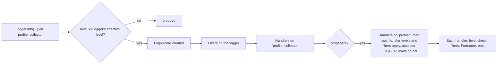

# Python Fundamentals -- Comprehensive Reference

> Last reviewed: 2026-11 · Versions assumed: CPython 3.12-3.15 (examples tested on CPython 3.14; version-specific behavior is called out inline); tooling examples tested with pybind11 3.1, nanobind 3.1, Cython 3.3, cffi 2.1, NumPy 2.5, pytest 9.2, pytest-cov 7.1, Hypothesis 6.170, mypy 2.4, pyright 1.1.414

> A thorough, interview-focused reference covering every important Python topic from language basics to advanced internals. Each section includes key concepts, code examples, comparison tables, common pitfalls, and interview-relevant explanations. Complements the *DSA Fundamentals*, *LeetCode Patterns*, and *CS Fundamentals* guides.

---

## Table of Contents

### Part 1: Language Core

1. [Python Data Model & Object System](#1-python-data-model--object-system)
2. [Built-in Data Types & Structures](#2-built-in-data-types--structures)
3. [Strings & Text Processing](#3-strings--text-processing)
4. [Control Flow & Looping](#4-control-flow--looping)
5. [Functions In Depth](#5-functions-in-depth)
6. [Comprehensions & Generator Expressions](#6-comprehensions--generator-expressions)
7. [Iterators & Generators](#7-iterators--generators)
- [Part 1 Interview Questions](#part-1-interview-questions)

### Part 2: Object-Oriented Python

8. [Classes & OOP Fundamentals](#8-classes--oop-fundamentals)
9. [Inheritance & MRO](#9-inheritance--mro)
10. [Magic (Dunder) Methods](#10-magic-dunder-methods)
11. [Abstract Base Classes & Protocols](#11-abstract-base-classes--protocols)
12. [Descriptors & Metaclasses](#12-descriptors--metaclasses)
- [Part 2 Interview Questions](#part-2-interview-questions)

### Part 3: Intermediate & Advanced

13. [Error Handling & Exceptions](#13-error-handling--exceptions)
14. [Context Managers](#14-context-managers)
15. [Decorators](#15-decorators)
16. [Functional Programming](#16-functional-programming)
17. [Type Hints & Static Typing](#17-type-hints--static-typing)
    - [17.6 Advanced `typing` Constructs](#176-advanced-typing-constructs) · [17.7 Variance](#177-variance-and-the-errors-it-explains) · [17.8 PEP 695 Syntax](#178-pep-695-type-parameter-syntax-312) · [17.9 mypy vs pyright](#179-mypy-vs-pyright-and-checker-configuration)
18. [Modules, Packages & Import System](#18-modules-packages--import-system)
    - [18.8 `pyproject.toml` and Build Backends](#188-pyprojecttoml-pep-517518621-and-build-backends) · [18.9 Wheels, sdists, manylinux](#189-wheels-sdists-and-manylinux) · [18.10 pip, uv, Poetry, Lockfiles](#1810-installers-and-lockfiles-pip-uv-poetry) · [18.11 Editable Installs](#1811-editable-installs) · [18.12 Entry Points and `importlib.metadata`/`resources`](#1812-entry-points-importlibmetadata-and-importlibresources)
- [Part 3 Interview Questions](#part-3-interview-questions)

### Part 4: Concurrency & Performance

19. [The GIL & Threading](#19-the-gil--threading)
20. [Multiprocessing](#20-multiprocessing)
21. [Asyncio & Async/Await](#21-asyncio--asyncawait)
22. [concurrent.futures](#22-concurrentfutures)
23. [Performance & Optimization](#23-performance--optimization)
    - [23.5 Deterministic vs Sampling Profilers](#235-deterministic-vs-sampling-profilers) · [23.6 Reading cProfile/pstats](#236-reading-cprofile-and-pstats-a-worked-example) · [23.7 py-spy, Scalene, `profiling.sampling`](#237-sampling-profilers-py-spy-scalene-profilingsampling) · [23.8 line_profiler, VizTracer, memray, Flame Graphs](#238-line_profiler-viztracer-memray-and-flame-graphs) · [23.9 `timeit` Pitfalls](#239-timeit-and-micro-benchmark-pitfalls)
- [Part 4 Interview Questions](#part-4-interview-questions)

### Part 5: Memory, Internals & Best Practices

24. [Memory Management & Garbage Collection](#24-memory-management--garbage-collection)
    - [24.6 pymalloc and RSS](#246-pymalloc-arenas-pools-blocks-and-why-rss-does-not-shrink) · [24.7 Shallow vs Deep Size, `__slots__`](#247-shallow-vs-deep-size-and-what-__slots__-really-saves) · [24.8 Leak Hunting](#248-leak-hunting-tracemalloc-diffs-gcget_referrers-objgraph) · [24.9 Cycles, `__del__`, `weakref`](#249-cycles-__del__-and-weakref-patterns)
25. [Copy Semantics](#25-copy-semantics)
26. [Python Internals (CPython)](#26-python-internals-cpython)
27. [Common Gotchas & Best Practices](#27-common-gotchas--best-practices)
28. [Testing](#28-testing)
    - [28.5 `conftest.py`](#285-conftestpy-and-fixture-discovery) · [28.6 Built-in Fixtures, Parametrize, Markers](#286-built-in-fixtures-parametrize-markers-a-worked-test-module) · [28.7 Selecting, Skipping, xfail](#287-selecting-skipping-and-expected-failures) · [28.8 Coverage](#288-coverage-with-pytest-cov) · [28.9 Hypothesis](#289-property-based-testing-with-hypothesis)
- [Part 5 Interview Questions](#part-5-interview-questions)

### Part 6: Quick Reference

29. [Built-in Functions Cheat Sheet](#29-built-in-functions-cheat-sheet)
30. [Standard Library Highlights](#30-standard-library-highlights)
- [Part 6 Interview Questions](#part-6-interview-questions)

### Part 7: Native Interop & Debugging

31. [Python and C/C++ Interop](#31-python-and-cc-interop)
32. [Debugging, Logging & Warnings](#32-debugging-logging--warnings)
- [Part 7 Interview Questions](#part-7-interview-questions)

---

# Part 1: Language Core

---

## 1. Python Data Model & Object System

---

### 1.1 Everything Is an Object

In Python, **every value is an object** -- integers, strings, functions, classes, modules, even `None`. Every object has three fundamental properties:

| Property | Accessor | Description |
|---|---|---|
| **Identity** | `id(obj)` | Unique integer (memory address in CPython) that never changes during the object's lifetime |
| **Type** | `type(obj)` | The class of the object; determines what operations it supports |
| **Value** | The object itself | May or may not be changeable (mutable vs immutable) |

```python
x = 42
print(id(x))       # e.g. 140735278617424 (memory address in CPython)
print(type(x))     # <class 'int'>
print(x)           # 42

def greet():
    return "hello"

print(type(greet))  # <class 'function'> -- functions are objects too
print(id(greet))    # functions have identity like any other object
```

### 1.2 Identity vs Equality

| Operator | Tests | Meaning |
|---|---|---|
| `is` | Identity | Are these the **same object** in memory? (`id(a) == id(b)`) |
| `==` | Equality | Do these objects have the **same value**? (calls `__eq__`) |

```python
a = [1, 2, 3]
b = [1, 2, 3]
c = a

a == b   # True  -- same value
a is b   # False -- different objects in memory
a is c   # True  -- c is an alias for the same object

# Common pitfall: use 'is' only for singletons
x = None
if x is None:      # correct -- None is a singleton
    pass
if x == None:      # works but discouraged
    pass
```

### 1.3 Mutability

| Mutable | Immutable |
|---|---|
| `list` | `int` |
| `dict` | `float` |
| `set` | `bool` |
| `bytearray` | `str` |
| User-defined classes (by default) | `tuple` |
| | `frozenset` |
| | `bytes` |
| | `None` |

**Why it matters:**

- Immutable objects can be used as dict keys and set elements (they are *hashable* by default).
- Mutable objects passed to functions can be modified in place (aliasing side effects).
- Immutable objects enable safe sharing between threads without locks.

```python
# Immutable -- "changing" creates a new object
s = "hello"
print(id(s))   # e.g. 140220948305648
s += " world"
print(id(s))   # different id -- new string object created

# Mutable -- modification happens in place
lst = [1, 2, 3]
print(id(lst))  # e.g. 140220947824576
lst.append(4)
print(id(lst))  # same id -- same object modified
```

### 1.4 Variable Binding Model

Python variables are **names** (labels/references) that point to objects, not boxes that contain values. Assignment binds a name to an object; it never copies data.

```
            ┌────────────┐
  x ──────▶ │  [1, 2, 3] │
             └────────────┘
  y ──────▶ same object (after y = x)
```

```python
x = [1, 2, 3]
y = x           # y is a reference to the SAME list
y.append(4)
print(x)        # [1, 2, 3, 4] -- x sees the change

# Reassignment breaks the link
y = [10, 20]    # y now points to a different object
print(x)        # [1, 2, 3, 4] -- x is unaffected
```

### 1.5 Interning and Caching

CPython caches certain immutable objects for performance:

| What is cached | Range / Rule |
|---|---|
| Small integers | -5 to 256 (pre-allocated at interpreter startup) |
| Strings | Single-character strings; identifier-like strings are interned automatically |
| `None`, `True`, `False` | Always singletons |

```python
a = 256
b = 256
a is b    # True -- cached small integer

a = 257
b = 257
a is b    # False (in general) -- outside cache range

a = "hello"
b = "hello"
a is b    # True -- identifier-like strings are interned

a = "hello world"
b = "hello world"
a is b    # False -- spaces prevent automatic interning
```

**Interview tip:** Never rely on interning for correctness. Always use `==` for value comparison and `is` only for singletons (`None`, `True`, `False`).

### 1.6 `None`

`None` is Python's null/nil value. It is a **singleton** -- there is exactly one `None` object.

```python
type(None)    # <class 'NoneType'>
bool(None)    # False -- None is falsy

def f():
    pass
print(f())    # None -- functions without return implicitly return None
```

### 1.7 Truthiness (Boolean Evaluation)

Any object can be evaluated in a boolean context. The rules:

| Evaluates to `False` (falsy) | Evaluates to `True` (truthy) |
|---|---|
| `None` | Everything else |
| `False` | |
| `0`, `0.0`, `0j`, `Decimal(0)`, `Fraction(0)` | |
| `""` (empty string) | |
| `[]`, `()`, `{}`, `set()`, `frozenset()` (empty containers) | |
| Objects with `__bool__()` returning `False` | |
| Objects with `__len__()` returning `0` | |

```python
# Pythonic -- use truthiness directly
if my_list:           # truthy if non-empty
    process(my_list)

# Unpythonic
if len(my_list) > 0:  # unnecessarily verbose
    process(my_list)
```

### 1.8 Type Checking

```python
isinstance(42, int)             # True -- preferred way to check types
isinstance(42, (int, float))    # True -- can check multiple types

type(42) == int                 # True -- exact type match only (ignores inheritance)
type(42) is int                 # True -- same, using identity

# isinstance respects inheritance
class Animal: pass
class Dog(Animal): pass

d = Dog()
isinstance(d, Animal)   # True
type(d) == Animal        # False -- type is Dog, not Animal
```

---

## 2. Built-in Data Types & Structures

---

### 2.1 Numeric Types

| Type | Description | Examples |
|---|---|---|
| `int` | Arbitrary-precision integers | `42`, `-7`, `0xFF`, `0b1010`, `0o17` |
| `float` | IEEE 754 double-precision (64-bit) | `3.14`, `1e-5`, `float('inf')`, `float('nan')` |
| `complex` | Complex numbers | `3+4j`, `complex(3, 4)` |
| `bool` | Subclass of `int`; `True` is `1`, `False` is `0` | `True`, `False` |

```python
# int is arbitrary precision
2 ** 1000       # works fine, produces a very large integer

# Float precision issues
0.1 + 0.2       # 0.30000000000000004
0.1 + 0.2 == 0.3  # False!

# Use decimal for exact arithmetic
from decimal import Decimal
Decimal('0.1') + Decimal('0.2') == Decimal('0.3')  # True

# Integer division vs true division
7 / 2    # 3.5  (true division -- always returns float)
7 // 2   # 3    (floor division -- truncates toward negative infinity)
-7 // 2  # -4   (not -3! floors toward negative infinity)
7 % 2    # 1    (modulo)

# Built-in numeric functions
abs(-5)         # 5
round(3.14159, 2)  # 3.14
divmod(7, 2)    # (3, 1) -- (quotient, remainder)
pow(2, 10)      # 1024
pow(2, 10, 1000)  # 24 -- modular exponentiation (2^10 % 1000)
```

### 2.2 Lists

A **list** is a mutable, ordered, dynamically-sized sequence implemented as a contiguous array of pointers to objects.

| Operation | Time Complexity | Notes |
|---|---|---|
| `lst[i]` | O(1) | Index access |
| `lst[i] = x` | O(1) | Index assignment |
| `lst.append(x)` | O(1) amortized | Add to end |
| `lst.pop()` | O(1) | Remove from end |
| `lst.pop(i)` | O(n) | Remove at index (shifts elements) |
| `lst.insert(i, x)` | O(n) | Insert at index (shifts elements) |
| `lst.remove(x)` | O(n) | Find and remove first occurrence |
| `x in lst` | O(n) | Linear search |
| `lst.sort()` | O(n log n) | Timsort (in-place, stable) |
| `lst.reverse()` | O(n) | In-place reversal |
| `len(lst)` | O(1) | Stored attribute |
| `lst.extend(iterable)` | O(k) | k = length of iterable |
| `lst + lst2` | O(n + m) | Creates new list |
| `lst[a:b]` | O(b - a) | Slice creates a new list (shallow copy) |

```python
# Creation
lst = [1, 2, 3]
lst = list(range(10))     # [0, 1, 2, ..., 9]
lst = [0] * 5             # [0, 0, 0, 0, 0]

# Slicing
lst = [0, 1, 2, 3, 4, 5]
lst[1:4]     # [1, 2, 3]       -- start inclusive, end exclusive
lst[:3]      # [0, 1, 2]       -- from beginning
lst[3:]      # [3, 4, 5]       -- to end
lst[-2:]     # [4, 5]          -- last two
lst[::2]     # [0, 2, 4]       -- every other element
lst[::-1]    # [5, 4, 3, 2, 1, 0]  -- reversed copy

# Useful methods
lst.index(3)          # 3 -- index of first occurrence (raises ValueError if absent)
lst.count(2)          # 1 -- number of occurrences
lst.copy()            # shallow copy (same as lst[:])
lst.clear()           # remove all items

# Sorting
nums = [3, 1, 4, 1, 5]
sorted(nums)          # [1, 1, 3, 4, 5] -- returns new list
nums.sort()           # sorts in-place, returns None
nums.sort(reverse=True)
nums.sort(key=lambda x: -x)  # custom sort key
```

### 2.3 Tuples

A **tuple** is an immutable, ordered sequence. Commonly used for fixed collections, function return values, and as dict keys.

```python
# Creation
t = (1, 2, 3)
t = 1, 2, 3         # parentheses are optional
t = (42,)            # single-element tuple NEEDS trailing comma
t = tuple([1, 2, 3]) # from iterable

# Operations (same as list, except mutation)
t[0]          # 1
t[1:3]        # (2, 3)
len(t)        # 3
3 in t        # True
t + (4, 5)    # (1, 2, 3, 4, 5) -- new tuple
t * 2         # (1, 2, 3, 1, 2, 3)  -- new tuple

# Tuple unpacking
a, b, c = (1, 2, 3)
first, *rest = [1, 2, 3, 4]    # first=1, rest=[2, 3, 4]
first, *mid, last = [1, 2, 3, 4]  # first=1, mid=[2, 3], last=4

# Named tuples for readability
from collections import namedtuple
Point = namedtuple('Point', ['x', 'y'])
p = Point(3, 4)
print(p.x, p.y)    # 3 4
print(p[0])         # 3 -- also supports indexing
```

### List vs Tuple

| Aspect | List | Tuple |
|---|---|---|
| Mutability | Mutable | Immutable |
| Syntax | `[1, 2, 3]` | `(1, 2, 3)` |
| Hashable | No | Yes (if all elements are hashable) |
| Use as dict key | No | Yes |
| Performance | Slightly slower (overhead of mutation support) | Slightly faster, less memory |
| Semantic meaning | Homogeneous collection (variable-length) | Heterogeneous record (fixed-length) |

### 2.4 Dictionaries

A **dict** is a mutable, unordered (insertion-ordered since Python 3.7+) mapping of hashable keys to arbitrary values. Implemented as a hash table.

| Operation | Average | Worst | Notes |
|---|---|---|---|
| `d[key]` | O(1) | O(n) | Lookup; raises `KeyError` if missing |
| `d.get(key, default)` | O(1) | O(n) | Safe lookup with default |
| `d[key] = val` | O(1) | O(n) | Insert / update |
| `del d[key]` | O(1) | O(n) | Delete; raises `KeyError` if missing |
| `key in d` | O(1) | O(n) | Membership test |
| `len(d)` | O(1) | O(1) | Stored attribute |
| `d.keys()` / `d.values()` / `d.items()` | O(1) | O(1) | Returns a *view* (iteration is O(n)) |
| `d.pop(key)` | O(1) | O(n) | Remove and return |
| `d.update(other)` | O(k) | O(k*n) | Merge k items from other |

Worst case O(n) occurs with hash collisions (extremely rare with good hash functions).

```python
# Creation
d = {'a': 1, 'b': 2}
d = dict(a=1, b=2)
d = dict([('a', 1), ('b', 2)])
d = {x: x**2 for x in range(5)}   # {0:0, 1:1, 2:4, 3:9, 4:16}

# Access
d['a']              # 1
d.get('z', 0)       # 0 (default if key missing)

# Iteration
for key in d:                       # iterate over keys
    print(key, d[key])
for key, val in d.items():          # iterate over key-value pairs
    print(key, val)

# Useful methods
d.setdefault('c', 3)   # returns d['c'] if exists; else sets d['c']=3 and returns 3
d.pop('a')              # removes 'a' and returns its value
d.popitem()             # removes and returns last inserted (key, value)
d1 = {**d, 'x': 10}    # merge/unpack into new dict
d1 = d | {'x': 10}     # merge operator (Python 3.9+)
d |= {'x': 10}         # in-place merge (Python 3.9+)
```

### 2.5 Sets

A **set** is a mutable, unordered collection of unique hashable elements. Implemented as a hash table (like a dict with keys only).

| Operation | Average | Notes |
|---|---|---|
| `x in s` | O(1) | Membership test |
| `s.add(x)` | O(1) | Add element |
| `s.remove(x)` | O(1) | Remove element (raises `KeyError` if missing) |
| `s.discard(x)` | O(1) | Remove element (no error if missing) |
| `s \| t` (union) | O(n + m) | New set with elements from both |
| `s & t` (intersection) | O(min(n, m)) | New set with elements in both |
| `s - t` (difference) | O(n) | New set with elements in s but not t |
| `s ^ t` (symmetric difference) | O(n + m) | New set with elements in exactly one |
| `s <= t` (subset) | O(n) | Is s a subset of t? |
| `s >= t` (superset) | O(m) | Is s a superset of t? |

```python
# Creation
s = {1, 2, 3}
s = set([1, 2, 2, 3])      # {1, 2, 3} -- duplicates removed
s = set()                    # empty set (NOT {} which is an empty dict)

# frozenset -- immutable, hashable set
fs = frozenset([1, 2, 3])
d = {fs: "value"}           # can be used as dict key

# Set operations
a = {1, 2, 3, 4}
b = {3, 4, 5, 6}
a | b    # {1, 2, 3, 4, 5, 6}   union
a & b    # {3, 4}                intersection
a - b    # {1, 2}                difference
a ^ b    # {1, 2, 5, 6}          symmetric difference
a <= b   # False                  subset
{3, 4} <= a  # True

# Common use: removing duplicates while preserving order
def dedupe_ordered(lst):
    seen = set()
    result = []
    for x in lst:
        if x not in seen:
            seen.add(x)
            result.append(x)
    return result
```

### 2.6 The `collections` Module

| Class | Description |
|---|---|
| `defaultdict` | Dict with a factory for missing keys |
| `Counter` | Dict subclass for counting hashable objects |
| `OrderedDict` | Dict that remembers insertion order (mostly superseded by regular dict in 3.7+) |
| `deque` | Double-ended queue with O(1) append/pop on both ends |
| `namedtuple` | Tuple subclass with named fields |
| `ChainMap` | Groups multiple dicts into a single mapping |

```python
from collections import defaultdict, Counter, deque, namedtuple, ChainMap

# defaultdict -- no KeyError for missing keys
word_count = defaultdict(int)
for word in "the cat sat on the mat".split():
    word_count[word] += 1
# {'the': 2, 'cat': 1, 'sat': 1, 'on': 1, 'mat': 1}

graph = defaultdict(list)
graph['a'].append('b')   # no need to check if 'a' exists

# Counter
c = Counter("abracadabra")
# Counter({'a': 5, 'b': 2, 'r': 2, 'c': 1, 'd': 1})
c.most_common(2)        # [('a', 5), ('b', 2)]
c['a']                  # 5
c + Counter("aab")      # combine counts
c - Counter("aab")      # subtract counts (drops zero/negative)

# deque -- O(1) operations on both ends
dq = deque([1, 2, 3])
dq.appendleft(0)        # deque([0, 1, 2, 3])
dq.popleft()            # 0
dq.append(4)            # deque([1, 2, 3, 4])
dq.rotate(1)            # deque([4, 1, 2, 3])
dq.rotate(-1)           # deque([1, 2, 3, 4])
# Fixed-size deque (sliding window)
dq = deque(maxlen=3)
dq.extend([1, 2, 3, 4, 5])  # deque([3, 4, 5]) -- oldest dropped

# namedtuple
Point = namedtuple('Point', ['x', 'y'])
p = Point(3, 4)
p.x, p.y               # 3, 4
p._asdict()             # {'x': 3, 'y': 4}
p._replace(x=10)        # Point(x=10, y=4) -- returns new tuple

# ChainMap -- layered lookup
defaults = {'color': 'red', 'size': 10}
user_prefs = {'color': 'blue'}
config = ChainMap(user_prefs, defaults)
config['color']   # 'blue'  (found in user_prefs first)
config['size']    # 10      (falls through to defaults)
```

### 2.7 `heapq` and `bisect`

```python
import heapq

# heapq -- min-heap operations on a regular list
heap = []
heapq.heappush(heap, 5)
heapq.heappush(heap, 1)
heapq.heappush(heap, 3)
heapq.heappop(heap)          # 1 (smallest)
heapq.heappushpop(heap, 2)   # push 2, then pop smallest → 2
heapq.nlargest(2, [5, 1, 8, 3])   # [8, 5]
heapq.nsmallest(2, [5, 1, 8, 3])  # [1, 3]

# Max-heap trick: negate values
max_heap = []
heapq.heappush(max_heap, -5)
heapq.heappush(max_heap, -1)
-heapq.heappop(max_heap)     # 5 (largest)

import bisect

# bisect -- binary search on sorted lists
sorted_list = [1, 3, 5, 7, 9]
bisect.bisect_left(sorted_list, 5)    # 2 (insertion point, left of existing 5)
bisect.bisect_right(sorted_list, 5)   # 3 (insertion point, right of existing 5)
bisect.insort(sorted_list, 4)         # [1, 3, 4, 5, 7, 9] -- insert maintaining order
```

### 2.8 Dict & Set Internals and Hashing

"How does a Python dict work?" is one of the most common Python interview questions. The short answer: **an open-addressing hash table, split into a sparse index array and a dense, insertion-ordered entries array**. The long answer follows.

#### 2.8.1 The Compact Dict Layout (CPython 3.6+)

Before 3.6, a dict was one sparse array of `(hash, key, value)` slots, and about a third of the slots were always empty. Since 3.6 (an implementation detail then; a language guarantee since **3.7**), CPython splits the table in two:

```text
d = {"a": 1, "b": 2, "c": 3}            # table size 8, usable = 8 * 2/3 = 5

dk_indices  (sparse, 8 slots, 1 byte each for small tables; slot positions illustrative)
  slot:   0     1     2     3     4     5     6     7
        [ -1 ,  1  , -1  ,  0  , -1  , -1  ,  2  , -1 ]     -1 = EMPTY, -2 = DUMMY (deleted)
                 |           |                 |
dk_entries  (dense, append-only, in insertion order)
  0: (hash("a"), "a", 1)
  1: (hash("b"), "b", 2)
  2: (hash("c"), "c", 3)
```

- **Lookup:** hash the key, probe `dk_indices` starting at slot `hash & mask`, follow the stored index into `dk_entries`, and compare: identity first (`is`), then the full hash, then `==`.
- **Insertion order for free:** new entries are **appended** to `dk_entries`, and iteration simply walks `dk_entries`. That is why dicts are ordered. The order is a side effect of the layout, not of extra bookkeeping.
- **Memory:** the sparse part holds 1-byte indices (2/4/8 bytes for bigger tables) instead of 24-byte slots. For an 8-slot table that means 8 B of indices + 5 x 24 B of entries = 128 B, against 8 x 24 B = 192 B for the old layout. Since 3.11, dicts whose keys are all `str` use 16-byte entries `(key, value)`: the hash is already cached inside the `str` object, so it is not stored again.
- **Deletion:** the index slot becomes `DUMMY` (a tombstone, so probe chains stay intact). The entry becomes a hole and is **not reused**; holes are compacted away at the next resize. That is why `popitem()` is LIFO and why deleting then re-inserting a key moves it to the end.
- **Key-sharing dicts (PEP 412):** instances of the same class can share one keys table, so each instance stores only its values. This is a big memory win for many small objects, and it breaks if you add attributes in a different order per instance or outside `__init__`.

#### 2.8.2 Open Addressing and Perturbation

CPython does **not** use chaining (linked lists per bucket). On a collision it probes other slots in the same array, using a recurrence that gradually mixes in the **high bits** of the hash:

```python
PERTURB_SHIFT = 5          # same constant as CPython's Objects/dictobject.c

def probe_sequence(h, table_size, n=8):
    """First n index slots CPython's dict probes for hash h (table_size = 2**k)."""
    mask = table_size - 1
    perturb = h & 0xFFFF_FFFF_FFFF_FFFF    # CPython treats the hash as unsigned (size_t)
    i = perturb & mask                     # start at the low bits of the hash
    out = [i]
    for _ in range(n - 1):
        perturb >>= PERTURB_SHIFT          # feed in 5 more high bits per step
        i = (i * 5 + perturb + 1) & mask   # i*5+1 alone visits every slot (full-period LCG)
        out.append(i)
    return out

# hash(int) == int, so these four keys all collide on slot 0 of an 8-slot table ...
for h in (0, 32, 64, 96):
    print(h, probe_sequence(h, 8))
# 0 [0, 1, 6, 7, 4, 5, 2, 3]
# 32 [0, 2, 3, 0, 1, 6, 7, 4]
# 64 [0, 3, 0, 1, 6, 7, 4, 5]
# 96 [0, 4, 5, 2, 3, 0, 1, 6]
# ... but their high bits send them down different probe paths after the first step.
```

Why this design: `i*5 + 1 mod 2**k` alone is a full-period linear congruential sequence, so once `perturb` reaches 0 every slot is eventually visited and the loop must terminate (a free slot always exists). `perturb` makes keys with identical low bits diverge immediately, which matters because Python's integer hash is the identity (`hash(8) == 8`), so sequential keys differ only in their low bits.

#### 2.8.3 Load Factor and Resizing

| Parameter | Dict | Set |
|---|---|---|
| Minimum table size | 8 | 8 |
| Max fill before resize | **2/3** (`USABLE_FRACTION`) | ~**60%** (`fill * 5 >= mask * 3`) |
| New size after resize | smallest power of 2 >= `3 * used` | `4 * used` (or `2 * used` above 50 000 elements), rounded up to a power of 2 |
| Collision strategy | perturbation probing | **9 linear probes** first (cache-friendly), then perturbation |
| Ordered? | Yes (insertion order) | **No** (no separate entries array) |
| Shrinks on delete? | No (only on the next resize/copy) | No |

```python
import sys

d, last = {}, sys.getsizeof({})
for i in range(1, 100):
    d[i] = i
    if sys.getsizeof(d) != last:
        last = sys.getsizeof(d)
        print(f"{i:>3} keys -> {last} bytes")
# CPython 3.14, 64-bit:
#   1 keys -> 224 bytes     (table 8, usable 5)
#   6 keys -> 352 bytes     (table 16, usable 10)
#  11 keys -> 632 bytes     (table 32, usable 21)
#  22 keys -> 1168 bytes    (table 64, usable 42)
#  43 keys -> 2264 bytes
#  86 keys -> 4688 bytes
```

The resize is O(n), but it happens geometrically, so insertion is **amortized O(1)**. The worst case O(n) per lookup in the table in §2.4 requires many keys with colliding hashes, either through bad `__hash__` implementations or deliberate attack (see below).

#### 2.8.4 Hash Functions and Hash Randomization

| Type | `hash(x)` | Randomized per process? |
|---|---|---|
| `int` | `x mod (2**61 - 1)` on 64-bit, sign preserved; `hash(-1) == -2` because `-1` is the C-level error code | No |
| `float` / `Fraction` / `Decimal` | consistent with `int`: `hash(1.0) == hash(1) == hash(True)` | No |
| `str`, `bytes` | SipHash (`siphash13` since 3.11; see `sys.hash_info.algorithm`) keyed by a random seed | **Yes** |
| `tuple` | combines element hashes (xxHash-based mixing since 3.8) | Only via its elements |
| `frozenset` | order-independent combination of element hashes | Only via its elements |
| user class (default) | derived from `id(obj)` | No |

**Hash randomization** (on by default since 3.3) seeds `str`/`bytes` hashing with random bytes at interpreter start. This defeats **hash-flooding DoS attacks**, where an attacker submits many keys known to collide (for example as HTTP form fields) and turns every dict operation into O(n). Consequences:

- `hash("abc")` differs between runs, and so does **set iteration order** of strings. Never persist `hash()` values or rely on set order in tests.
- `PYTHONHASHSEED=0` disables randomization; `PYTHONHASHSEED=<int>` makes it reproducible (useful for debugging flaky tests).
- `multiprocessing` children started with spawn/forkserver get **different** string hashes than the parent. Never use `hash(str)` to shard work across processes; use `hashlib` or `zlib.crc32`.

```bash
for i in 1 2; do python3 -c "print(hash('abc'), list({'a', 'b', 'c', 'd'}))"; done        # differs per run
for i in 1 2; do PYTHONHASHSEED=1 python3 -c "print(hash('abc'), list({'a', 'b', 'c', 'd'}))"; done  # identical
```

#### 2.8.5 The `__hash__` / `__eq__` Contract

Rule: **if `a == b` then `hash(a) == hash(b)`**. The reverse need not hold (collisions are legal). Also, a key's hash must **not change while it is in a dict or set**.

```python
class Point:
    def __init__(self, x, y):
        self.x, self.y = x, y
    def __eq__(self, other):
        return isinstance(other, Point) and (self.x, self.y) == (other.x, other.y)
    # Defining __eq__ without __hash__ sets __hash__ = None -> instances are unhashable

print(Point.__hash__)          # None
try:
    {Point(1, 2)}
except TypeError as e:
    print(e)                   # cannot use 'Point' as a set element (unhashable type: 'Point')

class Key:
    def __init__(self, v):
        self.v = v
    def __eq__(self, other):
        return isinstance(other, Key) and self.v == other.v
    def __hash__(self):
        return hash(self.v)    # hash exactly the fields used by __eq__

k = Key(1)
d = {k: "x"}
k.v = 2                        # MUTATING a key after insertion
print(Key(1) in d, Key(2) in d, k in d, len(d))   # False False False 1 -- the entry is lost

# Equal values collapse to one key; the FIRST key object is kept, the LAST value wins
print({1: "int", 1.0: "float", True: "bool"})     # {1: 'bool'}
```

Practical guidance:

- Hash a **tuple of the same fields** used by `__eq__`: `return hash((self.x, self.y))`.
- Prefer `@dataclass(frozen=True)` (generates a consistent `__eq__` and `__hash__`) or `typing.NamedTuple` for value-type keys.
- `@dataclass(eq=True)` without `frozen=True` sets `__hash__ = None`, which is correct because mutable objects should not be keys.
- Subclasses that override `__eq__` lose the inherited `__hash__` unless they re-declare it (`__hash__ = Base.__hash__`).

> **See also:** [Hash tables in DSA Fundamentals](../computer-science/DSA_Fundamentals.md#5-hash-tables) · [Consistent hashing](../computer-science/CS_Fundamentals.md#58-consistent-hashing) · output-prediction drills in [Python Output Quiz](../practice/Python_Output_Quiz.md)

---

## 3. Strings & Text Processing

---

### 3.1 String Fundamentals

Strings are **immutable** sequences of Unicode code points. Any operation that appears to modify a string actually creates a new one.

```python
s = "Hello, World!"
s[0]          # 'H'
s[-1]         # '!'
s[0:5]        # 'Hello'
len(s)        # 13
'World' in s  # True

# Strings are immutable
s[0] = 'h'   # TypeError: 'str' object does not support item assignment
s = 'h' + s[1:]  # creates new string "hello, World!"
```

### 3.2 String Methods Quick Reference

| Category | Methods |
|---|---|
| **Case** | `upper()`, `lower()`, `title()`, `capitalize()`, `swapcase()`, `casefold()` |
| **Search** | `find(sub)`, `rfind(sub)`, `index(sub)`, `rindex(sub)`, `count(sub)` |
| **Test** | `startswith(p)`, `endswith(s)`, `isalpha()`, `isdigit()`, `isalnum()`, `isspace()`, `isupper()`, `islower()` |
| **Transform** | `strip()`, `lstrip()`, `rstrip()`, `replace(old, new)`, `translate()` |
| **Split/Join** | `split(sep)`, `rsplit(sep)`, `splitlines()`, `join(iterable)`, `partition(sep)` |
| **Align** | `center(w)`, `ljust(w)`, `rjust(w)`, `zfill(w)` |
| **Encode** | `encode(encoding)` |

```python
# split and join
"a,b,c".split(",")         # ['a', 'b', 'c']
",".join(['a', 'b', 'c'])  # 'a,b,c'

# strip
"  hello  ".strip()        # 'hello'
"xxxhelloxxx".strip('x')   # 'hello'

# find vs index
"hello".find("ll")         # 2  (returns -1 if not found)
"hello".index("ll")        # 2  (raises ValueError if not found)

# replace
"hello world".replace("world", "Python")  # 'hello Python'

# partition
"user@example.com".partition("@")   # ('user', '@', 'example.com')
```

### 3.3 String Formatting

Python offers three formatting approaches:

```python
name = "Alice"
age = 30
gpa = 3.856

# f-strings (Python 3.6+) -- preferred
f"Name: {name}, Age: {age}"
f"GPA: {gpa:.2f}"          # 'GPA: 3.86'
f"{'centered':^20}"        # '      centered      '
f"{1_000_000:,}"           # '1,000,000'
f"{255:#x}"                # '0xff'
f"{name!r}"                # "'Alice'" (calls repr)
f"{2 + 3 = }"              # '2 + 3 = 5' (Python 3.8+ debug format)

# .format() method
"Name: {}, Age: {}".format(name, age)
"Name: {name}, Age: {age}".format(name=name, age=age)
"{0:.2f}".format(gpa)

# %-formatting (old style, C-like)
"Name: %s, Age: %d" % (name, age)
"GPA: %.2f" % gpa
```

| Format Spec | Meaning | Example | Output |
|---|---|---|---|
| `:.2f` | 2 decimal places | `f"{3.14159:.2f}"` | `'3.14'` |
| `:,` | Thousands separator | `f"{1000000:,}"` | `'1,000,000'` |
| `:>10` | Right-align, width 10 | `f"{'hi':>10}"` | `'        hi'` |
| `:<10` | Left-align, width 10 | `f"{'hi':<10}"` | `'hi        '` |
| `:^10` | Center, width 10 | `f"{'hi':^10}"` | `'    hi    '` |
| `:010d` | Zero-padded integer | `f"{42:010d}"` | `'0000000042'` |
| `:b` | Binary | `f"{10:b}"` | `'1010'` |
| `:#x` | Hex with prefix | `f"{255:#x}"` | `'0xff'` |

### 3.4 Encoding and Decoding

```python
# str (Unicode text) <--> bytes (raw data)
text = "café"
encoded = text.encode('utf-8')     # b'caf\xc3\xa9'
decoded = encoded.decode('utf-8')  # 'café'

# Byte literals
b = b"hello"          # bytes literal (ASCII only)
type(b)               # <class 'bytes'>
b[0]                  # 104 (integer, not 'h')

# Common encodings
text.encode('ascii')           # UnicodeEncodeError (é not in ASCII)
text.encode('ascii', 'ignore') # b'caf' (drops non-ASCII)
text.encode('ascii', 'replace')# b'caf?' (replaces with ?)
```

### 3.5 Regular Expressions (`re` Module)

```python
import re

# Basic matching
re.search(r'\d+', 'Order 42 shipped')     # <Match '42'>
re.match(r'\d+', 'Order 42')              # None (match checks start only)
re.match(r'\d+', '42 orders')             # <Match '42'>
re.findall(r'\d+', 'a1 b2 c3')            # ['1', '2', '3']
re.sub(r'\d+', 'X', 'a1 b2')             # 'aX bX'

# Groups
m = re.search(r'(\w+)@(\w+\.\w+)', 'user@example.com')
m.group(0)    # 'user@example.com'  (entire match)
m.group(1)    # 'user'
m.group(2)    # 'example.com'

# Named groups
m = re.search(r'(?P<user>\w+)@(?P<domain>\w+\.\w+)', 'user@example.com')
m.group('user')    # 'user'

# Compile for reuse
pattern = re.compile(r'\d{3}-\d{4}')
pattern.findall('Call 555-1234 or 555-5678')  # ['555-1234', '555-5678']
```

| Pattern | Meaning |
|---|---|
| `.` | Any character except newline |
| `\d`, `\D` | Digit / non-digit |
| `\w`, `\W` | Word character `[a-zA-Z0-9_]` / non-word |
| `\s`, `\S` | Whitespace / non-whitespace |
| `^`, `$` | Start / end of string |
| `*`, `+`, `?` | 0+, 1+, 0 or 1 |
| `{n,m}` | Between n and m repetitions |
| `[]` | Character class |
| `()` | Capturing group |
| `(?:...)` | Non-capturing group |
| `\|` | Alternation (or) |
| `(?P<name>...)` | Named group |

### 3.6 Raw Strings

```python
# Regular string -- backslash is an escape character
path = "C:\\Users\\name"     # need double backslash
regex = "\\d+\\.\\d+"       # hard to read

# Raw string -- backslash is literal
path = r"C:\Users\name"     # much cleaner
regex = r"\d+\.\d+"         # standard for regex patterns

# Note: raw strings cannot end with an odd number of backslashes
# r"C:\Users\" is a SyntaxError
```

---

## 4. Control Flow & Looping

---

### 4.1 Conditional Statements

```python
if condition:
    pass
elif other_condition:
    pass
else:
    pass

# Ternary (conditional expression)
result = "even" if x % 2 == 0 else "odd"

# Chained comparisons
if 0 < x < 10:        # equivalent to: 0 < x and x < 10
    pass
if a == b == c:        # all three equal
    pass
```

### 4.2 `for` and `while` Loops

```python
# for loop -- iterates over any iterable
for item in iterable:
    process(item)

# Useful built-ins for looping
for i, val in enumerate(lst):           # index + value
    print(i, val)

for a, b in zip(list1, list2):          # parallel iteration
    print(a, b)

for a, b in zip(list1, list2, strict=True):  # Python 3.10+, raises if lengths differ

for key, val in sorted(d.items()):      # sorted dict iteration

for i in range(start, stop, step):      # numeric range

for item in reversed(lst):              # reverse iteration
```

### 4.3 `else` on Loops

The `else` clause on `for`/`while` executes when the loop completes **without** hitting `break`. Think of it as "no break."

```python
# Practical use: searching
for item in collection:
    if matches(item):
        result = item
        break
else:
    # executed only if loop completed without break
    result = None
    print("Not found")

# Equivalent to:
found = False
for item in collection:
    if matches(item):
        result = item
        found = True
        break
if not found:
    result = None
```

### 4.4 Structural Pattern Matching (`match`/`case`, Python 3.10+)

```python
def http_status(status):
    match status:
        case 200:
            return "OK"
        case 301 | 302:
            return "Redirect"
        case 404:
            return "Not Found"
        case int(x) if x >= 500:
            return f"Server Error ({x})"
        case _:
            return "Unknown"

# Destructuring patterns
match point:
    case (0, 0):
        print("Origin")
    case (x, 0):
        print(f"On x-axis at {x}")
    case (0, y):
        print(f"On y-axis at {y}")
    case (x, y):
        print(f"Point at ({x}, {y})")

# Class patterns
match event:
    case Click(position=(x, y)):
        handle_click(x, y)
    case KeyPress(key_name="q"):
        quit()
```

### 4.5 Walrus Operator (`:=`, Python 3.8+)

The assignment expression `:=` assigns a value to a variable as part of an expression.

```python
# Without walrus
line = input()
while line != "quit":
    process(line)
    line = input()

# With walrus
while (line := input()) != "quit":
    process(line)

# Useful in comprehensions
results = [y for x in data if (y := expensive(x)) > threshold]

# Useful with regex
if m := re.search(pattern, text):
    process(m.group())
```

### 4.6 Short-Circuit Evaluation

```python
# 'and' returns first falsy value or last value
0 and 1         # 0
1 and 2         # 2
1 and 2 and 3   # 3

# 'or' returns first truthy value or last value
0 or 1          # 1
0 or "" or []   # []  (all falsy, returns last)
1 or 2          # 1

# Practical uses
name = user_input or "default"     # default if empty string
result = x and x.method()          # safe attribute access if x might be None/0
```

---

## 5. Functions In Depth

---

### 5.1 Function Basics & First-Class Functions

Functions in Python are **first-class objects**: they can be assigned to variables, passed as arguments, returned from other functions, and stored in data structures.

```python
def greet(name):
    return f"Hello, {name}"

# Assign to variable
say_hi = greet
say_hi("Alice")       # "Hello, Alice"

# Pass as argument
def apply(func, value):
    return func(value)

apply(greet, "Bob")   # "Hello, Bob"
apply(len, [1, 2, 3]) # 3

# Store in data structure
operations = {
    'add': lambda a, b: a + b,
    'mul': lambda a, b: a * b,
}
operations['add'](3, 4)  # 7

# Return from function
def make_multiplier(n):
    def multiplier(x):
        return x * n
    return multiplier

double = make_multiplier(2)
double(5)   # 10
```

### 5.2 Parameters & Arguments

```python
# Positional and keyword arguments
def func(a, b, c):
    pass

func(1, 2, 3)           # all positional
func(1, c=3, b=2)       # mix of positional and keyword
func(a=1, b=2, c=3)     # all keyword

# Default values
def func(a, b=10, c=20):
    return a + b + c

func(1)           # 31
func(1, 2)        # 23
func(1, c=5)      # 16

# *args -- variable positional arguments (collected into a tuple)
def func(*args):
    print(args)    # (1, 2, 3)

func(1, 2, 3)

# **kwargs -- variable keyword arguments (collected into a dict)
def func(**kwargs):
    print(kwargs)  # {'a': 1, 'b': 2}

func(a=1, b=2)

# Combined
def func(a, b, *args, **kwargs):
    pass

# Keyword-only arguments (after *)
def func(a, b, *, key=False, verbose=False):
    pass

func(1, 2, key=True)        # OK
func(1, 2, True)             # TypeError -- key must be keyword

# Positional-only arguments (before /, Python 3.8+)
def func(a, b, /, c, d):
    pass

func(1, 2, 3, d=4)          # OK
func(a=1, b=2, c=3, d=4)    # TypeError -- a and b are positional-only

# Full signature
def func(pos_only, /, normal, *, kw_only):
    pass
```

**Argument passing order: `positional-only / normal *args keyword-only **kwargs`**

### 5.3 Scope Rules (LEGB)

Python resolves names using the LEGB rule, checking each scope in order:

```
┌─────────────────────────────────────────┐
│ Built-in (B)                            │
│  ┌───────────────────────────────────┐  │
│  │ Global / Module (G)               │  │
│  │  ┌─────────────────────────────┐  │  │
│  │  │ Enclosing function (E)      │  │  │
│  │  │  ┌───────────────────────┐  │  │  │
│  │  │  │ Local (L)             │  │  │  │
│  │  │  └───────────────────────┘  │  │  │
│  │  └─────────────────────────────┘  │  │
│  └───────────────────────────────────┘  │
└─────────────────────────────────────────┘
```

| Scope | Description | Example |
|---|---|---|
| **L**ocal | Inside the current function | Function parameters, local variables |
| **E**nclosing | In enclosing functions (closures) | Variables in outer function |
| **G**lobal | Module level | Top-level variables |
| **B**uilt-in | Python built-in names | `len`, `print`, `range` |

```python
x = "global"

def outer():
    x = "enclosing"
    
    def inner():
        x = "local"
        print(x)       # "local"
    
    inner()
    print(x)           # "enclosing"

outer()
print(x)               # "global"

# global and nonlocal keywords
counter = 0

def increment():
    global counter     # refers to module-level counter
    counter += 1

def outer():
    count = 0
    def inner():
        nonlocal count  # refers to enclosing function's count
        count += 1
    inner()
    print(count)        # 1
```

### 5.4 Closures

A **closure** is a function that captures variables from its enclosing scope, retaining access even after the outer function has returned.

```python
def make_counter(start=0):
    count = start
    def counter():
        nonlocal count
        count += 1
        return count
    return counter

c = make_counter()
c()  # 1
c()  # 2
c()  # 3

# Inspecting closure variables
c.__closure__                         # tuple of cell objects
c.__closure__[0].cell_contents        # current value of 'count'
```

### 5.5 Lambda Functions

```python
# Anonymous functions for simple expressions
square = lambda x: x ** 2
add = lambda x, y: x + y

# Common use: sort keys
pairs = [(1, 'b'), (2, 'a'), (3, 'c')]
sorted(pairs, key=lambda p: p[1])   # [(2, 'a'), (1, 'b'), (3, 'c')]

# Limitations: single expression only, no statements, no annotations
```

### 5.6 Mutable Default Arguments (Classic Pitfall)

```python
# BUG: mutable default is shared across all calls
def append_to(element, target=[]):
    target.append(element)
    return target

append_to(1)   # [1]
append_to(2)   # [1, 2] -- NOT [2]! Same list object reused

# FIX: use None sentinel
def append_to(element, target=None):
    if target is None:
        target = []
    target.append(element)
    return target

append_to(1)   # [1]
append_to(2)   # [2] -- fresh list each time
```

**Why this happens:** Default arguments are evaluated **once** when the function is defined, not on each call. Since lists are mutable, the same list object is reused.

---

## 6. Comprehensions & Generator Expressions

---

### 6.1 List Comprehensions

```python
# Basic: [expression for item in iterable]
squares = [x**2 for x in range(10)]

# With filter: [expression for item in iterable if condition]
evens = [x for x in range(20) if x % 2 == 0]

# Nested loops (equivalent to nested for loops, left to right)
pairs = [(x, y) for x in range(3) for y in range(3)]
# same as:
# for x in range(3):
#     for y in range(3):
#         pairs.append((x, y))

# Flatten a 2D list
matrix = [[1, 2, 3], [4, 5, 6], [7, 8, 9]]
flat = [x for row in matrix for x in row]   # [1, 2, 3, 4, 5, 6, 7, 8, 9]

# Nested comprehension (list of lists)
transposed = [[row[i] for row in matrix] for i in range(3)]
```

### 6.2 Dict and Set Comprehensions

```python
# Dict comprehension
squares = {x: x**2 for x in range(5)}
# {0: 0, 1: 1, 2: 4, 3: 9, 4: 16}

# Invert a dict
original = {'a': 1, 'b': 2, 'c': 3}
inverted = {v: k for k, v in original.items()}

# Set comprehension
unique_lengths = {len(word) for word in ["hello", "world", "hi", "hey"]}
# {2, 3, 5}
```

### 6.3 Generator Expressions

A generator expression looks like a list comprehension but uses parentheses instead of brackets. It produces values **lazily**, one at a time, without storing the entire sequence in memory.

```python
# Generator expression (lazy)
gen = (x**2 for x in range(1_000_000))  # no memory allocated for results
sum(gen)   # consumes one element at a time

# List comprehension (eager)
lst = [x**2 for x in range(1_000_000)]  # entire list in memory
sum(lst)

# Generator expression is exhausted after one pass
gen = (x for x in range(5))
list(gen)   # [0, 1, 2, 3, 4]
list(gen)   # [] -- already exhausted

# No extra parentheses needed when sole argument to a function
sum(x**2 for x in range(10))        # OK
max(len(word) for word in words)     # OK
```

| Feature | List Comprehension | Generator Expression |
|---|---|---|
| Syntax | `[expr for ...]` | `(expr for ...)` |
| Returns | `list` | `generator` object |
| Memory | O(n) -- stores all elements | O(1) -- one element at a time |
| Reusable | Yes (list persists) | No (single pass, then exhausted) |
| Speed | Slightly faster for small data | Better for large data / pipelines |

---

## 7. Iterators & Generators

---

### 7.1 The Iterator Protocol

An **iterator** is any object that implements two methods:

| Method | Purpose |
|---|---|
| `__iter__()` | Returns the iterator object itself |
| `__next__()` | Returns the next value; raises `StopIteration` when exhausted |

An **iterable** is any object whose `__iter__()` returns an iterator (or that implements `__getitem__`).

```python
# How a for loop works under the hood
# for item in iterable:
#     process(item)
#
# is equivalent to:
iterator = iter(iterable)        # calls iterable.__iter__()
while True:
    try:
        item = next(iterator)    # calls iterator.__next__()
        process(item)
    except StopIteration:
        break
```

```python
# Custom iterator
class Countdown:
    def __init__(self, start):
        self.current = start
    
    def __iter__(self):
        return self
    
    def __next__(self):
        if self.current <= 0:
            raise StopIteration
        self.current -= 1
        return self.current + 1

list(Countdown(5))   # [5, 4, 3, 2, 1]
```

### 7.2 Generator Functions

A **generator function** uses `yield` to produce a sequence of values lazily. Each call to `next()` resumes execution right after the last `yield`.

```python
def countdown(n):
    while n > 0:
        yield n
        n -= 1

gen = countdown(5)
next(gen)   # 5
next(gen)   # 4
list(gen)   # [3, 2, 1] -- remaining values

# Generator for Fibonacci
def fibonacci():
    a, b = 0, 1
    while True:
        yield a
        a, b = b, a + b

from itertools import islice
list(islice(fibonacci(), 10))   # [0, 1, 1, 2, 3, 5, 8, 13, 21, 34]
```

**Memory comparison:**

```python
# This stores ALL values in memory
def get_squares_list(n):
    return [x**2 for x in range(n)]

# This yields one value at a time -- O(1) memory
def get_squares_gen(n):
    for x in range(n):
        yield x**2

# Processing 10 million numbers:
# get_squares_list(10_000_000)  # ~80 MB of memory
# get_squares_gen(10_000_000)   # ~100 bytes of memory
```

### 7.3 `yield from` (Delegation)

```python
def chain(*iterables):
    for it in iterables:
        yield from it      # delegates to sub-iterator

list(chain([1, 2], [3, 4], [5]))  # [1, 2, 3, 4, 5]

# Recursive tree traversal
def flatten(nested):
    for item in nested:
        if isinstance(item, list):
            yield from flatten(item)
        else:
            yield item

list(flatten([1, [2, [3, 4], 5], 6]))  # [1, 2, 3, 4, 5, 6]
```

### 7.4 Generator Methods: `send()`, `throw()`, `close()`

```python
# send() -- send a value INTO the generator
def accumulator():
    total = 0
    while True:
        value = yield total
        if value is None:
            break
        total += value

gen = accumulator()
next(gen)          # 0 (prime the generator)
gen.send(10)       # 10
gen.send(20)       # 30
gen.send(5)        # 35

# throw() -- raise an exception inside the generator at the paused yield
# (pass an instance; the 3-argument throw(type, value) form is deprecated since 3.12)
try:
    gen.throw(ValueError("invalid"))   # accumulator does not catch it, so it propagates out
except ValueError:
    pass                               # the generator is now finished

# close() -- terminate the generator
gen.close()        # raises GeneratorExit inside the generator (no-op if already finished)
```

### 7.5 The `itertools` Module

| Function | Description | Example |
|---|---|---|
| `chain(*its)` | Concatenate iterables | `chain([1,2], [3,4])` → `1 2 3 4` |
| `chain.from_iterable(it)` | Flatten one level | `chain.from_iterable([[1,2],[3]])` → `1 2 3` |
| `islice(it, stop)` | Slice an iterator | `islice(count(), 5)` → `0 1 2 3 4` |
| `count(start, step)` | Infinite counter | `count(10, 2)` → `10 12 14 ...` |
| `cycle(it)` | Repeat endlessly | `cycle('AB')` → `A B A B ...` |
| `repeat(x, n)` | Repeat x n times | `repeat(0, 3)` → `0 0 0` |
| `product(*its)` | Cartesian product | `product('AB', '12')` → `A1 A2 B1 B2` |
| `permutations(it, r)` | r-length permutations | `permutations('ABC', 2)` → `AB AC BA ...` |
| `combinations(it, r)` | r-length combinations | `combinations('ABC', 2)` → `AB AC BC` |
| `combinations_with_replacement` | With repetition | `cwr('AB', 2)` → `AA AB BB` |
| `groupby(it, key)` | Group consecutive equal items | see below |
| `accumulate(it, func)` | Running accumulation | `accumulate([1,2,3])` → `1 3 6` |
| `zip_longest(*its)` | Zip with fill value | `zip_longest('AB', '1234', fillvalue='-')` |
| `starmap(func, it)` | Apply func to unpacked tuples | `starmap(pow, [(2,3),(3,2)])` → `8 9` |
| `takewhile(pred, it)` | Take while predicate true | `takewhile(lambda x: x<5, [1,3,6,2])` → `1 3` |
| `dropwhile(pred, it)` | Drop while predicate true | `dropwhile(lambda x: x<5, [1,3,6,2])` → `6 2` |
| `filterfalse(pred, it)` | Opposite of filter | `filterfalse(lambda x: x%2, range(6))` → `0 2 4` |
| `tee(it, n)` | Duplicate iterator n times | `a, b = tee(iter([1,2,3]))` |
| `pairwise(it)` | Overlapping pairs (3.10+) | `pairwise('ABCD')` → `AB BC CD` |
| `batched(it, n)` | Groups of n (3.12+) | `batched('ABCDE', 2)` → `AB CD E` |

```python
from itertools import groupby

# groupby requires sorted input for expected grouping
data = sorted([(1, 'a'), (1, 'b'), (2, 'c'), (2, 'd')])
for key, group in groupby(data, key=lambda x: x[0]):
    print(key, list(group))
# 1 [(1, 'a'), (1, 'b')]
# 2 [(2, 'c'), (2, 'd')]
```

### 7.6 Generator Internals: States, Frames, and `send`/`throw`/`close` Semantics

A generator object is a **suspended stack frame plus an instruction pointer**. Calling a generator function runs **none** of its body. It allocates a frame, wraps it in a generator object, and returns. Each `next()`/`send()` resumes the frame until the next `yield` (which suspends it, keeping locals alive) or until `return` (which raises `StopIteration(value)`).

```text
            gen = f()              next()/send()            yield
 GEN_CREATED ─────────▶ (frame ready) ─────────▶ GEN_RUNNING ─────────▶ GEN_SUSPENDED
                                                    │    ▲                   │
                                     return / raise │    └── next()/send()───┘
                                     / close()      ▼        /throw()
                                                GEN_CLOSED   (gi_frame is None)
```

```python
import inspect

def echo():
    received = None
    try:
        while True:
            received = yield received          # suspension point
    except GeneratorExit:
        print("cleanup on close()")
        raise                                   # or just return -- but never yield here
    finally:
        print("finally runs too")

g = echo()
print(inspect.getgeneratorstate(g))   # GEN_CREATED
print(g.gi_frame is not None, g.gi_running)     # True False
try:
    g.send(42)                         # cannot send a non-None value to a fresh generator
except TypeError as e:
    print("TypeError:", e)             # can't send non-None value to a just-started generator
print(next(g))                         # None  ("priming": run to the first yield)
print(inspect.getgeneratorstate(g))   # GEN_SUSPENDED
print(g.send("hi"))                    # hi    (send() = resume AND make `yield` evaluate to "hi")
print(g.gi_frame.f_locals["received"]) # hi    (locals live in the suspended frame)
g.close()                              # prints the two cleanup lines
print(inspect.getgeneratorstate(g))   # GEN_CLOSED
print(g.gi_frame)                      # None -- frame released
```

| Attribute / function | Meaning |
|---|---|
| `inspect.getgeneratorstate(g)` | `GEN_CREATED`, `GEN_RUNNING`, `GEN_SUSPENDED`, `GEN_CLOSED` |
| `g.gi_frame` | The suspended frame (`f_locals`, `f_lineno`); `None` once closed |
| `g.gi_running` | `True` only while executing; re-entering raises `ValueError: generator already executing` |
| `g.gi_yieldfrom` | The sub-iterator currently delegated to via `yield from` (or `None`) |
| `g.gi_code` | The code object (has `CO_GENERATOR` flag set) |
| Coroutine equivalents | `cr_frame`, `cr_running`, `cr_await`, `inspect.getcoroutinestate()` |

**Exact semantics of the generator methods:**

| Method | What happens inside the generator | What the caller gets |
|---|---|---|
| `next(g)` == `g.send(None)` | Resumes; the paused `yield` expression evaluates to `None` | Next yielded value, or `StopIteration` |
| `g.send(v)` | Resumes; the paused `yield` evaluates to `v` | Next yielded value, or `StopIteration(return_value)` |
| `g.throw(exc)` | Raises `exc` **at the paused `yield`**; the generator may catch it | Next yielded value if handled; otherwise `exc` propagates out |
| `g.close()` | Raises `GeneratorExit` at the paused `yield` | `None`; since **3.13** returns the generator's return value if it catches `GeneratorExit` and `return`s. Yielding in response raises `RuntimeError: generator ignored GeneratorExit` |
| Garbage collection | An unfinished generator is `close()`d when collected, so `finally` blocks eventually run (timing is not guaranteed on PyPy, or when the generator sits in a reference cycle) | -- |

```python
# throw(): exception appears AT the paused yield; the generator may handle it
def resilient():
    while True:
        try:
            yield "ok"
        except ValueError as e:
            yield f"handled {e}"        # this becomes the return value of throw()

g = resilient()
next(g)
print(g.throw(ValueError("bad")))      # handled bad
print(next(g))                         # ok
# Note: the 3-argument form g.throw(type, value, tb) is deprecated since 3.12 -- pass an instance.

# close(): yielding after GeneratorExit is an error
def stubborn():
    try:
        yield 1
    except GeneratorExit:
        yield 2                         # illegal

s = stubborn(); next(s)
try:
    s.close()
except RuntimeError as e:
    print("RuntimeError:", e)          # generator ignored GeneratorExit

# close() returns the generator's return value (3.13+; None on older versions)
def summer():
    total = 0
    try:
        while True:
            total += yield
    except GeneratorExit:
        return total

acc = summer(); next(acc)
for x in (1, 2, 3):
    acc.send(x)
print(acc.close())                     # 6

# A return value travels in StopIteration.value; `yield from` captures it
def inner():
    yield 1
    return "inner-done"

def outer():
    result = yield from inner()        # also forwards send()/throw()/close() to inner
    print("outer got:", result)

print(list(outer()))                   # outer got: inner-done, then [1]
```

**PEP 479 (default since 3.7): `StopIteration` inside a generator becomes `RuntimeError`.** Before PEP 479, a stray `StopIteration` (typically from a bare `next()` call) silently ended the generator **and every loop consuming it**, which hid bugs. Now it is converted:

```python
def leaky(it):
    while True:
        yield next(it)                  # next() raises StopIteration at the end of `it`

try:
    print(list(leaky(iter([1, 2]))))
except RuntimeError as e:
    print("RuntimeError:", e)          # generator raised StopIteration

# Fix: catch it and `return`, or use next(it, sentinel), or just `yield from it`.
```

**Generator vs class-based iterator** (both satisfy the iterator protocol):

| | Generator function | Class with `__iter__`/`__next__` |
|---|---|---|
| State lives in | The suspended frame (local variables) | Instance attributes you manage by hand |
| Boilerplate | Minimal | `__iter__`, `__next__`, explicit `StopIteration` |
| Extra protocol | `send`, `throw`, `close`, `yield from` delegation | Only what you implement |
| Reusable / restartable | No (one pass; call the function again) | Make the *iterable* return a fresh iterator from `__iter__` |
| Picklable | **No** (frames cannot be pickled) | Yes, if attributes are picklable |
| Speed | Fast (resumption implemented in C) | `__next__` is a Python method call per item |

**Interview exercises built on generators:**

```python
import functools
from collections import deque
from itertools import islice

def primed(fn):
    """Decorator: advance a new push-style generator to its first yield."""
    @functools.wraps(fn)
    def start(*args, **kwargs):
        g = fn(*args, **kwargs)
        next(g)
        return g
    return start

@primed
def grep(pattern, target):
    try:
        while True:
            line = yield                  # receive a line via send()
            if pattern in line:
                target.send(line)
    finally:
        target.close()                    # propagate shutdown downstream

@primed
def count_into(sink):
    n = 0
    try:
        while True:
            yield
            n += 1
    finally:
        sink.append(n)                    # report when closed

result = []
pipeline = grep("ERROR", count_into(result))
for line in ["ERROR disk", "INFO ok", "ERROR net"]:
    pipeline.send(line)                   # push data in
pipeline.close()
print(result)                             # [2]

# Pull-style lazy combinator: sliding window over ANY iterable (even infinite)
def sliding_window(iterable, n):
    it = iter(iterable)
    window = deque(islice(it, n - 1), maxlen=n)
    for x in it:
        window.append(x)
        yield tuple(window)

print(list(sliding_window(range(6), 3)))  # [(0, 1, 2), (1, 2, 3), (2, 3, 4), (3, 4, 5)]
```

### 7.7 Async Generators and the Async Iteration Protocol

| Sync protocol | Async protocol |
|---|---|
| `__iter__()` returns iterator | `__aiter__()` returns async iterator (a **plain** method, not `async def`) |
| `__next__()` returns value / raises `StopIteration` | `async def __anext__()` returns value / raises **`StopAsyncIteration`** |
| `for x in it` | `async for x in ait` (only inside `async def`) |
| Generator: `def` + `yield` | Async generator: `async def` + `yield` (no `yield from`, no `return value`) |
| `send` / `throw` / `close` | `asend` / `athrow` / `aclose` (all awaitables) |

```python
import asyncio
import contextlib

# 1) Class-based async iterator
class Ticker:
    def __init__(self, n, delay=0.01):
        self.i, self.n, self.delay = 0, n, delay

    def __aiter__(self):
        return self

    async def __anext__(self):
        if self.i >= self.n:
            raise StopAsyncIteration      # NOT StopIteration
        await asyncio.sleep(self.delay)
        self.i += 1
        return self.i

# 2) Async generator: async def + yield
async def ticks(n):
    try:
        for i in range(1, n + 1):
            await asyncio.sleep(0.01)
            yield i
    finally:
        print("ticks: cleanup")           # runs on exhaustion OR aclose()

async def main():
    print([i async for i in Ticker(3)])   # [1, 2, 3]

    # Breaking out of `async for` does NOT finalize the async generator immediately.
    # contextlib.aclosing (3.10+) guarantees aclose() runs deterministically.
    async with contextlib.aclosing(ticks(10)) as agen:
        async for i in agen:
            if i == 2:
                break
    print(type(agen).__name__, hasattr(agen, "asend"))   # async_generator True

asyncio.run(main())
```

Why the explicit `aclose()` matters: an async generator's `finally` may need to `await`, which the garbage collector cannot do synchronously. asyncio installs finalizer hooks (`sys.set_asyncgen_hooks`) that schedule `aclose()` on the loop, and `asyncio.run()` calls `loop.shutdown_asyncgens()` at exit. Code that relies on this runs cleanup **late**, often after the resource it guards (a DB connection, a lock) is already gone. Use `aclosing()`.

> **See also:** [Asyncio internals: coroutines are generators underneath](#21-asyncio--asyncawait) · [Python Output Quiz](../practice/Python_Output_Quiz.md) for generator puzzles

---

## Part 1 Interview Questions

**Q1. What is the difference between `is` and `==`? When must you use `is`?**

`is` compares **identity**: are both names bound to the same object (same `id()`)? It is one pointer comparison and cannot be overridden. `==` compares **value** by calling `a.__eq__(b)` (falling back to the reflected `b.__eq__(a)`, then to identity), and classes can define it however they like. Use `is` only for **singletons**: `None`, `True`/`False` (rarely needed), `Ellipsis`, `NotImplemented`, and sentinel objects you created (`_MISSING = object()`). `x == None` is wrong because a class's `__eq__` can claim equality with `None` (NumPy arrays return an array). Pitfalls: `a = 256; b = 256; a is b` is `True` only because CPython caches small ints in `[-5, 256]`, and `1000 is 1000` may be `True` or `False` depending on constant folding in the same code object. Since 3.8 the compiler emits `SyntaxWarning: "is" with a literal`. Containers check identity **before** equality, so `nan = float('nan'); nan == nan` is `False` but `[nan] == [nan]` and `nan in [nan]` are `True`.

**Q2. How are arguments passed in Python: by value or by reference?**

Neither, in the C++ sense. Python uses **call by sharing** (also called "pass by object reference"): the parameter becomes a **new name bound to the same object**. Mutating that object (`lst.append(1)`) is visible to the caller. **Rebinding** the parameter (`lst = [9]`) only changes the local name and never affects the caller. So `def f(x): x += 1` cannot change an `int` the caller holds (ints are immutable and `+=` rebinds), but `def g(xs): xs += [1]` **does** change the caller's list, because `list.__iadd__` mutates in place and then rebinds the local name to the same object. A C++ analogy: every parameter is a copy of a `shared_ptr<Object>`.

**Q3. Why is `def f(x, acc=[])` a bug, and what is the fix?**

Default values are evaluated **once, when the `def` statement executes**, and stored in `f.__defaults__`. Every call that omits `acc` gets the **same list**, so items accumulate across calls. Fix: use a sentinel, `def f(x, acc=None): if acc is None: acc = []`. The same trap applies to `{}`, `set()`, and `datetime.now()` (a timestamp frozen at import time). It is occasionally used **deliberately** as a cheap memoization cache, but `functools.cache` states that intent explicitly. Linters flag the pattern (pylint `W0102`, ruff `B006`).

**Q4. What does `[f() for f in [lambda: i for i in range(3)]]` return, and why? (closures and scoping)**

`[2, 2, 2]`. Closures capture **variables, not values** (late binding). All three lambdas close over the same cell for `i` (the comprehension's scope), and they look up `i` only when **called**, by which time the loop has finished with `i == 2`. Fixes: bind the current value as a default argument, `lambda i=i: i`, or use `functools.partial`, or create a fresh scope per iteration with a factory function `def make(i): return lambda: i`. CPython implements this with **cell objects**: `f.__closure__[0].cell_contents` and the `LOAD_DEREF` opcode (§26.5). The same bug appears with callbacks registered in loops (GUI handlers, `loop.call_later`).

*Related scoping follow-up:* why does `x = 1; def f(): print(x); x = 2` raise `UnboundLocalError`? Scope is decided at **compile time**: any assignment to `x` anywhere in the function body makes `x` local for the **whole** function (LEGB: Local, Enclosing, Global, Built-in). `print(x)` therefore reads an unassigned local. Fix it with `global x` (module variable) or `nonlocal x` (enclosing function variable), or better, pass and return values explicitly. The same rule explains why `counter += 1` inside a nested function fails without `nonlocal`.

**Q5. How does a Python dict work, and why is it ordered?**

It is an **open-addressing hash table** (no chaining) with two arrays: a sparse `indices` array (1-8 bytes per slot) and a dense `entries` array of `(hash, key, value)` that is appended to in insertion order. A lookup computes `hash(key)`, starts at slot `hash & mask`, and probes with `i = (5*i + perturb + 1) & mask` (where `perturb >>= 5` each step mixes in high hash bits) until it finds a slot whose entry matches by identity or by equal hash plus `==`, or until it finds an empty slot. The table resizes when it is **2/3 full**, to a power of 2 of at least `3 * used`, which gives amortized O(1) insertion. Order is preserved because iteration walks the append-only `entries` array; it is guaranteed by the language since **3.7**. Deletions leave tombstones (`DUMMY`) in `indices`. Sets use the same hashing but a single sparse table with linear probing first, so they are **not** ordered. Details and code are in §2.8.

**Q6. Explain iterable vs iterator vs generator. Why can you loop over a list twice but a generator only once?**

An **iterable** has `__iter__` returning a new iterator (or has the legacy `__getitem__` protocol); examples are `list`, `dict`, `range`, and files. An **iterator** has `__next__` and an `__iter__` that returns **itself**; it is a one-shot cursor. A **generator** is an iterator produced by a function containing `yield`, with its state kept in a suspended frame. `for` calls `iter()` once and then `next()` until `StopIteration`. A list hands out a **fresh** iterator on each `iter()` call, so it can be looped repeatedly; a generator returns itself, so a second loop finds it exhausted and silently yields nothing. Classic bug: `gen = (x for x in data); total = sum(gen); count = len(list(gen))  # 0`. Make a reusable lazy sequence by writing an iterable class whose `__iter__` is a generator function.

**Q7. What are `send()`, `throw()`, and `close()`, and what does PEP 479 change?**

`send(v)` resumes the generator and makes the paused `yield` expression evaluate to `v` (a fresh generator must first be primed with `next()` or `send(None)`). `throw(exc)` raises `exc` at the paused `yield`; if the generator handles it and yields again, `throw()` returns that value. `close()` raises `GeneratorExit` there; the generator must not yield again (`RuntimeError`), and since 3.13 `close()` returns the generator's return value if it catches `GeneratorExit` and returns. A generator's `return x` raises `StopIteration(x)`, which `yield from` unwraps into its expression value. **PEP 479** (default since 3.7) turns a `StopIteration` escaping a generator body into `RuntimeError`, so a stray `next()` on an exhausted iterator no longer silently terminates the generator and all its consumers.

**Q8. Why can a tuple be a dict key but a list cannot? Is every tuple hashable?**

Dict and set lookup requires that a key's hash **never changes** while it is stored, and that `a == b` implies `hash(a) == hash(b)`. Lists are mutable and their equality depends on contents, so `list.__hash__` is `None`. Tuples are immutable, so their hash is computed from their elements. However, `(1, [2])` is **not** hashable: `hash((1, [2]))` raises `TypeError: unhashable type: 'list'`, because hashability is checked recursively. Note that "immutable" is shallow: `t = ([1],); t[0].append(2)` works. For your own classes, defining `__eq__` sets `__hash__ = None` unless you also define `__hash__` (or use `@dataclass(frozen=True)`).

> **Practice:** drill these as output-prediction puzzles in [Python Output Quiz](../practice/Python_Output_Quiz.md).

---

# Part 2: Object-Oriented Python

---

## 8. Classes & OOP Fundamentals

---

### 8.1 Class Definition

```python
class Dog:
    species = "Canis familiaris"     # class variable (shared by all instances)
    
    def __init__(self, name, age):   # initializer (NOT constructor -- __new__ is)
        self.name = name             # instance variable
        self.age = age               # instance variable
    
    def bark(self):                  # instance method
        return f"{self.name} says woof!"
    
    def __repr__(self):
        return f"Dog(name={self.name!r}, age={self.age})"

d = Dog("Rex", 5)
d.bark()           # "Rex says woof!"
d.species          # "Canis familiaris"
Dog.species        # "Canis familiaris"
```

### 8.2 Instance vs Class vs Static Methods

| Decorator | First Argument | Access | Use Case |
|---|---|---|---|
| *(none)* | `self` (instance) | Instance + class attributes | Most methods |
| `@classmethod` | `cls` (class) | Class attributes only | Alternate constructors, class-level logic |
| `@staticmethod` | *(none)* | No implicit access | Utility functions logically related to the class |

```python
class Date:
    def __init__(self, year, month, day):
        self.year = year
        self.month = month
        self.day = day
    
    def __repr__(self):
        return f"Date({self.year}, {self.month}, {self.day})"
    
    @classmethod
    def from_string(cls, date_string):
        """Alternate constructor from 'YYYY-MM-DD' string."""
        year, month, day = map(int, date_string.split('-'))
        return cls(year, month, day)  # cls, not Date -- supports subclassing
    
    @staticmethod
    def is_valid_date(year, month, day):
        """Pure utility -- doesn't need instance or class."""
        return 1 <= month <= 12 and 1 <= day <= 31

d = Date.from_string("2025-03-15")  # classmethod as alternate constructor
Date.is_valid_date(2025, 13, 1)     # False
```

### 8.3 Properties

`@property` turns a method into a managed attribute with getter/setter/deleter.

```python
class Circle:
    def __init__(self, radius):
        self._radius = radius       # convention: _ prefix for "private"
    
    @property
    def radius(self):
        """Getter -- accessed as circle.radius"""
        return self._radius
    
    @radius.setter
    def radius(self, value):
        """Setter -- assigned as circle.radius = 5"""
        if value < 0:
            raise ValueError("Radius cannot be negative")
        self._radius = value
    
    @property
    def area(self):
        """Read-only computed property."""
        import math
        return math.pi * self._radius ** 2

c = Circle(5)
c.radius           # 5       (calls getter)
c.radius = 10      # OK      (calls setter)
c.radius = -1      # ValueError
c.area             # 314.159... (computed, read-only)
c.area = 100       # AttributeError (no setter defined)
```

### 8.4 `__slots__`

By default, Python stores instance attributes in a per-instance `__dict__` (a dictionary). `__slots__` replaces this with a fixed-size struct, saving memory and providing faster attribute access.

```python
class PointDict:
    def __init__(self, x, y):
        self.x = x
        self.y = y

class PointSlots:
    __slots__ = ('x', 'y')
    def __init__(self, x, y):
        self.x = x
        self.y = y

import sys
pd = PointDict(1, 2)
ps = PointSlots(1, 2)
sys.getsizeof(pd.__dict__)   # ~104 bytes (dict overhead)
# PointSlots has no __dict__ at all

ps.z = 3   # AttributeError -- cannot add attributes not in __slots__
```

| Feature | `__dict__` (default) | `__slots__` |
|---|---|---|
| Memory per instance | Higher (dict overhead) | Lower (fixed struct) |
| Attribute access speed | Slightly slower (dict lookup) | Slightly faster (index lookup) |
| Dynamic attributes | Yes -- can add any attribute | No -- fixed set only |
| `__dict__` available | Yes | No (unless you add `'__dict__'` to slots) |
| Inheritance | Always available | Must be declared in each subclass |
| `__weakref__` | Yes | Only if included in `__slots__` |

### 8.5 Class Variables vs Instance Variables

```python
class Student:
    school = "MIT"              # class variable
    all_students = []           # class variable (shared mutable -- careful!)
    
    def __init__(self, name):
        self.name = name        # instance variable
        Student.all_students.append(self)

s1 = Student("Alice")
s2 = Student("Bob")

s1.school            # "MIT" (looked up on class)
Student.school       # "MIT"

s1.school = "Stanford"  # creates INSTANCE variable, shadows class variable
s1.school            # "Stanford" (instance)
s2.school            # "MIT" (still the class variable)
Student.school       # "MIT"
```

### 8.6 Name Mangling

```python
class MyClass:
    def __init__(self):
        self.public = 1          # public
        self._protected = 2      # protected by convention (not enforced)
        self.__private = 3       # name-mangled to _MyClass__private

obj = MyClass()
obj.public              # 1
obj._protected          # 2 (accessible, but convention says don't)
obj.__private           # AttributeError
obj._MyClass__private   # 3 (still accessible if you know the mangled name)
```

Name mangling exists to prevent accidental override in subclasses, not for security.

---

## 9. Inheritance & MRO

---

### 9.1 Single Inheritance

```python
class Animal:
    def __init__(self, name):
        self.name = name
    
    def speak(self):
        raise NotImplementedError

class Dog(Animal):
    def speak(self):
        return f"{self.name} says Woof!"

class Cat(Animal):
    def speak(self):
        return f"{self.name} says Meow!"

d = Dog("Rex")
d.speak()              # "Rex says Woof!"
isinstance(d, Animal)  # True
isinstance(d, Dog)     # True
issubclass(Dog, Animal)  # True
```

### 9.2 Multiple Inheritance and the Diamond Problem

```python
class A:
    def method(self):
        print("A.method")

class B(A):
    def method(self):
        print("B.method")
        super().method()

class C(A):
    def method(self):
        print("C.method")
        super().method()

class D(B, C):
    def method(self):
        print("D.method")
        super().method()
```

```
         A
        / \
       B   C      ← Diamond problem: which path to A?
        \ /
         D
```

### 9.3 Method Resolution Order (C3 Linearization)

Python uses **C3 linearization** to determine the order in which base classes are searched. You can inspect it:

```python
D.__mro__
# (<class 'D'>, <class 'B'>, <class 'C'>, <class 'A'>, <class 'object'>)

D.mro()   # same as above, as a list

d = D()
d.method()
# D.method
# B.method
# C.method
# A.method
# Each class's method is called exactly ONCE, in MRO order
```

**C3 linearization rules:**
1. The class itself comes first.
2. Then its bases, in the order they are listed.
3. A class appears before its parents.
4. If there are multiple parents, the order respects the local precedence (left-to-right listing in the class statement).

### 9.4 `super()` and Cooperative Multiple Inheritance

`super()` doesn't call the "parent" -- it calls the **next class in the MRO**. This enables cooperative multiple inheritance.

```python
class Base:
    def __init__(self, **kwargs):
        pass  # absorb remaining kwargs

class X(Base):
    def __init__(self, x, **kwargs):
        self.x = x
        super().__init__(**kwargs)

class Y(Base):
    def __init__(self, y, **kwargs):
        self.y = y
        super().__init__(**kwargs)

class Z(X, Y):
    def __init__(self, z, **kwargs):
        self.z = z
        super().__init__(**kwargs)

obj = Z(z=1, x=2, y=3)
obj.x, obj.y, obj.z   # 2, 3, 1
```

### 9.5 Mixins

A **mixin** is a class that provides methods to other classes through multiple inheritance but is not intended to stand on its own.

```python
class JsonMixin:
    import json
    def to_json(self):
        return JsonMixin.json.dumps(self.__dict__)
    
    @classmethod
    def from_json(cls, json_str):
        return cls(**JsonMixin.json.loads(json_str))

class LoggableMixin:
    def log(self, message):
        print(f"[{self.__class__.__name__}] {message}")

class User(JsonMixin, LoggableMixin):
    def __init__(self, name, email):
        self.name = name
        self.email = email

u = User("Alice", "alice@example.com")
u.to_json()       # '{"name": "Alice", "email": "alice@example.com"}'
u.log("created")  # [User] created
```

---

## 10. Magic (Dunder) Methods

---

### 10.1 Lifecycle Methods

| Method | When Called |
|---|---|
| `__new__(cls, ...)` | Creates a new instance (before `__init__`). Rarely overridden; used for singletons, immutable types. |
| `__init__(self, ...)` | Initializes the instance (the "constructor" in common usage). |
| `__del__(self)` | Called when the object is garbage collected. Avoid relying on this; use context managers instead. |

```python
class Singleton:
    _instance = None
    
    def __new__(cls, *args, **kwargs):
        if cls._instance is None:
            cls._instance = super().__new__(cls)
        return cls._instance
    
    def __init__(self, value):
        self.value = value

a = Singleton(1)
b = Singleton(2)
a is b        # True -- same instance
a.value       # 2    -- __init__ ran again on the same instance
```

### 10.2 Representation Methods

| Method | Purpose | Called By |
|---|---|---|
| `__repr__(self)` | Unambiguous representation (for developers) | `repr(obj)`, interactive shell, debugger |
| `__str__(self)` | Readable representation (for users) | `str(obj)`, `print(obj)` |
| `__format__(self, spec)` | Custom format spec | `format(obj, spec)`, f-strings |

```python
class Point:
    def __init__(self, x, y):
        self.x = x
        self.y = y
    
    def __repr__(self):
        return f"Point({self.x}, {self.y})"
    
    def __str__(self):
        return f"({self.x}, {self.y})"

p = Point(3, 4)
repr(p)    # "Point(3, 4)"
str(p)     # "(3, 4)"
print(p)   # (3, 4)
f"{p}"     # "(3, 4)"       (uses __str__)
f"{p!r}"   # "Point(3, 4)"  (uses __repr__)
```

**Rule of thumb:** Always implement `__repr__`. If `__str__` is not defined, Python falls back to `__repr__`.

### 10.3 Comparison Methods

| Method | Operator |
|---|---|
| `__eq__(self, other)` | `==` |
| `__ne__(self, other)` | `!=` (defaults to `not __eq__` if not defined) |
| `__lt__(self, other)` | `<` |
| `__le__(self, other)` | `<=` |
| `__gt__(self, other)` | `>` |
| `__ge__(self, other)` | `>=` |

```python
from functools import total_ordering

@total_ordering    # fills in __gt__, __ge__, __ne__ from __eq__ and __lt__
class Temperature:
    def __init__(self, celsius):
        self.celsius = celsius
    
    def __eq__(self, other):
        if not isinstance(other, Temperature):
            return NotImplemented
        return self.celsius == other.celsius
    
    def __lt__(self, other):
        if not isinstance(other, Temperature):
            return NotImplemented
        return self.celsius < other.celsius
    
    def __hash__(self):
        return hash(self.celsius)

t1 = Temperature(100)
t2 = Temperature(50)
t1 > t2   # True (auto-generated by @total_ordering)
```

**Important:** If you define `__eq__`, the default `__hash__` is set to `None` (making instances unhashable). Define `__hash__` explicitly if you need your objects in sets/dicts.

### 10.4 Arithmetic Operator Methods

| Method | Operator | Reflected |
|---|---|---|
| `__add__` | `+` | `__radd__` |
| `__sub__` | `-` | `__rsub__` |
| `__mul__` | `*` | `__rmul__` |
| `__truediv__` | `/` | `__rtruediv__` |
| `__floordiv__` | `//` | `__rfloordiv__` |
| `__mod__` | `%` | `__rmod__` |
| `__pow__` | `**` | `__rpow__` |
| `__matmul__` | `@` | `__rmatmul__` |

In-place variants: `__iadd__`, `__isub__`, etc. (for `+=`, `-=`, etc.)

```python
class Vector:
    def __init__(self, x, y):
        self.x = x
        self.y = y
    
    def __add__(self, other):
        return Vector(self.x + other.x, self.y + other.y)
    
    def __mul__(self, scalar):
        return Vector(self.x * scalar, self.y * scalar)
    
    def __rmul__(self, scalar):
        return self.__mul__(scalar)
    
    def __repr__(self):
        return f"Vector({self.x}, {self.y})"

v = Vector(1, 2) + Vector(3, 4)   # Vector(4, 6)
v = Vector(1, 2) * 3              # Vector(3, 6)
v = 3 * Vector(1, 2)              # Vector(3, 6) -- calls __rmul__
```

### 10.5 Container Protocol

| Method | Enables |
|---|---|
| `__len__(self)` | `len(obj)` |
| `__getitem__(self, key)` | `obj[key]`, iteration, slicing |
| `__setitem__(self, key, val)` | `obj[key] = val` |
| `__delitem__(self, key)` | `del obj[key]` |
| `__contains__(self, item)` | `item in obj` |
| `__iter__(self)` | `for item in obj` |
| `__reversed__(self)` | `reversed(obj)` |

```python
class Deck:
    ranks = [str(n) for n in range(2, 11)] + list('JQKA')
    suits = '♠ ♥ ♦ ♣'.split()
    
    def __init__(self):
        self._cards = [(rank, suit) for suit in self.suits
                                    for rank in self.ranks]
    
    def __len__(self):
        return len(self._cards)
    
    def __getitem__(self, position):
        return self._cards[position]
    
    def __contains__(self, card):
        return card in self._cards

deck = Deck()
len(deck)             # 52
deck[0]               # ('2', '♠')
deck[-1]              # ('A', '♣')
deck[::13]            # every 13th card
('A', '♠') in deck    # True

for card in deck:     # iteration works via __getitem__
    pass
```

### 10.6 Callable Objects

```python
class Adder:
    def __init__(self, n):
        self.n = n
    
    def __call__(self, x):
        return self.n + x

add5 = Adder(5)
add5(10)        # 15
callable(add5)  # True
```

### 10.7 Attribute Access Methods

| Method | When Called |
|---|---|
| `__getattr__(self, name)` | When normal attribute lookup fails (fallback) |
| `__getattribute__(self, name)` | On **every** attribute access (use with extreme caution) |
| `__setattr__(self, name, value)` | On every `obj.name = value` |
| `__delattr__(self, name)` | On every `del obj.name` |

```python
class DynamicAttributes:
    def __init__(self, **kwargs):
        for k, v in kwargs.items():
            setattr(self, k, v)
    
    def __getattr__(self, name):
        return f"'{name}' not found"

obj = DynamicAttributes(x=1, y=2)
obj.x     # 1 (found in __dict__, __getattr__ not called)
obj.z     # "'z' not found" (__getattr__ called as fallback)
```

---

## 11. Abstract Base Classes & Protocols

---

### 11.1 Abstract Base Classes (`abc` Module)

An ABC defines an interface that subclasses **must** implement.

```python
from abc import ABC, abstractmethod

class Shape(ABC):
    @abstractmethod
    def area(self) -> float:
        pass
    
    @abstractmethod
    def perimeter(self) -> float:
        pass
    
    def describe(self):
        return f"Area: {self.area():.2f}, Perimeter: {self.perimeter():.2f}"

# Cannot instantiate an ABC
# shape = Shape()   # TypeError: Can't instantiate abstract class

class Circle(Shape):
    def __init__(self, radius):
        self.radius = radius
    
    def area(self):
        import math
        return math.pi * self.radius ** 2
    
    def perimeter(self):
        import math
        return 2 * math.pi * self.radius

c = Circle(5)
c.describe()  # "Area: 78.54, Perimeter: 31.42"
```

### 11.2 Virtual Subclasses

You can register a class as a "virtual subclass" of an ABC without actual inheritance:

```python
from abc import ABC, abstractmethod

class Drawable(ABC):
    @abstractmethod
    def draw(self):
        pass

class ThirdPartyWidget:
    def draw(self):
        print("Drawing widget")

Drawable.register(ThirdPartyWidget)

isinstance(ThirdPartyWidget(), Drawable)   # True
issubclass(ThirdPartyWidget, Drawable)     # True
```

### 11.3 Structural Subtyping with `Protocol` (Python 3.8+)

`Protocol` defines structural (duck) typing -- a class matches if it has the right methods, no inheritance required.

```python
from typing import Protocol, runtime_checkable

@runtime_checkable
class Renderable(Protocol):
    def render(self) -> str: ...

class HtmlPage:
    def render(self) -> str:
        return "<html>...</html>"

class JsonResponse:
    def render(self) -> str:
        return '{"key": "value"}'

def display(obj: Renderable):
    print(obj.render())

display(HtmlPage())      # works -- HtmlPage has render()
display(JsonResponse())  # works -- JsonResponse has render()

isinstance(HtmlPage(), Renderable)  # True (thanks to @runtime_checkable)
```

| Feature | ABC | Protocol |
|---|---|---|
| Subtyping style | Nominal (explicit inheritance or `register`) | Structural (duck typing) |
| Requires inheritance | Yes (or registration) | No |
| Runtime `isinstance` | Always | Only with `@runtime_checkable` |
| Static type checking | Yes | Yes (with mypy/pyright) |
| Best for | Framework APIs, enforced interfaces | Lightweight interfaces, third-party compatibility |

---

## 12. Descriptors & Metaclasses

---

### 12.1 The Descriptor Protocol

A descriptor is any object that defines `__get__`, `__set__`, or `__delete__`. Descriptors power `property`, `classmethod`, `staticmethod`, and bound methods.

| Method | Called When |
|---|---|
| `__get__(self, obj, objtype=None)` | Attribute accessed on an instance or class |
| `__set__(self, obj, value)` | Attribute set on an instance |
| `__delete__(self, obj)` | Attribute deleted on an instance |

| Type | Has | Precedence |
|---|---|---|
| **Data descriptor** | `__get__` + `__set__` (or `__delete__`) | Overrides instance `__dict__` |
| **Non-data descriptor** | `__get__` only | Instance `__dict__` takes precedence |

```python
# Attribute lookup order:
# 1. Data descriptors on the class (and its MRO)
# 2. Instance __dict__
# 3. Non-data descriptors / class __dict__
```

```python
class Validated:
    """A data descriptor that validates on set."""
    def __init__(self, min_val=None, max_val=None):
        self.min_val = min_val
        self.max_val = max_val
    
    def __set_name__(self, owner, name):
        self.name = name            # called automatically when class is created
    
    def __get__(self, obj, objtype=None):
        if obj is None:
            return self             # accessed on the class itself
        return obj.__dict__.get(self.name)
    
    def __set__(self, obj, value):
        if self.min_val is not None and value < self.min_val:
            raise ValueError(f"{self.name} must be >= {self.min_val}")
        if self.max_val is not None and value > self.max_val:
            raise ValueError(f"{self.name} must be <= {self.max_val}")
        obj.__dict__[self.name] = value

class Student:
    grade = Validated(min_val=0, max_val=100)
    age = Validated(min_val=0, max_val=150)
    
    def __init__(self, name, grade, age):
        self.name = name
        self.grade = grade   # triggers Validated.__set__
        self.age = age

s = Student("Alice", 95, 20)
s.grade           # 95 (triggers Validated.__get__)
s.grade = 105     # ValueError: grade must be <= 100
```

### 12.2 How `property` Works Under the Hood

`property` is simply a data descriptor:

```python
# This:
class C:
    @property
    def x(self):
        return self._x

# Is equivalent to:
class C:
    def get_x(self):
        return self._x
    x = property(get_x)

# property is roughly:
class property:
    def __init__(self, fget=None, fset=None, fdel=None):
        self.fget = fget
        self.fset = fset
        self.fdel = fdel
    
    def __get__(self, obj, objtype=None):
        if obj is None:
            return self
        return self.fget(obj)
    
    def __set__(self, obj, value):
        if self.fset is None:
            raise AttributeError("can't set attribute")
        self.fset(obj, value)
```

### 12.3 Metaclasses

A **metaclass** is the "class of a class." Just as an object is an instance of a class, a class is an instance of its metaclass. The default metaclass is `type`.

```
┌─────────┐  is instance of  ┌──────────┐  is instance of  ┌──────┐
│ my_obj  │ ───────────────▶ │ MyClass  │ ───────────────▶ │ type │
└─────────┘                  └──────────┘                  └──────┘
  (object)                     (class)                    (metaclass)
```

```python
# type is the metaclass of all classes
type(int)        # <class 'type'>
type(str)        # <class 'type'>
type(type)       # <class 'type'>  -- type is its own metaclass

# Creating a class dynamically with type
Dog = type('Dog', (object,), {
    'species': 'canine',
    'bark': lambda self: 'Woof!'
})
d = Dog()
d.bark()   # 'Woof!'
```

```python
# Custom metaclass
class Meta(type):
    def __new__(mcs, name, bases, namespace):
        # Runs when a class using this metaclass is DEFINED
        cls = super().__new__(mcs, name, bases, namespace)
        cls.created_by = "Meta"
        return cls

class MyClass(metaclass=Meta):
    pass

MyClass.created_by   # "Meta"
```

### 12.4 `__init_subclass__` (Simpler Alternative, Python 3.6+)

For most use cases, `__init_subclass__` is preferred over metaclasses:

```python
class Plugin:
    _registry = {}
    
    def __init_subclass__(cls, **kwargs):
        super().__init_subclass__(**kwargs)
        Plugin._registry[cls.__name__] = cls

class AudioPlugin(Plugin):
    pass

class VideoPlugin(Plugin):
    pass

Plugin._registry
# {'AudioPlugin': <class 'AudioPlugin'>, 'VideoPlugin': <class 'VideoPlugin'>}
```

---

## Part 2 Interview Questions

**Q1. What is the MRO, and how does C3 linearization compute it? Walk through the diamond.**

The Method Resolution Order is the list of classes searched for an attribute, available as `Cls.__mro__`. C3 builds it as `L[C] = C + merge(L[B1], ..., L[Bn], [B1, ..., Bn])`. `merge` repeatedly takes the first **head** of a list that does not appear in the **tail** (any position after the first) of any other list, removes it everywhere, and repeats. For `class D(B, C)` with `B(A)`, `C(A)`:

```text
L[A] = [A, object]
L[B] = [B, A, object]          L[C] = [C, A, object]
L[D] = D + merge([B, A, object], [C, A, object], [B, C])
     -> take B  (B is in no tail)          merge([A, object], [C, A, object], [C])
     -> skip A  (A is in the tail of [C, A, object]); take C
     -> take A, then object
     =  [D, B, C, A, object]
```

C3 guarantees three properties: (1) a class precedes its bases; (2) the **local order** of bases (`B` before `C`) is preserved; (3) **monotonicity**, meaning a class's MRO is a subsequence of every subclass's MRO. If those constraints conflict, class creation fails. `class X(A, B)`, `class Y(B, A)`, then `class Z(X, Y)` raises `TypeError: Cannot create a consistent method resolution order (MRO) for bases A, B`.

**Q2. What does `super()` actually do? Why is it not "call my parent"?**

`super()` (shorthand for `super(CurrentClass, self)`) returns a proxy that looks up attributes in `type(self).__mro__` **starting after `CurrentClass`**. The next class depends on the **runtime type of `self`**, not on where the method was written. In the diamond above, `B.method`'s `super().method()` calls `C.method` (B's sibling, not its parent A) when `self` is a `D`. This is what makes **cooperative multiple inheritance** work: every class calls `super().__init__(**kwargs)` exactly once, so each `__init__` in the MRO runs once (`D, B, C, A`). Requirements for that to work: every class in the hierarchy must call `super()`, method signatures must be compatible (use `**kwargs` and pop what you consume), and a root class must stop the chain. Zero-argument `super()` relies on the compiler-created `__class__` cell, so it does not work in functions that are defined outside the class body and attached later.

**Q3. What is a descriptor? Explain data vs non-data descriptors and how a plain function becomes a bound method.**

A descriptor is an object stored as a **class attribute** that defines `__get__` and optionally `__set__`/`__delete__`. `obj.attr` is handled by `object.__getattribute__`, which looks for `attr` in `type(obj).__mro__`. (1) If it finds a **data descriptor** (one with `__set__` or `__delete__`), it calls `desc.__get__(obj, type(obj))`. (2) Otherwise, if `attr` is in `obj.__dict__`, it returns that value. (3) Otherwise, if it found a **non-data descriptor** (only `__get__`), it calls `__get__`; a plain class attribute is returned as-is. (4) Otherwise it calls `__getattr__` if one is defined, else raises `AttributeError`. **Functions are non-data descriptors**: `function.__get__(obj, cls)` returns a bound method that has `self` pre-filled, which is the entire mechanism behind methods. That is also why `obj.method = something` shadows the method (the instance dict wins over a non-data descriptor), while you **cannot** shadow a `property` by writing to `obj.__dict__` (data descriptors win). `property`, `classmethod`, `staticmethod`, `functools.cached_property` (non-data, so it caches its result in the instance dict, where later lookups find it), `__slots__` members, and ORM fields are all descriptors. `__set_name__` (3.6+) tells a descriptor which attribute name it was assigned to.

**Q4. `__new__` vs `__init__`: when do you override `__new__`?**

`__new__(cls, ...)` is a static method that **creates and returns** the instance; `__init__(self, ...)` **initializes** an already-created instance and must return `None`. `type.__call__` runs `__new__`, and then runs `__init__` **only if** the returned object is an instance of `cls`. Override `__new__` to: (1) subclass **immutable** types (`int`, `str`, `tuple`), whose value must be fixed at creation (`class Celsius(float): def __new__(cls, v): return super().__new__(cls, round(v, 2))`); (2) implement singletons, interning, or instance caches (return an existing object); (3) return a different type, as factories do. Pitfall: if `__new__` returns a cached instance, `__init__` still runs again on every construction call.

**Q5. What do `__slots__` do, and what are the tradeoffs?**

`__slots__ = ('x', 'y')` replaces the per-instance `__dict__` with fixed offsets in the object struct, implemented as member descriptors on the class. Benefits: much less memory per instance (no dict; often 40-60% savings for small objects), slightly faster attribute access, and typos such as `p.z = 1` raise `AttributeError`. Costs: no dynamic attributes; no `__weakref__` unless you list it; every class in the hierarchy must declare `__slots__` or a `__dict__` comes back; multiple inheritance from two classes with non-empty slots fails with a layout conflict; class-level defaults with the same name conflict with slots. Use it for classes with millions of instances (tree nodes, events, records). `@dataclass(slots=True)` (3.10+) generates them for you.

**Q6. Metaclass vs class decorator vs `__init_subclass__`: which do you reach for?**

All three run code when a class is defined. In order of preference: (1) **`__init_subclass__`** (3.6+), a hook on the base class that runs for every subclass; good for registries, validation, and enforcing that subclasses define something. (2) A **class decorator**, which transforms one class explicitly and is not inherited; `@dataclass` and `@functools.total_ordering` work this way. (3) A **metaclass** (subclass of `type`), needed only when you must control class **creation itself**. Examples: customizing the namespace via `__prepare__` (an ordered or validating dict), changing `isinstance` behavior (`ABCMeta.__instancecheck__`), or adding behavior to the class object such as `__getitem__` on the class (Enum's `Color['RED']`). Metaclasses compose badly: a class whose bases have unrelated metaclasses raises a metaclass conflict error.

**Q7. ABC vs `Protocol`: nominal vs structural typing.**

An `abc.ABC` with `@abstractmethod` is **nominal**: a class must inherit from it (or be `register()`ed), and instantiation fails at **runtime** with `TypeError` if abstract methods are missing. A `typing.Protocol` is **structural** (static duck typing): any class with matching methods satisfies it **for the type checker**, with no inheritance needed. That makes it ideal for describing third-party types you cannot modify. `@runtime_checkable` enables `isinstance` checks, but those only check that the method **names exist**, not their signatures, and they are slow. Choose an ABC when you own the hierarchy and want runtime enforcement plus shared mixin implementations; choose a Protocol for interfaces at module boundaries and for callbacks.

**Q8. `@staticmethod` vs `@classmethod` vs instance method.**

An instance method receives `self` through the function descriptor. A `classmethod` receives `cls`, which is the **actual subclass** it was called on. That makes it right for **alternate constructors** (`Date.from_string`, `dict.fromkeys`), because `cls(...)` builds the subclass correctly. A `staticmethod` receives nothing and is just a function namespaced in the class (a helper that is logically related but uses no state). Pitfall: using `@staticmethod` for a factory that hardcodes the class name breaks subclassing. Use `@classmethod` instead.

---

# Part 3: Intermediate & Advanced

---

## 13. Error Handling & Exceptions

---

### 13.1 Exception Hierarchy (Simplified)

```
BaseException
├── SystemExit
├── KeyboardInterrupt
├── GeneratorExit
└── Exception
    ├── StopIteration
    ├── ArithmeticError
    │   ├── ZeroDivisionError
    │   ├── OverflowError
    │   └── FloatingPointError
    ├── AttributeError
    ├── EOFError
    ├── ImportError
    │   └── ModuleNotFoundError
    ├── LookupError
    │   ├── IndexError
    │   └── KeyError
    ├── NameError
    │   └── UnboundLocalError
    ├── OSError
    │   ├── FileNotFoundError
    │   ├── PermissionError
    │   └── FileExistsError
    ├── RuntimeError
    │   └── RecursionError
    ├── TypeError
    ├── ValueError
    │   └── UnicodeError
    └── Warning
```

**Key point:** `except Exception` catches nearly everything except `SystemExit`, `KeyboardInterrupt`, and `GeneratorExit` -- which is usually what you want.

### 13.2 `try` / `except` / `else` / `finally`

```python
try:
    result = risky_operation()
except ValueError as e:
    # Runs if ValueError is raised
    print(f"Value error: {e}")
except (TypeError, KeyError) as e:
    # Can catch multiple types
    print(f"Error: {e}")
except Exception as e:
    # Catch-all for remaining exceptions (avoid bare except)
    print(f"Unexpected: {e}")
    raise    # re-raise to preserve the traceback
else:
    # Runs ONLY if no exception was raised in try
    process(result)
finally:
    # ALWAYS runs (cleanup), even if exception or return
    cleanup()
```

**Execution flow:**

```
try block succeeds:    try → else → finally
try block fails:       try → except → finally
return in try:         try → finally → return
exception in except:   try → except → finally → propagate
```

### 13.3 Custom Exceptions

```python
class AppError(Exception):
    """Base exception for the application."""
    pass

class ValidationError(AppError):
    def __init__(self, field, message):
        self.field = field
        self.message = message
        super().__init__(f"{field}: {message}")

class NotFoundError(AppError):
    pass

# Usage
try:
    raise ValidationError("email", "invalid format")
except ValidationError as e:
    print(e.field, e.message)   # email invalid format
```

### 13.4 Exception Chaining

```python
try:
    int("not_a_number")
except ValueError as e:
    raise RuntimeError("Failed to parse config") from e
# RuntimeError: Failed to parse config
#   caused by: ValueError: invalid literal for int()

# Suppress the chain
raise RuntimeError("clean message") from None
```

### 13.5 LBYL vs EAFP

| Style | Meaning | Approach |
|---|---|---|
| **LBYL** | Look Before You Leap | Check conditions before acting |
| **EAFP** | Easier to Ask Forgiveness than Permission | Try it and handle the exception |

```python
# LBYL (common in C/Java)
if key in dictionary:
    value = dictionary[key]
else:
    value = default

# EAFP (Pythonic)
try:
    value = dictionary[key]
except KeyError:
    value = default

# Even more Pythonic:
value = dictionary.get(key, default)
```

Python favors EAFP because:
- It avoids race conditions (check-then-act is not atomic).
- It's often faster when the common case is success.
- It follows Python's duck typing philosophy.

### 13.6 `ExceptionGroup` (Python 3.11+)

```python
# Group multiple exceptions together
eg = ExceptionGroup("multiple errors", [
    ValueError("bad value"),
    TypeError("wrong type"),
    KeyError("missing key"),
])

try:
    raise eg
except* ValueError as e:
    print(f"Value errors: {e.exceptions}")
except* TypeError as e:
    print(f"Type errors: {e.exceptions}")
# except* uses the new syntax for handling exception groups
```

---

## 14. Context Managers

---

### 14.1 The `with` Statement

A context manager guarantees that setup and teardown code runs, even if an exception occurs. The most common use is file handling.

```python
# Without context manager -- must manually close
f = open('file.txt')
try:
    data = f.read()
finally:
    f.close()

# With context manager -- close is automatic
with open('file.txt') as f:
    data = f.read()
# f.close() called automatically, even if an exception occurred
```

### 14.2 Writing a Context Manager (Class-Based)

Implement `__enter__` and `__exit__`:

```python
class Timer:
    import time as _time
    
    def __enter__(self):
        self.start = Timer._time.perf_counter()
        return self
    
    def __exit__(self, exc_type, exc_val, exc_tb):
        self.elapsed = Timer._time.perf_counter() - self.start
        print(f"Elapsed: {self.elapsed:.4f}s")
        return False  # do not suppress exceptions

with Timer() as t:
    sum(range(1_000_000))
# Elapsed: 0.0234s
```

`__exit__` receives exception info. If it returns `True`, the exception is suppressed.

```python
class Suppress:
    def __init__(self, *exceptions):
        self.exceptions = exceptions
    
    def __enter__(self):
        return self
    
    def __exit__(self, exc_type, exc_val, exc_tb):
        return exc_type is not None and issubclass(exc_type, self.exceptions)

with Suppress(FileNotFoundError):
    open('nonexistent.txt')
# No error raised
```

### 14.3 Writing a Context Manager (Generator-Based)

```python
from contextlib import contextmanager

@contextmanager
def timer():
    import time
    start = time.perf_counter()
    try:
        yield    # code inside 'with' block runs here
    finally:
        elapsed = time.perf_counter() - start
        print(f"Elapsed: {elapsed:.4f}s")

with timer():
    sum(range(1_000_000))

# With a yielded value
@contextmanager
def temp_directory():
    import tempfile, shutil
    path = tempfile.mkdtemp()
    try:
        yield path
    finally:
        shutil.rmtree(path)

with temp_directory() as tmpdir:
    print(tmpdir)  # /tmp/tmpXXXXXX
# directory deleted after with block
```

### 14.4 `contextlib` Utilities

| Utility | Purpose |
|---|---|
| `@contextmanager` | Create context manager from a generator function |
| `suppress(*exceptions)` | Suppress specified exceptions |
| `redirect_stdout(target)` | Redirect `sys.stdout` to target |
| `redirect_stderr(target)` | Redirect `sys.stderr` to target |
| `ExitStack` | Manage a dynamic number of context managers |
| `closing(thing)` | Call `thing.close()` on exit |
| `nullcontext(value)` | No-op context manager (returns value) |

```python
from contextlib import ExitStack

# Managing a dynamic number of files
filenames = ['a.txt', 'b.txt', 'c.txt']
with ExitStack() as stack:
    files = [stack.enter_context(open(fn)) for fn in filenames]
    # all files are open here
# all files closed here, even if one raised an exception
```

---

## 15. Decorators

---

### 15.1 Function Decorators

A decorator is a function that takes a function and returns a modified function.

```python
def my_decorator(func):
    def wrapper(*args, **kwargs):
        print("Before")
        result = func(*args, **kwargs)
        print("After")
        return result
    return wrapper

@my_decorator
def say_hello(name):
    print(f"Hello, {name}!")

say_hello("Alice")
# Before
# Hello, Alice!
# After

# @ syntax is syntactic sugar for:
# say_hello = my_decorator(say_hello)
```

### 15.2 Preserving Metadata with `@wraps`

Without `@wraps`, the decorated function loses its name, docstring, etc.

```python
from functools import wraps

def my_decorator(func):
    @wraps(func)    # preserves func.__name__, __doc__, __module__, etc.
    def wrapper(*args, **kwargs):
        return func(*args, **kwargs)
    return wrapper

@my_decorator
def my_function():
    """My docstring."""
    pass

my_function.__name__   # 'my_function'  (without @wraps: 'wrapper')
my_function.__doc__    # 'My docstring.' (without @wraps: None)
```

### 15.3 Decorators with Arguments

```python
def repeat(n):
    def decorator(func):
        @wraps(func)
        def wrapper(*args, **kwargs):
            for _ in range(n):
                result = func(*args, **kwargs)
            return result
        return wrapper
    return decorator

@repeat(3)        # repeat(3) returns the actual decorator
def greet(name):
    print(f"Hello, {name}!")

greet("Alice")
# Hello, Alice!
# Hello, Alice!
# Hello, Alice!
```

### 15.4 Class Decorators

```python
# Decorator that adds methods to a class
def add_repr(cls):
    def __repr__(self):
        attrs = ', '.join(f'{k}={v!r}' for k, v in self.__dict__.items())
        return f'{cls.__name__}({attrs})'
    cls.__repr__ = __repr__
    return cls

@add_repr
class Point:
    def __init__(self, x, y):
        self.x = x
        self.y = y

repr(Point(3, 4))   # "Point(x=3, y=4)"
```

### 15.5 Stacking Decorators

Decorators are applied bottom-up (innermost first):

```python
@decorator_a
@decorator_b
@decorator_c
def func():
    pass

# Equivalent to: func = decorator_a(decorator_b(decorator_c(func)))
```

### 15.6 Common Standard Library Decorators

| Decorator | Module | Purpose |
|---|---|---|
| `@property` | built-in | Managed attribute (getter/setter/deleter) |
| `@staticmethod` | built-in | Method that doesn't receive `self` or `cls` |
| `@classmethod` | built-in | Method that receives `cls` as first argument |
| `@functools.wraps` | `functools` | Preserve wrapped function metadata |
| `@functools.lru_cache` | `functools` | Memoization with LRU eviction |
| `@functools.cache` | `functools` | Unbounded memoization (Python 3.9+) |
| `@functools.singledispatch` | `functools` | Single-dispatch generic function |
| `@functools.total_ordering` | `functools` | Fill in comparison methods |
| `@dataclasses.dataclass` | `dataclasses` | Auto-generate `__init__`, `__repr__`, `__eq__`, etc. |
| `@abc.abstractmethod` | `abc` | Mark method as abstract |
| `@contextlib.contextmanager` | `contextlib` | Create context manager from generator |
| `@typing.overload` | `typing` | Declare function overloads for type checkers |

```python
import functools

@functools.lru_cache(maxsize=128)
def fibonacci(n):
    if n < 2:
        return n
    return fibonacci(n - 1) + fibonacci(n - 2)

fibonacci(100)   # instant (memoized)
fibonacci.cache_info()
# CacheInfo(hits=98, misses=101, maxsize=128, currsize=101)
fibonacci.cache_clear()
```

### 15.7 Practical Decorator Examples

```python
# Timing decorator
import time
from functools import wraps

def timing(func):
    @wraps(func)
    def wrapper(*args, **kwargs):
        start = time.perf_counter()
        result = func(*args, **kwargs)
        elapsed = time.perf_counter() - start
        print(f"{func.__name__} took {elapsed:.4f}s")
        return result
    return wrapper

# Retry decorator
def retry(max_attempts=3, delay=1):
    def decorator(func):
        @wraps(func)
        def wrapper(*args, **kwargs):
            for attempt in range(1, max_attempts + 1):
                try:
                    return func(*args, **kwargs)
                except Exception as e:
                    if attempt == max_attempts:
                        raise
                    time.sleep(delay)
        return wrapper
    return decorator

@retry(max_attempts=3, delay=0.5)
def fetch_data(url):
    pass

# Authorization decorator
def require_auth(func):
    @wraps(func)
    def wrapper(request, *args, **kwargs):
        if not request.user.is_authenticated:
            raise PermissionError("Authentication required")
        return func(request, *args, **kwargs)
    return wrapper
```

---

## 16. Functional Programming

---

### 16.1 `map`, `filter`, `reduce`

```python
# map -- apply function to each element
list(map(str.upper, ["hello", "world"]))   # ['HELLO', 'WORLD']
list(map(lambda x: x**2, [1, 2, 3]))      # [1, 4, 9]
list(map(pow, [2, 3], [3, 2]))             # [8, 9]  (multiple iterables)

# filter -- keep elements where predicate is True
list(filter(lambda x: x > 0, [-1, 0, 1, 2]))  # [1, 2]
list(filter(None, [0, 1, '', 'a', [], [1]]))   # [1, 'a', [1]]  (truthy values)

# reduce -- fold left
from functools import reduce
reduce(lambda a, b: a + b, [1, 2, 3, 4])      # 10
reduce(lambda a, b: a * b, [1, 2, 3, 4])      # 24
reduce(lambda a, b: a if a > b else b, [3, 1, 4, 1, 5])  # 5 (max)

# Prefer comprehensions/generators over map/filter for readability:
[x**2 for x in range(10)]           # better than list(map(lambda x: x**2, range(10)))
[x for x in data if x > 0]          # better than list(filter(lambda x: x > 0, data))
```

### 16.2 `functools` Module

| Function | Purpose |
|---|---|
| `partial(func, *args, **kwargs)` | Create a new function with some arguments pre-filled |
| `reduce(func, iterable)` | Left fold |
| `lru_cache(maxsize)` | Memoization with LRU eviction |
| `cache` | Unbounded memoization (3.9+) |
| `wraps(func)` | Copy metadata in decorators |
| `total_ordering` | Fill in comparison methods from `__eq__` + one of `<`, `>`, `<=`, `>=` |
| `singledispatch` | Generic function with dispatch on first argument type |
| `cached_property` | One-time computed property (3.8+) |

```python
from functools import partial, singledispatch

# partial -- freeze some arguments
def power(base, exponent):
    return base ** exponent

square = partial(power, exponent=2)
cube = partial(power, exponent=3)
square(5)    # 25
cube(3)      # 27

# singledispatch -- function overloading by argument type
@singledispatch
def process(data):
    raise TypeError(f"Unsupported type: {type(data)}")

@process.register(str)
def _(data):
    return data.upper()

@process.register(list)
def _(data):
    return sorted(data)

@process.register(int)
def _(data):
    return data * 2

process("hello")     # 'HELLO'
process([3, 1, 2])   # [1, 2, 3]
process(5)           # 10
```

### 16.3 `operator` Module

Provides function versions of Python's operators -- useful with `map`, `reduce`, `sorted`.

```python
import operator

# Instead of lambda
sorted(pairs, key=operator.itemgetter(1))     # same as key=lambda x: x[1]
sorted(objects, key=operator.attrgetter('name'))

reduce(operator.add, [1, 2, 3, 4])     # 10
reduce(operator.mul, [1, 2, 3, 4])     # 24

# Method caller
upcase = operator.methodcaller('upper')
upcase("hello")    # 'HELLO'
list(map(operator.methodcaller('strip'), ['  a  ', ' b ', 'c']))  # ['a', 'b', 'c']
```

---

## 17. Type Hints & Static Typing

---

### 17.1 Basic Annotations

```python
# Variable annotations
name: str = "Alice"
age: int = 30
scores: list[int] = [90, 85, 92]

# Function annotations
def greet(name: str, excited: bool = False) -> str:
    if excited:
        return f"Hello, {name}!!!"
    return f"Hello, {name}"

# Annotations are NOT enforced at runtime
def add(a: int, b: int) -> int:
    return a + b

add("hello", " world")   # works at runtime -- no TypeError
```

### 17.2 `typing` Module

```python
from typing import (
    List, Dict, Tuple, Set, Optional, Union, Any,
    Callable, Iterator, Generator, Sequence, Mapping,
    TypeVar, Generic, Protocol, Literal, TypeAlias,
    ClassVar, Final
)

# Modern syntax (Python 3.9+): use built-in types directly
def func(items: list[int]) -> dict[str, int]:
    pass

# Optional = Union[X, None]
def find(name: str) -> Optional[str]:     # str | None
    pass

# Python 3.10+ union syntax
def find(name: str) -> str | None:
    pass

# Callable
def apply(func: Callable[[int, int], int], a: int, b: int) -> int:
    return func(a, b)

# Literal
def set_direction(direction: Literal['north', 'south', 'east', 'west']) -> None:
    pass

# TypeAlias
Vector: TypeAlias = list[float]
Matrix: TypeAlias = list[list[float]]

# Final
MAX_SIZE: Final = 100    # cannot be reassigned (enforced by type checker)
```

### 17.3 Generics

```python
from typing import TypeVar, Generic

T = TypeVar('T')

class Stack(Generic[T]):
    def __init__(self) -> None:
        self._items: list[T] = []
    
    def push(self, item: T) -> None:
        self._items.append(item)
    
    def pop(self) -> T:
        return self._items.pop()
    
    def peek(self) -> T:
        return self._items[-1]

stack: Stack[int] = Stack()
stack.push(1)
stack.push(2)
stack.pop()     # type checker knows this returns int

# Bounded TypeVar
from typing import TypeVar
Comparable = TypeVar('Comparable', bound='SupportsLessThan')

# Python 3.12+ syntax (no need for TypeVar)
def first[T](items: list[T]) -> T:
    return items[0]
```

### 17.4 `dataclasses`

```python
from dataclasses import dataclass, field

@dataclass
class Point:
    x: float
    y: float

# Auto-generates: __init__, __repr__, __eq__
p = Point(3.0, 4.0)
print(p)             # Point(x=3.0, y=4.0)
p == Point(3.0, 4.0) # True

@dataclass(frozen=True)    # immutable, hashable
class FrozenPoint:
    x: float
    y: float

@dataclass(order=True)     # auto-generates comparison methods
class Student:
    name: str = field(compare=False)   # excluded from comparisons
    gpa: float = 0.0
    courses: list[str] = field(default_factory=list)  # mutable default
    
    def __post_init__(self):
        if self.gpa < 0 or self.gpa > 4.0:
            raise ValueError("GPA must be between 0 and 4.0")
```

| `@dataclass` Parameter | Effect |
|---|---|
| `init=True` | Generate `__init__` |
| `repr=True` | Generate `__repr__` |
| `eq=True` | Generate `__eq__` (and `__ne__`) |
| `order=False` | Generate `__lt__`, `__le__`, `__gt__`, `__ge__` |
| `frozen=False` | Make instances immutable |
| `slots=False` | Use `__slots__` (Python 3.10+) |
| `kw_only=False` | All fields are keyword-only (Python 3.10+) |

### 17.5 `NamedTuple` (Typed)

```python
from typing import NamedTuple

class Point(NamedTuple):
    x: float
    y: float
    label: str = "origin"

p = Point(3, 4)
p.x, p.y         # 3, 4
x, y, label = p  # unpacking works
p[0]              # 3 (indexing works)
```

| Feature | `dataclass` | `NamedTuple` |
|---|---|---|
| Mutable | Yes (unless `frozen=True`) | No (tuples are immutable) |
| Inheritance | Yes | Limited |
| Memory | Higher (dict-based, unless `slots=True`) | Lower (tuple-based) |
| Indexing | No | Yes |
| Unpacking | No (unless you add `__iter__`) | Yes |
| Default values | Yes | Yes |
| Type checking | Yes | Yes |

### 17.6 Advanced `typing` Constructs

The program below runs on Python 3.12+ and passes both `mypy --strict` and `pyright` with zero errors. Each block is one construct that interviewers ask about.

```python
# adv_typing.py -- runs on Python 3.12+; check with: mypy --strict adv_typing.py / pyright adv_typing.py
from __future__ import annotations

import functools
import io
import time
from collections.abc import Callable, Iterable, Sequence
from dataclasses import dataclass
from typing import (
    TYPE_CHECKING, Annotated, Concatenate, Final, Literal, NewType, NotRequired,
    Protocol, Self, TypedDict, overload, runtime_checkable,
)

if TYPE_CHECKING:                       # imported only by the type checker: no runtime cost/cycle
    from decimal import Decimal

# --- TypedDict: typing JSON-shaped dicts (still a plain dict at runtime) -----------------
class KernelRecord(TypedDict):
    name: str
    duration_ns: int
    grid: tuple[int, int, int]
    stream: NotRequired[int]            # key may be absent


rec: KernelRecord = {"name": "gemm", "duration_ns": 1200, "grid": (64, 1, 1)}

# --- Protocol: structural typing (no inheritance needed) --------------------------------
@runtime_checkable                      # enables isinstance() -- checks method NAMES only
class SupportsClose(Protocol):
    def close(self) -> None: ...


def shutdown(resources: Iterable[SupportsClose]) -> None:
    for r in resources:
        r.close()

# --- @overload: return type depends on argument types/values ----------------------------
@overload
def load(path: str, binary: Literal[True]) -> bytes: ...
@overload
def load(path: str, binary: Literal[False] = ...) -> str: ...
def load(path: str, binary: bool = False) -> str | bytes:   # the single real implementation
    if binary:
        with open(path, "rb") as fb:
            return fb.read()
    with open(path) as f:
        return f.read()

# --- ParamSpec (PEP 612) via PEP 695 syntax: decorators that keep the signature ---------
def timed[**P, R](fn: Callable[P, R]) -> Callable[P, R]:
    @functools.wraps(fn)
    def wrapper(*args: P.args, **kwargs: P.kwargs) -> R:
        t0 = time.perf_counter()
        try:
            return fn(*args, **kwargs)
        finally:
            print(f"{fn.__name__}: {time.perf_counter() - t0:.6f}s")
    return wrapper


class Conn:
    def execute(self, sql: str) -> int:
        return len(sql)


def with_conn[**P, R](fn: Callable[Concatenate[Conn, P], R]) -> Callable[P, R]:
    """Inject the first argument; callers no longer pass it."""
    def wrapper(*args: P.args, **kwargs: P.kwargs) -> R:
        return fn(Conn(), *args, **kwargs)
    return wrapper


@timed
def scale(xs: list[float], k: float = 2.0) -> list[float]:
    return [x * k for x in xs]


@with_conn
def count_rows(conn: Conn, table: str) -> int:
    return conn.execute(f"SELECT count(*) FROM {table}")


scale([1.0, 2.0], k=3.0)                # OK; scale([1.0], k="x") is a type error
count_rows("kernels")                   # OK: the Conn parameter was removed from the signature

# --- TypeVarTuple (PEP 646): variadic generics, e.g. array shapes -----------------------
@dataclass
class Tensor[*Shape]:
    shape: tuple[*Shape]


def batch[*Shape](t: Tensor[*Shape]) -> Tensor[int, *Shape]:
    return Tensor((1, *t.shape))


t2: Tensor[int, int, int] = batch(Tensor((3, 4)))   # (1, 3, 4)

# --- Self (PEP 673): fluent APIs and alternative constructors in subclasses -------------
class Builder:
    def __init__(self) -> None:
        self.flags: list[str] = []

    def flag(self, f: str) -> Self:     # returns the SUBCLASS type when called on a subclass
        self.flags.append(f)
        return self


class HipBuilder(Builder):
    def arch(self, a: str) -> Self:
        return self.flag(f"--offload-arch={a}")


hb = HipBuilder().flag("-O3").arch("gfx942")   # still HipBuilder, so .arch() type-checks

# --- NewType, Annotated, Final, Literal ------------------------------------------------
UserId = NewType("UserId", int)         # distinct static type, zero runtime cost (returns the int)
Nanoseconds = Annotated[int, "unit=ns"] # metadata for tools (pydantic, typer); checkers see int
MAX_RETRIES: Final = 3                  # reassignment is a type error
Mode = Literal["r", "w", "a"]


def lookup(uid: UserId) -> str:
    return f"user-{uid}"


lookup(UserId(42))                      # OK; lookup(42) is a type error

# --- PEP 695 type aliases and bounded/constrained parameters ----------------------------
type Pair[T] = tuple[T, T]              # lazily evaluated alias (3.12+)


def biggest[T: (int, float)](xs: Sequence[T]) -> T:   # constrained to int or float
    return max(xs)


def money(d: Decimal) -> str:           # Decimal referenced only in an annotation (TYPE_CHECKING)
    return f"{d:.2f}"


print(rec["name"], isinstance(io.StringIO(), SupportsClose), t2, hb.flags,
      lookup(UserId(7)), biggest([1, 5, 3]))
```

Output: `scale: 0.000002s` (the timing varies), then `gemm True Tensor(shape=(1, 3, 4)) ['-O3', '--offload-arch=gfx942'] user-7 5`.

| Construct | Since | Use it for | Runtime effect |
|---|---|---|---|
| `TypedDict` | 3.8 (`NotRequired`/`Required` 3.11, `ReadOnly` 3.13) | JSON payloads, config dicts, `**kwargs: Unpack[TD]` | None: a plain `dict` |
| `Protocol` | 3.8 | "Anything with `.close()`": duck typing that the checker verifies | `isinstance` only with `@runtime_checkable`, and it checks **attribute names only**, not signatures |
| `@overload` | 3.5 | Return type depends on argument types or literal values (`open()` text vs binary) | Overload stubs are discarded; only the final undecorated definition runs |
| `ParamSpec` / `Concatenate` | 3.10 | Decorators that preserve, add, or remove parameters | None |
| `TypeVarTuple` / `*Shape` | 3.11 | Variadic generics: tensor shapes, `zip`-like functions | None |
| `Self` | 3.11 | Fluent builders, `classmethod` constructors, `__enter__` returning `self` | None |
| `NewType` | 3.5 | Distinguish `UserId` from `int` with zero cost | `UserId(5)` returns the `int` itself |
| `Annotated[T, meta]` | 3.9 | Attach metadata (units, validators) for pydantic/typer/FastAPI | `get_type_hints(include_extras=True)` exposes it |
| `Literal[...]` | 3.8 | Finite string/int/enum options; drives `@overload` and narrowing | None |
| `Final` / `@final` | 3.8 | Constants; forbid overriding or subclassing | None (checker-only) |
| `TYPE_CHECKING` | 3.5 | Imports needed only for annotations: breaks import cycles, avoids heavy imports | `False` at runtime |
| `TypeIs` / `TypeGuard` | 3.13 / 3.10 | User-defined narrowing functions (`def is_str_list(x) -> TypeIs[list[str]]`) | Plain `bool` |
| `@override` | 3.12 | Mark methods that must override a base method (catches renamed base methods) | Sets `__override__` |

Why `ParamSpec` matters: without it, the usual decorator signature `Callable[..., R]` erases the parameter list, so `scale([1.0], k="x")` silently type-checks. With `[**P, R]`, the checker reports `Argument "k" to "scale" has incompatible type "str"; expected "float"`. `Concatenate[Conn, P]` describes "a `Conn` first, then whatever `P` is", which is how dependency-injecting decorators (DB connection, request context, `self`) are typed.

### 17.7 Variance and the Errors It Explains

**Variance** describes how subtyping of the type argument relates to subtyping of the generic type. `int` is treated as a subtype of `float` by the numeric tower rules of the checkers.

```python
# fragment -- each line marked "error" is reported by mypy --strict and pyright
from collections.abc import Callable, Sequence

def mean(xs: list[float]) -> float: return sum(xs) / len(xs)
def mean_ro(xs: Sequence[float]) -> float: return sum(xs) / len(xs)
ints: list[int] = [1, 2, 3]
mean(ints)              # error: list is INVARIANT (mean could append 0.5 into ints)
mean_ro(ints)           # OK: Sequence is read-only, hence COVARIANT

def on_float(x: float) -> None: ...
def on_int(x: int) -> None: ...
cb1: Callable[[int], None] = on_float    # OK: parameters are CONTRAVARIANT
cb2: Callable[[float], None] = on_int    # error: on_int cannot handle 2.5
```

mypy even prints the fix: `"list" is invariant -- see ...  Consider using "Sequence" instead, which is covariant`.

| Variance | Rule | Examples | Why |
|---|---|---|---|
| **Covariant** | `A <: B` implies `G[A] <: G[B]` | `Sequence`, `Mapping` values, `tuple`, `frozenset`, `Iterator`, return types | Read-only: you only get `A`s out, and an `A` is a `B` |
| **Contravariant** | `A <: B` implies `G[B] <: G[A]` | `Callable` parameters, sinks/consumers | A function that accepts any `float` can stand in for one that accepts `int` |
| **Invariant** | No relation | `list`, `dict`, `set`, any mutable container | You can both read and write, so neither direction is safe |

Practical rule: **accept the most abstract read-only type** (`Sequence`, `Mapping`, `Iterable`) in parameters and **return the concrete type**. With PEP 695 syntax, the checker **infers** variance for class type parameters from how they are used. With old-style `TypeVar`, you declare it (`TypeVar("T_co", covariant=True)`).

### 17.8 PEP 695 Type Parameter Syntax (3.12+)

| Old style (still valid) | PEP 695 (3.12+) |
|---|---|
| `T = TypeVar("T")` then `def first(xs: list[T]) -> T` | `def first[T](xs: list[T]) -> T` |
| `class Box(Generic[T]):` | `class Box[T]:` |
| `T = TypeVar("T", bound=Hashable)` | `def f[T: Hashable](x: T) -> T` |
| `T = TypeVar("T", int, float)` (constrained) | `def f[T: (int, float)](x: T) -> T` |
| `P = ParamSpec("P")` | `def deco[**P, R](fn: Callable[P, R]) -> Callable[P, R]` |
| `Ts = TypeVarTuple("Ts")` | `class Tensor[*Shape]:` |
| `Vector: TypeAlias = list[float]` | `type Vector = list[float]` (lazily evaluated, so forward references just work) |
| `TypeVar("T", default=int)` via `typing_extensions` | `class Box[T = int]:` (PEP 696, 3.13) |

The new syntax scopes type parameters to the function or class (no module-level `T` shared by unrelated functions), infers variance, and makes `type` aliases lazy. Use it in code that requires 3.12+. Libraries that support older versions keep `TypeVar` (or import from `typing_extensions`).

### 17.9 mypy vs pyright, and Checker Configuration

| Aspect | mypy | pyright (Pylance in VS Code) |
|---|---|---|
| Implementation | Python (with mypyc-compiled core); the reference implementation of many PEPs | TypeScript/Node; very fast and incremental; powers editor completion |
| Unannotated functions | **Not checked** by default (`check_untyped_defs = false`); `--strict` turns on most strictness flags | Checked, with inference of return types and local types |
| Inference | Conservative; infers a variable's type from its first assignment | Narrower inference (for example, declared vs inferred type tracked separately) |
| Plugins | Yes (pydantic, SQLAlchemy, Django stubs plugins) | No plugin system |
| Config | `[tool.mypy]` in `pyproject.toml` | `[tool.pyright]` in `pyproject.toml` or `pyrightconfig.json` |

```toml
# pyproject.toml (fragment)
[tool.mypy]
python_version = "3.12"
strict = true                       # disallow_untyped_defs, no_implicit_optional, warn_return_any, ...
warn_unreachable = true
[[tool.mypy.overrides]]
module = ["rocprof_legacy.*"]       # adopt gradually: relax strictness per module
disallow_untyped_defs = false
[[tool.mypy.overrides]]
module = ["some_untyped_lib.*"]
ignore_missing_imports = true       # third-party package without stubs or py.typed

[tool.pyright]
pythonVersion = "3.12"
typeCheckingMode = "strict"         # off | basic | standard | strict
```

Points interviewers probe: a library advertises inline types by shipping a **`py.typed`** marker file (PEP 561). Missing third-party types come from `types-*` stub packages (`types-requests`). `reveal_type(x)` prints the inferred type during checking, and `typing.assert_never(x)` makes `match`/`if` chains exhaustive. Use `# type: ignore[code]` with a specific code, never bare. The two checkers disagree in edge cases, so CI should run the one the team's editors use. Newer Rust-based checkers exist as well: Meta's **Pyrefly** (stable 1.0 in 2026) and Astral's **ty** (beta as of late 2026).

> See also: [Python Output Quiz](../practice/Python_Output_Quiz.md) for runtime behavior of annotations; [Part 3 Q9-Q11](#part-3-interview-questions) for typing interview questions.

---

## 18. Modules, Packages & Import System

---

### 18.1 Module Basics

A **module** is any `.py` file. A **package** is a directory containing modules and an `__init__.py` file (or a namespace package without one).

```
my_package/
├── __init__.py          # makes this directory a package
├── module_a.py
├── module_b.py
└── sub_package/
    ├── __init__.py
    └── module_c.py
```

```python
# Importing
import my_package.module_a
from my_package import module_a
from my_package.module_a import some_function
from my_package.sub_package.module_c import SomeClass

# Aliasing
import numpy as np
from collections import defaultdict as dd
```

### 18.2 Import Search Order

When you write `import foo`, Python searches in this order:

1. **`sys.modules`** -- cache of already-imported modules
2. **Built-in modules** -- compiled into the interpreter (e.g., `sys`, `os`)
3. **`sys.path`** -- list of directories, in order:
   - Directory of the script being run (or current directory)
   - `PYTHONPATH` environment variable entries
   - Installation-dependent defaults (site-packages, etc.)

```python
import sys
print(sys.path)       # shows the search path
print(sys.modules)    # shows all loaded modules
```

### 18.3 Relative vs Absolute Imports

```python
# Absolute import (preferred in most cases)
from my_package.sub_package import module_c

# Relative import (only works inside packages)
from . import module_b           # same package
from .. import module_a          # parent package
from ..sub_package import module_c  # sibling package
```

### 18.4 `__init__.py`

The `__init__.py` file runs when the package is first imported. Common uses:

```python
# my_package/__init__.py

# Re-export public API
from .module_a import ClassA
from .module_b import function_b

# Define __all__ for 'from my_package import *'
__all__ = ['ClassA', 'function_b']

# Package-level initialization
print("my_package initialized")
```

### 18.5 Circular Imports

```python
# a.py
from b import func_b    # tries to import b, which imports a → circular!

def func_a():
    return "A"

# b.py
from a import func_a    # ImportError (or partially initialized module)

def func_b():
    return func_a()
```

**Solutions:**
1. **Move import inside function** (deferred import):
   ```python
   def func_b():
       from a import func_a
       return func_a()
   ```
2. **Restructure** to eliminate the cycle (best approach).
3. **Import the module, not the name:**
   ```python
   import a
   def func_b():
       return a.func_a()
   ```

### 18.6 `__all__`

Controls what is exported by `from module import *`:

```python
# my_module.py
__all__ = ['public_func', 'PublicClass']

def public_func():
    pass

class PublicClass:
    pass

def _private_helper():  # not in __all__, excluded from star import
    pass
```

### 18.7 Virtual Environments

```bash
# Create a virtual environment
python -m venv .venv

# Activate (Windows)
.venv\Scripts\activate

# Activate (Unix/macOS)
source .venv/bin/activate

# Install packages
pip install requests flask

# Freeze dependencies
pip freeze > requirements.txt

# Install from requirements
pip install -r requirements.txt

# Deactivate
deactivate
```

### 18.8 `pyproject.toml`: PEP 517/518/621 and Build Backends

Modern packaging separates **who builds** from **who installs**. Three PEPs define the contract:

| PEP | Defines | Table in `pyproject.toml` |
|---|---|---|
| **518** (2016) | Build-time requirements, installed into an **isolated** build environment before building | `[build-system] requires = [...]` |
| **517** (2017) | The build-backend **API**: the frontend (pip, uv, `python -m build`) imports the backend and calls `build_wheel()` / `build_sdist()` (and `build_editable()` from PEP 660) | `[build-system] build-backend = "..."` |
| **621** (2020) | Tool-agnostic project **metadata**: name, version, dependencies, scripts | `[project]` |
| 735 (2024) | Dependency groups (dev/test/docs) that are **not** published as package metadata | `[dependency-groups]` |
| 639 (2025) | SPDX license expressions and `license-files` | `[project] license = "MIT"` |

A complete pure-Python package with a CLI, a plugin entry point, and a data file (built and installed with `uv build` and `uv pip install -e .` on CPython 3.12/3.14):

```text
kerneltop/
|-- pyproject.toml
|-- README.md
`-- src/kerneltop/            # "src layout": tests cannot accidentally import the un-installed tree
    |-- __init__.py
    |-- cli.py
    |-- exporters.py
    `-- data/defaults.json
```

```toml
[build-system]                         # PEP 518: what to install BEFORE building
requires = ["hatchling>=1.27"]
build-backend = "hatchling.build"      # PEP 517: which object implements build_wheel/build_sdist

[project]                              # PEP 621: static, tool-agnostic metadata
name = "kerneltop"
version = "0.3.0"
description = "Summarize GPU kernel traces"
readme = "README.md"
requires-python = ">=3.10"
license = "MIT"                        # PEP 639 SPDX expression
dependencies = [
    "numpy>=1.24",                     # libraries: lower bounds (ranges), not exact pins
    "rich>=13",
]

[project.optional-dependencies]        # extras: pip install "kerneltop[plot]"
plot = ["matplotlib>=3.8"]

[project.scripts]                      # console_scripts entry point -> bin/kerneltop
kerneltop = "kerneltop.cli:main"

[project.entry-points."kerneltop.exporters"]   # plugin registry other packages can extend
csv = "kerneltop.exporters:CsvExporter"

[dependency-groups]                    # PEP 735: dev-only groups, never published
dev = ["pytest>=8", "mypy>=1.10"]
```

| Build backend | `build-backend` | Best for | Notes |
|---|---|---|---|
| **setuptools** | `setuptools.build_meta` | Legacy projects, C extensions via `ext_modules` | Reads `[project]` since v61; `setup.py` is still allowed for dynamic logic but is no longer the entry point (`python setup.py install` is deprecated) |
| **hatchling** | `hatchling.build` | Pure-Python packages | Fast, sensible defaults, VCS versioning via `hatch-vcs` |
| flit-core | `flit_core.buildapi` | Tiny pure-Python packages | Minimal configuration |
| **scikit-build-core** | `scikit_build_core.build` | **C/C++/HIP extensions built with CMake** (pybind11, nanobind) | Runs CMake, installs into the wheel; see [CMake: Building Python Extensions](../tools/CMake_Fundamentals.md#66-building-python-extensions) |
| meson-python | `mesonpy` | Meson-built extensions (NumPy, SciPy use it) | Replaced `numpy.distutils` |
| maturin | `maturin` | Rust extensions (PyO3) | Builds abi3 wheels easily |

`version` may be marked dynamic (`dynamic = ["version"]`) and derived from git tags by `setuptools-scm` or `hatch-vcs`. At runtime, read it with `importlib.metadata.version("kerneltop")` rather than duplicating it in `__init__.py`.

### 18.9 Wheels, sdists, and manylinux

| | **sdist** (`.tar.gz`) | **wheel** (`.whl`) |
|---|---|---|
| Contents | Source plus `pyproject.toml`, `PKG-INFO` | Pre-built files laid out for `site-packages`, plus `*.dist-info/` (METADATA, RECORD, WHEEL, `entry_points.txt`) |
| Install step | Frontend runs the **build backend** (needs a compiler for C extensions) | Unzip and copy: no code executes, so it is fast and deterministic |
| Platform | Any | Encoded in the filename tags |

The filename **is** the compatibility contract: `{name}-{version}-{python tag}-{abi tag}-{platform tag}.whl`.

| Example | Meaning |
|---|---|
| `kerneltop-0.3.0-py3-none-any.whl` | Pure Python, any Python 3, any OS |
| `numpy-2.1.0-cp312-cp312-manylinux_2_17_x86_64.manylinux2014_x86_64.whl` | CPython 3.12 ABI only; Linux with glibc 2.17 or newer on x86-64 |
| `fastops-1.0-cp312-abi3-manylinux_2_28_x86_64.whl` | Stable ABI (`Py_LIMITED_API`): one wheel for CPython 3.12, 3.13, 3.14, ... |
| `...-cp314-cp314t-...whl` | Free-threaded 3.14 build (the `t` ABI suffix) |

**manylinux** (PEP 600: `manylinux_X_Y`) promises that the wheel only depends on glibc X.Y or newer and a small whitelist of system libraries. You build inside an old-glibc container (`quay.io/pypa/manylinux_2_28_x86_64`), then run **`auditwheel repair`**, which copies any other shared libraries (for example `libfoo.so`) into the wheel under `<pkg>.libs/` with mangled names and rewrites RPATHs. **`cibuildwheel`** automates the matrix (Python versions times platforms). `musllinux` is the Alpine equivalent. GPU wheels are the hard case: you cannot bundle the driver, and bundling ROCm/CUDA runtime libraries makes wheels huge, so projects either publish per-ROCm-version wheels on a custom index (as PyTorch does with `--index-url https://download.pytorch.org/whl/rocm...`) or depend on runtime packages from the vendor. Details: [CMake 66.5 Wheels, manylinux, and auditwheel](../tools/CMake_Fundamentals.md#665-wheels-manylinux-and-auditwheel) and [CI release automation](../tools/Containers_and_CI.md#22-artifacts-supply-chain-and-release-automation).

### 18.10 Installers and Lockfiles: pip, uv, Poetry

| Tool | Role | Key commands | Lockfile |
|---|---|---|---|
| **pip** | Installer (the reference frontend) | `pip install .`, `pip install -e .`, `pip install -r requirements.txt`, `pip wheel`, `pip lock` (experimental, 25.1+) | `requirements.txt` (pinned with `pip-tools`' `pip-compile`), or `pylock.toml` |
| **uv** (Astral) | Installer, resolver, venv, Python version manager, project manager in one Rust binary; typically 10-100x faster than pip | `uv venv`, `uv pip install`, `uv init`, `uv add numpy`, `uv lock`, `uv sync`, `uv run pytest`, `uv build`, `uv tool install ruff`, `uv python install 3.13` | `uv.lock` (cross-platform, universal resolution) |
| **Poetry** | Project manager and resolver | `poetry add`, `poetry lock`, `poetry install`, `poetry build` (2.0+ reads the standard `[project]` table) | `poetry.lock` |
| conda / mamba / pixi | Cross-language binary packages (CUDA/ROCm toolkits, compilers, MKL) | `conda env create -f environment.yml` | `conda-lock`, `pixi.lock` |
| `python -m build` | Builds sdist and wheel via the PEP 517 backend | `python -m build` | -- |

**Abstract vs concrete dependencies** is the core idea. `[project] dependencies` in a **library** should be **ranges** (`numpy>=1.24`), so that it can coexist with other libraries in one environment; exact pins in a library cause unsatisfiable conflicts for users. An **application** or a CI environment additionally commits a **lockfile**: the full transitive set with exact versions and hashes, so every install is identical. **PEP 751** (accepted 2025) standardized a tool-agnostic `pylock.toml`; `pip lock` (experimental) writes it, and `uv export --format pylock.toml` exports it while uv keeps `uv.lock` as its primary format.

```bash
# fragment -- day-to-day uv workflow for an application
uv init --app profiler-ui && cd profiler-ui
uv add "numpy>=2" pandas                 # edits [project].dependencies, updates uv.lock, syncs .venv
uv add --dev pytest mypy                 # goes to [dependency-groups].dev
uv run pytest -q                         # runs inside the project venv, syncing first if needed
uv lock --upgrade-package pandas         # bump one dependency deliberately
uv sync --locked                         # CI: fail if uv.lock is out of date instead of re-resolving
```

### 18.11 Editable Installs

`pip install -e .` (or `uv pip install -e .`) installs the project so that **source edits take effect without reinstalling**. Since PEP 660 the frontend asks the backend for an "editable wheel" (`build_editable()`), which usually installs a `.pth` file. The example above produced `_editable_impl_kerneltop.pth` in `site-packages` plus a normal `kerneltop-0.3.0.dist-info` with `direct_url.json` containing `"editable": true`. Consequences:

- **Metadata is frozen at install time.** Changing `[project.scripts]`, entry points, dependencies, or the version requires reinstalling.
- **Compiled extensions are not rebuilt** when you edit C++. Rebuild by reinstalling, or use scikit-build-core's `editable.rebuild = true` (rebuilds on import) together with a persistent `build-dir`.
- Depending on the backend, the `.pth` either adds `src/` to `sys.path` (simple, but every module under `src/` becomes importable) or installs an **import hook** that maps only the package names (stricter, but some static tools such as older type checkers and IDEs cannot follow it; setuptools offers `--config-settings editable_mode=compat` for those).

### 18.12 Entry Points, `importlib.metadata`, and `importlib.resources`

```python
# src/kerneltop/cli.py -- run via the generated `kerneltop` console script
import json
import sys
from importlib.metadata import entry_points
from importlib.resources import files

from kerneltop import __version__        # __init__.py: __version__ = importlib.metadata.version("kerneltop")


def main() -> int:
    defaults = json.loads(files("kerneltop").joinpath("data/defaults.json").read_text())
    exporters = {ep.name: ep for ep in entry_points(group="kerneltop.exporters")}
    print(f"kerneltop {__version__}: top={defaults['default_top']} exporters={sorted(exporters)}")
    exporter = exporters["csv"].load()()          # import happens only now (lazy plugins)
    print(exporter.export([("gemm", 1200), ("softmax", 300)]))
    return 0


if __name__ == "__main__":
    sys.exit(main())
```

```text
$ kerneltop
kerneltop 0.3.0: top=10 exporters=['csv']
gemm,1200
softmax,300
```

- **`[project.scripts]`** makes the installer generate an executable wrapper (`bin/kerneltop`) that imports `kerneltop.cli` and calls `sys.exit(main())`. It uses the venv's interpreter in its shebang, so it works without activating the venv. `[project.gui-scripts]` is the Windows no-console variant.
- **Entry points** are a cross-package **plugin registry** stored in `*.dist-info/entry_points.txt`. Any installed distribution can register under the group `kerneltop.exporters`, and the host discovers them with `entry_points(group=...)` without importing them first. pytest plugins (`pytest11`) and many CLIs work this way.
- **`importlib.metadata`**: `version("pkg")`, `requires("pkg")`, `distribution("pkg").files`, `packages_distributions()` (import name to distribution name, which differ for packages such as `PyYAML` imported as `yaml`).
- **`importlib.resources.files(pkg)`** returns a `Traversable` for data shipped **inside** the package. It works from wheels, zip imports, and editable installs, unlike `os.path.dirname(__file__)` arithmetic. Use `importlib.resources.as_file(...)` when a real filesystem path is required (for example, to pass to a C library).

> See also: [CMake 66.3 pybind11 with scikit-build-core: A Complete Package](../tools/CMake_Fundamentals.md#663-pybind11-with-scikit-build-core-a-complete-package) for the native-extension version of this layout; [Containers and CI](../tools/Containers_and_CI.md#18-matrix-builds-compilers-rocm-versions-and-gpu-architectures) for wheel build matrices.

---

## Part 3 Interview Questions

**Q1. Write a decorator that takes arguments. Why are there three levels of functions, and why `functools.wraps`?**

`@retry(times=3)` first **calls** `retry(times=3)`, which must return the real decorator. That decorator receives `fn` and returns the wrapper, so there are three nested levels: factory, then decorator, then wrapper.

```python
import functools
import time

def retry(times=3, exceptions=(Exception,), delay=0.0):
    def decorator(fn):
        @functools.wraps(fn)                 # keep __name__, __doc__, __wrapped__
        def wrapper(*args, **kwargs):
            for attempt in range(1, times + 1):
                try:
                    return fn(*args, **kwargs)
                except exceptions:
                    if attempt == times:
                        raise                # re-raise the last failure unchanged
                    time.sleep(delay)
        return wrapper
    return decorator

calls = 0

@retry(times=3, exceptions=(ConnectionError,))
def flaky():
    """Fails twice, then succeeds."""
    global calls
    calls += 1
    if calls < 3:
        raise ConnectionError("transient")
    return "ok"

print(flaky(), calls, flaky.__name__, flaky.__doc__)   # ok 3 flaky Fails twice, then succeeds.
```

Without `wraps`, `flaky.__name__` would be `"wrapper"` and the docstring would be lost. That breaks introspection, `help()`, logging, pytest output, and `inspect.signature` (which follows `__wrapped__`). Follow-ups: decorators run **at import time**, once per decorated function; stacked decorators apply bottom-up (`@a @b def f` means `a(b(f))`); for typed code, annotate decorators with `ParamSpec` so the wrapper keeps the signature. A decorator usable both with and without parentheses has to check whether its first argument is callable.

**Q2. How does `with` work, and how does a context manager suppress an exception?**

`with cm as x:` calls `type(cm).__enter__(cm)` and binds its result to `x`. On exit, it **always** calls `__exit__(exc_type, exc, tb)`, passing `(None, None, None)` on normal exit. If `__exit__` returns a **truthy** value, the exception is swallowed. That is how `contextlib.suppress` works, and accidentally returning `True` silently eats errors.

```python
class Suppress:
    def __init__(self, *exc_types):
        self.exc_types = exc_types
    def __enter__(self):
        return self
    def __exit__(self, exc_type, exc, tb):
        # Return True to swallow the exception; falsy to let it propagate
        return exc_type is not None and issubclass(exc_type, self.exc_types)

with Suppress(KeyError):
    {}["missing"]
print("continued")
```

With `@contextmanager`, the code after `yield` runs on exit. If the body raised, the exception is **re-raised at the `yield`**, so you need `try/finally` around the `yield` for cleanup to run on errors. `ExitStack` manages a dynamic number of context managers. Async versions use `__aenter__`/`__aexit__` with `async with`.

**Q3. What is the difference between `raise X from e`, `raise X from None`, and implicit chaining?**

Raising inside an `except` block sets `__context__` automatically (implicit chaining): the traceback says "During handling of the above exception, another exception occurred", which suggests a bug in the handler. `raise X from e` sets `__cause__` (and `__suppress_context__ = True`): the traceback says "The above exception was the direct cause of the following exception", which signals deliberate translation, for example a low-level `KeyError` becoming a domain `ConfigError`. `raise X from None` suppresses the context entirely, which is useful for hiding implementation details in library APIs. A bare `raise` inside `except` re-raises the current exception with its original traceback.

**Q4. What do these print, and why? (a) `return` inside `finally`; (b) using `e` after `except E as e:`.**

(a) A `return` (or `break`/`continue`) in `finally` **overrides** the `try` block's return value **and silently discards any in-flight exception**. `try: raise ValueError; finally: return "x"` returns `"x"` with no error. Python 3.14 emits `SyntaxWarning: 'return' in a 'finally' block` (PEP 765). Never do this. (b) The name bound by `except E as e` is **deleted at the end of the handler**: the compiler inserts `del e`, because the exception's traceback references the frame and would otherwise create a reference cycle that keeps every local alive. Reading `e` afterwards raises `NameError`/`UnboundLocalError`. Copy it first (`err = e`) if you need it later.

**Q5. What are the pitfalls of `functools.lru_cache`?**

(1) Every argument must be **hashable**, so passing a list raises `TypeError`. (2) On **methods**, the cache is stored on the function (class-level) and its keys include `self`, so it holds **strong references to every instance** (a memory leak) and is shared across instances. Use `functools.cached_property` for per-instance values, or a per-instance cache in `__init__`. (3) `maxsize=None` (or `functools.cache`) grows without bound. (4) Cached **mutable** return values are shared, so a caller that mutates the result corrupts the cache. (5) `f(1)` and `f(x=1)` are cached as different keys, and with `typed=False` (the default), equal arguments of different types can share an entry. For example, `g(1, 2)` and `g(1.0, 2)` hit the same key, so the result computed for ints is returned for the float call. Pass `typed=True` when that matters. (6) The cache is thread-safe (it will not corrupt), but concurrent misses may compute the same value twice. Inspect it with `f.cache_info()` and reset it with `f.cache_clear()`.

**Q6. How does `import` work, and how do you fix a circular import?**

`import m` first checks the **`sys.modules` cache**. On a miss, it walks `sys.meta_path` finders, which search `sys.path` (script directory, `PYTHONPATH`, the stdlib, `site-packages`). The finder returns a **spec**; a new module object is **inserted into `sys.modules` before its code runs**, then the module body executes top to bottom exactly once. That ordering is why circular imports produce **partially initialized modules**: if `a` imports `b` and `b` does `from a import f` before `a` has defined `f`, you get `ImportError: cannot import name 'f' from partially initialized module 'a'`. Fixes: move the shared code to a third module (the best fix); import the module instead of the name (`import a` and then `a.f()` at call time); move the import inside the function that needs it; or, for type hints only, import under `if TYPE_CHECKING:` with string annotations. Note that module-level code runs once per process, which makes modules natural singletons.

**Q7. Are type hints enforced at runtime? What are they for?**

No. Annotations are stored in `__annotations__` (evaluated lazily since 3.14 via PEP 649/749) and ignored by the interpreter. `def f(x: int)` happily accepts a string. They serve **static checkers** (mypy, pyright), IDEs, and documentation. Some libraries **choose** to read them at runtime: `dataclasses` uses them to discover fields, pydantic and FastAPI validate with them, and `functools.singledispatch` dispatches on them. Follow-ups: `list[int]` vs `List[int]` (builtin generics since 3.9), `X | None` (3.10), `TypeVar` and the 3.12 `def f[T](x: T) -> T` syntax, and `Protocol` for structural typing.

**Q8. When would you use `ExceptionGroup` and `except*`?**

When **several independent failures** must be reported together. The main source is concurrent work: `asyncio.TaskGroup` raises an `ExceptionGroup` that holds every child failure. `except* ValueError as eg:` matches the **subgroup** of `ValueError`s (`eg` is itself an `ExceptionGroup`), and **multiple `except*` clauses can run** for one group. Any unmatched exceptions are re-raised in a new group. A plain `except ValueError` does **not** match an `ExceptionGroup` that contains `ValueError`s. Use `except*` (3.11+) at boundaries that call TaskGroups or other code that raises groups.

**Q9. Type a `@retry` or `@timed` decorator so that the checker still validates calls to the decorated function. Then write one that injects the first argument.**

Use `ParamSpec`: `def timed[**P, R](fn: Callable[P, R]) -> Callable[P, R]`, with the inner `def wrapper(*args: P.args, **kwargs: P.kwargs) -> R`. `P` captures the **whole parameter list** (positional, keyword, defaults), so `scale([1.0], k="x")` is still an error after decoration. Typing it as `Callable[..., Any]` would silently accept anything and return `Any`, which then spreads through the codebase. To add or remove leading parameters, use `Concatenate`: `def with_conn[**P, R](fn: Callable[Concatenate[Conn, P], R]) -> Callable[P, R]` declares that the wrapped function takes a `Conn` first and the wrapper does not (see §17.6). Follow-ups: `P.args` and `P.kwargs` must be used **together** (`*args: P.args, **kwargs: P.kwargs`); `Concatenate` can only prepend positional parameters, not insert keyword-only ones; for a decorator factory such as `@retry(times=3)` the outer function returns `Callable[[Callable[P, R]], Callable[P, R]]`; keep `functools.wraps` for the runtime metadata. Async variants use `Callable[P, Awaitable[R]]`.

**Q10. Why is passing `list[int]` to a parameter typed `list[float]` an error, while `Sequence[float]` is fine?**

Because `list` is **invariant**. If it were allowed, the callee could legally do `xs.append(0.5)`, and the caller's `list[int]` would now contain a float: a type hole. `Sequence` exposes no mutating methods, so it is safely **covariant**: a sequence of ints is a sequence of floats for reading. Function **parameters** are **contravariant**: a `Callable[[float], None]` can be used where a `Callable[[int], None]` is expected, but not the reverse. The design rule that follows: accept `Sequence`/`Mapping`/`Iterable` in parameters, return concrete `list`/`dict`. The same reasoning explains why `dict[str, int]` is not a `dict[str, float]` while `Mapping[str, int]` is a `Mapping[str, float]` (values covariant; keys of `Mapping` are invariant).

**Q11. `Protocol` vs `ABC`: when do you use which? What does `TYPE_CHECKING` solve?**

An **ABC** is **nominal**: a class conforms only if it inherits from (or is registered with) the ABC. You get runtime enforcement (instantiating a class with unimplemented `@abstractmethod`s raises `TypeError`) and can share implementation through mixin methods. A **`Protocol`** is **structural**: any class with matching methods conforms, with no inheritance. That is ideal for typing third-party objects you cannot modify (file-like objects, "anything with `.close()`"), and it matches Python's duck typing. Use an ABC when you own the hierarchy and want runtime checks and shared code; use a Protocol at API boundaries. Pitfall: `@runtime_checkable` `isinstance` checks only that the **attribute names exist**, not signatures or types, and it is slow. `TYPE_CHECKING` is `False` at runtime and `True` for checkers. Imports under `if TYPE_CHECKING:` let you annotate with types from modules that would cause **circular imports** or that are **expensive to import** (`torch`), as long as the annotations are not evaluated at runtime (string annotations, `from __future__ import annotations`, or the lazy annotations of 3.14+).

**Q12. How would you ship a Python CLI that contains a C++/HIP extension so that users can just `pip install` it?**

(1) **Layout**: `src/` layout with the Python package and a `CMakeLists.txt`; `pyproject.toml` with `build-backend = "scikit_build_core.build"` and `requires = ["scikit-build-core", "pybind11"]` (or nanobind); `[project.scripts] mytool = "mytool.cli:main"`. (2) **Build wheels, not just an sdist**: users should never need a compiler. Use **cibuildwheel** in CI to build for each CPython version (or one **abi3** wheel with nanobind/`Py_LIMITED_API` for 3.12+) inside **manylinux** containers, then **auditwheel repair** to vendor non-system shared libraries. (3) **GPU runtime**: do not bundle the driver. Either link against the ROCm runtime found at run time (document the supported ROCm versions, check the version at import, and fail with a clear message) or publish separate wheels per ROCm major version on your own index, as PyTorch does. (4) **Test the installed wheel**, not the source tree: install it into a clean venv in CI and run the tests against it (src layout prevents accidental imports of the checkout). (5) Ship an sdist as the fallback for unsupported platforms. (6) Keep the Python part importable without the extension where possible (lazy import of the native module) so that `--help` works even when the GPU stack is missing. See [CMake: Building Python Extensions](../tools/CMake_Fundamentals.md#66-building-python-extensions).

**Q13. Wheel vs sdist: what does `cp312-abi3-manylinux_2_28_x86_64` mean, and why can `pip install` still try to compile?**

`cp312` is the minimum CPython version, `abi3` means the extension uses only the **stable ABI** (`Py_LIMITED_API`), so this one file works on CPython 3.12 and every later 3.x. `manylinux_2_28_x86_64` means it needs glibc 2.28 or newer on x86-64. pip picks the most specific compatible wheel for the running interpreter. If **no wheel matches** (new Python version, musl/Alpine, an uncommon architecture, or a too-old glibc), pip falls back to the **sdist**, creates an isolated build environment from `[build-system].requires`, and runs the backend, which needs a compiler, CMake, and headers. That is why installs suddenly break on a new Python release before projects publish wheels. Use `pip install --only-binary :all:` to fail fast instead, and `pip debug --verbose` to list the tags your interpreter accepts.

**Q14. Why should a library not pin exact versions, and where do lockfiles fit?**

A library's `dependencies` are **abstract** requirements that will be resolved together with every other library in the user's environment. If two libraries pin `numpy==1.26.4` and `numpy==2.1.0`, the environment is unsatisfiable. So libraries declare **ranges** with lower bounds they test against and upper bounds only for known breakage. An **application** (a service, a CLI deployed by your team, a CI job) needs **reproducibility**, so it commits a **lockfile** (`uv.lock`, `poetry.lock`, `pylock.toml`, or `requirements.txt` compiled with hashes) that records every transitive package at an exact version and hash. Installs from the lock skip resolution and cannot drift. Update locks deliberately (`uv lock --upgrade-package X`, Dependabot/Renovate) and run CI on them. Hashes also defend against a compromised index serving altered files.

---

# Part 4: Concurrency & Performance

---

## 19. The GIL & Threading

---

### 19.1 The Global Interpreter Lock (GIL)

The **GIL** is a mutex in CPython that allows only **one thread** to execute Python bytecode at a time, even on multi-core machines.

```
Thread 1:   ████░░░░████░░░░████
Thread 2:   ░░░░████░░░░████░░░░
            ────────────────────▶ time
            Only one thread runs Python bytecode at any instant
```

**Why the GIL exists:**
- Simplifies CPython's memory management (reference counting is not thread-safe without it).
- Makes C extensions easier to write.
- Single-threaded performance is not penalized.

**Implications:**

| Workload Type | Threads Help? | Why |
|---|---|---|
| **I/O-bound** (network, disk, DB) | Yes | GIL is released during I/O waits |
| **CPU-bound** (computation) | No | GIL prevents true parallelism |

For CPU-bound parallelism, use `multiprocessing`, `concurrent.futures.ProcessPoolExecutor`, or C extensions that release the GIL.

### 19.2 `threading` Module

```python
import threading
import time

def worker(name, duration):
    print(f"{name} starting")
    time.sleep(duration)         # GIL is released during sleep
    print(f"{name} done")

# Create and start threads
t1 = threading.Thread(target=worker, args=("Thread-1", 2))
t2 = threading.Thread(target=worker, args=("Thread-2", 1))

t1.start()
t2.start()

t1.join()    # wait for t1 to finish
t2.join()    # wait for t2 to finish
print("All done")
```

### 19.3 Synchronization Primitives

| Primitive | Purpose |
|---|---|
| `Lock` | Mutual exclusion (binary lock) |
| `RLock` | Reentrant lock (same thread can acquire multiple times) |
| `Semaphore` | Allow up to N threads into a section |
| `Event` | One thread signals, others wait |
| `Condition` | Wait for a condition to become true |
| `Barrier` | All threads wait until N arrive |

```python
import threading

# Lock -- prevent race conditions
counter = 0
lock = threading.Lock()

def increment():
    global counter
    for _ in range(100_000):
        with lock:
            counter += 1

threads = [threading.Thread(target=increment) for _ in range(4)]
for t in threads:
    t.start()
for t in threads:
    t.join()
print(counter)   # 400000 (correct with lock, would be < 400000 without)
```

```python
# Event -- signaling between threads
event = threading.Event()

def waiter():
    print("Waiting for event...")
    event.wait()          # blocks until event is set
    print("Event received!")

def setter():
    import time
    time.sleep(2)
    print("Setting event")
    event.set()           # all waiters unblock

threading.Thread(target=waiter).start()
threading.Thread(target=setter).start()
```

```python
# Semaphore -- limit concurrent access
semaphore = threading.Semaphore(3)   # allow 3 concurrent threads

def limited_resource(name):
    with semaphore:
        print(f"{name} acquired")
        import time
        time.sleep(1)
    print(f"{name} released")
```

### 19.4 Daemon Threads

A daemon thread is killed when all non-daemon threads have finished.

```python
t = threading.Thread(target=background_task, daemon=True)
t.start()
# program can exit without waiting for t
```

### 19.5 Thread-Safe Data Structures

```python
import queue

q = queue.Queue()        # FIFO, thread-safe
q.put("item")
item = q.get()           # blocks until an item is available
q.task_done()

q = queue.LifoQueue()    # LIFO (stack)
q = queue.PriorityQueue()  # priority queue

# Producer-consumer pattern
def producer(q):
    for i in range(10):
        q.put(i)
    q.put(None)  # sentinel

def consumer(q):
    while True:
        item = q.get()
        if item is None:
            break
        process(item)
        q.task_done()
```

### 19.6 How the GIL Is Handed Off: The Switch Interval

Since Python 3.2 ("new GIL", Antoine Pitrou), CPython does **not** switch threads every N bytecodes. The protocol is time-based:

1. A thread that wants the GIL waits on a condition variable for up to the **switch interval** (`sys.getswitchinterval()`, default **0.005 s = 5 ms**).
2. If the GIL has not been released by then, the waiter sets a **drop request** flag (part of the interpreter's "eval breaker").
3. The running thread checks the eval breaker only at specific points, **not after every bytecode**. In current CPython those points are function entry and loop back-edges. When it sees the request, it releases the GIL and waits until another thread has actually taken it ("forced switching", so it cannot immediately re-grab it).
4. Independently, any thread **voluntarily** releases the GIL around blocking calls (see §19.7).

```python
import sys
print(sys.getswitchinterval())   # 0.005
sys.setswitchinterval(0.001)     # more responsive thread switching, more switching overhead
```

Tuning tradeoff: a smaller interval improves latency for I/O threads competing with a CPU-bound thread, but adds context-switch and cache churn. A larger interval favors throughput. This leads to the **convoy effect**: an I/O-bound thread that releases the GIL for every `recv()` must wait up to one full interval to re-acquire it from a CPU-bound thread, so a single CPU hog can cut its throughput dramatically.

**The GIL does not make your code thread-safe.** It protects the interpreter's own state (refcounts, internal structures); a single C-level operation such as `list.append` or `dict[k] = v` happens to be atomic. But `counter += 1` is a **read-modify-write over several bytecodes**:

```python
import dis

counter = 0

def bump():
    global counter
    counter += 1

dis.dis(bump)
# CPython 3.14 (opcode names vary by version):
#   LOAD_GLOBAL   counter        <- read
#   LOAD_SMALL_INT 1
#   BINARY_OP     13 (+=)        <- modify
#   STORE_GLOBAL  counter        <- write: another thread may have written in between
```

Whether a race **manifests** depends on where the interpreter checks for GIL hand-off. The demo below forces a hand-off point (a function call) between the read and the write, and shrinks the switch interval:

```python
import sys
import threading

counter = 0

def noop():
    pass

def unsafe(n):
    global counter
    for _ in range(n):
        v = counter        # read
        noop()             # a call = a point where the interpreter may hand off the GIL
        counter = v + 1    # write back a possibly stale value

sys.setswitchinterval(1e-5)      # hand off far more often than the 5 ms default
threads = [threading.Thread(target=unsafe, args=(200_000,)) for _ in range(4)]
for t in threads:
    t.start()
for t in threads:
    t.join()
print("expected 800000, got", counter)   # typically far less (e.g. ~300000): lost updates
```

With the default 5 ms interval the same code often prints the correct total. That is exactly why GIL-dependent races are dangerous: they pass tests and then fail under load, on a different Python version, or on a free-threaded build (§19.8). Always protect shared read-modify-write sequences with a `Lock`, or use thread-safe structures (`queue.Queue`) or per-thread state.

### 19.7 When the GIL Is Released: I/O and C Extensions

C code releases the GIL around long operations that do not touch Python objects:

```c
// fragment -- CPython C API
Py_BEGIN_ALLOW_THREADS          // saves thread state, releases the GIL
n = read(fd, buf, len);         // blocking syscall: other Python threads run meanwhile
Py_END_ALLOW_THREADS            // re-acquires the GIL (may block here)
```

| Releases the GIL | Holds the GIL |
|---|---|
| Blocking I/O: `socket.recv/send`, `file.read/write`, `select`, `time.sleep`, `subprocess` waits, `lock.acquire()` while waiting | Pure-Python loops, arithmetic, attribute access |
| `hashlib` on buffers >= 2 KiB, `zlib`/`bz2`/`lzma` (de)compression | Building or iterating Python lists/dicts |
| NumPy ufuncs and copies on large non-object arrays, BLAS/LAPACK (`@`, `np.linalg`) | NumPy operations on `dtype=object`, small-array overhead |
| PyTorch / CuPy / most ML kernels (C++/CUDA/HIP side) | Python callbacks invoked from C (they must re-acquire it) |
| Your extension: `py::gil_scoped_release` (pybind11), `nb::gil_scoped_release` (nanobind), `with nogil:` (Cython) | Any code calling the Python C API |

```python
import hashlib
import sys
import threading
import time

def cpu_bound(n=3_000_000):          # pure-Python bytecode: holds the GIL
    s = 0
    for i in range(n):
        s += i
    return s

BLOB = b"x" * 50_000_000
def c_releases_gil():                # hashlib releases the GIL for large buffers
    hashlib.sha256(BLOB).hexdigest()

def timed(fn, nthreads):
    ts = [threading.Thread(target=fn) for _ in range(nthreads)]
    t0 = time.perf_counter()
    for t in ts: t.start()
    for t in ts: t.join()
    return time.perf_counter() - t0

print("GIL enabled:", getattr(sys, "_is_gil_enabled", lambda: True)())
for fn in (cpu_bound, c_releases_gil):
    t1, t4 = timed(fn, 1), timed(fn, 4)
    print(f"{fn.__name__:15s} 1 thread {t1:.2f}s  4 threads {t4:.2f}s  speedup x{4 * t1 / t4:.1f}")
# Typical (GIL build, many cores):
#   cpu_bound       speedup x1.0   -- 4x the work took 4x the time
#   c_releases_gil  speedup x3.4   -- real parallelism inside C
```

Rules for extension authors (relevant to Python front-ends over C++/HIP libraries such as profilers):

- Release the GIL around any long C++ call (kernel launches + synchronize, file parsing, compression) so other Python threads (UI, progress reporting, I/O) keep running.
- **Never touch Python objects** (including refcounts) while the GIL is released. Copy inputs into C++ types first.
- Native threads that call back into Python (for example a runtime callback thread) must **acquire** the GIL first: `py::gil_scoped_acquire` or `PyGILState_Ensure()`/`Release()` (the `PyGILState` family is soft-deprecated in 3.15 in favor of newer interpreter-guard APIs, but still works).
- Classic deadlock: C++ holds its own mutex and waits for the GIL, while a Python thread holds the GIL and waits for that mutex. Fix it with lock ordering: release the GIL before taking native locks.

### 19.8 Free-Threaded CPython (PEP 703, PEP 779)

| Version | Status of the no-GIL ("free-threaded") build |
|---|---|
| 3.12 and earlier | GIL always present |
| **3.13** (Oct 2024) | **Experimental** separate build (`./configure --disable-gil`, executable usually `python3.13t`). Large single-thread slowdown because the specializing adaptive interpreter was disabled in that build |
| **3.14** (Oct 2025) | **Officially supported but optional** (PEP 779 "phase II"). Specialization re-enabled; the official docs give a single-threaded penalty of roughly **5-10%** |
| **3.15** (Oct 2026) | Still opt-in (not the default). Adds a stable ABI for free-threaded builds (`abi3t`, PEP 803) so one extension wheel can target them |
| Future ("phase III") | Free-threaded as the **default**: requires a future PEP; no date set |

How to check and control it:

```python
import sys
import sysconfig

print(sysconfig.get_config_var("Py_GIL_DISABLED"))       # 1 on a free-threaded build, 0/None otherwise
print(getattr(sys, "_is_gil_enabled", lambda: True)())   # False if the GIL is actually off (3.13+)
```

```bash
python3.14t -VV                    # "... free-threading build"
PYTHON_GIL=0 python3.14t app.py    # keep the GIL off even if an extension is not marked safe
python3.14t -X gil=0 app.py        # same, via -X option
```

How CPython removes the GIL without crashing:

| Problem the GIL solved | Free-threaded replacement |
|---|---|
| Non-atomic refcounting | **Biased reference counting**: the owning thread uses a fast non-atomic count, other threads use an atomic shared count; **immortal objects** (PEP 683: `None`, small ints, interned strings) skip refcounting; **deferred refcounting** for functions, modules, code objects |
| Allocator not thread-safe | **mimalloc**, a thread-aware allocator, replaces pymalloc |
| `list`/`dict`/`set` internals | **Per-object locks** ("critical sections") on mutations; lock-free reads with safe memory reclamation (QSBR) |
| C extensions assume the GIL | Extensions declare support via the `Py_mod_gil` slot (`Py_MOD_GIL_NOT_USED`); importing an undeclared extension **re-enables the GIL** at runtime with a warning |

Interview-relevant consequences:

- CPU-bound **pure-Python threads now scale across cores**, so threads become an alternative to `multiprocessing` without pickling or IPC costs.
- Built-in containers stay **internally consistent** (no crashes), but **compound operations are still racy** (`if k not in d: d[k] = ...`, `d[k] += 1`, iterating while another thread mutates). Code that "worked because of the GIL" breaks. Use locks.
- Costs: some single-thread slowdown, higher memory use, and the extension ecosystem must ship `cp31Xt` wheels (NumPy, PyTorch and others have been adding them).

### 19.9 Subinterpreters: Per-Interpreter GIL (PEP 684) and `concurrent.interpreters` (PEP 734)

A third parallelism model between threads and processes: **multiple isolated interpreters in one process**, each with **its own GIL**, its own `sys.modules`, and its own builtins.

- **PEP 684 (3.12):** made the GIL per-interpreter, exposed only through the C API (`Py_NewInterpreterFromConfig` with `PyInterpreterConfig_OWN_GIL`).
- **PEP 734 (3.14):** added the Python-level `concurrent.interpreters` module and `concurrent.futures.InterpreterPoolExecutor`.

```python
# Requires Python 3.14+ (PEP 734)
from concurrent import interpreters
from concurrent.futures import InterpreterPoolExecutor

def cpu_bound(n):
    s = 0
    for i in range(n):
        s += i * i
    return s

if __name__ == "__main__":
    interp = interpreters.create()          # own GIL, own module state (PEP 684)
    interp.exec("import sys; print('hello from subinterpreter', sys.version_info[:2])")
    print(interp.call(cpu_bound, 10))       # 285
    interp.close()

    with InterpreterPoolExecutor(max_workers=4) as ex:   # runs in parallel on 4 cores
        print(list(ex.map(cpu_bound, [10**6] * 4))[0])  # 333332833333500000
```

| Model | Parallel CPU? | Sharing data | Startup / memory | Isolation |
|---|---|---|---|---|
| Threads (GIL build) | No (only while C code releases the GIL) | Everything, needs locks | Cheapest | None |
| Threads (free-threaded build) | Yes | Everything, needs locks | Cheapest | None |
| Subinterpreters | Yes | No shared objects; pass copies or share buffers (`memoryview`), use `interpreters.Queue` | Medium (faster and lighter than processes) | Module-level state isolated; a crash in C still kills the process |
| Processes | Yes | Pickled IPC, `shared_memory` | Highest | Full (separate address space) |

Caveat: an extension module must explicitly support multiple interpreters (multi-phase init, no global C state), and many popular extensions do not yet, so importing them in a subinterpreter fails.

> **See also:** [Threads vs processes (OS view)](../computer-science/CS_Fundamentals.md#61-threads-vs-processes) · [Concurrency coding problems (bounded buffer, rate limiter, ...)](../computer-science/Concurrency_Coding_Problems.md) · [Profiling GIL contention](../tools/Debugging_and_Profiling_Tools.md)

---

## 20. Multiprocessing

---

### 20.1 Basics

`multiprocessing` creates separate OS processes, each with its own Python interpreter and GIL. True parallelism for CPU-bound tasks.

```python
from multiprocessing import Process
import os

def worker(name):
    print(f"{name} running in PID {os.getpid()}")

if __name__ == '__main__':
    processes = []
    for i in range(4):
        p = Process(target=worker, args=(f"Worker-{i}",))
        processes.append(p)
        p.start()
    
    for p in processes:
        p.join()
```

**Important:** Always guard multiprocessing code with `if __name__ == '__main__':` on Windows to prevent infinite subprocess spawning.

### 20.2 `Pool` for Parallel Map

```python
from multiprocessing import Pool

def square(x):
    return x ** 2

if __name__ == '__main__':
    with Pool(processes=4) as pool:
        results = pool.map(square, range(10))
        # [0, 1, 4, 9, 16, 25, 36, 49, 64, 81]
        
        # Async variant
        async_result = pool.apply_async(square, (42,))
        print(async_result.get())   # 1764
        
        # imap for lazy results
        for result in pool.imap(square, range(100)):
            process(result)
        
        # imap_unordered for faster throughput when order doesn't matter
        for result in pool.imap_unordered(square, range(100)):
            process(result)
```

### 20.3 Inter-Process Communication

```python
from multiprocessing import Queue, Pipe

# Queue (thread/process-safe)
def producer(q):
    q.put([1, 2, 3])

def consumer(q):
    data = q.get()
    print(data)

q = Queue()

# Pipe (bidirectional, two endpoints)
parent_conn, child_conn = Pipe()
parent_conn.send("hello")
child_conn.recv()  # "hello"
```

### 20.4 Shared Memory

```python
from multiprocessing import Value, Array, Manager

# Value and Array -- shared between processes (with locks)
counter = Value('i', 0)     # 'i' = signed int
shared_array = Array('d', [0.0] * 10)  # 'd' = double

# Manager -- provides shared dicts, lists, etc. (slower, uses proxies)
with Manager() as manager:
    shared_dict = manager.dict()
    shared_list = manager.list()
```

### 20.5 When to Use What

| Criterion | `threading` | `multiprocessing` |
|---|---|---|
| Best for | I/O-bound tasks | CPU-bound tasks |
| GIL | Shared (limits CPU parallelism) | Separate GIL per process |
| Memory | Shared (lightweight) | Separate (heavier) |
| Communication | Shared variables (with locks) | IPC (Queue, Pipe, shared memory) |
| Startup cost | Low | High (fork/spawn process) |
| Data sharing | Easy (same address space) | Hard (must serialize) |
| Fault isolation | No (thread crash = process crash) | Yes (process crash is isolated) |

### 20.6 Start Methods: `fork` vs `spawn` vs `forkserver`

| | `fork` | `spawn` | `forkserver` |
|---|---|---|---|
| How a child starts | `os.fork()`: copy-on-write clone of the parent **at that moment** | Fresh interpreter (`python -c ...`), re-imports your `__main__` module, unpickles the target | A clean single-threaded **server process** (started once) forks children on request |
| Startup cost | Fastest (~ms) | Slowest (interpreter start + imports, often 50-500 ms) | Fast after the server starts |
| Inherits parent state | Everything: globals, open FDs, locks, threads' **memory** (but not the threads) | Nothing except pickled args | Only what the server imported (`set_forkserver_preload`) |
| Target/args must be picklable | No for `Process` target; yes for `Pool` tasks | **Yes** | **Yes** |
| Safe with threads in parent | **No** (see §20.7) | Yes | Yes |
| Platforms | POSIX only | All (only option on Windows) | POSIX only |

**Default start method by platform and version:**

| Platform | Default |
|---|---|
| Windows | `spawn` (always) |
| macOS | `spawn` since **3.8** (fork is unsafe with macOS system frameworks) |
| Linux / other POSIX | `fork` up to **3.13**; **`forkserver` since 3.14** (also for `ProcessPoolExecutor`) |

```python
import multiprocessing as mp
import pickle

def square(x):                      # module-level: picklable by reference
    return x * x

def main():
    print("default start method:", mp.get_start_method())   # 'forkserver' on Linux 3.14+
    print("available:", mp.get_all_start_methods())

    # Prefer an explicit context over the process-global set_start_method()
    ctx = mp.get_context("spawn")
    with ctx.Pool(2) as pool:
        print(pool.map(square, range(5)))                     # [0, 1, 4, 9, 16]

    # What fails to pickle (and therefore fails as a Pool task under ANY start method)
    def local_fn(x):
        return x
    for obj in (square, lambda x: x, local_fn):
        try:
            pickle.dumps(obj)
            print("picklable:", obj.__qualname__)
        except (pickle.PicklingError, AttributeError) as e:  # error type varies by version
            print("NOT picklable:", obj.__qualname__, "->", type(e).__name__)

if __name__ == "__main__":          # required for spawn/forkserver: children re-import this module
    main()
```

Migration pitfall (3.14): code that silently relied on `fork` inheriting globals (a model loaded at import, a module-level DB handle, a `Process(target=lambda: ...)`) breaks on Linux under `forkserver`. Either make the code spawn-safe or request fork explicitly with `mp.get_context("fork")`.

### 20.7 The Fork-After-Threads Hazard

`fork()` copies the whole address space but **only the calling thread**. Any lock held by **another** thread at the instant of the fork is copied in the locked state, and its owner does not exist in the child, so **nobody will ever release it**. Common victims: the `logging` module's handler locks, `malloc` arena locks in C libraries, OpenMP/BLAS thread pools, gRPC, CUDA/HIP runtime state (GPU contexts are never valid in a forked child).

```python
# fragment -- illustrates the deadlock; do not run in production
import logging, os, threading

def spam():
    while True:
        logging.warning("from thread")    # holds the handler's lock while writing

threading.Thread(target=spam, daemon=True).start()
pid = os.fork()
if pid == 0:
    logging.warning("child")              # may block forever: lock copied in "held" state
    os._exit(0)
```

Mitigations:

- Use `spawn` or `forkserver` whenever the parent has threads, which in practice means whenever any library might have started one.
- Fork **early**, before creating threads or initializing GPU runtimes (for example, create the worker pool before `import torch` or HIP initialization).
- `os.register_at_fork(before=..., after_in_child=...)` can reset library state in the child.
- Python **3.12+** emits `DeprecationWarning: This process ... is multi-threaded, use of fork() may lead to deadlocks in the child.`

### 20.8 Pickling: What Crosses the Process Boundary

Every `Pool`/`ProcessPoolExecutor` task sends the **function, its arguments, and its return value through `pickle`**, over a pipe.

| Picklable | Not picklable |
|---|---|
| Module-level functions and classes (pickled **by reference**: module + qualified name) | `lambda`, nested/local functions, locally defined classes |
| Instances whose class is importable and whose `__dict__` is picklable | Open files, sockets, locks, DB connections, thread objects, generators |
| Bound methods of picklable objects | Objects with C-level state lacking `__reduce__` |
| `functools.partial` of picklable parts | Closures over unpicklable values |

Consequences and fixes:

- Functions are pickled **by name**, so the child must be able to import them. Functions defined in an interactive session or in `if __name__ == "__main__":` blocks fail under spawn.
- Large arguments are **copied for every task**. Send an index or a file path instead, or load data once per worker with `Pool(initializer=load_data)` into a worker global.
- Customize with `__getstate__`/`__setstate__` (drop the unpicklable handle and reopen it in the child), or use `cloudpickle` (what Dask and Ray use) for lambdas.

### 20.9 `multiprocessing.shared_memory` (3.8+): Zero-Copy Sharing

`SharedMemory` maps a named OS shared-memory segment (`/dev/shm` on Linux) into each process. Workers attach **by name**, and nothing is pickled except the name.

```python
from multiprocessing import Process, shared_memory
import array

N = 1_000_000

def fill_half(shm_name, start, stop):
    shm = shared_memory.SharedMemory(name=shm_name)     # attach by name, no copy
    view = shm.buf.cast("d")                             # memoryview of doubles
    for i in range(start, stop):
        view[i] = i * 0.5
    view.release()                                       # drop exported pointer before close
    shm.close()                                          # unmap in this process

def main():
    itemsize = array.array("d").itemsize                 # 8
    shm = shared_memory.SharedMemory(create=True, size=N * itemsize)
    try:
        procs = [Process(target=fill_half, args=(shm.name, 0, N // 2)),
                 Process(target=fill_half, args=(shm.name, N // 2, N))]
        for p in procs:
            p.start()
        for p in procs:
            p.join()
        view = shm.buf.cast("d")
        print(view[0], view[N // 2], view[N - 1])        # 0.0 250000.0 499999.5
        view.release()
    finally:
        shm.close()
        shm.unlink()                                     # creator frees the segment exactly once

if __name__ == "__main__":
    main()
```

With NumPy the typical pattern is to wrap the buffer as an array without copying:

```python
# fragment -- requires numpy
arr = np.ndarray(shape, dtype=np.float32, buffer=shm.buf)   # zero-copy view
```

Rules: (1) **every** process calls `close()`, and **exactly one** (the creator) calls `unlink()`; a leaked segment survives until reboot or until it is removed from `/dev/shm`. (2) There is **no built-in synchronization**, so partition the data (as above) or protect it with a `multiprocessing.Lock`. (3) Release all `memoryview`s/arrays before `close()`, or you get `BufferError: cannot close exported pointers exist`. (4) `ShareableList` gives a fixed-size list of scalars/strings; `SharedMemoryManager` automates cleanup.

Comparison of sharing mechanisms: `Value`/`Array` (ctypes in shared memory with an optional lock, simple scalars and arrays), `Manager` (a server process with proxies; flexible but **every access is an IPC round-trip**), `shared_memory` (raw bytes, fastest for bulk numeric data), and `Queue`/`Pipe` (message passing with pickling).

### 20.10 `chunksize` and IPC Overhead

Each task costs a pickle, a pipe write, a pipe read, an unpickle, and the same again for the result: tens of microseconds. For cheap functions that overhead dominates, so batch tasks:

```python
import time
from concurrent.futures import ProcessPoolExecutor

def tiny(x):
    return x + 1

if __name__ == "__main__":
    data = range(50_000)
    with ProcessPoolExecutor(max_workers=4) as ex:
        for cs in (1, 100, 5_000):
            t0 = time.perf_counter()
            sum(ex.map(tiny, data, chunksize=cs))
            print(f"chunksize={cs:>5}: {time.perf_counter() - t0:.2f}s")
# Typical: chunksize=1 is 50-100x slower than chunksize=100 for a trivial function
```

| API | Default `chunksize` |
|---|---|
| `Pool.map` / `starmap` | Auto: `ceil(len(iterable) / (4 * n_workers))` (it converts the iterable to a list first) |
| `Pool.imap` / `imap_unordered` | **1** (set it explicitly for long inputs) |
| `ProcessPoolExecutor.map` | **1** (set it explicitly); 3.14 adds `buffersize=` to bound in-flight tasks |

Tradeoff: big chunks amortize IPC but cause **load imbalance** (one worker gets the slow chunk at the end) and delay the first results. A good starting point is chunks that take 10-100 ms each, or about 4 chunks per worker for uniform work. Also keep `max_workers <= os.process_cpu_count()` (3.13+; respects CPU affinity) for CPU-bound work.

> **See also:** [Linux process lifecycle and fork](../computer-science/CS_Fundamentals.md#19-linux-process-lifecycle-signals-and-file-descriptors) · [IPC mechanisms](../computer-science/CS_Fundamentals.md#16-inter-process-communication-ipc) · [Concurrency coding problems](../computer-science/Concurrency_Coding_Problems.md)

---

## 21. Asyncio & Async/Await

---

### 21.1 Core Concepts

**Asyncio** provides cooperative multitasking via an **event loop** that runs **coroutines**. While one coroutine is waiting for I/O, the event loop runs another.

```
Event Loop (single thread):

    Task A: ████░░░░░░████░░░░████
    Task B: ░░░░████░░░░░░████░░░░
    Task C: ░░░░░░░░████░░░░░░░░░░
                    │
                    └── "░" = awaiting I/O (yielded control)
                         "█" = running Python code
```

### 21.2 Coroutines

```python
import asyncio

async def fetch_data(url):
    print(f"Fetching {url}")
    await asyncio.sleep(1)     # simulates I/O wait (non-blocking)
    return f"Data from {url}"

async def main():
    result = await fetch_data("https://example.com")
    print(result)

asyncio.run(main())   # entry point -- creates and runs the event loop
```

### 21.3 Concurrent Tasks

```python
import asyncio

async def fetch(url, delay):
    await asyncio.sleep(delay)
    return f"Data from {url}"

async def main():
    # Run concurrently with gather
    results = await asyncio.gather(
        fetch("url1", 1),
        fetch("url2", 2),
        fetch("url3", 1),
    )
    # Takes ~2 seconds (not 4) -- tasks run concurrently
    print(results)  # ["Data from url1", "Data from url2", "Data from url3"]

    # Create individual tasks for more control
    task1 = asyncio.create_task(fetch("url1", 1))
    task2 = asyncio.create_task(fetch("url2", 2))
    
    result1 = await task1
    result2 = await task2

asyncio.run(main())
```

### 21.4 `TaskGroup` (Python 3.11+, Structured Concurrency)

```python
async def main():
    async with asyncio.TaskGroup() as tg:
        task1 = tg.create_task(fetch("url1", 1))
        task2 = tg.create_task(fetch("url2", 2))
    
    # All tasks are guaranteed complete here
    print(task1.result(), task2.result())
```

### 21.5 Async Iteration and Context Managers

```python
# Async iterator
async def async_range(n):
    for i in range(n):
        await asyncio.sleep(0.1)
        yield i

async def main():
    async for value in async_range(5):
        print(value)

# Async context manager
class AsyncConnection:
    async def __aenter__(self):
        await self.connect()
        return self
    
    async def __aexit__(self, exc_type, exc_val, exc_tb):
        await self.disconnect()

async def main():
    async with AsyncConnection() as conn:
        await conn.query("SELECT ...")
```

### 21.6 Async Queue

```python
import asyncio

async def producer(queue):
    for i in range(5):
        await asyncio.sleep(0.5)
        await queue.put(i)
    await queue.put(None)  # sentinel

async def consumer(queue):
    while True:
        item = await queue.get()
        if item is None:
            break
        print(f"Consumed: {item}")
        queue.task_done()

async def main():
    queue = asyncio.Queue()
    await asyncio.gather(
        producer(queue),
        consumer(queue),
    )

asyncio.run(main())
```

### 21.7 When to Use Asyncio

| Use Asyncio When | Don't Use Asyncio When |
|---|---|
| Many concurrent I/O operations (HTTP, DB, files) | CPU-bound work (use multiprocessing) |
| Web servers / API clients | Simple scripts with sequential I/O |
| WebSockets, streaming protocols | Libraries don't support async |
| Chat servers, real-time applications | Small number of connections |

### 21.8 Coroutines Under the Hood: `await`, `__await__`, and Generators

Native coroutines (`async def`) are built on the **same suspend/resume machinery as generators**. Historically asyncio used generators directly (`@asyncio.coroutine` + `yield from`, removed in 3.11).

| | Generator | Native coroutine |
|---|---|---|
| Defined by | `def` containing `yield` | `async def` |
| Calling it returns | generator object (body not run) | coroutine object (body not run) |
| Driven by | `next()` / `send()` | `send()` / `throw()`, called by an event loop's `Task` |
| Suspends at | `yield` | `await` of something that ultimately **yields** |
| Iterable? | Yes | **No** (`for x in coro` raises `TypeError`, which prevents mixing them up) |
| Introspection | `gi_frame`, `gi_yieldfrom` | `cr_frame`, `cr_await` |
| Never run | silently garbage-collected | `RuntimeWarning: coroutine '...' was never awaited` |

`await x` requires an **awaitable**: a coroutine, an object whose `__await__()` returns an **iterator**, or a `Future`/`Task` (which implement `__await__`). `await` delegates exactly like `yield from`: whatever the innermost `__await__` iterator **yields** travels straight up the whole chain of awaiting coroutines to the code calling `send()`, which is the event loop's `Task`.

```python
# A coroutine is a generator-like state machine driven by .send()
class Suspend:
    """Minimal awaitable: __await__ must return an iterator."""
    def __await__(self):
        value = yield "please wake me"      # this goes OUT to whoever drives the coroutine
        return value                         # becomes the result of `await Suspend()`

async def job():
    x = await Suspend()
    y = await Suspend()
    return x + y

c = job()
print(c.send(None))        # 'please wake me'   (runs until first suspension)
print(c.send(10))          # 'please wake me'   (x = 10)
try:
    c.send(32)             # y = 32, coroutine returns
except StopIteration as stop:
    print("result:", stop.value)   # 42
```

A toy round-robin scheduler shows what an event loop does, minus I/O and timers:

```python
from collections import deque

class Yield:
    def __await__(self):
        yield                               # bare suspension point (like asyncio.sleep(0))

async def worker(name, n):
    for i in range(n):
        print(f"{name} step {i}")
        await Yield()                       # cooperative yield to the scheduler
    return f"{name} done"

def run(*coros):
    ready = deque(coros)
    results = []
    while ready:
        coro = ready.popleft()
        try:
            coro.send(None)                 # resume until next suspension
            ready.append(coro)              # still alive: reschedule
        except StopIteration as stop:
            results.append(stop.value)
    return results

print(run(worker("A", 2), worker("B", 3)))
# A step 0 / B step 0 / A step 1 / B step 1 / B step 2
# ['A done', 'B done']
```

### 21.9 The Event Loop, Futures, and Tasks

**`asyncio.Future`**: a placeholder for a result that will arrive later. It holds a state (pending, finished, cancelled), a result or exception, and a list of **done callbacks**. Its `__await__` is essentially `if not done: yield self` followed by `return self.result()`.

**`asyncio.Task`** (a `Future` subclass) wraps and **drives a coroutine**. Its internal `__step()`:

1. Calls `coro.send(None)` (or `coro.throw(CancelledError)` if cancellation was requested).
2. If the coroutine **yields a Future** (because something awaited a pending future deep down), the task registers `self.__wakeup` as that future's done callback and goes to sleep. It costs nothing while waiting.
3. If it yields bare `None` (`asyncio.sleep(0)`), the task reschedules itself with `call_soon` (a pure "yield the CPU").
4. If the coroutine raises `StopIteration(value)`, the task's result is set; any other exception is stored on the task.
5. When the awaited future completes, its callbacks are scheduled, `__wakeup` runs, and `__step()` resumes the coroutine.

**The event loop** (`BaseEventLoop._run_once`, one iteration):

```text
             ┌─────────────────────────────────────────────────────────────┐
             │ 1. timeout = 0 if _ready else (nearest timer in _scheduled)  │
             │ 2. events = selector.select(timeout)   <- epoll_wait/kqueue  │
             │ 3. for each ready fd: append its reader/writer callback      │
             │    to _ready                                                 │
             │ 4. move expired TimerHandles from the _scheduled heap to     │
             │    _ready                                                    │
             │ 5. run exactly the callbacks in _ready NOW (new ones wait    │
             │    for the next iteration) -- each is a Task.__step, a       │
             │    future callback, a protocol method, ...                   │
             └─────────────────────────────────────────────────────────────┘
                       repeat until the main task completes
```

| Component | Implementation |
|---|---|
| Ready queue | `collections.deque` of `Handle`s (`call_soon`) |
| Timers | min-heap of `TimerHandle`s (`call_later`, `call_at`, `asyncio.sleep(n)`) |
| I/O readiness | `selectors.DefaultSelector`: **epoll** on Linux, **kqueue** on macOS/BSD (readiness-based, see [select/poll/epoll](../computer-science/CS_Fundamentals.md#select-vs-poll-vs-epoll)) |
| Windows | `ProactorEventLoop` (IOCP, completion-based), the default since 3.8 |
| Faster drop-in | **uvloop** (libuv-based, Cython), commonly 2-4x faster for network-heavy servers |

Key consequences:

- **Single-threaded:** callbacks never run in parallel, so no locks are needed between `await`s. But any callback that runs long **stalls everything**: timers fire late and sockets go unserviced.
- **Regular files are not truly async:** epoll reports disk files as always "ready", so asyncio has no non-blocking file I/O. `aiofiles` and `asyncio.to_thread(open(...).read)` use a thread pool.
- **The loop is not thread-safe.** From another thread, use `loop.call_soon_threadsafe(cb)` or `asyncio.run_coroutine_threadsafe(coro, loop)`, which returns a `concurrent.futures.Future` you can block on.
- `asyncio.run(main())` creates a new loop, runs `main` to completion, cancels leftover tasks, finalizes async generators, shuts down the default executor, and closes the loop. Inside coroutines, use `asyncio.get_running_loop()`; `get_event_loop()` is legacy.

### 21.10 Cancellation and Timeouts

`task.cancel()` does **not** stop the coroutine immediately. It requests that a `CancelledError` be **thrown into the coroutine at its current `await`** the next time the task runs. If the task is awaiting another future or task, that one is cancelled as well, so cancellation propagates **down** the await chain.

```python
import asyncio

async def slow_op(delay):
    try:
        await asyncio.sleep(delay)
        return "finished"
    except asyncio.CancelledError:
        print("  slow_op: cancelled, cleaning up")
        raise                                    # ALWAYS re-raise CancelledError

async def main():
    # 1) Timeout with asyncio.timeout (3.11+): cancels the body, raises TimeoutError
    try:
        async with asyncio.timeout(0.05):
            await slow_op(1)
    except TimeoutError:
        print("timeout: TimeoutError after ~50 ms")

    # 2) Explicit cancellation
    task = asyncio.create_task(slow_op(1))
    await asyncio.sleep(0.01)                    # let the task start and suspend
    task.cancel()
    try:
        await task
    except asyncio.CancelledError:
        print("cancel: task.cancelled() =", task.cancelled())   # True

    # 3) shield: the outer await can time out, the inner work keeps going
    inner = asyncio.create_task(asyncio.sleep(0.05, result="inner done"))
    try:
        async with asyncio.timeout(0.01):
            await asyncio.shield(inner)
    except TimeoutError:
        print("shield: outer timed out; inner result =", await inner)

asyncio.run(main())
```

Semantics to know:

- `CancelledError` derives from **`BaseException`** (since 3.8), so `except Exception:` does not swallow it. A bare `except:` or `except BaseException:` that does not re-raise **breaks** cancellation, timeouts, and `TaskGroup` shutdown.
- Cleanup in `finally`/`except CancelledError` may `await`, but keep it short. The task can be cancelled again during cleanup.
- 3.11+ tracks nested cancellation requests: `task.cancelling()` counts pending requests and `task.uncancel()` decrements the count. That is how `asyncio.timeout()` tells "my deadline fired" (it converts the `CancelledError` into `TimeoutError`) apart from "someone cancelled me from outside" (it re-raises `CancelledError`).
- `asyncio.timeout(delay)` / `asyncio.timeout_at(when)` (3.11+) is preferred. `asyncio.wait_for(aw, t)` wraps a single awaitable and is implemented on top of `timeout()` since 3.12. `asyncio.TimeoutError` is an alias of the builtin `TimeoutError` since 3.11.
- `asyncio.wait(tasks, timeout=...)` does **not** cancel anything on timeout; it just returns `(done, pending)`.
- `asyncio.shield(aw)` protects the inner awaitable from the **outer** cancellation, but the caller still sees `CancelledError`/`TimeoutError`.
- **`gather` vs `TaskGroup`:** by default, when one `gather` child fails, the first exception propagates to the awaiter, but the **other children keep running** (orphaned). With `return_exceptions=True`, exceptions are returned as values in the result list. A `TaskGroup` **cancels all siblings** on the first failure and raises an `ExceptionGroup` of every error. Prefer `TaskGroup` (structured concurrency) in 3.11+; 3.15 adds `TaskGroup.cancel()` for early, successful termination.

### 21.11 Blocking Code in an Event Loop

A coroutine that calls blocking code (`time.sleep`, `requests.get`, a big JSON parse, a CPU-heavy loop, a C++ call that holds the GIL) **freezes every other task**:

```python
import asyncio
import time

async def heartbeat(stop):
    last, worst = time.perf_counter(), 0.0
    while not stop.is_set():
        await asyncio.sleep(0.01)                 # wants to tick every 10 ms
        now = time.perf_counter()
        worst, last = max(worst, now - last), now
    return worst

async def bad():
    time.sleep(0.2)                               # BLOCKS the whole event loop

async def good():
    await asyncio.to_thread(time.sleep, 0.2)      # loop keeps running

async def measure(work):
    stop = asyncio.Event()
    hb = asyncio.create_task(heartbeat(stop))
    await asyncio.sleep(0.02)
    await work()
    stop.set()
    return await hb

async def main():
    print(f"blocking call : worst heartbeat gap {await measure(bad) * 1000:.0f} ms")   # ~210 ms
    print(f"to_thread     : worst heartbeat gap {await measure(good) * 1000:.0f} ms")  # ~11 ms

asyncio.run(main())
```

| Blocking work | Fix |
|---|---|
| Blocking I/O library (`requests`, DB driver, file I/O) | `await asyncio.to_thread(fn, *args)` (3.9+), or use an async library (`httpx`/`aiohttp`, `asyncpg`) |
| Need a specific/bounded pool | `await loop.run_in_executor(executor, fn, *args)` (`None` = default `ThreadPoolExecutor`) |
| CPU-bound Python | `loop.run_in_executor(ProcessPoolExecutor(), fn, arg)` (threads would still contend for the GIL on a GIL build) |
| Long pure-Python loop you own | Insert `await asyncio.sleep(0)` periodically to yield, or move it out of the loop |

**Detecting it:** `asyncio.run(main(), debug=True)` or `PYTHONASYNCIODEBUG=1` logs `Executing <Task ...> took 0.200 seconds` for any callback slower than `loop.slow_callback_duration` (default 100 ms), and also reports never-awaited coroutines and non-thread-safe calls. For a live process, `py-spy dump --pid PID` shows where the loop thread is stuck, and 3.14 adds `python -m asyncio ps PID` / `pstree PID` to list running tasks.

### 21.12 Asyncio Pitfalls and Synchronization Primitives

| Pitfall | Symptom | Fix |
|---|---|---|
| Forgetting `await` | `RuntimeWarning: coroutine 'f' was never awaited`; the work never happens; `if is_ready():` is always truthy (a coroutine object) | `await f()`; enable debug mode; type checkers flag unused coroutines |
| Fire-and-forget `create_task(...)` without keeping a reference | The loop keeps only **weak references** to tasks, so an unreferenced task can be garbage-collected **mid-execution** | Keep tasks in a set and discard them in a done callback (below), or use a `TaskGroup` |
| Task exception never awaited | `Task exception was never retrieved` logged at GC time, often far from the cause | Always await tasks or add a done callback that calls `t.exception()` |
| Blocking calls | Latency spikes for all clients | §21.11 |
| Unbounded concurrency (`gather(*[fetch(u) for u in 100_000 urls])`) | Socket/FD exhaustion, server rate-limits you | `asyncio.Semaphore(n)` around the request, or a fixed pool of N worker tasks reading from a `Queue` |
| Swallowing `CancelledError` | Timeouts and shutdown hang | Re-raise it (§21.10) |
| Using `threading.Lock` in coroutines | Blocks the loop thread, can deadlock | Use `asyncio.Lock` (and `threading` primitives only across threads) |
| Sharing a loop object across threads | Random corruption | `call_soon_threadsafe` / `run_coroutine_threadsafe` |

```python
import asyncio

background = set()

async def fire_and_forget(i):
    await asyncio.sleep(0.01)
    return i

async def main():
    for i in range(3):
        t = asyncio.create_task(fire_and_forget(i))
        background.add(t)                      # strong reference keeps the task alive
        t.add_done_callback(background.discard)
    await asyncio.sleep(0.05)
    print("background tasks left:", len(background))   # 0

    # gather(return_exceptions=True): failures come back as values, nothing is cancelled
    async def boom():
        raise ValueError("boom")
    print(await asyncio.gather(fire_and_forget(7), boom(), return_exceptions=True))
    # [7, ValueError('boom')]

asyncio.run(main())
```

**Asyncio synchronization primitives** (not thread-safe; for coordinating tasks within one loop):

| Primitive | Use |
|---|---|
| `asyncio.Lock` | Mutual exclusion across an `await` (e.g., one refresh of an auth token at a time) |
| `asyncio.Semaphore` / `BoundedSemaphore` | Limit concurrency (at most N in-flight requests) |
| `asyncio.Event` | One-shot or level-triggered signal to many waiters |
| `asyncio.Condition` | Wait for a predicate with an associated lock |
| `asyncio.Barrier` (3.11+) | N tasks rendezvous |
| `asyncio.Queue` / `PriorityQueue` / `LifoQueue` | Producer-consumer with back-pressure (`maxsize`); `Queue.shutdown()` in 3.13+ |

**Context variables:** `contextvars.ContextVar` is the async equivalent of thread-local storage. Each `Task` runs in a **copy of the context** captured at creation, so request IDs or trace spans set in one task do not leak into another (`threading.local` would be shared by all tasks on the loop thread).

> **See also:** [Event-driven concurrency and async/await (language-agnostic)](../computer-science/CS_Fundamentals.md#67-asyncawait-and-event-loops) · [I/O multiplexing and event-driven servers](../computer-science/CS_Fundamentals.md#110-io-multiplexing-and-event-driven-servers) · [Async crawler / rate limiter exercises](../computer-science/Concurrency_Coding_Problems.md)

---

## 22. `concurrent.futures`

---

### 22.1 High-Level Interface

`concurrent.futures` provides a unified API for both threading and multiprocessing.

```python
from concurrent.futures import ThreadPoolExecutor, ProcessPoolExecutor

# ThreadPoolExecutor -- for I/O-bound tasks
with ThreadPoolExecutor(max_workers=4) as executor:
    futures = [executor.submit(fetch_url, url) for url in urls]
    
    for future in futures:
        result = future.result()     # blocks until done
        print(result)

# ProcessPoolExecutor -- for CPU-bound tasks
with ProcessPoolExecutor(max_workers=4) as executor:
    results = executor.map(cpu_intensive_func, data)
    for result in results:
        print(result)
```

### 22.2 `Future` Objects

```python
from concurrent.futures import ThreadPoolExecutor, as_completed

def slow_task(n):
    import time
    time.sleep(n)
    return n * 10

with ThreadPoolExecutor() as executor:
    futures = {executor.submit(slow_task, n): n for n in [3, 1, 2]}
    
    # as_completed -- yields futures in completion order
    for future in as_completed(futures):
        n = futures[future]
        try:
            result = future.result()
            print(f"Task {n} returned {result}")
        except Exception as e:
            print(f"Task {n} failed: {e}")

# Output (order may vary):
# Task 1 returned 10
# Task 2 returned 20
# Task 3 returned 30
```

### 22.3 `executor.map` vs `executor.submit`

| Feature | `map(func, *iterables)` | `submit(func, *args, **kwargs)` |
|---|---|---|
| Returns | Iterator of results (in order) | `Future` object |
| Exception handling | Raised on iteration | Via `future.result()` |
| Flexibility | Simple parallel map | Full control (cancellation, callbacks) |
| Multiple args | Multiple iterables (like `map()`) | Any args/kwargs |

```python
# Callbacks on futures
future = executor.submit(slow_task, 5)
future.add_done_callback(lambda f: print(f"Done: {f.result()}"))
future.cancel()        # attempt to cancel
future.cancelled()     # check if cancelled
future.done()          # check if finished
future.running()       # check if running
```

---

## 23. Performance & Optimization

---

### 23.1 Profiling Tools

| Tool | Purpose | Granularity |
|---|---|---|
| `timeit` | Microbenchmark expressions/statements | Single line |
| `cProfile` | Function-level CPU profiler | Per function call |
| `profile` | Pure Python profiler (slower, more portable) | Per function call |
| `line_profiler` | Line-by-line profiling (third-party) | Per line |
| `memory_profiler` | Line-by-line memory profiling (third-party) | Per line |
| `tracemalloc` | Track memory allocations | Per allocation |

```python
# timeit -- quick benchmarks
import timeit

timeit.timeit('sum(range(1000))', number=10_000)
# returns total time in seconds

# From command line:
# python -m timeit "sum(range(1000))"

# cProfile
import cProfile

cProfile.run('my_function()')

# Detailed profiling to file
cProfile.run('my_function()', 'output.prof')
import pstats
p = pstats.Stats('output.prof')
p.sort_stats('cumulative').print_stats(10)  # top 10 by cumulative time
```

Deeper coverage: deterministic vs sampling profilers ([§23.5](#235-deterministic-vs-sampling-profilers)), reading `tottime` vs `cumtime` ([§23.6](#236-reading-cprofile-and-pstats-a-worked-example)), py-spy and friends ([§23.7](#237-sampling-profilers-py-spy-scalene-profilingsampling)), and `timeit` pitfalls ([§23.9](#239-timeit-and-micro-benchmark-pitfalls)).

### 23.2 Common Optimizations

| Slow | Fast | Why |
|---|---|---|
| `for` loop with string concatenation | `''.join(parts)` | String concat creates new object each time |
| `list.insert(0, x)` | `collections.deque.appendleft(x)` | O(n) vs O(1) |
| `if x in list` | `if x in set` | O(n) vs O(1) |
| Global variable access in loop | Local variable (assign before loop) | Local lookups are faster |
| `range(len(lst))` | `enumerate(lst)` | More Pythonic and often faster |
| Multiple `if`/`elif` | `dict` dispatch | O(1) lookup vs O(n) comparisons |
| `**` for squaring | `x * x` | Avoids function call overhead |
| Repeated attribute access `obj.method` | `method = obj.method` then call `method` | Cache the lookup |

```python
# String concatenation
# Slow: O(n²)
result = ""
for s in strings:
    result += s

# Fast: O(n)
result = "".join(strings)

# Membership testing
# Slow: O(n) per check
if item in my_list:
    pass

# Fast: O(1) per check
my_set = set(my_list)
if item in my_set:
    pass

# Dict dispatch vs if/elif
def handle_a(): pass
def handle_b(): pass
def handle_c(): pass

# Slow
if action == 'a':
    handle_a()
elif action == 'b':
    handle_b()
elif action == 'c':
    handle_c()

# Fast
dispatch = {'a': handle_a, 'b': handle_b, 'c': handle_c}
dispatch[action]()
```

### 23.3 `__slots__` for Memory Optimization

```python
import sys

class WithDict:
    def __init__(self, x, y, z):
        self.x = x
        self.y = y
        self.z = z

class WithSlots:
    __slots__ = ('x', 'y', 'z')
    def __init__(self, x, y, z):
        self.x = x
        self.y = y
        self.z = z

# Memory comparison: sys.getsizeof is misleading here (on 3.14 it reports 48 B for wd,
# excluding the inline attribute values, and 56 B for ws), and wd.__dict__ would itself
# materialize a dict. Measured with tracemalloc (see 24.7, two attributes, CPython 3.14):
# regular instance about 88 B while __dict__ is never touched, about 152 B once it is,
# vs about 48 B with __slots__.
wd = WithDict(1, 2, 3)
ws = WithSlots(1, 2, 3)
```

See [24.7 Shallow vs Deep Size, and What `__slots__` Really Saves](#247-shallow-vs-deep-size-and-what-__slots__-really-saves) for the measurement script; the old "200 vs 64 bytes" figure predates inline values (3.11+).

### 23.4 When to Optimize

1. **Profile first** -- don't guess where the bottleneck is.
2. **Algorithmic improvements** first (O(n²) → O(n log n) beats any micro-optimization).
3. **Use built-in functions** -- they are implemented in C and heavily optimized.
4. **Consider numpy** for numeric work -- vectorized operations avoid Python loops.
5. **Use C extensions** (Cython, ctypes, pybind11) for truly CPU-critical sections. See [§31 Python and C/C++ Interop](#31-python-and-cc-interop).

### 23.5 Deterministic vs Sampling Profilers

| | **Deterministic (tracing)** | **Sampling (statistical)** |
|---|---|---|
| How | A hook runs on **every** call/return (`sys.setprofile`, or `sys.monitoring` in 3.12+) | Every N ms, read each thread's stack (from inside via a signal/timer, or from **outside** by reading process memory) |
| Examples | `cProfile` (`profiling.tracing` in 3.15), `profile`, line_profiler, VizTracer | py-spy, Scalene, Austin, `profiling.sampling` (3.15), `perf` with `python -X perf` |
| Output | **Exact** call counts; per-function time | **Estimated** time proportional to sample counts; no call counts |
| Overhead | Proportional to the **number of calls**: about 1.3-2x for typical code, but 5x or more for code made of many tiny functions; line-level tracers are worse | Roughly constant and small (py-spy at the default 100 Hz is usually a few percent), independent of call rate |
| Distortion | Inflates functions that make many cheap calls, so it can point at the wrong hotspot | Statistical noise: functions shorter than the sampling interval are seen only in aggregate; needs enough samples (thousands) |
| Production use | Rarely: needs code changes or a restart, and the overhead changes timing | Yes: attach to a running PID, no restart, no code change |
| Native code | Sees C functions called from Python as single entries (`{method 'findall' ...}`), not inside them | `py-spy --native` and Scalene can attribute time inside C/C++ extensions |

**Rule of thumb:** sample first to find **where** time goes (whole program, low overhead, works in production), then use a deterministic or line profiler on the **one** hot function to understand **why**, then confirm the win with an end-to-end wall-clock measurement. For profiling-tool engineers this is the same tradeoff as instrumentation-based GPU tracing vs PC sampling; see [Debugging and Profiling Tools: Flame Graphs](../tools/Debugging_and_Profiling_Tools.md#10-flame-graphs-and-off-cpu-analysis).

### 23.6 Reading cProfile and pstats: A Worked Example

```python
# slow_report.py -- python3 slow_report.py --profile
import cProfile
import pstats
import re
import sys

LINE = re.compile(r"(\w+)=(\d+)")


def parse(line):
    return {k: int(v) for k, v in LINE.findall(line)}


def is_dup(seen, rec):
    return rec in seen                        # O(n) scan of a list: the real problem


def load(lines):
    seen = []
    for line in lines:
        rec = parse(line)
        if not is_dup(seen, rec):
            seen.append(rec)
    return seen


def main():
    lines = [f"id={i % 3000} kind={i % 7} size={i % 5}" for i in range(20_000)]
    return len(load(lines))


if __name__ == "__main__":
    if "--profile" in sys.argv:               # opt-in: profilers cannot nest (see note below)
        with cProfile.Profile() as prof:      # context-manager form: 3.8+
            main()
        stats = pstats.Stats(prof).strip_dirs().sort_stats("tottime")
        stats.print_stats(6)
        stats.print_callers("is_dup")         # who calls it, and how much time each caller attributes
    else:
        main()
```

Output on CPython 3.14 (times vary by machine):

```text
         80005 function calls in 2.534 seconds

   Ordered by: internal time
   List reduced from 9 to 6 due to restriction <6>

   ncalls  tottime  percall  cumtime  percall filename:lineno(function)
    20000    2.498    0.000    2.498    0.000 slow_report.py:14(is_dup)
    20000    0.012    0.000    0.023    0.000 slow_report.py:10(parse)
    20000    0.011    0.000    0.011    0.000 {method 'findall' of 're.Pattern' objects}
        1    0.008    0.008    2.530    2.530 slow_report.py:18(load)
        1    0.003    0.003    2.533    2.533 slow_report.py:27(main)
    20000    0.002    0.000    0.002    0.000 {method 'append' of 'list' objects}

Function                   was called by...
                               ncalls  tottime  cumtime
slow_report.py:14(is_dup)  <-   20000    2.498    2.498  slow_report.py:18(load)
```

How to read it:

| Column | Meaning | What it tells you |
|---|---|---|
| `ncalls` | Number of calls; `3/1` means 3 total, 1 **primitive** (non-recursive) call | Unexpectedly high counts suggest work repeated in a loop |
| `tottime` | Time **in the function's own body**, excluding callees ("self time") | **Sort by this to find where CPU is actually burned** |
| first `percall` | `tottime / ncalls` | Cost of one call |
| `cumtime` | Time including **everything it called** ("inclusive time") | Sort by this to find which high-level path is expensive; `main` is always near 100% |
| second `percall` | `cumtime / primitive calls` | |

Here `load` has `cumtime` 2.53 s but `tottime` only 0.008 s, so `load` is just the path. `is_dup` has `tottime` 2.498 s, so its body is the hotspot: `rec in seen` is a linear scan of a list of dicts (O(n^2) overall). Keeping a set of hashable keys (`key = tuple(rec.items())`, with `if key not in keys:`) brings the whole run from 2.53 s to 0.021 s (about 120x). Note that the dict comprehension in `parse` no longer appears as a separate `<dictcomp>` entry: comprehensions are inlined since 3.12 (PEP 709), so old tutorials' output looks different.

Command-line and visualization forms. These run the script **without** `--profile`, so it just calls `main()`. Do not let a script start its own `cProfile.Profile()` while running under `python -m cProfile`: since 3.12 cProfile is built on `sys.monitoring` and profilers cannot nest, so the inner one fails with `ValueError: Another profiling tool is already active`.

```bash
python -m cProfile -s tottime slow_report.py | head -20     # print sorted stats
python -m cProfile -o out.prof slow_report.py               # save for later analysis
python -m pstats out.prof                                   # interactive: sort tottime / stats 10 / callers is_dup
snakeviz out.prof                                           # icicle/sunburst view in the browser (pip install snakeviz)
```

Limitations to state in an interview: cProfile only profiles the thread that enabled it (other threads need their own profiler, e.g. via `threading.setprofile_all_threads` in 3.12+), it attributes time spent inside C calls and I/O to the calling entry, its per-call overhead inflates small functions, and it cannot show **which line** inside a function is slow.

### 23.7 Sampling Profilers: py-spy, Scalene, `profiling.sampling`

```bash
# py-spy (Rust; reads the target's memory via process_vm_readv; needs ptrace permission)
py-spy top --pid 12345                                  # live "top" of hot functions
py-spy dump --pid 12345 --native                        # one-shot stacks of every thread (hangs!)
py-spy record -o flame.svg --pid 12345 --duration 30    # attach to a running process, write a flame graph
py-spy record -o flame.svg -- python train.py           # launch under the profiler
py-spy record --native --rate 250 -f speedscope -o p.json -- python train.py

# Scalene (current releases: record, then view)
scalene run train.py                                    # writes scalene-profile.json
scalene view --cli                                      # per-line table in the terminal

# Python 3.15+: sampling profiler in the standard library (PEP 799)
python -m profiling.sampling run train.py
python -m profiling.sampling attach 12345
```

| Tool | Mechanism | Unique strengths | Caveats |
|---|---|---|---|
| **py-spy** | External sampler, no code changes | Attach to a **live PID** in production; `dump` for hangs; `--native` shows C/C++ frames (NumPy, PyTorch, pybind11 code); `--gil` (only samples holding the GIL); `--idle` (include waiting threads); `--subprocesses` | Needs `sudo`/`CAP_SYS_PTRACE` (in Docker: `--cap-add SYS_PTRACE`); must support the target's CPython version, which can lag new releases |
| **Scalene** | In-process sampler (signals) plus allocator interposition | Per **line**: Python time vs **native** time vs system time; memory allocation and copy volume; GPU time | Runs the program under its launcher; older 1.x releases used `scalene prog.py` directly |
| **`profiling.sampling`** (3.15+) | External sampler built on the PEP 768 remote-debugging interface | In the stdlib; wall/CPU/GIL modes; flame graph and pstats-compatible output; async-aware | Profiler and target must be the same minor version; same ptrace permissions as py-spy |
| Austin | External sampler (C) | Very low overhead, memory mode, simple text output that feeds flame graph tools | Fewer conveniences |
| `perf` + `python -X perf` (3.12+) | Kernel sampling with perf maps for Python frames | One profile that mixes Python, C++, kernel, and driver frames | Linux only; see [perf and Python](../tools/Debugging_and_Profiling_Tools.md#95-jit-code-python-and-interpreters) |

Interpreting py-spy output: the default view **only includes threads that are running** (on-CPU and not idle). If a service is slow but py-spy shows little, the time is off-CPU (locks, I/O, sleeping), so rerun with `--idle` or look at `dump`. A Python line that looks expensive with no Python callees usually means time in native code; `--native` reveals the C++ frames.

### 23.8 line_profiler, VizTracer, memray, and Flame Graphs

```python
# fragment -- hot.py, line-level profile: kernprof -l -v hot.py   (pip install line_profiler)
@profile                      # injected by kernprof as a builtin; remove (or guard) for normal runs
def normalize(rows):
    total = sum(r["v"] for r in rows)
    return [{**r, "v": r["v"] / total} for r in rows]
```

`kernprof -l` writes `hot.py.lprof`, and `-v` prints a table per decorated function with the columns `Line #`, `Hits`, `Time`, `Per Hit`, `% Time`, and `Line Contents`. Read `% Time` first, then `Hits` (a line hit 10^6 times with a tiny `Per Hit` is a candidate for vectorization).

| Tool | Kind | Use it when | Command |
|---|---|---|---|
| **line_profiler** | Deterministic, per line, only for decorated functions | You know the hot function and need to know which line | `kernprof -l -v script.py` |
| **VizTracer** | Deterministic tracer with a **timeline** (Perfetto/Chrome trace format) | Ordering and concurrency questions: which call ran when, async tasks, threads, subprocesses | `viztracer script.py` then `vizviewer result.json` |
| **memray** (Bloomberg) | Traces every allocation (Python and, with `--native`, C/C++) | Peak memory, leaks, "who allocated the 4 GB" | `memray run -o out.bin script.py`, `memray flamegraph out.bin`, `memray run --live script.py`, `memray attach PID` |
| **snakeviz** | Viewer for cProfile output | Exploring a `.prof` file | `snakeviz out.prof` |
| **tracemalloc** | Built-in allocation tracer (Python allocators only) | Leak hunting with snapshot diffs (§24.8) | `tracemalloc.start(25)` |

**Flame graphs** (Brendan Gregg): each box is a stack frame; the **x-axis is the share of samples** (alphabetically sorted, **not time order**); the y-axis is stack depth. A **wide plateau at the top** is where CPU is spent (self time). A wide frame lower down with narrow children spread across it is just a common ancestor. **Icicle** graphs are the same picture upside down. A **timeline** view (VizTracer, Perfetto) is different: its x-axis **is** time, which you need for latency of individual requests, ordering, and concurrency bugs. A **differential** flame graph colors frames by growth between two profiles, which is ideal for regression hunting.

### 23.9 `timeit` and Micro-Benchmark Pitfalls

```python
# timeit_pitfalls.py -- python3 timeit_pitfalls.py
import timeit

# 1) Constant folding: the compiler computes 2**10 once; you time loading a constant.
print(min(timeit.repeat("2**10", number=10**6, repeat=5)))                # ~0.004 s
print(min(timeit.repeat("x**10", setup="x=2", number=10**6, repeat=5)))  # ~0.020 s: the real cost

# 2) Report the MIN (or a robust statistic) of several repeats, not one run:
#    noise from other processes only ever ADDS time.
t = timeit.Timer("sorted(data)", setup="import random; data = random.sample(range(10**5), 10**5)")
n, _ = t.autorange()                          # picks a loop count that takes >= 0.2 s
print(n, min(t.repeat(repeat=5, number=n)) / n)

# 3) GC is DISABLED during timeit by default; re-enable it for allocation-heavy code.
print(min(timeit.repeat("[[] for _ in range(1000)]", setup="import gc; gc.enable()", number=1000, repeat=5)))
```

| Pitfall | Effect | Fix |
|---|---|---|
| Constant folding / dead code | Times nothing | Put inputs in `setup` variables; check with `dis` |
| `timeit` disables GC | Allocation-heavy code looks faster than in production | `setup="gc.enable()"` |
| Single run, mean of runs | Noise and outliers dominate | `repeat` and take `min` (CPU-bound) or median and percentiles (latency) |
| Benchmarking `sorted()` on already-sorted data | Timsort is O(n) on sorted runs | Re-create or copy the input inside the timed statement, or measure the copy separately |
| Cold vs warm state | First call pays imports, cache misses, and specialization warm-up (3.11+ adaptive interpreter) | Warm up; decide which state you mean to measure |
| CPU frequency scaling, turbo, noisy neighbours | 10-30% swings | Pin the CPU (`taskset`), fixed governor, `python -m pyperf system tune`; use **pyperf** for serious benchmarks (it spawns worker processes and reports mean +- std dev) |
| Micro vs macro | A 3x faster function that is 1% of runtime gives 0.7% | Profile end-to-end first (Amdahl's law) |
| `time.time()` for intervals | Wall clock can jump (NTP) and has coarse resolution on some systems | `time.perf_counter()` (monotonic, highest resolution); `time.process_time()` for CPU time |

IPython's `%timeit` uses the same machinery with automatic loop counts. More on benchmarking methodology: [Performance Engineering: Benchmarking Rigor](../computer-science/Performance_Engineering.md#8-benchmarking-rigor).

---

## Part 4 Interview Questions

**Q1. What is the GIL, why does CPython have it, and when is it released?**

The GIL is a per-interpreter mutex that only the thread executing Python bytecode may hold, so at most one thread runs Python code at a time. It exists because CPython's memory management uses **non-atomic reference counts** and many internal structures with no locks of their own. One big lock made the interpreter and C extensions simple and single-threaded code fast, at the cost of multi-core scaling for pure-Python CPU work. It is released: (1) **voluntarily** by C code around blocking or long operations (`Py_BEGIN_ALLOW_THREADS`): socket and file I/O, `time.sleep`, `select`, waiting on locks, `hashlib`/`zlib` on large buffers, NumPy/BLAS kernels, PyTorch ops; (2) **on request**: a waiting thread waits `sys.getswitchinterval()` (5 ms by default), then asks the running thread to drop the GIL, which it does at its next check point (function entry or loop back-edge). Therefore threads speed up I/O-bound work and C-heavy work, but not pure-Python CPU loops. Status as of 2026: the free-threaded build (PEP 703) is officially supported but opt-in in 3.14/3.15 (PEP 779), with roughly 5-10% single-thread overhead; subinterpreters with per-interpreter GILs are available via `concurrent.interpreters` (3.14). See §19.6-19.9.

**Q2. Is `counter += 1` thread-safe in CPython? Is `list.append`? What changes in free-threaded Python?**

`counter += 1` is **not** thread-safe. It compiles to load, add, and store as separate bytecodes, and a GIL hand-off between the load and the store loses updates. Whether you **observe** the race depends on where the interpreter checks for hand-off requests, which is why such bugs hide in tests (§19.6). `list.append(x)`, `dict[k] = v`, and `deque.append` are each a **single C call**, so they are atomic with respect to other threads on GIL builds. In free-threaded builds they remain safe because of per-object locks. **Compound** operations (`if k not in d: d[k] = v`, `d[k] += 1`, `lst[i] = lst[i] + 1`, iterating while another thread mutates) are races in **both** builds. Correct code uses `threading.Lock`, `queue.Queue`, `collections.Counter` per thread followed by a merge, or atomic designs. Free-threading removes the accidental protection the GIL gave, so latent races surface more often.

**Q3. Threads, processes, asyncio, or subinterpreters: how do you choose?**

| Workload | Choice | Why |
|---|---|---|
| Thousands of concurrent network connections, mostly waiting | **asyncio** | One thread, ~KB per task instead of ~MB per thread stack; no locks between awaits; needs async libraries |
| Tens of blocking I/O calls with sync libraries (`requests`, DB drivers) | **ThreadPoolExecutor** | GIL released during I/O; simple; no rewrite |
| CPU-bound pure Python, GIL build | **ProcessPoolExecutor** / `multiprocessing` | One GIL per process; pay pickling/IPC; use `shared_memory` for big arrays |
| CPU-bound in NumPy/C++ that releases the GIL | **Threads** | Real parallelism inside C, shared memory, no IPC |
| CPU-bound pure Python, 3.14+ | Free-threaded threads or `InterpreterPoolExecutor` | Parallelism without process startup and pickling, but check extension support |
| Mixed: async server with occasional blocking/CPU work | asyncio + `to_thread` / `run_in_executor(ProcessPool)` | Keep the loop responsive |

A useful rule of thumb for the interview: identify the bottleneck (I/O wait vs CPU), the scale (10 vs 10 000 concurrent operations), and the data-sharing needs (large shared arrays favor threads or shared memory), then pick the cheapest model that achieves parallelism where it is needed.

**Q4. Walk through what happens when a coroutine executes `await asyncio.sleep(1)`.**

`asyncio.sleep(1)` creates a `Future` and schedules `loop.call_later(1, future.set_result, None)`, a `TimerHandle` in the loop's min-heap. `await future` calls `Future.__await__`, which **yields the future itself**. That yield propagates through every `await` in the chain, as with `yield from`, up to the `Task.__step()` that called `coro.send(None)`. The task sees a pending future, registers its `__wakeup` as a done callback, and returns control to the loop. The loop's `_run_once` computes a select timeout from the nearest timer, blocks in `epoll_wait`/`kqueue` (servicing other sockets and tasks meanwhile), and after one second moves the expired timer to the ready queue and runs it. `set_result` schedules the future's callbacks; `__wakeup` runs and calls `__step()`, which `send()`s into the coroutine; `Future.__await__` returns `self.result()`, and the coroutine continues after the `await`. Nothing is preempted: control only changes hands at awaits that actually suspend. `await some_coroutine()` alone does **not** yield to the loop unless something inside it suspends.

**Q5. An asyncio service has periodic latency spikes of hundreds of milliseconds. What do you check?**

(1) **Blocking calls in coroutines**: `time.sleep`, `requests`, synchronous DB drivers, file I/O, large `json.loads`, CPU-heavy loops, C extensions that hold the GIL. Enable `debug=True`/`PYTHONASYNCIODEBUG=1` to log callbacks slower than 100 ms, sample the loop thread with `py-spy dump`/`py-spy top`, or use `python -m asyncio pstree PID` (3.14). Fix with `asyncio.to_thread`, `run_in_executor` (a process pool for CPU work), or async-native libraries. (2) **Unbounded fan-out** saturating connections or memory: bound it with a `Semaphore` or a worker pool. (3) **GC pauses** from large object graphs (`gc.callbacks` to measure; `gc.freeze()` after startup). (4) **GIL contention** from background threads running pure Python. (5) **Lost tasks**: fire-and-forget tasks that were garbage-collected, or exceptions never retrieved, which show up as work that silently never completes. Keep strong references to tasks or use `TaskGroup`.

**Q6. How does task cancellation work, and why must you re-raise `CancelledError`?**

`task.cancel()` marks the task; on its next step, the task **throws `CancelledError` into the coroutine at the current `await`** (and cancels the future it was waiting on). The coroutine may run cleanup in `try/finally` or `except CancelledError`, but it must **re-raise**. `asyncio.timeout()`, `wait_for`, `TaskGroup`, and `asyncio.run()` shutdown all rely on cancellation propagating. If a coroutine swallows it, timeouts never fire as `TimeoutError`, task groups hang, and shutdown stalls. `CancelledError` is a `BaseException` (3.8+), so `except Exception` does not catch it, but bare `except:` does. 3.11+ counts nested cancellation requests (`cancelling()`/`uncancel()`) so a timeout can distinguish its own cancellation from an external one. Related: `shield()` protects inner work from outer cancellation; `gather` leaves siblings running on failure, while `TaskGroup` cancels them and raises an `ExceptionGroup`.

**Q7. Explain fork vs spawn vs forkserver. Why did Python 3.14 change the Linux default?**

`fork` clones the parent with copy-on-write. It is fast and inherits all state, but it copies **only the calling thread**: locks held by other threads (logging, malloc, BLAS/OpenMP pools, GPU runtimes) stay locked forever in the child, a classic deadlock. `spawn` starts a fresh interpreter that re-imports `__main__` and unpickles the target: slow (often 100+ ms) but safe and portable, and the default on Windows and on macOS (since 3.8). `forkserver` starts one clean, single-threaded server process early and forks children from **it**, so it is fast and thread-safe; it is POSIX-only. Because modern programs almost always have threads (often started by libraries), 3.12 began warning on `fork()` in multi-threaded processes, and **3.14 made `forkserver` the default on Linux and other non-macOS POSIX systems**. Implications: targets and arguments must be picklable, the `if __name__ == "__main__":` guard is required, and globals initialized in the parent are no longer inherited. Request the old behavior explicitly with `mp.get_context("fork")`.

**Q8. Your `ProcessPoolExecutor` version is slower than the serial loop. Why?**

(1) **Per-task IPC overhead**: each item costs pickling, a pipe round-trip, and unpickling (tens of microseconds). For a microsecond-scale function, overhead dominates; set `chunksize` (the default is 1 for `Executor.map` and `imap`). (2) **Large arguments or results** are copied per task: pass indices or file paths, load data once per worker via `initializer=`, or use `shared_memory`. (3) **Startup cost** under spawn/forkserver: workers re-import modules (`import torch` costs seconds), so reuse the pool. (4) **Oversubscription**: NumPy/BLAS inside each worker spawns its own N threads, so set `OMP_NUM_THREADS=1` per worker. (5) **Too many workers** for the cores, or the work is actually I/O- or memory-bandwidth-bound. Measure first (`time.perf_counter`, `cProfile`, `py-spy`), then decide. If the hot loop can be vectorized with NumPy, that usually beats multiprocessing outright.

**Q9. Deterministic vs sampling profilers: how do they work, what does each cost, and which do you reach for first?**

A deterministic profiler installs a hook (`sys.setprofile`; `sys.monitoring` since 3.12) that runs on **every** function call and return, records timestamps, and accumulates exact counts and times per function. Its overhead scales with the **call rate**, so code made of many tiny calls slows down several times and the profile over-weights exactly those small functions. A sampling profiler interrupts (or, like py-spy, reads the memory of) the process at a fixed rate, records the current stacks, and estimates time as `samples x interval`. Its overhead is roughly constant and small, and it needs no code change, but it has statistical error (about 1/sqrt(n) relative error for a function seen in n samples: 10,000 samples gives about 1%) and no call counts. I start with a **sampler** on the whole program (py-spy or `profiling.sampling`, in production if needed), drill into the hottest function with **cProfile/line_profiler** to see call counts and the slow line, and validate with end-to-end wall-clock timing. Follow-up: wall-clock vs CPU sampling. A CPU-only view hides time blocked on locks and I/O, so latency problems need wall-clock (`--idle`) or off-CPU analysis.

**Q10. In pstats output, a function has `cumtime` 9.8 s and `tottime` 0.02 s, and another has `tottime` 6 s. Which do you optimize, and what does `ncalls 120/1` mean?**

`tottime` is self time (excluding callees); `cumtime` includes callees. A function with huge `cumtime` and tiny `tottime` is just an **ancestor** on the path (like `main`); optimizing its body gains at most 0.02 s. The function with 6 s of `tottime` is where the CPU is actually spent, so look there first, then use `print_callers()` to see **which caller** drives its calls (maybe it should be called less often, which is often a bigger win than making it faster). `120/1` means 120 total calls of which 1 was **primitive** (not induced by recursion): a recursive function entered once from outside. For recursive functions `cumtime` is counted once per primitive call, so it is not double-counted. Sort by `tottime` for hotspots and by `cumtime` for expensive subsystems.

**Q11. A Python service in production is using 100% CPU. You cannot restart it or add code. Walk through it.**

(1) `top -H -p PID` to see whether one thread or many are busy. (2) `py-spy top --pid PID` for a live view of hot functions, then `py-spy record --pid PID --duration 30 -o flame.svg` (add `--native` if time may be inside C extensions; `--gil` shows only GIL-holding samples). (3) Read the flame graph: find the widest frames at the top of stacks. (4) If the stacks show a tight loop (retry loop without backoff, busy-wait polling, regex with catastrophic backtracking, quadratic list scans on grown data), that is the bug. If they show native frames (`--native`), the time is in a library and the fix is in how it is called. (5) With 3.14+, `python -m pdb -p PID` allows interactive inspection, and 3.15's `python -m profiling.sampling attach PID` does the sampling without a third-party tool. Permissions: these tools need ptrace rights (`sudo`, `kernel.yama.ptrace_scope`, or `CAP_SYS_PTRACE` in containers), which is worth preparing **before** an incident.

**Q12. A colleague's `timeit` shows a 5x speedup, but the service is not faster. List the ways micro-benchmarks lie.**

(1) **Constant folding or dead code**: `timeit("2**10")` times a constant load. (2) **Unrealistic inputs**: tiny inputs fit in cache; sorted inputs make Timsort O(n); a dict benchmark without hash collisions. (3) **GC disabled** inside `timeit` by default, hiding collection pauses that allocation-heavy code causes in production. (4) **Warm vs cold**: the micro-benchmark runs hot (specialized bytecode, warm caches), while the service calls the function once per request with a cold cache. (5) **Amdahl's law**: the function might be 2% of request time, so a 5x speedup saves 1.6%. (6) **Noise**: one run, frequency scaling, other tenants; use `repeat` and min/median, or `pyperf`. (7) The service is not CPU-bound at all; it waits on I/O or locks, which a CPU benchmark does not model. Profile the real workload first, then micro-benchmark only what the profile points at, and confirm with an end-to-end measurement.

> **Practice:** implement bounded producer-consumer, a token-bucket rate limiter, and an async crawler with a concurrency limit in [Concurrency Coding Problems](../computer-science/Concurrency_Coding_Problems.md); predict outputs of async/threading snippets in [Python Output Quiz](../practice/Python_Output_Quiz.md).

---

# Part 5: Memory, Internals & Best Practices

---

## 24. Memory Management & Garbage Collection

---

### 24.1 Reference Counting

CPython's primary garbage collection mechanism is **reference counting**. Each object has a count of references pointing to it. When the count drops to zero, the object is immediately deallocated.

```python
import sys

a = [1, 2, 3]
sys.getrefcount(a)   # 2 (a + temporary reference from getrefcount itself)

b = a
sys.getrefcount(a)   # 3 (a + b + temporary)

del b
sys.getrefcount(a)   # 2

# Reference count increases:
# - Assignment (b = a)
# - Passed as argument
# - Added to a container (list, dict, etc.)
# - A new name/alias is created

# Reference count decreases:
# - del statement
# - Name goes out of scope
# - Name is reassigned
# - Object is removed from container
```

### 24.2 The Cyclic Garbage Collector

Reference counting cannot handle **reference cycles**:

```python
a = []
b = []
a.append(b)  # a → b
b.append(a)  # b → a → cycle!

del a, b     # refcount of both is 1 (from the other list), never reaches 0
```

CPython has a **cyclic garbage collector** (`gc` module) that detects and collects cycles. It uses a **generational** approach:

| Generation | Contains | Collected |
|---|---|---|
| Generation 0 | Newly created objects | Frequently |
| Generation 1 | Survived 1 collection | Less frequently |
| Generation 2 | Survived 2+ collections | Rarely |

```python
import gc

gc.get_count()          # (gen0_count, gen1_count, gen2_count)
gc.get_threshold()      # (700, 10, 10) -- defaults
gc.collect()            # force a collection cycle
gc.disable()            # disable automatic collection (not recommended)
gc.enable()

gc.set_debug(gc.DEBUG_LEAK)  # debug reference leaks
```

> **Version note:** `(700, 10, 10)` is the default up to 3.12. 3.13 raised `threshold0` to 2000, and 3.14.0-3.14.4 briefly shipped an incremental two-generation GC (reverted in 3.14.5/3.15). See [Part 5 Q1](#part-5-interview-questions).

### 24.3 Weak References

A **weak reference** does not increase the reference count, allowing the object to be garbage collected.

```python
import weakref

class ExpensiveObject:
    def __init__(self, name):
        self.name = name

obj = ExpensiveObject("important")
weak = weakref.ref(obj)

weak()           # <ExpensiveObject object> (the object, still alive)
del obj
weak()           # None (object was garbage collected)

# WeakValueDictionary -- cache that doesn't prevent garbage collection
cache = weakref.WeakValueDictionary()
obj = ExpensiveObject("data")
cache['key'] = obj
cache['key']     # <ExpensiveObject object>
del obj
cache.get('key') # None (collected)
```

### 24.4 Memory Profiling

```python
import sys
import tracemalloc

# sys.getsizeof -- size of a single object (not including referenced objects)
sys.getsizeof([])        # 56 bytes (empty list)
sys.getsizeof([1, 2, 3]) # 88 bytes (list object, not the ints themselves)
sys.getsizeof({})        # 64 bytes (empty dict)
sys.getsizeof("")        # 49 bytes (empty string)

# tracemalloc -- trace memory allocations
tracemalloc.start()

data = [list(range(100)) for _ in range(1000)]

snapshot = tracemalloc.take_snapshot()
stats = snapshot.statistics('lineno')
for stat in stats[:5]:
    print(stat)  # shows top memory-consuming lines
```

Snapshot **diffs** for leak hunting, deep sizes, and why RSS does not shrink are covered in [§24.6-24.9](#246-pymalloc-arenas-pools-blocks-and-why-rss-does-not-shrink).

### 24.5 Small Integer and String Caching

```python
# Small integers [-5, 256] are pre-allocated singletons
a = 256
b = 256
a is b    # True

a = 257
b = 257
a is b    # False (may vary in interactive mode vs scripts)

# String interning
a = "hello"
b = "hello"
a is b    # True (identifier-like strings are interned)

import sys
a = sys.intern("hello world")  # manually intern a string
b = sys.intern("hello world")
a is b    # True
```

### 24.6 pymalloc: Arenas, Pools, Blocks, and Why RSS Does Not Shrink

CPython allocates millions of small, short-lived objects, which general-purpose `malloc` handles poorly. The default (GIL) build therefore routes requests of **512 bytes or less** through its own allocator, **pymalloc** (`Objects/obmalloc.c`). Larger requests go to the system `malloc`. The free-threaded build uses **mimalloc** instead.

```text
Arena: 1 MiB, obtained with mmap (256 KiB before 3.10)
 |-- Pool: 16 KiB (4 KiB before 3.10); each pool serves ONE size class
 |    `-- Blocks: fixed size, a multiple of 16 bytes: 16, 32, 48, ..., 512 (32 size classes)
 |-- Pool (size class 64) ...
 `-- ...
```

| Level | Size (64-bit, 3.10+) | Freed back to | Rule |
|---|---|---|---|
| **Block** | 16-512 bytes, rounded up to a multiple of 16 | Its pool's free list | A 56-byte tuple uses a 64-byte block |
| **Pool** | 16 KiB | Its arena (becomes an empty pool that can be reused for **any** size class) | Pools with free blocks are kept on per-size-class lists for O(1) allocation |
| **Arena** | 1 MiB | **The OS (`munmap`), only when every pool in it is empty** | Allocation prefers the most-full arenas, so nearly empty arenas can drain and be released |

You can confirm the parameters with `python3 -c "import sys; sys._debugmallocstats()"` (prints `Small block threshold = 512, in 32 size classes` and `1048576 bytes/arena`).

This design explains a frequent production question: **"I deleted the data, why didn't RSS go down?"**

```python
# rss_demo.py -- Linux only: why RSS does not drop after `del`
import gc
import os


def rss_mb() -> float:
    with open("/proc/self/statm") as f:
        return int(f.read().split()[1]) * os.sysconf("SC_PAGE_SIZE") / 2**20


print(f"start            {rss_mb():7.1f} MB")
objs = [(i, i) for i in range(3_000_000)]          # small tuples+ints: served by pymalloc
print(f"allocated        {rss_mb():7.1f} MB")
survivors = objs[::1000]                           # keep 1 in 1000 alive (3000 objects)
del objs
gc.collect()
print(f"freed 99.9%      {rss_mb():7.1f} MB   <- survivors pin their arenas")
del survivors
gc.collect()
print(f"freed everything {rss_mb():7.1f} MB   <- empty arenas returned to the OS")
```

```text
$ python3.14 rss_demo.py
start                9.9 MB
allocated          309.2 MB
freed 99.9%        286.4 MB   <- survivors pin their arenas
freed everything    12.2 MB   <- empty arenas returned to the OS

$ PYTHONMALLOC=malloc python3.14 rss_demo.py      # bypass pymalloc: glibc behaves the same way
...
freed 99.9%        376.6 MB
freed everything   376.6 MB                       # glibc kept it; ctypes malloc_trim(0) -> 11.5 MB
```

Freeing 99.9% of the objects released only the 24 MB list buffer (a large allocation served by `mmap`). The 3000 survivors are spread across nearly every arena, and **one live block pins its whole 1 MiB arena**. The freed blocks are reused for future Python allocations, so this is not a leak, but RSS stays high. Consequences and mitigations:

- Long-running workers that once processed a big batch keep a high RSS. Common fixes: process big batches in a **child process** (memory is returned when it exits), recycle workers (`max_requests` in gunicorn, `maxtasksperchild` in `multiprocessing.Pool`), or keep long-lived objects from being created in the middle of short-lived bulk data.
- Store bulk numeric data in **one big buffer** (NumPy, `array`, `bytes`) instead of millions of objects: a single allocation goes to `malloc`/`mmap` and is released as a unit.
- glibc `malloc` has the same behavior for larger objects; `malloc_trim(0)` or jemalloc/tcmalloc (`LD_PRELOAD`) can help. `PYTHONMALLOC=malloc` is mainly for running Valgrind or ASan, which cannot see inside pymalloc.
- RSS also counts pages **touched** after `fork()`: copy-on-write breaks as soon as the child writes a refcount, which is why `gc.freeze()` and immortal objects (PEP 683) matter for pre-fork servers.

### 24.7 Shallow vs Deep Size, and What `__slots__` Really Saves

`sys.getsizeof` reports only the object's **own** allocation: a list's header plus its pointer array, not the elements. A deep size walks references:

```python
# deep_size.py -- shallow vs deep size
import sys
from gc import get_referents
from types import FunctionType, ModuleType

SKIP = (type, ModuleType, FunctionType)        # shared infrastructure: don't count it


def deep_getsizeof(obj) -> int:
    """Sum sys.getsizeof over everything reachable from obj, each object once."""
    seen, total, stack = set(), 0, [obj]
    while stack:
        o = stack.pop()
        if id(o) in seen or isinstance(o, SKIP):
            continue
        seen.add(id(o))
        total += sys.getsizeof(o)
        stack.extend(get_referents(o))         # what o points to (C-level traversal)
    return total


rows = [{"id": i, "name": f"user{i}"} for i in range(1000)]
print(sys.getsizeof(rows))       # 8856: the list header + 1000 pointers only
print(deep_getsizeof(rows))      # 268746: dicts, strings and ints as well (CPython 3.12/3.14)
```

Caveats: the `seen` set prevents double counting within the object graph, but the total **does** include objects shared with the rest of the program (interned strings, cached small ints, a common `None`), so deep sizes of two structures do not add up. `getsizeof` includes the GC header for tracked objects but not allocator rounding (a 56-byte request occupies a 64-byte pymalloc block). For real numbers, measure with `tracemalloc` (it records actual allocator requests) or `pympler.asizeof`.

**`__slots__` savings shrank in modern CPython.** Since 3.11-3.12, a regular instance stores its attribute values **inline** and creates the `__dict__` object lazily, only when something asks for it. Measured with `tracemalloc` for 100,000 instances with two attributes:

```python
# slots_mem.py -- real per-instance cost, measured with tracemalloc
import tracemalloc


class P:
    def __init__(self, x, y):
        self.x, self.y = x, y


class PS:
    __slots__ = ("x", "y")
    def __init__(self, x, y):
        self.x, self.y = x, y


N = 100_000
for cls, touch_dict in ((P, False), (P, True), (PS, False)):
    tracemalloc.start()
    objs = [cls(None, None) for _ in range(N)]      # None is shared: measure only the instances
    if touch_dict:
        for o in objs:
            o.__dict__                               # materializes a real dict per instance
    cur, _ = tracemalloc.get_traced_memory()
    tracemalloc.stop()
    label = cls.__name__ + (" + __dict__ touched" if touch_dict else "")
    print(f"{label:22} {(cur - 8 * N) / N:6.0f} bytes/instance")
    del objs
```

| Class | 3.12 | 3.14 |
|---|---|---|
| `P` (regular, `__dict__` never accessed) | 80 bytes | 88 bytes |
| `P` after `o.__dict__` / `vars(o)` | 144 bytes | 152 bytes |
| `PS` (`__slots__`) | 48 bytes | 48 bytes |

So `__slots__` still saves about 40% (and up to 3x if code materializes `__dict__`, for example via `vars()`, `copy`, pickling, or many attributes added in different orders), but the old "200 bytes vs 64 bytes" folklore is outdated. Other `__slots__` facts: instances cannot get new attributes (`AttributeError`), which catches typos; add `"__weakref__"` to the slots if instances must be weak-referenceable; slots in a subclass only help if **every** base class also defines `__slots__` (otherwise a `__dict__` exists anyway); `@dataclass(slots=True)` (3.10+) generates them. See also [§8.4](#84-__slots__) and [§23.3](#233-__slots__-for-memory-optimization).

### 24.8 Leak Hunting: tracemalloc Diffs, `gc.get_referrers`, objgraph

A Python "leak" is almost always an object that is still **reachable** from something long-lived. The method: (1) find **what** grows, (2) find **who allocates** it, (3) find **who holds** it.

```python
# leak_hunt.py -- find a leak with tracemalloc snapshot diffs, then find the owner with gc
import gc
import tracemalloc

_handlers = []                                   # module-level registry: the leak


class Request:
    def __init__(self, payload):
        self.payload = payload
        _handlers.append(self.on_done)           # bound method keeps `self` alive forever

    def on_done(self):
        pass


def serve(n):
    for i in range(n):
        Request(bytearray(1024))                 # caller drops it, but the registry does not


tracemalloc.start(10)                            # keep 10 frames per allocation
serve(100)                                       # warm up caches, imports, etc.
before = tracemalloc.take_snapshot()
serve(5_000)
after = tracemalloc.take_snapshot()

for stat in after.compare_to(before, "lineno")[:3]:
    print(stat)

# Who holds a leaked Request? Walk referrers.
victim = next(o for o in gc.get_objects() if isinstance(o, Request))
for ref in gc.get_referrers(victim):
    print(type(ref).__name__, getattr(ref, "__qualname__", ""))
    for owner in gc.get_referrers(ref):
        if owner is _handlers:
            print("  held by module-level _handlers list")
```

```text
/tmp/leak_hunt.py:19: size=5786 KiB (+5669 KiB), count=15300 (+15000), average=387 B
/tmp/leak_hunt.py:11: size=359 KiB (+352 KiB), count=5093 (+5000), average=72 B
/usr/lib/python3.14/tracemalloc.py:560: size=328 B (+328 B), count=1 (+1), average=328 B
dict
method Request.on_done
  held by module-level _handlers list
```

Reading it: line 19 grew by 15,000 allocations for 5,000 requests (instance, bytearray object, bytearray buffer), and line 11 grew by 5,000 bound-method objects, which points straight at the registry. The `dict` referrer is this module's **globals** holding our own `victim` variable: `gc.get_referrers` always reports the debugging code's own references (frames, globals, the list returned by `gc.get_objects()`), so filter those out. Fix: unregister in a `close()`/context manager, store `weakref.WeakMethod(self.on_done)`, or use a `weakref.WeakSet`.

Tools beyond the standard library:

| Tool | Answers | Example |
|---|---|---|
| `tracemalloc` | Which **lines** allocate memory that is still alive; diff two snapshots | `snap2.compare_to(snap1, "traceback")` for full stacks |
| `gc.get_objects()` + `collections.Counter(type(o).__name__ ...)` | Which **types** are growing in count | Take counts twice, diff |
| `gc.get_referrers(obj)` / `gc.get_referents(obj)` | Who points at `obj` / what `obj` points at | Only sees GC-tracked containers; slow on big heaps |
| **objgraph** | `objgraph.show_growth()` (types whose counts increased since the last call), `objgraph.show_backrefs(obj, max_depth=5, filename="refs.png")` (draws the chain from roots to the object, needs graphviz) | Fastest path from "something leaks" to "this global dict holds it" |
| memray / heaptrack / Valgrind | Native (C/C++) allocations that tracemalloc cannot see | `memray run --native` |

Common culprits: unbounded caches (dicts, `lru_cache(maxsize=None)`, `lru_cache` on methods), registries of callbacks or bound methods, exceptions stored with their tracebacks (which keep every frame's locals alive), class-level mutable attributes used as accumulators, and thread-locals in long-lived pools.

### 24.9 Cycles, `__del__`, and `weakref` Patterns

```python
# cycles.py -- cycles, __del__, and weakref
import gc
import weakref


class Node:
    def __init__(self, name):
        self.name, self.peer = name, None

    def __del__(self):
        print(f"__del__ {self.name}")


a, b = Node("a"), Node("b")
a.peer, b.peer = b, a                 # strong cycle
del a, b                              # refcounts stay at 1: nothing printed yet
print("collected:", gc.collect())     # PEP 442 (3.4+): prints __del__ a, __del__ b, then a count


# Same shape, but the back-edge is weak: no cycle, freed immediately by refcounting
class Parent:
    def __init__(self):
        self.children = []

    def add(self, child):
        self.children.append(child)
        child.parent = weakref.ref(self)      # child -> parent is weak


p = Parent()
c = Node("child")
p.add(c)
print(c.parent() is p)                # True: call the ref to get the object
del p                                 # Parent freed at once (no cycle)
print(c.parent())                     # None
del c                                 # __del__ child (refcount hit 0; no gc needed)

gc.set_debug(gc.DEBUG_SAVEALL)        # debugging aid: keep everything the GC frees in gc.garbage
x = []
x.append(x)
del x
gc.collect()
print(len(gc.garbage), type(gc.garbage[0]).__name__)    # 1 list
gc.set_debug(0)
gc.garbage.clear()
```

Key facts:

- Objects in a cycle are freed only when the **cyclic GC** runs, so their `__del__` (and the release of whatever they hold: file descriptors, GPU buffers, locks) is **delayed and non-deterministic**. Since PEP 442 (3.4) such cycles are collected; before that they were parked in `gc.garbage` forever.
- The order in which `__del__` methods in a cycle run is **unspecified**, and a finalizer may see peers that are already finalized. Never depend on it.
- **Break cycles by design**: weak back-references (`weakref.ref`, `WeakValueDictionary` for caches, `WeakSet` for observers, `WeakMethod` for bound-method callbacks, since a plain `weakref.ref(obj.method)` dies immediately because bound methods are temporary objects).
- Prefer `with` and `weakref.finalize(obj, fn, *args)` over `__del__` for cleanup. `finalize` must not reference `obj` itself in `fn`/`args`, or it keeps the object alive.
- Exception tracebacks are a hidden cycle source: a frame refers to the exception through a local, and the exception's traceback refers to the frame. That is why `except E as e` deletes `e` at the end of the block.
- Not every type supports weak references: `int`, `str`, `tuple`, `list`, and `dict` instances do not (subclass them, or add `"__weakref__"` to `__slots__`).

---

## 25. Copy Semantics

---

### 25.1 Assignment Is Not Copying

```python
original = [[1, 2], [3, 4]]
alias = original       # NOT a copy -- same object

alias[0][0] = 99
print(original)        # [[99, 2], [3, 4]] -- modified!
```

### 25.2 Shallow Copy

A shallow copy creates a new outer container but does **not** copy nested objects.

```python
import copy

original = [[1, 2], [3, 4]]

# Three ways to shallow copy a list:
shallow1 = original.copy()
shallow2 = original[:]
shallow3 = list(original)
shallow4 = copy.copy(original)

shallow1[0][0] = 99
print(original)   # [[99, 2], [3, 4]] -- inner list shared!

shallow1.append([5, 6])
print(original)   # [[99, 2], [3, 4]] -- outer list not affected
```

```
original: ──▶ [ ref₁, ref₂ ]
                │       │
shallow:  ──▶ [ ref₁, ref₂ ]    ← new outer list, same inner refs
                │       │
              [1, 2]  [3, 4]     ← shared inner lists
```

### 25.3 Deep Copy

A deep copy recursively copies all nested objects.

```python
import copy

original = [[1, 2], [3, 4]]
deep = copy.deepcopy(original)

deep[0][0] = 99
print(original)   # [[1, 2], [3, 4]] -- unaffected
```

```
original: ──▶ [ ref₁, ref₂ ]
                │       │
              [1, 2]  [3, 4]

deep:     ──▶ [ ref₃, ref₄ ]    ← new outer list
                │       │
              [1, 2]  [3, 4]     ← new inner lists (independent copies)
```

### 25.4 Copy Summary

| Operation | Creates New Outer Object | Copies Inner Objects | Handles Cycles |
|---|---|---|---|
| `=` (assignment) | No | No | N/A |
| Shallow copy | Yes | No (shared references) | No |
| Deep copy | Yes | Yes (recursive) | Yes (tracks seen objects) |

**When to use which:**
- Assignment: when you want an alias (intentional sharing).
- Shallow copy: when the container has only immutable elements (ints, strings, tuples).
- Deep copy: when the container has mutable elements and you need full independence.

---

## 26. Python Internals (CPython)

---

### 26.1 Compilation Pipeline

Python is not purely interpreted. CPython compiles source code to **bytecode**, which is then interpreted by the **Python Virtual Machine (PVM)**.

```
Source Code (.py)
       │
       ▼
    Lexer / Tokenizer
       │
       ▼
    Parser → AST (Abstract Syntax Tree)
       │
       ▼
    Compiler → Bytecode (.pyc)
       │
       ▼
    PVM (Python Virtual Machine) → Execution
```

### 26.2 Bytecode and the `dis` Module

```python
import dis

def add(a, b):
    return a + b

dis.dis(add)    # CPython 3.14; opcodes vary by version (3.10 and earlier: BINARY_ADD)
#   3           RESUME                   0
#
#   4           LOAD_FAST_BORROW_LOAD_FAST_BORROW 1 (a, b)
#               BINARY_OP                0 (+)
#               RETURN_VALUE

# Code object attributes
add.__code__.co_consts       # constants used
add.__code__.co_varnames     # local variable names
add.__code__.co_stacksize    # max stack depth
```

### 26.3 `__pycache__` and `.pyc` Files

When a module is imported, CPython compiles it to bytecode and caches it in `__pycache__/` as a `.pyc` file (e.g., `module.cpython-312.pyc`). On subsequent imports, if the source hasn't changed, the `.pyc` is loaded directly (faster startup).

```python
# Prevent .pyc generation:
# python -B script.py
# or set PYTHONDONTWRITEBYTECODE=1
```

### 26.4 Frame Objects

Each function call creates a **frame object** on the call stack. Frames are inspectable:

```python
import sys

def outer():
    def inner():
        frame = sys._getframe(0)    # current frame
        print(frame.f_lineno)       # current line number
        print(frame.f_locals)       # local variables
        print(frame.f_back)         # caller's frame
        print(frame.f_code.co_name) # function name
    inner()

outer()
```

### 26.5 How Closures Work (Cell Variables)

When a nested function references a variable from an enclosing scope, CPython stores that variable in a **cell object**. Both the inner and outer functions share a reference to this cell.

```python
def outer():
    x = 10           # stored in a cell object
    def inner():
        return x     # LOAD_DEREF (load from cell)
    return inner

f = outer()
f.__closure__                    # (<cell object>,)
f.__closure__[0].cell_contents   # 10

import dis
dis.dis(f)
# LOAD_DEREF  0 (x)    ← loads from closure cell, not local scope
```

### 26.6 Object Header and Memory Layout

Every CPython object has at minimum:

```
┌────────────────────────────┐
│ ob_refcnt  (Py_ssize_t)   │  reference count (8 bytes on 64-bit)
├────────────────────────────┤
│ ob_type    (PyTypeObject*) │  pointer to type object (8 bytes)
├────────────────────────────┤
│ ... object-specific data   │  varies by type
└────────────────────────────┘
```

This is why even a simple `int` occupies 28 bytes in CPython:
- 8 bytes for `ob_refcnt`
- 8 bytes for `ob_type`
- 4 bytes for `ob_size` (number of digits)
- 4+ bytes for the actual integer value (variable length for big ints)

---

## 27. Common Gotchas & Best Practices

---

### 27.1 Mutable Default Arguments

```python
# WRONG
def add_item(item, items=[]):
    items.append(item)
    return items

add_item(1)   # [1]
add_item(2)   # [1, 2] -- NOT [2]!

# CORRECT
def add_item(item, items=None):
    if items is None:
        items = []
    items.append(item)
    return items
```

### 27.2 Late-Binding Closures

```python
# WRONG -- all lambdas capture the same variable i
funcs = [lambda: i for i in range(5)]
[f() for f in funcs]   # [4, 4, 4, 4, 4] -- all return final value of i

# CORRECT -- default argument captures current value
funcs = [lambda i=i: i for i in range(5)]
[f() for f in funcs]   # [0, 1, 2, 3, 4]

# Also applies to closures in loops
def create_funcs():
    funcs = []
    for i in range(5):
        def f(x=i):     # capture current i via default arg
            return x
        funcs.append(f)
    return funcs
```

### 27.3 `is` vs `==`

```python
# Use 'is' ONLY for:
x is None
x is True
x is False
x is NotImplemented

# Use '==' for everything else
a == b        # value comparison
a != b        # value comparison

# Common mistake:
if x is 0:     # WRONG -- may fail for large integers
if x == 0:     # CORRECT
```

### 27.4 Integer Caching Surprises

```python
a = 256; b = 256; a is b   # True (cached)
a = 257; b = 257; a is b   # May be True or False depending on context

# In the REPL, each line is compiled separately:
>>> a = 257
>>> b = 257
>>> a is b   # False

# In a script or same expression, the compiler may optimize:
a = 257; b = 257; a is b   # Often True (compiler constant folding)
```

### 27.5 Variable Scoping in Loops

```python
# Variables are NOT scoped to loops
for i in range(10):
    pass
print(i)   # 9 -- i is still accessible

# List comprehension variables ARE scoped (Python 3)
[x for x in range(10)]
print(x)   # NameError (in Python 3; would be 9 in Python 2)
```

### 27.6 Tuple "Immutability" with Mutable Elements

```python
t = ([1, 2], [3, 4])
t[0].append(5)          # works! t is now ([1, 2, 5], [3, 4])
t[0] = [10]             # TypeError -- can't reassign tuple element

# The tuple is immutable (its slots can't be reassigned),
# but the objects it references can be mutable.
```

### 27.7 Chained Assignment and Augmented Assignment

```python
# Chained assignment -- all point to same object
a = b = c = []
a.append(1)
print(b)    # [1] -- same list!

# Augmented assignment with mutables
a = [1, 2]
b = a
a += [3]     # list.__iadd__ -- mutates in place
print(b)     # [1, 2, 3] -- b sees the change

a = (1, 2)
b = a
a += (3,)    # tuple.__add__ -- creates new tuple
print(b)     # (1, 2) -- b doesn't see the change
```

### 27.8 Pythonic Idioms

```python
# Swap variables
a, b = b, a

# Multiple assignment
x, y, z = 1, 2, 3

# Unpack with *
first, *rest = [1, 2, 3, 4]

# Check emptiness
if not my_list:        # Pythonic
if len(my_list) == 0:  # not Pythonic

# Use enumerate
for i, item in enumerate(items):
    pass

# Use zip for parallel iteration
for a, b in zip(list1, list2):
    pass

# Dictionary .get() with default
value = d.get(key, default_value)

# Conditional expression
x = a if condition else b

# String joining
result = ', '.join(items)

# List/dict/set comprehension over map/filter
squares = [x**2 for x in range(10)]

# Context managers for resource management
with open('file.txt') as f:
    pass

# Use collections.Counter for counting
from collections import Counter
counts = Counter(items)

# any() and all()
if any(x > 0 for x in numbers):
    pass
if all(x > 0 for x in numbers):
    pass

# Chained comparisons
if 0 < x < 10:
    pass
```

### 27.9 PEP 8 Highlights

| Guideline | Rule |
|---|---|
| Indentation | 4 spaces (no tabs) |
| Max line length | 79 characters (72 for docstrings) |
| Blank lines | 2 between top-level definitions; 1 between methods |
| Imports | One per line; at top of file; grouped (stdlib, third-party, local) |
| Naming: modules | `lowercase_underscore` |
| Naming: classes | `CapitalizedWords` (PascalCase) |
| Naming: functions/variables | `lowercase_underscore` (snake_case) |
| Naming: constants | `UPPER_CASE_WITH_UNDERSCORES` |
| Naming: private | `_single_leading_underscore` |
| Naming: name mangling | `__double_leading_underscore` |
| Comparisons | `if x is None:` not `if x == None:` |
| Boolean tests | `if flag:` not `if flag == True:` |

---

## 28. Testing

---

### 28.1 `unittest` Framework

```python
import unittest

class TestMathOperations(unittest.TestCase):
    
    @classmethod
    def setUpClass(cls):
        """Runs once before all tests in this class."""
        cls.data = load_test_data()
    
    def setUp(self):
        """Runs before each test method."""
        self.calculator = Calculator()
    
    def test_add(self):
        self.assertEqual(self.calculator.add(2, 3), 5)
    
    def test_divide(self):
        self.assertAlmostEqual(self.calculator.divide(1, 3), 0.333, places=3)
    
    def test_divide_by_zero(self):
        with self.assertRaises(ZeroDivisionError):
            self.calculator.divide(1, 0)
    
    def test_negative(self):
        self.assertTrue(self.calculator.is_negative(-1))
        self.assertFalse(self.calculator.is_negative(1))
    
    def tearDown(self):
        """Runs after each test method."""
        pass
    
    @classmethod
    def tearDownClass(cls):
        """Runs once after all tests in this class."""
        pass

if __name__ == '__main__':
    unittest.main()
```

**Common assert methods:**

| Method | Checks |
|---|---|
| `assertEqual(a, b)` | `a == b` |
| `assertNotEqual(a, b)` | `a != b` |
| `assertTrue(x)` | `bool(x) is True` |
| `assertFalse(x)` | `bool(x) is False` |
| `assertIs(a, b)` | `a is b` |
| `assertIsNone(x)` | `x is None` |
| `assertIn(a, b)` | `a in b` |
| `assertIsInstance(a, b)` | `isinstance(a, b)` |
| `assertRaises(exc)` | Context manager for exception checking |
| `assertAlmostEqual(a, b)` | `round(a-b, 7) == 0` |
| `assertGreater(a, b)` | `a > b` |
| `assertRegex(text, regex)` | `re.search(regex, text)` |

### 28.2 `pytest` Framework

```python
# test_math.py
import pytest

def test_add():
    assert 2 + 3 == 5

def test_divide_by_zero():
    with pytest.raises(ZeroDivisionError):
        1 / 0

# Parametrize -- run the same test with different inputs
@pytest.mark.parametrize("input,expected", [
    (1, 1),
    (2, 4),
    (3, 9),
    (4, 16),
])
def test_square(input, expected):
    assert input ** 2 == expected

# Fixtures -- setup/teardown
@pytest.fixture
def database():
    db = connect_to_test_db()
    yield db              # test runs here
    db.close()            # teardown

def test_query(database):
    result = database.query("SELECT 1")
    assert result == 1

# Fixture with scope
@pytest.fixture(scope="module")     # once per module (not per test)
def expensive_resource():
    resource = create_resource()
    yield resource
    resource.cleanup()

# Temporary directory fixture (built-in)
def test_file_creation(tmp_path):
    file = tmp_path / "test.txt"
    file.write_text("hello")
    assert file.read_text() == "hello"
```

### 28.3 Mocking

```python
from unittest.mock import Mock, patch, MagicMock

# Basic Mock
mock = Mock()
mock.method(1, 2, 3)
mock.method.assert_called_once_with(1, 2, 3)
mock.method.call_count    # 1

# Mock return values
mock.method.return_value = 42
mock.method()   # 42

# Mock side effects
mock.method.side_effect = ValueError("boom")
mock.method()   # raises ValueError

mock.method.side_effect = [1, 2, 3]
mock.method()   # 1
mock.method()   # 2
mock.method()   # 3

# patch -- temporarily replace an object
# file: my_module.py
# import requests
# def fetch(url):
#     return requests.get(url).text

from unittest.mock import patch

@patch('my_module.requests.get')
def test_fetch(mock_get):
    mock_get.return_value.text = "mocked response"
    result = my_module.fetch("http://example.com")
    assert result == "mocked response"
    mock_get.assert_called_once_with("http://example.com")

# Context manager form
def test_fetch():
    with patch('my_module.requests.get') as mock_get:
        mock_get.return_value.text = "mocked"
        result = my_module.fetch("http://example.com")
        assert result == "mocked"

# MagicMock -- supports magic methods
mock = MagicMock()
mock.__len__.return_value = 5
len(mock)   # 5
mock[0]     # returns another MagicMock (auto-created)
```

### 28.4 Test Design Patterns

| Pattern | Description |
|---|---|
| **Arrange-Act-Assert (AAA)** | Setup → Execute → Verify |
| **Given-When-Then** | Preconditions → Action → Expected result (BDD) |
| **Test doubles** | Mock, Stub, Fake, Spy, Dummy |
| **Fixture** | Shared setup/teardown |
| **Parametrized tests** | Same test, different data |
| **Property-based testing** | Generate random inputs (Hypothesis library) |

```python
# AAA pattern
def test_user_login():
    # Arrange
    user = User(username="alice", password="secret")
    auth_service = AuthService()
    
    # Act
    result = auth_service.login(user.username, "secret")
    
    # Assert
    assert result.is_authenticated
    assert result.username == "alice"
```

### 28.5 `conftest.py` and Fixture Discovery

The project used in §28.5-28.9 (all tests pass with pytest 9.2, pytest-cov 7.1, Hypothesis 6.170; run from the project root with `PYTHONPATH=.` or after `pip install -e .`):

```text
proj/
|-- pyproject.toml          # [tool.pytest.ini_options]: config, markers
|-- profcfg.py              # code under test
`-- tests/
    |-- conftest.py         # shared fixtures and hooks for tests/ and below
    `-- test_profcfg.py
```

How pytest finds things:

- **rootdir and config**: pytest determines a `rootdir` from the common ancestor of the arguments and the first `pytest.ini`, `pyproject.toml` (with a `[tool.pytest.ini_options]` table), `tox.ini`, or `setup.cfg` it finds walking upward. `testpaths` limits where it collects by default.
- **Collection**: files `test_*.py` or `*_test.py`, functions `test*`, classes `Test*` without an `__init__` method.
- **`conftest.py`** files are loaded automatically, **per directory**, before tests in that directory are collected. Fixtures defined in one are available to every test **in that directory and below**, without imports. Deeper `conftest.py` files can **override** a fixture of the same name for their subtree. Never import from `conftest.py` in tests.
- **Fixture resolution** for a test argument `x`: the test's class, then its module, then `conftest.py` files from the nearest directory upward, then plugins (built-ins like `tmp_path`, installed plugins like `pytest-cov`, registered through the `pytest11` entry point group).
- `conftest.py` is also where **hooks** go (`pytest_addoption`, `pytest_collection_modifyitems`, `pytest_configure`), so it is the place for project-wide policy such as auto-skipping GPU tests.

```toml
# pyproject.toml
[tool.pytest.ini_options]
testpaths = ["tests"]
addopts = "-ra --strict-markers"
markers = [
    "slow: long-running tests (deselect with -m 'not slow')",
    "gpu: needs a ROCm/CUDA device",
]
```

```python
# tests/conftest.py -- fixtures here are visible to every test in tests/ and below (no import needed)
import json

import pytest


@pytest.fixture(scope="session")
def golden_dir(tmp_path_factory):
    """Session-scoped: tmp_path is function-scoped, so use tmp_path_factory."""
    d = tmp_path_factory.mktemp("golden")
    (d / "expected.json").write_text(json.dumps({"SQ_WAVES": 4}))
    return d


@pytest.fixture
def counter_spec(request):
    """Used with indirect parametrization: request.param holds the raw value."""
    return request.param.upper()            # pre-process before the test sees it


def pytest_collection_modifyitems(config, items):
    """Hook: auto-skip @pytest.mark.gpu tests on machines without a GPU."""
    from profcfg import has_gpu
    if has_gpu():
        return
    skip_gpu = pytest.mark.skip(reason="no GPU (rocminfo not found)")
    for item in items:
        if "gpu" in item.keywords:
            item.add_marker(skip_gpu)
```

**Fixture scopes** (`function` default, `class`, `module`, `package`, `session`) control how often setup runs; `yield` fixtures run teardown after the last user in that scope. A fixture may only depend on fixtures of the **same or wider** scope: a session fixture that requests `tmp_path` or `monkeypatch` (both function-scoped) fails with `ScopeMismatch`. That is why `tmp_path_factory` exists, and why session-wide environment changes use `pytest.MonkeyPatch.context()` instead of the `monkeypatch` fixture.

### 28.6 Built-in Fixtures, Parametrize, Markers: A Worked Test Module

```python
# profcfg.py -- code under test
import logging
import os
import shutil

log = logging.getLogger(__name__)


def output_dir() -> str:
    return os.environ.get("PROF_OUT", "/tmp/prof")


def has_gpu() -> bool:
    return shutil.which("rocminfo") is not None


def parse_counter(spec: str) -> tuple[str, int]:
    """'SQ_WAVES:4' -> ('SQ_WAVES', 4)."""
    name, sep, n = spec.partition(":")
    if not sep or not name:
        raise ValueError(f"bad counter spec {spec!r}: expected NAME:N")
    value = int(n)
    if value < 0:
        log.warning("negative count for %s, clamping to 0", name)
        value = 0
    return name, value


def report(rows: list[tuple[str, int]]) -> None:
    for name, v in rows:
        print(f"{name:<10}{v:>6}")


def encode(s: str) -> str:
    """Run-length encode: 'aaab' -> '3a1b'."""
    out, i = [], 0
    while i < len(s):
        j = i
        while j < len(s) and s[j] == s[i]:
            j += 1
        out.append(f"{j - i}{s[i]}")
        i = j
    return "".join(out)


def decode(s: str) -> str:
    out, num = [], ""
    for ch in s:
        if ch.isdigit():
            num += ch
        else:
            out.append(ch * int(num))
            num = ""
    return "".join(out)
```

```python
# tests/test_profcfg.py -- run: pytest -q --cov=profcfg --cov-branch --cov-report=term-missing
import json
import logging
import sys

import pytest
from hypothesis import example, given, strategies as st

import profcfg


def test_output_dir_env(monkeypatch):
    monkeypatch.setenv("PROF_OUT", "/scratch/run1")      # undone automatically after the test
    assert profcfg.output_dir() == "/scratch/run1"
    monkeypatch.delenv("PROF_OUT")
    assert profcfg.output_dir() == "/tmp/prof"


def test_has_gpu_patched(monkeypatch):
    # Patch where it is LOOKED UP: profcfg calls shutil.which, so patch the shutil module attribute
    monkeypatch.setattr(profcfg.shutil, "which", lambda name: "/opt/rocm/bin/rocminfo")
    assert profcfg.has_gpu()


@pytest.mark.parametrize(
    ("spec", "expected"),
    [
        ("SQ_WAVES:4", ("SQ_WAVES", 4)),
        ("GRBM_COUNT:0", ("GRBM_COUNT", 0)),
        pytest.param("X:10", ("X", 10), id="single-letter"),
    ],                                                   # default ids: "SQ_WAVES:4-expected0", ...
)
def test_parse_ok(spec, expected):
    assert profcfg.parse_counter(spec) == expected


@pytest.mark.parametrize("bad", ["SQ_WAVES", ":4", "SQ_WAVES:x"], ids=["no-colon", "no-name", "not-int"])
def test_parse_bad(bad):
    with pytest.raises(ValueError, match=r"bad counter spec|invalid literal"):   # re.search on str(exc)
        profcfg.parse_counter(bad)


@pytest.mark.parametrize("counter_spec", ["sq_waves:2"], indirect=True)
def test_indirect(counter_spec):
    assert counter_spec == "SQ_WAVES:2"                  # went through the fixture first
    assert profcfg.parse_counter(counter_spec) == ("SQ_WAVES", 2)


def test_warning_logged(caplog):
    with caplog.at_level(logging.WARNING, logger="profcfg"):
        assert profcfg.parse_counter("SQ_WAVES:-3") == ("SQ_WAVES", 0)
    assert "clamping" in caplog.text
    assert caplog.records[0].levelname == "WARNING"


def test_report_output(capsys):
    profcfg.report([("SQ_WAVES", 4)])
    out, err = capsys.readouterr()
    assert out == "SQ_WAVES       4\n" and err == ""


def test_golden(golden_dir):
    expected = json.loads((golden_dir / "expected.json").read_text())
    assert dict([profcfg.parse_counter("SQ_WAVES:4")]) == expected


@pytest.mark.slow
def test_many_specs():
    assert all(profcfg.parse_counter(f"C{i}:{i}") == (f"C{i}", i) for i in range(100_000))


@pytest.mark.gpu
def test_real_device():
    assert profcfg.has_gpu()


@pytest.mark.skipif(sys.platform == "win32", reason="POSIX paths")
def test_posix_default():
    assert profcfg.output_dir().startswith("/")


@pytest.mark.xfail(reason="whitespace not stripped yet (issue #123)", strict=True)
def test_whitespace():
    assert profcfg.parse_counter(" SQ_WAVES : 4 ") == ("SQ_WAVES", 4)


# Property-based: hypothesis generates inputs and shrinks failures to a minimal example
@given(st.text(alphabet="abc", max_size=50))
@example("")                                             # always also test this explicit case
def test_rle_roundtrip(s):
    assert profcfg.decode(profcfg.encode(s)) == s
```

| Built-in fixture | What it does | Typical use |
|---|---|---|
| `monkeypatch` | `setattr`, `delattr`, `setitem`, `delitem`, `setenv`, `delenv`, `chdir`, `syspath_prepend`; **every change is undone at teardown** | Env vars, replacing a function or a module attribute, faking `time.time`; safer than hand-written try/finally |
| `capsys` / `capfd` | Capture `sys.stdout`/`sys.stderr` (`capfd`: file descriptors 1 and 2, so it also captures output from C extensions and subprocesses) | `out, err = capsys.readouterr()` (each call returns and **resets** what was captured so far) |
| `caplog` | Captures log records | `caplog.at_level(...)`, `caplog.records`, `caplog.text`, `caplog.record_tuples` |
| `tmp_path` / `tmp_path_factory` | Unique `pathlib.Path` directory per test / factory for wider scopes | Files, golden outputs, fake config trees |
| `request` | Introspection: `request.param`, `request.node`, `request.addfinalizer`, `request.config.getoption` | Indirect parametrization, per-test naming |
| `recwarn` | Records warnings | Asserting deprecations (or use `pytest.warns(DeprecationWarning, match=...)`) |

Parametrization details:

- **ids**: the default ID is built from the values (`test_parse_ok[SQ_WAVES:4-expected0]`); pass `ids=[...]`, an `ids=` function, or `pytest.param(..., id="...")` to make failures readable and `-k` selectable (`pytest -k single-letter`).
- **`pytest.param(..., marks=pytest.mark.xfail)`** marks a single case.
- **Stacked `@parametrize` decorators** produce the Cartesian product (2 x 3 = 6 tests).
- **`indirect=True`** routes each value through the fixture of the same name (`request.param`) before the test sees it. Use it when the parameter is a description of an expensive resource ("device=gfx942", "dataset=small") that the fixture should build, possibly with caching at module or session scope.
- **`pytest.raises(E, match=r"...")`** applies `re.search` to `str(exception)`; escape regex metacharacters (`re.escape`) when matching literal text. Keep the `with` block to the **single** statement expected to raise, and use `excinfo.value` to inspect attributes: `with pytest.raises(ValueError) as excinfo: ...` then `assert "NAME:N" in str(excinfo.value)`.

### 28.7 Selecting, Skipping, and Expected Failures

| Mechanism | Meaning | Example |
|---|---|---|
| `@pytest.mark.skip(reason=...)` | Never run | Feature not implemented on this platform |
| `@pytest.mark.skipif(cond, reason=...)` | Skip when `cond` is true at collection time | `sys.platform == "win32"`, missing GPU |
| `pytest.importorskip("cupy")` | Skip the module or test if an import fails | Optional dependencies |
| `@pytest.mark.xfail(reason=..., strict=True)` | Test is **expected to fail**: reported `XFAIL`; if it unexpectedly passes, `strict=True` turns that `XPASS` into a **failure** | Known bug with a ticket; strict mode forces removing the marker once fixed |
| `@pytest.mark.xfail(raises=NotImplementedError)` | Only that exception counts as the expected failure | Avoids masking unrelated errors |
| Custom markers (`slow`, `gpu`) | Labels; register them in config and use `--strict-markers` so typos fail | `pytest -m "not slow and not gpu"` |
| `-k EXPR` | Select by test **name** substring expression | `pytest -k "parse and not bad"` |
| `--lf` / `--ff` / `-x` / `--maxfail=3` | Rerun last failures / failures first / stop early | Fast edit-test loop |
| `-n auto` (pytest-xdist) | Run tests in parallel worker processes | Requires tests that do not share state |

With the example project: `pytest -m "not slow and not gpu"` reports `14 passed, 2 deselected, 1 xfailed`; `-ra` (set in `addopts`) prints the reasons for skips and xfails at the end of the run.

### 28.8 Coverage with pytest-cov

```bash
pytest -q --cov=profcfg --cov-branch --cov-report=term-missing --cov-fail-under=90
```

```text
Name         Stmts   Miss Branch BrPart  Cover   Missing
--------------------------------------------------------
profcfg.py      37      0     14      0   100%
--------------------------------------------------------
TOTAL           37      0     14      0   100%
16 passed, 1 xfailed in 0.44s
```

(That run was on a host with `rocminfo` installed. Without it, the `conftest.py` hook skips the GPU test and the summary reads `15 passed, 1 skipped, 1 xfailed`.)

- **Line coverage** asks whether each statement ran. **Branch coverage** (`--cov-branch`) asks whether each **decision** took both directions. An `if x < 0:` without an `else`, tested only with positive values, is 100% line-covered but only half branch-covered. `BrPart` counts partially covered branches, and `Missing` lists lines and `from->to` branch arcs not taken.
- `--cov-report=html` for an annotated source view, `xml` for CI services; `--cov-fail-under=N` fails the run below a threshold.
- Exclude with `# pragma: no cover` (sparingly) or configure `[tool.coverage.report] exclude_also = ["if TYPE_CHECKING:", "raise NotImplementedError"]`.
- Subprocesses and multiprocessing need coverage's subprocess support (pytest-cov handles common cases; configure `[tool.coverage.run] parallel = true` and `concurrency = ["multiprocessing"]` for the rest).
- **Coverage measures execution, not verification**: a test with no assertions still covers lines. Use it to find **untested** code, not as proof of quality. Mutation testing (`mutmut`) checks whether tests actually detect changes.

### 28.9 Property-Based Testing with Hypothesis

Example-based tests check the cases you thought of. **Property-based** tests state an invariant that must hold for **all** inputs, and Hypothesis generates hundreds of inputs (100 per test by default), including edge cases (empty strings, Unicode, huge ints, NaN), then **shrinks** any failure to a minimal reproducer and saves it in a local example database so it is retried first next time.

In §28.6, `test_rle_roundtrip` uses `alphabet="abc"`. Widening the strategy to `st.text(max_size=50)` makes Hypothesis report the minimal failing input `s='0'` immediately: the encoder writes `"10"` for one `"0"`, and the decoder reads `10` as a count with no character. The property exposed a real format bug (digits in the payload) that example tests would likely never cover.

Common properties:

| Property | Example |
|---|---|
| **Round trip** | `decode(encode(x)) == x`, `loads(dumps(x)) == x`, parse/format |
| **Oracle / reference implementation** | `fast_sort(xs) == sorted(xs)`; optimized GPU kernel output vs NumPy reference (with tolerance) |
| **Invariants** | Output length, sortedness, sum preserved, no duplicates |
| **Idempotence** | `normalize(normalize(x)) == normalize(x)` |
| **Metamorphic** | Adding a zero-duration kernel does not change total time; `f(scale * x) == scale * f(x)` |

```python
# fragment -- more strategies
from hypothesis import given, settings, assume, strategies as st
import hypothesis.extra.numpy as hnp      # NumPy array strategies

@given(st.lists(st.integers(), max_size=200))
def test_sorted_matches(xs):
    assert my_sort(xs) == sorted(xs)

@given(st.integers(), st.integers())
def test_div_mod(a, b):
    assume(b != 0)                                   # discard a few invalid examples
    assert (a // b) * b + a % b == a

@settings(max_examples=500, deadline=None)          # deadline=None for slow or JIT-compiled code
@given(hnp.arrays(dtype="float32", shape=st.integers(1, 1024),
                  elements=st.floats(-1e3, 1e3, width=32)))
def test_softmax_sums_to_one(x):
    assert abs(softmax(x).sum() - 1.0) < 1e-4
```

Hypothesis also supports **stateful** testing (`RuleBasedStateMachine`: random sequences of API calls checked against a simple model), which is effective for caches, allocators, and file formats. Pitfalls: do not use it for slow end-to-end tests; avoid over-filtering with `assume` (Hypothesis gives up when most examples are rejected; build valid data with strategies instead); make failures reproducible in CI with the `@example(...)` decorator for known regressions.

> See also: [C++ Testing](CPP_Testing.md) for the GoogleTest/Catch2 equivalents (fixtures, parametrized tests, death tests, coverage); [CI flaky-test handling](../tools/Containers_and_CI.md#21-flaky-tests-and-quarantine).

---

## Part 5 Interview Questions

**Q1. How does CPython free memory? Explain reference counting and the cyclic GC.**

Two mechanisms work together. (1) **Reference counting**, the primary mechanism: every object header holds `ob_refcnt`. When the count reaches 0, the object is freed **immediately and deterministically**, which is why `open(...)` without `with` usually still closes promptly in CPython (but not on PyPy). (2) A **cycle collector** for what refcounting cannot see: groups of objects that reference each other but are unreachable from outside. It tracks only **container** objects (lists, dicts, class instances, and so on). For each candidate set it copies the refcounts, subtracts the references that come from **inside** the set, and treats objects whose remaining count is still positive as externally reachable roots. Everything reachable from those roots survives; the rest is garbage. It is **generational**, because most objects die young: three generations, and a gen-0 collection runs when container allocations minus deallocations exceed `threshold0`. The default thresholds are `(700, 10, 10)` up to 3.12 and `(2000, 10, 10)` in 3.13. Python 3.14.0-3.14.4 shipped an **incremental** collector with young and old generations (`gc.get_threshold()` returns `(2000, 10, 0)`), which was **reverted** to the 3.13 generational GC in 3.14.5 and 3.15 because of memory-pressure reports. Production knobs: `gc.freeze()` after startup in pre-fork servers (avoids copy-on-write page faults and rescanning long-lived objects), `gc.disable()` only with care, and `gc.callbacks` to measure pause times.

**Q2. What does `sys.getrefcount(x)` return, and why is the refcount of `None` huge?**

It returns the reference count **including the temporary reference held by the call's argument** in most versions, so a freshly bound object usually shows 2. Exact numbers vary by version as the interpreter avoids redundant references, so never write tests against exact values. Since 3.12, **immortal objects** (PEP 683) such as `None`, `True`, small ints, and interned strings have a refcount pinned to a huge sentinel value (for example `3221225472` on 3.14, 64-bit). Increments and decrements are skipped or ignored for them, which avoids cache-line writes on shared objects, keeps their memory pages from being dirtied in forked children, and is a building block for free-threading and per-interpreter isolation.

**Q3. What are the problems with `__del__`? What should you use instead?**

`__del__` runs when the refcount hits zero, or when the GC collects a cycle. Problems: (1) **timing is not guaranteed**: it is delayed for objects in cycles, may run during interpreter shutdown when module globals are already `None`, and differs on PyPy; (2) exceptions raised inside it are only printed as "Exception ignored in ..."; (3) it can **resurrect** the object by storing `self` somewhere; (4) before 3.4, cycles containing `__del__` were never collected and ended up in `gc.garbage`. PEP 442 (3.4) fixed that, so such cycles are now finalized and collected. Use **context managers** (`with`) for deterministic cleanup of files, locks, and connections, and `weakref.finalize(obj, cleanup_fn, *args)` for best-effort cleanup that does not keep `obj` alive and is guaranteed to run at most once (including at exit).

**Q4. Shallow vs deep copy. What does `a = [[0] * 3] * 3; a[0][0] = 1; print(a)` print?**

It prints `[[1, 0, 0], [1, 0, 0], [1, 0, 0]]`. `* 3` on the outer list copies the **reference** to the same inner list three times, so all three rows are one object. Build independent rows with `[[0] * 3 for _ in range(3)]`. A **shallow copy** (`lst[:]`, `list(lst)`, `copy.copy`, `dict.copy()`) creates a new container whose elements are the **same objects**. `copy.deepcopy` recursively copies everything, using a `memo` dict keyed by `id()` so that shared references and cycles are preserved (a self-referencing list deep-copies into a self-referencing copy rather than recursing forever). Customize it with `__copy__`/`__deepcopy__`. Deep copy is slow, and it fails or misbehaves on objects holding OS resources (locks, sockets).

**Q5. Why does `sys.getsizeof(1)` return 28? How much memory does a list of one million ints use?**

A CPython `int` is a `PyLongObject`: an 8-byte refcount, an 8-byte type pointer, an 8-byte size/sign field, then 30-bit "digits" stored in 4-byte units. That gives 24 + 4 = 28 bytes for small values (the exact header layout of ints changed in 3.12, but the total stays 28). `getsizeof` is **shallow**: `sys.getsizeof(list(range(10**6)))` is about 8 MB, which is only the array of 8-byte **pointers**. The million int objects add about 28 MB more (values in `[-5, 256]` are shared cached objects). Compact alternatives: `array.array('q')` (8 bytes per element, about 8 MB in total) or a NumPy `int64` array (8 MB, plus vectorized operations). Use `tracemalloc` or `pympler.asizeof` for deep sizes.

**Q6. Is Python compiled or interpreted? What changed in 3.11-3.14 for performance?**

Both. CPython compiles source to an AST, then to **bytecode** (code objects, cached as `.pyc` in `__pycache__` keyed by source mtime or hash), and a stack-based VM loop interprets that bytecode. 3.11 introduced the **specializing adaptive interpreter** (PEP 659): hot instructions are rewritten in place into type-specialized variants (for example `LOAD_ATTR_INSTANCE_VALUE` or `BINARY_OP_ADD_INT`) with guards that deoptimize on a miss, giving roughly 1.25x average speedup over 3.10. It also added "zero-cost" exceptions (no setup cost for `try` blocks) and cheaper frames. 3.12 added the immortal objects described above. 3.13 added an **experimental copy-and-patch JIT** (PEP 744, off by default) and the experimental free-threaded build. `dis.dis(f, adaptive=True)` shows the specialized instructions after a function warms up.

**Q7. A long-running Python service's RSS keeps growing. How do you find the leak?**

(1) Confirm the growth is in **Python objects**: compare `tracemalloc` snapshots taken minutes apart (`snapshot2.compare_to(snapshot1, "lineno")` shows the allocation sites that grew). (2) Count objects by type (`gc.get_objects()`, `objgraph.show_growth()`), then find what holds them (`gc.get_referrers`, `objgraph.show_backrefs`). (3) Usual culprits: unbounded caches (`lru_cache(maxsize=None)`, dicts used as caches, `lru_cache` on methods holding `self`), lists that only grow (metrics, history), closures or callbacks registered and never removed, exception tracebacks stored long-term (they keep frames and their locals alive), and thread-locals in thread pools. (4) If Python-level memory is flat but RSS grows, suspect **C extensions** (use valgrind/heaptrack, ASan builds) or **fragmentation**: CPython's pymalloc allocates small objects (512 bytes or less) from 1 MiB arenas (3.10+) and can return an arena to the OS only when it is **completely** empty, so a few long-lived objects pin whole arenas. Mitigations: restart workers periodically (`max_requests` in gunicorn), use object pools, or switch allocators (`PYTHONMALLOC=malloc` with jemalloc).

**Q8. In `unittest.mock`, why does `patch("requests.get")` sometimes not take effect?**

`patch` replaces a name **in a specific namespace**. Patch the name **where it is looked up**, not where it is defined. If `my_module` does `from requests import get`, then `my_module.get` is a separate binding to the original function, so you must use `patch("my_module.get")`. If it does `import requests` and calls `requests.get(...)`, then `patch("requests.get")` (or `patch("my_module.requests.get")`) works. Related: use `autospec=True` so the mock enforces the real signature; prefer fakes over deep mock chains; and remember that mocks hide integration bugs, so keep a few real integration tests.

**Q9. Explain pymalloc's arena/pool/block structure. A worker's RSS stays at 3 GB after it finishes a big job and drops all references. Leak or not?**

pymalloc serves requests of 512 bytes or less. It gets **1 MiB arenas** from the OS with `mmap`, splits each into **16 KiB pools**, and each pool hands out **fixed-size blocks** of one size class (multiples of 16 bytes, 32 classes). Freed blocks go back on their pool's free list; an entirely free pool returns to its arena's free-pool list and can be reused for any size class; an arena is returned to the OS **only when all its pools are empty**. If a few long-lived objects were allocated in the middle of the job's data (a cache entry, a log record, an interned string), they pin entire arenas, so RSS stays high even though Python has the memory free for reuse (§24.6 shows 3000 survivors keeping 286 MB of 309 MB resident). It is **not a leak** if RSS stays flat when the job repeats (memory is reused); it **is** one if RSS climbs with every job. To tell, compare `tracemalloc` totals (Python-level live memory) against RSS, and run the job several times. Mitigations: run big jobs in a child process, recycle workers, keep bulk data in NumPy/`bytes` buffers, and for glibc-held memory try `malloc_trim(0)` or jemalloc.

**Q10. `sys.getsizeof(my_list)` says 8 KB but the process uses 300 MB more after building it. Explain, and how much does `__slots__` save today?**

`getsizeof` is **shallow**: for a list it is the header plus the array of 8-byte pointers. The referenced objects (dicts, strings, ints) are separate allocations. A recursive walk using `gc.get_referents` with an `id()` seen-set gives the deep size (§24.7: 8,856 bytes shallow vs 268,746 deep for 1000 small dicts). For production numbers use `tracemalloc` or `pympler.asizeof`, since deep sizes count shared objects and ignore allocator rounding. On `__slots__`: CPython 3.11+ stores instance attributes inline and only materializes `__dict__` on demand, so a two-attribute instance costs about 80-88 bytes without slots and 48 bytes with them (measured on 3.12/3.14), not the 3-4x difference older articles cite. The saving is still worth it for millions of instances, and it grows when code touches `__dict__` (144-152 bytes). For truly large homogeneous data, a NumPy structured array or columnar arrays beat any per-object layout.

**Q11. How do you find what is keeping an object alive?**

`gc.get_referrers(obj)` lists GC-tracked containers that reference it; repeat upward until you reach a module global, a class attribute, a running frame, or a thread. `objgraph.show_backrefs(obj, max_depth=6)` automates that walk and draws the chain to a root. Caveats: your own debugging code shows up (the frame's locals, module globals holding the variable, the list returned by `gc.get_objects()`), referrers that are not GC-tracked (some C extension objects) are invisible, and calling it on huge heaps is slow. Typical chains: global registry or cache, then a bound method, then `self`; a closure cell; a traceback stored on an exception, then frames, then locals; a `functools.lru_cache` on a method holding `self`. Fix by removing the reference, bounding the cache, or using weak references (`WeakValueDictionary`, `WeakSet`, `WeakMethod`).

**Q12. What is the difference between `monkeypatch` and `unittest.mock.patch`, and why can a session-scoped fixture not use `monkeypatch`?**

Both replace attributes temporarily and restore them. `monkeypatch` is a pytest **fixture** with a small API (`setattr`, `setenv`, `delenv`, `setitem`, `chdir`, `syspath_prepend`) that undoes everything at the end of the test; you supply the replacement object yourself. `mock.patch` is a decorator/context manager that by default **creates** a `MagicMock` that records calls, so you can assert on how it was called (`assert_called_once_with`), and `autospec=True` makes the mock enforce the real signature. Use `monkeypatch` for environment and simple substitutions, `mock` when you need call assertions. The same "patch where it is looked up" rule applies to both. `monkeypatch` is **function-scoped**, and a fixture may only request fixtures of equal or wider scope, so a session fixture that requests it fails with `ScopeMismatch`. Use `with pytest.MonkeyPatch.context() as mp:` inside the session fixture instead (and `tmp_path_factory` instead of `tmp_path`).

**Q13. When would you use indirect parametrization, `xfail(strict=True)`, and custom markers?**

**Indirect parametrization** (`indirect=True`) passes each parameter value to the **fixture** of the same name (`request.param`) instead of directly to the test. Use it when the parameter describes a resource the fixture must build or cache, such as a device name, a dataset size, or a server configuration, especially with module or session scope so each resource is built once per value. **`xfail(strict=True)`** documents a known bug: the test runs, its failure is reported as `XFAIL` without breaking CI, and when someone fixes the bug, the unexpected pass (`XPASS`) **fails** the run, forcing removal of the marker so the test protects the fix from then on. Non-strict xfails silently rot. **Custom markers** (`@pytest.mark.gpu`, `slow`) let CI select subsets (`-m "not gpu"` on CPU runners, `-m gpu` on GPU runners). Register them in config with `--strict-markers` so a typo like `@pytest.mark.gpuu` is an error instead of a silently unselected test, and use a `pytest_collection_modifyitems` hook in `conftest.py` to auto-skip GPU tests when no device is present.

**Q14. Your code has 95% line coverage. Is it well tested? What would property-based testing add?**

Not necessarily. Coverage proves lines **executed**, not that results were **checked**: a test without assertions, or with weak ones, still covers code. Line coverage also hides untaken **branches** (an `if` without `else` tested only on the true path); use `--cov-branch`. Coverage cannot reveal missing code paths (an unhandled input class is not a "line" to cover). Use it to find untested areas, gate against regressions with `--cov-fail-under`, and complement it with mutation testing for assertion quality. **Property-based testing** (Hypothesis) attacks the input-space problem: you state invariants (round trip, agreement with a reference implementation, idempotence) and the library generates edge cases you did not think of, then shrinks a failure to a minimal example. In §28.9, widening the alphabet immediately found that a run-length encoder breaks on digit characters (`s='0'`), a bug that 100% line and branch coverage did not reveal.

> **Practice:** [Python Output Quiz](../practice/Python_Output_Quiz.md) (aliasing, copying, and `__del__` puzzles) · deeper testing material: [C++ Testing](CPP_Testing.md) for the parallel C++ toolchain.

---

# Part 6: Quick Reference

---

## 29. Built-in Functions Cheat Sheet

---

| Function | Description | Example |
|---|---|---|
| `abs(x)` | Absolute value | `abs(-5)` → `5` |
| `all(it)` | `True` if all elements truthy | `all([1, 2, 3])` → `True` |
| `any(it)` | `True` if any element truthy | `any([0, 0, 1])` → `True` |
| `bin(n)` | Integer to binary string | `bin(10)` → `'0b1010'` |
| `bool(x)` | Convert to boolean | `bool(0)` → `False` |
| `breakpoint()` | Enter debugger (3.7+) | `breakpoint()` |
| `callable(obj)` | Check if object is callable | `callable(len)` → `True` |
| `chr(n)` | Unicode code point to character | `chr(65)` → `'A'` |
| `classmethod(f)` | Convert to class method | `@classmethod` |
| `complex(r, i)` | Create complex number | `complex(3, 4)` → `(3+4j)` |
| `delattr(obj, name)` | Delete attribute | `delattr(obj, 'x')` |
| `dict()` | Create dictionary | `dict(a=1, b=2)` |
| `dir(obj)` | List attributes/methods | `dir([])` |
| `divmod(a, b)` | `(a // b, a % b)` | `divmod(7, 2)` → `(3, 1)` |
| `enumerate(it, start=0)` | Index + value iterator | `enumerate(['a','b'])` |
| `eval(expr)` | Evaluate string expression | `eval('2+3')` → `5` |
| `exec(code)` | Execute string as code | `exec('x = 1')` |
| `filter(f, it)` | Filter elements by predicate | `filter(bool, [0,1,2])` |
| `float(x)` | Convert to float | `float('3.14')` → `3.14` |
| `format(val, spec)` | Format a value | `format(3.14, '.1f')` → `'3.1'` |
| `frozenset(it)` | Create immutable set | `frozenset([1,2,3])` |
| `getattr(obj, name, default)` | Get attribute | `getattr(obj, 'x', 0)` |
| `globals()` | Global symbol table (dict) | `globals()['x']` |
| `hasattr(obj, name)` | Check attribute exists | `hasattr(obj, 'x')` |
| `hash(obj)` | Hash value | `hash('hello')` |
| `hex(n)` | Integer to hex string | `hex(255)` → `'0xff'` |
| `id(obj)` | Object identity | `id(x)` |
| `input(prompt)` | Read from stdin | `input('Name: ')` |
| `int(x, base=10)` | Convert to integer | `int('ff', 16)` → `255` |
| `isinstance(obj, cls)` | Type check (with inheritance) | `isinstance(1, int)` → `True` |
| `issubclass(cls, cls)` | Subclass check | `issubclass(bool, int)` → `True` |
| `iter(obj)` | Get iterator | `iter([1,2,3])` |
| `len(obj)` | Length | `len([1,2,3])` → `3` |
| `list(it)` | Create list | `list(range(3))` → `[0,1,2]` |
| `locals()` | Local symbol table (dict) | `locals()` |
| `map(f, *its)` | Apply function to elements | `map(str, [1,2])` |
| `max(it)` / `max(a,b,...)` | Maximum value | `max([3,1,2])` → `3` |
| `min(it)` / `min(a,b,...)` | Minimum value | `min([3,1,2])` → `1` |
| `next(it, default)` | Next item from iterator | `next(iter([1,2]))` → `1` |
| `oct(n)` | Integer to octal string | `oct(8)` → `'0o10'` |
| `open(file, mode)` | Open file | `open('f.txt', 'r')` |
| `ord(c)` | Character to Unicode code point | `ord('A')` → `65` |
| `pow(b, e, mod=None)` | Power (optional modulo) | `pow(2, 10, 100)` → `24` |
| `print(*args)` | Print to stdout | `print('hello')` |
| `property(fget)` | Managed attribute | `@property` |
| `range(start, stop, step)` | Integer range | `range(0, 10, 2)` |
| `repr(obj)` | Developer string | `repr('hi')` → `"'hi'"` |
| `reversed(seq)` | Reverse iterator | `reversed([1,2,3])` |
| `round(n, digits=0)` | Round to digits | `round(3.14, 1)` → `3.1` |
| `set(it)` | Create set | `set([1,1,2])` → `{1, 2}` |
| `setattr(obj, name, val)` | Set attribute | `setattr(obj, 'x', 1)` |
| `slice(start, stop, step)` | Slice object | `s = slice(1, 5, 2)` |
| `sorted(it, key, reverse)` | Sorted list | `sorted([3,1,2])` → `[1,2,3]` |
| `staticmethod(f)` | Convert to static method | `@staticmethod` |
| `str(obj)` | Convert to string | `str(42)` → `'42'` |
| `sum(it, start=0)` | Sum of elements | `sum([1,2,3])` → `6` |
| `super()` | Proxy to parent class | `super().__init__()` |
| `tuple(it)` | Create tuple | `tuple([1,2,3])` → `(1,2,3)` |
| `type(obj)` | Object's type | `type(42)` → `<class 'int'>` |
| `vars(obj)` | `__dict__` of object | `vars(obj)` |
| `zip(*its)` | Parallel iterator | `zip([1,2], ['a','b'])` |

---

## 30. Standard Library Highlights

---

### 30.1 File System & OS

| Module | Purpose | Key Functions/Classes |
|---|---|---|
| `os` | OS interface | `os.getcwd()`, `os.listdir()`, `os.environ`, `os.path.join()`, `os.makedirs()` |
| `os.path` | Path manipulation (legacy) | `exists()`, `join()`, `split()`, `basename()`, `dirname()`, `isfile()`, `isdir()` |
| `pathlib` | OOP path manipulation (preferred) | `Path.cwd()`, `Path.home()`, `p.exists()`, `p.read_text()`, `p.glob('*.py')` |
| `shutil` | High-level file operations | `copy2()`, `copytree()`, `rmtree()`, `move()`, `make_archive()` |
| `glob` | File pattern matching | `glob.glob('*.py')`, `glob.iglob('**/*.py', recursive=True)` |
| `tempfile` | Temporary files/directories | `NamedTemporaryFile()`, `mkdtemp()`, `TemporaryDirectory()` |

```python
from pathlib import Path

p = Path('data') / 'output' / 'results.csv'
p.parent            # PosixPath('data/output')
p.name              # 'results.csv'
p.stem              # 'results'
p.suffix            # '.csv'
p.exists()          # True/False
p.read_text()       # read entire file as string
p.write_text('...')  # write string to file
list(Path('.').glob('**/*.py'))   # recursive file search
p.mkdir(parents=True, exist_ok=True)  # create directory tree
```

### 30.2 Data Serialization

| Module | Purpose | Key Functions |
|---|---|---|
| `json` | JSON encoding/decoding | `dumps()`, `loads()`, `dump()`, `load()` |
| `csv` | CSV reading/writing | `reader()`, `writer()`, `DictReader()`, `DictWriter()` |
| `pickle` | Python object serialization | `dumps()`, `loads()`, `dump()`, `load()` |

```python
import json

# JSON
data = {'name': 'Alice', 'scores': [90, 85, 92]}
json_str = json.dumps(data, indent=2)     # to string
parsed = json.loads(json_str)              # from string

with open('data.json', 'w') as f:
    json.dump(data, f, indent=2)           # to file
with open('data.json') as f:
    data = json.load(f)                    # from file

import csv

# CSV
with open('data.csv', newline='') as f:
    reader = csv.DictReader(f)
    for row in reader:
        print(row['name'], row['age'])

with open('output.csv', 'w', newline='') as f:
    writer = csv.DictWriter(f, fieldnames=['name', 'age'])
    writer.writeheader()
    writer.writerow({'name': 'Alice', 'age': 30})
```

### 30.3 Date & Time

```python
from datetime import datetime, date, timedelta, timezone

now = datetime.now()                      # local time
utc = datetime.now(timezone.utc)          # UTC time
d = date(2025, 3, 15)                     # specific date
dt = datetime(2025, 3, 15, 10, 30, 0)    # specific datetime

# Formatting
dt.strftime('%Y-%m-%d %H:%M:%S')         # '2025-03-15 10:30:00'
dt.isoformat()                            # '2025-03-15T10:30:00'

# Parsing
datetime.strptime('2025-03-15', '%Y-%m-%d')

# Arithmetic
tomorrow = date.today() + timedelta(days=1)
diff = datetime(2025, 12, 31) - datetime(2025, 1, 1)
diff.days     # 364
```

### 30.4 Logging

```python
import logging

logging.basicConfig(
    level=logging.DEBUG,
    format='%(asctime)s - %(name)s - %(levelname)s - %(message)s',
    filename='app.log',
)

logger = logging.getLogger(__name__)

logger.debug("Detailed debugging info")
logger.info("Informational message")
logger.warning("Warning message")
logger.error("Error occurred")
logger.critical("Critical failure")

# Log levels: DEBUG < INFO < WARNING < ERROR < CRITICAL
```

For logger hierarchies, `dictConfig`, structured JSON logging, and the `warnings` module, see [§32 Debugging, Logging & Warnings](#32-debugging-logging--warnings).

### 30.5 Regular Expressions

```python
import re

# See Section 3.5 for full reference
pattern = re.compile(r'\b\w+@\w+\.\w+\b')
emails = pattern.findall(text)
```

### 30.6 Subprocess

```python
import subprocess

# Run a command and capture output
result = subprocess.run(
    ['ls', '-la'],
    capture_output=True,
    text=True,            # return str instead of bytes
    check=True,           # raise CalledProcessError on non-zero exit
)
print(result.stdout)
print(result.returncode)  # 0

# With shell=True (be careful with untrusted input)
result = subprocess.run('echo hello | wc -w', shell=True, capture_output=True, text=True)
```

### 30.7 `enum` Module

```python
from enum import Enum, auto, IntEnum

class Color(Enum):
    RED = 1
    GREEN = 2
    BLUE = 3

Color.RED              # Color.RED
Color.RED.name         # 'RED'
Color.RED.value        # 1
Color(1)               # Color.RED
Color['RED']           # Color.RED
list(Color)            # [Color.RED, Color.GREEN, Color.BLUE]

class Direction(Enum):
    NORTH = auto()     # auto-assigns 1
    SOUTH = auto()     # auto-assigns 2
    EAST = auto()      # auto-assigns 3
    WEST = auto()      # auto-assigns 4

class Status(IntEnum):     # can be compared with ints
    OK = 200
    NOT_FOUND = 404

Status.OK == 200           # True (because IntEnum)
```

### 30.8 `argparse` for CLI

```python
import argparse

parser = argparse.ArgumentParser(description='Process some data')
parser.add_argument('filename', help='Input file')
parser.add_argument('-o', '--output', default='out.txt', help='Output file')
parser.add_argument('-n', '--count', type=int, default=10, help='Number of items')
parser.add_argument('-v', '--verbose', action='store_true', help='Enable verbose')

args = parser.parse_args()
print(args.filename, args.output, args.count, args.verbose)

# Usage: python script.py data.csv -o results.txt -n 20 -v
```

### 30.9 Module Quick Reference Table

| Module | Category | One-Line Description |
|---|---|---|
| `os` | System | OS interface (env vars, process, paths) |
| `sys` | System | Interpreter config (argv, path, stdin/stdout, exit) |
| `pathlib` | File I/O | Object-oriented file system paths |
| `json` | Serialization | JSON encoding and decoding |
| `csv` | Serialization | CSV file reading and writing |
| `pickle` | Serialization | Python object serialization (binary) |
| `logging` | Diagnostics | Flexible logging framework |
| `argparse` | CLI | Command-line argument parsing |
| `datetime` | Date/Time | Date and time manipulation |
| `enum` | Data Types | Enumeration support |
| `dataclasses` | Data Types | Auto-generate class boilerplate |
| `typing` | Type Hints | Type annotation support |
| `collections` | Data Structures | Specialized container types |
| `itertools` | Iteration | Iterator building blocks |
| `functools` | Functions | Higher-order functions and caching |
| `re` | Text | Regular expressions |
| `subprocess` | System | Spawn external processes |
| `threading` | Concurrency | Thread-based parallelism |
| `multiprocessing` | Concurrency | Process-based parallelism |
| `asyncio` | Concurrency | Async I/O framework |
| `concurrent.futures` | Concurrency | High-level parallel execution |
| `unittest` | Testing | Unit testing framework |
| `copy` | Utilities | Shallow and deep copy operations |
| `math` | Math | Mathematical functions (sqrt, sin, log, pi, e) |
| `random` | Math | Random number generation |
| `statistics` | Math | Statistical functions (mean, median, stdev) |
| `hashlib` | Security | Secure hash functions (SHA, MD5) |
| `secrets` | Security | Cryptographically strong random numbers |
| `sqlite3` | Database | SQLite database interface |
| `socket` | Networking | Low-level networking |
| `http.server` | Networking | Simple HTTP server |
| `urllib` | Networking | URL handling and HTTP client |
| `pdb` | Debugging | Interactive debugger |
| `traceback` | Debugging | Print/format stack traces |
| `gc` | Memory | Garbage collector interface |
| `weakref` | Memory | Weak reference support |
| `abc` | OOP | Abstract base classes |
| `contextlib` | Utilities | Context manager utilities |
| `operator` | Functions | Function versions of operators |
| `textwrap` | Text | Text wrapping and filling |
| `string` | Text | String constants and templates |

---

## Part 6 Interview Questions

**Q1. What algorithm does `sorted()` use, and why does stability matter?**

**Timsort** (CPython 3.11+ uses the Powersort merge policy within the same Timsort framework). It is a hybrid of merge sort and binary insertion sort that detects existing **runs** (ascending or strictly descending, the latter reversed in place), extends short runs to a minimum length with insertion sort, and merges them with "galloping" when one run dominates. Complexity is O(n log n) worst case and **O(n) on already-sorted or reverse-sorted input**, with O(n) extra memory. It is **stable**: equal keys keep their original relative order. Stability lets you sort by multiple keys in passes, secondary key first and primary key last: `rows.sort(key=lambda r: r.name); rows.sort(key=lambda r: r.dept)` yields rows grouped by department with names sorted inside each group. Equivalently, use a tuple key `key=lambda r: (r.dept, r.name)`, and negate numeric fields for mixed directions. `key=` is called once per element (decorate-sort-undecorate), which is much cheaper than a comparison function. Use `functools.cmp_to_key` only for genuinely pairwise orderings.

**Q2. How do you get the top-k elements, and what are the `heapq` pitfalls?**

`heapq.nlargest(k, it)` maintains a size-k heap: O(n log k) time and O(k) memory, better than sorting (O(n log n)) when k is much smaller than n. For k = 1 use `max()`, and for k close to n use `sorted()[:k]`. `heapq` is a **min-heap** on a plain list. For a max-heap, push negated keys or (3.14+) use `heapq.heappush_max`/`heappop_max`/`heapify_max`. Pitfall: heap entries `(priority, payload)` with equal priorities fall back to comparing payloads, so `(1, {'id': 1})` vs `(1, {'id': 2})` raises `TypeError: '<' not supported between instances of 'dict' and 'dict'`. Insert a monotonically increasing tie-breaker: `(priority, next(counter), payload)` with `counter = itertools.count()`, which also makes ordering FIFO among equal priorities. To change a priority, use lazy deletion (mark the old entry invalid and push a new one) instead of searching the heap in O(n).

**Q3. Which built-in operations have surprising complexity?**

| Operation | Cost | Better choice |
|---|---|---|
| `list.pop(0)`, `list.insert(0, x)` | O(n) (shifts all elements) | `collections.deque.popleft()` / `appendleft()` O(1) |
| `x in list` | O(n) | `set` / `dict` O(1) average |
| `deque[i]` (middle) | O(n) | `list` for random access |
| `bisect.insort(lst, x)` | O(log n) search + **O(n)** insert | `sortedcontainers.SortedList` (O(log n)-ish) |
| `s += t` for strings in a loop | O(n^2) worst case | `"".join(parts)` |
| `list(dict)` / `len(d)` | O(n) / O(1) | -- |
| `min(d, key=d.get)` | O(n) per call | maintain a heap |
| `sum(list_of_lists, [])` | O(n^2) | `itertools.chain.from_iterable` |

**Q4. What are the safety and deadlock pitfalls of `subprocess`?**

(1) `shell=True` with interpolated input enables **shell injection** (`f"ls {user_path}"` with `user_path = "; rm -rf ~"`). Pass an argument **list** (`["ls", user_path]`), which is executed without a shell, or quote with `shlex.quote`. (2) `Popen(..., stdout=PIPE, stderr=PIPE)` followed by `p.wait()` can **deadlock**: the child blocks writing to a full pipe buffer (64 KiB on Linux) while the parent waits for it to exit. Use `p.communicate()` or `subprocess.run(..., capture_output=True)`, which drain both pipes concurrently. (3) Always pass `timeout=` for external tools and `check=True` to turn non-zero exits into `CalledProcessError`. (4) Use `text=True` (or `encoding=`) to get `str` instead of `bytes`. (5) For many parallel child processes, prefer `asyncio.create_subprocess_exec` or a thread pool over a busy-polling loop.

**Q5. What are the `json` module's gotchas?**

(1) Object **keys are always strings** in JSON: `json.loads(json.dumps({1: 2}))` returns `{'1': 2}`. Round-trips are not identity, and tuples come back as lists. (2) `datetime`, `Decimal`, `set`, dataclasses, and NumPy scalars are not serializable by default. Pass `default=` (a function that returns a serializable form) or subclass `JSONEncoder`; for dataclasses use `dataclasses.asdict`. (3) `NaN`/`Infinity` are emitted by default even though they are **invalid JSON**; use `allow_nan=False` for strict output. (4) For floats, `json` round-trips the shortest `repr`, but other languages' parsers may lose precision on big ints above 2^53. (5) For large or performance-critical payloads use `orjson` or `msgspec`, and stream line-delimited JSON (JSONL) instead of one giant document.

> **Practice:** last-minute recall in [Night Before Cheat Sheet](../practice/Night_Before_Cheat_Sheet.md) · built-in puzzles in [Python Output Quiz](../practice/Python_Output_Quiz.md)

---

# Part 7: Native Interop & Debugging

---

## 31. Python and C/C++ Interop

Most performance-critical Python is a thin layer over C, C++, Fortran, HIP, or CUDA: NumPy, PyTorch, and profiler front-ends such as rocprof-compute all follow this pattern. Interviews for systems, GPU, and ML-infra roles ask how the boundary works: who owns memory, who holds the GIL, and how data crosses without copies. All examples in this section were built and run on Linux x86-64 with CPython 3.14 and GCC.

### 31.1 The Options at a Glance

| Approach | You write | Build step | Call overhead | Best for | Watch out for |
|---|---|---|---|---|---|
| **ctypes** (stdlib) | Python declarations of an existing C ABI | None (load a `.so` at runtime) | Highest (measured ~360 ns for `dot(a, a, 1)` with `argtypes` set; conversion happens per call) | Quick bindings to an existing C library; no compiler on the user's machine | No type checking against headers: a wrong `argtypes`/`restype` silently corrupts data or crashes; C++ needs an `extern "C"` shim |
| **cffi** | C declarations (copied from headers) | ABI mode: none. API mode: compiles a real extension | Lower than ctypes (measured ~100 ns in API mode); fastest option on PyPy | C libraries; projects targeting PyPy too | C only; API mode needs a compiler at build time |
| **Cython** | Python-like `.pyx` with C types | Cython to C, then compile | Very low for typed code | Speeding up Python loops; wrapping C/C++ with typed memoryviews | Untyped Cython is barely faster than Python; generated C is hard to debug |
| **pybind11** | C++ binding code (header-only library) | Compile C++ | Moderate (measured ~190 ns for a call converting two 1-element lists) | Binding existing C++ APIs (classes, overloads, STL, exceptions, NumPy) | Long compile times and large binaries; per-CPython-version builds |
| **nanobind** | C++ binding code (pybind11-like API, by the same author) | Compile C++ (CMake helper) | Lower than pybind11 | New C++ bindings; `ndarray` interop with NumPy/PyTorch/JAX/CuPy via DLPack; abi3 for 3.12+ | Fewer conveniences than pybind11 (deliberately), C++17 minimum |
| **CPython C API** | C code against `Python.h` | Compile C | Lowest (a builtin like `math.sqrt` costs ~20 ns) | Maximum control; understanding what the tools above generate | Manual reference counting: leaks and use-after-free are easy |
| PyO3 / maturin | Rust | Compile Rust | Low | Rust libraries | Out of scope here; see [Rust and Go for C++ Programmers](Rust_and_Go_for_Cpp_Programmers.md) |

Decision sketch: existing C library and no build step allowed, use ctypes or cffi ABI mode. Hot loop in your own Python code, use NumPy first, then Cython or Numba. Exposing a C++ library's classes to Python, use pybind11 (mature, huge ecosystem) or nanobind (new projects, smaller and faster binaries, DLPack arrays). In every case, keep the native side **coarse-grained**: one call that processes a million elements, not a million calls.

### 31.2 ctypes: Calling a Compiled `.so`

```c
// vecops.c -- build: gcc -O2 -shared -fPIC vecops.c -o libvecops.so
#include <stddef.h>
#include <stdlib.h>
#include <string.h>
#include <stdio.h>

typedef struct {
    double x, y;
} Point;

double dot(const double *a, const double *b, size_t n) {
    double s = 0.0;
    for (size_t i = 0; i < n; ++i) s += a[i] * b[i];
    return s;
}

void scale(double *a, size_t n, double k) {      /* mutates the caller's buffer */
    for (size_t i = 0; i < n; ++i) a[i] *= k;
}

double norm2(const Point *p) { return p->x * p->x + p->y * p->y; }

/* Returns a malloc'd string: the CALLER owns it and must call free_str. */
char *greet(const char *name) {
    size_t len = strlen(name) + 8;
    char *out = malloc(len);
    if (out) snprintf(out, len, "Hello, %s", name);
    return out;
}

void free_str(char *s) { free(s); }
```

```python
# use_ctypes.py -- python3 use_ctypes.py (after building libvecops.so)
import ctypes
from pathlib import Path

lib = ctypes.CDLL(str(Path(__file__).with_name("libvecops.so")))

# ALWAYS declare signatures. Without them ctypes assumes int args/returns:
# a double return value would be read from the wrong register and come back as garbage.
lib.dot.argtypes = [ctypes.POINTER(ctypes.c_double), ctypes.POINTER(ctypes.c_double), ctypes.c_size_t]
lib.dot.restype = ctypes.c_double
lib.scale.argtypes = [ctypes.POINTER(ctypes.c_double), ctypes.c_size_t, ctypes.c_double]
lib.scale.restype = None


class Point(ctypes.Structure):
    _fields_ = [("x", ctypes.c_double), ("y", ctypes.c_double)]   # must match the C layout


lib.norm2.argtypes = [ctypes.POINTER(Point)]
lib.norm2.restype = ctypes.c_double

# greet returns memory the caller must free: use c_void_p (NOT c_char_p, which
# converts to bytes immediately and loses the pointer, leaking the allocation).
lib.greet.argtypes = [ctypes.c_char_p]
lib.greet.restype = ctypes.c_void_p
lib.free_str.argtypes = [ctypes.c_void_p]
lib.free_str.restype = None

n = 4
DoubleArray = ctypes.c_double * n            # a ctypes array type: contiguous C doubles
a = DoubleArray(1.0, 2.0, 3.0, 4.0)
b = DoubleArray(10.0, 20.0, 30.0, 40.0)
print(lib.dot(a, b, n))                      # 300.0

lib.scale(a, n, 0.5)                         # C writes into the Python-owned buffer
print(list(a))                               # [0.5, 1.0, 1.5, 2.0]

print(lib.norm2(ctypes.byref(Point(3.0, 4.0))))   # 25.0

raw = lib.greet(b"AMD")
try:
    print(ctypes.string_at(raw).decode())    # Hello, AMD
finally:
    lib.free_str(raw)                        # ownership rule: whoever allocates provides the free
```

With NumPy, let ctypes validate dtype and layout instead of trusting the caller:

```python
# fragment -- requires numpy and libvecops.so
import ctypes
import numpy as np
from numpy.ctypeslib import ndpointer

lib = ctypes.CDLL("./libvecops.so")
lib.dot.argtypes = [ndpointer(np.float64, flags="C_CONTIGUOUS"),
                    ndpointer(np.float64, flags="C_CONTIGUOUS"), ctypes.c_size_t]
lib.dot.restype = ctypes.c_double
x = np.arange(4.0)
lib.dot(x, x, x.size)          # 14.0 -- passes x's data pointer, no copy
lib.dot(x[::2], x[::2], 2)     # ctypes.ArgumentError: array must have flags ['C_CONTIGUOUS']
lib.dot(np.arange(4), x, 4)    # ctypes.ArgumentError: array must have data type float64
```

ctypes pitfalls interviewers like:

- **Missing `restype`**: the default is `c_int`. Without it, `lib.dot(a, a, 2)` returned the meaningless integer `2` in the test above because ctypes read the integer return register while the C function returned its result in a floating-point register.
- **Lifetime**: ctypes does not keep Python objects alive on the C side. If C stores a pointer to `a` (or a callback created with `CFUNCTYPE`) and Python later frees it, C dereferences freed memory. Keep a Python reference for as long as C may use it.
- **GIL**: functions called through `CDLL` **release the GIL** for the duration of the call (`PyDLL` keeps it, which is required if the C code calls the Python C API). Callbacks from C into Python reacquire it.
- **C++**: ctypes understands only the C ABI. Expose C++ through `extern "C"` functions taking plain types and opaque handles (`void*` to an object plus `create`/`destroy` functions).
- `ctypes.util.find_library("m")` locates system libraries; `ctypes.CDLL(path, mode=ctypes.RTLD_GLOBAL)` makes symbols visible to libraries loaded later (needed by some plugin systems).

### 31.3 cffi: ABI and API Modes

```python
# use_cffi_abi.py -- ABI mode: no compiler needed at install time (requires: pip install cffi)
from pathlib import Path
from cffi import FFI

ffi = FFI()
ffi.cdef("""
    typedef struct { double x, y; } Point;
    double dot(const double *a, const double *b, size_t n);
    void   scale(double *a, size_t n, double k);
    double norm2(const Point *p);
    char  *greet(const char *name);
    void   free_str(char *s);
""")                                             # declarations pasted from the header
lib = ffi.dlopen(str(Path(__file__).with_name("libvecops.so")))

a = ffi.new("double[]", [1.0, 2.0, 3.0])        # owned by Python; freed when `a` dies
print(lib.dot(a, a, 3))                          # 14.0

p = ffi.new("Point *", {"x": 3.0, "y": 4.0})
print(lib.norm2(p))                              # 25.0

s = ffi.gc(lib.greet(b"cffi"), lib.free_str)     # attach the C destructor to the pointer
print(ffi.string(s).decode())                    # Hello, cffi

buf = bytearray(8 * 3)                           # zero-copy: view a Python buffer as double*
d = ffi.from_buffer("double[]", buf)
d[0:3] = [1.0, 2.0, 3.0]
lib.scale(d, 3, 2.0)
print(list(d))                                   # [2.0, 4.0, 6.0]
```

```python
# build_cffi_api.py -- API mode: compiles a real CPython extension `_vecops_cffi`
from cffi import FFI

ffi = FFI()
ffi.cdef("double dot(const double *a, const double *b, size_t n);")
ffi.set_source(
    "_vecops_cffi",
    '#include <stddef.h>\n'
    'double dot(const double *a, const double *b, size_t n);',
    sources=["vecops.c"],                        # compiled into the extension itself
    extra_compile_args=["-O2"],
)

if __name__ == "__main__":
    ffi.compile(verbose=False)                   # -> _vecops_cffi.cpython-3XX-...so
```

After `python build_cffi_api.py`, `from _vecops_cffi import ffi, lib` works like a normal extension. **ABI mode** (`dlopen`) has the same weakness as ctypes: a wrong declaration is not detected. **API mode** compiles the declarations against the real header with a C compiler, so mismatched types and struct layouts become **compile errors**, and calls are faster. cffi releases the GIL around C calls. In packaging, API-mode builders hook into setuptools with `cffi_modules=["build_cffi_api.py:ffi"]`.

### 31.4 pybind11: A Minimal Module with GIL Release, NumPy, and the Buffer Protocol

```cpp
// fastops.cpp -- pybind11 module: GIL release, NumPy input, buffer protocol, zero-copy output
#include <pybind11/pybind11.h>
#include <pybind11/numpy.h>
#include <pybind11/stl.h>

#include <cmath>
#include <cstddef>
#include <vector>

namespace py = pybind11;

// Pure C++ kernel: knows nothing about Python.
static double sum_sq_kernel(const double* x, std::size_t n) {
    double s = 0.0;
    for (int rep = 0; rep < 20; ++rep)            // make it CPU-heavy enough to time
        for (std::size_t i = 0; i < n; ++i) s += std::sqrt(x[i] * x[i] + rep);
    return s;
}

// forcecast: convert int/float32 input to float64 (copy); c_style: guarantee contiguity.
double sum_sq(py::array_t<double, py::array::c_style | py::array::forcecast> arr, bool release) {
    auto buf = arr.request();                      // Py_buffer: ptr, shape, strides (needs the GIL)
    const double* p = static_cast<const double*>(buf.ptr);
    std::size_t n = static_cast<std::size_t>(buf.size);
    if (!release) return sum_sq_kernel(p, n);      // holds the GIL: other Python threads wait
    py::gil_scoped_release nogil;                  // RAII: PyEval_SaveThread now, restore at scope exit
    return sum_sq_kernel(p, n);                    // `arr` keeps the memory alive; no Python API here!
}

// A C++ type that exposes its storage through the buffer protocol (zero-copy to NumPy/memoryview).
class Matrix {
public:
    Matrix(py::ssize_t rows, py::ssize_t cols)
        : rows_(rows), cols_(cols), data_(static_cast<std::size_t>(rows * cols), 0.0) {}
    double* data() { return data_.data(); }
    py::ssize_t rows() const { return rows_; }
    py::ssize_t cols() const { return cols_; }
    double sum() const { double s = 0; for (double v : data_) s += v; return s; }
private:
    py::ssize_t rows_, cols_;
    std::vector<double> data_;
};

// Return a NumPy array that views a heap std::vector; a capsule owns (and later deletes) it.
py::array_t<double> make_ramp(std::size_t n) {
    auto* v = new std::vector<double>(n);
    for (std::size_t i = 0; i < n; ++i) (*v)[i] = static_cast<double>(i);
    py::capsule owner(v, [](void* p) { delete static_cast<std::vector<double>*>(p); });
    return py::array_t<double>({n}, {sizeof(double)}, v->data(), owner);   // no copy
}

PYBIND11_MODULE(fastops, m, py::mod_gil_not_used()) {   // also safe on free-threaded 3.13t+
    m.doc() = "pybind11 interop demo";
    m.def("sum_sq", &sum_sq, py::arg("x"), py::arg("release") = true);
    // Same effect declaratively, for functions that never touch Python objects:
    m.def("dot", [](const std::vector<double>& a, const std::vector<double>& b) {
        double s = 0; for (std::size_t i = 0; i < a.size() && i < b.size(); ++i) s += a[i] * b[i];
        return s;
    }, py::call_guard<py::gil_scoped_release>());   // args are converted (copied) BEFORE release

    py::class_<Matrix>(m, "Matrix", py::buffer_protocol())
        .def(py::init<py::ssize_t, py::ssize_t>())
        .def("sum", &Matrix::sum)
        .def_buffer([](Matrix& mat) -> py::buffer_info {
            return py::buffer_info(
                mat.data(), sizeof(double), py::format_descriptor<double>::format(), 2,
                {mat.rows(), mat.cols()},                                   // shape
                {sizeof(double) * mat.cols(), sizeof(double)});            // strides (bytes)
        });
    m.def("make_ramp", &make_ramp);
}
```

```bash
# Build by hand (pip install pybind11 numpy). In a real project use CMake + scikit-build-core.
c++ -O3 -Wall -shared -std=c++17 -fPIC $(python3 -m pybind11 --includes) fastops.cpp \
    -o fastops$(python3 -c "import sysconfig; print(sysconfig.get_config_var('EXT_SUFFIX'))")
```

```python
# use_fastops.py -- requires numpy and the fastops extension built above
import time
from concurrent.futures import ThreadPoolExecutor

import numpy as np
import fastops

x = np.random.default_rng(0).random(2_000_000)

def bench(release: bool, threads: int = 4) -> float:
    t0 = time.perf_counter()
    with ThreadPoolExecutor(threads) as pool:
        list(pool.map(lambda _: fastops.sum_sq(x, release=release), range(threads)))
    return time.perf_counter() - t0

one = time.perf_counter(); fastops.sum_sq(x); one = time.perf_counter() - one
print(f"1 call: {one:.3f}s | 4 threads, GIL held: {bench(False):.3f}s | released: {bench(True):.3f}s")

m = fastops.Matrix(2, 3)
view = np.asarray(m)                 # buffer protocol: no copy
view[:] = [[1, 2, 3], [4, 5, 6]]     # writes go straight into the C++ std::vector
print(m.sum(), view.flags["OWNDATA"], memoryview(m).shape)   # 21.0 False (2, 3)

r = fastops.make_ramp(5)
print(r, r.flags["OWNDATA"], type(r.base).__name__)          # [0. 1. 2. 3. 4.] False PyCapsule
```

```text
1 call: 0.070s | 4 threads, GIL held: 0.277s | released: 0.072s
21.0 False (2, 3)
[0. 1. 2. 3. 4.] False PyCapsule
```

With the GIL held, four threads take 4x the single-call time (they run one at a time). With `gil_scoped_release`, four calls finish in the time of one: real parallelism from Python threads.

Rules that keep pybind11 code correct:

- **Release the GIL only around code that touches no Python objects.** Extract pointers, sizes, and copies of arguments first; `py::gil_scoped_acquire` re-enters Python if a callback is needed. `py::call_guard<py::gil_scoped_release>()` releases it after argument conversion and reacquires it before converting the return value.
- **`py::array_t<T, py::array::forcecast>` may copy.** Passing an `int64` or non-contiguous array silently creates a temporary `float64` copy, so in-place writes would be lost. For in-place APIs, omit `forcecast` (wrong dtypes then raise `TypeError`) and check `flags`.
- **Lifetimes across the boundary**: returning a pointer or reference to a member needs `py::return_value_policy::reference_internal` (keeps the parent object alive while the child is alive), and `py::keep_alive<0, 1>()` expresses "the return value keeps argument 1 alive". Arrays that view C++ memory need an owner: `py::capsule` (above) or the parent object as the array's `base`.
- **Exceptions translate automatically**: `std::invalid_argument` becomes `ValueError`, `std::out_of_range` becomes `IndexError`, other `std::exception`s become `RuntimeError`; `py::register_exception` adds custom mappings. C++ exceptions must never escape into the C API through raw callbacks.
- **STL conversions copy**: `std::vector<double>` arguments (`dot` above) are converted element by element from a Python list or array. For large data use `py::array_t` or the buffer protocol, or `PYBIND11_MAKE_OPAQUE` with `py::bind_vector` to share one container without copying.

For a full CMake + scikit-build-core package of this exact kind of module, see [CMake 66.3](../tools/CMake_Fundamentals.md#663-pybind11-with-scikit-build-core-a-complete-package).

### 31.5 nanobind

```cpp
// nbops.cpp -- nanobind version; ndarray accepts NumPy, PyTorch, JAX, CuPy, ... (DLPack and buffer protocol)
#include <nanobind/nanobind.h>
#include <nanobind/ndarray.h>
#include <cmath>
#include <cstddef>

namespace nb = nanobind;

// Accept only C-contiguous 1-D float64 arrays that live in CPU memory.
double sum_sq(nb::ndarray<const double, nb::ndim<1>, nb::c_contig, nb::device::cpu> x) {
    const double* p = x.data();
    std::size_t n = x.shape(0);
    nb::gil_scoped_release nogil;
    double s = 0;
    for (std::size_t i = 0; i < n; ++i) s += std::sqrt(p[i] * p[i]);
    return s;
}

NB_MODULE(nbops, m) {
    m.def("sum_sq", &sum_sq, nb::arg("x").noconvert());   // noconvert: reject int arrays instead of copying
}
```

```cmake
# CMakeLists.txt -- cmake -S . -B build -DPython_EXECUTABLE=$(which python3) && cmake --build build
cmake_minimum_required(VERSION 3.15...3.30)
project(nbops LANGUAGES CXX)
find_package(Python 3.9 REQUIRED COMPONENTS Interpreter Development.Module)
execute_process(COMMAND "${Python_EXECUTABLE}" -m nanobind --cmake_dir
                OUTPUT_STRIP_TRAILING_WHITESPACE OUTPUT_VARIABLE nanobind_ROOT)
find_package(nanobind CONFIG REQUIRED)
nanobind_add_module(nbops NB_STATIC FREE_THREADED nbops.cpp)
```

`nbops.sum_sq(np.array([3.0, -4.0]))` returns `7.0`. Without `.noconvert()`, nanobind **implicitly converts** `np.arange(3)` (int64) into a temporary float64 array and returns `3.0`; with it, the call raises `TypeError: sum_sq(): incompatible function arguments` and prints the accepted signature `ndarray[dtype=float64, shape=(*), order='C', device='cpu', writable=False]`.

Why teams choose nanobind over pybind11 for new code: several times faster compile times and smaller binaries, lower per-call overhead, a single `nb::ndarray` type that exchanges tensors with NumPy, PyTorch, JAX, TensorFlow, and CuPy through **DLPack** (including GPU memory: `nb::device::cuda`, and `nb::device::rocm` for HIP/ROCm), **stable ABI** builds for CPython 3.12+ (`STABLE_ABI` in `nanobind_add_module`: one wheel for all later versions), and free-threading support (`FREE_THREADED`). The cost: it intentionally drops some pybind11 features (for example multiple inheritance of bound classes is restricted, and some implicit conversions are absent). See [CMake 66.4 nanobind](../tools/CMake_Fundamentals.md#664-nanobind).

### 31.6 Cython

```cython
# sumsq.pyx -- build in place: cythonize -i -3 sumsq.pyx
# cython: boundscheck=False, wraparound=False, language_level=3
from libc.math cimport sqrt

def sum_sq(const double[::1] x):            # typed memoryview: any C-contiguous float64 buffer
    cdef Py_ssize_t i, n = x.shape[0]
    cdef double s = 0.0
    with nogil:                             # legal: the loop touches only C types
        for i in range(n):
            s += sqrt(x[i] * x[i])
    return s

def py_style(xs):                           # untyped: compiles, but every op is a C-API call
    s = 0.0
    for v in xs:
        s += (v * v) ** 0.5
    return s
```

Measured on 1,000,000 elements (CPython 3.14, Cython 3.3):

| Version | Time per call | Why |
|---|---|---|
| Pure Python loop over a list | 38 ms | Bytecode dispatch plus a boxed float object per operation |
| Cython, untyped (`py_style`) | 24 ms | Removes the bytecode loop but still calls the C API on Python objects |
| Cython, typed memoryview + `nogil` (`sum_sq`) | 1.8 ms | A plain C loop over a `double*`: about 20x faster than pure Python |

Key Cython points: `cdef` declares C variables and C-only functions; `cpdef` functions are callable from both C and Python; **typed memoryviews** (`double[:, ::1]`) accept anything that exports the buffer protocol (NumPy arrays, `array.array`, `bytearray` casts) with no copy and fail with `ValueError: Buffer dtype mismatch` on the wrong dtype; `with nogil:` blocks may only use C operations; `prange` from `cython.parallel` gives OpenMP loops. `cython -a file.pyx` produces an annotated HTML report where yellow lines interact with Python objects; the goal is to make the hot loop white. Cython can also wrap C++ classes (`cdef extern from "foo.hpp"` with `cppclass`). "Pure Python mode" uses `cython.int` annotations in `.py` files so the same file runs interpreted or compiled. For free-threaded builds, mark modules with the `# cython: freethreading_compatible=True` directive.

### 31.7 The CPython C API: Reference Ownership

Every `PyObject*` you handle is either **owned** (a *strong* or *new* reference: you must eventually `Py_DECREF` it or hand it to someone who takes ownership) or **borrowed** (someone else owns it; you must not `Py_DECREF` it, and it is only valid while the owner keeps it alive).

| Category | Rule | Examples |
|---|---|---|
| **Returns a new reference** | Caller owns it and must `Py_DECREF` it (or return it) | `PyLong_FromLong`, `PyUnicode_FromString`, `PyObject_GetAttrString`, `PyObject_GetItem`, `PySequence_GetItem`, `PyObject_Call*`, `PyList_New`, `PyTuple_New`, `PyImport_ImportModule`, `PyList_GetItemRef` (3.13+), `PyDict_GetItemRef` (3.13+, via an out-parameter) |
| **Returns a borrowed reference** | Do not `DECREF`; `Py_INCREF` (or `Py_NewRef`) it if you need it beyond the owner's lifetime or across code that may run Python | `PyList_GetItem`/`PyList_GET_ITEM`, `PyTuple_GetItem`/`PyTuple_GET_ITEM`, `PyDict_GetItem` (also **swallows errors**; prefer `PyDict_GetItemRef`), `PyDict_GetItemString`, `PyModule_GetDict` |
| **Steals a reference** | Takes over your reference; do **not** `DECREF` afterwards (even on some failure paths) | `PyList_SetItem`, `PyList_SET_ITEM`, `PyTuple_SetItem`, `PyTuple_SET_ITEM`, `PyModule_Add` (3.13+); note that `PyModule_AddObject` steals **only on success**, a classic leak, so prefer `PyModule_AddObjectRef` (3.10+) which never steals |
| **Function arguments** | Borrowed for the duration of the call | `self`, `args` in a `PyCFunction` |
| **Return values** | Your function returns a **new** reference, or `NULL` with an exception set | `return Py_NewRef(Py_None);` or `Py_RETURN_NONE;` |

```c
/* refdemo.c -- raw CPython C API: reference ownership in practice.
 * build: gcc -O2 -Wall -shared -fPIC $(python3-config --includes) refdemo.c \
 *            -o refdemo$(python3-config --extension-suffix)                    */
#define PY_SSIZE_T_CLEAN
#include <Python.h>

/* min_max(list_of_numbers) -> (min, max) */
static PyObject *min_max(PyObject *self, PyObject *arg) {
    (void)self;                                        /* module object; unused */
    if (!PyList_Check(arg)) {
        PyErr_SetString(PyExc_TypeError, "expected a list");
        return NULL;                                   /* NULL + exception set = "raise" */
    }
    Py_ssize_t n = PyList_GET_SIZE(arg);
    if (n == 0) {
        PyErr_SetString(PyExc_ValueError, "empty list");
        return NULL;
    }
    PyObject *lo = PyList_GET_ITEM(arg, 0);            /* BORROWED: the list owns it */
    PyObject *hi = lo;
    Py_INCREF(lo);                                     /* now we own a reference to each */
    Py_INCREF(hi);
    for (Py_ssize_t i = 1; i < n; ++i) {
        PyObject *item = PyList_GetItemRef(arg, i);    /* NEW (3.13+): safe even if a  */
        if (item == NULL) goto error;                  /* __lt__ below mutates the list */
        int lt = PyObject_RichCompareBool(item, lo, Py_LT);   /* may run arbitrary Python */
        int gt = lt < 0 ? -1 : PyObject_RichCompareBool(item, hi, Py_GT);
        if (lt < 0 || gt < 0) { Py_DECREF(item); goto error; }
        if (lt) Py_SETREF(lo, Py_NewRef(item));        /* DECREF old, store new strong ref */
        if (gt) Py_SETREF(hi, Py_NewRef(item));
        Py_DECREF(item);                               /* release our NEW reference */
    }
    PyObject *result = PyTuple_New(2);                 /* NEW reference */
    if (result == NULL) goto error;
    PyTuple_SET_ITEM(result, 0, lo);                   /* STEALS: ownership moves to the tuple */
    PyTuple_SET_ITEM(result, 1, hi);                   /* so we must NOT DECREF lo/hi now */
    return result;                                     /* caller receives a NEW reference */
error:
    Py_DECREF(lo);
    Py_DECREF(hi);
    return NULL;
}

static PyMethodDef methods[] = {
    {"min_max", min_max, METH_O, "Return (min, max) of a non-empty list."},
    {NULL, NULL, 0, NULL},
};

static struct PyModuleDef moddef = {
    PyModuleDef_HEAD_INIT, "refdemo", "C API refcount demo", -1, methods,
};

PyMODINIT_FUNC PyInit_refdemo(void) { return PyModule_Create(&moddef); }
```

```text
>>> import refdemo, sys
>>> refdemo.min_max([5, 3, 9, 1, 7])
(1, 9)
>>> o = object(); before = sys.getrefcount(o)
>>> for _ in range(1000): refdemo.min_max([o])
>>> sys.getrefcount(o) - before          # 0: no leaked references
>>> refdemo.min_max([1, "a"])            # TypeError: '<' not supported between instances of 'str' and 'int'
```

The classic bug this example avoids: holding a **borrowed** reference (from `PyList_GetItem`) across a call that can run arbitrary Python code, such as a comparison that invokes a user-defined `__lt__`, `__eq__`, or `__del__`. That Python code can mutate or clear the list, dropping the last reference to the item, and the C code then uses a dangling pointer. Rule: **`Py_INCREF` borrowed references before calling anything that might execute Python**, or use the `...Ref` APIs that return strong references. Debugging aids: a debug build of CPython (`python3-dbg`, `./configure --with-pydebug`) checks refcounts and has `sys.gettotalrefcount()`; run leak checks in a loop like the `getrefcount` test above; ASan with `PYTHONMALLOC=malloc` finds use-after-free. Binding generators (pybind11, nanobind, Cython) exist largely to make these rules automatic through RAII (`py::object`) or generated code.

### 31.8 The Buffer Protocol, `memoryview`, and Zero-Copy NumPy Views

The **buffer protocol** (PEP 3118) is the C-level contract by which an object exposes a raw memory region: `Py_buffer` holds a pointer, item size, a `struct`-style format string (`"d"` for double), the number of dimensions, shape, strides, and a read-only flag. Exporters include `bytes`, `bytearray`, `array.array`, `mmap`, NumPy arrays, and any pybind11/nanobind/Cython class that implements it. Consumers call `PyObject_GetBuffer` and **must** call `PyBuffer_Release`; while a buffer is exported, the exporter must not move or free the memory. `memoryview` is Python's consumer.

```python
# memoryview_demo.py -- stdlib only
import array
import struct

buf = bytearray(b"header:" + bytes(range(8)))
mv = memoryview(buf)
payload = mv[7:]                       # slicing a memoryview: NO copy (bytes slicing would copy)
payload[0] = 255                       # writes through to buf
print(buf[7], payload.nbytes, payload.readonly)          # 255 8 False

try:
    buf.extend(b"x")                   # resizing would move the storage under the exporter's feet
except BufferError as e:
    print("BufferError:", e)           # Existing exports of data: object cannot be re-sized
payload.release(); mv.release()        # or use `with memoryview(buf) as mv:`
buf.extend(b"x")                       # fine now

nums = array.array("i", [1, 2, 3, 4])  # typed, contiguous C ints
m = memoryview(nums)
print(m.format, m.itemsize, m.shape, m.tolist())          # i 4 (4,) [1, 2, 3, 4]
m2 = m.cast("B")                       # reinterpret the same bytes as unsigned chars
print(len(m2), m2[:4].tolist())       # 16 [1, 0, 0, 0]  (little-endian)
grid = memoryview(bytearray(12)).cast("i", shape=[3, 1])  # multi-dimensional view
print(grid.shape, grid.strides)        # (3, 1) (4, 4)

# Parse a binary record without copying the source buffer
packet = bytearray(struct.pack("<IHd", 7, 2, 3.5))
rec_id, kind, value = struct.unpack_from("<IHd", memoryview(packet), 0)
print(rec_id, kind, value)             # 7 2 3.5
```

```python
# numpy_views.py -- requires numpy
import numpy as np

buf = bytearray(8 * 4)
a = np.frombuffer(buf, dtype=np.float64)       # zero-copy view of a Python buffer
a[:] = [1, 2, 3, 4]
print(buf[:8], a.flags["OWNDATA"], type(a.base).__name__, a.base.obj is buf)
# bytearray(b'\x00\x00\x00\x00\x00\x00\xf0?') False memoryview True

b = a[::2]                                     # basic slicing: a view (strided)
c = a.copy()                                   # explicit copy
d = a.reshape(2, 2).T                          # transpose: a view, but not C-contiguous
e = np.ascontiguousarray(d)                    # forces a copy when the layout must change
print(np.shares_memory(a, b), np.shares_memory(a, c), np.shares_memory(a, d), d.flags["C_CONTIGUOUS"],
      np.shares_memory(a, e))
# True False True False False

ro = np.frombuffer(b"\x00" * 16, dtype=np.float64)   # bytes are immutable -> read-only array
print(ro.flags.writeable)                      # False
```

Zero-copy rules:

- A view is only valid while its **owner** lives. NumPy tracks this with `arr.base` (a memoryview of the bytearray above, the `PyCapsule` returned by `make_ramp`, or the pybind11 `Matrix` object). Never hand out a raw pointer view without such an owner reference.
- Native code usually needs **C-contiguous** data of an exact dtype. `np.ascontiguousarray(x, dtype=np.float64)` is a no-op when the array already qualifies and a copy otherwise, which makes hidden copies explicit at the call site.
- **Interchange beyond NumPy**: `__array_interface__` (CPU, NumPy's dict protocol), `__cuda_array_interface__` (GPU device pointers, used by CuPy, Numba, and PyTorch), and **DLPack** (`np.from_dlpack(t)`, `torch.from_dlpack(x)`), which carries device type (CPU, CUDA, ROCm) and a deleter, and is the modern standard for zero-copy tensor exchange between frameworks. Details: [NumPy memory layout and strides](Python_Libraries.md#15-memory-layout-and-strides).
- `multiprocessing.shared_memory` plus `np.ndarray(shape, dtype, buffer=shm.buf)` extends the same idea across processes (§20.9).

### 31.9 GIL Rules for Native Code and Free-Threaded Builds

| Situation | Rule |
|---|---|
| Long computation or blocking I/O in C/C++ that does not touch Python objects | **Release the GIL**: `Py_BEGIN_ALLOW_THREADS ... Py_END_ALLOW_THREADS` (C API), `py::gil_scoped_release` (pybind11), `nb::gil_scoped_release` (nanobind), `with nogil:` (Cython). Otherwise Python threads cannot run in parallel and the whole process stalls during the call |
| Any use of `PyObject*` (including `Py_INCREF`/`Py_DECREF`) | **Must hold the GIL** (or, on free-threaded builds, be an attached thread state) |
| A native thread (created by C++, OpenMP, a HIP runtime callback) calls into Python | Acquire first: `PyGILState_Ensure()`/`PyGILState_Release()` or `py::gil_scoped_acquire` |
| Callback from a native library while the calling thread has released the GIL | Reacquire inside the callback before touching Python (pybind11's `std::function` wrapper does this for you) |
| Deadlock pattern | Thread A holds a C++ mutex and waits for the GIL; thread B holds the GIL and waits for the same mutex. Fix: release the GIL **before** taking native locks |
| Free-threaded CPython (3.13t/3.14t) | Importing an extension that does not declare `Py_mod_gil = Py_MOD_GIL_NOT_USED` **re-enables the GIL** for the whole process (with a warning) unless `PYTHON_GIL=0`. Declare support only after making the module thread-safe: `py::mod_gil_not_used()` (pybind11), `FREE_THREADED` (nanobind), `freethreading_compatible=True` (Cython). Borrowed-reference APIs such as `PyList_GetItem` become unsafe when another thread can mutate the container; use the `...Ref` variants |

### 31.10 Building and Shipping Native Extensions

Hand-written compiler commands are fine for experiments. Real projects use **CMake with scikit-build-core** (pybind11, nanobind) or **meson-python**, configured in `pyproject.toml` (§18.8), and **cibuildwheel** + **auditwheel** to produce manylinux wheels (§18.9). Remember the Linux rules: extension modules must **not** link `libpython`, the filename suffix must match the interpreter (`EXT_SUFFIX`), and only `PyInit_<name>` should be exported. All of this is covered in [CMake Fundamentals: Building Python Extensions](../tools/CMake_Fundamentals.md#66-building-python-extensions).

> See also: [Project deep dive: rocprof-compute](../career/Project_Deep_Dive_rocprof-compute.md) for discussing a Python front-end over native profiling libraries; [§19.7 When the GIL Is Released](#197-when-the-gil-is-released-io-and-c-extensions); [§19.8 Free-Threaded CPython](#198-free-threaded-cpython-pep-703-pep-779).

---

## 32. Debugging, Logging & Warnings

Tool-level coverage (py-spy, gdb with Python, eBPF) lives in [Debugging and Profiling Tools §16](../tools/Debugging_and_Profiling_Tools.md#16-python-debugging-and-profiling). This section covers the language-level workflow.

### 32.1 pdb: Breakpoints, Commands, and Post-Mortem

Ways in:

| How | When |
|---|---|
| `breakpoint()` (3.7+) | Stop here. Calls `sys.breakpointhook()`, which honors **`PYTHONBREAKPOINT`**: `PYTHONBREAKPOINT=0` turns every `breakpoint()` into a no-op (protects production from a forgotten one), `PYTHONBREAKPOINT=ipdb.set_trace` or `=pudb.set_trace` swaps the debugger |
| `python -m pdb script.py args` | Start under the debugger, stopped at the first line |
| `python -m pdb -c continue script.py` | Run normally; on an uncaught exception, drop into **post-mortem** at the frame that raised |
| `python -i script.py`, then `import pdb; pdb.pm()` | Post-mortem after the crash, using `sys.last_exc` (3.12+; `sys.last_traceback` before) |
| `pdb.post_mortem()` inside an `except` block | Inspect a caught exception (with no argument it uses the exception being handled) |
| `pytest --pdb` / `pytest --trace` | Post-mortem on test failure / break at the start of each test |
| `python -m pdb -p PID` (3.14+, PEP 768) | Attach to a running process (needs ptrace permission) |

Post-mortem in action:

```python
# pm.py -- python3 -m pdb -c continue pm.py
def ratio(xs):
    return sum(xs) / len(xs)

print(ratio([]))
```

```text
ZeroDivisionError: division by zero
Uncaught exception. Entering post mortem debugging
Running 'cont' or 'step' will restart the program
> /tmp/pm.py(3)ratio()
-> return sum(xs) / len(xs)
(Pdb) p xs
[]
```

Commands worth knowing beyond `n`/`s`/`c`/`p` (full table in [Debugging and Profiling Tools §16.1](../tools/Debugging_and_Profiling_Tools.md#161-pdb)):

| Command | Use |
|---|---|
| `w`, `u`, `d` | Show the stack; move up to the caller and down again (post-mortem lands in the deepest frame; `u` to see why bad data arrived) |
| `ll` | List the whole current function |
| `b file.py:42, n > 1000` | Conditional breakpoint: stop only on the interesting iteration |
| `tbreak`, `disable N`, `ignore N 50` | One-shot breakpoint; disable; skip the next 50 hits |
| `commands N` ... `end` | Run commands automatically when breakpoint N hits (`p x` then `continue` turns it into a logpoint) |
| `display expr` | Print the expression every time it changes while stepping |
| `until`, `return`, `jump N` | Leave a loop; run to the end of the function; move the next line to execute (same frame) |
| `interact` | Full Python REPL in the current scope (for multi-line experiments) |
| `!x = 0` | Execute a statement that would otherwise be parsed as a command |

### 32.2 Uncaught Exceptions, faulthandler, and Hangs

| Problem | Tool |
|---|---|
| Uncaught exception in the main thread | `sys.excepthook(type, value, tb)`: log it with your logger instead of only printing to stderr |
| Uncaught exception in a `threading.Thread` | `threading.excepthook` (3.8+); otherwise the thread dies with a printed traceback and the program continues |
| Unretrieved exception in an asyncio task | `loop.set_exception_handler(...)`; "Task exception was never retrieved" in logs means a task was not awaited |
| Formatting tracebacks yourself | `traceback.format_exc()`, `traceback.print_exception(exc)` (3.10+ single-argument form), `traceback.print_stack()` to see how you got here without an exception |
| **Segfault or abort in a C extension** | `python -X faulthandler app.py` or `PYTHONFAULTHANDLER=1`: dumps the Python stack of every thread on SIGSEGV, SIGFPE, SIGABRT, SIGBUS, SIGILL. For the native side, run under `gdb --args python app.py`; CPython's gdb extension (`py-bt`, `py-list`, `py-locals`) shows Python frames inside gdb |
| **Hang** | `faulthandler.register(signal.SIGUSR1)` then `kill -USR1 PID` prints all stacks without stopping; `faulthandler.dump_traceback_later(60, exit=True)` is a watchdog for batch jobs and CI; pytest has `faulthandler_timeout = 300` in config; from outside, `py-spy dump --pid PID` |
| Resource leaks and misuse | `python -X dev` (development mode): shows `ResourceWarning` for unclosed files and sockets, enables asyncio debug mode, debug memory allocator hooks, and faulthandler |

The tools doc has a runnable deadlock-and-dump example: [faulthandler: Stacks From Crashes and Hangs](../tools/Debugging_and_Profiling_Tools.md#162-faulthandler-stacks-from-crashes-and-hangs).

### 32.3 Logging Architecture and `dictConfig`

The `logging` module has four kinds of object:



- **Loggers** form a dot-separated hierarchy: `getLogger("profiler.collector")` is a child of `profiler`, which is a child of the root. Always use `logging.getLogger(__name__)` so the hierarchy mirrors your packages.
- A logger's **effective level** is its own level, or the nearest ancestor's if unset. It is checked **once**, where the call is made. After that, the record propagates up to every ancestor's **handlers**, and only the **handler** levels and filters apply. This surprises people: in the example below, a DEBUG record from `profiler.collector` reaches the root's file handler even though the root logger's level is INFO.
- **Handlers** decide where records go (`StreamHandler`, `FileHandler`, `RotatingFileHandler`, `TimedRotatingFileHandler`, `SysLogHandler`, `QueueHandler`); **Formatters** decide the text; **Filters** drop or enrich records.
- **Libraries never configure logging.** They call `getLogger(__name__)`, optionally add `logging.NullHandler()` to their top-level logger, and leave handlers and levels to the application. A library calling `basicConfig()` hijacks the application's output.
- **Applications configure once**, at the entry point (`main()`), with `dictConfig` (or `basicConfig` for scripts). `basicConfig` does nothing if the root already has handlers, unless `force=True`.

```python
# logcfg.py -- application logging setup with dictConfig + a JSON (structured) formatter
import json
import logging
import logging.config


class JsonFormatter(logging.Formatter):
    """One JSON object per line: machine-parseable by Loki/ELK/CloudWatch."""
    RESERVED = set(vars(logging.makeLogRecord({}))) | {"message", "asctime"}

    def format(self, record: logging.LogRecord) -> str:
        doc = {
            "ts": round(record.created, 3),
            "level": record.levelname,
            "logger": record.name,
            "msg": record.getMessage(),              # applies %-args lazily, only if emitted
        }
        doc.update({k: v for k, v in vars(record).items() if k not in self.RESERVED})  # `extra=`
        if record.exc_info:
            doc["exc"] = self.formatException(record.exc_info)
        return json.dumps(doc, default=str)


LOGGING = {
    "version": 1,
    "disable_existing_loggers": False,              # default True silently mutes loggers created at import
    "formatters": {
        "human": {"format": "%(asctime)s %(levelname)-7s %(name)s: %(message)s"},
        "json": {"()": JsonFormatter},              # "()" = factory/class to instantiate
    },
    "handlers": {
        "console": {"class": "logging.StreamHandler", "formatter": "human", "level": "INFO"},
        "file": {"class": "logging.handlers.RotatingFileHandler", "formatter": "json",
                 "filename": "app.jsonl", "maxBytes": 10_000_000, "backupCount": 3, "level": "DEBUG"},
    },
    "loggers": {
        "urllib3": {"level": "WARNING"},             # quiet a chatty dependency
        "profiler": {"level": "DEBUG"},              # our package; children inherit
    },
    "root": {"level": "INFO", "handlers": ["console", "file"]},
}

if __name__ == "__main__":
    logging.config.dictConfig(LOGGING)               # call ONCE, in the application entry point
    log = logging.getLogger("profiler.collector")    # hierarchy: profiler.collector -> profiler -> root
    log.debug("only in the file: %d kernels", 42)    # console handler level is INFO
    log.info("run started", extra={"run_id": "r-17", "gpu": "MI300X"})
    try:
        1 / 0
    except ZeroDivisionError:
        log.exception("normalization failed")        # ERROR level + traceback
    logging.shutdown()
    with open("app.jsonl") as f:
        for line in f:
            print("FILE:", line.rstrip()[:110])
```

```text
2026-11-03 19:05:56,513 INFO    profiler.collector: run started
2026-11-03 19:05:56,513 ERROR   profiler.collector: normalization failed
Traceback (most recent call last):
  ...
ZeroDivisionError: division by zero
FILE: {"ts": 1793732756.513, "level": "DEBUG", "logger": "profiler.collector", "msg": "only in the file: 42 kernels"
FILE: {"ts": 1793732756.513, "level": "INFO", "logger": "profiler.collector", "msg": "run started", "run_id": "r-17"
FILE: {"ts": 1793732756.513, "level": "ERROR", "logger": "profiler.collector", "msg": "normalization failed", "exc":
```

Logging performance and correctness rules:

- Use **lazy %-style arguments**: `log.debug("rows=%d", n)`, not `log.debug(f"rows={n}")`. The f-string is formatted even when DEBUG is off; `%` arguments are only formatted if a handler emits the record. For expensive values, guard with `if log.isEnabledFor(logging.DEBUG):`.
- `log.exception(...)` inside `except` logs at ERROR with the traceback; elsewhere pass `exc_info=True`. `stack_info=True` adds the current stack.
- Handlers do blocking I/O while the calling thread waits, and each handler takes a lock. In async services or hot paths, put a **`QueueHandler`** on the loggers and run the real handlers in a `QueueListener` thread (3.12+ `dictConfig` can configure the listener directly). Across processes, send records through a `multiprocessing.Queue` to one listener rather than having many processes append to the same file.
- With no configuration at all, `logging.lastResort` prints WARNING and above to stderr, which is why `log.info` "does nothing" in an unconfigured script.

### 32.4 Structured Logging and Context

**Structured logging** emits key-value records (usually one JSON object per line) instead of free text, so that log systems can filter and aggregate by field (`run_id`, `gpu`, `kernel`, `duration_ms`) without fragile regexes. With the standard library: pass fields through `extra={...}` and emit them with a JSON formatter as above. To attach request-scoped context to every record without passing it around, combine `contextvars` with a filter:

```python
# ctxlog.py -- attach a request id to every record via contextvars + a Filter
import asyncio
import contextvars
import logging

request_id = contextvars.ContextVar("request_id", default="-")


class RequestIdFilter(logging.Filter):
    def filter(self, record: logging.LogRecord) -> bool:
        record.request_id = request_id.get()       # enrich; returning True keeps the record
        return True


handler = logging.StreamHandler()
handler.addFilter(RequestIdFilter())               # on the HANDLER: also sees records from child loggers
handler.setFormatter(logging.Formatter("%(levelname)s [%(request_id)s] %(name)s: %(message)s"))
logging.basicConfig(level=logging.INFO, handlers=[handler])
log = logging.getLogger("svc")


async def handle(rid: str) -> None:
    request_id.set(rid)                            # each Task has its own context copy
    log.info("start")
    await asyncio.sleep(0.01)
    log.info("done")


async def main() -> None:
    await asyncio.gather(handle("r1"), handle("r2"))

asyncio.run(main())
```

```text
INFO [r1] svc: start
INFO [r2] svc: start
INFO [r1] svc: done
INFO [r2] svc: done
```

Interleaved concurrent requests still carry the right ID because each asyncio task (and each thread) sees its own context. Filters attached to a **logger** run only for records created on that logger, not for records propagating from children, which is why the filter is attached to the handler. Third-party libraries such as **structlog** make this style the default (bound loggers, processors pipeline, JSON rendering) and interoperate with stdlib logging. Field-naming conventions (OpenTelemetry semantic conventions, ECS) make logs joinable with traces and metrics.

### 32.5 The `warnings` Module

Warnings report conditions that are not errors (deprecated APIs, suspicious usage, resource leaks) and are filtered separately from logging.

```python
# warn_demo.py -- python3 warn_demo.py ; python3 -W error::DeprecationWarning warn_demo.py
import warnings


def old_api(x):
    warnings.warn("old_api() is deprecated; use new_api()", DeprecationWarning, stacklevel=2)
    return x * 2                                   # stacklevel=2 -> report the CALLER's line


def caller():
    return old_api(21)                             # this line is what the warning points at


print(caller())                                    # DeprecationWarning is shown: triggered in __main__

with warnings.catch_warnings(record=True) as caught:
    warnings.simplefilter("always")                # bypass the once-per-location registry
    caller()
print(caught[0].category.__name__, caught[0].lineno)

with warnings.catch_warnings():
    warnings.simplefilter("error", DeprecationWarning)   # escalate to an exception (like -W error)
    try:
        caller()
    except DeprecationWarning as e:
        print("raised:", e)
```

```text
/tmp/warn_demo.py:11: DeprecationWarning: old_api() is deprecated; use new_api()
  return old_api(21)                             # this line is what the warning points at
42
DeprecationWarning 11
raised: old_api() is deprecated; use new_api()
```

| Fact | Detail |
|---|---|
| Default visibility | `DeprecationWarning` is shown only when triggered by code in `__main__` (PEP 565); `PendingDeprecationWarning`, `ImportWarning`, and `ResourceWarning` are hidden by default; `UserWarning`, `RuntimeWarning`, `FutureWarning` (deprecations aimed at **end users**) are shown |
| Deduplication | The default action shows a warning **once per source location**; `"always"` shows every occurrence, `"once"` once per message |
| `stacklevel` | `stacklevel=2` attributes the warning to the caller of the deprecated function, which is what users need to fix; 3.12 added `skip_file_prefixes` for deep library stacks |
| Command line / env | `-W error` (all warnings become exceptions), `-W error::DeprecationWarning`, `-W ignore::UserWarning:mymodule`, `PYTHONWARNINGS=...`; `-X dev` shows everything |
| Tests | `pytest -W error::DeprecationWarning` or `filterwarnings = ["error"]` in config catches deprecations before dependencies remove the API; `pytest.warns(DeprecationWarning, match="new_api")` asserts that your code warns |
| Decorator | `@warnings.deprecated("use g")` (3.13, PEP 702) warns at runtime **and** makes type checkers flag call sites |
| Bridge to logging | `logging.captureWarnings(True)` routes warnings to the `py.warnings` logger |

---

## Part 7 Interview Questions

**Q1. You need to call a C++ library from Python. Compare ctypes, cffi, Cython, pybind11, and nanobind, and pick one for (a) a C library with no build step allowed, (b) binding a large C++ class hierarchy, (c) a new high-performance tensor library.**

(a) **ctypes** (stdlib, nothing to install) or **cffi ABI mode**: both load the `.so` at runtime with declarations written in Python, at the cost of no compile-time checking (a wrong `restype` silently returns garbage) and the highest per-call overhead (hundreds of ns). cffi's API mode adds compile-time checking if a build step becomes possible. (b) **pybind11**: mature, handles classes, inheritance (including multiple), overloads, virtual functions overridable from Python (trampolines), STL containers, smart pointers, and exception translation, with a huge ecosystem; costs are compile time, binary size, and per-version builds. (c) **nanobind**: same design by the same author, but faster to compile, smaller binaries, lower call overhead, an `ndarray` type that exchanges data zero-copy with NumPy/PyTorch/JAX/CuPy via DLPack (including ROCm/CUDA device memory), stable-ABI wheels for 3.12+, and free-threading support. **Cython** fits best when the goal is speeding up Python-shaped loops or when the team prefers writing Python-like code, and it can wrap C++ too. Whatever the tool, design the boundary **coarse-grained** (batch calls), keep pure C++ kernels separate from binding code, and release the GIL inside long calls.

**Q2. When must native code hold the GIL, when should it release it, and what goes wrong otherwise?**

It must hold the GIL (be "attached" to the interpreter) for **any** operation on Python objects: creating them, reading attributes, even `Py_INCREF`/`Py_DECREF`, since refcounts are not atomic in the default build. It **should release** it around long computations and blocking I/O that touch only native data, so other Python threads run in parallel (§31.4: four threads finished in the time of one after `py::gil_scoped_release`, versus 4x longer with the GIL held). Failure modes: (1) releasing it and then touching a Python object causes refcount races, corrupted objects, and crashes far from the cause; (2) never releasing it makes the whole process single-threaded during the call and can starve the asyncio loop; (3) **deadlock**: thread A holds a native mutex and waits for the GIL while thread B holds the GIL and waits for that mutex, so release the GIL before taking native locks; (4) native threads (OpenMP, runtime callbacks) that call Python without `PyGILState_Ensure`/`py::gil_scoped_acquire` crash. Pattern: extract pointers and sizes while holding the GIL, keep the owning Python objects referenced, release, compute, reacquire to build the result.

**Q3. What is the difference between a borrowed and a new reference in the C API? Describe a real bug caused by confusing them.**

A **new** (strong) reference is owned by the caller, who must `Py_DECREF` it or transfer it; forgetting causes a leak. A **borrowed** reference is owned by someone else (`PyList_GetItem` returns one owned by the list); calling `Py_DECREF` on it causes a double free, and it is only valid while the owner keeps the object. Some functions **steal** a reference (`PyTuple_SET_ITEM`, `PyList_SetItem`), so the caller must not decrement afterwards. Classic bug: C code takes `item = PyList_GetItem(list, i)` (borrowed), then calls `PyObject_RichCompare(item, x, Py_LT)` or `PyObject_Repr(item)`. That can run arbitrary Python (`__lt__`, `__repr__`, or a `__del__` triggered by a GC), which mutates the list and drops the last reference to `item`, leaving a dangling pointer: a use-after-free that shows up as a random crash later. Fix: `Py_INCREF` the borrowed reference before calling into anything that can execute Python (then `Py_DECREF` after), or use the 3.13+ `PyList_GetItemRef`/`PyDict_GetItemRef` APIs that return strong references, which are also required for correctness on free-threaded builds. Another classic: `PyModule_AddObject` steals only on success, so code that `DECREF`s on failure double-frees, while code that does not leaks; `PyModule_AddObjectRef` avoids the ambiguity.

**Q4. How do you pass a 1 GB NumPy array to C++ and get a result array back without copying? What can go wrong?**

Input: accept `py::array_t<float, py::array::c_style>` (no `forcecast`) or `nb::ndarray<float, nb::c_contig>`, which wrap the existing buffer via the buffer protocol or DLPack. Read `data()`, `shape`, and `strides`, verify dtype and contiguity (reject or explicitly `np.ascontiguousarray` at the Python call site so any copy is visible), release the GIL, and process in place. Output: allocate in C++ and return an array that **views** that memory with an owner (a `py::capsule` whose destructor frees it, or the parent C++ object as `base`), or let Python allocate the output (`np.empty`) and pass it in, which keeps ownership simple. What goes wrong: (1) `forcecast` or implicit conversion silently copies (a 1 GB copy, and in-place writes are lost); (2) non-contiguous views (`x[:, ::2]`, `x.T`) break code that assumes contiguous strides; (3) returning a pointer into a temporary `std::vector` without an owner leaves NumPy with freed memory; (4) holding a raw pointer after the Python array is resized or freed (always keep a reference to the owner); (5) aliasing: the caller passes overlapping input and output views; (6) GPU memory needs DLPack or `__cuda_array_interface__` with the right device type and stream synchronization, not the CPU buffer protocol.

**Q5. A test suite occasionally segfaults inside a native extension in CI. How do you debug it?**

(1) Enable **faulthandler** (`python -X faulthandler`, or pytest, which enables it by default) to get the Python stack of every thread at the crash, which identifies the call into native code. (2) Reproduce under **gdb** (`gdb --args python -m pytest -x tests/test_x.py`), get the native backtrace with `bt`, and the Python frames with CPython's gdb helpers (`py-bt`); enable core dumps in CI and analyze them post-mortem. (3) Build the extension with **ASan/UBSan** (`-fsanitize=address,undefined`), run with `LD_PRELOAD=$(gcc -print-file-name=libasan.so)` and `PYTHONMALLOC=malloc` so pymalloc does not hide heap errors. (4) Suspect the usual interop bugs: borrowed references used after Python code ran, missing `Py_INCREF` on stored objects, Python API calls without the GIL (often in callbacks from native threads), returning views into freed C++ memory, exceptions crossing a C boundary, ABI mismatch (extension built for a different Python or NumPy version). (5) Intermittent means threads or GC timing: run with `-X dev`, `gc.collect()` stress, `pytest -p no:randomly` to fix order, and loop the failing test (`pytest --count=200` with pytest-repeat) to raise the reproduction rate.

**Q6. Explain the logging hierarchy. Why does a library's DEBUG message appear (or not appear) in an application's output?**

Loggers are named in a dotted hierarchy (`pkg.sub.mod` under `pkg` under root). When code calls `log.debug(...)`, the logger compares the level with its **effective level** (its own level or the nearest ancestor's that is set). If it passes, a `LogRecord` is created and passed to the logger's handlers, then **propagated** to every ancestor's handlers (unless `propagate=False`). Ancestor **loggers'** levels are **not** re-checked during propagation, but each **handler's** level is. So a DEBUG message appears if its own logger chain allows DEBUG and some handler on the path accepts DEBUG; it disappears if the effective level is INFO (the default root level is WARNING), if every handler on the path is set to INFO or higher, or if `dictConfig` ran with the default `disable_existing_loggers=True`, which disables loggers created before configuration (typically at import time of library modules). Libraries should only create loggers (`getLogger(__name__)`, maybe a `NullHandler`) and never add handlers or call `basicConfig`; applications configure once. Debug a mystery with `logging.getLogger("pkg").getEffectiveLevel()`, `.handlers`, and `.propagate`, or `logging_tree`.

**Q7. How do you make logs useful in a distributed or async service?**

(1) **Structured** output (one JSON object per line) with stable field names so the log system can filter and aggregate: timestamp, level, logger, message, plus domain fields (`run_id`, `gpu`, `kernel`, `duration_ms`). (2) **Correlation IDs**: put a request or trace ID into a `contextvars.ContextVar` at the request boundary and inject it into every record with a filter on the handler (§32.4); each asyncio task and thread sees its own value. Propagate it to downstream services in headers and align with OpenTelemetry trace IDs. (3) **Non-blocking emission**: `QueueHandler` + `QueueListener` so request threads or the event loop never block on disk or network I/O. (4) **Levels with intent**: INFO for business events, WARNING for degraded but working, ERROR with tracebacks (`log.exception`) for failed operations; DEBUG off in production but switchable at runtime. (5) **Lazy formatting** (`%s` arguments) and sampling for very hot paths. (6) No secrets or PII in messages. (7) Logs complement, but do not replace, **metrics** (counters, histograms) and **traces**: high-cardinality per-request detail belongs in traces.

**Q8. Your library needs to rename a public function. How do you deprecate the old name properly?**

Keep the old name as a wrapper that calls the new one and emits `warnings.warn("old() is deprecated; use new()", DeprecationWarning, stacklevel=2)`, or decorate it with `@warnings.deprecated(...)` (3.13+, or `typing_extensions.deprecated` for older versions) so type checkers also flag call sites. `stacklevel=2` makes the warning point at the **user's** line rather than the wrapper. Document the deprecation and the removal version in the changelog. Know the default filters: `DeprecationWarning` is shown only for code in `__main__`, so library users mostly see it through test runners (pytest shows it in the warnings summary) and `-X dev`; use `FutureWarning` if end users of an application must see it. Test it with `pytest.warns(DeprecationWarning, match=r"use new\(\)")`. Run your own CI with `-W error::DeprecationWarning` (or `filterwarnings = ["error"]`) so you notice your **dependencies'** deprecations before they remove the API. Remove the old name only in a major release after at least one or two minor releases with the warning.

> **Practice:** [Python Output Quiz](../practice/Python_Output_Quiz.md) · [CS Fundamentals Drills](../practice/CS_Fundamentals_Drills.md) · native-extension build drills in [CMake Fundamentals §66](../tools/CMake_Fundamentals.md#66-building-python-extensions)

---

*End of Python Fundamentals reference. This guide is designed to be a comprehensive companion to the DSA Fundamentals, LeetCode Patterns, and CS Fundamentals guides.*
