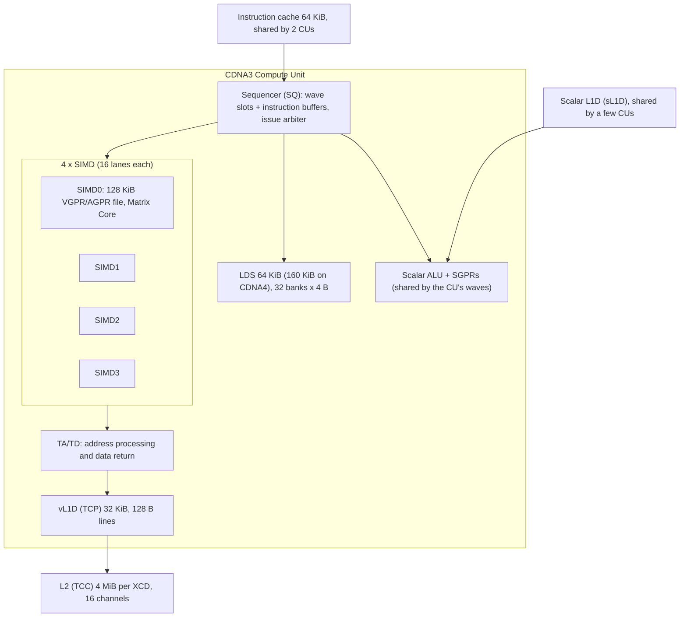
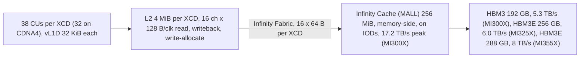
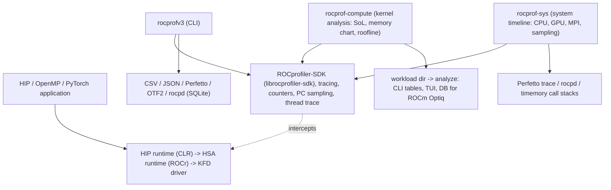
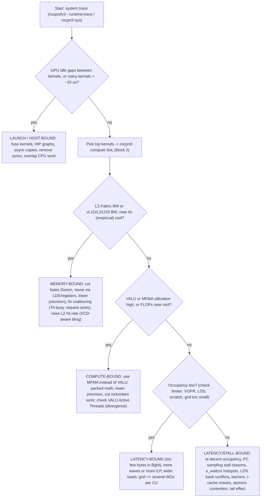
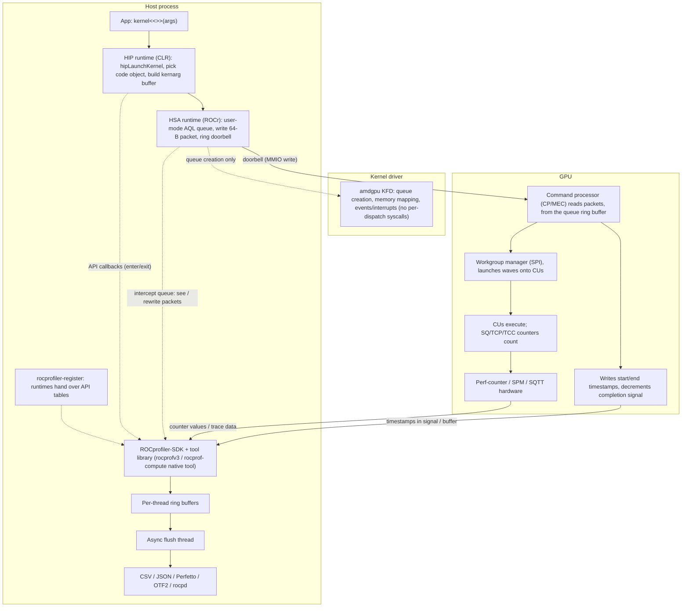

# AMD GPU Architecture and Profiling -- Comprehensive Interview Reference

> Last reviewed: 2026-11 · Versions assumed: ROCm 6.4-7.x, CDNA3/CDNA4

> An interview-focused deep dive into AMD Instinct GPUs (CDNA3 MI300X/MI325X, CDNA4 MI350X/MI355X) and the ROCm profiling and debugging stack. It covers compute-unit microarchitecture and occupancy math, Matrix Cores, the cache and chiplet hierarchy, the GPU memory model, quantitative latency hiding, current tools (rocprofv3, ROCprofiler-SDK, rocprof-compute, rocprof-sys), counter-driven bottleneck analysis, how profilers work inside the runtime, and GPU debugging. Every major section ends with interview questions and full answers. Section 8 is a question bank for a GPU profiling-tools role.

**Version note.** Tool flags move quickly. Facts were checked against the ROCm documentation and the AMD CDNA3 ISA guide and white paper (see [Sources](#9-sources)). Values marked as illustrative or assumed are not vendor data. The command lines and programs were also run on an MI350X (gfx950) with a recent ROCm nightly (rocprofv3 from ROCprofiler-SDK, rocprof-compute 3.9.0). Newer ROCm releases (the docs site now shows 10.x) keep the same tools but rename a few flags. For example, rocprof-compute 3.10 renamed `-d/--dispatch` to `--kernel-iteration-range`, and newer rocprofv3 builds steer you toward `rocpd` output plus converters. Always check `--help` on your installed version.

**Conventions.** "Wave" means wavefront (64 work-items on CDNA). The **XCD** (accelerator complex die) is the compute chiplet. **GFX IP names**: gfx90a = CDNA2 (MI200), gfx942 = CDNA3 (MI300X/MI300A/MI325X), gfx950 = CDNA4 (MI350X/MI355X). Peak numbers are vendor-published theoretical peaks unless they are marked as measured.

---

## Table of Contents

1. [CDNA Compute Unit and Chip Architecture](#1-cdna-compute-unit-and-chip-architecture)
    - [1.1 The CU at a Glance](#11-the-cu-at-a-glance)
    - [1.2 SIMD16 x 4 and the Four-Cycle Wave64 Cadence](#12-simd16-x-4-and-the-four-cycle-wave64-cadence)
    - [1.3 The Scalar Unit and SGPRs](#13-the-scalar-unit-and-sgprs)
    - [1.4 VGPRs, AGPRs, and Occupancy Math](#14-vgprs-agprs-and-occupancy-math)
    - [1.5 Instruction Buffers, Issue Arbitration, and s_waitcnt](#15-instruction-buffers-issue-arbitration-and-s_waitcnt)
    - [1.6 LDS: Size, Banks, and Conflicts](#16-lds-size-banks-and-conflicts)
    - [1.7 CU-Level Caches: vL1D, sL1D, and Instruction Cache](#17-cu-level-caches-vl1d-sl1d-and-instruction-cache)
    - [1.8 Matrix Cores and MFMA](#18-matrix-cores-and-mfma)
    - [1.9 L2, Infinity Cache (MALL), and HBM](#19-l2-infinity-cache-mall-and-hbm)
    - [1.10 MI300X, MI325X, MI355X: Chiplets and Partition Modes](#110-mi300x-mi325x-mi355x-chiplets-and-partition-modes)
    - [1.11 RDNA vs CDNA](#111-rdna-vs-cdna)
    - [1.12 AMD vs NVIDIA: Terminology and Hardware](#112-amd-vs-nvidia-terminology-and-hardware)
    - [1.13 Interview Questions](#113-interview-questions)
2. [GPU Memory Model](#2-gpu-memory-model)
    - [2.1 Why GPUs Need Scopes](#21-why-gpus-need-scopes)
    - [2.2 Scopes and Fences](#22-scopes-and-fences)
    - [2.3 Acquire and Release in HIP Atomics](#23-acquire-and-release-in-hip-atomics)
    - [2.4 What the Compiler Emits on gfx942](#24-what-the-compiler-emits-on-gfx942)
    - [2.5 Fine-Grained vs Coarse-Grained Memory](#25-fine-grained-vs-coarse-grained-memory)
    - [2.6 System-Scope Atomics over PCIe and xGMI](#26-system-scope-atomics-over-pcie-and-xgmi)
    - [2.7 XNACK, Unified Memory, and Page Migration](#27-xnack-unified-memory-and-page-migration)
    - [2.8 Memory-Model Pitfalls](#28-memory-model-pitfalls)
    - [2.9 Interview Questions](#29-interview-questions)
3. [Latency Hiding Quantified](#3-latency-hiding-quantified)
    - [3.1 Little's Law for GPU Memory](#31-littles-law-for-gpu-memory)
    - [3.2 Worked Example: Saturating HBM](#32-worked-example-saturating-hbm)
    - [3.3 Measured: Waves vs ILP](#33-measured-waves-vs-ilp)
    - [3.4 Occupancy vs ILP: When Each Wins](#34-occupancy-vs-ilp-when-each-wins)
    - [3.5 Hiding ALU, LDS, and MFMA Latency](#35-hiding-alu-lds-and-mfma-latency)
    - [3.6 Interview Questions](#36-interview-questions)
4. [ROCm Profiling Tools](#4-rocm-profiling-tools)
    - [4.1 The Tool Family and Name History](#41-the-tool-family-and-name-history)
    - [4.2 rocprofv3](#42-rocprofv3)
    - [4.3 ROCprofiler-SDK](#43-rocprofiler-sdk)
    - [4.4 rocprof-compute](#44-rocprof-compute)
    - [4.5 rocprof-sys](#45-rocprof-sys)
    - [4.6 Trace Formats and Perfetto](#46-trace-formats-and-perfetto)
    - [4.7 Comparison with NVIDIA Nsight](#47-comparison-with-nvidia-nsight)
    - [4.8 Interview Questions](#48-interview-questions)
5. [Counter-Driven Performance Methodology](#5-counter-driven-performance-methodology)
    - [5.1 Counter Naming: Hardware Blocks and Instances](#51-counter-naming-hardware-blocks-and-instances)
    - [5.2 Core Counters and What They Mean](#52-core-counters-and-what-they-mean)
    - [5.3 Derived Metrics and Their Formulas](#53-derived-metrics-and-their-formulas)
    - [5.4 Worked Example: From Raw Counters to a Diagnosis](#54-worked-example-from-raw-counters-to-a-diagnosis)
    - [5.5 Decision Tree: From Symptom to Bottleneck](#55-decision-tree-from-symptom-to-bottleneck)
    - [5.6 Multi-Pass Collection, Multiplexing, and Replay](#56-multi-pass-collection-multiplexing-and-replay)
    - [5.7 Profiler Overhead and Perturbation](#57-profiler-overhead-and-perturbation)
    - [5.8 Interview Questions](#58-interview-questions)
6. [How GPU Profilers Work Internally](#6-how-gpu-profilers-work-internally)
    - [6.1 From hipLaunchKernel to the Command Processor](#61-from-hiplaunchkernel-to-the-command-processor)
    - [6.2 HSA Queues, AQL Packets, and Doorbells](#62-hsa-queues-aql-packets-and-doorbells)
    - [6.3 Kernarg Segment and Kernel Descriptor](#63-kernarg-segment-and-kernel-descriptor)
    - [6.4 Code Objects and Kernel Symbol Resolution](#64-code-objects-and-kernel-symbol-resolution)
    - [6.5 Tool Loading and API Interception](#65-tool-loading-and-api-interception)
    - [6.6 Kernel Timestamps](#66-kernel-timestamps)
    - [6.7 Dispatch Counter Collection via Injected Packets](#67-dispatch-counter-collection-via-injected-packets)
    - [6.8 PC Sampling: Host-Trap vs Stochastic](#68-pc-sampling-host-trap-vs-stochastic)
    - [6.9 Thread Trace: ATT and SQTT](#69-thread-trace-att-and-sqtt)
    - [6.10 Buffering and Asynchronous Output](#610-buffering-and-asynchronous-output)
    - [6.11 Interview Questions](#611-interview-questions)
7. [GPU Debugging](#7-gpu-debugging)
    - [7.1 A Debugging Workflow](#71-a-debugging-workflow)
    - [7.2 Environment Variables](#72-environment-variables)
    - [7.3 rocgdb](#73-rocgdb)
    - [7.4 Reading a Memory Access Fault](#74-reading-a-memory-access-fault)
    - [7.5 AddressSanitizer on ROCm](#75-addresssanitizer-on-rocm)
    - [7.6 Hangs: Barriers, Spin-Waits, and Timeouts](#76-hangs-barriers-spin-waits-and-timeouts)
    - [7.7 amd-smi and rocm-smi](#77-amd-smi-and-rocm-smi)
    - [7.8 Interview Questions](#78-interview-questions)
8. [Interview Q&A for a GPU Profiling-Tools Role](#8-interview-qa-for-a-gpu-profiling-tools-role)
9. [Sources](#9-sources)

---

## 1. CDNA Compute Unit and Chip Architecture

> **See also:** [Parallel GPU Programming -- AMD CDNA Architecture Considerations](Parallel_GPU_Programming.md#301-amd-cdna-architecture-considerations) for the HIP-level summary; [Performance Engineering -- Ridge Points](../computer-science/Performance_Engineering.md#33-ridge-points-mi300x-and-a-cpu) for MI300X roofline numbers; [GPU Kernel Case Studies](GPU_Kernel_Case_Studies.md) for kernels tuned against these limits.

### 1.1 The CU at a Glance

A CDNA **compute unit (CU)** is the AMD counterpart of an NVIDIA SM. Workgroups are placed on CUs, and all waves of a workgroup live on **one** CU, so they can share LDS and synchronize with `s_barrier`.



| Component | CDNA3 (MI300X, gfx942) | CDNA4 (MI355X, gfx950) | Why it matters |
|---|---|---|---|
| SIMDs per CU | 4, each 16 lanes wide | 4 | A wave64 VALU op takes 4 cycles (1.2) |
| Max waves | 8 per SIMD = 32 per CU | 8 per SIMD = 32 per CU | Occupancy ceiling |
| VGPR file | 512 registers per lane per SIMD (128 KiB), shared by arch VGPRs and AGPRs | Same, unified | Main occupancy limiter (1.4) |
| SGPRs | About 800 per SIMD, at most about 102 per wave | Same | Rarely the limiter |
| LDS | 64 KiB per CU, 32 banks of 4 B | **160 KiB** per CU, double read bandwidth | Tiling and occupancy |
| Vector L1 (vL1D/TCP) | 32 KiB, 128 B lines | 32 KiB, 128 B lines | First cache for global loads |
| Instruction cache | 64 KiB, shared by 2 CUs | Shared | Code-size cliffs |
| Matrix Core | 1 per SIMD | 1 per SIMD, new FP6/FP4 and MX formats | MFMA throughput (1.8) |

Older parts differ. GCN and CDNA1 (MI100) allowed 10 waves per SIMD, and CDNA1 (gfx908) had a separate physical AGPR file; CDNA2 (gfx90a) and later share one 512-entry file. Quote the generation when you give a number.

### 1.2 SIMD16 x 4 and the Four-Cycle Wave64 Cadence

Each SIMD is 16 lanes wide for 32-bit (and, on CDNA2+, 64-bit) vector ALU work, but a wavefront has 64 work-items. So **one VALU instruction for a wave64 executes over 4 cycles**, with 16 lanes per cycle. The HIP hardware-implementation guide puts it this way: "executing one instruction takes four cycles (one cycle per 16 threads)".

The sequencer matches that cadence. It services the 4 SIMDs **round-robin, one SIMD per cycle**, so each SIMD gets an issue opportunity every 4 cycles, which is exactly when its previous wave64 VALU instruction finishes.

```text
cycle:      0     1     2     3     4     5     6     7     8
issue to:  SIMD0 SIMD1 SIMD2 SIMD3 SIMD0 SIMD1 SIMD2 SIMD3 SIMD0
SIMD0 ALU: [ lanes 0-15 | 16-31 | 32-47 | 48-63 ][ next instr ...
```

**Why this design matters in interviews:**

1. **ALU latency is mostly hidden by construction.** A dependent VALU instruction from the *same* wave can usually issue at the SIMD's next turn, so even one wave per SIMD can keep simple VALU math busy. On CDNA, occupancy is mostly about hiding **memory** latency, not ALU latency. Exceptions include transcendental ops, DPP/cross-lane ops, and some 64-bit ops with extra hazard cycles, where the ISA requires independent instructions or `s_nop`.
2. **Peak math.** MI300X vector FP64: `4 SIMDs x 16 lanes x 2 FLOP (FMA) = 128 FLOP/clk/CU`, and `304 CUs x 2.1 GHz x 128 = 81.7 TFLOP/s`. AMD lists vector FP32 at 256 FLOP/clk/CU (163.4 TFLOP/s). That is twice the per-lane FMA rate, which implies **packed FP32** (`v_pk_fma_f32`, two FP32 values per lane). rocprof-compute's VALU FLOPs peak uses `64 x 2` FLOP/clk/CU, so scalar-per-lane FP32 code tops out at about 81.7 TFLOP/s. Say this explicitly when someone quotes 163 TFLOP/s for a non-packed kernel.
3. **Divergence costs the whole 4 cycles.** With an EXEC mask of 1 active lane out of 64, the instruction still takes 4 cycles. rocprof-compute's "VALU Active Threads" metric measures this directly (5.3).

### 1.3 The Scalar Unit and SGPRs

Each CU has a **scalar ALU (SALU)** and a **scalar memory path (SMEM)** through the scalar L1 data cache. The compiler moves work that is **uniform across the wave** onto the scalar unit: kernel-argument loads, base addresses, loop counters, branch conditions that do not depend on the lane ID, and the EXEC mask manipulation itself.

| | SGPR (scalar) | VGPR (vector) |
|---|---|---|
| One value per | wave | lane |
| Typical contents | Kernel args, pointers, loop bounds, `blockIdx`-derived values, EXEC/VCC masks | `threadIdx`-derived values, loaded data, accumulators |
| Loads via | `s_load_dword*` (scalar cache, waits on `lgkmcnt`) | `global_load_*` / `buffer_load_*` (vL1D, waits on `vmcnt`) |
| Budget | ~800 per SIMD, max ~102 per wave | 512 per lane per SIMD, max 512 per wave (256 arch + 256 AGPR) |

**Interview-relevant consequences:**

- **Uniformity is free performance.** `if (blockIdx.x == 0)` is a scalar branch (`s_cbranch_*`) with no divergence. `if (threadIdx.x == 0)` needs an EXEC mask and still costs the full wave issue for every instruction in the branch.
- **Scalar loads of kernel arguments** go through the constant/scalar path. That is why reading `n` from the kernarg segment (6.3) costs nothing per lane.
- **Readfirstlane.** `__builtin_amdgcn_readfirstlane(x)` moves a value the programmer *knows* is uniform from a VGPR to an SGPR, which can turn a vector loop into a scalar one.

### 1.4 VGPRs, AGPRs, and Occupancy Math

On CDNA3 and CDNA4, each SIMD has **512 registers per lane** (`512 x 64 lanes x 4 B = 128 KiB`, so 512 KiB per CU). Architectural VGPRs and **accumulation VGPRs (AGPRs)**, which hold MFMA accumulators, share this one budget. A wave can use up to 256 of each. CDNA1 (gfx908) had a separate AGPR file. CDNA2 (gfx90a) unified it, and CDNA3/CDNA4 keep the unified layout.

**Allocation rules (gfx942/gfx950):**

1. Arch VGPRs are rounded up to a multiple of 4. AGPRs start right after them (`.amdhsa_accum_offset` in the kernel descriptor).
2. The total is rounded up to the allocation **granule of 8** registers.
3. `waves_per_SIMD = min(8, floor(512 / total_vgprs), SGPR limit, LDS limit, workgroup limits)`.

**VGPR cliffs (waves per SIMD vs total VGPRs per lane):**

| Total VGPRs (after rounding) | <=64 | <=72 | <=80 | <=96 | <=128 | <=168 | <=256 | <=512 |
|---|---|---|---|---|---|---|---|---|
| Waves/SIMD | 8 | 7 | 6 | 5 | 4 | 3 | 2 | 1 |

**LDS limit:** `workgroups_per_CU = floor(LDS_per_CU / LDS_per_workgroup)`. Each workgroup's waves are spread over the 4 SIMDs, so `waves_per_SIMD_from_LDS = workgroups_per_CU x waves_per_workgroup / 4`.

**Worked example.** A GEMM-like kernel with 256-thread workgroups (4 waves) uses 72 arch VGPRs, 32 AGPRs, 40 SGPRs, and 24 KiB of LDS per workgroup.

```text
VGPRs: round4(72) + 32 = 104 -> round8 = 104 -> floor(512/104) = 4 waves/SIMD
SGPRs: floor(800 / round16(40)=48) = 16             -> not limiting
LDS  : MI300X floor(64 KiB / 24 KiB)  = 2 WGs/CU = 8 waves/CU = 2 waves/SIMD  <- binding
       MI355X floor(160 KiB / 24 KiB) = 6 WGs/CU = 24 waves/CU = 6 waves/SIMD
Result: MI300X 2/8 = 25% occupancy (LDS-bound); MI355X 4/8 = 50% (VGPR-bound)
```

```python
"""occupancy.py -- waves per SIMD on CDNA3 (MI300X) and CDNA4 (MI355X) from kernel resources.

Rules (CDNA3/CDNA4, wave64): 512 VGPRs per lane per SIMD shared by arch VGPRs and AGPRs,
allocation granule 8; AGPRs start after the arch VGPRs rounded up to a multiple of 4;
max 8 waves per SIMD; ~800 SGPRs per SIMD (granule 16); LDS per CU is 64 KiB (CDNA3) or
160 KiB (CDNA4); a workgroup lives on one CU and its waves are spread over the 4 SIMDs.
"""
import math

ARCH = {
    "CDNA3 (MI300X)": {"lds_kib": 64, "max_waves_simd": 8, "vgprs": 512, "sgprs": 800},
    "CDNA4 (MI355X)": {"lds_kib": 160, "max_waves_simd": 8, "vgprs": 512, "sgprs": 800},
}


def round_up(x: int, g: int) -> int:
    return (x + g - 1) // g * g


def waves_per_simd(arch: dict, vgpr: int, agpr: int, sgpr: int, lds_bytes: int, wg_threads: int):
    total_vgpr = round_up(round_up(vgpr, 4) + agpr, 8)
    by_vgpr = arch["vgprs"] // total_vgpr
    by_sgpr = arch["sgprs"] // round_up(sgpr, 16)
    waves_per_wg = math.ceil(wg_threads / 64)
    wgs_per_cu = (arch["lds_kib"] * 1024) // lds_bytes if lds_bytes else 10**9
    by_lds = (wgs_per_cu * waves_per_wg) // 4          # waves per SIMD (4 SIMDs per CU)
    limits = {"VGPR": by_vgpr, "SGPR": by_sgpr, "LDS": by_lds, "HW": arch["max_waves_simd"]}
    binding = min(limits, key=limits.get)
    return limits[binding], binding, total_vgpr, limits


if __name__ == "__main__":
    kernel = {"vgpr": 72, "agpr": 32, "sgpr": 40, "lds_bytes": 24 * 1024, "wg_threads": 256}
    print(f"kernel: {kernel}")
    for name, arch in ARCH.items():
        w, why, tv, lim = waves_per_simd(arch, **kernel)
        print(f"{name}: allocated VGPRs/lane={tv}, limits={lim} -> {w} waves/SIMD "
              f"({w / arch['max_waves_simd']:.0%} occupancy, {why}-bound)")
```

```text
kernel: {'vgpr': 72, 'agpr': 32, 'sgpr': 40, 'lds_bytes': 24576, 'wg_threads': 256}
CDNA3 (MI300X): allocated VGPRs/lane=104, limits={'VGPR': 4, 'SGPR': 16, 'LDS': 2, 'HW': 8} -> 2 waves/SIMD (25% occupancy, LDS-bound)
CDNA4 (MI355X): allocated VGPRs/lane=104, limits={'VGPR': 4, 'SGPR': 16, 'LDS': 6, 'HW': 8} -> 4 waves/SIMD (50% occupancy, VGPR-bound)
```

**Where to get the inputs.** Compile with `--save-temps` (or `-Rpass-analysis=kernel-resource-usage`) and read the `.s` file. It prints `; NumVgprs`, `; NumAgprs`, `; TotalNumVgprs`, `; ScratchSize`, and `; Occupancy`. rocprofv3 `--kernel-trace` records `VGPR_Count`, `Accum_VGPR_Count`, `SGPR_Count`, `LDS_Block_Size`, and `Scratch_Size` for every dispatch, so a profile tells you the occupancy limit without the source.

**Pitfalls:**

- **Scratch (spills) is the silent killer.** If `ScratchSize > 0`, registers spilled to per-lane private memory, which goes through the vL1D/L2 like any global access. Capping registers (`__launch_bounds__`, `amdgpu_waves_per_eu`) to raise occupancy can *lose* performance if it causes spills.
- **Occupancy is a means, not a goal.** High-performance GEMMs often run at 1-2 waves per SIMD and hide latency with ILP and software pipelining (3.4).
- **LDS allocation granularity** also rounds up (the occupancy PR cited in the Sources uses 512 B granules on gfx942), and a per-CU cap on resident workgroups can bind for very small workgroups.

### 1.5 Instruction Buffers, Issue Arbitration, and s_waitcnt

Each wave slot in the sequencer holds the wave's state (PC, EXEC mask, status) and an **instruction buffer** of prefetched instructions, fetched through the shared instruction cache. On the cycle a SIMD is serviced, the arbiter can issue **up to five instructions, each of a different type and from a different wave**:

| Issue port | Instruction class | Examples |
|---|---|---|
| VALU | Vector ALU, including MFMA issue | `v_fma_f32`, `v_mfma_*` |
| VMEM | Vector memory | `global_load_dwordx4`, `buffer_store_dword` |
| SALU / SMEM | Scalar ALU or scalar memory | `s_add_u32`, `s_load_dwordx2` |
| LDS | Local data share | `ds_read_b128`, `ds_write_b32` |
| Branch / message | Control flow | `s_cbranch_scc1`, `s_barrier` |

**Two consequences:**

1. **One wave issues at most one instruction per turn.** Instruction-level overlap *within* a wave comes from issuing a long-latency op (load, MFMA) and continuing with independent instructions. Overlap *across* waves is why several waves per SIMD help: wave A's load, wave B's VALU, and wave C's LDS op can all issue in the same cycle. rocprof-compute's IPC metric has a peak of 5 for this reason.
2. **There is no hardware scoreboard for memory results. Waves wait explicitly.** Memory instructions increment per-wave counters, and the compiler inserts `s_waitcnt` before the first use of a result:
    - `vmcnt`: outstanding vector memory loads **and stores** on CDNA/GFX9 (loads return in issue order; RDNA gfx10+ moves stores to a separate `vscnt`)
    - `lgkmcnt`: LDS, GDS, constant (scalar) loads, and messages
    - `expcnt`: exports/GDS and, on GFX9, VMEM store data still being read out of VGPRs (wait on it before overwriting a store's source registers)

```text
global_load_dwordx4 v[0:3], v8, s[4:5]     ; load A  (vmcnt = 1)
global_load_dwordx4 v[4:7], v9, s[4:5]     ; load B  (vmcnt = 2), independent: ILP
s_waitcnt vmcnt(1)                         ; wait until only 1 load is outstanding -> A has arrived
v_add_f32 v10, v0, v1                      ; use A while B is still in flight
s_waitcnt vmcnt(0)                         ; now wait for B
```

A wave sitting on `s_waitcnt` is **stalled on memory**. With PC sampling (6.8), samples pile up on the instruction after the wait, which is the classic "the hot spot is the add, but the cause is the load" puzzle.

### 1.6 LDS: Size, Banks, and Conflicts

The **Local Data Share** is software-managed on-CU memory, the counterpart of CUDA shared memory: 64 KiB per CU on CDNA3 (max 64 KiB per workgroup) and 160 KiB on CDNA4. On CDNA3 it has **32 banks, each 4 bytes wide**, so `bank = (byte_address / 4) % 32`.

- **Conflict:** two lanes serviced in the same LDS cycle access **different addresses in the same bank**. The accesses serialize.
- **Broadcast:** lanes reading the **same address** do not conflict.
- **Classic fix:** pad a 2-D tile, for example `__shared__ float tile[64][64 + 1]`, so a column walk strides 65 words and hits a different bank each row.
- **Counter:** `SQ_LDS_BANK_CONFLICT` counts cycles the LDS stalled on conflicts. rocprof-compute reports **LDS Bank Conflicts/Access** = `SQ_LDS_BANK_CONFLICT / (SQ_LDS_IDX_ACTIVE - SQ_LDS_BANK_CONFLICT)`. 0 is ideal.
- **Wider is better:** `ds_read_b128` moves 16 B per lane per instruction and uses fewer instruction slots, as long as it stays conflict-free.

### 1.7 CU-Level Caches: vL1D, sL1D, and Instruction Cache

| Cache | Counter block | CDNA3 facts | Notes |
|---|---|---|---|
| **vL1D** (vector L1) | TCP | 32 KiB per CU, 128 B lines (doubled from CDNA2) | Write-through to L2. "Very relaxed coherency": needs explicit invalidates or scope bits for cross-CU visibility (2.4). The TA/TD blocks in front of it do address processing and data return |
| **sL1D** (scalar L1) | SQC (data) | Shared by a small group of CUs | Serves `s_load_*`: kernargs and uniform data |
| **L1I** (instruction) | SQC (inst) | 64 KiB, 8-way, **shared by 2 CUs** | Huge unrolled kernels can thrash it; check "Instruction Cache" hit rate (rocprof-compute block 13) |

### 1.8 Matrix Cores and MFMA

Each SIMD has a **Matrix Core** that executes **MFMA** (matrix fused multiply-add) instructions: `D = A x B + C` on small tiles, cooperatively across the 64 lanes of a wave. The naming pattern is `v_mfma_<Dtype>_<M>x<N>x<K>[_<blocks>B]_<ABtype>`.

| Instruction (gfx942 spelling) | A/B type | Accum (C/D) | Blocks | Cycles (passes x 4) | FLOPs per instruction | FLOP/clk/CU |
|---|---|---|---|---|---|---|
| `v_mfma_f32_32x32x8_f16` | FP16 | FP32 | 1 | 32 | 2x32x32x8 = 16,384 | 2,048 |
| `v_mfma_f32_16x16x16_f16` | FP16 | FP32 | 1 | 16 | 8,192 | 2,048 |
| `v_mfma_f32_32x32x8_bf16` | BF16 | FP32 | 1 | 32 | 16,384 | 2,048 |
| `v_mfma_f32_32x32x16_fp8_fp8` | FP8 (E4M3FNUZ/E5M2FNUZ on gfx942 via fp8/bf8) | FP32 | 1 | 32 | 32,768 | 4,096 |
| `v_mfma_i32_32x32x16_i8` | INT8 | INT32 | 1 | 32 | 32,768 | 4,096 |
| `v_mfma_f32_32x32x4_xf32` | XF32 (TF32-like) | FP32 | 1 | 32 | 8,192 | 1,024 |
| `v_mfma_f32_32x32x2_f32` | FP32 | FP32 | 1 | 64 | 4,096 | 256 |
| `v_mfma_f64_16x16x4_f64` | FP64 | FP64 | 1 | 32 | 2,048 | 256 |
| `v_mfma_f32_32x32x4_2b_f16` | FP16 | FP32 | 2 | 64 | 16,384 | 1,024 |

The table follows the CDNA3 ISA guide (Table 28, "MFMA VALU Opcodes"). Check the arithmetic: `FLOP/clk/CU = FLOPs / cycles x 4 SIMDs`, so `16384 / 32 x 4 = 2048`, and `304 CUs x 2.1 GHz x 2048 = 1307.4 TFLOP/s` (the MI300X FP16 dense peak).

**Things interviewers probe:**

- **Spelling changed with gfx940.** CDNA1/CDNA2 assembly spells it `v_mfma_f32_32x32x8f16`, while gfx942/gfx950 print `v_mfma_f32_32x32x8_f16`. The compiler builtin keeps the old form: `__builtin_amdgcn_mfma_f32_32x32x8f16(a, b, c, cbsz, abid, blgp)`. The last three immediates control broadcast across blocks and lane-group swizzles.
- **Accumulation precision.** FP16, BF16, and FP8 inputs accumulate in **FP32**, INT8 accumulates in INT32, and FP64 stays FP64. MFMA ignores the MODE round mode and uses round-to-nearest-even. It keeps denormals regardless of the MODE denorm setting.
- **Non-K-dimension blocks.** Variants such as `_4x4x4_16b_f16` compute 16 independent small products at once. They are useful for batched small matrices, but most GEMMs use the 1-block 16x16 or 32x32 shapes.
- **Latency vs throughput.** An MFMA occupies its SIMD's Matrix Core for 8-64 cycles (4x4 multi-block shapes take 8; 32x32 FP32 and 2-block F16 shapes take 64). A dependent MFMA (same accumulator) waits for it, so GEMM kernels interleave **several independent accumulator tiles**. The ISA also lists required independent instructions (or `s_nop`) between an MFMA and dependent VALU reads. VALU address math from other waves can overlap with a long MFMA.
- **CDNA3 additions:** FP8 and BF8 in the FNUZ variants (E4M3FNUZ/E5M2FNUZ, not OCP: no infinities, no negative zero, exponent bias one higher, so E4M3FNUZ max is 240 vs OCP E4M3's 448) at 2x FP16 rate, XF32, and 2:4 structured sparsity (`v_smfmac_*`), which doubles the effective rate.
- **CDNA4 additions:** double-K FP16/BF16 shapes (`v_mfma_f32_16x16x32_f16`, `v_mfma_f32_32x32x16_f16`) and block-scaled MX formats (`v_mfma_scale_f32_32x32x64_f8f6f4`, `v_mfma_scale_f32_16x16x128_f8f6f4`, which take FP8, FP6, or FP4 operands plus per-block scale registers). MI355X peaks: 2.5 PFLOP/s FP16 dense, 5.0 FP8, and 10 for MXFP6/MXFP4. CDNA4 switches FP8 to the OCP E4M3/E5M2 encodings, so FP8 checkpoints and scales are not bit-compatible between MI300X and MI355X (the same bit pattern decodes to a value 2x apart; frameworks use `float8_e4m3fnuz` on gfx94x and `float8_e4m3fn` on gfx950).

**A complete MFMA program.** One wave computes `D(16x16) = A(16x4) x B(4x16)` with a single `v_mfma_f32_16x16x4_f32` (the layout follows AMD's matrix-core lab notes). Lane `l = threadIdx.x + 16 * threadIdx.y` holds `A[m][k]` and `B[k][n]` with `m = n = threadIdx.x` and `k = threadIdx.y`. It receives `D[4k + i][n]` for `i = 0..3`.

```cpp
// mfma_16x16x4.hip -- one wave64 computes D(16x16) = A(16x4) * B(4x16) with one MFMA.
// Build: hipcc --offload-arch=gfx942 mfma_16x16x4.hip -o mfma   (gfx90a / gfx950 also work)
#include <hip/hip_runtime.h>
#include <cmath>
#include <cstdio>
#include <cstdlib>

#define HIP_CHECK(x) do { hipError_t e_ = (x); if (e_ != hipSuccess) { \
    std::fprintf(stderr, "%s:%d %s\n", __FILE__, __LINE__, hipGetErrorString(e_)); std::exit(1); } } while (0)

constexpr int M = 16, N = 16, K = 4;
using float4_t = __attribute__((__vector_size__(4 * sizeof(float)))) float;

__global__ void sgemm_16x16x4(const float* A, const float* B, float* D) {
    // block = (16, 4): lane = threadIdx.x + 16 * threadIdx.y, so all 64 lanes form one wave.
    const int m = threadIdx.x, k = threadIdx.y;
    float a = A[m * K + k];          // lane holds A[m][k]   (A row-major, M x K)
    float b = B[k * N + m];          // lane holds B[k][n=m] (B row-major, K x N)
    float4_t d = {0.f, 0.f, 0.f, 0.f};
    d = __builtin_amdgcn_mfma_f32_16x16x4f32(a, b, d, /*cbsz=*/0, /*abid=*/0, /*blgp=*/0);
    for (int i = 0; i < 4; ++i)      // lane holds D[4*k + i][n] for i = 0..3
        D[(4 * k + i) * N + m] = d[i];
}

int main() {
    float hA[M * K], hB[K * N], hD[M * N], ref[M * N];
    for (int i = 0; i < M * K; ++i) hA[i] = static_cast<float>(i % 7) - 3.0f;
    for (int i = 0; i < K * N; ++i) hB[i] = static_cast<float>(i % 5) - 2.0f;
    for (int r = 0; r < M; ++r)
        for (int c = 0; c < N; ++c) {
            float s = 0.f;
            for (int k = 0; k < K; ++k) s += hA[r * K + k] * hB[k * N + c];
            ref[r * N + c] = s;
        }
    float *dA, *dB, *dD;
    HIP_CHECK(hipMalloc(&dA, sizeof hA));
    HIP_CHECK(hipMalloc(&dB, sizeof hB));
    HIP_CHECK(hipMalloc(&dD, sizeof hD));
    HIP_CHECK(hipMemcpy(dA, hA, sizeof hA, hipMemcpyHostToDevice));
    HIP_CHECK(hipMemcpy(dB, hB, sizeof hB, hipMemcpyHostToDevice));
    sgemm_16x16x4<<<dim3(1), dim3(16, 4)>>>(dA, dB, dD);
    HIP_CHECK(hipGetLastError());
    HIP_CHECK(hipMemcpy(hD, dD, sizeof hD, hipMemcpyDeviceToHost));
    int bad = 0;
    for (int i = 0; i < M * N; ++i) bad += std::fabs(hD[i] - ref[i]) > 1e-5f;
    std::printf("mismatches: %d of %d\n", bad, M * N);
    HIP_CHECK(hipFree(dA)); HIP_CHECK(hipFree(dB)); HIP_CHECK(hipFree(dD));
    return bad != 0;
}
```

Output: `mismatches: 0 of 256`. With `--save-temps` for gfx942, the assembly shows `v_mfma_f32_16x16x4_f32 v[0:3], v2, v0, 0`.

**rocWMMA** is AMD's portable C++ wrapper. Its API mirrors CUDA's `nvcuda::wmma` (fragments, `load_matrix_sync`, `mma_sync`, `store_matrix_sync`), and it lowers to MFMA on CDNA and to WMMA on RDNA3/RDNA4. Use it when you want tensor-core code without hand-writing lane layouts. For peak GEMMs, use hipBLASLt, Composable Kernel, or Triton.

```cpp
// rocwmma_gemm.hip -- one wave computes a 16x16 tile of C = A * B (fp16 in, fp32 accumulate).
// Build: hipcc -O2 --offload-arch=gfx942 rocwmma_gemm.hip -o rocwmma_gemm
#include <hip/hip_runtime.h>
#include <rocwmma/rocwmma.hpp>
#include <cmath>
#include <cstdio>
#include <cstdlib>
#include <vector>

#define HIP_CHECK(x) do { hipError_t e_ = (x); if (e_ != hipSuccess) { \
    std::fprintf(stderr, "%s:%d %s\n", __FILE__, __LINE__, hipGetErrorString(e_)); std::exit(1); } } while (0)

constexpr int T = 16;                              // tile M = N = K = 16
constexpr int Kdim = 64;                           // full K, walked 16 at a time
using half_t = rocwmma::float16_t;

__global__ void gemm_16x16(const half_t* A, const half_t* B, float* C) {
    // A: 16 x Kdim row-major, B: Kdim x 16 col-major, C: 16 x 16 row-major
    rocwmma::fragment<rocwmma::matrix_a, T, T, T, half_t, rocwmma::row_major> a;
    rocwmma::fragment<rocwmma::matrix_b, T, T, T, half_t, rocwmma::col_major> b;
    rocwmma::fragment<rocwmma::accumulator, T, T, T, float> acc;
    rocwmma::fill_fragment(acc, 0.0f);
    for (int k = 0; k < Kdim; k += T) {
        rocwmma::load_matrix_sync(a, A + k, Kdim);          // leading dimension = Kdim
        rocwmma::load_matrix_sync(b, B + k, Kdim);
        rocwmma::mma_sync(acc, a, b, acc);                  // lowers to MFMA on CDNA
    }
    rocwmma::store_matrix_sync(C, acc, T, rocwmma::mem_row_major);
}

int main() {
    std::vector<half_t> hA(T * Kdim), hB(Kdim * T);
    std::vector<float> fA(T * Kdim), fB(Kdim * T), hC(T * T);
    for (int i = 0; i < T * Kdim; ++i) { fA[i] = float(i % 5) - 2.f; hA[i] = half_t(fA[i]); }
    for (int i = 0; i < Kdim * T; ++i) { fB[i] = float(i % 3) - 1.f; hB[i] = half_t(fB[i]); }
    half_t *dA, *dB;
    float* dC;
    HIP_CHECK(hipMalloc(&dA, hA.size() * sizeof(half_t)));
    HIP_CHECK(hipMalloc(&dB, hB.size() * sizeof(half_t)));
    HIP_CHECK(hipMalloc(&dC, hC.size() * sizeof(float)));
    HIP_CHECK(hipMemcpy(dA, hA.data(), hA.size() * sizeof(half_t), hipMemcpyHostToDevice));
    HIP_CHECK(hipMemcpy(dB, hB.data(), hB.size() * sizeof(half_t), hipMemcpyHostToDevice));
    gemm_16x16<<<1, 64>>>(dA, dB, dC);                       // exactly one wave64
    HIP_CHECK(hipGetLastError());
    HIP_CHECK(hipMemcpy(hC.data(), dC, hC.size() * sizeof(float), hipMemcpyDeviceToHost));
    int bad = 0;
    for (int r = 0; r < T; ++r)
        for (int c = 0; c < T; ++c) {
            float ref = 0.f;
            for (int k = 0; k < Kdim; ++k) ref += fA[r * Kdim + k] * fB[c * Kdim + k];  // B col-major
            bad += std::fabs(ref - hC[r * T + c]) > 1e-3f;
        }
    std::printf("mismatches: %d of %d\n", bad, T * T);
    HIP_CHECK(hipFree(dA)); HIP_CHECK(hipFree(dB)); HIP_CHECK(hipFree(dC));
    return bad != 0;
}
```

On gfx942 this compiles to a chain of `v_mfma_f32_16x16x16_f16`, with the accumulator fed back in.

### 1.9 L2, Infinity Cache (MALL), and HBM



| Level | MI300X numbers | Key behavior |
|---|---|---|
| L2 (TCC) | 4 MiB per XCD, 16-way, 16 channels of 256 KiB, 128 B lines; 2 KiB/clk read per XCD (~34.4 TB/s aggregate) | **Coherent only within its XCD.** Writeback and write-allocate. It is the last level where hardware keeps coherence automatically for the XCD's CUs |
| Infinity Cache / MALL | 256 MiB total, 16-way, 2 MiB per HBM channel, 17.2 TB/s peak | **Memory-side** (it caches memory, not L2 evictions) and **outside the coherence protocol**. It holds a snoop filter for the XCD L2s |
| HBM | 8 stacks; HBM3 at 5.2 Gb/s on an 8192-bit bus = 5.3 TB/s | Achievable streaming bandwidth is typically 75-90% of spec |

**Interview points:**

- **L2 is per XCD, not per GPU.** Data written by a workgroup on XCD 0 can sit dirty in XCD 0's L2, invisible to XCD 3. Device-scope ("agent") synchronization therefore has to write back or bypass L2 on multi-XCD parts. That is the `buffer_wbl2` you will see in 2.4.
- **"HBM bandwidth" counters are really L2-to-fabric counters.** The `TCC_EA0_*` counters measure L2 traffic to the Infinity Fabric. On MI300 some of that traffic is served by the Infinity Cache. A small working set can show "L2-Fabric BW" **above** the HBM peak, so read it as "traffic below L2", not as DRAM bandwidth.
- **Benchmark sizing:** a buffer under 256 MiB re-read in a loop is measured against the MALL, not HBM.

### 1.10 MI300X, MI325X, MI355X: Chiplets and Partition Modes

| | MI300X | MI325X | MI355X (MI350X) |
|---|---|---|---|
| Architecture | CDNA3, gfx942 | CDNA3, gfx942 | CDNA4, gfx950 |
| XCDs x active CUs | 8 x 38 (40 physical) = **304** | 8 x 38 = 304 | 8 x 32 (36 physical) = **256** |
| I/O dies | 4 (6 nm), each under 2 XCDs | 4 | 2 |
| L2 / Infinity Cache | 4 MiB per XCD / 256 MiB | same | 4 MiB per XCD / 256 MiB |
| LDS per CU | 64 KiB | 64 KiB | 160 KiB |
| Memory | 192 GB HBM3, 5.3 TB/s | 256 GB HBM3E, 6.0 TB/s | 288 GB HBM3E, 8 TB/s |
| Peak engine clock | 2.1 GHz | 2.1 GHz | 2.4 GHz |
| FP16/BF16 dense | 1307.4 TFLOP/s | 1307.4 | ~2.5 PFLOP/s |
| FP8 dense | 2614.9 TFLOP/s | 2614.9 | ~5.0 PFLOP/s (MXFP4/FP6 ~10) |
| FP64 vector | 81.7 TFLOP/s | 81.7 | 78.6 |
| Compute partitions | SPX, DPX, QPX, CPX (1/2/4/8) | same | 1, 2, 4, 8 |
| Memory partitions (NPS) | NPS1, NPS4 (AMD's partitioning docs also list DPX+NPS2) | NPS1, NPS4 | NPS1, NPS2 |

**Compute partitioning** splits the XCDs into separate logical GPUs:

| Mode | MI300X XCDs per logical GPU | Use case |
|---|---|---|
| **SPX** (default) | 8 (one GPU, 304 CUs) | Large single jobs. **Workgroups are dispatched round-robin across XCDs**, so WG `i` lands on XCD `i mod 8` |
| DPX | 4 | Two jobs per device |
| QPX | 2 | Four jobs |
| **CPX** | 1 (8 logical GPUs of 38 CUs, 24 GB each) | Many small jobs or inference replicas. Each logical GPU has its own L2, so there is no cross-XCD coherence traffic |

**Memory partitioning (NPS)** controls HBM interleaving. NPS1 interleaves across all stacks. NPS4 on MI300X gives each quarter its own local pair of stacks (AMD's blog reports 5-10% higher STREAM bandwidth when localized). The memory partition count must not exceed the compute partition count. AMD's MI300X partitioning docs list the valid combinations as SPX+NPS1, DPX+NPS2, CPX+NPS1, and CPX+NPS4 (the same docs mark DPX+NPS2 as unsupported on MI325X). Set modes with `amd-smi set --compute-partition CPX` and `amd-smi set --memory-partition NPS4` (requires root; the GPU reverts to SPX/NPS1 when the driver reloads).

**Why round-robin XCD dispatch matters.** In a GEMM, adjacent output tiles share A rows and B columns. With consecutive workgroup IDs on **different** XCDs, each XCD's L2 sees only one-eighth of the neighbors, and L2 hit rate drops. Tuned kernels (hipBLASLt, Triton on ROCm) **remap the program ID** so tiles that share data land on the same XCD. For example, with `NUM_XCDS = 8` and the program count a multiple of 8, `new_pid = (pid % 8) * (num_pids // 8) + pid // 8`. In a profile this shows up as a low L2 hit rate and high L2-Fabric traffic that improve after remapping.

### 1.11 RDNA vs CDNA

| | CDNA (Instinct, data center) | RDNA (Radeon, Ryzen AI APUs) |
|---|---|---|
| Wave size | **Wave64** | **Wave32 native** (wave64 supported by double-issue) |
| Core block | CU = 4 x SIMD16 | WGP = 2 CUs, each with 2 x SIMD32 |
| Cycles to issue one wave VALU instruction | 4 (wave64 on SIMD16) | 1 for wave32 on SIMD32 (issue cadence; dependent-instruction latency is ~5 cycles on RDNA) |
| LDS | 64 KiB per CU (160 KiB CDNA4) | 128 KiB per WGP |
| Caches | vL1D, L2 per XCD, MALL | L0 (vector), GL1 (shader array), GL2, Infinity Cache |
| Matrix | MFMA, FP64 matrix, FP8 and MX formats | WMMA (RDNA3+), no FP64 matrix |
| Graphics | Mostly removed (no display or rasterization focus) | Full graphics pipeline |
| rocprof-compute | Full support | Partial support (RDNA panels: SPI, WGP, GL0/GL1/GL2) |

**Why wave32 on RDNA:** graphics shaders are short, branchy, and latency-sensitive. Narrower waves cut divergence waste and finish an instruction in 1 cycle. **Why CDNA kept wave64:** HPC and ML kernels are throughput-bound and regular. A wider wave amortizes instruction fetch, decode, and scalar work over more lanes, and MFMA shapes are designed around 64 lanes. **Portability pitfall:** code that assumes `warpSize == 32` (ballot masks in 32-bit ints, `__shfl` with hard-coded 32) breaks on CDNA. Use `warpSize` and 64-bit masks (`unsigned long long` from `__ballot`).

### 1.12 AMD vs NVIDIA: Terminology and Hardware

| AMD (CDNA) | NVIDIA | Notes |
|---|---|---|
| Compute Unit (CU) | Streaming Multiprocessor (SM) | MI300X 304 CUs; H100 SXM 132 SMs |
| SIMD (4 per CU, 16 lanes) | SM sub-partition (4 per SM, 32-wide warp scheduler) | NVIDIA issues a warp instruction every cycle per sub-partition |
| Wavefront (64) | Warp (32) | `warpSize` differs, so masks are 64-bit on AMD |
| Max 32 waves/CU (8/SIMD) | Max 64 warps/SM (Hopper) | Both are 2048 threads per CU/SM |
| VGPR file 512 KiB per CU | Register file 256 KiB per SM | AMD has 2x the registers per compute block |
| SGPRs + scalar ALU | Uniform registers/datapath (Turing+) | AMD has had a scalar unit since GCN |
| AGPRs (unified since CDNA2/gfx90a) | None (accumulators in registers; TMEM on Blackwell) | |
| LDS 64 KiB (160 KiB CDNA4) | Shared memory up to 228 KiB per SM (Hopper, carved from 256 KiB L1) | |
| Matrix Core / MFMA | Tensor Core / `mma.sync`, `wgmma` | MFMA is per wave; `wgmma` is per warpgroup (4 warps) |
| `s_waitcnt` counters | Scoreboard, plus `cp.async` wait groups | |
| L2 per XCD + 256 MiB MALL | One 50 MiB L2 (H100), partitioned in two | AMD has more last-level capacity; NVIDIA has a unified L2 |
| XCD chiplets, SPX/CPX partitions | MIG (Multi-Instance GPU) | Both partition a device |
| DPP, `ds_swizzle`, `ds_bpermute` | `__shfl_*_sync` | Cross-lane ops |
| rocprofv3 / ROCprofiler-SDK | Nsight Systems CLI / CUPTI | Tracing |
| rocprof-compute | Nsight Compute | Kernel analysis |

### 1.13 Interview Questions

**Q1.** Why does a VALU instruction take 4 cycles on CDNA, and what does that imply for latency hiding?

**A:** A CU has 4 SIMDs, each 16 lanes wide, and a wave has 64 lanes, so one wave64 instruction occupies its SIMD for 4 cycles (16 lanes per cycle). The sequencer services the SIMDs round-robin, one per cycle, so each SIMD gets an issue slot every 4 cycles, matched to the instruction duration. As a result, simple dependent VALU instructions from the same wave can issue back to back at the SIMD's cadence, and ALU pipeline latency is largely hidden even at 1 wave per SIMD. Extra waves are needed mainly to hide **memory** latency (hundreds of ns) and to fill the other issue ports (VMEM, LDS, SALU) in parallel. Exceptions include transcendentals, cross-lane ops, and MFMA dependencies, where the ISA requires independent instructions between producer and consumer.

**Q2.** A kernel uses 130 VGPRs and no AGPRs on MI300X. What is the occupancy, and what would you try?

**A:** 130 rounds up to 136 (granule 8), and `floor(512 / 136) = 3` waves per SIMD = 37.5% occupancy. The next cliff is at 128 VGPRs (4 waves). Shaving 2+ registers (smaller unroll, recomputing cheap values, narrowing types, `__launch_bounds__(256, 4)` or `__attribute__((amdgpu_waves_per_eu(4)))` hints; in HIP the second `__launch_bounds__` argument is the minimum waves per EU (SIMD), not CUDA's minimum blocks per SM, so `(256, 2)` would ask for only 2 waves and change nothing here) could raise occupancy to 4 waves/SIMD. Then check `ScratchSize` in the `--save-temps` output: if forcing 128 causes spills, the scratch traffic usually costs more than the occupancy gains. Finally, measure. If the kernel is not latency-bound (5.5), more occupancy will not help.

**Q3.** What is the difference between an AGPR and a VGPR on MI300X?

**A:** Both live in the same 512-entry-per-lane register file on CDNA3 and CDNA4. AGPRs are a separately addressed range (up to 256 per wave) that MFMA can use for its C/D accumulators. Ordinary VALU instructions cannot do arithmetic on AGPRs directly; data moves with `v_accvgpr_read`/`v_accvgpr_write`/`v_accvgpr_mov`. On CDNA2 and later, MFMA can also accumulate in arch VGPRs, so the compiler often uses no AGPRs for small kernels. For occupancy, count `round4(arch) + agpr`, rounded to 8. On CDNA1 (gfx908), AGPRs were a separate physical file, so they did not reduce the arch VGPR budget (and MFMA could accumulate only in AGPRs).

**Q4.** Compute the MI300X FP16 dense peak from first principles.

**A:** `v_mfma_f32_32x32x8_f16` does `2 x 32 x 32 x 8 = 16,384` FLOPs in 32 cycles on one SIMD's Matrix Core, so 512 FLOP/clk per SIMD and **2,048 FLOP/clk per CU**. Then `304 CUs x 2.1e9 Hz x 2048 = 1.307e15` = 1307.4 TFLOP/s. FP8 doubles it to 2614.9, and 2:4 sparsity doubles those again. Sustained GEMM numbers are lower because clocks drop under power limits and because of tile quantization, epilogues, and memory stalls.

**Q5.** Why is L2 hit rate sometimes poor on MI300X in SPX mode even though the working set fits in 32 MiB of aggregate L2?

**A:** The L2 is 8 separate 4 MiB caches, one per XCD. Workgroups are dispatched round-robin over the XCDs, so neighboring workgroups that share data run on different XCDs and each pulls its own copy into its own L2. The effective capacity for shared data is closer to 4 MiB, and every XCD pays misses for the same lines. Fixes: remap workgroup IDs so data-sharing tiles land on the same XCD, use CPX mode for independent jobs, or rely on the 256 MiB Infinity Cache, which is shared and catches cross-XCD reuse at lower bandwidth (17.2 vs ~34 TB/s aggregate L2).

**Q6.** What changes for a kernel author moving from MI300X to MI355X?

**A:** (1) **LDS grows from 64 to 160 KiB** per CU, so LDS-limited kernels gain occupancy or can use bigger tiles. (2) **Fewer CUs (256 vs 304) at a higher clock (2.4 vs 2.1 GHz)**, so grid sizing heuristics tied to the CU count need retuning. (3) **New MFMA shapes** (double-K FP16/BF16) and **MX block-scaled FP8/FP6/FP4**, so GEMM kernels need new instruction selection to reach 2x/4x throughput. (4) **8 TB/s HBM3E**, so the ridge point moves and some kernels flip between memory- and compute-bound. (5) Memory partitions become NPS1/NPS2 instead of NPS1/NPS4. Profiling configs differ too: rocprof-compute ships per-arch panels (`gfx950` vs `gfx942`).

**Q7.** Explain `s_waitcnt` and how it shows up in a profile.

**A:** AMD GPUs don't track memory-result readiness with a hardware scoreboard per register. Each wave has counters of outstanding operations (`vmcnt` for vector memory, `lgkmcnt` for LDS/scalar/messages). The compiler inserts `s_waitcnt vmcnt(N)` before the first use of a load result, which stalls the wave until at most N loads are outstanding. Good code issues several loads, then waits with a nonzero count to use the oldest result first. In profiles, time spent waiting shows up as "wait" cycles (`SQ_WAIT_INST_ANY`, the wavefront panel's "Wait" cycles). PC samples land on the `s_waitcnt` or the instruction after it, so the hotspot is the consumer of a slow load, not the load itself.

---

## 2. GPU Memory Model

> **See also:** [C++ Fundamentals -- The C++ Memory Model](../languages/Cpp_Fundamentals.md#129-the-c-memory-model) for acquire/release on CPUs; [Parallel GPU Programming -- Synchronization Scope Summary](Parallel_GPU_Programming.md#215-synchronization-scope-summary); [Concurrency Coding Problems](../computer-science/Concurrency_Coding_Problems.md) for CPU-side lock-free patterns.

### 2.1 Why GPUs Need Scopes

A CPU memory model has one notion of "all other threads". A GPU has a hierarchy of agents that share progressively more distant caches:

```text
lanes of one wave  -> share registers (lockstep, EXEC-masked)
waves of one WG    -> share one CU: LDS and the vL1D
WGs on one XCD     -> share one L2
WGs on other XCDs  -> share only the Infinity Fabric / MALL / HBM   (MI300: L2s are not coherent with each other)
the host CPU, peer GPUs -> PCIe or xGMI/Infinity Fabric links
```

Making every store visible to every agent immediately would mean writing through or bypassing every cache, which destroys bandwidth. So GPU memory models (HSA, OpenCL 2.0, CUDA, HIP via LLVM's AMDGPU model) attach a **scope** to atomics and fences. You pay only for the level of visibility you ask for.

### 2.2 Scopes and Fences

| Scope | HIP builtin constant | LLVM `syncscope` | Who is guaranteed to observe | CUDA analogue |
|---|---|---|---|---|
| Single thread | `__HIP_MEMORY_SCOPE_SINGLETHREAD` | `singlethread` | Same work-item (signal fences) | -- |
| Wavefront | `__HIP_MEMORY_SCOPE_WAVEFRONT` | `wavefront` | Lanes of the same wave | (warp) |
| Workgroup | `__HIP_MEMORY_SCOPE_WORKGROUP` | `workgroup` | Work-items in the same workgroup | `cuda::thread_scope_block` |
| Agent | `__HIP_MEMORY_SCOPE_AGENT` | `agent` | All work-items on the same GPU (all XCDs) | `thread_scope_device` |
| System | `__HIP_MEMORY_SCOPE_SYSTEM` | (default, empty) | Host CPU and other GPUs too | `thread_scope_system` |

**Fences in HIP:**

| Call | Effect |
|---|---|
| `__syncthreads()` | Execution barrier (`s_barrier`) **plus** workgroup-scope memory fence (LDS and global) |
| `__threadfence_block()` | Workgroup-scope fence (sequentially consistent at that scope) |
| `__threadfence()` | **Agent**-scope fence: orders this work-item's prior writes before later ones as seen by any work-item on the device |
| `__threadfence_system()` | **System**-scope fence: also orders with respect to the host and peer devices (meaningful only on fine-grained memory, 2.5) |
| `__builtin_amdgcn_fence(__ATOMIC_RELEASE, "agent")` | Explicit-order fence with a chosen scope (any of `"workgroup"`, `"agent"`, `""` for system) |

A **fence orders, it does not wait for anyone**. Message passing needs a fence (or a release operation) on the producer side **and** an acquire on the consumer side. Producer-only fences are the most common GPU memory-model bug.

### 2.3 Acquire and Release in HIP Atomics

HIP exposes C11-style builtins with an explicit memory order and scope:

```cpp
// fragment -- signatures (Clang HIP builtins)
T   __hip_atomic_load(T* ptr, int order, int scope);
void __hip_atomic_store(T* ptr, T val, int order, int scope);
T   __hip_atomic_fetch_add(T* ptr, T val, int order, int scope);   // also _sub/_and/_or/_xor/_min/_max
T   __hip_atomic_exchange(T* ptr, T val, int order, int scope);
bool __hip_atomic_compare_exchange_strong(T* ptr, T* expected, T desired,
                                          int success_order, int failure_order, int scope);
// order: __ATOMIC_RELAXED, __ATOMIC_ACQUIRE, __ATOMIC_RELEASE, __ATOMIC_ACQ_REL, __ATOMIC_SEQ_CST
```

The classic CUDA-style API is also available. In the HIP headers, `atomicAdd` is `__hip_atomic_fetch_add(p, v, __ATOMIC_RELAXED, __HIP_MEMORY_SCOPE_AGENT)` and `atomicAdd_system` uses `__HIP_MEMORY_SCOPE_SYSTEM`. CUDA's `atomicAdd_block` has no HIP counterpart in the ROCm headers checked for this doc; use the builtin with `__HIP_MEMORY_SCOPE_WORKGROUP` instead.

**A complete program:** release/acquire message passing (1) between two workgroups at agent scope, and (2) from a **still-running** kernel to the host through fine-grained pinned memory at system scope.

```cpp
// memory_model.hip -- release/acquire message passing (1) between workgroups at agent scope and
// (2) from a running kernel to the host through fine-grained pinned memory at system scope.
// Build: hipcc -O2 -std=c++20 --offload-arch=gfx942 memory_model.hip -o mm
#include <hip/hip_runtime.h>
#include <atomic>
#include <cstdio>
#include <cstdlib>

#define HIP_CHECK(x) do { hipError_t e_ = (x); if (e_ != hipSuccess) { \
    std::fprintf(stderr, "%s:%d %s\n", __FILE__, __LINE__, hipGetErrorString(e_)); std::exit(1); } } while (0)

constexpr int kN = 1024;

// Block 0 produces, block 1 consumes. Both blocks are co-resident (2 tiny workgroups), so the spin
// cannot deadlock. With thousands of blocks it could: never spin on work that may not be scheduled.
__global__ void message_passing(int* data, int* flag, int* result) {
    if (blockIdx.x == 0) {
        for (int i = threadIdx.x; i < kN; i += blockDim.x) data[i] = i;      // plain stores
        __syncthreads();                         // all producer threads done (workgroup scope)
        if (threadIdx.x == 0)                    // release at agent scope publishes data[] to all CUs/XCDs
            __hip_atomic_store(flag, 1, __ATOMIC_RELEASE, __HIP_MEMORY_SCOPE_AGENT);
    } else {
        if (threadIdx.x == 0)                    // acquire pairs with the release above
            while (__hip_atomic_load(flag, __ATOMIC_ACQUIRE, __HIP_MEMORY_SCOPE_AGENT) == 0) {
                __builtin_amdgcn_s_sleep(1);
            }
        __syncthreads();                         // extend the acquire to the whole workgroup
        int sum = 0;
        for (int i = threadIdx.x; i < kN; i += blockDim.x) sum += data[i];
        atomicAdd(result, sum);                  // device-scope relaxed RMW is fine for a counter
    }
}

// The kernel tells the host "phase 1 done" while it is still running, then waits for the host's reply.
__global__ void talk_to_host(int* to_host, int* from_host) {
    if (threadIdx.x == 0 && blockIdx.x == 0) {
        __hip_atomic_store(to_host, 42, __ATOMIC_RELEASE, __HIP_MEMORY_SCOPE_SYSTEM);
        while (__hip_atomic_load(from_host, __ATOMIC_ACQUIRE, __HIP_MEMORY_SCOPE_SYSTEM) == 0) {
            __builtin_amdgcn_s_sleep(8);
        }
    }
}

int main() {
    int *data, *flag, *result;
    HIP_CHECK(hipMalloc(&data, kN * sizeof(int)));
    HIP_CHECK(hipMalloc(&flag, sizeof(int)));
    HIP_CHECK(hipMalloc(&result, sizeof(int)));
    HIP_CHECK(hipMemset(flag, 0, sizeof(int)));
    HIP_CHECK(hipMemset(result, 0, sizeof(int)));
    message_passing<<<2, 256>>>(data, flag, result);
    int h_result = 0;
    HIP_CHECK(hipMemcpy(&h_result, result, sizeof(int), hipMemcpyDeviceToHost));
    std::printf("consumer saw sum = %d (expected %d)\n", h_result, kN * (kN - 1) / 2);

    // Fine-grained (coherent) pinned host memory: device system-scope atomics are visible to the CPU
    // while the kernel runs. Coarse-grained memory gives no such guarantee until a sync point.
    int *to_host, *from_host;
    HIP_CHECK(hipHostMalloc(&to_host, sizeof(int), hipHostMallocCoherent));
    HIP_CHECK(hipHostMalloc(&from_host, sizeof(int), hipHostMallocCoherent));
    *to_host = 0;
    *from_host = 0;
    talk_to_host<<<1, 64>>>(to_host, from_host);
    std::atomic_ref<int> th(*to_host), fh(*from_host);
    while (th.load(std::memory_order_acquire) == 0) { /* spin: kernel is still running */ }
    std::printf("host saw %d from the running kernel\n", th.load());
    fh.store(1, std::memory_order_release);                       // let the kernel finish
    HIP_CHECK(hipDeviceSynchronize());
    std::printf("kernel finished\n");

    HIP_CHECK(hipHostFree(to_host));
    HIP_CHECK(hipHostFree(from_host));
    HIP_CHECK(hipFree(data));
    HIP_CHECK(hipFree(flag));
    HIP_CHECK(hipFree(result));
    return 0;
}
```

```text
consumer saw sum = 523776 (expected 523776)
host saw 42 from the running kernel
kernel finished
```

### 2.4 What the Compiler Emits on gfx942

Compiling the program above for gfx942 (`--save-temps`, or `-S --cuda-device-only`) shows how scopes become cache operations. Vector memory instructions on CDNA3 carry **SC1:SC0 scope bits** (0 = wave, 1 = group, 2 = device, 3 = system) and an **NT** (non-temporal) bit:

```text
; agent-scope RELEASE store (producer)
buffer_wbl2 sc1                       ; write back dirty L2 lines (multiple L2s on MI300 -> not coherent)
s_waitcnt vmcnt(0)                    ; wait until all prior stores/writebacks are done
global_store_dword v0, v1, s[6:7] sc1 ; the flag store itself, device scope

; agent-scope ACQUIRE load (consumer)
global_load_dword v3, v2, s[6:7] sc1  ; device-scope load bypasses non-coherent cached copies
s_waitcnt vmcnt(0)
buffer_inv sc1                        ; invalidate vL1D (and non-coherent L2 lines) so later loads see fresh data

; system-scope versions use "sc0 sc1": buffer_wbl2 sc0 sc1 ... buffer_inv sc0 sc1
```

**Reading it:**

- **Release = make my earlier writes visible, then publish.** On a single-L2 GPU (MI200 per GCD), agent-scope release needs only `s_waitcnt`. On MI300, with 8 non-coherent L2s, it must also **write back L2** (`buffer_wbl2`), which costs real time. That is why fences inside hot loops hurt on MI300. Compiling the same source for gfx90a confirms the difference: the agent-scope release there is a plain `global_store_dword` after `s_waitcnt`, the acquire invalidates only the L1 (`buffer_wbinvl1_vol`), and `buffer_wbl2` / `buffer_invl2` appear only at system scope.
- **Acquire = after observing the flag, discard stale cached copies.** The vL1D is write-through but not coherent, so a stale line from before the flag must be invalidated (`buffer_inv`).
- **Workgroup scope is nearly free.** All waves of a workgroup share a CU, its vL1D, and LDS, so workgroup-scope acquire/release usually needs only `s_waitcnt`. The exception is "threadgroup split" (`tgsplit`) mode, where a workgroup's waves can span CUs.
- **Relaxed atomics** (the default `atomicAdd`) need no fences. Device-scope atomics execute **in L2** (the "atomic" path of the TCC), not in the CU.

### 2.5 Fine-Grained vs Coarse-Grained Memory

| | Coarse-grained | Fine-grained |
|---|---|---|
| Coherence promise | Up to date only **at synchronization points**: kernel boundaries, `hipDeviceSynchronize`, `hipStreamSynchronize`, blocking copies | Coherent **while kernels run**: host and device can see each other's atomics and fenced writes |
| Caching | Cacheable in L2. Atomics execute in L2 | Marked uncached for writes through the page tables. Atomics are forwarded over the Infinity Fabric to the memory's home |
| Bandwidth | Full | Lower (typically bypasses L2) |
| Default for | `hipMalloc`, `hipExtMallocWithFlags(..., hipDeviceMallocDefault)` | `hipExtMallocWithFlags(..., hipDeviceMallocFinegrained)`, `hipHostMalloc(..., hipHostMallocCoherent)`, `hipMallocManaged` (default; coarse with `hipMemAdviseSetCoarseGrain`) |
| Use for | Bulk data | Flags, counters, and queues shared with the host or peers while kernels run |

`hipHostMalloc` without coherence flags follows the `HIP_HOST_COHERENT` environment variable. `hipHostMallocCoherent` and `hipHostMallocNonCoherent` override it per allocation. If a kernel and the CPU must talk **during** a kernel, request fine-grained memory explicitly. Don't rely on defaults that changed between releases.

**Why atomics on coarse-grained host memory "fail".** A coarse-grained page is cacheable, so a device atomic executes **in the GPU's L2** on a cached copy of the line. The CPU, doing its own atomics on the same address in DRAM, never sees the L2 copy until a sync point writes it back, and the GPU never sees the CPU's updates. Both sides "succeed" locally and updates are lost, or the host reads stale values while the kernel runs. Nothing traps. The result is just wrong. Fine-grained memory forces the atomic out to the fabric, where it executes at the memory's home and is visible to all.

### 2.6 System-Scope Atomics over PCIe and xGMI

When a fine-grained atomic targets **host** memory, the GPU forwards it to the fabric and then:

| Link | What happens | Pitfall |
|---|---|---|
| **PCIe** | Becomes a PCIe AtomicOp (FetchAdd, Swap, CAS on 32/64-bit). Requires AtomicOp support on every switch and root port in the path | AMD's atomics reference: "Any atomic not supported by the PCIe bus will be a NOP and give incorrect result." Float atomics over PCIe are the classic case |
| **xGMI / Infinity Fabric** (AMD CPU + AMD GPU, or GPU-GPU) | Forwarded to the remote location; succeeds if the fabric supports the op | On **MI200**, float atomics on fine-grained host memory cannot be forwarded: NOP, wrong result. **MI300/MI350** forward all atomicRMW ops; the fabric supports integer and bitwise atomics, FP32 add, packed FP16/BF16 add, and FP64 add/min/max |
| **Unsupported op** | The compiler can emit a **CAS loop** instead (correct, slower) | Options such as `-munsafe-fp-atomics` tell the compiler that hardware FP atomics are safe (the memory is not fine-grained or remote). Wrong if it is |

**Rules of thumb:**

1. Keep host-device communication **during** kernels to a few fine-grained integer flags. Never stream data through system-scope atomics.
2. Prefer **integer** atomics on anything that may live in host memory.
3. Peer GPUs over xGMI: use fine-grained peer allocations for flags, and RCCL or plain copies for data.
4. If an atomic "sometimes does nothing", check the memory kind first (`hipPointerGetAttributes`), then the link.

### 2.7 XNACK, Unified Memory, and Page Migration

**XNACK** is the GPU's ability to **retry a memory access after a page fault**. Without it, a GPU page fault is fatal (a memory access fault, 7.4). With it, a faulting wave is parked, the driver (Linux HMM plus KFD) resolves the fault by **mapping or migrating** the page, and the access replays.

| | `HSA_XNACK=0` (default on most dGPU setups) | `HSA_XNACK=1` (requires `xnack+` or `xnack`-any code objects and HMM kernel support) |
|---|---|---|
| `hipMallocManaged` | Pinned host memory, accessed **zero-copy over the link** | First-touch placement plus **on-demand page migration** on fault |
| Plain `malloc`/`new` from a kernel | Not accessible (fault) | Accessible; pages migrate or map on demand |
| Code objects | `gfx942:xnack-` or target-ID-agnostic `gfx942` | `gfx942:xnack+` or agnostic |
| Cost | No fault overhead | Retry-capable code is slightly slower; a fault costs microseconds (driver round trip) |

**Interview points:**

- **Target IDs.** `gfx942:xnack+` and `gfx942:xnack-` are different compilation targets. Running xnack+ code with XNACK off fails to find a matching code object (`hipErrorNoBinaryForGpu`). Compiling without the feature produces "any" code that runs in both modes.
- **MI300A (APU)** shares physical HBM between CPU and GPU, so `malloc` memory is directly usable without migration. That is the HMM-based "unified memory" story at its best.
- **Profiling page migration:** `rocprofv3 --kfd-page-migration-trace` / `--kfd-trace` (newer releases) record KFD fault, migration, and queue eviction events. A "slow first iteration" with XNACK on is usually migration, visible in such a trace or with `hipMemPrefetchAsync` removing it.
- **ASan on GPU requires `xnack+`** (7.5).

### 2.8 Memory-Model Pitfalls

| Pitfall | Symptom | Fix |
|---|---|---|
| Producer writes data then a plain flag store; consumer polls a plain load | Works in testing, fails under load (flag seen before data, or never seen because the load hits a cached line) | Release store / acquire load at the right scope, or `__threadfence()` + atomic flag + acquire |
| `volatile` used as a synchronization primitive | Disables some caching but gives **no ordering** guarantees | Use atomics with order and scope |
| Spinning on a flag set by a workgroup that is not yet resident | Hang: the producer never gets scheduled because consumers occupy every slot | Never spin on a later workgroup. Use separate kernels, cooperative launch (`hipLaunchCooperativeKernel`, guarantees co-residency), or a stream-K style "last block done" counter |
| Workgroup-scope atomic used across workgroups | Lost updates on different CUs | Agent scope for cross-workgroup communication |
| Agent-scope fences in an inner loop on MI300 | Big slowdown (`buffer_wbl2` per fence) | Fence once per phase. Batch publications |
| Float `atomicAdd` reductions | Non-deterministic results (order varies) | Accept it, or use deterministic two-pass reductions; see [Performance Engineering 9.5](../computer-science/Performance_Engineering.md#95-why-parallel-and-gpu-reductions-are-non-deterministic) |
| Device atomics on coarse-grained host memory | Lost updates, stale host reads | Fine-grained allocation (2.5) |

### 2.9 Interview Questions

**Q1.** What does `__threadfence()` guarantee, and why is it not enough on its own?

**A:** It is an agent-scope fence. All of the calling thread's memory operations before it are ordered before its operations after it, as observed by any thread on the same GPU. It does **not** make another thread wait, and it does not make the consumer's loads fresh. Correct message passing needs: producer writes data, fence (or release), writes flag. Consumer reads flag with acquire semantics (an acquire load, or a load followed by a fence), then reads data. On MI300 the consumer side matters concretely: without the acquire's `buffer_inv`, the consumer can read a stale line from its own vL1D or L2.

**Q2.** Why is agent-scope release more expensive on MI300X than on MI250X?

**A:** An MI250X GCD has a single L2 that is the device's coherence point, so publishing writes at agent scope only requires waiting for stores to reach L2 (`s_waitcnt`). MI300X has eight XCDs with eight L2s that are not coherent with each other, so agent-scope release must **write back dirty L2 lines** (`buffer_wbl2 sc1`) before publishing, and acquire must invalidate non-coherent lines (`buffer_inv sc1`). The compiler output shows exactly these instructions. Fences inside inner loops therefore cost far more on MI300.

**Q3.** A kernel uses `atomicAdd` on a counter in host memory allocated with `hipHostMalloc`, and the host reads the counter while the kernel runs. The host sees zero until the kernel ends. Why?

**A:** The allocation is coarse-grained, either from the flags used or from the `HIP_HOST_COHERENT` default. Coarse-grained pages are cacheable, so the device-scope atomics execute in the GPU's L2 and the updated line is written back only at a synchronization point. Allocate with `hipHostMallocCoherent` (fine-grained) and use system-scope atomics (`atomicAdd_system` or `__hip_atomic_fetch_add(..., __HIP_MEMORY_SCOPE_SYSTEM)`). Check the PCIe path supports AtomicOps, or prefer xGMI-connected systems.

**Q4.** What is XNACK, and what are its trade-offs?

**A:** XNACK lets a wave that takes a GPU page fault be retried after the driver resolves the fault. This enables demand paging: HMM-based unified memory, migration of `hipMallocManaged` pages on first touch, `malloc`'d memory usable from kernels, and GPU ASan. Costs: code must be compiled for `xnack+` or "any", faults cost microseconds each (a driver round trip), and first-touch migration storms can dominate short runs. Without XNACK, managed memory is pinned host memory accessed over the link (zero-copy), and an invalid access is a fatal memory access fault.

**Q5.** When is a workgroup-scope fence sufficient, and when is it not?

**A:** It is sufficient when every producer and consumer is in the same workgroup. All its waves run on the same CU, share the vL1D and LDS, and `__syncthreads()` already provides the barrier plus the workgroup fence. It is insufficient across workgroups (they may be on different CUs or XCDs). It is also insufficient in threadgroup-split mode, where a workgroup's waves are spread across CUs, so the compiler must treat workgroup scope more conservatively.

---

## 3. Latency Hiding Quantified

> **See also:** [Performance Engineering -- Little's Law](../computer-science/Performance_Engineering.md#41-littles-law) and [Memory-Level Parallelism: Bytes in Flight](../computer-science/Performance_Engineering.md#42-memory-level-parallelism-bytes-in-flight) for the general derivation; [Performance Engineering -- Roofline Model](../computer-science/Performance_Engineering.md#3-roofline-model) for the throughput ceilings this section explains how to reach.

### 3.1 Little's Law for GPU Memory

```text
bytes_in_flight  =  bandwidth  x  latency            (Little's law: L = lambda x W)
```

To sustain bandwidth `B` against memory latency `W`, the whole GPU must keep `B x W` bytes of requests outstanding at all times. Those bytes come from:

```text
bytes_in_flight = (CUs) x (resident waves per CU) x (independent loads in flight per wave) x (bytes per wave-load)
                            \___ occupancy ___/      \______ ILP ______/                  \__ access width __/
bytes per wave-load = 64 lanes x {4 B dword, 8 B dwordx2, 16 B dwordx4}  = 256 B / 512 B / 1 KiB
```

The roofline (Performance Engineering Section 3) tells you the **ceiling**. Little's law tells you **what it takes to reach it**. A kernel well below the bandwidth roof with low utilization everywhere is usually short of bytes in flight: it is **latency-bound**.

### 3.2 Worked Example: Saturating HBM

**MI300X**, 5.3 TB/s peak, assume 80% achievable (4.24 TB/s), with a loaded DRAM latency of ~500-800 ns as seen by a wave (an assumption; measure your own, as in 3.3):

```python
"""littles_law.py -- bytes in flight needed to saturate HBM, and what that means per CU and per wave."""
GPUS = {  # vendor peak HBM bandwidth (B/s), CU count
    "MI300X": (5.3e12, 304),
    "MI325X": (6.0e12, 304),
    "MI355X": (8.0e12, 256),
}
LATENCY_NS = (500, 800)        # assumed loaded DRAM latency seen by a wave; measure on your system
EFFICIENCY = 0.8               # achievable fraction of the vendor peak

if __name__ == "__main__":
    for gpu, (bw, cus) in GPUS.items():
        for lat in LATENCY_NS:
            inflight = EFFICIENCY * bw * lat * 1e-9            # Little's law: L = lambda x W
            per_cu = inflight / cus
            print(f"{gpu} @ {lat} ns: {inflight / 2**20:5.2f} MiB in flight, {per_cu / 1024:5.1f} KiB/CU "
                  f"= {per_cu / 1024:5.1f} dwordx4 wave-loads or {per_cu / 256:5.1f} dword wave-loads per CU")
```

```text
MI300X @ 500 ns:  2.02 MiB in flight,   6.8 KiB/CU =   6.8 dwordx4 wave-loads or  27.2 dword wave-loads per CU
MI300X @ 800 ns:  3.23 MiB in flight,  10.9 KiB/CU =  10.9 dwordx4 wave-loads or  43.6 dword wave-loads per CU
MI325X @ 500 ns:  2.29 MiB in flight,   7.7 KiB/CU =   7.7 dwordx4 wave-loads or  30.8 dword wave-loads per CU
MI325X @ 800 ns:  3.66 MiB in flight,  12.3 KiB/CU =  12.3 dwordx4 wave-loads or  49.3 dword wave-loads per CU
MI355X @ 500 ns:  3.05 MiB in flight,  12.2 KiB/CU =  12.2 dwordx4 wave-loads or  48.8 dword wave-loads per CU
MI355X @ 800 ns:  4.88 MiB in flight,  19.5 KiB/CU =  19.5 dwordx4 wave-loads or  78.1 dword wave-loads per CU
```

**Reading the numbers for MI300X at 800 ns:**

- With **4-byte loads** (one `float` per lane), a CU needs ~44 wave-loads in flight. The hardware maximum is 32 waves per CU, so even 100% occupancy with one load per wave **cannot** saturate HBM. You need ILP (2+ independent loads per wave) or wider loads.
- With **16-byte loads** (`float4`, `global_load_dwordx4`), ~11 wave-loads per CU suffice: for example 4 waves/CU x 3 loads each, or 12 waves x 1.
- **MI355X** needs ~1.8x more bytes in flight per CU than MI300X (more bandwidth, fewer CUs). Kernels that were "just saturating" MI300X can become latency-bound on MI355X.

### 3.3 Measured: Waves vs ILP

The program below sweeps waves per CU (1-32) and independent 16-byte loads per wave (`UNROLL` = 1-8) on a read-only streaming kernel. One 64-thread workgroup is one wave.

```cpp
// bytes_in_flight.hip -- achieved read bandwidth vs. waves per CU and loads in flight per wave.
// Build: hipcc -O3 --offload-arch=gfx942 bytes_in_flight.hip -o bif   (any CDNA target works)
#include <hip/hip_runtime.h>
#include <cstdio>
#include <cstdlib>

#define HIP_CHECK(x) do { hipError_t e_ = (x); if (e_ != hipSuccess) { \
    std::fprintf(stderr, "%s:%d %s\n", __FILE__, __LINE__, hipGetErrorString(e_)); std::exit(1); } } while (0)

// Each wave issues UNROLL independent 16-byte-per-lane loads (1 KiB per wave per load) before
// consuming any of them, so a wave keeps UNROLL KiB in flight. Grid-stride over the buffer.
template <int UNROLL>
__global__ void read_kernel(const float4* __restrict__ in, float* __restrict__ out, size_t n) {
    const size_t stride = static_cast<size_t>(gridDim.x) * blockDim.x;
    size_t i = static_cast<size_t>(blockIdx.x) * blockDim.x + threadIdx.x;
    float acc = 0.f;
    for (; i + (UNROLL - 1) * stride < n; i += UNROLL * stride) {
        float4 v[UNROLL];
#pragma unroll
        for (int u = 0; u < UNROLL; ++u) v[u] = in[i + u * stride];
#pragma unroll
        for (int u = 0; u < UNROLL; ++u) acc += v[u].x + v[u].y + v[u].z + v[u].w;
    }
    out[static_cast<size_t>(blockIdx.x) * blockDim.x + threadIdx.x] = acc;  // keep loads live
}

template <int UNROLL>
double tbps(const float4* in, float* out, size_t n, int blocks) {
    hipEvent_t t0, t1;
    HIP_CHECK(hipEventCreate(&t0));
    HIP_CHECK(hipEventCreate(&t1));
    read_kernel<UNROLL><<<blocks, 64>>>(in, out, n);                 // warm-up
    const int reps = 5;
    HIP_CHECK(hipEventRecord(t0));
    for (int r = 0; r < reps; ++r) read_kernel<UNROLL><<<blocks, 64>>>(in, out, n);
    HIP_CHECK(hipEventRecord(t1));
    HIP_CHECK(hipEventSynchronize(t1));
    float ms = 0.f;
    HIP_CHECK(hipEventElapsedTime(&ms, t0, t1));
    HIP_CHECK(hipEventDestroy(t0));
    HIP_CHECK(hipEventDestroy(t1));
    return static_cast<double>(n) * sizeof(float4) * reps / (ms * 1e-3) / 1e12;
}

int main() {
    hipDeviceProp_t prop;
    HIP_CHECK(hipGetDeviceProperties(&prop, 0));
    const int cus = prop.multiProcessorCount;
    const size_t n = (size_t{2} << 30) / sizeof(float4);              // 2 GiB, far larger than caches
    float4* in;
    float* out;
    HIP_CHECK(hipMalloc(&in, n * sizeof(float4)));
    HIP_CHECK(hipMalloc(&out, size_t{64} * 32 * cus * sizeof(float)));
    HIP_CHECK(hipMemset(in, 0, n * sizeof(float4)));
    std::printf("%s, %d CUs. Read bandwidth in TB/s (one 64-thread workgroup = one wave)\n",
                prop.gcnArchName, cus);
    std::printf("waves/CU  KiB-in-flight/CU(U=1)  U=1    U=2    U=4    U=8\n");
    for (int waves_per_cu : {1, 2, 4, 8, 16, 32}) {
        const int blocks = waves_per_cu * cus;
        std::printf("%8d  %21d  %5.2f  %5.2f  %5.2f  %5.2f\n", waves_per_cu, waves_per_cu,
                    tbps<1>(in, out, n, blocks), tbps<2>(in, out, n, blocks),
                    tbps<4>(in, out, n, blocks), tbps<8>(in, out, n, blocks));
    }
    HIP_CHECK(hipFree(in));
    HIP_CHECK(hipFree(out));
    return 0;
}
```

**Measured** on one MI350X (gfx950, 256 CUs, 8 TB/s spec) with a ROCm nightly. Treat the absolute values as illustrative:

```text
gfx950:sramecc+:xnack-, 256 CUs. Read bandwidth in TB/s (one 64-thread workgroup = one wave)
waves/CU  KiB-in-flight/CU(U=1)  U=1    U=2    U=4    U=8
       1                      1   0.63   1.05   1.70   2.79
       2                      2   1.21   2.00   3.21   4.86
       4                      4   2.12   3.62   5.38   5.32
       8                      8   3.78   5.55   5.33   5.12
      16                     16   5.58   5.28   5.23   5.22
      32                     32   5.36   4.99   5.24   5.22
```

**Little's law applied to the measurement** (`latency = bytes_in_flight / bandwidth`, with `bytes_in_flight = waves/CU x U x 1 KiB x 256 CUs`):

| Waves/CU x U | In flight (whole GPU) | Measured TB/s | Implied latency |
|---|---|---|---|
| 1 x 1 | 0.25 MiB | 0.63 | ~416 ns (close to unloaded) |
| 4 x 1 | 1 MiB | 2.12 | ~495 ns |
| 1 x 4 | 1 MiB | 1.70 | ~617 ns |
| 2 x 4 | 2 MiB | 3.21 | ~653 ns |
| 4 x 4 | 4 MiB | 5.38 | ~780 ns (saturated) |
| 8 x 8 | 16 MiB | 5.12 | ~3,280 ns (pure queueing) |

**What the data teaches:**

1. **Bandwidth tracks bytes in flight, not occupancy as such.** 1 wave x 4 loads (1.70) is close to 4 waves x 1 load (2.12). 2 x 4 (3.21) is close to 8 x 1 (3.78). Waves and ILP are interchangeable sources of concurrency, to first order.
2. **Saturation at ~4 MiB in flight** (16 KiB per CU), which matches the Little's-law prediction for an 8 TB/s-class part at ~600-800 ns (3.2).
3. **Latency is load-dependent.** Once saturated, extra requests only queue: 4x the bytes in flight gave 0 more bandwidth and 4x the latency. Past the knee, more occupancy buys nothing and can hurt slightly through cache and DRAM-page thrash (the 32-wave column).
4. **The measured plateau (~5.4-5.6 TB/s read) is ~70% of the 8 TB/s spec.** Report "achieved vs achievable", not just vs spec. rocprof-compute's empirical roofline benchmark measures the achievable ceiling on your machine.

### 3.4 Occupancy vs ILP: When Each Wins

| Prefer more occupancy (waves) when | Prefer more ILP (work per wave) when |
|---|---|
| Kernel is simple and register-light (elementwise, copies) | Registers are needed for data reuse (GEMM tiles, stencils), so occupancy is capped anyway |
| Access pattern is irregular (gathers): the hardware interleaves waves for free | Access pattern is regular: unroll and issue all loads before the first use |
| Workload has divergence or dynamic work per thread | You can software-pipeline (prefetch tile k+1 into registers or LDS while computing tile k) |
| You cannot change the code much (`__launch_bounds__`, fewer registers) | Barrier-heavy kernels: fewer, fatter waves synchronize less |

**Vasily Volkov's classic result** ("Better performance at lower occupancy", GTC 2010) applies directly to AMD. Peak bandwidth needs a fixed amount of concurrency, and whether it comes from waves or from ILP is an implementation choice. On CDNA, prefer `dwordx4` loads, independent loads hoisted above their uses (watch the `s_waitcnt vmcnt(N)` counts in the ISA), and occupancy "just high enough".

### 3.5 Hiding ALU, LDS, and MFMA Latency

| Latency source | Rough scale | How it is hidden |
|---|---|---|
| VALU (wave64) | 4-cycle issue cadence covers most dependencies | Built in (1.2); a single wave can keep VALU busy |
| Transcendental / DPP / some 64-bit ops | Extra wait states | Independent instructions between producer and consumer; compiler inserts `s_nop` |
| LDS access | Tens of cycles plus conflicts | Several waves per SIMD, or batch several `ds_read_b128` before use |
| MFMA | 8-64 cycles per instruction (1.8) | Multiple independent accumulator tiles per wave; interleave LDS reads and next-tile loads |
| L2 hit | Hundreds of cycles | Same as HBM, but less in flight needed |
| HBM / fabric | ~0.5-1 us loaded | Bytes in flight (3.1) |

**Worked example: why GEMMs run at low occupancy.** A 256x256 output tile per workgroup with 4 waves means each wave owns a 128x128 block, or 16,384 FP32 accumulators. That is 256 accumulator registers per lane (`16384 / 64`), the full AGPR range. So the wave count is 1-2 per SIMD by construction. Latency is hidden by **double-buffering**: load the next K-slice from global memory into registers (or via LDS) while the MFMAs run on the current one. The ILP comes from the tile, not from waves.

### 3.6 Interview Questions

**Q1.** Estimate how many waves per CU a `float`-per-thread copy kernel needs to saturate MI300X HBM.

**A:** Use Little's law: `B x W = 4.24 TB/s (80% of 5.3) x ~800 ns = ~3.4 MB` in flight across 304 CUs, about 11 KiB per CU. A one-`float`-per-lane load is 256 B per wave, so ~44 outstanding wave-loads per CU are needed. That exceeds the 32-wave maximum even at one load per wave, so occupancy alone cannot do it. Use `float4` loads (1 KiB per wave-load: ~11 per CU) or unroll so each wave has 2-4 independent loads in flight. That is why vectorized, unrolled copy kernels hit the bandwidth roof and naive ones don't.

**Q2.** A kernel achieves 30% of HBM bandwidth with 25% occupancy. Should you raise occupancy?

**A:** Maybe. First check whether it is latency-bound: low VALU utilization, low bandwidth, high wait cycles, PC samples on `s_waitcnt vmcnt`. If so, the fix is **more bytes in flight**, and occupancy is one way. ILP (more independent loads per wave, wider loads, prefetching the next iteration) is another, and it doesn't fight the register budget. If the kernel uses registers for reuse, raising occupancy by cutting registers may cause spills or lose reuse and get slower. Try both, and confirm with achieved bandwidth.

**Q3.** Why does adding waves past a point stop helping, or even hurt?

**A:** Once bytes in flight exceed `bandwidth x unloaded latency`, the memory system is saturated and extra requests just queue. Latency grows in proportion and throughput stays flat (Little's law with load-dependent latency; the measurement in 3.3 shows 4 MiB vs 16 MiB in flight at the same bandwidth). More resident waves also share the vL1D and L2, so their working sets can evict each other (cache thrash), and they can increase DRAM row conflicts.

**Q4.** How would you measure the loaded memory latency of a GPU?

**A:** Two ways. (1) **Pointer chase**: one lane follows a linked list through a buffer larger than the caches, timing N dependent loads. This gives unloaded latency per level (L1, L2, MALL, HBM) as the buffer grows. (2) **Little's law in reverse**, as in 3.3: sweep concurrency, measure bandwidth, and compute `latency = in_flight / bandwidth`. This gives latency **under load**, which is what matters for sizing occupancy. rocprof-compute also reports L2-Fabric read latency from `TCC_EA0_RDREQ_LEVEL` accumulators.

---

## 4. ROCm Profiling Tools

> **See also:** [Project Deep Dive: rocprof-compute](../career/Project_Deep_Dive_rocprof-compute.md) for the architecture of rocprof-compute itself; [Debugging and Profiling Tools](../tools/Debugging_and_Profiling_Tools.md) for CPU-side `perf`, uProf, and VTune; [Parallel GPU Programming -- ROCm Profiling Tools](Parallel_GPU_Programming.md#305-rocm-profiling-tools) (older, legacy-tool-oriented overview).

### 4.1 The Tool Family and Name History



| Legacy name | Current name (CLI) | When | What changed |
|---|---|---|---|
| `rocprof` (v1, ROCProfiler library) and `rocprofv2` | **`rocprofv3`** on **ROCprofiler-SDK** | SDK first shipped as beta in ROCm 6.2. Legacy tools deprecated from 6.4 (critical fixes only); AMD's 7.2.x notes target end of support by the end of 2026 Q2 | New SDK with a stable C API, tool-library model, per-dispatch counter records, PC sampling, thread trace, rocpd output. Flags changed: `--hip-trace` no longer implies kernel tracing; `--list-basic`/`--list-derived` became `--list-avail` (`-L`) |
| ROCTracer (`roctracer`, `roctx`) | ROCprofiler-SDK callback/buffer tracing; ROCTx markers via `rocprofiler-sdk-roctx` | Same deprecation track | Unified tracing and counting in one library |
| **Omniperf** (`omniperf profile/analyze`) | **ROCm Compute Profiler**, `rocprof-compute` (package `rocprofiler-compute`) | Renamed in ROCm 6.3.0 (tool version 3.0.0). rocprofv3 backend experimental in 6.4, default from 7.0 | Same profile/analyze model. Backend moved to ROCprofiler-SDK with a native C++ counter tool |
| **Omnitrace** (`omnitrace-instrument`, `omnitrace-sample`, `omnitrace-run`) | **ROCm Systems Profiler**, `rocprof-sys-*` (package `rocprofiler-systems`) | Renamed in ROCm 6.3.0 (version 0.1.0) | Same model (binary instrumentation, sampling, causal profiling). GPU data via the SDK |
| (none) | ROCprof Compute Viewer, ROCm Optiq | Recent releases | GUIs for thread trace and for rocprof-compute and rocpd databases |

**Interview phrasing:** "rocprof-compute, formerly Omniperf, is our Nsight Compute counterpart; rocprof-sys, formerly Omnitrace, is our Nsight Systems counterpart; both sit on ROCprofiler-SDK, whose CLI is rocprofv3, the replacement for rocprof v1/v2 and roctracer."

### 4.2 rocprofv3

rocprofv3 always needs `--` before the application. Common runs:

```bash
# fragment -- requires ROCm; flags from rocprofv3 --help (ROCprofiler-SDK, ROCm 6.4-7.x)
# 1. Which kernels ran and for how long (kernel timeline + per-kernel stats)
rocprofv3 --kernel-trace --stats --output-format csv -d out -o run -- ./app

# 2. Full runtime timeline for Perfetto: HIP API + kernels + copies + markers (no HSA API)
rocprofv3 --runtime-trace --output-format pftrace -d out -- ./app     # open .pftrace at ui.perfetto.dev
rocprofv3 --sys-trace --output-format pftrace -d out -- ./app         # adds the HSA API layer

# 3. Hardware counters, one pass (fails if the set does not fit in one pass)
rocprofv3 --pmc SQ_WAVES SQ_INSTS_VALU GRBM_GUI_ACTIVE --output-format csv -d out -- ./app

# 4. Several passes: one --pmc per pass (the application is re-run once per pass)
rocprofv3 --pmc SQ_WAVES SQ_WAVE_CYCLES --pmc GRBM_COUNT GRBM_GUI_ACTIVE -d out -- ./app

# 5. Narrow it: only matching kernels, only some iterations of each
rocprofv3 --pmc SQ_INSTS_VALU --kernel-include-regex 'gemm' --kernel-iteration-range "[1-3]" -d out -- ./app

# 6. What counters exist on this GPU?
rocprofv3 --list-avail          # (-L) also lists PC-sampling configurations

# 7. MPI: profiler inside the launcher, optionally only some ranks
mpirun -n 8 rocprofv3 --kernel-trace --profile-mpi-ranks 0,4 -d out -- ./mpi_app

# 8. PC sampling (beta): host-trap on MI200+, stochastic on MI300+
rocprofv3 --pc-sampling-beta-enabled --pc-sampling-method stochastic \
          --pc-sampling-unit cycles --pc-sampling-interval 1048576 --output-format csv -- ./app

# 9. Thread trace (ATT) of one CU / shader engine
rocprofv3 --att --att-target-cu 1 --att-shader-engine-mask 0x1 -d att_out -- ./app
```

**Key flags (verified against `rocprofv3 --help`):**

| Flag | Meaning |
|---|---|
| `--kernel-trace` | One record per dispatch: name, start and end timestamps, grid and workgroup sizes, `VGPR_Count`, `Accum_VGPR_Count`, `SGPR_Count`, `LDS_Block_Size`, `Scratch_Size` |
| `--hip-trace` = `--hip-runtime-trace` + `--hip-compiler-trace` | HIP API calls only (**does not** imply kernel trace) |
| `--hsa-trace` | HSA API (core, AMD extensions, image, finalizer) |
| `--memory-copy-trace`, `--memory-allocation-trace`, `--scratch-memory-trace` | Copies, allocations, scratch growth |
| `--marker-trace` | ROCTx ranges and markers |
| `--rccl-trace` | RCCL collectives |
| `--runtime-trace` / `--sys-trace` | Aggregates. `sys` = everything including HSA API; `runtime` = without HSA and HIP compiler APIs |
| `--kfd-trace` (newer releases) | Driver-level page migration, page faults, and queue eviction events |
| `--pmc` | Counters; repeat the flag for multiple passes |
| `--stats`, `-S/--summary`, `-D` | Aggregated statistics and summaries |
| `-d` / `-o` / `--output-format {csv,json,pftrace,otf2,rocpd}` | Output directory, file prefix, format(s) |
| `--kernel-include-regex`, `--kernel-exclude-regex`, `--kernel-iteration-range` | Filters for counter collection and thread trace |
| `-P/--collection-period start:duration:repeat` | Time-windowed collection |
| `-p/--pid/--attach` | Attach to a running process (recent releases) |
| `-M/--mangled-kernels`, `-T/--truncate-kernels`, `--kernel-rename` | Kernel naming (`--kernel-rename` uses ROCTx ranges) |

**Real output** (MI350X, `--kernel-trace --stats --output-format csv -o run`): files `run_kernel_trace.csv`, `run_kernel_stats.csv`, `run_domain_stats.csv`, `run_agent_info.csv`. The stats file:

```text
"Name","Calls","TotalDurationNs","AverageNs","Percentage","MinNs","MaxNs","StdDev"
"void read_kernel<1>(HIP_vector_type<float, 4u> const*, float*, unsigned long)",36,45233416,1256483.777778,39.90,378682,3491236,1097351.185183
"void read_kernel<8>(HIP_vector_type<float, 4u> const*, float*, unsigned long)",36,17005209,472366.916667,15.00,390563,765561,131041.460828
```

Note the first kernel in the trace: `__amd_rocclr_fillBufferUnAligned`. That is `hipMemset` implemented as a **runtime blit kernel**. Copies and fills appear as kernels unless they go to SDMA engines.

**Version notes:** in the newest builds `--output-format` warns that direct CSV, pftrace, and OTF2 output is deprecated in favor of `rocpd` plus converters (`rocpd2csv`, `rocpd2pftrace`, `rocpd2otf2`, `rocpd2summary`). Some releases add a beta in-process **kernel replay** (`--replay-mode kernel` with a beta-enable flag) so multi-pass collection does not rerun the whole application. Check `--help` before relying on either.

### 4.3 ROCprofiler-SDK

ROCprofiler-SDK is the library under every current AMD tool. A tool is a shared library that exports `rocprofiler_configure`:

```cpp
// fragment -- tool entry point (ROCprofiler-SDK); see 6.5 for how it is found and loaded
extern "C" rocprofiler_tool_configure_result_t*
rocprofiler_configure(uint32_t version, const char* runtime_version, uint32_t priority,
                      rocprofiler_client_id_t* client_id);
// Return {sizeof(result), tool_init, tool_fini, user_data}. In tool_init: create a context,
// configure services (callback tracing, buffer tracing, dispatch counting, PC sampling, ...), start it.
// Do NOT call HIP/HSA runtime functions during tool initialization.
```

| Service | Delivers | Typical use |
|---|---|---|
| **Callback tracing** | Synchronous callbacks on API enter/exit (HIP, HSA, markers, RCCL), code-object and kernel-symbol load events | Correlation, kernel-name maps, argument capture |
| **Buffer tracing** | Records written to a ring buffer and flushed asynchronously: kernel dispatch (start/end timestamps), memory copies, allocations, scratch, page migration | Low-overhead timelines |
| **Dispatch counting** | Per-kernel counter values. A callback picks a counter config per dispatch; the SDK serializes and wraps the dispatch | rocprofv3 `--pmc`, rocprof-compute |
| **Device counting** | Device-wide counters over a time range (not attributed to one kernel) | Sampling-style monitoring |
| **PC sampling** | Host-trap or stochastic samples (6.8) | Instruction hotspots, stall reasons |
| **Thread trace** | SQTT/ATT data plus a decoder (6.9) | Cycle-level wave timelines |

Counter configurations ("profiles") are **immutable and agent-specific**. You create one per GPU type with `rocprofiler_create_counter_config`. The SDK also exposes **derived counters** (for example `TCC_HIT_sum`, or simple expressions over raw counters) defined in a YAML counter definition file, and rocprofv3 accepts extra definitions with `-E/--extra-counters`.

### 4.4 rocprof-compute

rocprof-compute answers "**why** is this kernel slow?". It runs the application under ROCprofiler-SDK once per counter pass, plus an empirical **roofline** microbenchmark, then evaluates hundreds of architecture-specific metric formulas in an `analyze` step.

```bash
# fragment -- rocprof-compute 3.x; confirm flags with --help on your version
rocprof-compute profile -n saxpy -- ./saxpy                  # full collection + roofline benchmark
rocprof-compute profile -n saxpy -k saxpy_kernel -- ./saxpy  # only kernels whose name matches
rocprof-compute profile -n saxpy -b 2 -- ./saxpy             # only counters needed for block 2 (System SoL)
rocprof-compute profile -n saxpy --list-sets                 # predefined single-pass metric sets
rocprof-compute profile -n saxpy --set <set_name> -- ./saxpy # one pass: good for MPI / long runs
rocprof-compute profile -n saxpy --roof-only -- ./saxpy      # roofline counters + benchmark only
rocprof-compute profile -n saxpy --no-roof -- ./saxpy        # skip the roofline benchmark

rocprof-compute analyze -p workloads/saxpy/MI300X_A1 --list-stats     # kernels and dispatches found
rocprof-compute analyze -p workloads/saxpy/MI300X_A1 -b 2 3 4         # SoL, memory chart, roofline
rocprof-compute analyze -p workloads/saxpy/MI300X_A1 -k 0 -b 16 17    # kernel 0: vL1D and L2 panels
rocprof-compute analyze -p base/MI300X_A1 -p opt/MI300X_A1 -b 2       # side-by-side comparison
```

**The top-down workflow (memorize the block numbers):**

| Block | Panel | Question it answers |
|---|---|---|
| 0 / 1 | Top Stats / System Info | Which kernels matter? On what GPU, clocks, CU count? |
| **2** | **System Speed-of-Light** | Which unit is closest to its peak? VALU/MFMA FLOPs, VALU and MFMA utilization, IPC, occupancy, LDS conflicts, vL1D/L2 hit rates, L2-Fabric BW |
| **3** | **Memory Chart** | Where does traffic flow: instruction counts per memory type, bytes and hit rates at each cache level, fabric traffic |
| **4** | **Roofline** | Achieved FLOP/s vs empirical ceilings at HBM, L2, vL1D, and LDS intensities (hierarchical roofline) |
| 5 / 6 | Command Processor / Workgroup Manager (SPI) | Is dispatch the bottleneck? Are workgroups being scheduled? What limits occupancy (resource stalls)? |
| 7 | Wavefront | Waves launched, cycles per wave, wait/active/idle breakdown |
| 10 / 11 | Instruction Mix / Compute Pipeline | VALU vs MFMA vs memory instruction counts; FLOP breakdown; pipeline utilization |
| 12 | LDS | Bank conflicts, LDS bandwidth and utilization |
| 13 / 14 | Instruction Cache / Scalar L1D | Code-size and scalar-load problems |
| 15 / 16 | Address Processing Unit (TA) / Vector L1D | Coalescing (TA busy), vL1D hit rate, request sizes |
| 17 / 18 | L2 Cache / L2 per channel | Hit rate, fabric traffic, channel imbalance (hot channels) |

**Speed-of-Light (SoL) thinking.** Every metric is shown as a **percent of its peak**. The unit with the highest percentage is the first suspect. If nothing is above ~50%, the kernel is latency-bound or launch-bound (5.5), not throughput-bound.

**Hierarchical roofline.** rocprof-compute plots arithmetic intensity against HBM, L2, vL1D, and LDS bytes. The spread between a kernel's dots shows cache reuse (see [Performance Engineering 3.4](../computer-science/Performance_Engineering.md#34-hierarchical-and-cache-aware-roofline)). The ceilings are **empirical**, measured by microbenchmarks on your machine, so "100%" means achievable, not spec.

### 4.5 rocprof-sys

rocprof-sys gives the **whole-application timeline**: CPU threads, call stacks, MPI, OpenMP, GPU kernels and copies, RCCL, and hardware counters over time. It can work three ways:

```bash
# fragment -- ROCm Systems Profiler executables
rocprof-sys-avail --all                          # what components/counters/settings exist
rocprof-sys-avail -G ~/.rocprofsys.cfg           # generate a config file to edit
rocprof-sys-sample -- ./app                      # statistical sampling (no instrumentation)
rocprof-sys-instrument -o app.inst -- ./app      # binary rewrite (Dyninst) of functions
rocprof-sys-run -- ./app.inst                    # run the instrumented binary with the runtime
rocprof-sys-causal -- ./app                      # causal profiling ("what if this were faster?")
```

Output: a Perfetto trace (`.proto`, opened at ui.perfetto.dev), and in newer releases a **rocpd** SQLite database by default, plus timemory text/JSON call-stack profiles and `metadata.json`. Settings come from `ROCPROFSYS_*` environment variables (for example `ROCPROFSYS_OUTPUT_PATH`, and `ROCPROFSYS_OUTPUT_PREFIX` with `%pid%` / `%rank%` tokens).

**When to use which:**

| Question | Tool |
|---|---|
| "Which kernels take time? Any gaps between them?" | `rocprofv3 --kernel-trace --stats`, or `--runtime-trace` + Perfetto |
| "Is the GPU idle while the CPU prepares data? Is MPI or the dataloader the problem?" | rocprof-sys |
| "Why is this kernel slow?" | rocprof-compute (SoL, memory chart, roofline) |
| "Which instructions stall, and why?" | PC sampling (rocprofv3 or rocprof-compute), thread trace (rocprofv3 `--att` + ROCprof Compute Viewer) |
| "What does counter X read for kernel Y?" | `rocprofv3 --pmc` |

### 4.6 Trace Formats and Perfetto

| Format | Producer | Viewer | Notes |
|---|---|---|---|
| CSV / JSON | rocprofv3 | pandas, spreadsheets, scripts | Easy to post-process. One file per record type |
| **Perfetto** (`.pftrace`, `.proto`) | rocprofv3 `--output-format pftrace`, rocprof-sys | https://ui.perfetto.dev (loads locally in the browser), `trace_processor` for SQL | The standard timeline: tracks per thread, queue, and stream; flows for correlations |
| OTF2 | rocprofv3, rocprof-sys | Vampir, other HPC tools | HPC ecosystem interop |
| **rocpd** (SQLite) | rocprofv3, rocprof-sys (newer default) | SQL, ROCm Optiq, `rocpd2*` converters | One database for all record types; convert later |

**Reading a Perfetto timeline for a GPU app:** look for (1) **gaps** between kernels on the GPU queue track (launch-bound or CPU-bound), (2) long HIP API calls on the CPU thread that line up with gaps (synchronization, allocation, implicit host-device copies), (3) copies overlapping or not overlapping with compute, and (4) many tiny kernels, which suggest fusion or HIP graphs. Perfetto's SQL (`trace_processor`) lets you compute "sum of kernel time vs wall time" directly.

### 4.7 Comparison with NVIDIA Nsight

| Need | AMD | NVIDIA | Notable differences |
|---|---|---|---|
| Collection library | ROCprofiler-SDK | CUPTI (plus the Perfworks metrics library) | Both offer callback/activity tracing and range/dispatch profiling |
| Timeline CLI | rocprofv3 (`--sys-trace`), rocprof-sys | `nsys profile --trace=cuda,nvtx,osrt` | rocprof-sys adds Dyninst instrumentation and causal profiling |
| Kernel analysis | rocprof-compute | Nsight Compute (`ncu --set full`) | ncu defaults to **kernel replay** (save/restore memory, replay the kernel per pass); rocprof-compute uses **application replay** (rerun the app per pass), plus multiplexing and single-pass sets. ncu locks clocks to base by default |
| Metric model | SoL, memory chart, hierarchical roofline; formulas in open per-arch YAML | SoL, memory workload analysis, roofline, source counters, warp-state sampling | rocprof-compute's formulas are readable in the open-source repo |
| Instruction-level | PC sampling (host-trap, stochastic) and thread trace (ATT) | Warp-state sampling, SASS source counters | Stochastic sampling gives stall reasons with zero skid |
| Markers | ROCTx (`roctxRangePush`) | NVTX | Same concept |
| GUI | Perfetto, ROCm Optiq, ROCprof Compute Viewer, rocprof-compute TUI | Nsight Systems / Nsight Compute GUIs | |

### 4.8 Interview Questions

**Q1.** What is the difference between rocprofv3, rocprof-compute, and rocprof-sys?

**A:** rocprofv3 is the CLI of ROCprofiler-SDK. It collects raw data: API and kernel traces, memory operations, and the counters you name with `--pmc`, written as CSV/JSON/Perfetto/OTF2/rocpd. rocprof-compute is an analysis tool on top of the SDK (the Nsight Compute counterpart). It decides which counters a full analysis needs, schedules them over multiple passes, runs roofline microbenchmarks, and evaluates per-arch metric formulas into speed-of-light, memory-chart, and roofline views. rocprof-sys is the system-level timeline profiler (the Nsight Systems counterpart). It covers CPU sampling and instrumentation, MPI/OpenMP, and GPU activity on one timeline. Use rocprof-sys or rocprofv3 traces to find **which** kernel or phase matters, then rocprof-compute to learn **why** that kernel is slow.

**Q2.** Your colleague runs `rocprofv3 --hip-trace ./app` and sees no kernels. Why?

**A:** Two problems. In rocprofv3, `--hip-trace` traces only the HIP API calls. Unlike legacy rocprof, it does not enable kernel tracing, so add `--kernel-trace`, or use `--runtime-trace`/`--sys-trace`. Also, rocprofv3 requires `--` before the application: `rocprofv3 --hip-trace --kernel-trace -- ./app`.

**Q3.** Why might rocprof-compute show a different kernel duration than a plain run?

**A:** (1) Kernels are **serialized** for counter attribution, so overlap with other kernels or copies disappears. (2) Counter collection adds packets and cache effects around each dispatch. (3) Multiple application passes each measure a slightly different run (clocks, cache warmth, data-dependent work). (4) Some setups lock or change clocks. Use per-kernel durations from a **trace-only** run for timing and counter runs for ratios and utilizations.

**Q4.** How do you view a rocprofv3 trace in Perfetto, and what do you look for?

**A:** Run `rocprofv3 --runtime-trace --output-format pftrace -d out -- ./app` (or convert from rocpd with `rocpd2pftrace`), then open the file at ui.perfetto.dev. Look for idle gaps on the GPU queue tracks, CPU API calls blocking during those gaps, unexpected synchronization (`hipDeviceSynchronize`, `hipMemcpy` without `Async`), copies serialized with compute, and long trains of tiny kernels that indicate launch overhead.

---

## 5. Counter-Driven Performance Methodology

> **See also:** [Performance Engineering -- Roofline Model](../computer-science/Performance_Engineering.md#3-roofline-model); [Performance Engineering -- Profiler Overhead and the Observer Effect](../computer-science/Performance_Engineering.md#88-profiler-overhead-and-the-observer-effect); [Project Deep Dive -- Speed-of-Light, Memory Chart, and Roofline](../career/Project_Deep_Dive_rocprof-compute.md#8-speed-of-light-memory-chart-and-roofline); [GPU Kernel Case Studies](GPU_Kernel_Case_Studies.md) for profile -> fix -> re-profile walkthroughs.

### 5.1 Counter Naming: Hardware Blocks and Instances

AMD counter names are `<BLOCK>_<EVENT>`. The block tells you where in the chip the event is counted:

| Block | Hardware | Example counters |
|---|---|---|
| **GRBM** | Graphics register bus manager: GPU-level busy/idle | `GRBM_COUNT` (free-running cycles), `GRBM_GUI_ACTIVE` (GPU active cycles) |
| **CPC / CPF** | Command processor (compute / fetcher) | `CPC_*`, `CPF_*` busy and stall cycles: dispatch overhead |
| **SPI** | Shader processor input = workgroup manager | Wave launch, resource-allocation stalls (VGPR, LDS, barrier slots) |
| **SQ** | Sequencer, per CU | `SQ_WAVES`, `SQ_INSTS_*`, `SQ_WAVE_CYCLES`, `SQ_BUSY_CYCLES`, `SQ_WAIT_INST_ANY`, `SQ_LDS_BANK_CONFLICT` |
| **SQC** | Instruction cache and scalar L1D | Hits and misses of L1I and sL1D |
| **TA / TD** | Texture addresser / texture data (vector memory address and data path) | `TA_TA_BUSY`, `TA_BUSY_avr`, per-instruction-type counts |
| **TCP** | Vector L1 cache (vL1D) | `TCP_TOTAL_CACHE_ACCESSES`, `TCP_TCC_READ_REQ` (misses going to L2) |
| **TCC** | L2 cache, per channel | `TCC_HIT`, `TCC_MISS`, `TCC_REQ`, `TCC_EA0_RDREQ`, `TCC_EA0_WRREQ`, `TCC_BUBBLE` |

**Instances and aggregation.** Many counters exist per instance. For example, `TCC_HIT[n]` per L2 channel and `TCP_*[n]` per CU. Raw SDK records carry **dimension** coordinates (XCC/XCD, shader engine, CU, channel). rocprofv3's CSV gives one value per counter per dispatch, summed over instances. Derived names like `TCC_HIT_sum` or `TA_BUSY_avr` are explicit aggregations. The important trap is **XCD summation**. On MI300X and MI355X, `GRBM_GUI_ACTIVE` is summed over the 8 XCDs, so divide by the XCD count before treating it as "kernel cycles". rocprof-compute's formulas use `$GRBM_GUI_ACTIVE_PER_XCD` for exactly this reason.

Measured on MI350X: one dispatch with `End - Start = 1,262,449 ns` reported `GRBM_GUI_ACTIVE = 22,280,527`. Divided by 8 XCDs that is 2,785,066 cycles, or 2.21 GHz average, which is plausible under load. Without the division, the result would be an impossible 17.6 GHz.

### 5.2 Core Counters and What They Mean

Definitions follow AMD's "MI300 and MI200 Series performance counters" reference. **Qcycles** means quad-cycles (units of 4 cycles):

| Counter | Definition (unit) | Use it for |
|---|---|---|
| `GRBM_COUNT` | Free-running GPU cycles | Elapsed cycles |
| `GRBM_GUI_ACTIVE` | GPU active cycles (summed over XCDs on MI300) | Denominator for utilizations |
| `SQ_WAVES` | Wavefronts dispatched to sequencers, including restored waves (waves) | Grid sanity check: should equal `ceil(threads/64)` |
| `SQ_BUSY_CYCLES` | Cycles the sequencers report busy | SQ activity |
| `SQ_BUSY_CU_CYCLES` | Quad-cycles each CU is busy (Qcycles) | IPC denominator |
| `SQ_WAVE_CYCLES` | Quad-cycles spent by waves in CUs (Qcycles) | Wave lifetime; with `SQ_WAVES` gives average cycles per wave |
| `SQ_LEVEL_WAVES` / `SQ_LEVEL_WAVES_ACCUM` | In-flight waves, accumulated every cycle | Time-averaged occupancy |
| `SQ_INSTS_VALU` | VALU instructions issued, **including MFMA** (per wave, not per lane) | Instruction mix |
| `SQ_INSTS_SALU`, `SQ_INSTS_SMEM` | Scalar ALU / scalar memory instructions | Scalar work |
| `SQ_INSTS_VMEM_RD`, `SQ_INSTS_VMEM_WR` | Vector memory read/write instructions (including flat) | Loads and stores per wave |
| `SQ_INSTS_LDS` | LDS instructions (MI300: excludes flat) | LDS traffic |
| `SQ_INSTS_VALU_MFMA_MOPS_F16` (and `_BF16`, `_F32`, `_F64`, `_F8`, `_I8`) | Matrix FMA ops in units of 512 | MFMA FLOPs = 512 x count |
| `SQ_VALU_MFMA_BUSY_CYCLES` | Cycles the MFMA unit is busy | MFMA utilization |
| `SQ_ACTIVE_INST_VALU` | Quad-cycles the issue arbiter spends on VALU instructions | VALU utilization |
| `SQ_WAIT_INST_ANY` | Quad-cycles waves wait for any instruction to issue | Stall time (usually `s_waitcnt`) |
| `SQ_LDS_BANK_CONFLICT` | Cycles LDS stalled by bank conflicts | LDS conflicts |
| `SQ_LDS_IDX_ACTIVE` | Cycles LDS is used for indexed operations | Conflict-rate denominator |
| `TA_TA_BUSY[n]` / `TA_BUSY_avr` | Texture-addresser busy cycles per instance / average | Vector memory address pipeline pressure (uncoalesced access, many small requests) |
| `TCP_TOTAL_CACHE_ACCESSES` | vL1D accesses (hits + misses) | vL1D hit rate denominator |
| `TCP_TCC_READ_REQ` (and `_WRITE_`, `_ATOMIC_*`) | vL1D requests sent to L2 | vL1D misses |
| `TCC_HIT`, `TCC_MISS`, `TCC_REQ` | L2 hits, misses, all requests | L2 hit rate |
| `TCC_EA0_RDREQ`, `TCC_EA0_RDREQ_32B`, `TCC_BUBBLE` | L2 to fabric read requests (32 B / 64 B), 128 B reads on gfx942 | Fabric read bytes |
| `TCC_EA0_WRREQ`, `TCC_EA0_WRREQ_64B` | L2 to fabric write requests (32 B / 64 B) | Fabric write bytes |

**Gotchas:**

- `SQ_INSTS_*` count **wave-level** instructions. Measured on MI350X: a kernel reading 2 GiB as `float4` showed `SQ_INSTS_VMEM_RD = 2,097,152 = 2^31 / (16 B x 64 lanes)`.
- Counter names change between architectures (`TCC_EA_*` on older parts, `TCC_EA0_*` on gfx942+). Use `rocprofv3 --list-avail` on the target, never a list copied from another GPU.
- AMD marks some MI300 counters as still under validation in its reference. Sanity-check counters against known kernels (5.4).

### 5.3 Derived Metrics and Their Formulas

The formulas below are taken from rocprof-compute's gfx942 System Speed-of-Light configuration (`0200_system_speed_of_light.yaml`). `SUM` means over the selected dispatches:

| Metric | Formula | Peak |
|---|---|---|
| VALU FLOPs | `64 x SUM(ADD_F* + MUL_F* + TRANS_F* + 2 x FMA_F*) / SUM(duration)` (F16, F32, F64 instruction counters) | `sclk x CUs x 64 x 2` |
| MFMA FLOPs (F16) | `512 x SUM(SQ_INSTS_VALU_MFMA_MOPS_F16) / SUM(duration)` | `sclk x CUs x 2048` |
| VALU Utilization | `100 x SUM(SQ_ACTIVE_INST_VALU) / SUM(GRBM_GUI_ACTIVE_PER_XCD x CUs)` | 100% |
| MFMA Utilization | `100 x SUM(SQ_VALU_MFMA_BUSY_CYCLES) / (4 x SUM(GRBM_GUI_ACTIVE_PER_XCD x CUs))` | 100% |
| VALU Active Threads | `SUM(SQ_THREAD_CYCLES_VALU) / SUM(SQ_ACTIVE_INST_VALU)` | 64 (wave size) |
| IPC | `SUM(SQ_INSTS) / SUM(SQ_BUSY_CU_CYCLES)` | 5 |
| Wavefront Occupancy | `SUM(SQ_LEVEL_WAVES_ACCUM) / SUM(GRBM_GUI_ACTIVE_PER_XCD)` | `max_waves_per_CU x CUs` |
| LDS Bank Conflicts/Access | `SUM(SQ_LDS_BANK_CONFLICT) / SUM(SQ_LDS_IDX_ACTIVE - SQ_LDS_BANK_CONFLICT)` | 0 is ideal |
| vL1D Hit Rate | `100 - 100 x SUM(TCP_TCC_{READ,WRITE,ATOMIC_*}_REQ_sum) / SUM(TCP_TOTAL_CACHE_ACCESSES_sum)` | 100% |
| L2 Hit Rate | `100 x SUM(TCC_HIT_sum) / SUM(TCC_HIT_sum + TCC_MISS_sum)` | 100% |
| L2-Fabric Read BW | `SUM(128 x TCC_BUBBLE + 64 x (TCC_EA0_RDREQ - TCC_BUBBLE - TCC_EA0_RDREQ_32B) + 32 x TCC_EA0_RDREQ_32B) / SUM(duration)` | HBM bandwidth |
| L2-Fabric Write BW | `SUM(64 x TCC_EA0_WRREQ_64B + 32 x (TCC_EA0_WRREQ - TCC_EA0_WRREQ_64B)) / SUM(duration)` | HBM bandwidth |

**Interpretation traps (classic interview material):**

1. **VALU FLOPs assume full EXEC masks.** The instruction count is multiplied by 64 lanes. A divergent kernel with half the lanes masked off reports twice its real FLOPs. Check VALU Active Threads.
2. **"VALU utilization" means different things in different tools.** In rocprof-compute it is the fraction of CU cycles the arbiter issued VALU instructions. Legacy rocprof's derived `VALUUtilization` was the **percentage of active threads** in a wave (a divergence metric), while `VALUBusy` was the time metric. Always state the formula.
3. **L2-Fabric BW is not DRAM bandwidth.** It counts traffic leaving L2 toward the fabric, and on MI300 the Infinity Cache can serve part of it. Reading above 100% of HBM peak means MALL hits, not a broken counter.
4. **Occupancy is time-averaged and unreliable for very short kernels.** The rocprof-compute docs warn about kernels under ~1 ms.
5. **IPC peak is 5** (one per issue port, 1.5), but practical kernels rarely exceed 1-2. Compare IPC between versions of the same kernel, not across kernels.

### 5.4 Worked Example: From Raw Counters to a Diagnosis

**Real counters** (MI350X, `rocprofv3 --pmc SQ_WAVES SQ_INSTS_VALU SQ_INSTS_VMEM_RD GRBM_GUI_ACTIVE --kernel-include-regex 'read_kernel<4>'`, the 1-wave-per-CU dispatch from 3.3):

```text
Counter_Name,Counter_Value       (one dispatch, End-Start = 1,262,449 ns, Grid_Size 16384, Workgroup_Size 64)
GRBM_GUI_ACTIVE,22280527
SQ_INSTS_VALU,15733248
SQ_INSTS_VMEM_RD,2097152
SQ_WAVES,256
```

**Derivation:**

```text
clock      = 22,280,527 / 8 XCDs / 1.262449 ms             = 2.21 GHz
waves      = 256 on 256 CUs                                 = 1 wave per CU  -> occupancy 1/32 = 3%
bytes read = 2,097,152 wave-loads x 64 lanes x 16 B         = 2 GiB  -> 2^31 B / 1.262 ms = 1.70 TB/s
           = ~21% of the 8 TB/s spec (~31% of the ~5.5 TB/s achievable plateau in 3.3)
VALU/VMEM  = 15.7M / 2.1M                                   = 7.5 VALU instructions per load (address math + adds)
```

**Diagnosis:** low bandwidth, very low occupancy, trivial ALU work, so the kernel is **latency-bound**. Not enough bytes in flight: `256 CUs x 1 wave x 4 KiB = 1 MiB` against a ~4 MiB requirement. **Fix:** launch at least 4-8 waves per CU (grid of 1024-2048 workgroups of 64) or more loads per wave. **Re-profile:** the 4-waves-x-4-loads configuration reaches 5.38 TB/s (3.3), now near the achievable plateau and therefore memory-bound. At that point further work must reduce bytes (fusion, lower precision), not add concurrency.

**Illustrative MI300X example in code.** The script below implements the rocprof-compute formulas and the first branches of the decision tree in 5.5. The counter values are hand-built but internally consistent (a 1.0 ms kernel at 2.1 GHz):

```python
"""counters_to_metrics.py -- turn raw per-dispatch counters into rocprof-compute-style metrics
and a first-pass bottleneck label. Formulas follow rocprof-compute's gfx942 System SOL panel.

Counters such as GRBM_GUI_ACTIVE are summed over all XCDs, so divide by the XCD count first.
The counter values below are an illustrative, internally consistent MI300X example (1.0 ms kernel).
"""
MI300X = {"cus": 304, "xcds": 8, "sclk_ghz": 2.1, "hbm_tbps": 5.3, "max_waves_cu": 32}


def metrics(c: dict, hw: dict) -> dict:
    dur_s = c["duration_ns"] * 1e-9
    gui_per_xcd = c["GRBM_GUI_ACTIVE"] / hw["xcds"]          # GPU-active cycles of one XCD
    cu_cycles = gui_per_xcd * hw["cus"]
    rd_bytes = (128 * c["TCC_BUBBLE"] + 32 * c["TCC_EA0_RDREQ_32B"]
                + 64 * (c["TCC_EA0_RDREQ"] - c["TCC_BUBBLE"] - c["TCC_EA0_RDREQ_32B"]))
    wr_bytes = 64 * c["TCC_EA0_WRREQ_64B"] + 32 * (c["TCC_EA0_WRREQ"] - c["TCC_EA0_WRREQ_64B"])
    flops = 64 * 2 * c["SQ_INSTS_VALU_FMA_F32"]               # 64 lanes x 2 FLOP per FMA (assumes full EXEC)
    m = {
        "VALU utilization %": 100 * c["SQ_ACTIVE_INST_VALU"] / cu_cycles,
        "Wave occupancy % of peak": 100 * (c["SQ_LEVEL_WAVES_ACCUM"] / gui_per_xcd)
                                    / (hw["max_waves_cu"] * hw["cus"]),
        "L2 hit %": 100 * c["TCC_HIT"] / (c["TCC_HIT"] + c["TCC_MISS"]),
        "L2-fabric BW TB/s": (rd_bytes + wr_bytes) / dur_s / 1e12,
        "VALU FP32 TFLOP/s": flops / dur_s / 1e12,
    }
    m["L2-fabric BW % of HBM peak"] = 100 * m["L2-fabric BW TB/s"] / hw["hbm_tbps"]
    m["AI vs fabric (FLOP/B)"] = flops / (rd_bytes + wr_bytes)
    return m


def classify(m: dict, duration_ns: float) -> str:
    if duration_ns < 10_000:
        return "launch/overhead-bound: kernel < 10 us; batch, fuse, or use graphs"
    if m["L2-fabric BW % of HBM peak"] > 70:
        return "memory-bound (near the bandwidth roof): cut bytes (fusion, lower precision, reuse)"
    if m["VALU utilization %"] > 70:
        return "compute-bound: VALU busy; check MFMA use, instruction mix, packed math"
    if m["Wave occupancy % of peak"] < 25:
        return "latency-bound with low occupancy: raise bytes in flight (occupancy or ILP)"
    return "latency/stall-bound at decent occupancy: look at stalls (PC sampling), LDS, divergence"


if __name__ == "__main__":
    cyc_xcd = 2.1e6                                           # 1.0 ms at 2.1 GHz, per XCD
    streaming = {                                             # memory-bound elementwise kernel
        "duration_ns": 1_000_000, "GRBM_GUI_ACTIVE": 8 * cyc_xcd,
        "SQ_ACTIVE_INST_VALU": 0.12 * cyc_xcd * 304, "SQ_LEVEL_WAVES_ACCUM": 7300 * cyc_xcd,
        "TCC_HIT": 9.0e6, "TCC_MISS": 31.0e6,
        "TCC_EA0_RDREQ": 31.25e6, "TCC_BUBBLE": 31.25e6, "TCC_EA0_RDREQ_32B": 0,
        "TCC_EA0_WRREQ": 15.625e6, "TCC_EA0_WRREQ_64B": 15.625e6,
        "SQ_INSTS_VALU_FMA_F32": 7.8e6,
    }
    starved = dict(streaming, SQ_LEVEL_WAVES_ACCUM=750 * cyc_xcd, SQ_ACTIVE_INST_VALU=0.03 * cyc_xcd * 304,
                   TCC_EA0_RDREQ=7.5e6, TCC_BUBBLE=7.5e6, TCC_EA0_WRREQ=3.75e6, TCC_EA0_WRREQ_64B=3.75e6,
                   SQ_INSTS_VALU_FMA_F32=1.872e6)
    for name, c in (("streaming", streaming), ("starved", starved)):
        m = metrics(c, MI300X)
        print(f"[{name}]")
        for k, v in m.items():
            print(f"  {k:28s} {v:8.2f}")
        print(f"  -> {classify(m, c['duration_ns'])}")
```

```text
[streaming]
  VALU utilization %              12.00
  Wave occupancy % of peak        75.04
  L2 hit %                        22.50
  L2-fabric BW TB/s                5.00
  VALU FP32 TFLOP/s                1.00
  L2-fabric BW % of HBM peak      94.34
  AI vs fabric (FLOP/B)            0.20
  -> memory-bound (near the bandwidth roof): cut bytes (fusion, lower precision, reuse)
[starved]
  VALU utilization %               3.00
  Wave occupancy % of peak         7.71
  L2 hit %                        22.50
  L2-fabric BW TB/s                1.20
  VALU FP32 TFLOP/s                0.24
  L2-fabric BW % of HBM peak      22.64
  AI vs fabric (FLOP/B)            0.20
  -> latency-bound with low occupancy: raise bytes in flight (occupancy or ILP)
```

Both kernels have the same arithmetic intensity (0.2 FLOP/B, far left of MI300X's FP32 ridge at ~31 FLOP/B), so both are "memory-bound" on a roofline. Only the counters show that one is **at** the roof and the other is **starved below it**. The fixes are opposite: reduce bytes vs add concurrency.

### 5.5 Decision Tree: From Symptom to Bottleneck



| Bound | Signature in counters | Typical fixes |
|---|---|---|
| **Launch-bound** | Kernels of a few us with gaps on the timeline; CPU API time ~ GPU time; low device busy fraction over the run (device counting or `amd-smi monitor`). Per-dispatch counters can't show this: inside a dispatch the GPU is busy by definition | Fuse kernels, HIP graphs (`hipStreamBeginCapture`), persistent kernels, bigger batches |
| **Memory-bound** | L2-Fabric BW > ~70% of achievable; low AI; high `TA_BUSY` with low hit rates | Fusion, tiling into LDS, `float4` access, lower precision, cache-friendly (XCD-aware) ordering |
| **Compute-bound** | VALU or MFMA utilization > ~70%; FLOPs near the roof | MFMA for matmul-like work, packed FP32/FP16, remove redundant math, strength reduction |
| **Latency-bound** | Nothing near a roof; low occupancy or low ILP; high wait cycles | More bytes in flight (3.1), prefetching, double buffering, fewer `s_waitcnt vmcnt(0)` |
| **LDS-bound** | High LDS utilization or bank-conflict rate | Padding, swizzled layouts, `ds_read_b128`, fewer LDS round trips |
| **Divergence / underfill** | VALU Active Threads << 64; few waves vs CUs (tail effect) | Restructure branches, sort work, grid-stride loops, more workgroups |

**Grid sanity check** (catches many "latency-bound" kernels): `SQ_WAVES` vs `CUs x 4 SIMDs x target waves`. For example, 256 workgroups of 256 threads = 1,024 waves on a 304-CU MI300X is ~3.4 waves per CU at best. Some CUs idle, and the last wave of work runs alone (tail effect).

### 5.6 Multi-Pass Collection, Multiplexing, and Replay

**Why passes exist.** Each hardware block has a small number of physical counter registers, typically single digits per block. One project's working limits on gfx942 were SQ 8, TCC 4, TCP 4, and GRBM 2 counters per pass (`rocprofv3 --list-avail` and the SDK tell you what fits). Some counters (the `_ACCUM` level accumulators) need **their own pass**. A full rocprof-compute analysis needs hundreds of raw counters, so it is split into passes.

Measured: `rocprof-compute profile -b 2` (System SoL only) on MI350X ran the application **6 times**: 4 regular counter groups plus dedicated passes for `SQ_LEVEL_WAVES_ACCUM` and `SQ_IFETCH_LEVEL_ACCUM`. A full profile runs many more.

| Strategy | How | Pros | Cons |
|---|---|---|---|
| **Application replay** (rocprof-compute default, rocprofv3 multi-`--pmc`) | Rerun the whole application once per pass; join results by kernel name and dispatch index | No memory snapshotting; works with any app | N x runtime; requires **deterministic** apps (same kernels, same order, same data); breaks with MPI/randomness; cross-run variance mixes into ratios |
| **Kernel replay** (Nsight Compute default; beta in recent rocprofv3) | Save the memory a kernel can write, replay the dispatch per pass, restore memory between passes | One app run; identical inputs for every pass | Must snapshot all writable memory (hard with pointers in structs, device `malloc`, unified memory); slow for large footprints; changes cache state |
| **Iteration multiplexing** (rocprof-compute `--iteration-multiplexing`) | Rotate counter groups across successive dispatches of the same kernel in **one** run | One run; fine for iterative codes | Each counter sees different iterations; needs many dispatches; ratios mix iterations |
| **Single-pass sets** (`--set`) | Profile only a curated metric set that fits one pass | Cheapest; MPI-friendly | Partial view |

**Multiplexing on CPUs vs GPUs.** CPU `perf` time-slices counters and **scales** counts by enabled/running time (statistical estimates). GPU dispatch counting does not time-slice inside a kernel. Each counter's value is exact **for the dispatches where it was collected**, but different counters may come from different runs or iterations.

### 5.7 Profiler Overhead and Perturbation

| Mechanism | Effect on the measurement | Mitigation |
|---|---|---|
| **Dispatch serialization** for counter attribution | Removes kernel-kernel and copy-kernel overlap; changes total time and per-kernel time (no contention from neighbors) | Take timings from trace-only runs; interpret counters as "kernel in isolation" |
| **Injected packets** around each dispatch (6.7) | Adds microseconds per dispatch; dominates for tiny kernels | Filter kernels (`-k`, `--kernel-include-regex`), limit iterations |
| **Multiple passes** | N x wall time; nondeterminism makes passes disagree | Deterministic inputs, fixed seeds, `--set` or iteration multiplexing |
| **API tracing** | Per-call overhead (most visible on launch-heavy apps) | Trace only the needed domains (`--kernel-trace` alone is cheap) |
| **Buffer flushes** | Periodic host work; can show up as CPU stalls | Larger buffers, asynchronous flush threads (6.10) |
| **Clock behavior** | Short profiled runs may run at different clocks than production | Warm up; check reported clocks; compare within the same mode |
| **PC sampling / thread trace** | Host-trap interrupts waves; thread trace consumes memory bandwidth and buffer space | Lower sampling rate; trace one CU/SE and a few kernels |

**Validate counters with known kernels.** A copy kernel of N bytes must show ~N bytes read and ~N written at the fabric. A known-FLOP kernel must report the expected FLOPs. `SQ_WAVES` must equal the grid's wave count. Disagreement means a counter definition, aggregation, or attribution bug: exactly the kind of bug a profiling-tools engineer is hired to find.

### 5.8 Interview Questions

**Q1.** Walk me through how you would diagnose a slow kernel with counters.

**A:** First confirm it matters: a trace with `rocprofv3 --kernel-trace --stats` or rocprof-sys shows it is a large share of GPU time and the GPU is not idle between kernels. Then use rocprof-compute on that kernel only (`-k`). Read Speed-of-Light: which unit is closest to its peak? If L2-Fabric bandwidth is near the achievable roof, the kernel is memory-bound: reduce bytes (fusion, reuse, precision) and check the memory chart for poor hit rates or uncoalesced traffic. If VALU or MFMA utilization is high, it is compute-bound: move work to MFMA, use packed math, check divergence via VALU Active Threads. If nothing is high, it is latency-bound: check occupancy and its limiter (VGPRs, LDS, scratch, grid size), then PC sampling for stall reasons. Make one change, re-profile, and compare the two workloads side by side (`analyze -p base -p new`).

**Q2.** Why does `GRBM_GUI_ACTIVE` look ~8x too large on MI300X?

**A:** On multi-XCD parts the counter is accumulated per XCD and the reported value is the sum across XCDs (8 on MI300X and MI355X). Divide by the XCD count to get kernel-duration cycles. That is what rocprof-compute's `$GRBM_GUI_ACTIVE_PER_XCD` does. A check: `GRBM_GUI_ACTIVE / XCDs / duration` should give a plausible clock (1.5-2.4 GHz). On MI350X I measured 22.28M / 8 / 1.262 ms = 2.21 GHz.

**Q3.** A kernel shows "L2-Fabric read bandwidth = 7 TB/s" on MI300X, above the 5.3 TB/s HBM peak. Is the profiler broken?

**A:** Not necessarily. The `TCC_EA0_*` counters measure requests leaving the L2 toward the Infinity Fabric. On MI300X the 256 MiB Infinity Cache (MALL) sits between the fabric and HBM, with up to 17.2 TB/s peak, so a working set that fits in MALL is served without touching HBM. The metric is "traffic below L2", and the HBM peak is just a reference line. To claim DRAM bandwidth, use a buffer much larger than 256 MiB (or data-fabric counters if available).

**Q4.** What is the difference between application replay and kernel replay, and which would you choose for an MPI application?

**A:** Application replay reruns the whole program per counter pass. That is simple and robust to memory snapshotting, but costs N runs and needs determinism. With MPI, every pass re-runs `MPI_Init` and all communication, and nondeterministic message ordering can change kernels and dispatch counts. Kernel replay snapshots and restores device memory and replays one dispatch per pass inside a single run, so it gives identical inputs without rerunning MPI. Its costs are the snapshot itself and possible complications (host-visible memory, atomics, inter-kernel dependencies). For MPI I would use single-pass sets (`--set`) or iteration multiplexing with the profiler inside the launcher (`mpirun -n 8 rocprof-compute profile --set ... -- ./app`), and kernel replay where the tool supports it.

**Q5.** How do you know a counter is correct?

**A:** Use **microbenchmarks with known answers**: a copy of N bytes (fabric reads and writes = N), a kernel with a known number of FMAs (FLOPs), a grid of known size (`SQ_WAVES`), and an LDS kernel with designed conflicts (conflict cycles). Cross-check tools against each other (rocprofv3 raw counts vs rocprof-compute metrics vs ISA instruction counts times trip count) and across architectures. Watch for aggregation errors (sum vs average over instances, per-XCD normalization) and attribution errors (concurrent kernels, missing serialization).

---

## 6. How GPU Profilers Work Internally

> **See also:** [Project Deep Dive -- Profile Mode and Counter Collection](../career/Project_Deep_Dive_rocprof-compute.md#6-profile-mode-and-counter-collection) for how rocprof-compute drives these mechanisms; [CS Fundamentals](../computer-science/CS_Fundamentals.md) for dynamic linking, `LD_PRELOAD`, and ELF basics.

### 6.1 From hipLaunchKernel to the Command Processor



**The key design fact:** after a queue is created through the KFD driver, **kernel launches never enter the OS kernel**. The user-space runtime writes a packet into a ring buffer in memory the GPU can read, then writes the queue's **doorbell**, which notifies the command processor. That is why launch overhead is microseconds, and why profilers work by **intercepting the runtime in user space**, not by tracing syscalls.

### 6.2 HSA Queues, AQL Packets, and Doorbells

An **HSA queue** is a ring buffer of 64-byte **AQL** (Architected Queuing Language) packets, with a write index (advanced by producers) and a read index (advanced by the CP). Packet types include **kernel dispatch**, **barrier-AND**, **barrier-OR**, agent dispatch, and **vendor-specific** (AMD uses this type for PM4 command streams such as counter control).

**Kernel dispatch packet (64 bytes):**

| Offset | Field | Size | Notes |
|---|---|---|---|
| 0 | `header` | 2 | Packet type (bits 0-7), **barrier** bit (8), **acquire fence scope** (9-10), **release fence scope** (11-12) |
| 2 | `setup` | 2 | Number of grid dimensions |
| 4 | `workgroup_size_x/y/z` | 3 x 2 | Work-items per workgroup |
| 10 | reserved | 2 | |
| 12 | `grid_size_x/y/z` | 3 x 4 | **Total work-items** (not workgroups, unlike CUDA's grid) |
| 24 | `private_segment_size` | 4 | Scratch bytes per work-item |
| 28 | `group_segment_size` | 4 | LDS bytes per workgroup (static + dynamic) |
| 32 | `kernel_object` | 8 | **Address of the kernel descriptor** (6.3) |
| 40 | `kernarg_address` | 8 | Pointer to the kernel-argument buffer |
| 48 | reserved | 8 | |
| 56 | `completion_signal` | 8 | HSA signal decremented when the kernel completes (0 = none) |

**Submission protocol (single producer):**

```cpp
// fragment -- HSA kernel dispatch, simplified (no error handling, no queue-full wait)
uint64_t idx = hsa_queue_add_write_index_screlease(queue, 1);           // reserve a slot
auto* pkt = reinterpret_cast<hsa_kernel_dispatch_packet_t*>(queue->base_address)
            + (idx % queue->size);
pkt->setup = 3 << HSA_KERNEL_DISPATCH_PACKET_SETUP_DIMENSIONS;          // fill body fields first
pkt->workgroup_size_x = 256; pkt->grid_size_x = n; /* ... y, z = 1 ... */
pkt->kernel_object = kernel_descriptor_address;
pkt->kernarg_address = kernarg_buffer;
pkt->completion_signal = signal;
uint16_t header = (HSA_PACKET_TYPE_KERNEL_DISPATCH << HSA_PACKET_HEADER_TYPE)
                | (HSA_FENCE_SCOPE_SYSTEM << HSA_PACKET_HEADER_ACQUIRE_FENCE_SCOPE)
                | (HSA_FENCE_SCOPE_SYSTEM << HSA_PACKET_HEADER_RELEASE_FENCE_SCOPE);
__atomic_store_n(&pkt->header, header, __ATOMIC_RELEASE);                 // publish: header written LAST
hsa_signal_store_screlease(queue->doorbell_signal, idx);                  // ring the doorbell
```

**Why the header goes last:** the CP may already be polling the slot. Until the header changes from `INVALID` to `KERNEL_DISPATCH`, the CP treats the packet as not ready. The release store guarantees all body fields are visible first. This is the same publish pattern as 2.3.

**Fence scopes in the header** tell the CP what cache maintenance to do before the kernel (acquire: invalidate caches so the kernel sees host and previous-kernel writes) and after it (release: write back so the host and later kernels see results). The **barrier bit** makes the packet wait until all earlier packets in the queue complete. That is how in-order stream semantics are built on a queue that otherwise may overlap dispatches.

The fault report from 7.4 decodes a real packet: `Dispatch Header = 0xa02 (type=2, barrier=0, acquire=1, release=1), setup=3, grid=[64, 1, 1], workgroup=[64, 1, 1] ... kernel_obj=0x7d8f443f85c0, kernarg_address=0x7d8f3a200000`. Type 2 is a kernel dispatch, and fence scope 1 is agent.

### 6.3 Kernarg Segment and Kernel Descriptor

- **Kernarg segment:** a buffer (in host-visible memory the GPU can read) holding the kernel's explicit arguments, laid out per the code object's argument metadata (`.offset`, `.size`, `.value_kind`). Code object v5+ appends **implicit ("hidden") arguments** when the kernel needs them, such as block counts, group sizes, the printf/hostcall buffers, and the heap pointer. The kernel reads them with scalar loads (`s_load_dwordx2 s[4:5], s[0:1], 0x0`). The runtime keeps a pool of kernarg buffers, and a profiler can read argument values from it at dispatch time.
- **Kernel descriptor:** a 64-byte object in the code object, exported as the symbol `<mangled_name>.kd`. It holds the LDS and scratch sizes, the kernarg size, the offset to the first instruction, and the `COMPUTE_PGM_RSRC1/2/3` register images (granulated VGPR/SGPR counts, AGPR offset (`accum_offset`), which system SGPRs/VGPRs like workgroup IDs to initialize, trap and exception settings). The CP programs the hardware from it when launching waves. **The AQL packet's `kernel_object` is the address of this descriptor**, which is how a profiler maps a dispatch to a kernel (6.4).

### 6.4 Code Objects and Kernel Symbol Resolution

A HIP executable embeds device code in a **fat binary**:

```text
host ELF (x86-64)
 └── .hip_fatbin section: clang offload bundle (magic "__CLANG_OFFLOAD_BUNDLE__", optionally compressed)
      ├── host-x86_64-unknown-linux-gnu-                (empty placeholder)
      ├── hip-amdgcn-amd-amdhsa--gfx942                (one AMDGPU code object per target ID;
      └── hip-amdgcn-amd-amdhsa--gfx950:xnack+          older toolchains used the prefix "hipv4-")
```

Each entry is an **AMDGPU code object** (`.hsaco`): an ELF shared object with `e_machine = EM_AMDGPU`, OS/ABI `AMDGPU - HSA`, the target (for example `gfx950, xnack, sramecc`) in `e_flags`, and an **`NT_AMDGPU_METADATA` note** (MessagePack, printed as YAML by `llvm-readelf --notes`). Real output for the MFMA example from 1.8:

```text
$ llvm-readelf --notes mfma.0.hip-amdgcn-amd-amdhsa--gfx950      # extracted with: llvm-objdump --offloading mfma
amdhsa.kernels:
  - .agpr_count:     0
    .args:           [three 8-byte global_buffer args at offsets 0, 8, 16]
    .group_segment_fixed_size: 0
    .kernarg_segment_size: 24
    .max_flat_workgroup_size: 1024
    .name:           _Z13sgemm_16x16x4PKfS0_Pf
    .private_segment_fixed_size: 0
    .sgpr_count:     14
    .symbol:         _Z13sgemm_16x16x4PKfS0_Pf.kd
    .vgpr_count:     6
    .wavefront_size: 64
amdhsa.target:   amdgcn-amd-amdhsa-unknown-gfx950
$ llvm-readelf -s mfma.0.hip-amdgcn-amd-amdhsa--gfx950 | grep sgemm
     3: 0000000000001900   140 FUNC    GLOBAL PROTECTED   8 _Z13sgemm_16x16x4PKfS0_Pf
     5: 0000000000000680    64 OBJECT  GLOBAL PROTECTED   6 _Z13sgemm_16x16x4PKfS0_Pf.kd
```

**How a profiler names a dispatch:**

1. **Code object load events.** When the HIP runtime loads a code object for a GPU (at module load, or lazily at first launch), the HSA loader maps it into GPU-visible memory. ROCprofiler-SDK's **code-object callback tracing** reports the load (URI such as `file:///path/app#offset=8192&size=32312`, load base address, size) and one **kernel-symbol registration** per kernel: name, `.kd` address, and resource metadata.
2. **Build a map** `kernel_object address -> kernel_id -> name`.
3. **At each dispatch**, read `kernel_object` from the intercepted AQL packet and look it up. Demangle unless `-M/--mangled-kernels` is set. Truncate with `-T`.
4. **On unload**, remove the entries. Addresses can be reused by later code objects, so stale maps cause wrong names.
5. **PC to source:** for PC samples and faults, map the PC into the loaded code object (`pc - load_base`), then use the code object's DWARF line table (compile with `-g`) or disassemble it (`llvm-objdump -d --mcpu=gfx942`).

Useful commands: `llvm-objdump --offloading app` (extract code objects), `llvm-readelf --notes` / `-s` (metadata and symbols), `llvm-objdump -d` (ISA), `hipcc --save-temps` (keep `.s` with resource usage comments). Older ROCm releases also shipped `roc-obj-ls` / `roc-obj-extract` for the same job.

### 6.5 Tool Loading and API Interception

| Mechanism | How it works | Used by |
|---|---|---|
| **rocprofiler-register** | At initialization, the HIP, HSA, ROCTx, and RCCL runtimes register their **API dispatch tables** (structs of function pointers) with `librocprofiler-register`. If a tool is present, it passes the tables to ROCprofiler-SDK, which swaps in wrapper functions | ROCprofiler-SDK (modern path) |
| **Tool discovery** | The SDK finds tools that export `rocprofiler_configure`: already-loaded libraries (including `LD_PRELOAD`), libraries listed in `ROCP_TOOL_LIBRARIES`, or explicit `rocprofiler_force_configure` | rocprofv3 sets these for you; rocprof-compute preloads its native tool |
| **`HSA_TOOLS_LIB`** | ROCr loads the listed libraries at `hsa_init` and calls their `OnLoad` with the HSA API table, which they may patch | Legacy rocprof v1, the ROCm debug agent (7.2) |
| **Queue intercept** | `hsa_amd_queue_intercept_create` creates a queue whose packets pass through a registered callback (`hsa_amd_queue_intercept_register`) before reaching the hardware ring. The callback can rewrite packets, add packets, or attach signals | Kernel tracing and dispatch counting |
| **Binary instrumentation** | Dyninst rewrites host functions with entry/exit probes | rocprof-sys `-instrument` |

**Callback tracing in practice:** the wrapper for `hipLaunchKernel` calls the tool's callback with phase **ENTER** (arguments visible), calls the real function, then calls back with **EXIT** (return value visible). It assigns a **correlation ID** that also tags the resulting kernel-dispatch record, so a trace can draw an arrow from the CPU API call to the GPU kernel. Nested calls (HIP calling HSA) get parent-child correlation.

**Why "load before runtime init" matters:** the API tables are handed out when the runtimes initialize, so a tool must be present then. That is why rocprofv3 wraps the launch (`rocprofv3 ... -- ./app`) and uses `LD_PRELOAD`. Attaching to a running process (`--attach`) needs extra machinery (ptrace-based injection plus re-registration), and it can only see what happens after attach.

### 6.6 Kernel Timestamps

When profiling is enabled on a queue, the CP records the **start and end timestamps** of each dispatch into the dispatch's completion signal (or into a profiler-provided buffer). The runtime API `hsa_amd_profiling_set_profiler_enabled(queue, 1)` turns this on, and `hsa_amd_profiling_get_dispatch_time(agent, signal, &time)` reads `start`/`end` in GPU ticks. The tool then converts GPU ticks to the host clock domain (`hsa_amd_profiling_convert_tick_to_system_domain`), so CPU API records and GPU kernel records share one timeline.

**Facts to know:**

- **Each dispatch needs a completion signal** to carry timestamps. If the app passes none, the tool attaches its own (via queue intercept) and forwards completion.
- **Timestamps mark when the CP started and finished the dispatch**, not "first wave ran" and "last wave retired" exactly. They include CP launch ramp and drain. Tiny kernels therefore show a floor of a few microseconds.
- **Concurrent kernels overlap in time.** Summing durations then double-counts. Measure busy time as the union of intervals.
- **Clock-domain conversion has error.** Correlating CPU and GPU events to better than ~1 us requires care. For GPU-only intervals, use GPU timestamps on both ends.
- `hipEventRecord` itself uses similar packet-level timestamps (newer rocprofv3 releases trace these as `--hip-event-trace`).

### 6.7 Dispatch Counter Collection via Injected Packets

Per-kernel counters work like this (simplified):

1. **Intercept the dispatch packet** (queue intercept callback).
2. **Ask the tool which counter set to collect** for this dispatch (the dispatch-counting callback returns a counter config; rocprof-compute's native tool picks the group for this pass).
3. **Build PM4 command streams** with AMD's AQL-profile library (`libhsa-amd-aqlprofile64`): one to **program and start** the selected counters (select registers per block, reset), and one to **stop and read** them into a memory buffer.
4. **Write three packets instead of one**: `[vendor-specific: start counters] [kernel dispatch] [vendor-specific: stop + read counters]`, with barrier bits so that nothing else runs between them.
5. **Serialize** the queue (and other queues on the device) so no other kernel contributes to the counters. Counters are **global per block**, not per kernel. Attribution is only exact if the kernel runs alone.
6. When the read packet completes, **decode** the raw buffer (per block instance: per SE, per CU, per channel, per XCD), aggregate as configured, and emit a record `{dispatch_id, kernel_id, counter, value, dimensions}`.

**Consequences an interviewer will test:**

- **Serialization** is why counter runs lose concurrency and why per-kernel time under counters differs from trace-only time.
- **Fixed per-block counter slots** cause multi-pass collection (5.6).
- **Device counting** (sampling counters over time without per-dispatch packets) avoids serialization but cannot attribute values to kernels.
- **SPM** (streaming performance monitor, `--spm` beta in recent rocprofv3) streams counter samples to memory at a fixed cycle interval. That gives a time series *within* a kernel.

### 6.8 PC Sampling: Host-Trap vs Stochastic

PC sampling answers "**where** in the kernel do waves spend time?" without serializing on counters.

| | Host-trap | Stochastic (hardware) |
|---|---|---|
| Supported | MI200, MI300, MI350 | MI300, MI350 |
| Mechanism | The driver periodically (time-based interval) sends a trap/interrupt to a running wave; a trap handler records the wave's PC | Dedicated hardware periodically picks a wave and snapshots its state (cycle-based interval) |
| Skid | Up to ~2 instructions away from the true source | **Zero skid** |
| Extra data | PC, EXEC mask, dispatch/correlation ID, timestamp | Plus **whether the sampled instruction issued**, instruction type, **stall reason**, wave count |
| Units | `time` (us) | `cycles` |
| Overhead | Interrupts perturb execution | Lower and more precise |

```bash
# fragment -- ROCm 6.4+ (PC sampling is beta; needs recent firmware on MI300X)
rocprofv3 --pc-sampling-beta-enabled --pc-sampling-method host_trap  --pc-sampling-unit time   --pc-sampling-interval 1 -- ./app
rocprofv3 --pc-sampling-beta-enabled --pc-sampling-method stochastic --pc-sampling-unit cycles --pc-sampling-interval 1048576 -- ./app
rocprofv3 -L    # lists supported PC-sampling configurations on this GPU
```

**Interpreting samples:** aggregate by PC, map to ISA and source lines (6.4), and look at stall reasons. A hot `s_waitcnt vmcnt(0)` means waiting on memory, so check bytes in flight and access patterns. A hot barrier means imbalance between waves. Hot MFMA with "not issued" stalls means dependency chains or a too-small tile. Sample counts have statistical error of about `1/sqrt(n)`, so collect thousands of samples for kernels you care about.

### 6.9 Thread Trace: ATT and SQTT

**SQ Thread Trace (SQTT)**, exposed as **Advanced Thread Trace (ATT)**, records a near cycle-accurate token stream from the sequencer for selected CUs and SIMDs: wave start and end, each instruction issue with timing, waits, and optionally interleaved perf counters. A decoder library (**ROCprof Trace Decoder**, `librocprof-trace-decoder.so`) turns tokens into per-instruction latency statistics and wave timelines. **ROCprof Compute Viewer** displays them.

```bash
# fragment -- trace CU 1 of shader engine 0 for kernels matching "gemm"
rocprofv3 --att --att-target-cu 1 --att-shader-engine-mask 0x1 --att-simd-select 0xF \
          --att-buffer-size 0x60000000 --kernel-include-regex gemm -d att_out -- ./app
# outputs: stats_*.csv (per-instruction latency summaries), ui_output_* (for the viewer), raw .att, code objects (.out)
```

**Trade-offs:** traces are huge (gigabytes per second per traced CU), so you trace one or a few CUs and SEs and a few kernels. You get an exact per-instruction view of a **sample** of waves, so you must assume they are representative. Supported fully (instruction trace plus perf counters) on CDNA2/3/4, and trace-only on RDNA2+.

### 6.10 Buffering and Asynchronous Output

Profilers must not slow the hot path with I/O:

```text
hot path (app thread)          -> append fixed-size record to a per-thread (or lock-free) ring buffer
buffer reaches watermark       -> hand it to a background flush thread (double buffering)
flush thread                   -> decode, demangle, resolve symbols, write CSV / rocpd / Perfetto
process exit / tool fini       -> flush everything; correlate API <-> dispatch records by correlation ID
```

**Design points to discuss:**

- **Record early, resolve late.** Store kernel IDs and raw timestamps in the hot path. Demangle names and convert clocks at flush time.
- **Back-pressure policy:** block (accurate, perturbs) vs drop and count drops (cheap, lossy). Perfetto's `--perfetto-buffer-fill-policy {discard,ring_buffer}` is an example of exposing this choice.
- **Fork/exec and MPI:** each process writes its own files (`%pid%`, `%rank%` in output names). rocprofv3 `--process-sync` coordinates finalization across processes.
- **Crash safety:** signal handlers flush buffers on SIGSEGV/SIGABRT. rocprofv3 `--disable-signal-handlers` exists for apps with their own handlers.
- **Overhead budget:** a few hundred nanoseconds per API record and per dispatch is typical for buffered tracing. Counters cost far more because of serialization and passes.

### 6.11 Interview Questions

**Q1.** How does a profiler get per-kernel timing without modifying the application?

**A:** It loads as a tool library before the runtimes initialize (`LD_PRELOAD` or `ROCP_TOOL_LIBRARIES`, set up by rocprofv3). Through rocprofiler-register it receives the HIP and HSA API tables, and it replaces HSA queue creation with **intercept queues**. Every AQL dispatch packet then passes through the tool before reaching the hardware ring. The tool enables profiling timestamps on the queue and attaches a completion signal if the app didn't. When the CP finishes the dispatch, it writes start and end GPU timestamps, and the tool reads them, converts them to host time, and emits a record tagged with a correlation ID that links back to the `hipLaunchKernel` call. No app changes and no recompilation are needed. The cost is a small per-dispatch overhead and buffered I/O.

**Q2.** Why do counter-collection tools serialize kernels?

**A:** Hardware counters live in shared blocks (SQ, TCC, and so on) and count events from **whatever is running**. If two kernels overlap, their events mix. To attribute counts to one dispatch, the tool brackets it with start/stop packets and ensures nothing else runs between them, using barrier bits and serialization across queues. The price is lost concurrency, changed timing, and possible deadlock for kernels that depend on each other running concurrently (for example a producer and consumer communicating through memory).

**Q3.** What is in an AQL kernel dispatch packet?

**A:** 64 bytes: a header (packet type, barrier bit, acquire and release fence scopes), setup (dimensions), workgroup size, **grid size in work-items**, private (scratch) and group (LDS) segment sizes, `kernel_object` (address of the 64-byte kernel descriptor), `kernarg_address` (argument buffer), and a completion signal. The producer fills the body, publishes the header with a release store (written last, so the CP never sees a half-written packet), and rings the doorbell with the write index.

**Q4.** Host-trap vs stochastic PC sampling?

**A:** Host-trap is software-driven. The driver interrupts waves at a time interval and a trap handler records the PC. It works on MI200+, has skid (samples can land up to ~2 instructions away from the stalling instruction), and only gives PC plus basic state. Stochastic sampling uses dedicated hardware on MI300+ to snapshot a wave at cycle intervals with **zero skid**, plus whether the instruction issued and **why it stalled**. Use stochastic where available, and aggregate samples by PC and source line.

**Q5.** How does the profiler know a dispatch's kernel name?

**A:** From code-object load events. When the runtime loads a code object, the SDK reports each kernel symbol with its kernel-descriptor address (`<name>.kd`) and metadata. The dispatch packet's `kernel_object` field is that descriptor address, so the tool maps address to kernel ID to name (demangled on output). Handle unloads (addresses get reused), multiple GPUs (each loads its own copy), and lazy loading (symbols may appear just before the first launch).

---

## 7. GPU Debugging

> **See also:** [Debugging and Profiling Tools](../tools/Debugging_and_Profiling_Tools.md) for gdb, sanitizers, and `perf` on the CPU side; [C++ Testing](../languages/CPP_Testing.md) for CPU ASan/TSan; [Parallel GPU Programming -- HIP/ROCm interview questions](Parallel_GPU_Programming.md#common-interview-questions----hiprocm).

### 7.1 A Debugging Workflow

1. **Check every API return.** Wrap HIP calls in a `HIP_CHECK` macro and call `hipGetLastError()` after launches. Kernel launch errors are asynchronous, so they surface at the **next** synchronizing call, often in unrelated code.
2. **Make it synchronous.** `AMD_SERIALIZE_KERNEL=3 AMD_SERIALIZE_COPY=3` (or `HIP_LAUNCH_BLOCKING=1`) so the failing kernel is the one just launched.
3. **Get logs.** `AMD_LOG_LEVEL=3` (or 4) shows API calls, kernel launches, and copies, so you can see the last kernel before the error.
4. **Catch memory errors:** the ROCm debug agent (wave state dump), rocgdb (stop at the faulting wave), or ASan (bounds and use-after-free with source lines).
5. **Wrong results without a crash:** compare against a CPU reference with ULP or relative tolerances, run with `-O0 -g`, bisect kernels, check races (missing `__syncthreads`, wrong scope, 2.8), and check `warpSize` assumptions.
6. **Hangs:** see 7.6.

### 7.2 Environment Variables

| Variable | Values | Effect |
|---|---|---|
| `AMD_LOG_LEVEL` | 0-5 | 0 off, 1 errors, 2 warnings, 3 info, 4 debug, 5 extra debug (HIP/CLR logging) |
| `AMD_LOG_MASK` | bitmask (default 0x7FFFFFFF) | Filter log categories: 0x1 API, 0x2 kernel and copy commands, 0x4 sync, 0x8 AQL packet decode, ... |
| `AMD_SERIALIZE_KERNEL` | 1, 2, 3 | Wait for completion before (1), after (2), or both (3) enqueueing each kernel |
| `AMD_SERIALIZE_COPY` | 1, 2, 3 | Same for copies |
| `HIP_LAUNCH_BLOCKING` | 0/1 | Serialize kernel execution (CUDA_LAUNCH_BLOCKING analogue) |
| `HIP_VISIBLE_DEVICES` | e.g. `0,1` | Restrict visible GPUs (also `ROCR_VISIBLE_DEVICES` at the ROCr level) |
| `HSA_ENABLE_SDMA` | 0 | Use blit kernels instead of DMA engines for copies (isolate SDMA issues) |
| `HSA_ENABLE_INTERRUPT` | 0 | Poll instead of interrupts for completion |
| `HSA_XNACK` | 0/1 | Enable retry-on-fault (2.7). Needed for ASan and demand paging |
| `HSA_TOOLS_LIB` | library path(s) | Load HSA tool libraries at init, e.g. `librocm-debug-agent.so.2` |
| `HIP_HOST_COHERENT` | 0/1 | Default coherence of `hipHostMalloc` without flags (2.5) |

**ROCm debug agent** (prints the state of every wave on a memory fault or trap):

```text
$ HSA_TOOLS_LIB=librocm-debug-agent.so.2 ./fault          # real output, trimmed
wave_1: pc=0x74d5df04182c (kernel_code_entry=0x74d5df041800 <oob(int*)>, kernargs=0x7495acc00000)
        (stopped, reason: MEMORY_VIOLATION)
scalar registers:   s0: d0400000  s1: 000074d5 ...
vector registers:   v0: [0] d0400000 [1] d0400004 [2] d0400008 ...   (low 32 bits of each lane's address)
                    v1: [0] 000074d9 [1] 000074d9 ...                  (high 32 bits)
general registers:  pc: 000074d5df04182c   exec: ffffffffffffffff
Global memory (kernarg segment, 8 bytes):  0x7495acc00000: d0400000 000074d5   (the pointer argument)
```

Read it like a detective: the kernarg is `p = 0x000074d5_d0400000`, while lanes are storing to `0x000074d9_d0400000 + 4*lane`. That is exactly `p + 2^34` bytes, a 16 GiB out-of-bounds offset. The bug is in the index math, not the allocation.

### 7.3 rocgdb

rocgdb is GDB with AMDGPU support (via the ROCdbgapi library). GPU **waves appear as threads** and **lanes** are selectable:

```text
$ rocgdb -q --batch -ex "set amdgpu precise-memory on" -ex run -ex bt -ex 'x/i $pc' -ex "info threads" ./fault
Thread 5 "oob" received signal SIGBUS, Bus error.
[Switching to thread 5, lane 0 (AMDGPU Lane 1:2:1:1/0 (0,0,0)[0,0,0])]
0x00007ffff5b4d82c in oob (p=0x7fffe7000000) at fault.hip:3
3   __global__ void oob(int* p) { p[threadIdx.x + (1ull << 34) / 4] = 1; }  // far past the allocation
#0  0x00007ffff5b4d82c in oob (p=0x7fffe7000000) at fault.hip:3
=> 0x7ffff5b4d82c <_Z3oobPi+44>:   s_endpgm
* 5    AMDGPU Wave 1:2:1:1 (0,0,0)/0 "oob"   0x00007ffff5b4d82c in oob (p=0x7fffe7000000) at fault.hip:3
```

| Command | Purpose |
|---|---|
| `info agents` / `info queues` / `info dispatches` | List GPUs, HSA queues, in-flight dispatches |
| `info threads` | Host threads **and** GPU waves (`AMDGPU Wave agent:queue:dispatch:wave (x,y,z)/n`) |
| `thread N`, `lane N`, `info lanes` | Switch wave and lane; inspect per-lane variables |
| `break kernel_name` / `break file.hip:LINE` | Breakpoints in device code (compile with `-g -O0` for reliable source mapping) |
| `p $v0`, `p $s0`, `p $exec`, `x/8i $pc` | Registers and ISA |
| `set amdgpu precise-memory on` | Wave waits for each memory op, so reported stops are closer to the faulting instruction |

Notes: the memory violation is delivered as **SIGBUS** to the wave "thread". The PC can point **just after** the faulting store (here, `s_endpgm`), so disassemble a few instructions back. With ASan, `LD_PRELOAD` the ASan runtime first (7.5).

### 7.4 Reading a Memory Access Fault

Classic HIP output (ROCm 6.x style):

```text
Memory access fault by GPU node-2 (Agent handle: 0x55d3c8a0) on address 0x7f1e40000000. Reason: Page not present or supervisor privilege.
Aborted (core dumped)
```

Newer runtimes add a decoded queue and packet dump. Real output from the nightly used for this doc:

```text
Warning: Queue error - HSA_STATUS_ERROR_MEMORY_FAULT
SWq=0x7d8f443fe000, HWq=0x7d8f3a800000, id=1, ... Dispatch Header = 0xa02 (type=2, barrier=0, acquire=1, release=1),
setup=3, grid=[64, 1, 1], workgroup=[64, 1, 1], private_seg_size=0, group_seg_size=0, kernel_obj=0x7d8f443f85c0,
kernarg_address=0x7d8f3a200000, completion_signal=0x0, rptr=0, wptr=2
:0:rocdevice.cpp :3923: ... Memory Fault Error [host: ..., GPU index: 0, faulting addr: 0x7d933ac00000, kernel: oob(int*)]
sync returned: an illegal memory access was encountered
```

**How to read it:**

| Field | Meaning |
|---|---|
| `GPU node-N` / `GPU index` | Which GPU (KFD node numbers include CPU nodes, so node-2 is often GPU 0) |
| Faulting address | Page-granular virtual address of the access |
| `Page not present or supervisor privilege` | Address not mapped for the GPU: out of bounds, use-after-free, a host pointer not registered with HIP, or a pointer to another GPU's memory without peer access |
| `Write access to a read-only page` | Writing to a read-only mapping (for example const or host-registered read-only memory) |
| Packet dump (newer) | Which kernel, grid, and kernarg buffer: you can read the arguments from `kernarg_address` |
| Error at next sync | Launch errors are asynchronous; with `AMD_SERIALIZE_KERNEL=3` the culprit is the last launched kernel |

**Triage checklist:** is the address near a valid allocation (off-by-one or stride bug), far away (garbage index, 7.2's 16 GiB example), near zero (null plus offset), or a host stack or heap address (passing a host pointer to the kernel)? `dmesg` (root) shows the driver-side fault with VMID and PASID. With XNACK on, unmapped host memory may migrate instead of faulting, so the same bug can appear only with `HSA_XNACK=0`.

### 7.5 AddressSanitizer on ROCm

```bash
# fragment -- build and run with GPU ASan (ROCm docs: "Using the AddressSanitizer on a GPU")
hipcc -g -fsanitize=address -shared-libsan --offload-arch=gfx942:xnack+ app.hip -o app
export HSA_XNACK=1                                          # required at run time on gfx90a / gfx942
export LD_LIBRARY_PATH=/opt/rocm/lib/asan:$LD_LIBRARY_PATH  # instrumented ROCm runtimes (libamdhip64 etc.)
./app
# under rocgdb: LD_PRELOAD=$(amdclang++ -print-file-name=libclang_rt.asan-x86_64.so) rocgdb ./app
```

**Requirements and pitfalls:**

- The device code is instrumented **only for `xnack+` targets**. With `gfx942:xnack-` the compiler warns that it is ignoring `-fsanitize=address` for that offload arch, and GPU bugs go undetected. The binary still runs.
- `HSA_XNACK=1` and an HMM-enabled kernel are needed. On older gfx906/gfx908 the setting is system-wide (amdgpu `noretry=0`).
- Use the **instrumented ROCm libraries** in `/opt/rocm/lib/asan` (same names as the regular ones), especially `libamdhip64.so`. Otherwise device reports can be lost.
- Device reports name the GPU and the workgroup, and the device stack currently has only one frame.
- Overhead: roughly 2x memory and a large slowdown. This is for test runs, not benchmarks.

### 7.6 Hangs: Barriers, Spin-Waits, and Timeouts

**Common causes:**

| Cause | Mechanism | Fix |
|---|---|---|
| **Barrier count mismatch between live waves** | Waves of a workgroup execute different numbers of `__syncthreads()` (barrier inside a wave-dependent loop or branch) while still alive. Note: on AMD, `s_barrier` waits only for **surviving** waves (the ISA says waves that have terminated are not waited on), so `if (tid >= n) return; __syncthreads();` happens to work on AMD. It is still undefined in the HIP/CUDA model and breaks portability | Barriers in uniform control flow only |
| **Spin-wait on another wave or workgroup that is not scheduled** | Consumers occupy all slots while the producer workgroup waits to launch; or wave A spins on a flag that wave B sets **after** a barrier A never reaches | Never spin on later workgroups. Use cooperative launch for grid sync. Order barriers and flags carefully |
| **Missing acquire / wrong scope** | The spin loop reads a cached stale value forever | Acquire loads at the correct scope (2.3) |
| **Host waits on a signal never signaled** | Wrong stream or event dependency, or a kernel that never launched (error swallowed) | Check API errors; `AMD_LOG_LEVEL=3` shows enqueue order |
| **Infinite loop in kernel** | Index or loop-bound bug | rocgdb: interrupt (Ctrl-C), `info threads`, inspect waves |

**What the system does:** long-running compute kernels on user-mode queues are legitimate, so there is generally no short watchdog that kills a hung kernel. The driver notices when it cannot **preempt** or evict the queues (for example, on process teardown, memory eviction, or another process's demand) and may **reset the GPU**, which `dmesg` reports as a queue preemption failure and GPU reset. On a shared node, a hang can therefore affect other users' jobs after a reset.

**Debugging a hang:** attach `rocgdb -p <pid>` (or run under rocgdb and press Ctrl-C), then `info dispatches`, `info threads`. Look at where waves are (`s_barrier`, a spin loop on `s_sleep`). Then check `amd-smi monitor` (GFX activity 100% with no progress means a spinning kernel; 0% means waiting on the host or a dependency).

### 7.7 amd-smi and rocm-smi

`amd-smi` is the current CLI and library. `rocm-smi` is being deprecated in its favor.

| Command | Use |
|---|---|
| `amd-smi list` | GPUs with BDF, UUID, and partition info |
| `amd-smi static` | Static info: ASIC, VRAM, board, driver, limits |
| `amd-smi metric` | Current clocks, power, temperature, utilization, ECC |
| `amd-smi monitor` (e.g. `--gfx`) | Live table of activity and clocks |
| `amd-smi process` | Processes using each GPU, with memory |
| `amd-smi topology` / `amd-smi xgmi` | Link types, hops, xGMI bandwidth and status |
| `amd-smi partition` | Show compute and memory partitions |
| `sudo amd-smi set --compute-partition CPX` / `--memory-partition NPS4` | Change partition modes |
| `sudo amd-smi set --perf-determinism <MHz>` | Cap GFX clock for low-variance benchmarking (support varies by product) |
| `amd-smi reset` | Reset clocks, fans, or performance settings to default |
| `rocm-smi --showuse --showmemuse` (legacy) | Quick utilization view on older installs |

**In investigations:** check clocks and power under load (thermal or power throttling explains "slower on this node"), ECC and retired pages (bad-page counts), the partition mode (the app sees 8 GPUs in CPX), and xGMI link health for multi-GPU slowdowns.

### 7.8 Interview Questions

**Q1.** A HIP program prints "Memory access fault by GPU node-2 ... Reason: Page not present". How do you find the bug?

**A:** First, make execution synchronous (`AMD_SERIALIZE_KERNEL=3`) and turn on `AMD_LOG_LEVEL=3` to identify the kernel that faulted (newer runtimes print the kernel name and dispatch packet directly). Then get the wave state: run with `HSA_TOOLS_LIB=librocm-debug-agent.so.2` to dump registers and the faulting PC, or run under rocgdb (`set amdgpu precise-memory on`) to stop on the faulting wave and inspect variables per lane. Compare the faulting address with the kernel's pointer arguments: is it just past the end (bounds), a large offset (index overflow, wrong stride), null plus offset, or a host pointer? For systematic coverage, rebuild with ASan (`-fsanitize=address -shared-libsan --offload-arch=gfx942:xnack+`, `HSA_XNACK=1`, instrumented libraries), which reports the exact out-of-bounds access with the allocation.

**Q2.** Why might a kernel work on AMD but hang on NVIDIA, or vice versa, with an early return before `__syncthreads()`?

**A:** The programming model says barriers must be reached by all threads of the block. Behavior otherwise is undefined. On AMD hardware, `s_barrier` only waits for waves that have not terminated, so if whole waves return early, the remaining waves pass the barrier and the code "works". Divergence **within** a wave is handled by EXEC masking (the wave still executes the barrier). Other hardware or compilers can behave differently (for example, partially exited warps, or a compiler that moves code across the barrier assuming uniformity). Write barriers in uniform control flow, and treat the AMD behavior as an accident, not a guarantee.

**Q3.** Your kernel's results differ slightly between runs. Is it a bug?

**A:** Possibly not. Floating-point atomics and any order-dependent parallel reduction change the summation order between runs, and FP addition isn't associative, so results vary in the last bits. Check whether the differences are within a ULP or relative tolerance and whether they disappear with a deterministic reduction (fixed-order two-pass). If differences are large or include NaNs, suspect a race: missing `__syncthreads()` between LDS writes and reads, a wrong atomic scope, or reading uninitialized memory. ASan doesn't detect races, so reason from the code and use serialization to narrow it down.

**Q4.** What does `HSA_TOOLS_LIB` do, and how does it differ from how rocprofv3 loads its tool?

**A:** `HSA_TOOLS_LIB` tells the ROCr runtime to `dlopen` the listed libraries during `hsa_init` and call their `OnLoad` function with the HSA API table, which they may patch. That is the older, HSA-only tool hook, still used by the ROCm debug agent and legacy rocprof. ROCprofiler-SDK uses rocprofiler-register: each runtime (HIP, HSA, ROCTx, RCCL) registers its API table at initialization, and the SDK, if a tool exporting `rocprofiler_configure` is present (via `LD_PRELOAD` or `ROCP_TOOL_LIBRARIES`), wraps the tables. That covers all runtimes uniformly and supports multiple tools with priorities.

---

## 8. Interview Q&A for a GPU Profiling-Tools Role

> **See also:** [Project Deep Dive: rocprof-compute](../career/Project_Deep_Dive_rocprof-compute.md) (likely follow-ups about your own work); [Behavioral Interview Prep](../career/Behavioral_Interview_Prep.md); [Interview Loops and Logistics](../career/Interview_Loops_and_Logistics.md); [Night-Before Cheat Sheet](../practice/Night_Before_Cheat_Sheet.md); [ML Systems Design](ML_Systems_Design.md) for design-style GPU questions.

**Q1.** Design a kernel-level GPU profiler from scratch. What are the components?

**A:** (1) **Injection:** a shared library loaded before the runtimes initialize (`LD_PRELOAD` or a launcher), registering with the runtime's tool interface (ROCprofiler-SDK's `rocprofiler_configure`) so it receives API tables and code-object events. (2) **Naming:** a code-object and kernel-symbol tracker mapping kernel-descriptor addresses to names and resource usage. (3) **Dispatch interception:** intercept queues to see each AQL packet, attach completion signals for timestamps, and optionally bracket dispatches with counter start/stop packets (serializing them). (4) **Counter planner:** given requested metrics, expand to raw counters, check per-block hardware limits, and bin-pack into passes, plus a replay strategy (application replay, kernel replay, or iteration multiplexing). (5) **Recording:** per-thread lock-free buffers with an asynchronous flush thread, correlation IDs, and a drop policy. (6) **Storage:** a columnar or SQLite (rocpd-like) format with process, agent, queue, dispatch, and counter tables. (7) **Analysis:** metric formulas per architecture (data-driven, like rocprof-compute's YAML), peaks from specs plus empirical microbenchmarks, and SoL/roofline views. (8) **Validation:** microbenchmarks with known counter values in CI, per architecture. Cross-cutting concerns: overhead budget, MPI/multi-process output naming, multi-GPU, partition modes, version skew between the tool and the runtime.

**Q2.** How would you add support for a new GPU architecture (say, the next CDNA) to a counter-based analysis tool?

**A:** Start from data, not code. (1) Get the counter inventory (`rocprofv3 --list-avail` on the new part, SDK counter YAML) and diff it against the previous architecture: renamed counters, new blocks, changed instance counts (XCDs, channels, SEs), new request sizes (like `TCC_BUBBLE` for 128 B on gfx942). (2) Update architecture specs: CUs, XCDs, wave limits, LDS size, cache sizes, peak FLOPs per data type, and new MFMA types (CDNA4's FP6/FP4 and MX formats need new FLOP counters and peaks). (3) Port the metric formulas and fix the denominators (per-XCD normalization, quad-cycle units). (4) Re-plan counter passes under the new block limits. (5) Validate every metric with microbenchmarks (copy, FMA chain, LDS conflicts, MFMA loops, atomics) whose correct values are known analytically. (6) Run the empirical roofline benchmark to calibrate ceilings. (7) Add CI coverage per architecture with stored expected-value ranges, and document metrics that are known-inaccurate.

**Q3.** Achieved occupancy is 30% but the theoretical occupancy from registers is 100%. What explains the gap?

**A:** Theoretical occupancy is a resource limit. Achieved occupancy is the time-average of resident waves (`SQ_LEVEL_WAVES_ACCUM / cycles`). Gaps come from: (1) **too few workgroups** for the GPU (grid smaller than CUs x waves, so some CUs idle), (2) the **tail effect**, where the last partial wave of workgroups runs alone while the rest of the GPU idles, (3) **launch ramp**, where waves start one by one and the workgroup manager has finite launch rate, which matters for short kernels, (4) **imbalanced work per workgroup**, (5) **LDS or barrier resource** limits not visible in VGPR math, and (6) a measurement window that includes ramp-up and drain on very short kernels (rocprof-compute warns below ~1 ms). Check grid size vs CUs, kernel duration, and the workgroup manager (SPI) panel for resource stalls.

**Q4.** Place this kernel on the MI300X roofline: 2 GFLOP of FP32 FMA work, 12 GB of L2-Fabric traffic, 3.0 ms runtime.

**A:** Achieved compute: `2e9 / 3e-3 = 0.67 TFLOP/s`. Achieved bandwidth: `12e9 / 3e-3 = 4.0 TB/s`, about 75% of the 5.3 TB/s spec, likely 85-95% of the empirical HBM ceiling. Arithmetic intensity: `2e9 / 12e9 = 0.17 FLOP/B`, far left of the FP32 ridge (~30.8 FLOP/B against spec, or ~15.4 against the 81.7 TFLOP/s non-packed VALU peak). The kernel is memory-bound **and at the roof**, so compute optimizations are useless. The remaining levers reduce bytes: fuse with the neighboring kernel, keep data in lower precision, or improve reuse so the L2 hit rate rises. If the traffic were much smaller than the algorithmic minimum, I'd suspect the MALL served it (1.9).

**Q5.** How would you profile a slow PyTorch training step on MI300X end to end?

**A:** Top-down. (1) **System view:** PyTorch profiler (Kineto, which on ROCm uses the ROCm tracing backend) or `rocprofv3 --runtime-trace --output-format pftrace` / rocprof-sys. Look at the timeline for GPU idle gaps (dataloader, Python overhead, synchronization such as `.item()`), communication (RCCL kernels and their overlap with compute), and the top kernels by total time. (2) **Classify:** if the GPU is idle much of the step, fix the host side (more dataloader workers, pinned memory, CUDA/HIP graphs, `torch.compile` to cut launch count). If communication dominates, look at bucket sizes, overlap, and topology. (3) **Kernel view:** for the top 3-5 kernels, use rocprof-compute with `-k` filters. Check GEMMs against MFMA peak (are they using hipBLASLt with the right types?) and elementwise kernels against the bandwidth roof (fusion candidates). (4) Fix, re-measure step time, and keep a before/after trace. Compute MFU (`model FLOPs per step / (step time x peak)`) as the headline metric.

**Q6.** A user reports "rocprof-compute shows only 30% VALU utilization, so my kernel is bad." How do you respond?

**A:** Ask what bounds the kernel first. VALU utilization is the share of cycles issuing VALU instructions. A memory-bound kernel at the bandwidth roof will legitimately show low VALU utilization, and improving VALU code won't help. Look at SoL: if L2-Fabric bandwidth is near its achievable ceiling, the kernel is fine compute-wise and the question is whether bytes can be reduced. If the kernel is a GEMM, VALU utilization is the wrong metric altogether: look at MFMA utilization and MFMA FLOPs. Also check the definition. Legacy rocprof's `VALUUtilization` was a thread-activity (divergence) percentage, a different quantity with the same name.

**Q7.** How do you measure and minimize a profiler's overhead?

**A:** Measure: the same workload with and without the tool, repeated, reporting the distribution (median and spread) of both wall time and per-kernel time. Use microbenchmarks for per-event cost (for example 100k empty launches with and without `--kernel-trace`), and compare the **results**, not just the slowdown (does the top-kernel ranking change under counters?). Minimize: trace only the domains needed, buffer and flush asynchronously, resolve names and convert clocks at flush time, filter kernels and iterations for counters, prefer sampling (PC sampling, device counting) for long runs, and use single-pass sets where possible. Document the residual perturbation (serialization, passes) in the tool's output so users don't misinterpret it. See [Performance Engineering 8.8](../computer-science/Performance_Engineering.md#88-profiler-overhead-and-the-observer-effect).

**Q8.** When would you use device counting, dispatch counting, SPM, PC sampling, or thread trace?

**A:**

| Technique | Granularity | Attribution | Overhead | Use when |
|---|---|---|---|---|
| Dispatch counting | Whole kernel | Exact per dispatch (serialized) | Medium-high (passes, serialization) | Per-kernel metrics, SoL, roofline |
| Device counting | Time window | Device-wide, not per kernel | Low | Monitoring concurrent or long-running workloads |
| SPM | Fixed cycle interval inside kernels | Time series | Medium (stream bandwidth) | Phases within a long kernel |
| PC sampling | Instruction | Statistical per PC | Low-medium | Hot instructions, stall reasons |
| Thread trace (ATT) | Instruction, cycle-level | Exact for a few CUs and waves | High (huge data) | Deep dives into one kernel's schedule |

**Q9.** Why is kernel replay hard to implement correctly?

**A:** To replay a dispatch you must restore every byte it can write. That includes memory reachable through pointers inside structs, device-side `malloc`, unified or managed memory that may live on the host, and memory shared with other processes or devices. You often cannot know the write set, so you snapshot all device allocations, which costs time and memory proportional to the footprint and may not fit. Kernels with side effects outside memory (atomics on host-visible counters, `printf`, communication with other kernels or GPUs, timers) cannot be replayed faithfully. Replays also start with warm caches unless you flush them. That is why application replay remains the robust default and kernel replay is an optimization with documented limitations.

**Q10.** How do you attribute GPU time to source lines?

**A:** Compile with `-g` (line tables; consider `-O2 -g`, not `-O0`, so the code matches production), collect PC samples (stochastic on MI300+), map each sampled PC to an offset in the loaded code object (`pc - load_base`), then use the DWARF line table to get file and line, and aggregate. Present ISA and source side by side, because one source line often expands to dozens of instructions and inlining blurs the attribution. For instruction-exact cycle data on a few waves, use thread trace, which includes per-instruction latency stats.

**Q11.** Programmatically, how would you detect that a workload is launch-bound from a trace?

**A:** From the kernel-dispatch records of one GPU: compute the **union** of kernel intervals (busy time; summing durations double-counts overlap), the idle gaps between them, and the distribution of kernel durations. Launch-bound signs: many kernels under ~10 us, total gap time comparable to busy time, and API-side `hipLaunchKernel` rates near the launch-throughput limit. A minimal analyzer for rocprofv3 CSV:

```python
"""trace_gaps.py -- from a rocprofv3 kernel_trace.csv, compute GPU busy time (union of intervals),
idle gaps, and the top kernels. Usage: python3 trace_gaps.py [path/to/run_kernel_trace.csv]
Without an argument it analyzes a small built-in sample with the same columns."""
import csv
import io
import sys
from collections import defaultdict

SAMPLE = """Kind,Agent_Id,Queue_Id,Kernel_Name,Start_Timestamp,End_Timestamp
KERNEL_DISPATCH,Agent 2,1,gemm,1000000,1450000
KERNEL_DISPATCH,Agent 2,1,bias_add,1458000,1461000
KERNEL_DISPATCH,Agent 2,1,relu,1470000,1472500
KERNEL_DISPATCH,Agent 2,2,allreduce,1440000,1600000
KERNEL_DISPATCH,Agent 2,1,gemm,1610000,2060000
KERNEL_DISPATCH,Agent 2,1,bias_add,2075000,2078000
KERNEL_DISPATCH,Agent 2,1,relu,2090000,2092500
"""


def analyze(rows, agent):
    iv = sorted((int(r["Start_Timestamp"]), int(r["End_Timestamp"]), r["Kernel_Name"])
                for r in rows if r["Kind"] == "KERNEL_DISPATCH" and r["Agent_Id"] == agent)
    per_kernel = defaultdict(lambda: [0, 0])
    busy, gaps, cur_s, cur_e = 0, [], iv[0][0], iv[0][1]
    for s, e, name in iv:
        per_kernel[name][0] += 1
        per_kernel[name][1] += e - s
        if s > cur_e:                               # disjoint: close the current busy interval
            busy += cur_e - cur_s
            gaps.append(s - cur_e)
            cur_s, cur_e = s, e
        else:                                       # overlap (concurrent queues): extend
            cur_e = max(cur_e, e)
    busy += cur_e - cur_s
    span = iv[-1][1] - iv[0][0]
    summed = sum(t for _, t in per_kernel.values())
    print(f"{agent}: span {span / 1e3:.1f} us, busy (union) {busy / 1e3:.1f} us = {busy / span:.1%}, "
          f"sum of kernel times {summed / 1e3:.1f} us (overlap double-counts {(summed - busy) / 1e3:.1f} us)")
    if gaps:
        print(f"  {len(gaps)} idle gaps, total {sum(gaps) / 1e3:.1f} us, max {max(gaps) / 1e3:.1f} us")
    short = sum(c for name, (c, t) in per_kernel.items() if t / c < 10_000)
    print(f"  dispatches shorter than 10 us: {short} of {len(iv)}")
    for name, (c, t) in sorted(per_kernel.items(), key=lambda kv: -kv[1][1]):
        print(f"  {name:12s} calls={c:3d} total={t / 1e3:8.1f} us avg={t / c / 1e3:7.1f} us")


if __name__ == "__main__":
    text = open(sys.argv[1]).read() if len(sys.argv) > 1 else SAMPLE
    rows = list(csv.DictReader(io.StringIO(text)))
    for agent in sorted({r["Agent_Id"] for r in rows}):
        analyze(rows, agent)
```

```text
Agent 2: span 1092.5 us, busy (union) 1055.5 us = 96.6%, sum of kernel times 1071.0 us (overlap double-counts 15.5 us)
  3 idle gaps, total 37.0 us, max 15.0 us
  dispatches shorter than 10 us: 4 of 7
  gemm         calls=  2 total=   900.0 us avg=  450.0 us
  allreduce    calls=  1 total=   160.0 us avg=  160.0 us
  bias_add     calls=  2 total=     6.0 us avg=    3.0 us
  relu         calls=  2 total=     5.0 us avg=    2.5 us
```

Note the second-order insight: `bias_add` and `relu` are tiny, and the device-idle gaps around them in the second iteration (12-15 us) are larger than the kernels themselves (in the first iteration they hide behind the concurrent allreduce), so they are fusion candidates (into the GEMM epilogue). With rocpd output, the same analysis is a SQL query over the dispatch table.

**Q12.** How do you correlate timestamps across multiple GPUs and nodes?

**A:** Within a node, each GPU's ticks are converted to the host's clock domain (the HSA runtime provides the conversion, calibrated against a common time source), so GPUs on one host share the CPU timeline with small calibration error, typically well under 1 us drift over short runs if recalibrated. Across nodes, host clocks differ, so you align with PTP/NTP-synchronized clocks or post-hoc alignment on known synchronization events (for example the end of a collective, which all ranks exit at nearly the same time). Report residual skew, and avoid conclusions that rely on sub-microsecond cross-node ordering.

**Q13.** How would you test a metric-formula engine like rocprof-compute's analyze step?

**A:** Layers. (1) **Unit tests** for the expression parser and evaluator: operators, functions (`SUM`, `AVG`, `MIN`, `MAX`), division by zero (return N/A, not a crash), and missing counters. (2) **Golden tests:** stored raw-counter CSVs from known runs and expected metric tables, per architecture, so formula edits that change numbers are caught and reviewed. (3) **Physical sanity tests** on microbenchmarks: copy kernels must show bytes matching the algorithmic count, FMA kernels must show the expected FLOPs, and percentages must stay between 0 and peak (catch per-XCD normalization bugs). (4) **Aggregation tests:** "average of ratios" vs "ratio of sums" across dispatches give different answers. Decide and test which one each metric uses. (5) **Cross-tool checks:** raw `rocprofv3 --pmc` values for the same dispatch must match the tool's inputs.

**Q14.** The same memory-bound kernel runs at 4.2 TB/s on MI300X. Predict MI355X performance.

**A:** At the bandwidth roof, time scales with bytes / achievable bandwidth. MI355X peaks at 8 TB/s vs 5.3, so with similar efficiency (~80%) expect ~6.4 TB/s, about 1.5x faster, **if** the kernel keeps enough bytes in flight. MI355X has fewer CUs (256 vs 304) and needs ~1.8x more bytes in flight per CU (3.2), so a kernel tuned to "just saturate" MI300X may become latency-bound and land well short of 1.5x. Check occupancy and ILP, and consider wider loads or more unrolling. Different MALL behavior and LDS size (160 KiB) may also change optimal tile sizes.

**Q15.** What can go wrong when profiling a workload that uses HIP graphs or multiple streams?

**A:** (1) **Serialization** under counter collection destroys the concurrency you are trying to study, so use traces for concurrency and counters for per-kernel efficiency. (2) **Graph launches** replay many kernels from one API call: correlation from API call to kernel is one-to-many, and kernels may lack per-node names unless the tool records graph node info (newer rocprofv3 has a graph-launch record type). (3) **Kernel naming and iteration filters** (`--kernel-iteration-range`) count dispatches per kernel, so graph replays shift iteration indices. (4) **Queue vs stream mapping:** HIP streams map onto a limited number of HSA queues, so two streams may share a queue and appear serialized (rocprofv3's `--group-by-queue` option changes whether the timeline is grouped by HIP stream or by HSA queue). (5) Overlapping kernels mean "sum of kernel durations" exceeds wall time. Use union-of-intervals analysis (Q11).

**Q16.** Explain the difference between occupancy, utilization, and efficiency in one minute.

**A:** **Occupancy** is how many waves are resident relative to the maximum: a capacity measure that enables latency hiding, but is not performance by itself. **Utilization** is the fraction of time a unit is busy (VALU utilization, MFMA utilization, memory unit busy): it says where time goes. **Efficiency** is achieved throughput relative to the attainable peak (percent of the HBM roof, percent of MFMA FLOPs): it says how close you are to the limit that matters. A kernel can have high occupancy and low efficiency (latency-bound on dependent loads), or low occupancy and high efficiency (a well-pipelined GEMM). Only efficiency against the right roof answers "is this kernel good?"

**Q17.** Walk through what happens on the GPU between the doorbell write and the first wave executing.

**A:** The doorbell write notifies the command processor's micro-engine (MEC) that the queue's write index advanced. The CP fetches the 64-byte AQL packet from the ring, waits for the barrier bit if set, and performs the acquire fence (cache invalidation at the requested scope). It reads the kernel descriptor at `kernel_object` to get resource requirements and register setup (`COMPUTE_PGM_RSRC*`). It then hands the dispatch to the workgroup manager (SPI), which splits the grid into workgroups, finds CUs with enough free VGPRs, SGPRs, LDS, and wave slots, allocates them, initializes each wave's system SGPRs and VGPRs (kernarg pointer, workgroup IDs, work-item IDs), and launches waves. Workgroups are spread round-robin across XCDs in SPX mode on MI300. When all waves finish, the CP performs the release fence (cache writeback at the requested scope), writes the end timestamp if profiling is enabled, and decrements the completion signal, which wakes any waiting host thread or dependent packet.

---

## 9. Sources

Primary sources used to verify the facts in this document (accessed 2026-11):

- AMD CDNA 3 architecture white paper (CU, caches, Infinity Cache, partitioning, peak table): https://www.amd.com/content/dam/amd/en/documents/instinct-tech-docs/white-papers/amd-cdna-3-white-paper.pdf
- AMD Instinct MI300 CDNA3 ISA reference guide (MFMA opcodes and cycles, scope bits, `s_waitcnt`, `s_barrier`): https://www.amd.com/content/dam/amd/en/documents/instinct-tech-docs/instruction-set-architectures/amd-instinct-mi300-cdna3-instruction-set-architecture.pdf
- MI300 microarchitecture (ROCm docs): https://rocm.docs.amd.com/en/latest/reference/gpu-arch/mi300.html
- MI350 microarchitecture (ROCm docs): https://rocm.docs.amd.com/en/latest/reference/gpu-arch/mi350.html
- HIP hardware implementation (SIMD16, 4-cycle issue, issue arbiter): https://rocm.docs.amd.com/projects/HIP/en/latest/understand/hardware_implementation.html
- Occupancy math on MI355X (ROCm blog): https://rocm.blogs.amd.com/software-tools-optimization/occupancy-math-mi355x/README.html
- Occupancy estimator PR citing CDNA3 limits (VGPR granule, LDS granule): https://github.com/gpu-flight/gpufl-client/pull/184
- MI300X partition modes (ROCm blog): https://rocm.blogs.amd.com/software-tools-optimization/compute-memory-modes/README.html
- MI300X GPU partitioning overview (round-robin XCD dispatch): https://instinct.docs.amd.com/projects/amdgpu-docs/en/latest/gpu-partitioning/mi300x/overview.html
- HIP coherence control (fine vs coarse grained): https://rocm.docs.amd.com/projects/HIP/en/latest/how-to/hip_runtime_api/memory_management/coherence_control.html
- AMD GPU atomics operation support (PCIe and xGMI behavior): https://rocm.docs.amd.com/en/latest/reference/gpu-atomics-operation.html
- HIP unified memory and XNACK: https://rocm.docs.amd.com/projects/HIP/en/latest/how-to/hip_runtime_api/memory_management/unified_memory.html
- Using rocprofv3: https://rocm.docs.amd.com/projects/rocprofiler-sdk/en/latest/how-to/using-rocprofv3.html
- PC sampling with rocprofv3: https://rocm.docs.amd.com/projects/rocprofiler-sdk/en/latest/how-to/using-pc-sampling.html
- Thread trace with rocprofv3: https://rocm.docs.amd.com/projects/rocprofiler-sdk/en/latest/how-to/using-thread-trace.html
- ROCprofiler-SDK tool library: https://rocm.docs.amd.com/projects/rocprofiler-sdk/en/latest/api-reference/tool_library.html
- ROCprofiler-SDK counter collection services: https://rocm.docs.amd.com/projects/rocprofiler-sdk/en/latest/api-reference/counter_collection_services.html
- ROCm Compute Profiler CLI analysis: https://rocm.docs.amd.com/projects/rocprofiler-compute/en/latest/how-to/analyze/cli.html
- rocprof-compute gfx942 System SoL formulas: https://github.com/ROCm/rocm-systems/blob/develop/projects/rocprofiler-compute/src/rocprof_compute_soc/analysis_configs/gfx942/0200_system_speed_of_light.yaml
- MI300 and MI200 performance counters and metrics: https://rocm.docs.amd.com/en/latest/reference/gpu-arch/mi300-mi200-performance-counters.html
- ROCm Systems Profiler output: https://rocm.docs.amd.com/projects/rocprofiler-systems/en/latest/how-to/understanding-rocprof-sys-output.html
- ROCm 6.2.0 and 6.3.0 release notes (SDK beta, Omniperf/Omnitrace renames): https://rocm.docs.amd.com/en/docs-6.2.0/about/release-notes.html, https://rocm.docs.amd.com/en/docs-6.3.0/about/release-notes.html
- ROCm 7.2.x release notes (legacy profiler deprecation timeline): https://rocm.docs.amd.com/en/docs-7.2.3/about/release-notes.html
- HIP debugging (AMD_LOG_LEVEL, AMD_SERIALIZE_KERNEL, HIP_LAUNCH_BLOCKING): https://rocm.docs.amd.com/projects/HIP/en/latest/how-to/debugging.html
- Using the AddressSanitizer on a GPU: https://rocm.docs.amd.com/projects/llvm-project/en/latest/conceptual/using-gpu-sanitizer.html
- AMD SMI CLI: https://rocm.docs.amd.com/projects/amdsmi/en/latest/how-to/amdsmi-cli-tool.html
- AMD matrix cores lab notes (MFMA builtins and layouts): https://gpuopen.com/learn/amd-lab-notes/amd-lab-notes-matrix-cores-readme/
