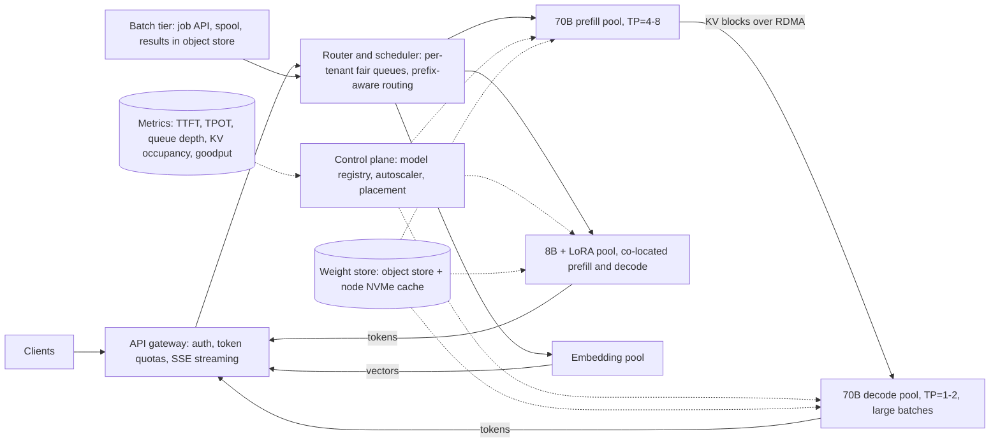
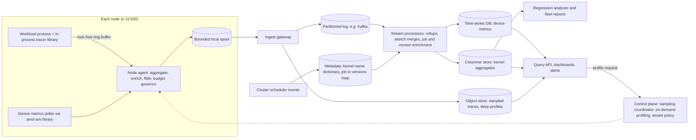
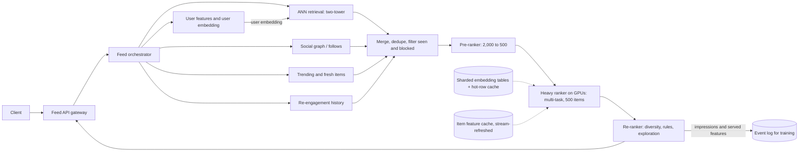

# ML and HPC Systems Design -- Comprehensive Interview Reference

> Last reviewed: 2026-11 · Versions assumed: public datasheets for AMD Instinct MI300X / MI325X / MI355X and NVIDIA H100 / H200; vLLM / SGLang-style serving engines (concepts, not flags); PyTorch FSDP2 and Megatron-style TP/PP/DP; RCCL / NCCL ring collectives; ROCprofiler-SDK (`rocprofv3`) and `amd-smi` for telemetry.

> An interview-style guide to ML infrastructure and HPC system design. It uses the same case-study template as [High Level Design](../computer-science/High_Level_Design.md#6-worked-system-designs): requirements, capacity math, architecture, components and data flow, deep dives, scaling, failure handling, tradeoffs, and likely follow-ups. The difference is that the binding constraints here are FLOPs, HBM capacity and bandwidth, interconnect bandwidth, and failure rates, not just QPS and storage. Framework-level details (PagedAttention internals, Megatron flags, FSDP APIs) live in [ML and AI Frameworks](ML_AI_Frameworks.md); this file is about putting those pieces together into a system and defending the numbers.

---

## Table of Contents

1. [How ML System Design Differs from Classic HLD](#1-how-ml-system-design-differs-from-classic-hld)
2. [A Framework for ML and HPC Design Interviews](#2-a-framework-for-ml-and-hpc-design-interviews)
3. [Numbers Every ML Systems Engineer Should Know](#3-numbers-every-ml-systems-engineer-should-know)
   - [3.1 Accelerators](#31-accelerators)
   - [3.2 Interconnect, Network, and Storage](#32-interconnect-network-and-storage)
   - [3.3 Model Arithmetic](#33-model-arithmetic)
   - [3.4 Collective Communication Cost](#34-collective-communication-cost)
   - [3.5 Reliability Arithmetic](#35-reliability-arithmetic)
   - [3.6 A Napkin-Math Script](#36-a-napkin-math-script)
   - [3.7 Interview Questions](#37-interview-questions)
4. [Case Study: LLM Inference Serving Platform](#4-case-study-llm-inference-serving-platform)
   - [4.1 Requirements and Assumptions](#41-requirements-and-assumptions)
   - [4.2 Capacity Estimate](#42-capacity-estimate)
   - [4.3 Architecture](#43-architecture)
   - [4.4 Components and Data Flow](#44-components-and-data-flow)
   - [4.5 Deep Dive: Continuous Batching and SLOs](#45-deep-dive-continuous-batching-and-slos)
   - [4.6 Deep Dive: KV-Cache Memory Management](#46-deep-dive-kv-cache-memory-management)
   - [4.7 Deep Dive: Routing, Autoscaling, and Multi-Tenant Fairness](#47-deep-dive-routing-autoscaling-and-multi-tenant-fairness)
   - [4.8 Deep Dive: Prefill/Decode Disaggregation](#48-deep-dive-prefilldecode-disaggregation)
   - [4.9 Failure Handling](#49-failure-handling)
   - [4.10 Tradeoffs](#410-tradeoffs)
   - [4.11 Likely Follow-Ups](#411-likely-follow-ups)
5. [Case Study: Distributed Training of a 70B Model on 512 MI300X](#5-case-study-distributed-training-of-a-70b-model-on-512-mi300x)
   - [5.1 Requirements and Assumptions](#51-requirements-and-assumptions)
   - [5.2 Compute and Time Estimate](#52-compute-and-time-estimate)
   - [5.3 Memory Math per GPU](#53-memory-math-per-gpu)
   - [5.4 Choosing Parallelism Degrees](#54-choosing-parallelism-degrees)
   - [5.5 Communication Volume per Step](#55-communication-volume-per-step)
   - [5.6 Architecture and Data Flow](#56-architecture-and-data-flow)
   - [5.7 Checkpointing Strategy and Frequency](#57-checkpointing-strategy-and-frequency)
   - [5.8 Failure Recovery](#58-failure-recovery)
   - [5.9 Data Pipeline Throughput](#59-data-pipeline-throughput)
   - [5.10 Tradeoffs](#510-tradeoffs)
   - [5.11 Likely Follow-Ups](#511-likely-follow-ups)
6. [Case Study: GPU Cluster Job Scheduler](#6-case-study-gpu-cluster-job-scheduler)
   - [6.1 Requirements and Assumptions](#61-requirements-and-assumptions)
   - [6.2 Capacity Estimate](#62-capacity-estimate)
   - [6.3 Architecture](#63-architecture)
   - [6.4 Components and Data Flow](#64-components-and-data-flow)
   - [6.5 Deep Dive: Gang Scheduling and Backfill](#65-deep-dive-gang-scheduling-and-backfill)
   - [6.6 Deep Dive: Topology-Aware Placement and Fragmentation](#66-deep-dive-topology-aware-placement-and-fragmentation)
   - [6.7 Deep Dive: Fairness, Quotas, and Preemption](#67-deep-dive-fairness-quotas-and-preemption)
   - [6.8 Failure Handling](#68-failure-handling)
   - [6.9 Tradeoffs](#69-tradeoffs)
   - [6.10 Likely Follow-Ups](#610-likely-follow-ups)
7. [Case Study: Fleet-Wide GPU Profiling and Telemetry Service](#7-case-study-fleet-wide-gpu-profiling-and-telemetry-service)
   - [7.1 Requirements and Assumptions](#71-requirements-and-assumptions)
   - [7.2 Capacity and Retention Estimate](#72-capacity-and-retention-estimate)
   - [7.3 Architecture](#73-architecture)
   - [7.4 Components and Data Flow](#74-components-and-data-flow)
   - [7.5 Deep Dive: The Overhead Budget](#75-deep-dive-the-overhead-budget)
   - [7.6 Deep Dive: Counter Collection at Fleet Scale](#76-deep-dive-counter-collection-at-fleet-scale)
   - [7.7 Deep Dive: Regression Detection Across Driver and ROCm Versions](#77-deep-dive-regression-detection-across-driver-and-rocm-versions)
   - [7.8 Deep Dive: Privacy and Multi-Tenancy](#78-deep-dive-privacy-and-multi-tenancy)
   - [7.9 Failure Handling](#79-failure-handling)
   - [7.10 Tradeoffs](#710-tradeoffs)
   - [7.11 Likely Follow-Ups](#711-likely-follow-ups)
8. [Case Study: Feature Store](#8-case-study-feature-store)
   - [8.1 Requirements and Assumptions](#81-requirements-and-assumptions)
   - [8.2 Capacity Estimate](#82-capacity-estimate)
   - [8.3 Architecture](#83-architecture)
   - [8.4 Components and Data Flow](#84-components-and-data-flow)
   - [8.5 Deep Dive: Point-in-Time Correctness](#85-deep-dive-point-in-time-correctness)
   - [8.6 Deep Dive: Online/Offline Consistency](#86-deep-dive-onlineoffline-consistency)
   - [8.7 Scaling and Failure Handling](#87-scaling-and-failure-handling)
   - [8.8 Tradeoffs](#88-tradeoffs)
   - [8.9 Likely Follow-Ups](#89-likely-follow-ups)
9. [Case Study: Distributed Checkpointing Service](#9-case-study-distributed-checkpointing-service)
   - [9.1 Requirements and Assumptions](#91-requirements-and-assumptions)
   - [9.2 Capacity Estimate](#92-capacity-estimate)
   - [9.3 Architecture](#93-architecture)
   - [9.4 Components and Data Flow](#94-components-and-data-flow)
   - [9.5 Deep Dive: Atomic Commit and Integrity](#95-deep-dive-atomic-commit-and-integrity)
   - [9.6 Deep Dive: Resharding on Load](#96-deep-dive-resharding-on-load)
   - [9.7 Scaling and Failure Handling](#97-scaling-and-failure-handling)
   - [9.8 Tradeoffs](#98-tradeoffs)
   - [9.9 Likely Follow-Ups](#99-likely-follow-ups)
10. [Case Study: Recommendation System Serving](#10-case-study-recommendation-system-serving)
    - [10.1 Requirements and Assumptions](#101-requirements-and-assumptions)
    - [10.2 Capacity Estimate](#102-capacity-estimate)
    - [10.3 Architecture](#103-architecture)
    - [10.4 Components and Data Flow](#104-components-and-data-flow)
    - [10.5 Deep Dive: The Latency Budget](#105-deep-dive-the-latency-budget)
    - [10.6 Deep Dive: Embeddings and Retrieval](#106-deep-dive-embeddings-and-retrieval)
    - [10.7 Scaling and Failure Handling](#107-scaling-and-failure-handling)
    - [10.8 Tradeoffs](#108-tradeoffs)
    - [10.9 Likely Follow-Ups](#109-likely-follow-ups)
11. [Cross-Case Checklists and Pitfalls](#11-cross-case-checklists-and-pitfalls)
12. [Practice Prompts](#12-practice-prompts)
13. [Answers](#answers)

---

## 1. How ML System Design Differs from Classic HLD

Classic HLD questions are usually bounded by request rate, storage, and consistency. ML and HPC questions add a layer of physics: every design decision has to respect how many FLOPs the hardware can do, how many bytes it can hold and move, and how often it fails. Interviewers at GPU vendors, AI labs, and ML-infra teams expect you to do that arithmetic aloud and let it drive the architecture.

| Dimension | Classic HLD (e.g. URL shortener) | ML / HPC system design |
|---|---|---|
| Unit of work | A request (KB, ms) | A token, a training step, a batch, or a kernel (GB, ms to s) |
| Binding constraint | QPS, storage, DB write rate | FLOP/s, HBM capacity, HBM bandwidth, interconnect bandwidth, power |
| Scale-out model | Stateless replicas behind a load balancer | Tightly coupled gangs (all ranks must be up), plus stateless serving replicas with huge state (weights, KV cache) |
| Failure model | A node dies, retry elsewhere | One GPU dies and a 4,096-GPU job stops; failures are routine at scale |
| Cost model | Servers are cheap relative to engineers | A GPU-hour costs dollars; 1% utilization is real money |
| Key metrics | p99 latency, availability | MFU, goodput, TTFT/TPOT, tokens/s per GPU, $/1M tokens, queue wait |
| Data path | Mostly CPU and network | HBM, xGMI / NVLink, RDMA NICs, PCIe, parallel file systems |

Two habits separate strong candidates:

1. **They find the binding resource before drawing boxes.** "Decode is HBM-bandwidth-bound, so batching is the main throughput lever" is the kind of sentence that should come before the architecture, because it determines the architecture.
2. **They treat failure and cost as first-class requirements.** At 512+ GPUs a hardware fault every few days is normal, and a serving fleet at 30% utilization can cost three times as much as one at 90%.

---

## 2. A Framework for ML and HPC Design Interviews

This extends the [eight-step HLD process](../computer-science/High_Level_Design.md#2-a-repeatable-interview-process) with ML-specific checks.

| Step | What to do | ML-specific questions to ask |
|---|---|---|
| 1. Clarify | Functional scope, users, SLOs | Training or inference? Model size, architecture (dense, MoE, GQA)? Context length? Hardware fixed or chosen? Latency SLO (TTFT/TPOT) or throughput/cost target? |
| 2. Physics first | Estimate FLOPs, bytes, memory, communication | Which resource binds: compute, HBM capacity, HBM bandwidth, interconnect, storage, or power? |
| 3. Shape the work | Choose batching, parallelism, sharding, caching | What moves the binding constraint? (Batch to amortize weight reads; shard to fit memory; overlap communication) |
| 4. Draw data plane and control plane | Data plane: tokens, tensors, gradients. Control plane: scheduling, placement, health, config | Which component is stateful? Where does the big state (weights, KV, optimizer) live? |
| 5. Walk the critical path | One request or one training step end to end | What is serialized? What overlaps? |
| 6. Failure model | What breaks, how often, and what it costs | MTBF of the whole gang, checkpoint cost, blast radius of one bad GPU, silent data corruption |
| 7. Observability and cost | Metrics, alerts, $/unit | MFU, goodput, queue wait, KV utilization, GPU-hours by team, $/1M tokens |
| 8. Tradeoffs and evolution | Compare with one real alternative | What changes at 10x scale, on a different GPU, or with a longer context? |

**Suggested 45-minute split:** 5 min clarify, 7 min physics and estimates, 15 min architecture and data flow, 10 min deep dive on the part the interviewer cares about, 5 min failure and scaling, 3 min summary. If the interviewer asks for one deep dive (for example, "how do you manage KV-cache memory?"), drop breadth and go deep.

**Phrases that signal seniority:**

- "Let me first check whether this is compute-bound or memory-bound."
- "This fits in memory on paper at 156 GB of 192 GB, but I would not plan on it without measuring fragmentation."
- "I will separate the SLO-bearing path from the best-effort path so batch traffic cannot hurt interactive latency."
- "The failure rate scales with GPU count, so recovery time matters as much as checkpoint frequency."

**Common traps:**

- Quoting sparse or marketing peak FLOPs as if they were achievable. Use dense peaks and an explicit efficiency (MFU 35-50% for large training runs, 60-80% of peak HBM bandwidth for streaming kernels).
- Using GPU "utilization" (the fraction of time any kernel is running) as a capacity signal. A GPU can report 100% while doing 5% of its peak FLOPs.
- Forgetting that collective operations make a training job a single failure domain.
- Ignoring the control plane: who decides placement, who detects a dead rank, who garbage-collects partial checkpoints.

See also: [Fermi Estimation](../computer-science/Math_Probability_Estimation.md#9-fermi-estimation), [Roofline Model](../computer-science/Performance_Engineering.md#3-roofline-model), and [Little's Law and Queueing](../computer-science/Performance_Engineering.md#4-littles-law-and-queueing).

---

## 3. Numbers Every ML Systems Engineer Should Know

### 3.1 Accelerators

Vendor-published theoretical peaks. **Dense** throughput is shown; vendor headline numbers for FP16/FP8 often assume 2:4 structured sparsity, which doubles them. Re-check datasheets before an interview, because SKUs and clocks change.

| | AMD MI300X | AMD MI325X | AMD MI355X | NVIDIA H100 SXM | NVIDIA H200 SXM |
|---|---|---|---|---|---|
| Architecture | CDNA 3 | CDNA 3 | CDNA 4 | Hopper | Hopper |
| HBM capacity | 192 GB HBM3 | 256 GB HBM3E | 288 GB HBM3E | 80 GB HBM3 | 141 GB HBM3e |
| HBM bandwidth | 5.3 TB/s | 6.0 TB/s | 8.0 TB/s | 3.35 TB/s | 4.8 TB/s |
| BF16/FP16 dense | 1,307 TFLOP/s | 1,307 TFLOP/s | ~2,500 TFLOP/s | ~989 TFLOP/s | ~989 TFLOP/s |
| FP8 dense | 2,615 TFLOP/s | 2,615 TFLOP/s | ~5,000 TFLOP/s | ~1,979 TFLOP/s | ~1,979 TFLOP/s |
| FP4 / MXFP4 | -- | -- | ~10,000 TFLOP/s | -- | -- |
| FP64 vector | 81.7 TFLOP/s | 81.7 TFLOP/s | 78.6 TFLOP/s | ~34 TFLOP/s | ~34 TFLOP/s |
| Scale-up link (per GPU) | 7 Infinity Fabric (xGMI) links, 896 GB/s aggregate bidirectional, full mesh of 8 | Same topology as MI300X | ~1 TB/s+ aggregate (sources differ on the exact figure) | NVLink 4, 900 GB/s bidirectional, via NVSwitch | Same as H100 |
| Board power | 750 W | 1,000 W | 1,400 W (liquid-cooled) | 700 W | 700 W |
| BF16 ridge point | ~247 FLOP/B | ~218 FLOP/B | ~313 FLOP/B | ~295 FLOP/B | ~206 FLOP/B |

The **ridge point** (peak FLOP/s divided by peak bytes/s) is the arithmetic intensity a kernel needs before it stops being memory-bound. LLM decode at batch 1 has an intensity of about 1 FLOP/B, so it is far below every ridge point. See [Ridge Points: MI300X and a CPU](../computer-science/Performance_Engineering.md#33-ridge-points-mi300x-and-a-cpu).

**The topology difference that matters in design questions.** An MI300X 8-GPU platform is a **full mesh**: each GPU has one direct xGMI link to each of the other seven, at about 64 GB/s per direction per link. Collectives that use all seven links at once (all-reduce, all-gather across all 8 GPUs) see up to about 448 GB/s per direction per GPU. A single point-to-point transfer between two GPUs uses one link, so it peaks around 64 GB/s per direction. On H100/H200 HGX boards, NVSwitch lets any pair use the full ~450 GB/s per direction. Consequences:

- Tensor parallelism across all 8 GPUs uses the whole MI300X mesh well. TP=4 or TP=2 groups use only 3 or 1 of the 7 links unless several groups are interleaved.
- Point-to-point patterns (pipeline-parallel sends, KV-cache transfer between two GPUs in one node) are relatively slower on a mesh than on a switch.

### 3.2 Interconnect, Network, and Storage

Order-of-magnitude planning numbers. "Per direction" matters: network specs are per direction, while GPU link specs are often quoted bidirectionally.

| Path | Typical bandwidth | Notes |
|---|---|---|
| HBM (one GPU) | 3-8 TB/s | Achievable streaming is roughly 70-85% of peak |
| GPU-GPU in node (all links) | ~450 GB/s per direction | xGMI mesh (MI300X) or NVLink/NVSwitch (H100) |
| GPU-GPU in node (one MI300X link) | ~64 GB/s per direction | Point-to-point on a mesh |
| PCIe Gen5 x16 (GPU to host) | ~64 GB/s per direction (128 GB/s bidirectional) | Host staging, checkpoint snapshots, KV offload |
| 400 Gb/s NIC (RoCE or InfiniBand NDR) | 50 GB/s per direction | Typical AI node: 8 NICs, one per GPU ("rail-optimized") |
| Node scale-out (8 x 400G) | 400 GB/s per direction | About 9x less than in-node GPU-GPU bandwidth per GPU |
| Host DRAM | 300-600 GB/s per socket | 1.5-3 TB per node is common in AI servers |
| Local NVMe (Gen4 / Gen5) | 6-7 / 12-14 GB/s read per drive | Weight cache, checkpoint staging |
| Parallel file system (Lustre, GPFS, WEKA, VAST, etc.) | 100s of GB/s to several TB/s aggregate | Shared by every job; plan per-job bandwidth explicitly |
| Object store (per client) | 1-10 GB/s with parallel ranged GETs | Cheap and durable; high first-byte latency |
| Network round trip | ~2-5 µs RDMA in a rack; ~0.5 ms across a region | Latency term in collectives |

### 3.3 Model Arithmetic

Use these formulas for dense decoder-only transformers. *N* is the parameter count, *D* the number of training tokens, *L* the number of layers, *h* the hidden size, *s* the sequence length, and *b* the micro-batch size.

| Quantity | Formula | Worked example (Llama-3-70B-class: L=80, h=8192, 64 query heads, 8 KV heads, head dim 128, FFN 28672) |
|---|---|---|
| Parameters | Per layer: attention `2h^2 + 2h*(kv_heads*head_dim)` + SwiGLU MLP `3*h*ffn`; plus embeddings | `151M + 705M = 856M` per layer x 80 = 68.4B, plus about 2.1B of embeddings (128k vocab, untied) = **~70.6B** |
| Weight bytes | `N x bytes/param` | BF16: 141 GB. FP8: 71 GB |
| Training FLOPs | `6ND` (2 forward + 4 backward); `8ND` with full activation recompute | 70B x 2T tokens: **8.4e23 FLOPs** |
| Inference FLOPs | `2N` per generated or prefilled token (plus attention, `~4*L*h*context` per token, small at short context) | **1.4e11 FLOPs per token** |
| KV cache per token | `2 x L x kv_heads x head_dim x bytes` | `2 x 80 x 8 x 128 x 2 B` = **320 KiB/token** in BF16; 160 KiB in FP8; 1.25 GiB per 4k-token sequence |
| Training memory (mixed-precision Adam) | `2 (BF16 weights) + 2 (BF16 grads) + 4 (FP32 master) + 4 (Adam m) + 4 (Adam v)` = **16 B/param** | 70B x 16 B = **1.12 TB** before activations |
| Activations per layer (Megatron estimate, flash attention, BF16) | about `34 x s x b x h` bytes, divided by TP degree with sequence parallelism | s=8192, b=1: **2.28 GB per layer**; x80 layers = 182 GB without recompute |
| Decode arithmetic intensity | about `batch` FLOP/B for the weight GEMMs at BF16 (2 FLOPs per 2-byte weight per sequence) | Need batch ~250 to reach the MI300X BF16 ridge point |

Two notes interviewers like to probe:

- **Why GQA matters for serving.** With 64 KV heads instead of 8, the same model would need 2.5 MiB of KV per token, eight times more. GQA is one of the main reasons 70B-class models serve economically.
- **Where the 16 bytes go.** Optimizer state (12 B: master weights plus two Adam moments) is three quarters of the model state. That is why ZeRO-1 (shard only the optimizer) already removes most of the redundancy in data parallelism. Some stacks also keep FP32 gradient accumulation buffers (+2 B/param); state that assumption if you use it.

[LLM and ML Fundamentals](LLM_and_ML_Fundamentals.md#7-flop-accounting-and-scaling-laws) derives the FLOP formulas and [KV cache sizing with GQA](LLM_and_ML_Fundamentals.md#92-kv-cache-sizing-with-gqa); [ML and AI Frameworks, section 30](ML_AI_Frameworks.md#30-vllm-architecture-and-pagedattention) covers PagedAttention and the KV cache in vLLM.

### 3.4 Collective Communication Cost

The **alpha-beta model**: sending *n* bytes costs `alpha + n / B`, where alpha is per-message latency (a few microseconds) and B is link bandwidth.

| Collective (p ranks, S bytes total per rank) | Bytes each rank sends (and receives) with ring algorithm | Ring time |
|---|---|---|
| Reduce-scatter | `(p-1)/p x S` | `(p-1) x alpha + (p-1)/p x S/B` |
| All-gather | `(p-1)/p x S` | same |
| All-reduce = reduce-scatter + all-gather | `2(p-1)/p x S` | `2(p-1) x alpha + 2(p-1)/p x S/B` |
| All-to-all (MoE expert dispatch) | `(p-1)/p x S` | Bandwidth-bound by the bisection of the network |
| Broadcast (pipelined ring) | `S` | `~S/B` for large S |

Key facts:

- **Ring all-reduce bandwidth cost is nearly independent of p.** Each rank moves about `2S` bytes whether there are 8 or 8,000 ranks. The latency term grows linearly with p, which is why libraries switch to tree or hierarchical algorithms for small messages and large rank counts.
- **"Bus bandwidth"** in `rccl-tests` / `nccl-tests` is `algorithm bandwidth x 2(p-1)/p` for all-reduce. It is comparable to the link speed, so it is the number to compare against hardware peaks.
- **Hierarchical all-reduce on 8-GPU nodes:** reduce-scatter inside the node (fast links), then all-reduce across nodes with each GPU handling 1/8 of the data over its own NIC, then all-gather inside the node. Each NIC carries only `2(n-1)/n x S/8` bytes. This is why one NIC per GPU ("rails") matters.
- **Worked example:** all-reducing 17.5 GB of BF16 gradients across 64 nodes at 50 GB/s per direction takes `2 x 63/64 x 17.5 GB / 50 GB/s` = **0.69 s** plus latency.

See [Collective Communication](Parallel_GPU_Programming.md#3-collective-communication) for MPI semantics.

### 3.5 Reliability Arithmetic

- **Gang MTBF:** if components fail independently, `MTBF_job ≈ MTBF_component / number_of_components`. Doubling the GPU count halves the time between interruptions.
- **Field data point:** Meta's Llama 3 paper reports **419 unexpected interruptions in a 54-day period on 16,384 H100 GPUs**, about one every 3 hours, with GPU and HBM faults the largest categories. Scaled linearly to 512 GPUs, that is about 13 interruptions in 54 days, or an MTBF of about **4 days (~100 hours)**. Early-life ("burn-in") failure rates are higher, so plan for worse.
- **Young/Daly optimal checkpoint interval:** `tau ≈ sqrt(2 x delta x M)`, where delta is the time training is blocked per checkpoint and M is the job MTBF.
- **Expected waste fraction** ≈ `delta / tau` (checkpoint overhead) `+ (tau/2 + R) / M` (lost work plus restart time R per failure).

| Blocking checkpoint cost (delta) | MTBF (M) | Optimal interval | Waste (with R = 15 min) |
|---|---|---|---|
| 10 s (synchronous write at ~100 GB/s) | 100 h | ~45 min | ~1.0% |
| 1 s (async: snapshot to host memory) | 100 h | ~14 min | ~0.5% |
| 10 s | 24 h | ~22 min | ~2.5% |

The lesson: once checkpointing is asynchronous, **restart time R dominates**. Reducing R (hot spares, fast loads from local or peer memory) is the next lever.

### 3.6 A Napkin-Math Script

Run it before an interview and be able to reproduce each line by hand.

```python
"""ml_napkin.py -- back-of-envelope calculator for ML/HPC system design interviews."""
import math

GiB = 2**30


def kv_bytes_per_token(layers: int, kv_heads: int, head_dim: int, bytes_per_elem: int = 2) -> int:
    """K and V, for every layer and every KV head."""
    return 2 * layers * kv_heads * head_dim * bytes_per_elem


def decode_step_s(weight_bytes: float, kv_bytes_read: float, hbm_bw: float, eff: float = 0.7) -> float:
    """Memory-bound decode step: stream all weights once plus every sequence's KV cache."""
    return (weight_bytes + kv_bytes_read) / (hbm_bw * eff)


def ring_allreduce_s(size_bytes: float, p: int, bw: float, alpha_s: float = 10e-6) -> float:
    """Each rank sends and receives 2(p-1)/p * size; 2(p-1) latency-bound steps."""
    return 2 * (p - 1) / p * size_bytes / bw + 2 * (p - 1) * alpha_s


def young_daly_interval_s(ckpt_cost_s: float, mtbf_s: float) -> float:
    return math.sqrt(2 * ckpt_cost_s * mtbf_s)


def waste_fraction(ckpt_cost_s: float, interval_s: float, mtbf_s: float, restart_s: float) -> float:
    """Checkpoint overhead + expected lost work (half an interval) + restart cost, per failure."""
    return ckpt_cost_s / interval_s + (interval_s / 2 + restart_s) / mtbf_s


if __name__ == "__main__":
    kv = kv_bytes_per_token(layers=80, kv_heads=8, head_dim=128)            # Llama-3-70B, BF16
    print(f"70B GQA KV cache: {kv / 1024:.0f} KiB/token, {kv * 4096 / GiB:.2f} GiB per 4k-token sequence")

    # Decode on one MI300X: FP8 weights (70 GB), FP8 KV, average context 1,650 tokens, batch 128
    kv_seq = 1650 * kv_bytes_per_token(80, 8, 128, bytes_per_elem=1)
    step = decode_step_s(70e9, 128 * kv_seq, 5.3e12)
    print(f"decode step (batch 128): {step * 1e3:.1f} ms -> {128 / step:,.0f} tokens/s per GPU")

    flops = 6 * 70e9 * 2e12                                                   # 6 N D
    for mfu in (0.35, 0.40, 0.50):
        days = flops / (512 * 1307.4e12 * mfu) / 86400
        print(f"70B x 2T tokens on 512 MI300X at {mfu:.0%} MFU: {days:.1f} days")

    t = ring_allreduce_s(17.5e9, 64, 50e9)
    print(f"ring all-reduce, 17.5 GB over 64 ranks at 50 GB/s: {t:.2f} s")

    mtbf = 100 * 3600
    for ckpt in (10.0, 1.0):
        tau = young_daly_interval_s(ckpt, mtbf)
        w = waste_fraction(ckpt, tau, mtbf, restart_s=900)
        print(f"blocking ckpt {ckpt:>4.0f} s, MTBF 100 h -> every {tau / 60:.0f} min, total waste {w:.2%}")
```

```text
70B GQA KV cache: 320 KiB/token, 1.25 GiB per 4k-token sequence
decode step (batch 128): 28.2 ms -> 4,540 tokens/s per GPU
70B x 2T tokens on 512 MI300X at 35% MFU: 41.5 days
70B x 2T tokens on 512 MI300X at 40% MFU: 36.3 days
70B x 2T tokens on 512 MI300X at 50% MFU: 29.0 days
ring all-reduce, 17.5 GB over 64 ranks at 50 GB/s: 0.69 s
blocking ckpt   10 s, MTBF 100 h -> every 45 min, total waste 1.00%
blocking ckpt    1 s, MTBF 100 h -> every 14 min, total waste 0.49%
```

### 3.7 Interview Questions

**Q1.** Why is LLM decode memory-bound, and what does that imply for system design?

Each decode step generates one token per sequence, so every weight is read from HBM once per step and used for only `2 x batch` FLOPs. At batch 1 in BF16 the intensity is about 1 FLOP/B, roughly 250x below the MI300X ridge point. Step time is therefore about `(weight bytes + KV bytes read) / HBM bandwidth`, almost independent of batch size until the batch reaches the hundreds. Implications: (1) batching is nearly free throughput, so the serving engine should keep as many sequences in flight as KV memory and the TPOT SLO allow; (2) weight quantization (FP8, INT4 weight-only) speeds decode roughly in proportion to bytes saved, even when compute stays in higher precision; (3) KV-cache capacity, not FLOPs, limits the batch, so KV memory management becomes the core of the design; (4) GPUs with more HBM bandwidth and capacity (MI300X, H200) win on decode-heavy workloads.

**Q2.** A 70B model trains on 2T tokens. Roughly how many GPU-hours is that on MI300X, and what assumptions did you make?

`6ND = 6 x 70e9 x 2e12 = 8.4e23` FLOPs. At 40% MFU of the 1.307 PFLOP/s dense BF16 peak, each GPU delivers about 5.2e14 FLOP/s, so the job needs `8.4e23 / 5.2e14 ≈ 1.6e9` GPU-seconds ≈ **446k GPU-hours**: about 36 days on 512 GPUs. Assumptions: dense model, sequence length short enough that attention FLOPs are small relative to 6N per token (at 8k context they add roughly 5-10%), no full activation recompute (which would make it 8ND), and that MFU 40% is achievable. Also add 3-10% for failures and restarts.

**Q3.** Why does the ring all-reduce cost not grow with the number of GPUs, and when does that stop being true?

In a ring, the buffer is split into p chunks. In p-1 reduce-scatter steps and p-1 all-gather steps, each rank sends one chunk of size S/p per step, for a total of `2(p-1)/p x S ≈ 2S`. The bandwidth term is constant in p. It stops being true when (1) the latency term `2(p-1) x alpha` dominates, which happens for small messages or very large p (use tree or hierarchical algorithms); (2) the ring crosses an oversubscribed network link, so the slowest hop sets the speed; or (3) one straggler slows every step, because each step waits on a neighbor.

**Q4.** Why is GPU utilization a bad autoscaling or capacity signal?

The common "GPU utilization" metric reports the fraction of time at least one kernel was running. A decode loop running tiny memory-bound kernels, or a job stuck waiting in a collective with a spinning kernel, can report near 100% while using a small fraction of the GPU's compute or bandwidth. Better signals: for serving, queue depth, KV-cache occupancy, and TTFT/TPOT against the SLO; for training, tokens/s, MFU, and step time; for hardware efficiency, counter-based metrics such as achieved FLOP/s and HBM bandwidth (what tools like rocprof-compute report).

---

## 4. Case Study: LLM Inference Serving Platform

The prompt: *"Design a platform that serves several LLMs to many internal and external tenants with streaming responses. Make it fast and cost-efficient."* This is the most common ML-infra design question. The interviewer wants to hear that decode is memory-bound, that KV-cache memory is the scarce resource, and that the scheduler, not the load balancer, is the heart of the system.

### 4.1 Requirements and Assumptions

**Functional**

- OpenAI-compatible completion and chat APIs with token streaming (server-sent events).
- Multiple models: a 70B-class flagship (GQA, 80 layers), an 8B-class fast model with up to a few hundred LoRA adapters, and an embedding model.
- Tenants authenticate with API keys and have quotas in tokens per minute. Two tiers: **interactive** (SLO-bearing) and **batch** (complete within 24 hours, cheaper).

**Non-functional**

- 70B interactive SLOs: **TTFT p99 ≤ 1 s** for prompts up to 4k tokens (≤ 3 s up to 32k); **TPOT p99 ≤ 50 ms** (at least 20 tokens/s, faster than people read).
- 99.9% availability per model. One tenant's burst must not break another tenant's SLO.
- Maximize **goodput per GPU-hour**. Report $/1M tokens per model and tenant.
- Out of scope: training, retrieval (RAG), and safety classifiers (mention them as pre- and post-processing hooks).

**Serving metrics, defined precisely**

| Metric | Definition | What drives it |
|---|---|---|
| **TTFT** (time to first token) | Request arrival to first streamed token | Queueing + prefill compute (+ KV transfer if disaggregated) |
| **TPOT** / **ITL** (time per output token / inter-token latency) | Average (TPOT) or per-gap (ITL) time between streamed tokens | Decode step time: weight and KV reads, batch size, prefill interference |
| **E2E latency** | `TTFT + TPOT x (output_tokens - 1)` | Both |
| **Throughput** | Tokens/s per GPU (input and output counted separately) | Batch size, quantization, parallelism |
| **Goodput** | Requests/s that meet **both** TTFT and TPOT SLOs | The metric to maximize; raw throughput can rise while goodput falls |

### 4.2 Capacity Estimate

Plan for the 70B model; the smaller models are a small fraction of the fleet.

```text
Traffic:        10M requests/day; average 1,500 input + 300 output tokens
Average:        10M / 86,400 ≈ 116 req/s;  peak (3x) ≈ 350 req/s
Peak tokens:    prefill 350 x 1,500 = 525k tok/s;  decode 350 x 300 = 105k tok/s
Prefix cache:   assume 50% of prompt tokens hit (system prompts, chat history) -> ~260k tok/s to compute

Prefill (compute-bound):
  FLOPs/token     2N = 1.4e11
  per MI300X      FP8 dense peak 2.6 PFLOP/s x ~40% ≈ 1.0 PFLOP/s  ->  ~7,000 tok/s
  GPUs            260k / 7k ≈ 37

Decode (HBM-bandwidth-bound), one replica per GPU (TP=1, FP8 weights 70 GB, FP8 KV 160 KiB/token):
  KV per seq      ~1,650 tokens average context x 160 KiB ≈ 270 MB
  step time       (70 GB + 128 x 0.27 GB) / (5.3 TB/s x 0.7) ≈ 28 ms at batch 128
  throughput      128 / 28 ms ≈ 4,500 tok/s; plan 4,000 after scheduling overhead
  GPUs            105k / 4k ≈ 27

Peak total        ≈ 64 GPUs; provision ~80 (10 nodes) for SLO headroom and N+1

Memory check per GPU:
  192 GB - 70 GB weights - ~15 GB activations/workspace ≈ 105 GB for KV
  105 GB / 270 MB ≈ 390 average-length sequences (or ~155 at the full 4k context)
  -> KV room (~390 sequences) is not the first limit: at a 50 ms TPOT, compute caps a step at
     ~357 tokens (section 4.5), so decode batch is held at ~128 to leave ~230 tokens/step for chunked prefill

TTFT check:
  1,500-token prompt, 750 uncached: 750 x 1.4e11 / 1e15 ≈ 105 ms of prefill  -> fine
  32k-token prompt, uncached:       32k x 1.4e11 / 1e15 ≈ 4.5 s on one GPU  -> needs TP=4-8 prefill
```

**Cost.** With a diurnal pattern (average ≈ peak / 3) and autoscaling, the fleet averages about 45 GPUs including headroom.

```text
GPU-hours/day        45 x 24 = 1,080
At an assumed $2.50 per GPU-hour:          $2,700/day
Tokens/day           3B output + 15B input
Fleet cost per 1M output tokens            $2,700 / 3,000 ≈ $0.90 (prefill cost folded in)

Unit cost formula:   $/1M tokens = ($/GPU-hour) / (tokens/s per GPU x 3,600) x 1e6
Decode at full load: 2.50 / (4,000 x 3,600) x 1e6 ≈ $0.17 per 1M decode tokens
```

The gap between the full-load unit cost and the fleet cost is **utilization**. The batch tier exists largely to fill diurnal troughs with work that has no latency SLO.

### 4.3 Architecture



The 70B model is drawn disaggregated (separate prefill and decode pools) and the 8B model co-located. Start the interview with the co-located version and introduce disaggregation in the deep dive (section 4.8) once you have shown why it helps.

### 4.4 Components and Data Flow

| Component | Responsibility | State |
|---|---|---|
| API gateway | TLS, auth, tenant lookup, token-based rate limits, request validation (max context), SSE streaming to the client | Stateless; rate-limit counters in a shared store |
| Router / scheduler | Picks model pool and replica; holds per-tenant queues; enforces priorities and fairness; admission control | Soft state: replica load, prefix-cache hints |
| Engine replica | One model instance on 1-8 GPUs: continuous batching, paged KV cache, prefix cache, sampling, graph capture for decode | Weights (read-only), KV cache (per request) |
| KV transfer layer | Moves KV blocks prefill → decode (RDMA, xGMI within a node) | In-flight buffers |
| Model registry | Model versions, quantization, parallelism config, rollout state (canary %) | Durable metadata |
| Weight store | Versioned weights in an object store; NVMe cache on each node | Durable blobs |
| Autoscaler | Adds or removes replicas per pool from queue and SLO signals | Policy |
| Batch tier | Accepts large offline jobs, spools requests, feeds them at low priority, writes results to object storage | Durable job state |

**Data flow of one interactive request (co-located replica):**

1. The gateway authenticates, checks the tenant's token budget (prompt tokens plus `max_tokens`), and opens an SSE stream.
2. The router tokenizes (or receives token counts), computes the prefix hash of the first few KV blocks, and chooses a replica that is likely to have that prefix cached and is not overloaded (section 4.7).
3. The request waits in the replica's queue. The engine's per-step scheduler admits it when enough KV blocks are free and the tenant's fair share allows.
4. Prefill runs in chunks interleaved with other requests' decode steps. The first token is sampled at the end of prefill and streamed (TTFT).
5. Each later engine step generates one token for every running sequence. Tokens are detokenized incrementally and streamed (TPOT).
6. On a stop token or `max_tokens`, the engine frees the sequence's KV blocks. Full prompt blocks stay in the prefix cache until evicted. Usage (input and output tokens) is recorded for billing and fairness.

### 4.5 Deep Dive: Continuous Batching and SLOs

**Static batching** waits for a batch to fill and runs it until the longest sequence finishes, wasting slots on sequences that ended early. **Continuous (iteration-level) batching** re-forms the batch at every step: finished sequences leave and waiting ones join. See [Scheduling and Batching](ML_AI_Frameworks.md#32-scheduling-and-batching) for the vLLM view.

Each engine step runs a **token budget**: one token for every running decode, plus chunks of waiting prompts (**chunked prefill**) up to the budget. The budget is set by the TPOT SLO, not by throughput alone:

```text
Step time ≈ max( memory time = (weights + KV read) / effective HBM BW,
                 compute time = tokens_in_step x 2N / effective FLOP/s )

MI300X, 70B FP8, TP=1, batch 128 decodes:
  memory time   ≈ 28 ms
  compute time  ≈ 128 x 1.4e11 / 1e15 ≈ 18 ms   -> memory-bound; ~70 tokens of "free" compute slack

TPOT SLO 50 ms -> at most 50e-3 x 1e15 / 1.4e11 ≈ 357 tokens per step
  = 128 decode tokens + ~230 prefill tokens per step
```

So a single-GPU 70B replica can only fold about 230 prefill tokens into each step while honoring a 50 ms TPOT. A 32k-token prompt would take 140 steps (7 s) to prefill without stalling decodes. Higher TP multiplies the per-step token budget (TP=8 gives roughly 8x the FLOP/s), which is why long-prompt traffic wants larger TP for prefill while decode prefers TP=1-2 with large batches. That tension is the core argument for disaggregation.

**SLO-aware step scheduling:**

- Running decodes go first; they protect TPOT, and preempting them wastes KV already built.
- Prefill admission is ordered by TTFT deadline (earliest deadline first), within each tenant's fair share.
- Batch-tier work only fills leftover budget and is the first to be preempted.

**Choose the operating point by goodput, not throughput.** Throughput keeps rising with batch size until KV memory runs out, but TPOT rises too. Sweep the batch cap and token budget with a load generator, plot goodput (requests/s meeting both SLOs), and run at the knee, typically 70-80% of the maximum throughput. Queueing theory explains the knee: latency grows roughly as `1 / (1 - utilization)` (see [Utilization vs Latency](../computer-science/Performance_Engineering.md#44-utilization-vs-latency-mm1-and-beyond)).

### 4.6 Deep Dive: KV-Cache Memory Management

KV memory decides batch size, and batch size decides decode throughput. The engine manages it like a virtual-memory system.

| Mechanism | How it works | Why |
|---|---|---|
| **Paged KV blocks** | KV is stored in fixed blocks (e.g. 16 tokens). Each sequence has a block table mapping logical to physical blocks | No external fragmentation; waste is less than one block per sequence |
| **Admission control** | Admit a request only if its prompt blocks plus a free-block watermark are available | Prevents admitting work that will immediately be preempted |
| **Preemption** | When decode growth exhausts blocks, evict a victim: **recompute** (drop KV, re-prefill later) or **swap** to host memory | Recompute is cheap for short sequences; swap for long ones (270 MB over PCIe at ~50 GB/s ≈ 5 ms vs ~200 ms to recompute 1,500 tokens) |
| **Prefix caching** | Full blocks are keyed by a hash chained over all preceding tokens; identical prefixes share physical blocks with reference counts; unreferenced blocks are evicted LRU | System prompts and multi-turn history skip prefill entirely |
| **KV quantization** | Store KV in FP8 | Halves KV memory and bandwidth; small, model-dependent accuracy cost |
| **Tiered KV (offload)** | Spill cold prefix blocks to host DRAM, then NVMe or a remote KV store | Multi-turn chats return minutes later; reloading beats recomputing |

**Is offloading worth it?** Reloading the KV for a 1,500-token prefix (FP8: 1,500 x 160 KiB ≈ 246 MB) over PCIe at ~50 GB/s takes about 5 ms. Recomputing it costs `1,500 x 1.4e11 / 1e15 ≈ 210 ms` of GPU time. Offload wins by about 40x whenever the session returns before the host copy is evicted. Host DRAM per node (1.5-3 TB) holds thousands of such prefixes.

A toy block manager with chained prefix hashing, all-or-nothing admission, and LRU eviction of unreferenced cached blocks:

```python
"""paged_kv.py -- toy paged KV-cache block manager with prefix sharing and all-or-nothing admission."""
from collections import OrderedDict

BLOCK = 16  # tokens per KV block


class BlockManager:
    def __init__(self, num_blocks: int, share_prefixes: bool = True) -> None:
        self.free: list[int] = list(range(num_blocks))
        self.ref: dict[int, int] = {}                        # block -> number of sequences using it
        self.cache: OrderedDict[int, int] = OrderedDict()    # chained prefix hash -> block (LRU order)
        self.hash_of: dict[int, int] = {}                    # block -> its prefix hash (if cached)
        self.tables: dict[str, list[int]] = {}               # sequence -> block table
        self.share = share_prefixes

    def _take(self) -> int | None:
        if self.free:
            return self.free.pop()
        for h, b in self.cache.items():                      # evict the oldest cached, unused block
            if self.ref.get(b, 0) == 0:
                del self.cache[h], self.hash_of[b]
                return b
        return None

    def _release(self, blocks: list[int]) -> None:
        for b in blocks:
            self.ref[b] -= 1
            if self.ref[b] == 0 and b not in self.hash_of:   # cached blocks stay resident until evicted
                self.free.append(b)

    def admit(self, seq: str, tokens: list[int]) -> bool:
        table: list[int] = []
        h = 0
        for start in range(0, len(tokens), BLOCK):
            chunk = tuple(tokens[start:start + BLOCK])
            full = len(chunk) == BLOCK
            h = hash((h, chunk))                             # hash chains over the whole prefix
            if self.share and full and h in self.cache:
                b = self.cache[h]
                self.cache.move_to_end(h)
            else:
                b = self._take()
                if b is None:                                # no room: roll back, admit nothing
                    self._release(table)
                    return False
                if self.share and full:
                    self.cache[h], self.hash_of[b] = b, h
            self.ref[b] = self.ref.get(b, 0) + 1
            table.append(b)
        self.tables[seq] = table
        return True

    def finish(self, seq: str) -> None:
        self._release(self.tables.pop(seq))


if __name__ == "__main__":
    system_prompt = list(range(512))                         # 32 full blocks shared by every request
    for share in (False, True):
        bm = BlockManager(num_blocks=100, share_prefixes=share)
        admitted = 0
        while bm.admit(f"req{admitted}", system_prompt + [10_000 + admitted * 100 + i for i in range(100)]):
            admitted += 1
        print(f"prefix sharing={share!s:5}: admitted {admitted} requests of 612 tokens into 100 blocks")
    bm.finish("req0")
    evictable = sum(1 for b in bm.cache.values() if bm.ref.get(b, 0) == 0)
    print(f"after req0 finishes: {len(bm.free)} free + {evictable} evictable cached blocks; "
          f"shared prefix refcount = {bm.ref[bm.tables['req1'][0]]}")
```

```text
prefix sharing=False: admitted 2 requests of 612 tokens into 100 blocks
prefix sharing=True : admitted 9 requests of 612 tokens into 100 blocks
after req0 finishes: 1 free + 11 evictable cached blocks; shared prefix refcount = 8
```

Each request needs 39 blocks (612 / 16, rounded up). With sharing, the 32 system-prompt blocks are stored once, so later requests need only 7 new blocks each, and 4.5x more requests fit. The 11 evictable blocks are req0's 6 unique full blocks plus 5 blocks cached by the 10th request's failed admission; they remain useful as a warm cache until memory pressure evicts them. Production engines add a radix tree over cached blocks (SGLang's RadixAttention), copy-on-write for parallel sampling, and per-tenant block caps.

### 4.7 Deep Dive: Routing, Autoscaling, and Multi-Tenant Fairness

**Routing.** Round robin is wrong for LLMs: requests differ in cost by 100x, and it ignores prefix caches.

- Level 1: model and version → pool (canary percentages live here).
- Level 2: replica choice. Score each candidate by `pending prefill tokens + KV occupancy`, and prefer the replica that likely holds the request's prefix. Implement affinity with **consistent hashing on the prefix hash or session ID, with bounded load**: if the preferred replica is above `(1 + epsilon) x average load`, fall through to the next one on the ring. Without the bound, one popular system prompt melts one replica. "Power of two choices" on the load score is a simpler fallback.
- Requests with very long prompts go to replicas configured with larger TP or to the prefill pool.

**Autoscaling.** The scale-out lead time is long, so the policy must be predictive as well as reactive.

```text
Cold start for a 70B FP8 replica (70 GB of weights):
  from object store at ~2 GB/s           ≈ 35 s
  from local NVMe at ~6 GB/s             ≈ 12 s
  from a running peer over RDMA 50 GB/s  ≈ 1.5 s
  + engine init, memory profiling, graph capture: tens of seconds
  + node acquisition if no warm node exists: minutes
```

- Signals: queue wait time, pending prefill tokens, KV occupancy, TTFT and TPOT p95 against the SLO. Not GPU utilization (see [3.7 Q4](#37-interview-questions)).
- Scale out early (predicted diurnal curve plus a reactive term), scale in slowly with hysteresis, and keep a warm standby pool with weights already on NVMe.
- Long-tail models: scale to zero only if a cold start of tens of seconds is acceptable. Otherwise host many LoRA adapters on one shared base model, or pack several small models on one GPU (MI300X supports compute and memory partitioning modes that expose one physical GPU as several logical ones).

**Multi-tenant fairness.**

- **Rate limits in tokens, not requests.** A 100k-token prompt is not the same as a 100-token prompt. Charge input and output tokens, with output weighted higher (it costs a decode slot for its whole lifetime). See [Rate Limiter](../computer-science/High_Level_Design.md#62-rate-limiter).
- **Weighted fair queueing on tokens.** The Virtual Token Counter (VTC) scheduler from "Fairness in Serving Large Language Models" (Sheng et al., OSDI 2024) keeps a per-tenant counter of weighted tokens served and always admits from the backlogged tenant with the smallest counter. When an idle tenant returns, its counter is raised to the minimum of the active tenants so it cannot bank credit.
- **Isolation of memory.** Cap each tenant's concurrent KV blocks, so one tenant with huge contexts cannot occupy the whole cache and starve everyone else.
- **Priority tiers.** Interactive above batch. Batch work is admitted only below a utilization threshold and preempted first.

```python
# fragment -- VTC-style admission: pick the backlogged tenant with the least weighted service
def pick_next(queues: dict[str, list], counters: dict[str, float]) -> str | None:
    backlogged = [t for t, q in queues.items() if q]
    return min(backlogged, key=lambda t: counters[t]) if backlogged else None

def on_tokens_served(counters, tenant, n_in, n_out, w_in=1.0, w_out=2.0, weight=1.0):
    counters[tenant] += (w_in * n_in + w_out * n_out) / weight   # weight = tenant's share
```

### 4.8 Deep Dive: Prefill/Decode Disaggregation

**Idea:** run prefill and decode on different GPU pools. A prefill worker computes the prompt's KV cache and first token, then transfers the KV blocks to a decode worker, which continues generation. Research systems such as DistServe and Splitwise and production systems such as Moonshot's Mooncake popularized the approach; mainstream open-source engines now support it.

**Why it helps:**

| Problem with co-location | How disaggregation fixes it |
|---|---|
| Prefill chunks inflate decode step time (section 4.5) | Decode steps contain only decodes; TPOT becomes stable |
| One parallelism config must serve two regimes | Prefill uses higher TP for TTFT on long prompts; decode uses TP=1-2 with big batches |
| Input/output ratio varies by tenant and time of day | Each pool scales on its own signal (prefill on pending prompt tokens, decode on KV occupancy and TPOT) |
| Prefill is compute-bound, decode bandwidth-bound | Each pool can even use different hardware (high-FLOP parts for prefill, high-HBM parts for decode) |

**Cost of the KV transfer:**

```text
1,500-token prompt, 70B FP8 KV: 1,500 x 160 KiB ≈ 246 MB
  over one 400 Gb/s NIC (50 GB/s)           ≈ 5 ms
  over one MI300X xGMI link (~64 GB/s)      ≈ 4 ms
  BF16 KV doubles both
Layer-wise streaming (send layer i's KV while computing layer i+1) hides most of it.
```

A few milliseconds against a 1 s TTFT budget is cheap. It stops being cheap with very long prompts on a slow network, or when the transfer serializes behind other traffic on the same NIC.

**When not to disaggregate:** short prompts and short outputs (the 8B pool), small deployments where two pools cannot each be kept busy, or clusters without RDMA. Chunked prefill on co-located replicas is simpler and usually good enough there.

**Failure modes specific to disaggregation:** a decode worker crash loses the KV for its sequences (re-prefill on another worker using the prompt plus tokens generated so far); a prefill pool shortage shows up as TTFT growth while the decode pool sits idle, so autoscaling has to watch the ratio, not just totals.

### 4.9 Failure Handling

| Failure | Detection | Response |
|---|---|---|
| Replica crash or GPU fault (ECC error, link down, hang) | Engine health endpoint, step heartbeat, driver error events | Router stops sending; node is cordoned. Requests not yet started are retried elsewhere. Streams in progress are resumed by re-submitting `prompt + tokens already sent` as a new prompt (prefix caching makes this cheap). Sampling is random, so the continuation differs, but the client sees no duplicated text |
| Overload (burst beyond capacity) | Queue wait above budget, admission rejections | Shed by priority: delay batch tier, then return 429 with `Retry-After` for over-quota tenants, then for others. Rejecting early beats accepting work that will miss its SLO anyway |
| Slow replica (thermal throttling, noisy neighbor, bad link) | Per-replica TPOT outlier versus pool median | Lower its routing weight, then drain and investigate |
| Bad model rollout (quality or latency regression) | Canary metrics, evals on shadow traffic | Automatic rollback by flipping the registry's version pointer; old weights stay cached on NVMe |
| Weight store unavailable | Load failures | Replicas keep serving from local copies; only scale-out is blocked, so keep warm headroom |
| KV memory exhaustion | Free-block watermark | Preempt by priority (batch first, then most recently admitted), recompute or swap |

### 4.10 Tradeoffs

| Decision | Option A | Option B | Rule of thumb |
|---|---|---|---|
| Tensor parallel degree | TP=1: no communication, best tokens/s per GPU | TP=4-8: lower latency per request, more KV room per replica | Smallest TP that meets TTFT and fits weights plus a useful KV pool |
| Weight precision | BF16: reference quality | FP8 / INT4 weight-only: ~2-4x fewer bytes per decode step | Quantize after evals on your tasks; decode speedup tracks bytes saved |
| Prefill placement | Co-located with chunked prefill | Disaggregated pools | Disaggregate when prompts are long and TPOT SLOs are tight |
| Batch size cap | Large: throughput, cost | Small: TPOT | Run at the goodput knee |
| Prefix routing | Strong affinity: cache hits | Pure load balancing: even load | Consistent hashing with bounded load |
| Fleet layout | Dedicated pools per model | Shared pools, multiplexed models and adapters | Dedicate for big, hot models; multiplex the long tail |

### 4.11 Likely Follow-Ups

**Q1.** TTFT p99 doubled this afternoon, but GPU utilization and request rate look normal. How do you debug it?

Split TTFT into queue wait and prefill time per replica. If queue wait grew: check whether average prompt length or the cache hit rate changed (a tenant changed its system prompt, invalidating prefix caches, so more tokens need prefill); check routing skew (one replica receiving a hot prefix); check whether a batch job is now admitted at a higher rate. If prefill time per token grew: look for a slow replica (thermal throttling, a degraded link, a new driver on some nodes) by comparing per-replica prefill tokens/s; look at whether chunked-prefill budgets were changed in a deploy. Utilization is uninformative here; queue-wait histograms and per-replica tokens/s are the signals.

**Q2.** How would you serve 1,000 LoRA adapters of an 8B model?

Do not deploy 1,000 copies. Load the base model once per replica and keep adapters (tens of MB each at typical ranks) in a tiered cache: hot ones in HBM, warm in host DRAM, all in object storage. Batch requests for different adapters together and use batched LoRA kernels that apply each sequence's adapter inside one forward pass (the S-LoRA / Punica approach). Route by adapter affinity with bounded load, as with prefixes. Cap the number of distinct adapters per batch if the kernel cost grows with it, and account adapter load time in the cold-path latency.

**Q3.** How do you pick the tensor-parallel degree for a 70B model on MI300X?

FP8 weights (70 GB) fit on one GPU with about 105 GB left for KV, so TP=1 is possible and maximizes throughput per GPU (no all-reduces). Check the latency requirements next: TPOT at TP=1 is about 28 ms at batch 128, which meets 50 ms; TTFT for 32k-token prompts is about 4.5 s, which does not. So: TP=1 or 2 for the decode pool (or co-located short-prompt pool), TP=4-8 for long-prompt prefill. In BF16 (141 GB of weights) TP=1 leaves only about 35 GB of KV, so TP=2 becomes the floor. On an MI300X mesh, note that TP=2 uses one xGMI link per pair; measure the all-reduce cost per layer before assuming TP=2 is free.

**Q4.** When does speculative decoding help, and when does it hurt?

A small draft model (or extra decoding heads) proposes k tokens; the large model verifies them in one forward pass, which costs about the same as one decode step because decode is memory-bound. If the acceptance rate is high, you get several tokens per large-model step and lower TPOT. It helps most at small batch sizes, where the GPU has spare compute. At large batch sizes the large model is closer to compute-bound, so verifying k extra tokens per sequence is no longer free, and rejected drafts waste compute; throughput can drop. Use it for latency-sensitive, low-concurrency tiers and turn it off adaptively under load.

**Q5.** Some tenants send 128k-token prompts. What changes?

KV per request becomes 128k x 160 KiB ≈ 20 GB in FP8, so a single GPU holds only a handful. Prefill is about 1.8e16 FLOPs plus quadratic attention, which is tens of seconds on one GPU. Route these to a dedicated long-context pool with high TP (or context parallelism for prefill), cap the number in flight per replica, use prefix caching and KV offload aggressively (long documents are often re-queried), and give this tier its own TTFT SLO. Keeping them out of the short-prompt pool protects everyone else's TPOT.

**Q6.** How do you roll out a new model version with no downtime?

Register the new version, pre-stage weights to NVMe on the target nodes, and bring up new replicas alongside the old ones. Shadow a small slice of traffic (compare latency and offline quality metrics), then canary 1% → 10% → 50% → 100% by flipping weights in the router, with automatic rollback on SLO or eval regressions. Drain old replicas by stopping new admissions and letting in-flight streams finish. Keep prefix-cache keys version-scoped, because KV from one model version is invalid for another.

See also: [ML and AI Frameworks: vLLM](ML_AI_Frameworks.md#30-vllm-architecture-and-pagedattention), [Quantization and Model Optimization](ML_AI_Frameworks.md#33-quantization-and-model-optimization), [Tail Latency and Fan-Out Amplification](../computer-science/Performance_Engineering.md#14-tail-latency-and-fan-out-amplification), [Serving Metrics and Scheduling](LLM_and_ML_Fundamentals.md#10-serving-metrics-and-scheduling), and [Decode Throughput and Batching Math](LLM_and_ML_Fundamentals.md#93-decode-throughput-upper-bound-and-batching-math).

---

## 5. Case Study: Distributed Training of a 70B Model on 512 MI300X

The prompt: *"You have 512 MI300X GPUs. Plan the pretraining of a 70B dense model: parallelism, memory, communication, checkpointing, failure handling, and data loading."* The interviewer is checking whether you can derive a configuration from first principles instead of reciting a recipe.

### 5.1 Requirements and Assumptions

- Model: Llama-3-70B-class dense decoder (section 3.3): L = 80, h = 8192, GQA with 8 KV heads, SwiGLU FFN, ~70B parameters.
- Sequence length 8,192; global batch 512 sequences ≈ **4.19M tokens** per step; **2T training tokens**.
- BF16 mixed precision, AdamW, FP32 master weights and optimizer states.
- Hardware: 64 nodes x 8 MI300X (192 GB each), xGMI full mesh inside a node, 8 x 400 Gb/s NICs per node (one per GPU, rail-optimized), a parallel file system with about 100 GB/s available to this job.
- Targets: MFU ≥ 40%; less than 5% of wall-clock lost to failures; exact, resumable data order; checkpoints usable for evaluation and for resuming with a different parallel layout.

### 5.2 Compute and Time Estimate

```text
Tokens per step          512 x 8,192                         = 4,194,304
FLOPs per step           6 x 70e9 x 4.19e6                   = 1.76e18   (+~8% for causal attention at 8k)
FLOPs per GPU per step   1.76e18 / 512                       = 3.44e15
At 100% of BF16 peak     3.44e15 / 1.307e15                  = 2.63 s
At 40% MFU                                                    ≈ 6.6 s per step
Steps                    2e12 / 4.19e6                        ≈ 477k
Wall clock               477k x 6.6 s ≈ 3.1e6 s               ≈ 36 days (29 days at 50% MFU)
Token throughput         4.19e6 / 6.6 s                       ≈ 640k tokens/s  (≈ 1,250 per GPU)
```

**MFU vs HFU:** MFU (model FLOPs utilization) counts only the `6ND` FLOPs the model needs. HFU (hardware FLOPs utilization) also counts recomputation. Full activation recompute makes the hardware do `8ND`, so a run at 50% HFU with full recompute is only 37.5% MFU. Always report MFU when comparing configurations.

### 5.3 Memory Math per GPU

Start with the fixed costs:

```text
Model states (mixed-precision Adam): 16 B/param x 70e9 = 1,120 GB   -> must be sharded across >= 6 GPUs
  BF16 weights 140 GB | BF16 grads 140 GB | FP32 master 280 GB | Adam m 280 GB | Adam v 280 GB

Activations per layer, micro-batch 1, s = 8,192, flash attention (Megatron estimate 34·s·b·h bytes):
  34 x 8192 x 8192                       ≈ 2.28 GB per layer;  x 80 layers ≈ 182 GB   (no recompute, no TP)
  with TP=t and sequence parallelism     ≈ 2.28 / t GB per layer
  full recompute keeps only layer inputs: 2·s·b·h = 134 MB per layer; x 80 ≈ 10.7 GB (+ one layer's working set)
```

Candidate configurations (per GPU, before allocator fragmentation and workspace, which typically add 10-20 GB):

| Config | Model states | Activations | Total | Notes |
|---|---|---|---|---|
| **A.** FSDP / ZeRO-3 across all 512, TP=1, full recompute | 1,120 / 512 = 2.2 GB | 10.7 + 2.3 GB + ~3.4 GB of gathered layer params | **~19 GB** | Tiny memory, but every layer's params are all-gathered across 512 ranks over the network (section 5.5) |
| **B.** HSDP: shard within the node (8), replicate across 64 nodes, TP=1, full recompute | 1,120 / 8 = 140 GB | ~16 GB | **~156 GB** | Sharding traffic stays on xGMI; fits on paper, tight in practice |
| **C.** TP=8 (+SP), PP=1, DP=64 with ZeRO-1 (distributed optimizer), selective recompute | weights + grads `4 B x 70e9/8` = 35 GB; optimizer `12 B x 8.75e9 / 64` = 1.6 GB | 2.28/8 x 80 = 22.8 GB | **~60 GB** | Lots of headroom; TP all-gathers and reduce-scatters every layer (+17.5 GB if gradients accumulate in FP32) |
| **C'.** TP=4, DP=128, ZeRO-1 | 70 + 1.6 GB | 45.6 GB | **~117 GB** | Halves TP group size; on the MI300X mesh a TP=4 group uses only 3 of 7 links |
| **D.** TP=8, PP=4, DP=16 (an 80 GB-GPU style recipe) | 8.75 + 1.6 GB | 22.8 GB (1F1B keeps 4 micro-batches in flight on stage 0) | **~33 GB** | Pipeline bubble `(p-1)/m` = 3/32 ≈ 9.4% |

**What the table says:** on 192 GB parts, a 70B model does **not need pipeline parallelism**. On 80 GB GPUs, config C is tight (60 GB before workspace), which is why 70B recipes on H100 usually add PP=2-4 or more sharding. The extra HBM is a real design advantage: it removes the pipeline bubble and the PP scheduling complexity.

### 5.4 Choosing Parallelism Degrees

A decision procedure that works for most dense models:

1. **Tensor parallelism (TP) only inside a node**, and only as large as memory or latency requires. TP communicates on every layer, so it needs the fastest links (xGMI / NVLink). Never stretch TP across the NIC.
2. **Pipeline parallelism (PP) across nodes only if model states plus activations still do not fit.** Choose the number of micro-batches m so the bubble `(p-1)/m` stays under ~10%, or use interleaved schedules (bubble `(p-1)/(v·m)` with v virtual stages per GPU).
3. **Data parallelism (DP) for everything else,** with ZeRO-1 at least (optimizer states are three quarters of model state), or FSDP / ZeRO-3 when memory is tight. Keep DP groups rail-aligned: GPU i of every node talks over NIC i.
4. **Context parallelism (CP)** when sequences are long enough (roughly 32k+) that activations or attention dominate; **expert parallelism (EP)** for MoE models (section 5.11 Q3).
5. **Respect the batch-size constraint:** `DP x micro_batch x grad_accum_steps = global batch (in sequences)`. With 512 sequences per step, DP can never exceed 512. At very large GPU counts this, not memory, is what forces TP and PP.

**Recommendation for this cluster:**

- **Baseline: config C** (TP=8 within each node, PP=1, DP=64 with a distributed optimizer, sequence parallelism, selective activation recompute, micro-batch 1 with 8 gradient-accumulation steps). It has generous memory headroom, no pipeline bubble, rail-aligned DP, and well-understood Megatron-style kernels.
- **Benchmark alternative: config B** (FSDP2/HSDP with intra-node sharding, TP=1). It needs no model-parallel code changes and its sharding traffic overlaps well with compute, so it may reach higher MFU. The risks are memory (156 GB of 192 GB) and the 33% extra compute of full recompute.
- Decide with data: run both on 2-4 nodes at the full sequence length for a few hundred steps, compare MFU and peak memory, then scale to 64 nodes and check that MFU holds. This is the answer interviewers want: a reasoned starting point plus a measurement plan.

See [Parallelism Dimension Summary](ML_AI_Frameworks.md#423-parallelism-dimension-summary) and [FSDP](ML_AI_Frameworks.md#74-fsdp-fully-sharded-data-parallel) for the mechanics.

### 5.5 Communication Volume per Step

**Config C, tensor-parallel traffic (inside the node, over xGMI):**

```text
Activation tensor per layer   s·b·h·2 B = 8192 x 8192 x 2 B   = 134 MB
With SP, each layer does 2 all-gathers + 2 reduce-scatters forward, and the same backward
Each moves (t-1)/t x 134 MB = 117 MB per GPU                  -> 8 x 117 MB ≈ 940 MB per layer
Per micro-batch               940 MB x 80 layers             ≈ 75 GB per GPU
Per step (8 micro-batches)                                   ≈ 600 GB per GPU
At ~300 GB/s achievable per direction (all 7 links)          ≈ 2.0 s per step if fully exposed
```

**Config C, data-parallel traffic (across nodes, over RDMA):**

```text
Gradient shard per GPU        2 B x 70e9 / 8 (TP)              = 17.5 GB (BF16)
ZeRO-1: reduce-scatter grads + all-gather updated params      = same volume as one all-reduce
Per GPU                       2 x 63/64 x 17.5 GB              ≈ 34.5 GB per step
Over its own 400G NIC (50 GB/s)                                ≈ 0.69 s, overlappable with the last
                                                                  micro-batch's backward pass (bucketed)
```

**Putting the step together for C:** about 2.63 s of ideal compute becomes about 4.2 s at realistic GEMM and attention efficiency (60-65% of peak), plus up to 2.0 s of TP communication and a little exposed DP communication. That is 6.2-6.6 s per step, about 40-42% MFU. Overlapping TP communication with compute (Megatron's TP comm overlap, PyTorch async TP) is the main lever beyond that.

**Config A (FSDP over 512) for contrast:**

```text
Per micro-batch: all-gather params forward (2N bytes) + again backward (2N) + reduce-scatter grads (2N)
                 = 6 x 70e9 = 420 GB per GPU, almost all crossing the NIC
At 50 GB/s:      8.4 s  vs  ~8.8 s of compute (8ND with full recompute at 40% of peak)
```

Config A sits right at the edge of being communication-bound. Any network congestion, plus the latency term of 512-rank rings on per-layer messages, makes it slower than C or B. **The general lesson: FSDP across the whole cluster moves `6N` bytes per GPU per micro-batch over the slowest links; keep sharding inside the fast domain (HSDP) or add TP.**

| Config | Fast-link traffic per GPU per step | Network traffic per GPU per step | Risk |
|---|---|---|---|
| A. FSDP-512 | small | ~420 GB | Network-bound |
| B. HSDP-8 | ~420 GB on xGMI (~1.4 s) | ~34 GB (~0.7 s) | Memory headroom; 8ND compute |
| C. TP8 + DP64 | ~600 GB on xGMI (~2.0 s) | ~34 GB (~0.7 s) | TP exposure |
| D. TP8 + PP4 + DP16 | ~600 GB on xGMI (20 layers x 32 micro-batches) | ~8 GB DP + small PP sends | 9% bubble |

### 5.6 Architecture and Data Flow

```text
                  +---------------- Control plane ------------------------------------------+
                  | Job scheduler (gang of 64 nodes + 2 hot spares)                          |
                  | Launcher / rendezvous    Health monitor    Checkpoint coordinator         |
                  | Metrics: step time per rank, MFU, loss, grad norm, NIC and xGMI counters |
                  +-----------------------------------------------------------------------------+
   Node 0 (TP group 0)                    Node 1 (TP group 1)          ...   Node 63
   +---------------------------+          +---------------------------+
   | GPU0 GPU1 ... GPU7        |          | GPU0 GPU1 ... GPU7        |
   |   \___ xGMI full mesh ___/ |          |   \___ xGMI full mesh ___/ |
   | NIC0 NIC1 ... NIC7        |          | NIC0 NIC1 ... NIC7        |
   +--|----|-----------|-------+          +--|----|-----------|-------+
      |    |           |                     |    |           |
   rail 0 rail 1 ... rail 7  <---- DP group i = GPU i of every node, all on rail i ---->
      |
   Parallel file system (checkpoints, data shards)   Object store (milestone checkpoints)
```

**One training step:**

1. Each DP rank's data loader yields 8 micro-batches of one packed 8k-token sequence. All 8 GPUs of a TP group receive the same tokens.
2. For each micro-batch, the forward pass runs layer by layer, with TP all-gather and reduce-scatter on xGMI. The backward pass recomputes cheap activations and accumulates gradients locally.
3. During the last micro-batch's backward pass, gradient buckets are reduce-scattered across the 64-way DP group over the NICs as soon as each bucket is ready.
4. Each GPU updates its 1/64 shard of the FP32 master weights and Adam states, casts to BF16, and all-gathers the updated parameters across DP.
5. Rank-local metrics (step time, loss, grad norm) are pushed asynchronously. Every k steps the checkpoint coordinator triggers a snapshot (section 5.7).

### 5.7 Checkpointing Strategy and Frequency

**Size:** BF16 weights (140 GB) + FP32 master (280 GB) + Adam m and v (560 GB) ≈ **980 GB** (about 840 GB if the BF16 weights are re-derived from the master copy). Plus small state: step, LR schedule, RNG states, and the data loader position.

**Who writes what:** with config C, optimizer shards are unique across all 512 GPUs (1.6 GB each). BF16 weights are replicated across the 64 DP replicas, so each DP rank writes only 1/64 of its TP shard's weights. Every GPU writes about 1.9 GB, and no byte is written twice.

| Approach | Blocking time | Notes |
|---|---|---|
| Synchronous write to the parallel FS | ~980 GB / 100 GB/s ≈ 10 s | Simple; storage bursts hurt other jobs |
| **Asynchronous, two-stage** | ~1 s (device-to-host copy of 1.9 GB per GPU into pinned host memory, plus a barrier) | Training resumes immediately; a background thread writes to the PFS at a throttled rate over ~1-2 min |
| Async plus peer in-memory replica | ~1 s | Each node also copies its snapshot to a buddy node's DRAM, so a single-node loss recovers without touching storage (the idea behind systems such as Gemini, SOSP 2023) |

**Frequency** (Young/Daly, section 3.5): with an MTBF of about 100 h, a blocking cost of 1 s gives an optimal interval of about 14 min; 10 s gives about 45 min. Choose **every ~15 minutes (about 135 steps)** with async checkpoints. In practice, also checkpoint on demand before planned maintenance and when the scheduler sends a preemption notice.

**Retention:**

```text
Every 15 min to PFS, keep last 4 (rolling)                         ≈ 4 TB
Every ~6 h (or every N billion tokens) to the object store, keep all  ≈ 4/day x 36 days ≈ 144 checkpoints ≈ 140 TB
  -> used for evaluations, loss-spike rollback, and the final model
Garbage-collect incomplete checkpoints (no manifest) after 24 h
```

See [Distributed Checkpointing Service](#9-case-study-distributed-checkpointing-service) for the commit protocol and resharding.

### 5.8 Failure Recovery

At an expected ~13 interruptions over the run (section 3.5), recovery is a normal operating mode, not an exception.

| Failure | Detection | Recovery |
|---|---|---|
| GPU or node fault (ECC, xGMI link, NIC, kernel panic) | Collective timeout (watchdog), missing heartbeat, driver error events | Cordon the node; scheduler substitutes a pre-validated **hot spare**; all ranks restart and load the latest checkpoint (from peer DRAM if available, else PFS) |
| Hang (deadlocked collective, stuck kernel) | Step-time watchdog: no progress for k x median step | Dump stack traces and RCCL/NCCL debug state from every rank (to find the rank that did not arrive), then restart as above |
| Straggler (thermal throttling, slow link, noisy host process) | Per-rank compute and communication time vs peers | Every collective waits for the slowest rank, so one slow GPU slows all 512. Drain the node and replace it at the next checkpoint |
| Silent data corruption (a GPU computes wrong values) | Loss spikes, grad-norm anomalies, NaNs; per-rank local gradient norms (or checksums) compared across DP ranks before the reduce-scatter, since a bad GPU's local gradient is an outlier; periodic deterministic replay of a fixed micro-batch on each node compared against a reference. Note that with ZeRO-1/FSDP, replicas are bit-identical by construction after the all-gather, so post-step parameter checksums catch only at-rest memory corruption, not compute SDC | Roll back to the last good checkpoint; rerun the suspicious step deterministically on suspect nodes to identify the bad GPU; quarantine it |
| Loss spike / divergence (not hardware) | Loss and grad-norm monitors | Roll back a few hundred steps, skip the offending data batches, and/or lower LR |
| Storage outage | Checkpoint write failures | Keep training with in-memory and peer checkpoints; alert; do not delete the last good durable checkpoint |

**Restart time budget (RTO):** detection ~1-2 min, node replacement with a hot spare ~1 min, process launch and rendezvous ~1-2 min, checkpoint load (1.9 GB per GPU from peer DRAM in seconds, or 980 GB from PFS at 100 GB/s ≈ 10 s plus metadata overhead), warmup and first step ~1-2 min. Target under 10 minutes. With 13 failures, that is about 2 hours, plus about 7.5 min of lost work per failure (half the checkpoint interval), well under the 5% budget.

**Why hot spares instead of elastic shrinking:** dropping a node changes DP from 64 to 63. Either the global batch changes (which affects optimization) or the accumulation becomes uneven. Spares (2 nodes = 3% of the cluster) keep the math identical and simplify reproducibility.

### 5.9 Data Pipeline Throughput

```text
Required:   ~640k tokens/s cluster-wide (≈ 1,250 tokens/s per GPU)
Bytes:      pre-tokenized uint32 (128k vocabulary needs > 16 bits): 640k x 4 B ≈ 2.6 MB/s
Total:      2T tokens x 4 B ≈ 8 TB of token data
```

**Bandwidth is trivial for text LLM pretraining.** That is the surprising answer interviewers look for. The real requirements are:

- **Determinism and resumability:** the sampler state (which shard, which offset, the shuffle seed, the data-mixture state) goes into every checkpoint, so a restart replays exactly the same sequence of batches.
- **Global shuffling without random I/O:** pre-shuffle and pre-tokenize into large shard files (1-4 GB), shuffle the shard order per epoch, and use an in-memory shuffle buffer within shards.
- **Packing:** concatenate documents into 8k-token sequences with document-boundary attention masks, so no compute is wasted on padding.
- **Avoid metadata storms:** 512 ranks opening thousands of small files at startup can overwhelm a parallel file system's metadata servers. Use few, large files and stagger reads.
- **Data mixtures:** the mixing weights across sources (web, code, math) are part of the configuration and must be checkpointed if they change on a schedule.

Contrast with **vision or video training,** which can be I/O- and CPU-bound: 512 GPUs x 2,000 images/s x ~110 KB per JPEG ≈ 113 GB/s of reads, plus JPEG decode and augmentation that can need dozens of CPU cores per node. There, use local NVMe caching, GPU decode, and prefetching.

### 5.10 Tradeoffs

| Decision | Choice | Alternative | Why |
|---|---|---|---|
| PP or not | No PP (192 GB fits) | PP=2-4 | Avoids the bubble and pipeline scheduling complexity |
| TP=8 vs HSDP | TP=8 baseline | HSDP-8, TP=1 | TP gives memory headroom; HSDP is simpler and may overlap better. Measure both |
| Recompute | Selective | Full | Full recompute costs about 33% more FLOPs; use only if memory forces it |
| Checkpoint mode | Async, two-stage, every ~15 min | Sync every hour | ~0.5% vs ~1% waste, and much less lost work per failure |
| Failure response | Hot spares, full restart | Elastic resize | Keeps the global batch and numerics identical |
| Gradient communication precision | BF16 reduce-scatter | FP32 | Halves traffic; accumulate in FP32 locally to protect accuracy |

### 5.11 Likely Follow-Ups

**Q1.** Why not put tensor parallelism across nodes?

TP communicates activation-sized tensors on every layer, forward and backward: about 75 GB per GPU per micro-batch here. Inside a node that runs at roughly 300-450 GB/s per direction; across nodes each GPU has one 50 GB/s NIC, about 6-9x slower, and the collective is on the critical path of every layer. TP across nodes would turn a 0.25 s per micro-batch cost into roughly 1.5-2 s, more than the compute. Use PP or DP across nodes, which communicate less often (PP sends one activation per micro-batch per stage boundary; DP communicates once per step and can overlap).

**Q2.** MFU dropped from 42% at 256 GPUs to 31% at 512. What do you check?

Per-GPU work did not change (same micro-batch, same TP), so look at what scales with the number of nodes: (1) DP all-reduce exposure: did the larger ring push gradient communication beyond the overlap window? Check per-step communication time and whether buckets start early; (2) network topology: the job now spans more leaf switches, so traffic crosses an oversubscribed spine. Check placement and congestion counters; (3) stragglers: more nodes means a higher chance one is slow. Compare per-rank step times and look for outliers; (4) data-loader or host stalls on specific nodes; (5) checkpoint or logging that is now larger and synchronous. A per-rank timeline (compute, TP comm, DP comm, idle) from a profiler or the training framework's own timers answers this quickly.

**Q3.** How would the plan change for a Mixture-of-Experts model with the same active parameters?

Total parameters grow (for example 8 experts) while FLOPs per token stay near those of the active parameters. Memory is driven by total parameters, so experts must be sharded: **expert parallelism (EP)** places different experts on different GPUs, and each MoE layer does an **all-to-all** to send tokens to their experts and another to bring them back. All-to-all is bandwidth-hungry and sensitive to load imbalance, so keep EP inside a node (xGMI) where possible, use capacity factors and auxiliary load-balancing losses, and overlap all-to-all with shared-expert or attention compute. DP and ZeRO still apply to the non-expert parameters, and expert parameters get their own DP groups.

**Q4.** The team wants 128k-token context. What breaks first?

Activations: 34·s·h per layer grows linearly with s, so 2.28 GB per layer at 8k becomes about 36 GB per layer at 128k, impossible even with TP=8. Attention FLOPs (quadratic in s) also become a large share of compute. Add **context parallelism** (split the sequence across GPUs and exchange K/V in a ring, as in ring attention), keep full recompute for long phases, and train mostly at short context with a final long-context phase. The data pipeline needs enough long documents and packing that respects document boundaries.

**Q5.** How do you choose the global batch size, and how does it interact with parallelism?

Optimization sets the upper bound: beyond the critical batch size, more tokens per step stop reducing the number of steps proportionally, so you waste compute. LLM pretraining commonly uses a few million tokens per step, often ramped up early in training. Parallelism then has to factor it: `DP x micro_batch x accumulation = global batch`. If DP would exceed the number of sequences per step, you must use more TP, PP, or CP instead of DP. Larger accumulation counts reduce DP communication per token but increase step time and checkpoint granularity.

**Q6.** How would the plan differ on 512 H100-80GB GPUs?

About 25% less dense BF16 compute per GPU (989 vs 1,307 TFLOP/s), so the same run takes about 30% longer at equal MFU. Memory is the bigger change: config C needs about 60 GB before workspace, which is tight in 80 GB, so recipes typically use TP=8 with PP=2-4 (adding a bubble and pipeline scheduling) or full recompute. The NVSwitch fabric makes partial TP groups (TP=2 or 4) and point-to-point PP sends inside a node faster than on a mesh. Inter-node design (rails, DP all-reduce, checkpointing) is the same.

See also: [Megatron-LM Training Recipes](ML_AI_Frameworks.md#43-megatron-lm-training-recipes-and-interview-questions), [Amdahl's and Gustafson's Laws](../computer-science/Performance_Engineering.md#2-amdahls-and-gustafsons-laws) for strong vs weak scaling, and [Why Parallel and GPU Reductions Are Non-Deterministic](../computer-science/Performance_Engineering.md#95-why-parallel-and-gpu-reductions-are-non-deterministic).

---

## 6. Case Study: GPU Cluster Job Scheduler

The prompt: *"Design the scheduler for a shared 4,096-GPU cluster used by many teams for training, fine-tuning, evaluation, and inference."* This differs from the generic [Distributed Job Scheduler](../computer-science/High_Level_Design.md#612-distributed-job-scheduler), which runs many small independent tasks. Here jobs are **gangs** that need many GPUs at once, placement quality changes job speed, and an idle GPU costs real money.

### 6.1 Requirements and Assumptions

**Cluster:** 512 nodes x 8 MI300X = 4,096 GPUs. Nodes are grouped in **scalable units** of 32 nodes (256 GPUs) that share a set of rail-optimized leaf switches; units connect through a spine layer that may be oversubscribed.

**Workloads:**

| Class | Size | Duration | Notes |
|---|---|---|---|
| Pretraining | 256-2,048 GPUs | Days to weeks | Checkpointable; very sensitive to placement |
| Fine-tuning and experiments | 8-128 GPUs | Hours | Often submitted as sweeps of hundreds of jobs |
| Evaluation and batch inference | 1-8 GPUs | Minutes to hours | Preemptible, latency-tolerant |
| Interactive development | 1-8 GPUs | Hours, often idle | Notebooks, debugging |
| Inference services | 8-64 GPUs per service | Long-running | Autoscaled; highest priority |

**Functional:** submit jobs with a resource shape (GPUs, whole nodes or not), priority class, maximum runtime, and a "checkpointable / preemptible" flag; all-or-nothing (gang) start; topology-aware placement; team quotas with borrowing; preemption with a grace period; usage accounting.

**Non-functional:** small jobs start within a minute when capacity exists; allocation (GPUs assigned to jobs) above 90%; no double allocation; the scheduler is highly available; a control-plane outage must not kill running jobs.

### 6.2 Capacity Estimate

```text
Submissions:   ~20k jobs/day ≈ 0.25/s average; sweeps burst 1,000 jobs in a minute
State:         512 nodes, ~10k pending + running jobs -> a few MB; fits in one process's memory
Decision cost: 10k pending jobs x 512 nodes = 5M (job, node) checks per full pass
               -> index free capacity by node, leaf group, and free-GPU count; a pass takes well under a second

Money:         4,096 GPUs x $2.50/GPU-hour (assumed) ≈ $10k/hour ≈ $90M/year
               1% of GPUs idle due to fragmentation ≈ $900k/year
```

The scheduler is not throughput-bound: a single active leader with a durable store is enough. The hard parts are **combinatorial placement, policy, and correctness under failure**, and the cost numbers justify spending engineering effort on utilization.

### 6.3 Architecture

```text
 Users / CLI / SDK
        |
        v
 +--------------+     +-------------------------------+
 |  API server  |---->| Job and cluster state store    |  (etcd or a replicated SQL DB)
 +--------------+     +-------------------------------+
        |                    ^             ^
        v                    |             |
 +--------------+   +--------+---------+   |
 |  Admission   |   |    Scheduler      |   |   leader-elected; standby replica
 | quota checks |-->|  1. order queue   |   |
 | validation   |   |  2. gang placement|   |
 +--------------+   |  3. preemption    |   |
                    |  4. bind (atomic) |   |
                    +--------+---------+   |
                             | bind(job, nodes, epoch)
                             v             |
         +-------------------+-------------+-----------------+
         | Node agent x 512: health checks, container launch, |
         | GPU isolation (device cgroups, visible-device env), |
         | heartbeats, actual-state reports                    |
         +-----------------------------------------------------+
                             |
                             v
         Telemetry and accounting: GPU-hours by team, utilization, queue wait,
         preemptions, GPU health (amd-smi / device metrics exporter)
```

### 6.4 Components and Data Flow

| Component | Responsibility |
|---|---|
| API server | Validates job specs; authN/authZ; writes jobs to the store |
| Admission | Checks team quota and borrowing limits; rejects impossible shapes (more GPUs than exist) |
| Scheduler | Orders the queue (priority, fair share, age), finds gang placements, plans preemptions, binds atomically |
| Node agents | Launch and kill containers; enforce GPU isolation; run health checks; report actual state |
| State store | Durable source of truth for desired state (jobs, bindings, quotas) |
| Accounting | Usage per team and priority class; feeds fair-share decay and chargeback |

**Flow for a 64-GPU fine-tuning job:**

1. The user submits `{gpus: 64, whole_nodes: true, priority: team-default, max_runtime: 8h, checkpointable: true}`.
2. Admission checks that the team's usage plus 64 is within its quota (or within its borrowing limit, in which case the job is marked preemptible-by-owner).
3. In the next scheduling cycle, the job reaches the head of its priority band. The placer looks for 8 whole free nodes in one scalable unit.
4. If found, the scheduler writes the binding (job → nodes, with a fencing epoch) to the store in one transaction. If not, it considers preempting lower-priority or borrowed work, or reserving nodes (section 6.5).
5. Node agents watch for bindings, launch the containers with the right devices, and report "running" once all 8 have started. If any node fails to start within a timeout, the scheduler releases the whole gang and requeues it.
6. On completion, agents verify the GPUs are clean (no leftover processes, memory freed) before reporting them free.

### 6.5 Deep Dive: Gang Scheduling and Backfill

**Why all-or-nothing:** a distributed training job cannot make progress until every rank is up, because its first collective blocks. If the scheduler allocates incrementally, two 512-GPU jobs on a cluster with 600 free GPUs can each grab 300 and wait forever for the rest: a deadlock that also wastes 600 GPUs. Gang scheduling computes the complete placement first and binds all of it atomically.

**Head-of-line blocking:** with strict priority order, a 1,024-GPU job at the head of the queue waits for 1,024 GPUs to free up. Meanwhile, the free GPUs sit idle if nothing else may jump ahead, and if smaller jobs may jump ahead, they keep taking the freed GPUs and the big job starves.

**Reservation plus backfill (EASY backfill, standard in HPC schedulers such as Slurm):**

1. For the highest-priority job that cannot start, compute the earliest time T at which enough nodes will be free, using the running jobs' maximum runtimes. Reserve those specific nodes from time T.
2. Let lower-priority jobs start out of order only if they **finish before T** (by their declared maximum runtime) or only use nodes outside the reservation, or are **preemptible** and will be evicted at T.
3. Re-plan every cycle, because jobs often finish before their maximum runtime, which moves T earlier.

```text
Example: a 1,024-GPU job (128 nodes) is at the head; 96 whole nodes are free now;
         32 more nodes free up when a job with max_runtime ending in 3 h finishes.
  -> Reserve 128 nodes from T = now + 3 h.
  -> 2-hour evaluation jobs may backfill the 96 idle nodes; a 6-hour job may not
     (unless it is preemptible).
  -> Without backfill: 96 nodes x 3 h = 2,304 idle GPU-hours (~$5,800 at $2.50).
```

Backfill only works if declared runtimes are honest, so enforce them (kill at the limit) and reward accurate estimates (jobs with shorter limits backfill more easily).

### 6.6 Deep Dive: Topology-Aware Placement and Fragmentation

**Topology levels and what they cost:**

| Level | What differs | Placement rule |
|---|---|---|
| GPU within a node | On MI300X, all 8 GPUs are one xGMI hop apart (full mesh), so which GPUs matters less than on PCIe-switch systems; each GPU still has an affine CPU NUMA node and NIC | Pin CPU threads and the NIC to the GPU's NUMA node; for multi-node jobs, use whole nodes |
| Node within a scalable unit | Same rail switches: one switch hop per rail | Keep a gang inside one unit when it fits |
| Unit within the spine | Crossing the spine adds hops and may share oversubscribed links | Span as few units as possible; prefer units with spare uplink capacity |

**Placement algorithm (greedy, good enough in practice):**

- Jobs smaller than a node: **best fit**, the node with the fewest free GPUs that still fits. This keeps other nodes whole for multi-node jobs.
- Multi-node jobs: whole nodes only; choose the smallest scalable unit that fits the whole gang (best fit at the unit level); otherwise span the fewest units, taking the emptiest first.

```python
"""placement.py -- toy topology-aware gang placement.

Small jobs (< 1 node) go to the best-fit node so whole nodes stay whole.
Multi-node jobs take whole nodes, all-or-nothing, on as few leaf switches as possible.
"""
GPUS_PER_NODE = 8


class Cluster:
    def __init__(self, leaves: int, nodes_per_leaf: int) -> None:
        self.free = {(leaf, n): GPUS_PER_NODE for leaf in range(leaves) for n in range(nodes_per_leaf)}

    def place(self, gpus: int) -> dict[tuple[int, int], int] | None:
        if gpus < GPUS_PER_NODE:
            fits = [k for k, f in self.free.items() if f >= gpus]
            if not fits:
                return None
            node = min(fits, key=lambda k: (self.free[k], k))       # best fit: tightest node
            self.free[node] -= gpus
            return {node: gpus}

        assert gpus % GPUS_PER_NODE == 0, "multi-node jobs take whole nodes"
        need = gpus // GPUS_PER_NODE
        whole: dict[int, list[tuple[int, int]]] = {}
        for (leaf, n), f in self.free.items():
            if f == GPUS_PER_NODE:
                whole.setdefault(leaf, []).append((leaf, n))
        if sum(len(v) for v in whole.values()) < need:
            return None                                              # gang: never start partially
        one_leaf = [leaf for leaf, v in whole.items() if len(v) >= need]
        if one_leaf:                                                 # smallest leaf that fits
            order = [min(one_leaf, key=lambda leaf: (len(whole[leaf]), leaf))]
        else:                                                        # else span fewest leaves
            order = sorted(whole, key=lambda leaf: -len(whole[leaf]))
        chosen: list[tuple[int, int]] = []
        for leaf in order:
            chosen += whole[leaf][: need - len(chosen)]
            if len(chosen) == need:
                break
        for k in chosen:
            self.free[k] = 0
        return {k: GPUS_PER_NODE for k in chosen}

    def report(self) -> str:
        free = sum(self.free.values())
        whole = sum(1 for f in self.free.values() if f == GPUS_PER_NODE)
        return f"free GPUs={free}, whole free nodes={whole} (largest gang that can start: {whole * GPUS_PER_NODE} GPUs)"


if __name__ == "__main__":
    c = Cluster(leaves=4, nodes_per_leaf=8)                          # 32 nodes, 256 GPUs
    for gpus in (2, 2, 4, 1, 64, 32, 96, 64):
        p = c.place(gpus)
        where = "QUEUED (cannot start)" if p is None else \
            f"leaves {sorted({leaf for leaf, _ in p})}, nodes {len(p)}"
        print(f"job {gpus:>3} GPUs -> {where}")
    print(c.report())
```

```text
job   2 GPUs -> leaves [0], nodes 1
job   2 GPUs -> leaves [0], nodes 1
job   4 GPUs -> leaves [0], nodes 1
job   1 GPUs -> leaves [0], nodes 1
job  64 GPUs -> leaves [1], nodes 8
job  32 GPUs -> leaves [0], nodes 4
job  96 GPUs -> leaves [2, 3], nodes 12
job  64 GPUs -> QUEUED (cannot start)
free GPUs=55, whole free nodes=6 (largest gang that can start: 48 GPUs)
```

The three small jobs (2 + 2 + 4) share one node, and the 1-GPU job starts a second node instead of breaking a third. The final 64-GPU job cannot start even though 55 GPUs are free, and only 48 of them are in whole nodes. That is **fragmentation**: free capacity that the queue's job shapes cannot use.

**Fragmentation metrics and mitigations:**

- Track the **largest schedulable gang** and **stranded GPUs** (free GPUs on partly used nodes that no pending job can use), not just total free GPUs.
- Pack small jobs onto a designated subset of nodes (a soft partition for sub-node jobs), so they cannot pepper every node.
- Encourage standard shapes (1, 2, 4, 8 GPUs, then whole nodes in multiples of 4 or 8 nodes).
- **Defragment:** when a large job is blocked by scattered small jobs, preempt or migrate checkpointable small jobs to consolidate whole nodes.
- Align end times: jobs with similar maximum runtimes placed together free their nodes together.

### 6.7 Deep Dive: Fairness, Quotas, and Preemption

**Quotas with borrowing.** Each team gets a **guaranteed (nominal) quota** of GPUs. Idle quota can be **borrowed** by other teams up to a limit, but borrowed capacity is reclaimable: when the owner submits work, borrowing jobs are preempted. Kubernetes' Kueue expresses this with ClusterQueues, nominal quotas, borrowing limits, and cohorts; Slurm uses accounts, QOS limits, and preemption between partitions or QOS levels.

**Fair share over time.** Static quotas do not handle bursty teams well. Fair-share priority (as in Slurm's multifactor priority) lowers a team's priority according to its **recently used GPU-hours relative to its share**, with an exponential decay (for example a 7-day half-life). Heavy recent users drift down the queue; idle teams drift up. With multiple resources (GPUs, CPU, host memory), **Dominant Resource Fairness (DRF)** equalizes each team's largest share; in GPU clusters, GPUs are almost always the dominant resource.

**Priority classes (example):** production inference > reserved pretraining runs > team jobs within quota > borrowed or opportunistic jobs. Inference services get a separate pool or a guaranteed slice, because their latency SLOs do not tolerate queueing behind training.

**Preemption policy:**

- **Victim selection:** among lower-priority or borrowing jobs, choose the set that frees a topology-suitable block at the lowest cost, where `cost ≈ GPUs x time since that job's last checkpoint + restart overhead`. Prefer preemptible and borrowed work, and as few jobs as possible.
- **Grace period:** send SIGTERM (or a preemption notice through the job API), give the job a few minutes to checkpoint, then kill it. Jobs that register a checkpoint hook can be preempted cheaply.
- **Anti-thrashing:** guarantee a minimum runtime before a job can be preempted (for example 30 minutes), and rate-limit preemptions per team.
- **Requeue:** preempted jobs go back to the queue with their original submission time, so they are not starved.

### 6.8 Failure Handling

| Failure | Handling |
|---|---|
| Node or GPU fails under a running gang | The whole gang fails (collectives block). The agent reports the failure; the scheduler marks the node unhealthy, requeues the job at high priority per its restart policy, and prefers spare nodes. The job resumes from its last checkpoint |
| Bad hardware that passes basic checks | Burn-in before nodes enter the pool (GPU stress, HBM test, xGMI and RCCL all-reduce tests, NIC loopback); periodic passive checks (ECC and link-error counters via `amd-smi` or a metrics exporter); quick active checks between jobs. Nodes that fail repeatedly go to a repair queue |
| Scheduler crash | A standby replica takes over through leader election. State is in the durable store; on takeover it **reconciles** with node agents' reported actual state before scheduling anything new |
| Split brain (two schedulers think they lead) | Every binding carries the leader's **fencing epoch**; the store and the node agents reject bindings from a stale epoch |
| Control plane unreachable from a node | Keep running jobs alive (do not kill training over a control-plane blip). Mark the node unschedulable until its lease is renewed |
| Leaked resources (zombie processes, GPU memory not freed) | Agents verify that the GPUs are idle and their memory is free before reporting them available; otherwise reset the devices or drain the node |

### 6.9 Tradeoffs

| Decision | Option A | Option B | Notes |
|---|---|---|---|
| Platform | Slurm: mature gang scheduling, backfill, fair share, topology awareness | Kubernetes + a batch layer (Kueue, Volcano): containers, services, ecosystem | Many AI clusters run both, or Slurm-on-Kubernetes. Inference services fit Kubernetes; big training fits either |
| Scheduler structure | One central scheduler: global view, simple correctness | Shared-state / optimistic multi-scheduler (Omega-style) | At ~0.25 submissions/s, central is sufficient |
| Partitioning | Static pools per team or job class | One shared pool with quotas | Static pools waste idle capacity; shared pools need preemption |
| Fairness vs utilization | Strict quotas | Borrowing with preemption | Borrowing raises utilization but adds preemption churn |
| Placement strictness | Require a single scalable unit | Allow spanning units | Strict placement improves job speed but raises wait time; make it a per-job preference with a timeout |

### 6.10 Likely Follow-Ups

**Q1.** A 1,024-GPU job has been pending for two days while the cluster shows 92% allocation. What is happening and how do you fix it?

Classic head-of-line starvation plus fragmentation. Small jobs keep backfilling into nodes as they free, so 128 whole nodes are never free at once. Fixes: give the large job a **reservation** so freed nodes accumulate for it, while only jobs that finish before the reservation start (or preemptible jobs) may use those nodes; consolidate small jobs onto a sub-node partition; if the job has high business priority, preempt checkpointable lower-priority work in one topology-contiguous block. Report expected start time to the user so the wait is visible.

**Q2.** Interactive users hold 8 GPUs for days and use them 5% of the time. What do you do?

Measure real activity with device counters (GPU activity, HBM traffic) rather than allocation. Apply idle policies: warn after N hours below a threshold, then reclaim; limit interactive sessions to short maximum runtimes with easy renewal; place interactive work in a small dedicated pool, or give it fractional or partitioned GPUs (MI300X compute partitioning can expose one physical GPU as several smaller logical GPUs). Show teams their idle GPU-hours in chargeback reports; visibility alone changes behavior.

**Q3.** How do you make placement aware of a degraded switch or a flapping link?

Feed network telemetry (link errors, congestion, switch health) into the topology model as per-link or per-unit health scores. The placer treats unhealthy units as lower preference, or excludes them for large gangs whose every collective would cross them. Running jobs on affected nodes are flagged so their owners can checkpoint and move. This needs the scheduler's topology model to come from discovery (LLDP, fabric manager) rather than a static file.

**Q4.** How do you schedule inference services and training on the same cluster?

Give inference a guaranteed slice with the highest priority, and let training borrow idle inference capacity at night when traffic is low, as preemptible work. The inference autoscaler requests capacity through the scheduler; when it scales up, the scheduler preempts borrowed training work on those nodes with a short grace period. Training jobs that opportunistically borrow must checkpoint frequently, or be elastic (for example, extra data-parallel replicas that can be dropped).

**Q5.** How do you guarantee a GPU is never assigned to two jobs?

Make bindings a single serialized writer's decision: only the elected leader writes bindings, each transaction checks that the nodes are still free (compare-and-set on node versions), and each binding carries the leader's fencing epoch. Node agents reject a binding whose epoch is older than the newest they have seen, and refuse to start a job on devices that still have running processes. The agent's actual state is reconciled with the store's desired state continuously.

See also: [Distributed Job Scheduler](../computer-science/High_Level_Design.md#612-distributed-job-scheduler), [Containers and CI](../tools/Containers_and_CI.md), and [Linux Command Line](../tools/Linux_Command_Line.md) for device visibility and cgroups.

---

## 7. Case Study: Fleet-Wide GPU Profiling and Telemetry Service

The prompt: *"Design a service that continuously profiles every GPU in a 100k-GPU fleet, finds where GPU time goes, and catches performance regressions when we roll out a new driver or ROCm release."* This is the profiling-tool engineer's home turf. It combines a metrics pipeline (see [Metrics, Logging, and Monitoring](../computer-science/High_Level_Design.md#613-metrics-logging-and-monitoring-system)) with GPU-specific constraints: per-kernel events arrive at enormous rates, hardware counters are scarce and can perturb execution, and the overhead budget is part of the contract with every user.

### 7.1 Requirements and Assumptions

**Fleet:** 100k GPUs on 12,500 nodes across several clusters; mostly MI300X, MI325X, and MI355X, with some other vendors' GPUs. Workloads: training, inference, evaluation; many tenants (internal teams or cloud customers).

**Use cases (ask the interviewer which matter most):**

1. **Fleet efficiency:** where do GPU-hours go, by kernel, library, model, and team? Which hot kernels sit far below the roofline?
2. **Regression detection:** when a new ROCm, kernel driver, firmware, framework, or library version rolls out, detect kernels and jobs that got slower (or faster) within hours, before the rollout completes.
3. **Debugging:** take an on-demand deep profile (counters, PC sampling, full trace) of selected ranks of a running job; find stragglers.
4. **Health correlation:** connect performance anomalies with throttling, ECC errors, and link errors.

**Functional:** always-on device telemetry; always-on (or duty-cycled) per-kernel aggregate statistics; sampled raw traces; on-demand deep profiles; query API, dashboards, regression reports, and alerts.

**Non-functional:**

- **Overhead budget:** always-on collection costs ≤ 0.5% throughput on any job (hard ceiling 1%); sampled trace windows ≤ 3% while active; deep profiling is opt-in and shows its expected overhead before it starts.
- **Never harm the workload:** telemetry may drop data; it must never block, crash, or deadlock the application.
- **Freshness:** dashboards within 1-5 minutes; a regression verdict within hours of a canary rollout.
- **Privacy:** no tensor data or kernel arguments; kernel names and shapes are tenant-confidential; role-based access, retention limits, and audit logs.

### 7.2 Capacity and Retention Estimate

```text
Fleet: 100k GPUs, 12,500 nodes

1) Device metrics (out-of-process, amd-smi-class library): ~20 hot metrics at 1 Hz, ~80 at 0.1 Hz
   samples/s       100k x (20 + 8)                       = 2.8M samples/s
   compressed      ~1.4 B/sample (delta-of-delta timestamps, XOR floats)  ≈ 4 MB/s ≈ 340 GB/day
   raw, 15 days                                           ≈ 5 TB
   1-min rollups (min/max/avg/count), 13 months           ≈ 60 GB/day ≈ 24 TB
     (10M series x 1,440 min x 3 floats x ~1.4 B; count compresses to almost nothing)
   active series   100k GPUs x 100 metrics                = 10M series  <- cardinality is the real limit

2) Kernel dispatch events
   rate            ~3k dispatches/s per GPU average (training: 1-5k; small-batch decode can exceed 10k)
   fleet           100k x 3k                              = 300M events/s
   raw at ~64 B    ≈ 19 GB/s ≈ 1.7 PB/day                 <- cannot ship raw; aggregate on the node

3) On-node kernel aggregates: per (job, kernel signature) per node per minute
   ~200 active signatures x ~300 B (ids, count, sum, min/max per GPU, duration sketch)  ≈ 60 KB per node-minute
   fleet           12,500 x 60 KB/min                     ≈ 12.5 MB/s ≈ 1.1 TB/day
   30 days at 1-min granularity, columnar-compressed ~4x  ≈ 8 TB; hourly rollups for 2 years are small

4) Sampled raw traces: 1% of GPUs at any moment, rotating 60-s windows
   1,000 GPUs x 3k events/s x 64 B                        ≈ 190 MB/s ≈ 16 TB/day raw, ~4 TB/day compressed
   14 days in the object store                            ≈ 56 TB

5) Deep profiles: ~300/day x 1-5 GB                       ≈ 1 TB/day; 90 days ≈ 90 TB (cold tier), pinned ones kept
```

| Tier | Ingest/day | Retention | Stored | Store |
|---|---|---|---|---|
| Device metrics (raw) | ~340 GB | 15 days | ~5 TB | Time-series DB |
| Device metric rollups | ~60 GB | 13 months | ~24 TB | Time-series DB |
| Kernel aggregates | ~1.1 TB | 30 days (1 min), 2 years (1 h) | ~8 TB + small | Columnar OLAP |
| Sampled raw traces | ~4 TB | 14 days | ~56 TB | Object store |
| Deep profiles | ~1 TB | 90 days | ~90 TB | Object store, cold tier |

**What the numbers decide:** raw per-kernel events cannot leave the node at fleet scale (1.7 PB/day), so **on-node aggregation into sketches is mandatory**, and raw traces must be sampled. The time-series store is limited by **series cardinality**, not bytes: do not put job IDs or kernel names as metric labels; keep a separate `(node, gpu, time range) → job` mapping and join at query time.

### 7.3 Architecture



### 7.4 Components and Data Flow

| Component | Responsibility | Key design points |
|---|---|---|
| In-process tracer library | Records kernel dispatches (signature, start/end timestamps, grid and workgroup sizes, queue/stream), memory copies, and selected API calls; collects counters when instructed | Built on a profiling SDK (on ROCm, a ROCprofiler-SDK tool library, the same foundation `rocprofv3` uses); buffered, never blocks; drops and counts when full |
| Node agent | Polls device metrics; merges per-kernel records into per-minute sketches; enriches with job and version metadata; applies privacy filters; enforces the overhead budget; executes control commands | Runs with CPU and memory limits (cgroups) on a housekeeping core; failure-isolated from workloads |
| Sampling coordinator | Chooses which GPUs record raw traces in each window and which counter group each GPU collects (section 7.6) | Deterministic hash of (GPU, window) so the choice is reproducible and spread evenly |
| On-demand profiling service | Accepts requests such as "job J, ranks 0 and 17, steps 1000-1003, counter set *memory*", checks permission and budget, and orchestrates collection and upload | Profiles a subset of ranks; warns that profiling all ranks of a job distorts collective timing |
| Ingest and log | Authenticated, idempotent ingestion (batch IDs); partitioned durable log decouples producers from processors | At-least-once delivery plus idempotent writes |
| Stream processors | Merge sketches across nodes, build rollups, join metadata, compute derived metrics (achieved FLOP/s, bytes/s, roofline position) | Event-time windows with watermarks for late data |
| Stores | TSDB for device metrics; columnar OLAP for kernel aggregates; object store for traces and profiles | Tiered retention by data class |
| Regression analyzer | Periodic jobs comparing versions (section 7.7) | Ranks findings by fleet impact |

**Key data model, the kernel signature:** `hash(mangled kernel name) + grid size + workgroup size (+ library-level problem key when available, e.g. GEMM M/N/K and data types)`. Mangled names of templated kernels can be kilobytes long, so names live once in a dictionary table and events carry the hash.

**Version tuple attached to every record (via the process and node):** ROCm runtime version, kernel driver version, GPU firmware versions, framework and library versions (hipBLASLt, RCCL, MIOpen), container image digest, GPU SKU, partition mode, and power cap. Regression analysis is only as good as this metadata.

**Flow of an on-demand deep profile:**

1. A user opens a slow job's page and requests a memory-counter profile for ranks 0 and 17 over 3 steps.
2. The control plane checks that the user may profile this tenant's job and that the job has not used its profiling budget, then sends the request to the two nodes' agents.
3. Each agent first takes ownership of the target GPUs' counters: counter hardware is single-owner, so it pauses the always-on device counting sampler on those GPUs and marks that window's fleet samples as missing (section 7.6). It then tells the in-process library (over a local control socket) to enable per-dispatch counter collection for the window. That mode serializes kernels on the device, so the request shows a warning. When the window ends, the agent resumes the fleet sampler.
4. Results upload to the object store and a post-processing job runs the analysis (for example, the speed-of-light and memory-chart views that rocprof-compute builds from counters), linking the report to the job page.

### 7.5 Deep Dive: The Overhead Budget

**Where overhead comes from:**

| Source | Mechanism | Typical size |
|---|---|---|
| Host-side record cost per dispatch | Callback or buffer write on the launching thread | ~1 µs or less per dispatch with buffered tracing; matters only when the job is launch-bound |
| Timestamp collection | Device timestamps through completion signals | Small; no extra synchronization if done asynchronously |
| **Per-dispatch counter collection** | Kernels are serialized so counters can be attributed to one dispatch | Large: destroys kernel concurrency and adds tens of microseconds per dispatch in reported measurements. Never always-on |
| Multi-pass counter replay | The application or kernel re-runs to collect more counter groups | Multiplies runtime; deep profiling only |
| Agent CPU and I/O | Aggregation, compression, upload | Bounded by cgroup limits; pinned away from data-loader and launch threads |
| Observer effect | Changed timing alters overlap, collective arrival order, or kernel selection | Hard to bound; verify with on/off A/B |

**Budget arithmetic:**

```text
Always-on kernel aggregates:
  overhead on the launch thread ≈ dispatch rate x per-dispatch cost
                                ≈ 3,000/s x 1 µs = 3 ms/s = 0.3% of that thread's time
  -> ~0.3% slowdown if the job is launch-bound; near 0% if the GPU queue stays full

Sampled raw traces (3% overhead while active, 1% duty cycle):
  amortized ≈ 0.01 x 3% = 0.03%

Device metrics (out of process, 1 Hz): effectively 0 for the workload

Total always-on budget: ≈ 0.3% worst case, inside the 0.5% target
```

**Enforcement:**

- A **budget governor** in the agent measures its own CPU time and, when the job exports a throughput signal (step time, tokens/s), compares interleaved windows with collection on and off. If the measured overhead exceeds the budget, it lowers the duty cycle or disables per-kernel tracing for that job.
- **Kill switches** per tenant, per cluster, and fleet-wide. The tracer library is itself rolled out through canaries, because a telemetry bug that crashes workloads across 100k GPUs is the worst outcome this system can produce. (AMD's device metrics exporter, for example, documents automatically disabling its profiler-based metrics as a failure-mitigation step.)
- **Publish the measured overhead** per workload class. Users trust the budget only if they can see it measured.

See [Profiler Overhead and the Observer Effect](../computer-science/Performance_Engineering.md#88-profiler-overhead-and-the-observer-effect) and [A/B Methodology](../computer-science/Performance_Engineering.md#85-ab-methodology).

### 7.6 Deep Dive: Counter Collection at Fleet Scale

A GPU exposes hundreds of hardware counters, but each hardware block has only a few counter registers. A tool like rocprof-compute collects the full set by running many passes (replaying the application or kernels), which is impossible on production jobs.

| Mode | What it gives | Overhead | Fleet use |
|---|---|---|---|
| Device-wide counter sampling (ROCprofiler-SDK's device counting service) | Counters for the whole GPU, read periodically (e.g. every 100 ms) | Low; kernels keep running concurrently | Always-on, at low rate; attribute to the kernel running at the time when one kernel dominates |
| Per-dispatch counters (dispatch counting, `rocprofv3 --pmc`) | Exact counters per kernel dispatch | High; serializes kernels | On-demand only |
| PC sampling (supported on MI200 and MI300 series in ROCprofiler-SDK) | Statistical instruction-level hot spots and stall reasons | Moderate | On-demand |
| Kernel replay or application replay | All counter groups for one kernel | Very high | Deep profiles and offline benchmarks |

**The fleet trick: multiplex counters across space and time.** Assign counter group `g = hash(gpu_id, window) mod G` to each GPU for each window. Any given kernel signature runs on many GPUs, so over an hour the fleet collects every group for every hot signature, and the aggregator reconstructs per-signature means for the full counter set. Caveats to state:

- This works for **means** of counters (and ratios of means), not for per-dispatch correlations between counters in different groups.
- It assumes a signature behaves the same across GPUs and runs. That is reasonable when the signature includes the grid size and problem shape, and wrong if it does not.
- Record which group each sample came from, and require a minimum number of samples per group before publishing a derived metric.

**Counter ownership is a control-plane requirement.** Counter hardware is single-owner: only one profiling session per GPU at a time. The node agent arbitrates. Before an on-demand profile (or a user running `rocprofv3` by hand), it pauses the device counting sampler on the target GPUs, marks that window's fleet samples as missing (so aggregates are not biased by silent gaps), and resumes afterward. It also detects a foreign profiler that grabbed the counters first and backs off instead of failing or crashing the job. AMD's Device Metrics Exporter documents the same constraint: its profiler-based `GPU_PROF_*` metrics should be turned off while application-level profiling runs, because the hardware allows a single profiler instance at a time, and it auto-disables them after profiler failures.

**Fleet roofline report (the most valuable output):** for every hot signature, compute achieved FLOP/s and HBM bytes/s from counters, place it on the roofline of its GPU SKU, and rank by `GPU-hours x (1 - fraction of attainable roof)`. That ranking tells kernel and library teams exactly where optimization effort pays off fleet-wide. See [Roofline Model](../computer-science/Performance_Engineering.md#3-roofline-model) and [Speed-of-Light, Memory Chart, and Roofline](../career/Project_Deep_Dive_rocprof-compute.md#8-speed-of-light-memory-chart-and-roofline).

### 7.7 Deep Dive: Regression Detection Across Driver and ROCm Versions

**The core difficulty is confounding.** Workload mix, clocks, temperature, and co-located jobs change all the time. Comparing "last week's fleet" with "this week's fleet" mostly measures workload changes.

**Design the comparison, then the statistics:**

1. **Comparable unit:** (kernel signature, GPU SKU, partition mode, power cap). At job level: (model config hash, parallelism, batch shape) → step time or tokens/s.
2. **Natural experiment from staged rollouts:** deploy the new version to a randomly chosen 1% of nodes (random, not "all of cluster B", which would confound version with hardware batch and workload). Compare canary and control **in the same time window**.
3. **Statistic:** ratio of median durations with a bootstrap confidence interval. Flag only if the whole interval lies beyond a **practical threshold** (for example ±2%), and require a minimum sample count.
4. **Rank by impact,** `share of fleet GPU time x (ratio - 1)`, not by p-value. A 30% slowdown in a kernel nobody runs matters less than 3% in the main GEMM.
5. **Multiple comparisons:** thousands of signatures are tested at once, so a few will cross any threshold by chance. Control the false discovery rate (for example Benjamini-Hochberg) or confirm findings on a second, independent window before filing them.

```python
"""regress.py -- flag per-kernel duration regressions between two ROCm/driver versions.

Comparable unit = (kernel signature, GPU SKU). Statistic = ratio of medians with a
bootstrap 95% CI. Flag only if the whole CI is beyond a practical threshold, and rank
by fleet impact (share of GPU time x slowdown), not by p-value.
"""
import random
import statistics

THRESHOLD = 1.02          # ignore changes smaller than 2%
MIN_SAMPLES = 100


def bootstrap_ratio_ci(a: list[float], b: list[float], iters: int = 1000, seed: int = 0) -> tuple[float, float]:
    rng = random.Random(seed)
    ratios = sorted(
        statistics.median(rng.choices(b, k=len(b))) / statistics.median(rng.choices(a, k=len(a)))
        for _ in range(iters)
    )
    return ratios[int(0.025 * iters)], ratios[int(0.975 * iters) - 1]


def synth(rng: random.Random, base_us: float, n: int, slowdown: float = 1.0, noise: float = 0.05) -> list[float]:
    # log-normal-ish noise plus rare slow outliers (clock throttling, contention)
    return [base_us * slowdown * rng.lognormvariate(0, noise) * (3 if rng.random() < 0.01 else 1) for _ in range(n)]


if __name__ == "__main__":
    rng = random.Random(42)
    # signature: (old-version samples, new-version samples, share of fleet GPU time)
    kernels = {
        "gemm_bf16_8192x8192x8192": (synth(rng, 900, 400), synth(rng, 900, 400), 0.35),
        "flash_attn_fwd_d128":      (synth(rng, 310, 400), synth(rng, 310, 400, slowdown=1.08), 0.20),
        "rmsnorm_8192":             (synth(rng, 12, 400, noise=0.25), synth(rng, 12, 400, noise=0.25), 0.02),
        "allreduce_rccl_256MB":     (synth(rng, 1500, 400), synth(rng, 1500, 400, slowdown=0.95), 0.10),
        "rare_kernel":              (synth(rng, 50, 20), synth(rng, 50, 20, slowdown=1.3), 0.0001),
    }
    print(f"{'kernel':28s} {'ratio':>6s} {'95% CI':>15s} {'impact':>7s}  verdict")
    for name, (old, new, share) in kernels.items():
        if min(len(old), len(new)) < MIN_SAMPLES:
            print(f"{name:28s} {'-':>6s} {'-':>15s} {'-':>7s}  insufficient samples")
            continue
        ratio = statistics.median(new) / statistics.median(old)
        lo, hi = bootstrap_ratio_ci(old, new)
        impact = share * (ratio - 1)                     # fraction of fleet GPU time gained/lost
        verdict = "REGRESSION" if lo > THRESHOLD else "improvement" if hi < 1 / THRESHOLD else "no change"
        print(f"{name:28s} {ratio:6.3f} [{lo:.3f}, {hi:.3f}] {impact:+7.2%}  {verdict}")
```

```text
kernel                        ratio          95% CI  impact  verdict
gemm_bf16_8192x8192x8192      0.997 [0.987, 1.005]  -0.12%  no change
flash_attn_fwd_d128           1.076 [1.067, 1.085]  +1.53%  REGRESSION
rmsnorm_8192                  1.012 [0.962, 1.059]  +0.02%  no change
allreduce_rccl_256MB          0.949 [0.942, 0.959]  -0.51%  improvement
rare_kernel                       -               -       -  insufficient samples
```

Medians are used because duration distributions have heavy right tails (throttling, contention); a mean would let a few outliers decide the verdict. The noisy `rmsnorm` kernel shows why the interval matters: its point estimate is +1.2%, but the interval spans both directions.

**Confounders and how to handle them:**

| Confounder | Symptom | Mitigation |
|---|---|---|
| Kernel selection changed | A library picks a different GEMM kernel in the new version: the old signature disappears, a new one appears, and nothing "regresses" | Also compare at the **API level** (GEMM problem size and type → total time), and report signatures that vanished or appeared |
| Clocks and power | Thermal throttling or a new power-management firmware lowers clocks | Record clocks and power per window; compare at similar clocks, or treat the clock change as the finding |
| Same name, different work | One kernel name used for many shapes | Include grid size and problem shape in the signature |
| Concurrency | Overlapping kernels slow each other | Compare within the same job configuration; analyze idle gaps and overlap separately |
| Host-side changes | Launch overhead or synchronization changed; kernels are unchanged but the job is slower | Track **GPU idle time between kernels** and end-to-end step time, not only kernel durations |

**Job-level detection** complements kernel-level detection: for recurring jobs (nightly benchmarks, periodic training runs with the same configuration), run change-point detection (CUSUM or similar) on step time and annotate the series with deployment events. Each regression report links sample traces from both versions so a human can diff them, and files a ticket to the owning library or driver team.

### 7.8 Deep Dive: Privacy and Multi-Tenancy

| Data | Sensitivity | Why |
|---|---|---|
| Device metrics (power, clocks, utilization) | Low | Says little about the workload |
| Kernel names | Medium to high | Custom kernel names can reveal model architecture or proprietary techniques |
| Grid sizes and problem shapes | Medium | Reveal hidden sizes, batch sizes, sequence lengths |
| Raw traces | High | Full timing structure of a workload |
| Deep profiles (PC samples, ISA) | High | Effectively reveal code |

**Controls:**

- Tenant-scoped storage and access control; every deep-profile request is authorized and audited, and customer workloads require explicit opt-in.
- Cross-tenant fleet views use **salted hashes** of kernel names, show a signature only if it appears in at least k tenants (a k-anonymity threshold), or use an allowlist of public library kernels (BLAS, collectives, attention libraries) whose names are not secret.
- Never collect kernel arguments, pointers, or memory contents.
- Retention limits per data class, deletion on request, encryption in transit and at rest.
- The **overhead budget is part of the privacy and trust contract:** users must be able to see what is collected, at what cost, and how to opt out.

### 7.9 Failure Handling

| Failure | Handling |
|---|---|
| Tracer library cannot keep up | Bounded lock-free ring buffers; drop records and increment a drop counter. Never block the launching thread |
| Node agent crashes | The workload is unaffected; the library's buffers fill and drop. A supervisor restarts the agent; the gap is visible as missing data, not wrong data |
| Pipeline or network outage | Spool locally up to a bound (for example 2 GB per node), then drop by priority: raw traces first, then aggregates, keeping health metrics longest |
| Duplicate delivery | Batches carry IDs; ingestion is idempotent |
| Late data | Event-time windows with allowed lateness; rollups are recomputed when late data arrives within the bound |
| Clock skew across nodes | Convert GPU timestamps to host time with a measured per-node offset; align cross-node traces using collective start and end events |
| Telemetry bug crashes workloads | Canary rollout of the library, feature flags, automatic disable on crash loops, a fleet-wide kill switch |

### 7.10 Tradeoffs

| Decision | Option A | Option B | Choice |
|---|---|---|---|
| Per-kernel data | Ship raw events | Aggregate on node into sketches | Aggregate; sample raw traces |
| Counter collection | Per-dispatch (exact, serializing) | Device-wide sampling plus fleet multiplexing (statistical) | Sampling always-on; per-dispatch on demand |
| Collection location | In-process library (rich, risky) | Out-of-process (safe, limited) | Both: out-of-process for device metrics, in-process with strict safety for kernels |
| Transport | Pull (Prometheus-style scraping) | Push to a log | Pull is fine for device metrics; push for event-derived aggregates |
| Storage | One store for everything | Tiered by data class | Tiered: TSDB, columnar, object store |
| Regression method | Before/after time comparison | Randomized staged rollout (canary vs control) | Canary vs control in the same time window |

### 7.11 Likely Follow-Ups

**Q1.** After a ROCm upgrade, fleet training throughput dropped 3%, but no kernel shows a regression. Where do you look?

At what kernel-level comparison cannot see. (1) **Kernel selection:** a library chose different kernels, so old signatures vanished and new ones appeared; compare at the API level (GEMM shape → time). (2) **Communication:** collective duration and overlap with compute; RCCL algorithm or channel selection may have changed. (3) **Host side:** launch overhead, synchronization, or memory allocation changes show up as larger idle gaps between kernels; track GPU idle time per step. (4) **Clocks and power:** new firmware may change boost behavior. (5) **Mix shift:** confirm by restricting to jobs present in both canary and control. Then pull paired traces from the same job configuration on both versions and diff the timelines.

**Q2.** A customer asks you to prove the always-on profiler costs less than 1%. How?

Run paired A/B windows on their own workload: alternate collection on and off in short interleaved windows (to cancel drift), measure their throughput metric, and report the difference with a confidence interval (see [Benchmarking Rigor](../computer-science/Performance_Engineering.md#8-benchmarking-rigor)). Show the mechanism too: dispatch rate x per-dispatch cost, agent CPU limits, and that no serializing mode is active. Offer a per-tenant opt-out, and publish fleet-wide overhead measurements per workload class.

**Q3.** How do you attribute GPU time to tenants when several processes share a GPU, or a GPU is partitioned?

Attribute at the finest level that the hardware and driver expose: per partition when partitioned (each logical GPU belongs to one job); per process when several processes share one GPU, using kernel timestamps from each process's tracer and splitting overlapping intervals (by equal share or by occupancy if counters are available). Without in-process tracing, fall back to per-process activity metrics if the driver exposes them, and label the result as an estimate.

**Q4.** How would you investigate a straggler in a 4,096-GPU job without downloading 4,096 traces?

Start from per-rank aggregates that the system already has: per-rank step time, time inside collectives, and compute time. The straggler is the rank whose compute time is high while every other rank shows long waits in collectives. Fetch full traces only for that rank and one healthy peer, align clocks, and compare. Then check that node's device metrics (clocks, temperature, ECC and link errors). Profiling all ranks would distort collective timing anyway.

**Q5.** How do you verify that the numbers the system reports are correct?

Golden workloads: microbenchmarks with analytically known FLOPs and bytes (a streaming copy, a large GEMM) run nightly on every SKU and version, and their derived metrics must match expectations within a tolerance. Consistency checks: summed kernel time per GPU cannot exceed wall time; achieved bandwidth cannot exceed the HBM peak; counter-derived FLOPs must match analytic FLOPs for known kernels. Cross-check the fleet pipeline against a standalone deep profile of the same job. This is the same validation discipline as for a single-node profiler (see [Project Deep Dive: Key Design Tradeoffs](../career/Project_Deep_Dive_rocprof-compute.md#10-key-design-tradeoffs)).

See also: [Profile Mode and Counter Collection](../career/Project_Deep_Dive_rocprof-compute.md#6-profile-mode-and-counter-collection), [AMD GPU Architecture and Profiling](AMD_GPU_Architecture_and_Profiling.md), and [Debugging and Profiling Tools](../tools/Debugging_and_Profiling_Tools.md).

---

## 8. Case Study: Feature Store

The prompt: *"Many teams build models from the same user and item signals. Design a feature store that serves features online for inference and produces correct training data offline."* The two ideas the interviewer is listening for are **point-in-time correctness** (no information from the future in training data) and **online/offline consistency** (the model sees the same feature values in training as in serving).

### 8.1 Requirements and Assumptions

**Functional**

- Teams register **feature views**: an entity key (user, item, merchant), a source (event stream or warehouse table), a transformation (for example "clicks in the last 7 days"), a timestamp column, a TTL, and an owner.
- **Offline:** given a table of labeled events `(entity, timestamp, label)`, return each event joined to the feature values that were available at that timestamp. Support backfilling a new feature over years of history.
- **Online:** `get_features(entity_ids, feature_refs)` for serving, including batch lookups (one user plus hundreds of candidate items).
- Three freshness tiers: **batch** (daily), **streaming** (seconds to minutes), and **on-demand** (computed at request time from request data, such as the distance between user and item).
- A registry for discovery, lineage, versioning, and access control (some features derive from PII).

**Non-functional**

- Online p99 ≤ 10 ms for one entity with 200 features; high availability (serving falls back to defaults rather than failing).
- Streaming features visible online within 1 minute of the event.
- Training/serving skew measured and alerted on.

### 8.2 Capacity Estimate

```text
Entities          200M users, 10M items
Online values     users: 300 features x ~4 B ≈ 1.2 KB + key and overhead ≈ 2 KB  -> 400 GB
                  items: 10M x 2 KB                                               -> 20 GB
                  x3 replicas                                                     ≈ 1.3 TB (RAM or SSD-backed KV store)
Online reads      70k ranking requests/s at peak (section 10), each 1 user + 500 candidate items
                  user reads   70k/s                          -> easy for a sharded KV store
                  item reads   70k x 500 = 35M/s               -> too many for remote lookups:
                                                                  cache item features in the ranker hosts
                                                                  (10M x 2 KB = 20 GB; fits in every ranker host's RAM)
Streaming writes  1M events/s -> windowed aggregates update ~5M feature values/s
Offline           2B training examples/day x ~1 KB of features ≈ 2 TB/day
                  1 year ≈ 730 TB raw, ~150 TB as compressed columnar files
```

**What the numbers decide:** user features can be fetched per request from a remote store, but item features cannot (35M reads/s); they are pushed to, and cached in, the serving hosts. The offline store is a data-lake-scale columnar dataset, not a database.

### 8.3 Architecture

```text
            Event streams (clicks, views, purchases)            Warehouse tables (profiles, catalog)
                       |                                                   |
                       v                                                   v
          +-------------------------+                         +-------------------------+
          | Streaming engine         |                         | Batch engine            |
          | (windowed aggregates)    |                         | (daily transforms,      |
          |                          |                         |  backfills)             |
          +-----+--------------+-----+                         +-----+--------------+----+
                |              |                                     |              |
                v              v                                     v              v
     +-----------------+   +----------------------------------------------------------+
     | Online store     |   | Offline store: append-only columnar tables              |
     | KV: (view, key)  |   | (entity, event_ts, available_ts, values), by date        |
     |  -> values, ts   |   +----------------------------------------------------------+
     +--------+--------+                         |
              |                                  v
              v                     Training dataset builder (point-in-time join)
     Serving SDK / feature server                |
     (+ on-demand transforms)                    v
              |                          Training pipelines
              v
     Model servers  --- log served features + request ids ---> offline store ("log and wait")

     Registry: definitions, owners, versions, lineage, ACLs      Monitoring: freshness, skew, drift
```

### 8.4 Components and Data Flow

| Component | Responsibility |
|---|---|
| Registry | Stores feature view definitions; generates both the batch and streaming jobs from one definition; tracks versions and owners |
| Streaming engine | Maintains windowed aggregates (counts, sums, last-N) per entity; writes updates to both stores |
| Batch engine | Computes daily features and backfills; writes to the offline store and **materializes** the latest values into the online store |
| Online store | Sharded KV keyed by `(feature_view, entity_id)`, value = feature vector plus event timestamp; replicated |
| Offline store | Append-only history with `event_ts` (when the underlying event happened) and `available_ts` (when the value could have been read online) |
| Feature server / SDK | Batch gets, on-demand transforms, defaults for missing values, staleness metadata |
| Dataset builder | Point-in-time joins at scale (section 8.5) |
| Monitoring | Freshness lag per view, online/offline consistency, distribution drift |

**Online write rule:** only overwrite a value if the incoming `event_ts` is newer than the stored one. Streams deliver out of order, and a backfill that replays old data must not clobber fresher values. This makes writes idempotent and order-independent (last writer wins by event time, not by arrival time).

### 8.5 Deep Dive: Point-in-Time Correctness

**The bug it prevents (label leakage):** a training example for "did the user click at 09:00 on Jan 7?" must use the feature values the model would have seen at 09:00 on Jan 7. Joining today's `clicks_7d` (which includes that very click and everything after) makes offline metrics look great and production performance collapse.

**Use `available_ts`, not just `event_ts`.** A daily batch feature for the window ending at midnight is typically not online until the pipeline finishes, say at 01:00. If training uses the value from midnight while serving could only see it from 01:00, examples between midnight and 01:00 get information that serving never has. Store when each value became available and join on that.

**As-of join:** for each label row, take the latest feature row for the same entity with `available_ts ≤ label_ts`, and treat it as missing if it is older than the feature's TTL (mirroring what the online store would have returned).

```python
"""pit_join.py -- point-in-time (as-of) join of labels to feature snapshots with pandas."""
import pandas as pd

labels = pd.DataFrame({
    "user_id": [1, 1, 2],
    "label_ts": pd.to_datetime(["2026-01-05 12:00", "2026-01-07 09:00", "2026-01-06 18:00"]),
    "clicked": [1, 0, 1],
})
# available_ts = when the value could actually be read online (window end + pipeline delay)
features = pd.DataFrame({
    "user_id": [1, 1, 1, 2],
    "available_ts": pd.to_datetime(["2026-01-05 01:00", "2026-01-06 01:00",
                                    "2026-01-07 10:00", "2026-01-04 01:00"]),
    "clicks_7d": [3, 5, 9, 1],
})

train = pd.merge_asof(
    labels.sort_values("label_ts"),
    features.sort_values("available_ts"),
    left_on="label_ts", right_on="available_ts",
    by="user_id",
    direction="backward",               # latest value at or before the label time: no future leakage
    tolerance=pd.Timedelta("2D"),       # mirror the online TTL: older values are treated as missing
)
print(train[["user_id", "label_ts", "available_ts", "clicks_7d", "clicked"]].to_string(index=False))
```

```text
 user_id            label_ts        available_ts  clicks_7d  clicked
       1 2026-01-05 12:00:00 2026-01-05 01:00:00        3.0        1
       2 2026-01-06 18:00:00                 NaT        NaN        1
       1 2026-01-07 09:00:00 2026-01-06 01:00:00        5.0        0
```

User 1's Jan 7 example gets 5, not 9: the value 9 only became available at 10:00, after the label. User 2's only value is more than 2 days old, so it is missing, exactly as the online store would have expired it.

The same join in SQL. DuckDB (and several warehouses) have a native `ASOF JOIN`; the `LATERAL` form is portable to PostgreSQL:

```sql
-- DuckDB
SELECT l.user_id, l.label_ts, l.clicked, f.clicks_7d
FROM labels l
ASOF LEFT JOIN features f
  ON l.user_id = f.user_id AND l.label_ts >= f.available_ts;
-- (apply the TTL afterwards: NULL out clicks_7d where l.label_ts - f.available_ts > INTERVAL 2 DAY)

-- PostgreSQL
SELECT l.user_id, l.label_ts, l.clicked, f.clicks_7d
FROM labels l
LEFT JOIN LATERAL (
    SELECT clicks_7d
    FROM features f
    WHERE f.user_id = l.user_id
      AND f.available_ts <= l.label_ts
      AND f.available_ts >  l.label_ts - INTERVAL '2 days'
    ORDER BY f.available_ts DESC
    LIMIT 1
) f ON TRUE;
```

**At billions of rows:** partition both tables by `hash(entity)`, sort each partition by `(entity, timestamp)`, and do a merge pass (one sequential scan per partition), which is what `merge_asof` does in memory. In Spark, the equivalent is a union of labels and features, a window per entity ordered by time, and "last non-null value" to carry features forward. Skewed entities (a bot with millions of events) need salting or separate handling.

### 8.6 Deep Dive: Online/Offline Consistency

**Sources of training/serving skew:**

| Source | Example |
|---|---|
| Two implementations | Offline in Python/SQL, online in Java; a window boundary or null-handling differs |
| Different data | Offline recomputation sees late-arriving events that the online stream never saw in time |
| Timing | The offline join ignores pipeline delay (section 8.5) |
| Defaults | Missing values become 0 offline but -1 online |
| Versions | The model was trained on feature view v3, but serving reads v4 |

**Approaches, from weakest to strongest:**

1. **One definition, two engines:** the registry compiles each definition to both batch and streaming jobs. This removes implementation drift but not data-timing differences.
2. **Point-in-time joins on `available_ts`:** removes leakage and approximates serving timing.
3. **Log and wait:** the model server logs the exact feature vector it used for each request; labels are joined to the logged features later. Training data then equals serving data by construction. The cost: a new feature has no history until it has been logged for a while, so it still needs a backfill path for initial experiments.

**Monitoring:** for a sample of requests, recompute the features offline and compare with the logged served values (a per-feature consistency rate), and track distribution drift between training data and live traffic (for example the population stability index). Alert on freshness lag per streaming view.

### 8.7 Scaling and Failure Handling

- **Online store:** shard by `hash(entity_id)`; replicate across zones; keep features of one entity in one row so a lookup is one read. Hot entities (a viral item) are served from the ranker's local cache.
- **Streaming lag:** return staleness metadata with each value; if lag exceeds a threshold, the model can fall back to batch values. Models should be trained with some feature dropout so missing values degrade gracefully.
- **Store outage:** the SDK returns defaults with a "missing" flag and serving continues with lower quality; alert, never block inference.
- **Backfills:** write to a new versioned table and switch atomically; never rewrite the table serving production. Throttle backfill writes to the online store.
- **Late events:** the streaming engine uses event-time windows with allowed lateness; the event-time write rule (section 8.4) keeps the online store correct.

### 8.8 Tradeoffs

| Decision | Option A | Option B | Notes |
|---|---|---|---|
| Training data source | Recompute features offline (flexible, backfillable) | Log served features (exactly consistent) | Mature systems do both: log for production models, recompute for exploration |
| Online store | In-memory KV (lowest latency, expensive) | SSD-backed KV (cheaper, ~1 ms reads) | Size, QPS, and the p99 budget decide |
| Freshness | Streaming everywhere | Batch where daily freshness suffices | Streaming costs more to operate; use it for features whose value decays quickly |
| Compute location | Precompute and store | On-demand at request time | On-demand for features that depend on request context or have huge key spaces |
| Item features | Fetch per request | Push to ranker caches | At 35M reads/s, push |

### 8.9 Likely Follow-Ups

**Q1.** Offline AUC is 0.85, online performance is much worse than the model it replaced. What do you suspect first?

Leakage or skew. Check whether any feature was joined without point-in-time logic (an aggregate computed over a window that includes the label event), whether the join used `event_ts` instead of `available_ts`, and whether serving actually computes each feature the same way (compare logged served values with offline values for the same requests). Also check for features that are always present offline but often missing online.

**Q2.** How do you backfill a new 30-day aggregate feature over two years of history?

Run the feature definition in the batch engine over the historical event log, producing a row per entity per time step (or per event) with the correct `available_ts`, as if the streaming pipeline had existed. Write to a new versioned offline table, validate it against the streaming pipeline's output for the recent days where both exist, then materialize only the latest value per entity to the online store. Throttle the job and schedule it off-peak; it can be the biggest batch job of the quarter.

**Q3.** Why not just put features in the model server's request and skip the feature store?

That works for one model, but the store adds: shared definitions across teams (one "clicks_7d" instead of five subtly different ones), point-in-time training data generation, lineage and access control for PII-derived features, freshness and skew monitoring, and one online serving path tuned for latency. The cost is another critical dependency, so the serving path must degrade gracefully when it is slow.

See also: [Pandas](../languages/Pandas.md) for `merge_asof` and window operations, [SQL and Pandas Exercises](../practice/SQL_and_Pandas_Exercises.md), and [Distributed Key-Value Store](../computer-science/High_Level_Design.md#68-distributed-key-value-store) for the online store.

---

## 9. Case Study: Distributed Checkpointing Service

The prompt: *"Build checkpointing as a platform service for all training jobs on the cluster, from 8 to 10,000 GPUs."* Section 5.7 sized checkpoints for one job; here the focus is the protocol, the storage tiers, and sharing storage among many jobs.

### 9.1 Requirements and Assumptions

- A library linked into training jobs (PyTorch, JAX, Megatron-style) plus a backend service and storage tiers.
- Checkpoint sizes from 10 GB to over 10 TB. Training stall under ~1 s per checkpoint for large jobs; total overhead under 1-2%.
- **Consistency:** a checkpoint contains every shard from the same step, or it does not exist.
- **Resharding:** load a checkpoint into a different parallel layout (different TP, PP, DP, or GPU count).
- Fast restart: recovery time dominated by reading, so reading must be parallel and close to the GPUs.
- Integrity (end-to-end checksums), retention policies, milestones copied to durable and cross-region storage.
- Many concurrent jobs share storage bandwidth fairly.

### 9.2 Capacity Estimate

```text
Largest job: 405B parameters on 2,048 GPUs (256 nodes)
  checkpoint size      14 B/param x 405e9          ≈ 5.7 TB
  per node             5.7 TB / 256                ≈ 22 GB  -> fits in pinned host RAM for staging
  every 30 min, persisted within 5 min             -> 19 GB/s aggregate; ~75 MB/s per node (easy per node)

Fleet: ~50 concurrent large jobs, average 1 TB per checkpoint, every 20 min
  average write rate   50 TB / 1,200 s              ≈ 42 GB/s sustained
  if they all checkpoint at the same minute         -> 50 TB burst; must be staggered and throttled

Retention: last 3 per job on the parallel FS        ≈ 150 TB hot
           milestones (every few hours) in the object store, kept for the life of the project

Restore of the 405B job:
  from peer host memory           seconds
  from parallel FS at ~200 GB/s    5.7 TB / 200 GB/s ≈ 30 s (+ metadata)
  from object store at ~50 GB/s    ≈ 2 min
```

**What the numbers decide:** per-node bandwidth is never the problem; **aggregate storage bandwidth across jobs** and **metadata operations** (millions of small files) are. The service must schedule bandwidth, and the file layout must use a modest number of large files.

### 9.3 Architecture

```text
 Training job (every rank)                         Node (x N)                          Shared services
 +-----------------------------+      D2H copy     +------------------------------+
 | Checkpoint library           |----------------->| Pinned host staging buffers   |
 |  - state-dict sharding plan  |                   | (double-buffered)             |
 |  - snapshot at step boundary |                   |   |            |              |
 |  - async writer threads      |                   |   v            v              |
 +-------------+---------------+                   | local NVMe   peer replica in  |
               |                                   |              buddy node RAM    |
               | shard descriptors                 +---+--------------------------+
               v                                       | throttled upload
 +-----------------------------+                       v
 | Coordinator (rank 0 or the   |          +------------------------------+     +-----------------------+
 | service): gathers shard      |--------->| Parallel FS (hot, last K)    |---->| Object store           |
 | descriptors, writes MANIFEST |          +------------------------------+     | (milestones, durable,  |
 +-------------+---------------+                                                  |  cross-region copy)    |
               |                                                                  +-----------------------+
               v
 +-----------------------------+      +--------------------------------------+
 | Catalog: job, step, layout,  |      | Bandwidth scheduler: per-job tokens, |
 | location tiers, checksums,   |      | staggered checkpoint windows         |
 | retention, pins              |      +--------------------------------------+
 +-----------------------------+      Garbage collector: deletes uncommitted and expired checkpoints
```

### 9.4 Components and Data Flow

**Save path:**

1. At a step boundary (after the optimizer step, before the next forward pass), each rank copies its unique shards from GPU to pinned host buffers. This is the only blocking part (about 1 s). Training resumes.
2. Writer threads serialize shards into a few large files per node, compute checksums (for example CRC32C or SHA-256), and write to local NVMe and/or a buddy node's memory, then upload to the parallel FS at the rate the bandwidth scheduler grants.
3. Each rank reports a **shard descriptor** (tensor names, global shapes, offsets, dtype, file, byte range, checksum) to the coordinator.
4. When every descriptor for the step has arrived, the coordinator writes the **manifest** last. Writing the manifest is the commit. The catalog then records the checkpoint.
5. Later, the copy service uploads milestone checkpoints to the object store; the garbage collector removes uncommitted directories and expired checkpoints, never the latest committed or a pinned one.

**Load path:** read the newest committed manifest whose checksums verify, compute a load plan for the new layout (section 9.6), and have each rank read only the byte ranges it needs, from the closest tier that has them (peer memory, local NVMe, parallel FS, object store).

### 9.5 Deep Dive: Atomic Commit and Integrity

The protocol is a simple two-phase commit: shards first, manifest last. Readers ignore any checkpoint without a manifest, and verify checksums before trusting it.

```python
"""ckpt_commit.py -- sharded checkpoint whose commit point is the manifest, written last."""
import hashlib
import json
import os
import tempfile
from concurrent.futures import ThreadPoolExecutor


def _durable_write(path: str, data: bytes) -> None:
    tmp = path + ".tmp"
    with open(tmp, "wb") as f:
        f.write(data)
        f.flush()
        os.fsync(f.fileno())
    os.replace(tmp, path)                       # atomic rename within one filesystem
    dfd = os.open(os.path.dirname(path), os.O_RDONLY)
    try:
        os.fsync(dfd)                           # make the rename itself durable
    finally:
        os.close(dfd)


def write_shard(ckpt_dir: str, rank: int, payload: bytes, fail: bool) -> dict:
    if fail:
        raise IOError(f"rank {rank}: storage write failed")
    name = f"shard_{rank:05d}.bin"
    _durable_write(os.path.join(ckpt_dir, name), payload)
    return {"rank": rank, "file": name, "bytes": len(payload), "sha256": hashlib.sha256(payload).hexdigest()}


def save(root: str, step: int, world: int, fail_rank: int | None = None) -> bool:
    ckpt_dir = os.path.join(root, f"step_{step:08d}")
    os.makedirs(ckpt_dir, exist_ok=True)
    with ThreadPoolExecutor(max_workers=8) as pool:   # stand-in for "every rank writes its shard"
        futs = [pool.submit(write_shard, ckpt_dir, r, f"step{step}-rank{r}".encode() * 1000, r == fail_rank)
                for r in range(world)]
    try:
        shards = [f.result() for f in futs]
    except IOError as e:
        print(f"step {step}: not committed ({e})")
        return False
    manifest = {"step": step, "world": world, "layout": {"tp": 8, "pp": 1, "dp": world // 8}, "shards": shards}
    _durable_write(os.path.join(ckpt_dir, "MANIFEST.json"), json.dumps(manifest).encode())  # commit point
    print(f"step {step}: committed {world} shards")
    return True


def latest_valid(root: str) -> int | None:
    for d in sorted(os.listdir(root), reverse=True):
        mpath = os.path.join(root, d, "MANIFEST.json")
        if not os.path.exists(mpath):
            continue                                  # incomplete: ignore, garbage-collect later
        with open(mpath) as f:
            man = json.load(f)
        ok = True
        for s in man["shards"]:
            with open(os.path.join(root, d, s["file"]), "rb") as f:
                ok &= hashlib.sha256(f.read()).hexdigest() == s["sha256"]
        if ok:
            return man["step"]
        print(f"{d}: checksum mismatch, falling back")
    return None


if __name__ == "__main__":
    with tempfile.TemporaryDirectory() as root:
        save(root, 100, world=16)
        save(root, 200, world=16, fail_rank=3)        # crash mid-checkpoint
        save(root, 300, world=16)
        with open(os.path.join(root, "step_00000300", "shard_00007.bin"), "r+b") as f:
            f.write(b"bitrot")                        # silent corruption after commit
        print("resume from step:", latest_valid(root))
```

```text
step 100: committed 16 shards
step 200: not committed (rank 3: storage write failed)
step 300: committed 16 shards
step_00000300: checksum mismatch, falling back
resume from step: 100
```

**Details that matter in production:**

- **Durability of the rename:** `fsync` the file, rename it, then `fsync` the directory; otherwise a crash can lose the rename. On an object store, a single object PUT is atomic, so the manifest object's existence is the commit; never rely on listing a prefix to decide completeness.
- **Checksums end to end:** compute them on the host before the data leaves the node, store them in the manifest, and verify them on load. This catches corruption in the network, the storage system, and host memory.
- **Format versioning:** the manifest records a format version and the framework version, so old checkpoints remain loadable.
- **Everything needed to resume exactly:** model and optimizer state, step, learning-rate schedule, RNG states per rank, the data loader position, and the parallel layout.

### 9.6 Deep Dive: Resharding on Load

If each rank saves an opaque blob of "my state", the checkpoint can only be loaded into the same layout. Jobs change layout often: a different GPU count after a failure, an evaluation job on 8 GPUs, a new TP degree for better MFU. The fix is to save **global logical tensors with shard metadata** (global shape, the offsets of each shard, dtype). PyTorch Distributed Checkpoint (DCP) and Megatron's distributed checkpoint format both work this way.

On load, each new rank computes which slices it needs and intersects them with the saved shards to get a **load plan**:

```python
"""reshard.py -- load plan: which byte ranges of saved shards each new rank must read."""


def shard_ranges(rows: int, parts: int) -> list[tuple[int, int]]:
    """Split [0, rows) into `parts` contiguous ranges, as evenly as possible."""
    base, extra = divmod(rows, parts)
    out, start = [], 0
    for i in range(parts):
        end = start + base + (1 if i < extra else 0)
        out.append((start, end))
        start = end
    return out


def load_plan(rows: int, saved_parts: int, new_parts: int) -> dict[int, list[tuple[int, int, int]]]:
    """For each new rank: list of (saved_shard, first_row, last_row_exclusive) to read."""
    saved = shard_ranges(rows, saved_parts)
    plan = {}
    for r, (lo, hi) in enumerate(shard_ranges(rows, new_parts)):
        plan[r] = [(s, max(lo, a), min(hi, b)) for s, (a, b) in enumerate(saved) if max(lo, a) < min(hi, b)]
    return plan


if __name__ == "__main__":
    # A [28672 x 8192] FFN weight saved row-sharded with TP=8, loaded with TP=3
    for rank, reads in load_plan(28672, 8, 3).items():
        print(f"new rank {rank}: " + ", ".join(f"shard{s}[{a}:{b}]" for s, a, b in reads))
```

```text
new rank 0: shard0[0:3584], shard1[3584:7168], shard2[7168:9558]
new rank 1: shard2[9558:10752], shard3[10752:14336], shard4[14336:17920], shard5[17920:19115]
new rank 2: shard5[19115:21504], shard6[21504:25088], shard7[25088:28672]
```

Each rank reads exactly the rows it needs, as byte ranges, with no rank reading the whole tensor. Real implementations handle multi-dimensional slices, fused tensors (for example QKV weights stored together, which must be split by head before resharding), optimizer state that follows its parameter's sharding, and pipeline-stage remapping of layers.

### 9.7 Scaling and Failure Handling

- **Bandwidth scheduling:** each job gets a write-bandwidth allocation (a token bucket) based on its size and priority; checkpoint times are staggered so that 50 jobs do not burst at the same minute. When storage is saturated, the library keeps the snapshot in host memory and writes later; if it falls a full interval behind, it skips one checkpoint (and alerts) rather than stalling training indefinitely.
- **Metadata load:** aggregate shards into one or a few files per node; use striping on the parallel FS so large files spread across storage servers.
- **Compression and deduplication:** FP32 optimizer state barely compresses losslessly, and every weight changes every step, so incremental checkpoints help little in pretraining. They help a lot in fine-tuning with frozen bases (save only adapters or unfrozen layers).
- **Failures during save:** a crash mid-save leaves no manifest, so the previous checkpoint stays authoritative. A node lost during an async flush loses only that in-flight snapshot.
- **Failures during load:** a checksum mismatch falls back to the previous checkpoint or another replica tier; a missing tier is skipped for the next one.
- **Dangerous operations:** the garbage collector must never delete the newest committed checkpoint or pinned milestones. Use soft deletes with a delay, and audit deletions.

### 9.8 Tradeoffs

| Decision | Option A | Option B | Notes |
|---|---|---|---|
| Sync vs async | Synchronous: simple, consistent, stalls | Async with host staging: ~1 s stall | Async needs pinned host memory and careful double-buffering |
| Recovery tier | Storage only | Peer in-memory replicas | Peer copies cut restart time for single-node failures; they cost host RAM and network |
| File layout | One file per tensor shard | Few large files per node + index | Few large files: fewer metadata operations, faster |
| Format | Per-rank blobs | Global tensors with shard metadata | Metadata enables resharding; slightly more complex |
| Frequency | Fixed interval | Young/Daly-derived, plus on preemption notice | Recompute the interval when MTBF or checkpoint cost changes |

### 9.9 Likely Follow-Ups

**Q1.** How do you make sure that all ranks snapshot the same step without a global pause?

The snapshot happens at a step boundary that every rank reaches anyway (after the optimizer step), so the only coordination is agreeing on which step: the coordinator broadcasts "checkpoint at step S" ahead of time, or every rank uses the same deterministic rule (every k steps). The device-to-host copy is the only blocking part. Ranks then continue independently, and the manifest commits only when all shard descriptors for step S have arrived.

**Q2.** A job restarts on 1,920 GPUs instead of 2,048 after losing nodes. What has to happen?

Load with resharding: the new DP degree changes how optimizer states are partitioned, so each rank computes its load plan against the saved shard metadata. The data loader state must be converted to the global sample position, then re-partitioned among the new DP ranks. The global batch should stay the same (adjust gradient accumulation) so optimization is unaffected; if it cannot (the numbers do not divide evenly), the team must accept and record a change in batch size and learning rate.

**Q3.** How would you detect that a checkpoint is valid but numerically bad (for example, written after a loss spike)?

Integrity checks cannot catch this. Record training health metrics (loss, grad norm, NaN counts) in the manifest, mark checkpoints written during anomalies as suspect, and run a quick evaluation on milestone checkpoints. Keep enough older checkpoints to roll back past a spike.

See also: [Checkpointing (Training Resumption)](ML_AI_Frameworks.md#63-checkpointing-training-resumption), [Object Storage (S3-like)](../computer-science/High_Level_Design.md#614-object-storage-s3-like), and section [5.7](#57-checkpointing-strategy-and-frequency) for single-job sizing.

---

## 10. Case Study: Recommendation System Serving

The prompt: *"Design the serving system for a personalized home feed: given a user, return 50 items in under 150 ms."* The structure interviewers expect is the **funnel**: cheap retrieval over millions of items, progressively more expensive ranking over fewer items, then business logic. The interesting parts are the latency budget, embedding tables that do not fit on one device, and graceful degradation.

### 10.1 Requirements and Assumptions

- 100M daily active users, about 20 feed requests per user per day; catalog of 10M items with ~100k new items per day.
- Return 50 ranked items per request. Server-side **p99 ≤ 150 ms**.
- New items must be recommendable within minutes; user actions (clicks, likes) should influence the next request.
- Multiple objectives (click, like, long view, hide), combined into one score; business rules (no duplicates, no blocked content, diversity across creators and topics).
- 99.95% availability with graceful degradation: a worse feed is better than an error.
- Out of scope: model training (mention the logging that feeds it), ads auctions.

### 10.2 Capacity Estimate

```text
Requests          100M x 20 = 2B/day ≈ 23k/s average; peak (3x) ≈ 70k/s

Funnel per request: retrieve ~2,000 candidates -> pre-rank to 500 -> heavy rank 500 -> re-rank to 50

Heavy ranking     70k x 500 = 35M item scorings/s
                  ~100 MFLOPs per item (MLP towers + attention over the user's recent history)
                  -> 3.5e15 FLOP/s; at ~20% of a MI300X's BF16 peak (small batches, gathers) ≈ 260 TFLOP/s effective
                  -> ~14 GPUs of pure compute; ~30-40 per region with latency headroom and N+1

Embedding tables  1B sparse IDs (users, items, creators, topics) x 128 dims x FP16 ≈ 256 GB
                  -> larger than one GPU's HBM: shard across GPUs or hosts, cache hot rows
Embedding reads   ~50 sparse features per item x 128 x 2 B ≈ 12.8 KB per item
                  x 35M items/s ≈ 450 GB/s of small random reads -> must be served from HBM/DRAM near the ranker

ANN index         10M items x 128 dims: FP32 vectors 5.1 GB + HNSW graph (~256 B/item) ≈ 2.6 GB
                  -> fits on one host; replicate for QPS (70k requests x ~3 ANN sources ≈ 210k queries/s)

Item features     10M x 2 KB ≈ 20 GB -> cached in every ranker host's RAM, refreshed by stream
```

**What the numbers decide:** compute is modest (tens of GPUs), but **embedding lookups and feature fetching** dominate memory and network design. Item features and hot embedding rows must live in the ranking hosts, not behind remote calls per item.

### 10.3 Architecture



### 10.4 Components and Data Flow

| Stage | Input → output | Model / mechanism | Where it runs |
|---|---|---|---|
| User context | user id → user features, user embedding | Feature store lookup; user tower inference (or a cached embedding refreshed every few minutes) | CPU or GPU |
| Candidate generation | user → ~2,000 items from several sources | Two-tower ANN, graph neighbors, trending, recently engaged creators | CPU ANN or GPU ANN, plus KV lookups |
| Merge and filter | → ~1,500 unique, eligible items | Bloom filter or set of seen items, blocklists | CPU |
| Pre-ranking | → 500 items | Small model (dot product or tiny MLP) | CPU or GPU |
| Heavy ranking | → scores for p(click), p(like), p(long view), p(hide) | Large multi-task model with embeddings and sequence features | GPU |
| Re-ranking | → 50 items | Weighted score combination, diversity (e.g. maximal marginal relevance), business rules, exploration slots | CPU |
| Logging | → event stream | Impressions, positions, served features, model versions | Async |

**Data flow:** the orchestrator fetches the user context, fans out to candidate sources in parallel with per-source timeouts, merges what returns in time, pre-ranks, hydrates the 500 survivors with item features from the local cache, sends them as one batch to a GPU ranker, re-ranks, returns the page, and asynchronously logs everything needed to train the next model (including the exact served features, see [section 8.6](#86-deep-dive-onlineoffline-consistency)).

### 10.5 Deep Dive: The Latency Budget

| Stage | p99 budget | Notes |
|---|---|---|
| Gateway, auth, request parsing | 10 ms | |
| User features and user embedding | 10 ms | One feature-store read; user embedding cached |
| Candidate generation (parallel sources) | 25 ms | Per-source timeouts; proceed with what has returned |
| Merge, dedupe, filter | 5 ms | |
| Pre-ranking (2,000 → 500) | 10 ms | |
| Feature hydration for 500 items | 10 ms | Local cache; no remote call per item |
| Heavy ranking (500 items) | 40 ms | Includes a few ms of dynamic batching wait on the GPU server |
| Re-ranking and response | 10 ms | |
| Slack | 30 ms | GC pauses, retries, network variance |
| **Total** | **150 ms** | |

**Fan-out and tail latency:** if five candidate sources each have p99 = 25 ms and are independent, the probability that all five finish within 25 ms is `0.99^5 ≈ 95%`, so the stage's p99 is worse than any single source's. Mitigations: per-source deadlines (return partial candidates rather than wait), hedged requests to a second replica after the p95 latency, and making the most important source (ANN) the most replicated. See [Tail Latency and Fan-Out Amplification](../computer-science/Performance_Engineering.md#14-tail-latency-and-fan-out-amplification).

**GPU batching tradeoff:** each request already brings a batch of 500 items, which is reasonably efficient on a GPU. Cross-request dynamic batching (wait up to 2-5 ms to merge requests) raises throughput further but spends latency budget. Size it from the budget, not from peak throughput.

### 10.6 Deep Dive: Embeddings and Retrieval

**Two-tower retrieval:** a user tower and an item tower are trained so that the dot product of their outputs predicts engagement. Item embeddings are computed offline for the whole catalog and indexed in an approximate nearest neighbor (ANN) index (HNSW, IVF-PQ, or a GPU ANN library); the user embedding is computed at request time or cached, and the ANN query returns the top ~1,000 items.

- **Version consistency:** user and item embeddings must come from the same model version. Ship the index and the user tower together, with a version tag, and switch both atomically. Mixing versions silently produces near-random retrieval.
- **Freshness:** new items get embeddings on ingestion (item tower inference) and go into a small real-time index that is queried alongside the main index, which is rebuilt periodically.
- **Compression:** product quantization stores 10M x 128-dim vectors in ~64 bytes each (640 MB) at some recall cost; re-score the top results with full vectors.

**Embedding tables in ranking:** 256 GB does not fit on one GPU. Options:

| Approach | How | Tradeoff |
|---|---|---|
| Shard across GPUs in the ranking server (model-parallel embeddings) | Each GPU holds a slice of rows; lookups use an all-to-all within the server | Fast (HBM and in-node links); a server needs enough total HBM |
| Hot-row cache + parameter server | Hot rows (IDs follow a power law; a few percent of rows get most lookups) cached in each GPU's HBM; cold rows fetched from CPU-memory shards | Cheaper; cold misses add latency |
| Quantize | INT8 or FP8 rows, sometimes lower for cold rows | 2x or more memory saving with small quality loss |
| Hashing / compositional embeddings | Hash IDs into fewer rows, or compose embeddings from smaller tables | Saves memory; collisions cost quality |

### 10.7 Scaling and Failure Handling

- **Stateless tiers** (orchestrator, rankers) scale horizontally per region; stateful tiers (ANN replicas, embedding shards, caches) are replicated and loaded from versioned snapshots.
- **Degradation ladder:** heavy ranker slow or down → serve pre-ranker order; one candidate source down → continue with the others; all retrieval down → serve the user's cached last feed or a popular-items list; feature store slow → defaults with "missing" flags (the model is trained with feature dropout so this degrades gracefully).
- **Model rollout:** shadow scoring, then A/B tests on a small percentage of users with guardrail metrics (latency, hides, engagement), then ramp. Keep the previous model loaded for instant rollback.
- **Feedback loops and bias:** the system learns from what it showed. Log positions to correct position bias, reserve a few slots for exploration (random or uncertainty-based), and monitor creator and topic concentration.
- **Hot items:** a viral item appears in millions of feeds; its features and embeddings are in every local cache, so no single shard becomes hot.

### 10.8 Tradeoffs

| Decision | Option A | Option B | Notes |
|---|---|---|---|
| Ranking hardware | CPU (simple, cheap at small models) | GPU (needed for large models and sequence features) | Move to GPUs once per-item FLOPs reach tens of MFLOPs |
| Precompute feeds | Precompute per user offline (fast reads, stale) | Compute on request (fresh, costs compute) | Hybrid: precompute candidates, rank online |
| Candidate count | More candidates (better recall) | Fewer (lower latency and cost) | Tune by measuring quality vs pre-ranker cutoff |
| User embedding | Per request | Cached for minutes | Cache, but refresh after significant user actions |
| Exploration | None (short-term engagement) | Some (long-term quality, cold start) | A few percent of slots |

### 10.9 Likely Follow-Ups

**Q1.** p99 latency jumped from 140 ms to 210 ms after a ranker model update, but the median barely moved. Where do you look?

A tail-only change suggests a stage whose cost varies per request: the new model may use longer user-history sequences (cost grows with history length, so heavy users hit the tail), larger embeddings that miss the hot-row cache more often, or a larger model that pushes GPU batches past an efficient size, increasing queueing at peak. Break down per-stage latency by percentile, compare by user-history length, and check GPU queue time vs compute time. Fixes: cap sequence length, increase cache size, add GPU capacity, or tighten dynamic batching windows.

**Q2.** How do you get a new item recommended within minutes of upload?

Compute its embedding with the item tower at ingestion and insert it into the real-time ANN index; populate its item features in the stream-refreshed cache; reserve a small number of exploration slots for fresh items (they have no engagement history, so the ranker would otherwise under-score them); and boost freshness in the re-ranker within limits.

**Q3.** How would you serve a ranking model whose embedding tables are 2 TB?

Shard the tables across many GPUs or hosts and treat lookups as a distributed service: either a multi-GPU ranking server with model-parallel embeddings and all-to-all lookups, or dense layers on GPU servers with embeddings in a sharded CPU-memory parameter service plus large hot-row caches in HBM. Quantize rows, and prune or hash rarely used IDs. Measure the hit rate of the hot-row cache; with power-law access, a cache of a few percent of rows often serves most lookups.

See also: [Feature Store](#8-case-study-feature-store), [High Level Design: News Feed](../computer-science/High_Level_Design.md#63-news-feed), and [ML and AI Frameworks](ML_AI_Frameworks.md).

---

## 11. Cross-Case Checklists and Pitfalls

**Before drawing anything:**

- [ ] Is this training, inference, data, or platform? What is the model size and architecture (dense, MoE, GQA), and the context length?
- [ ] What is fixed (hardware, budget, SLOs) and what may I choose?
- [ ] Which SLO metric matters: TTFT/TPOT, step time, MFU, time to recover, $/1M tokens?

**Physics pass (say these numbers aloud):**

- [ ] Weights, KV cache per token, and training state in bytes (2 B/param BF16, 16 B/param training).
- [ ] FLOPs: `2N` per inference token, `6ND` for training.
- [ ] Which resource binds: HBM capacity, HBM bandwidth, FLOPs, interconnect, storage, or power?
- [ ] Communication volume of the main collective, and whether it can overlap with compute.
- [ ] Failure rate of the gang and the checkpoint/restart cost.

**Design pass:**

- [ ] Data plane vs control plane separated; big state (weights, KV, optimizer, embeddings) placed explicitly.
- [ ] Batching or parallelism chosen to move the binding constraint.
- [ ] Admission control and backpressure: what happens at 2x load?
- [ ] Failure detection, blast radius, and recovery time for the most likely failure.
- [ ] Observability: the 3-5 metrics you would put on the first dashboard.
- [ ] Cost: GPU-hours and utilization.

**Pitfalls that cost candidates the round:**

| Pitfall | Better |
|---|---|
| Quoting sparse peak FLOPs | Dense peak x explicit efficiency |
| "Scale on GPU utilization" | Scale on queue depth, KV occupancy, SLO attainment |
| Round-robin load balancing for LLMs | Cost-aware, prefix-aware routing with bounded load |
| FSDP across the whole cluster by default | Keep sharding inside the fast domain or add TP; do the communication math |
| Ignoring that one GPU failure stops a gang | Checkpoint interval from MTBF; hot spares; fast restart |
| Treating telemetry as free | Overhead budget, sampling, kill switches |
| Joining the latest feature values to historical labels | Point-in-time join on `available_ts` |
| A checkpoint is "done" when files exist | Commit by manifest; verify checksums |
| One giant diagram, no numbers | Numbers first, then the simplest design that satisfies them |

---

## 12. Practice Prompts

Work each one with the framework from section 2 in 35-45 minutes, out loud, then compare with the outline in [Answers](#answers). For full mock-interview scripts, see [HLD Mock Interviews](../practice/HLD_Mock_Interviews.md).

1. **Batch embedding job:** embed 10B documents (average 500 tokens) with a 1B-parameter embedding model within 48 hours. How many GPUs, and how is the pipeline built?
2. **Serving capacity estimate:** how many MI300X GPUs do you need to serve a 70B model at 1M output tokens per minute with TPOT ≤ 40 ms?
3. **Multi-LoRA platform:** serve 1,000 fine-tuned LoRA adapters of an 8B model for 200 tenants, most of them rarely used.
4. **Performance CI for a GPU library:** design nightly performance regression testing for a BLAS-like library across 5 GPU SKUs and 3 ROCm versions.
5. **GPU health and burn-in service:** detect bad GPUs and nodes before they reach training jobs, and catch degradations in service.
6. **RL post-training system:** design a system that alternates generating rollouts with an inference engine and updating the policy with a trainer, on one shared cluster.
7. **Tokenization pipeline:** tokenize and deduplicate 15T tokens of raw web text into training shards.
8. **Kernel autotuning service:** store and serve the best kernel configurations per (operation, shape, dtype, GPU SKU, library version) for a fleet.
9. **Vector search at 1B scale:** serve top-100 nearest neighbors over 1B 768-dimensional embeddings at 10k QPS, p99 ≤ 50 ms.
10. **Straggler hunter:** an automated system that finds the slow rank in any large training job and explains why.

---

## Answers

Outline hints, not full answers. Each lists the numbers to derive and the design decisions to defend.

**1. Batch embedding job.**
Tokens: `10B x 500 = 5e12`. FLOPs: forward only, `2N` per token = `2 x 1e9 x 5e12 = 1e22`. At ~40% of an MI300X's 1.3 PFLOP/s BF16 dense peak (≈ 520 TFLOP/s), that is `1e22 / 5.2e14 ≈ 1.9e7` GPU-seconds ≈ 5,300 GPU-hours, or about **110 GPUs for 48 hours** (provision ~130 for failures and stragglers). Design: a work queue of document shards (idempotent, at-least-once, results keyed by document ID so retries overwrite), length-bucketed batching to avoid padding, tokenization on CPUs in parallel with GPU inference, output written as columnar files to an object store, a progress tracker for exactly-once accounting, and preemptible capacity because the job is restartable at shard granularity. Read bandwidth: 10B docs x ~3 KB ≈ 30 TB over 48 h ≈ 175 MB/s, which is easy.

**2. Serving capacity estimate.**
1M tokens/min ≈ 16.7k output tokens/s. TPOT ≤ 40 ms: with FP8 weights on one MI300X, decode step ≈ `(70 GB + B x KV_per_seq) / 3.7 TB/s`. With 270 MB of KV per sequence, solve `19 ms + B x 0.073 ms ≤ 40 ms` → B ≤ ~290; leave room for prefill interference, so B ≈ 150 → step ≈ 30 ms → ~5,000 tokens/s per GPU → about 4 decode GPUs at full load. Then add prefill capacity from the input/output ratio (with a 5:1 ratio, prefill dominates: `83k input tok/s x 1.4e11 / 1e15 ≈ 12` GPU-equivalents), headroom for peaks and N+1. Answer: on the order of 20 GPUs, and state every assumption. The key insight is that decode needs few GPUs; prefill and headroom drive the total.

**3. Multi-LoRA platform.**
One base model per replica; adapters cached in tiers (HBM, host DRAM, object store); batched LoRA kernels mixing many adapters in one batch; routing by adapter affinity with bounded load; per-tenant token quotas and fair queueing; adapter load latency (tens of MB over PCIe in milliseconds, over the network longer) on the cold path; versioned adapters with canaries; usage-based cost attribution. Discuss the maximum number of distinct adapters per batch and the kernel cost as it grows.

**4. Performance CI for a GPU library.**
Matrix: operations x representative shapes (from fleet telemetry, section 7) x dtypes x 5 SKUs x 3 versions. Run on dedicated, isolated nodes with fixed clocks or recorded clocks, warmups, and repeated trials; store results with full version metadata; compare against a rolling baseline with bootstrap confidence intervals and a practical threshold; bisect automatically over commits when a regression appears (see [Git Fundamentals](../tools/Git_Fundamentals.md) for `git bisect`); file tickets with paired traces. Budget the GPU-hours: shapes x configurations x trials must fit the nightly window, so prioritize by fleet impact.

**5. GPU health and burn-in service.**
Stages: acceptance burn-in (stress compute, HBM pattern tests, xGMI and RCCL bandwidth tests, NIC loopback, thermal soak), periodic passive monitoring (ECC counters, link errors, throttling events via `amd-smi` or a metrics exporter), quick active checks between jobs (a short GEMM plus all-reduce with expected-performance thresholds, catching "slow but not broken" GPUs), and silent-data-corruption screening (deterministic kernels with known outputs). Integrate with the scheduler: unhealthy nodes are cordoned, repaired, and must pass burn-in again. Track failure rates per component and per hardware batch.

**6. RL post-training system.**
Two phases with very different profiles: generation (inference engine: memory-bandwidth-bound decode, long tails in output length) and training (compute-bound). Options: colocate both on the same GPUs and switch phases (weights must be resharded from the training layout to the inference layout each iteration), or split into separate pools connected by a weight-broadcast step (pipeline the next rollout batch with the current training step, accepting slightly stale policies). Discuss weight synchronization cost (70B BF16 = 140 GB per update over RDMA), handling straggling long generations (asynchronous rollouts, partial batches), reward model serving, and checkpointing both sides.

**7. Tokenization pipeline.**
Volume: 15T tokens ≈ 60 TB of raw text (≈ 4 bytes/token). A CPU-scale embarrassingly parallel batch job: partition by document; MinHash/LSH near-duplicate detection (bands and rows chosen for the similarity threshold) with a global shuffle by bucket; exact dedup by content hash; quality filters; tokenization (fast tokenizers manage on the order of 1M tokens/s per few cores, so 15T tokens is tens of thousands of core-hours: a CPU job, not a GPU job); write large shuffled shards with an index; record lineage and mixture statistics. Make every stage idempotent and restartable.

**8. Kernel autotuning service.**
Key: (operation, shape, dtype, layout, GPU SKU, partition mode, library version, driver version). Value: best configuration plus measured time and confidence. Tuning jobs run on dedicated GPUs for shapes seen in fleet telemetry, prioritized by GPU-hours; results are validated (re-measured, compared with the default) before publishing; clients fetch a versioned table at startup and fall back to heuristics on a miss; invalidate entries on library or driver changes; report the fleet speedup achieved.

**9. Vector search at 1B scale.**
Raw size: `1B x 768 x 4 B = 3 TB` (FP32), too big for one host, so compress (product quantization to ~64-128 bytes per vector ≈ 64-128 GB) and shard (for example 16 shards). IVF-PQ or a graph index per shard; query all shards in parallel and merge top-k (fan-out tail latency again: hedging and per-shard deadlines); re-rank the top candidates with full-precision vectors from SSD or memory. 10k QPS x 16 shards = 160k shard queries/s; size replicas from measured per-shard QPS at the target recall. Handle inserts with a small mutable index plus periodic rebuilds; filter by metadata either before or during the search.

**10. Straggler hunter.**
Inputs: per-rank step-phase timings (compute, collective wait, data loading), device metrics (clocks, temperature, power, ECC and link errors), and network counters. Detection: robust outlier detection on per-rank compute time (median absolute deviation), since stragglers have high compute while everyone else has high collective wait. Explanation: correlate with throttling, errors, host CPU contention, data-loader stalls, or placement (rank on an oversubscribed link). Action: notify, cordon the node at the next checkpoint, and trigger a deep profile of the slow rank and a healthy peer. Keep its own overhead tiny (section 7.5).
