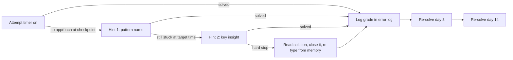

# Coding Problem List -- Comprehensive 300-Problem Checklist, Practice Protocol, and 6-Week Plan

> Last reviewed: 2026-11 · Versions assumed: LeetCode problem numbers and official difficulty labels as of 2026-11. Company-flavored lists reflect commonly reported candidate experiences and are not authoritative.

> A pattern-organized checklist of 300 problems: the original 150 (Blind-75 / NeetCode-150 style coverage) plus 150 extended (`ext`) problems. It also has a flagged **core 75** subset, company-flavored lists, a timed practice protocol with spaced repetition and an error log, a 6-week schedule, a self-run mock-interview format with a rubric, and 30 unsolved practice problems with answers at the end. Pattern names and numbering match [LeetCode Patterns](../computer-science/LeetCode_Patterns.md). That guide has the templates and worked solutions, and [LeetCode Solutions](LeetCode_Solutions.md) has Python and C++ solutions for every checklist problem the guide does not work. Every checklist line links straight to its solution. This file tells you what to solve, in what order, and how to practice.

---

## Table of Contents

1. [How to Use This List](#1-how-to-use-this-list)
2. [The 300-Problem Checklist by Pattern](#2-the-300-problem-checklist-by-pattern)
3. [Core 75 Subset](#3-core-75-subset)
4. [Bonus Lists: Concurrency, Strings, Shortest Paths](#4-bonus-lists-concurrency-strings-shortest-paths)
5. [Company-Flavored Lists (Commonly Reported)](#5-company-flavored-lists-commonly-reported)
6. [Timed Practice Protocol](#6-timed-practice-protocol)
7. [Spaced Repetition and the Error Log](#7-spaced-repetition-and-the-error-log)
8. [Six-Week Coding Schedule](#8-six-week-coding-schedule)
9. [Self-Practice Mock Interview Format](#9-self-practice-mock-interview-format)
10. [Unsolved Practice Sets by Pattern](#10-unsolved-practice-sets-by-pattern)
11. [Answers](#answers)

---

## 1. How to Use This List

### 1.1 Legend

Each checklist line has this shape:

```text
- [ ] **LC <number>** · <title> · <Easy|Medium|Hard> [· ★ core] [· ext] [· premium] · [§N](link to pattern section) · [solution](link to solution)
```

| Marker | Meaning |
|---|---|
| `- [ ]` / `- [x]` | Tick a problem only after you solve it **unaided within the time target** (Section 6). A problem you solved with a hint (grade C) or after reading the solution (grade D) stays unticked until both the day-3 and day-14 re-solves pass. Grade B needs only the day-3 re-solve (Section 6.3). |
| **LC number** | LeetCode problem number. Search the number on leetcode.com. Numbers are stable even when titles change slightly. |
| Difficulty | LeetCode's official label as of 2026-11. A few labels in the patterns guide differ: LeetCode rates 167 Two Sum II and 72 Edit Distance as Medium, 202 Happy Number, 21 Merge Two Sorted Lists and 703 Kth Largest in a Stream as Easy, 102 Level Order Traversal as Medium, 127 Word Ladder as Hard, 287 Find the Duplicate Number as Medium (the guide's §3 says Hard), and 295 Find Median from Data Stream as Hard (the guide's §9 says Medium). This list uses LeetCode's labels because those set the interviewer's time expectations. |
| ★ core | One of the [core 75](#3-core-75-subset). Do these first if you have less than three weeks. |
| ext | One of the 150 extended problems added on top of the original 150. Do the original 150 first. The ext problems add variants and depth to each pattern (see [Section 8](#8-six-week-coding-schedule)). The picker's `--no-ext` flag leaves them out. |
| premium | LeetCode Premium. Free mirrors of most classic premium problems exist on LintCode and NeetCode's site. |
| §N link | Jumps to the template and pitfalls for that pattern. |
| solution | Jumps to the full Python and C++ solution. It is in [LeetCode Patterns](../computer-science/LeetCode_Patterns.md) or in [LeetCode Solutions](LeetCode_Solutions.md). Attempt the problem first and read the solution only after your attempt (Section 6). |

### 1.2 Distribution

| | Easy | Medium | Hard | Total |
|---|---|---|---|---|
| Original 150 | 24 | 106 | 20 | 150 |
| Extended (`ext`) | 27 | 94 | 29 | 150 |
| Full list | 51 | 200 | 49 | 300 |
| Interview reality (reported) | rare in onsites; common in phone screens and as warm-ups | the bulk of onsite questions | occasional, most often at Google; less common at team-driven companies | |

The list is weighted toward mediums because that is what onsite rounds mostly ask. Hards are included where they teach a technique that also shows up inside mediums: monotonic stacks (84), two heaps (295), binary search on the answer (410), interval sweeps (218).

### 1.3 Pattern-first versus random practice

The checklist is grouped by pattern, and that is how you should learn: group problems by pattern so the template sticks. Interviews do not tell you the pattern, though. Once you have finished a pattern group, practice that pattern **blind** with the random picker in [Section 9.2](#92-random-problem-picker), which prints only the number and title. Recognizing the pattern is half the skill, and a pattern-sorted list hides that half.

### 1.4 What "solved" means

A problem counts as solved when you can:

1. State the brute force and its complexity in one sentence.
2. State the optimal approach, its invariant, and its time and space complexity before you write code.
3. Write compiling, correct code within the time target, in your interview language (C++ or Python).
4. Dry-run it on one normal case and two edge cases (empty or single element, duplicates, negative numbers, overflow) without running it.

Steps 1, 2 and 4 are what interviewers grade beyond correctness. The communication framework is in [Interview Loops and Logistics §7](../career/Interview_Loops_and_Logistics.md#7-the-coding-round-communication-framework).

### 1.5 Constraint-to-complexity cheat sheet

Assume roughly 10^8 simple operations per second for C++ and 10^7 for Python, and a 1-2 second limit.

| Input size n | Target complexity | Typical technique |
|---|---|---|
| n ≤ 10 | O(n!) | permutations, brute force |
| n ≤ 20 | O(2^n · n) | subsets, bitmask DP |
| n ≤ 500 | O(n^3) | interval DP, Floyd-Warshall |
| n ≤ 5,000 | O(n^2) | 2D DP, all pairs |
| n ≤ 10^5 to 10^6 | O(n log n) or O(n) | sorting, heaps, two pointers, prefix sums, hashing |
| n ≥ 10^9 (value range) | O(log n) or O(√n) | binary search on the answer, math |

**Q1. Is solving 150 problems enough, or should you aim for 300+?**

For pattern-based interviews, 150 problems that you can each re-solve cold beats 400 problems you solved once with hints. Interviews reward recognition and clean execution, and both come from spaced re-solving, not from first exposure. A reasonable bar: all 150 solved, the core 75 re-solved twice, and an A or B grade (Section 6.3) on at least 80% of random mediums in mock conditions. Go past 150 only when the error log shows a specific weak pattern. Then add 5-10 problems for that pattern instead of more breadth. The `ext` problems in that pattern's checklist group are there for this. Working through all 300 makes sense only if you have more than about ten weeks or are targeting Google-style medium-hard rounds.

**Q2. The interviewer asks a problem you have already solved. Do you say so?**

Yes, briefly: "I've seen something similar. Happy to solve it, or we can switch." Most interviewers will continue anyway and watch whether you can explain *why* the solution works. Reciting a memorized solution without being able to justify the invariant or handle a changed constraint scores worse than an honest re-derivation. Interviewers also often have a follow-up ready for well-known problems, so be prepared for it.

---

## 2. The 300-Problem Checklist by Pattern

Patterns are numbered 2.1-2.26 to match sections 1-26 of [LeetCode Patterns](../computer-science/LeetCode_Patterns.md). The guide's later sections, such as [§27 Weighted Shortest Path Patterns](../computer-science/LeetCode_Patterns.md#27-weighted-shortest-path-patterns), have no group of their own here: their checklist problems sit under the closest basic pattern and link to the later section. For example, the §27 shortest-path problems (743, 787, 1631) are under BFS, the §28 binary-search-on-the-answer problems (1011, 1552) are under Modified Binary Search, and the §30 string-matching problems (28, 187, 214, 459, 1044) are under Hashing & Array Classics. Each pattern group runs from Easy to Hard, with the original problems before the `ext` problems at each difficulty.

### 2.1 Two Pointers

Pattern guide: [LeetCode Patterns §1 Two Pointers](../computer-science/LeetCode_Patterns.md#1-two-pointers) · 12 problems (5E / 6M / 1H) · 4 core · 6 ext

- [ ] **LC 125** · Valid Palindrome · Easy · ★ core · [§1](../computer-science/LeetCode_Patterns.md#1-two-pointers) · [solution](../computer-science/LeetCode_Patterns.md#problem-2--easy----valid-palindrome-leetcode-125)
- [ ] **LC 283** · Move Zeroes · Easy · [§1](../computer-science/LeetCode_Patterns.md#1-two-pointers) · [solution](LeetCode_Solutions.md#lc-283--move-zeroes--easy)
- [ ] **LC 26** · Remove Duplicates from Sorted Array · Easy · ext · [§1](../computer-science/LeetCode_Patterns.md#1-two-pointers) · [solution](LeetCode_Solutions.md#lc-26--remove-duplicates-from-sorted-array--easy)
- [ ] **LC 977** · Squares of a Sorted Array · Easy · ext · [§1](../computer-science/LeetCode_Patterns.md#1-two-pointers) · [solution](LeetCode_Solutions.md#lc-977--squares-of-a-sorted-array--easy)
- [ ] **LC 680** · Valid Palindrome II · Easy · ext · [§1](../computer-science/LeetCode_Patterns.md#1-two-pointers) · [solution](LeetCode_Solutions.md#lc-680--valid-palindrome-ii--easy)
- [ ] **LC 167** · Two Sum II - Input Array Is Sorted · Medium · [§1](../computer-science/LeetCode_Patterns.md#1-two-pointers) · [solution](../computer-science/LeetCode_Patterns.md#problem-1--easy----two-sum-ii-leetcode-167)
- [ ] **LC 15** · 3Sum · Medium · ★ core · [§1](../computer-science/LeetCode_Patterns.md#1-two-pointers) · [solution](../computer-science/LeetCode_Patterns.md#problem-3--medium----3sum-leetcode-15)
- [ ] **LC 11** · Container With Most Water · Medium · ★ core · [§1](../computer-science/LeetCode_Patterns.md#1-two-pointers) · [solution](../computer-science/LeetCode_Patterns.md#problem-4--medium----container-with-most-water-leetcode-11)
- [ ] **LC 75** · Sort Colors · Medium · ext · [§22](../computer-science/LeetCode_Patterns.md#22-hashing--array-classics) · [solution](../computer-science/LeetCode_Patterns.md#problem-8-sort-colors-lc-75--medium-dutch-national-flag)
- [ ] **LC 16** · 3Sum Closest · Medium · ext · [§1](../computer-science/LeetCode_Patterns.md#1-two-pointers) · [solution](LeetCode_Solutions.md#lc-16--3sum-closest--medium)
- [ ] **LC 18** · 4Sum · Medium · ext · [§1](../computer-science/LeetCode_Patterns.md#1-two-pointers) · [solution](LeetCode_Solutions.md#lc-18--4sum--medium)
- [ ] **LC 42** · Trapping Rain Water · Hard · ★ core · [§1](../computer-science/LeetCode_Patterns.md#1-two-pointers) · [solution](../computer-science/LeetCode_Patterns.md#problem-5--hard----trapping-rain-water-leetcode-42)

### 2.2 Sliding Window

Pattern guide: [LeetCode Patterns §2 Sliding Window](../computer-science/LeetCode_Patterns.md#2-sliding-window) · 13 problems (3E / 6M / 4H) · 4 core · 7 ext

- [ ] **LC 121** · Best Time to Buy and Sell Stock · Easy · ★ core · [§2](../computer-science/LeetCode_Patterns.md#2-sliding-window) · [solution](../computer-science/LeetCode_Patterns.md#problem-7-best-time-to-buy-and-sell-stock-iiv-cooldown-fee-lc-121-122-123-188-309-714-state-machine)
- [ ] **LC 643** · Maximum Average Subarray I · Easy · ext · [§2](../computer-science/LeetCode_Patterns.md#2-sliding-window) · [solution](../computer-science/LeetCode_Patterns.md#problem-1-maximum-average-subarray-i-leetcode-643--easy)
- [ ] **LC 219** · Contains Duplicate II · Easy · ext · [§2](../computer-science/LeetCode_Patterns.md#2-sliding-window) · [solution](LeetCode_Solutions.md#lc-219--contains-duplicate-ii--easy)
- [ ] **LC 3** · Longest Substring Without Repeating Characters · Medium · ★ core · [§2](../computer-science/LeetCode_Patterns.md#2-sliding-window) · [solution](../computer-science/LeetCode_Patterns.md#problem-2-longest-substring-without-repeating-characters-leetcode-3--medium)
- [ ] **LC 424** · Longest Repeating Character Replacement · Medium · ★ core · [§2](../computer-science/LeetCode_Patterns.md#2-sliding-window) · [solution](../computer-science/LeetCode_Patterns.md#problem-6-longest-repeating-character-replacement-leetcode-424--medium)
- [ ] **LC 567** · Permutation in String · Medium · [§2](../computer-science/LeetCode_Patterns.md#2-sliding-window) · [solution](../computer-science/LeetCode_Patterns.md#problem-4-permutation-in-string-leetcode-567--medium)
- [ ] **LC 438** · Find All Anagrams in a String · Medium · [§2](../computer-science/LeetCode_Patterns.md#2-sliding-window) · [solution](LeetCode_Solutions.md#lc-438--find-all-anagrams-in-a-string--medium)
- [ ] **LC 209** · Minimum Size Subarray Sum · Medium · ext · [§2](../computer-science/LeetCode_Patterns.md#2-sliding-window) · [solution](../computer-science/LeetCode_Patterns.md#problem-3-minimum-size-subarray-sum-leetcode-209--medium)
- [ ] **LC 1004** · Max Consecutive Ones III · Medium · ext · [§2](../computer-science/LeetCode_Patterns.md#2-sliding-window) · [solution](LeetCode_Solutions.md#lc-1004--max-consecutive-ones-iii--medium)
- [ ] **LC 76** · Minimum Window Substring · Hard · ★ core · [§2](../computer-science/LeetCode_Patterns.md#2-sliding-window) · [solution](../computer-science/LeetCode_Patterns.md#problem-5-minimum-window-substring-leetcode-76--hard)
- [ ] **LC 220** · Contains Duplicate III · Hard · ext · [§29](../computer-science/LeetCode_Patterns.md#29-ordered-containers) · [solution](../computer-science/LeetCode_Patterns.md#problem-1-contains-duplicate-iii-lc-220--hard)
- [ ] **LC 862** · Shortest Subarray with Sum at Least K · Hard · ext · [§2](../computer-science/LeetCode_Patterns.md#2-sliding-window) · [solution](../computer-science/LeetCode_Patterns.md#problem-9-shortest-subarray-with-sum-at-least-k-leetcode-862--hard)
- [ ] **LC 992** · Subarrays with K Different Integers · Hard · ext · [§2](../computer-science/LeetCode_Patterns.md#2-sliding-window) · [solution](../computer-science/LeetCode_Patterns.md#problem-8-subarrays-with-k-different-integers-leetcode-992--hard)

### 2.3 Fast and Slow Pointers

Pattern guide: [LeetCode Patterns §3 Fast and Slow Pointers](../computer-science/LeetCode_Patterns.md#3-fast-and-slow-pointers) · 7 problems (4E / 3M / 0H) · 2 core · 3 ext

- [ ] **LC 141** · Linked List Cycle · Easy · ★ core · [§3](../computer-science/LeetCode_Patterns.md#3-fast-and-slow-pointers) · [solution](../computer-science/LeetCode_Patterns.md#problem-1-linked-list-cycle-leetcode-141--easy)
- [ ] **LC 202** · Happy Number · Easy · ext · [§3](../computer-science/LeetCode_Patterns.md#3-fast-and-slow-pointers) · [solution](../computer-science/LeetCode_Patterns.md#problem-4-happy-number-leetcode-202--medium)
- [ ] **LC 876** · Middle of the Linked List · Easy · ext · [§3](../computer-science/LeetCode_Patterns.md#3-fast-and-slow-pointers) · [solution](../computer-science/LeetCode_Patterns.md#problem-2-middle-of-the-linked-list-leetcode-876--easy)
- [ ] **LC 160** · Intersection of Two Linked Lists · Easy · ext · [§3](../computer-science/LeetCode_Patterns.md#3-fast-and-slow-pointers) · [solution](LeetCode_Solutions.md#lc-160--intersection-of-two-linked-lists--easy)
- [ ] **LC 142** · Linked List Cycle II · Medium · [§3](../computer-science/LeetCode_Patterns.md#3-fast-and-slow-pointers) · [solution](../computer-science/LeetCode_Patterns.md#problem-3-linked-list-cycle-ii-leetcode-142--medium)
- [ ] **LC 287** · Find the Duplicate Number · Medium · [§3](../computer-science/LeetCode_Patterns.md#3-fast-and-slow-pointers) · [solution](../computer-science/LeetCode_Patterns.md#problem-5-find-the-duplicate-number-leetcode-287--hard)
- [ ] **LC 19** · Remove Nth Node From End of List · Medium · ★ core · [§3](../computer-science/LeetCode_Patterns.md#3-fast-and-slow-pointers) · [solution](LeetCode_Solutions.md#lc-19--remove-nth-node-from-end-of-list--medium)

### 2.4 Merge Intervals

Pattern guide: [LeetCode Patterns §4 Merge Intervals](../computer-science/LeetCode_Patterns.md#4-merge-intervals) · 6 problems (1E / 3M / 2H) · 3 core · 2 ext

- [ ] **LC 252** · Meeting Rooms · Easy · premium · [§4](../computer-science/LeetCode_Patterns.md#4-merge-intervals) · [solution](../computer-science/LeetCode_Patterns.md#41-easy--meeting-rooms-leetcode-252)
- [ ] **LC 56** · Merge Intervals · Medium · ★ core · [§4](../computer-science/LeetCode_Patterns.md#4-merge-intervals) · [solution](../computer-science/LeetCode_Patterns.md#42-medium--merge-intervals-leetcode-56)
- [ ] **LC 57** · Insert Interval · Medium · ★ core · [§4](../computer-science/LeetCode_Patterns.md#4-merge-intervals) · [solution](../computer-science/LeetCode_Patterns.md#43-medium--insert-interval-leetcode-57)
- [ ] **LC 435** · Non-overlapping Intervals · Medium · ★ core · [§4](../computer-science/LeetCode_Patterns.md#4-merge-intervals) · [solution](../computer-science/LeetCode_Patterns.md#44-medium--non-overlapping-intervals-leetcode-435)
- [ ] **LC 759** · Employee Free Time · Hard · ext · premium · [§4](../computer-science/LeetCode_Patterns.md#4-merge-intervals) · [solution](../computer-science/LeetCode_Patterns.md#45-hard--employee-free-time-leetcode-759)
- [ ] **LC 1851** · Minimum Interval to Include Each Query · Hard · ext · [§4](../computer-science/LeetCode_Patterns.md#4-merge-intervals) · [solution](LeetCode_Solutions.md#lc-1851--minimum-interval-to-include-each-query--hard)

### 2.5 Cyclic Sort

Pattern guide: [LeetCode Patterns §5 Cyclic Sort](../computer-science/LeetCode_Patterns.md#5-cyclic-sort) · 4 problems (2E / 1M / 1H) · 1 core · 1 ext

- [ ] **LC 268** · Missing Number · Easy · ★ core · [§5](../computer-science/LeetCode_Patterns.md#5-cyclic-sort) · [solution](../computer-science/LeetCode_Patterns.md#51-easy--missing-number-leetcode-268)
- [ ] **LC 448** · Find All Numbers Disappeared in an Array · Easy · ext · [§5](../computer-science/LeetCode_Patterns.md#5-cyclic-sort) · [solution](../computer-science/LeetCode_Patterns.md#52-easy--find-all-numbers-disappeared-in-an-array-leetcode-448)
- [ ] **LC 442** · Find All Duplicates in an Array · Medium · [§5](../computer-science/LeetCode_Patterns.md#5-cyclic-sort) · [solution](../computer-science/LeetCode_Patterns.md#54-medium--find-all-duplicates-in-an-array-leetcode-442)
- [ ] **LC 41** · First Missing Positive · Hard · [§5](../computer-science/LeetCode_Patterns.md#5-cyclic-sort) · [solution](../computer-science/LeetCode_Patterns.md#55-hard--first-missing-positive-leetcode-41)

### 2.6 In-place Linked List Reversal

Pattern guide: [LeetCode Patterns §6 In-place Linked List Reversal](../computer-science/LeetCode_Patterns.md#6-in-place-linked-list-reversal) · 11 problems (2E / 8M / 1H) · 2 core · 6 ext

- [ ] **LC 206** · Reverse Linked List · Easy · ★ core · [§6](../computer-science/LeetCode_Patterns.md#6-in-place-linked-list-reversal) · [solution](../computer-science/LeetCode_Patterns.md#problem-1--reverse-linked-list-lc-206-easy)
- [ ] **LC 234** · Palindrome Linked List · Easy · ext · [§6](../computer-science/LeetCode_Patterns.md#6-in-place-linked-list-reversal) · [solution](../computer-science/LeetCode_Patterns.md#problem-3--palindrome-linked-list-lc-234-medium)
- [ ] **LC 143** · Reorder List · Medium · ★ core · [§6](../computer-science/LeetCode_Patterns.md#6-in-place-linked-list-reversal) · [solution](../computer-science/LeetCode_Patterns.md#problem-4--reorder-list-lc-143-medium)
- [ ] **LC 2** · Add Two Numbers · Medium · [§6](../computer-science/LeetCode_Patterns.md#6-in-place-linked-list-reversal) · [solution](LeetCode_Solutions.md#lc-2--add-two-numbers--medium)
- [ ] **LC 138** · Copy List with Random Pointer · Medium · [§6](../computer-science/LeetCode_Patterns.md#6-in-place-linked-list-reversal) · [solution](LeetCode_Solutions.md#lc-138--copy-list-with-random-pointer--medium)
- [ ] **LC 92** · Reverse Linked List II · Medium · ext · [§6](../computer-science/LeetCode_Patterns.md#6-in-place-linked-list-reversal) · [solution](../computer-science/LeetCode_Patterns.md#problem-2--reverse-linked-list-ii-lc-92-medium)
- [ ] **LC 24** · Swap Nodes in Pairs · Medium · ext · [§6](../computer-science/LeetCode_Patterns.md#6-in-place-linked-list-reversal) · [solution](LeetCode_Solutions.md#lc-24--swap-nodes-in-pairs--medium)
- [ ] **LC 61** · Rotate List · Medium · ext · [§6](../computer-science/LeetCode_Patterns.md#6-in-place-linked-list-reversal) · [solution](LeetCode_Solutions.md#lc-61--rotate-list--medium)
- [ ] **LC 82** · Remove Duplicates from Sorted List II · Medium · ext · [§6](../computer-science/LeetCode_Patterns.md#6-in-place-linked-list-reversal) · [solution](LeetCode_Solutions.md#lc-82--remove-duplicates-from-sorted-list-ii--medium)
- [ ] **LC 148** · Sort List · Medium · ext · [§6](../computer-science/LeetCode_Patterns.md#6-in-place-linked-list-reversal) · [solution](LeetCode_Solutions.md#lc-148--sort-list--medium)
- [ ] **LC 25** · Reverse Nodes in k-Group · Hard · [§6](../computer-science/LeetCode_Patterns.md#6-in-place-linked-list-reversal) · [solution](../computer-science/LeetCode_Patterns.md#problem-5--reverse-nodes-in-k-group-lc-25-hard)

### 2.7 BFS (Breadth-First Search)

Pattern guide: [LeetCode Patterns §7 BFS (Breadth-First Search)](../computer-science/LeetCode_Patterns.md#7-bfs-breadth-first-search) · 17 problems (0E / 14M / 3H) · 1 core · 11 ext

LC 743 is the bridge from BFS to Dijkstra: its edges are weighted, so plain BFS gives wrong answers. It and the other weighted-graph problems in this group (787, 1631, 1368, 847) link to [LeetCode Patterns §27](../computer-science/LeetCode_Patterns.md#27-weighted-shortest-path-patterns). LC 1514 is solved in [LeetCode Solutions](LeetCode_Solutions.md#7-bfs-breadth-first-search).

- [ ] **LC 102** · Binary Tree Level Order Traversal · Medium · ★ core · [§7](../computer-science/LeetCode_Patterns.md#7-bfs-breadth-first-search) · [solution](../computer-science/LeetCode_Patterns.md#problem-1--binary-tree-level-order-traversal-lc-102-easy)
- [ ] **LC 199** · Binary Tree Right Side View · Medium · [§7](../computer-science/LeetCode_Patterns.md#7-bfs-breadth-first-search) · [solution](LeetCode_Solutions.md#lc-199--binary-tree-right-side-view--medium)
- [ ] **LC 994** · Rotting Oranges · Medium · [§7](../computer-science/LeetCode_Patterns.md#7-bfs-breadth-first-search) · [solution](../computer-science/LeetCode_Patterns.md#problem-3--rotting-oranges-lc-994-medium)
- [ ] **LC 542** · 01 Matrix · Medium · [§7](../computer-science/LeetCode_Patterns.md#7-bfs-breadth-first-search) · [solution](LeetCode_Solutions.md#lc-542--01-matrix--medium)
- [ ] **LC 743** · Network Delay Time · Medium · [§27](../computer-science/LeetCode_Patterns.md#27-weighted-shortest-path-patterns) · [solution](../computer-science/LeetCode_Patterns.md#problem-1-network-delay-time-lc-743--medium)
- [ ] **LC 103** · Binary Tree Zigzag Level Order Traversal · Medium · ext · [§7](../computer-science/LeetCode_Patterns.md#7-bfs-breadth-first-search) · [solution](../computer-science/LeetCode_Patterns.md#problem-2--binary-tree-zigzag-level-order-traversal-lc-103-medium)
- [ ] **LC 787** · Cheapest Flights Within K Stops · Medium · ext · [§27](../computer-science/LeetCode_Patterns.md#27-weighted-shortest-path-patterns) · [solution](../computer-science/LeetCode_Patterns.md#problem-3-cheapest-flights-within-k-stops-lc-787--medium)
- [ ] **LC 1091** · Shortest Path in Binary Matrix · Medium · ext · [§7](../computer-science/LeetCode_Patterns.md#7-bfs-breadth-first-search) · [solution](../computer-science/LeetCode_Patterns.md#problem-5--shortest-path-in-binary-matrix-lc-1091-hard)
- [ ] **LC 1631** · Path With Minimum Effort · Medium · ext · [§27](../computer-science/LeetCode_Patterns.md#27-weighted-shortest-path-patterns) · [solution](../computer-science/LeetCode_Patterns.md#problem-2-path-with-minimum-effort-lc-1631--medium)
- [ ] **LC 130** · Surrounded Regions · Medium · ext · [§7](../computer-science/LeetCode_Patterns.md#7-bfs-breadth-first-search) · [solution](LeetCode_Solutions.md#lc-130--surrounded-regions--medium)
- [ ] **LC 433** · Minimum Genetic Mutation · Medium · ext · [§7](../computer-science/LeetCode_Patterns.md#7-bfs-breadth-first-search) · [solution](LeetCode_Solutions.md#lc-433--minimum-genetic-mutation--medium)
- [ ] **LC 934** · Shortest Bridge · Medium · ext · [§7](../computer-science/LeetCode_Patterns.md#7-bfs-breadth-first-search) · [solution](LeetCode_Solutions.md#lc-934--shortest-bridge--medium)
- [ ] **LC 310** · Minimum Height Trees · Medium · ext · [§7](../computer-science/LeetCode_Patterns.md#7-bfs-breadth-first-search) · [solution](LeetCode_Solutions.md#lc-310--minimum-height-trees--medium)
- [ ] **LC 1514** · Path with Maximum Probability · Medium · ext · [§7](../computer-science/LeetCode_Patterns.md#7-bfs-breadth-first-search) · [solution](LeetCode_Solutions.md#lc-1514--path-with-maximum-probability--medium)
- [ ] **LC 127** · Word Ladder · Hard · [§7](../computer-science/LeetCode_Patterns.md#7-bfs-breadth-first-search) · [solution](../computer-science/LeetCode_Patterns.md#problem-4--word-ladder-lc-127-medium)
- [ ] **LC 847** · Shortest Path Visiting All Nodes · Hard · ext · [§27](../computer-science/LeetCode_Patterns.md#27-weighted-shortest-path-patterns) · [solution](../computer-science/LeetCode_Patterns.md#problem-5-shortest-path-visiting-all-nodes-lc-847--hard)
- [ ] **LC 1368** · Minimum Cost to Make at Least One Valid Path in a Grid · Hard · ext · [§27](../computer-science/LeetCode_Patterns.md#27-weighted-shortest-path-patterns) · [solution](../computer-science/LeetCode_Patterns.md#problem-4-minimum-cost-to-make-at-least-one-valid-path-in-a-grid-lc-1368--hard)

### 2.8 DFS (Depth-First Search)

Pattern guide: [LeetCode Patterns §8 DFS (Depth-First Search)](../computer-science/LeetCode_Patterns.md#8-dfs-depth-first-search) · 26 problems (7E / 16M / 3H) · 11 core · 13 ext

- [ ] **LC 104** · Maximum Depth of Binary Tree · Easy · ★ core · [§8](../computer-science/LeetCode_Patterns.md#8-dfs-depth-first-search) · [solution](../computer-science/LeetCode_Patterns.md#problem-1--maximum-depth-of-binary-tree-lc-104-easy)
- [ ] **LC 226** · Invert Binary Tree · Easy · ★ core · [§8](../computer-science/LeetCode_Patterns.md#8-dfs-depth-first-search) · [solution](../computer-science/LeetCode_Patterns.md#problem-2--invert-binary-tree-lc-226-easy)
- [ ] **LC 543** · Diameter of Binary Tree · Easy · [§8](../computer-science/LeetCode_Patterns.md#8-dfs-depth-first-search) · [solution](../computer-science/LeetCode_Patterns.md#problem-11--diameter-of-binary-tree-lc-543-easy)
- [ ] **LC 100** · Same Tree · Easy · ext · [§8](../computer-science/LeetCode_Patterns.md#8-dfs-depth-first-search) · [solution](LeetCode_Solutions.md#lc-100--same-tree--easy)
- [ ] **LC 101** · Symmetric Tree · Easy · ext · [§8](../computer-science/LeetCode_Patterns.md#8-dfs-depth-first-search) · [solution](LeetCode_Solutions.md#lc-101--symmetric-tree--easy)
- [ ] **LC 110** · Balanced Binary Tree · Easy · ext · [§8](../computer-science/LeetCode_Patterns.md#8-dfs-depth-first-search) · [solution](LeetCode_Solutions.md#lc-110--balanced-binary-tree--easy)
- [ ] **LC 572** · Subtree of Another Tree · Easy · ext · [§8](../computer-science/LeetCode_Patterns.md#8-dfs-depth-first-search) · [solution](LeetCode_Solutions.md#lc-572--subtree-of-another-tree--easy)
- [ ] **LC 235** · Lowest Common Ancestor of a Binary Search Tree · Medium · ★ core · [§8](../computer-science/LeetCode_Patterns.md#8-dfs-depth-first-search) · [solution](LeetCode_Solutions.md#lc-235--lowest-common-ancestor-of-a-binary-search-tree--medium)
- [ ] **LC 236** · Lowest Common Ancestor of a Binary Tree · Medium · [§8](../computer-science/LeetCode_Patterns.md#8-dfs-depth-first-search) · [solution](../computer-science/LeetCode_Patterns.md#problem-7--lowest-common-ancestor-of-a-binary-tree-lc-236-medium)
- [ ] **LC 98** · Validate Binary Search Tree · Medium · ★ core · [§8](../computer-science/LeetCode_Patterns.md#8-dfs-depth-first-search) · [solution](../computer-science/LeetCode_Patterns.md#problem-6--validate-binary-search-tree-lc-98-medium)
- [ ] **LC 230** · Kth Smallest Element in a BST · Medium · ★ core · [§8](../computer-science/LeetCode_Patterns.md#8-dfs-depth-first-search) · [solution](../computer-science/LeetCode_Patterns.md#problem-10--kth-smallest-element-in-a-bst-lc-230-medium)
- [ ] **LC 105** · Construct Binary Tree from Preorder and Inorder Traversal · Medium · ★ core · [§8](../computer-science/LeetCode_Patterns.md#8-dfs-depth-first-search) · [solution](../computer-science/LeetCode_Patterns.md#problem-8--construct-binary-tree-from-preorder-and-inorder-traversal-lc-105-medium)
- [ ] **LC 200** · Number of Islands · Medium · ★ core · [§8](../computer-science/LeetCode_Patterns.md#8-dfs-depth-first-search) · [solution](../computer-science/LeetCode_Patterns.md#problem-3--number-of-islands-lc-200-medium)
- [ ] **LC 417** · Pacific Atlantic Water Flow · Medium · ★ core · [§8](../computer-science/LeetCode_Patterns.md#8-dfs-depth-first-search) · [solution](LeetCode_Solutions.md#lc-417--pacific-atlantic-water-flow--medium)
- [ ] **LC 133** · Clone Graph · Medium · ★ core · [§8](../computer-science/LeetCode_Patterns.md#8-dfs-depth-first-search) · [solution](LeetCode_Solutions.md#lc-133--clone-graph--medium)
- [ ] **LC 113** · Path Sum II · Medium · ext · [§8](../computer-science/LeetCode_Patterns.md#8-dfs-depth-first-search) · [solution](../computer-science/LeetCode_Patterns.md#problem-4--path-sum-ii-lc-113-medium)
- [ ] **LC 1448** · Count Good Nodes in Binary Tree · Medium · ext · [§8](../computer-science/LeetCode_Patterns.md#8-dfs-depth-first-search) · [solution](LeetCode_Solutions.md#lc-1448--count-good-nodes-in-binary-tree--medium)
- [ ] **LC 114** · Flatten Binary Tree to Linked List · Medium · ext · [§8](../computer-science/LeetCode_Patterns.md#8-dfs-depth-first-search) · [solution](LeetCode_Solutions.md#lc-114--flatten-binary-tree-to-linked-list--medium)
- [ ] **LC 116** · Populating Next Right Pointers in Each Node · Medium · ext · [§8](../computer-science/LeetCode_Patterns.md#8-dfs-depth-first-search) · [solution](LeetCode_Solutions.md#lc-116--populating-next-right-pointers-in-each-node--medium)
- [ ] **LC 437** · Path Sum III · Medium · ext · [§8](../computer-science/LeetCode_Patterns.md#8-dfs-depth-first-search) · [solution](LeetCode_Solutions.md#lc-437--path-sum-iii--medium)
- [ ] **LC 450** · Delete Node in a BST · Medium · ext · [§8](../computer-science/LeetCode_Patterns.md#8-dfs-depth-first-search) · [solution](LeetCode_Solutions.md#lc-450--delete-node-in-a-bst--medium)
- [ ] **LC 695** · Max Area of Island · Medium · ext · [§8](../computer-science/LeetCode_Patterns.md#8-dfs-depth-first-search) · [solution](LeetCode_Solutions.md#lc-695--max-area-of-island--medium)
- [ ] **LC 863** · All Nodes Distance K in Binary Tree · Medium · ext · [§8](../computer-science/LeetCode_Patterns.md#8-dfs-depth-first-search) · [solution](LeetCode_Solutions.md#lc-863--all-nodes-distance-k-in-binary-tree--medium)
- [ ] **LC 124** · Binary Tree Maximum Path Sum · Hard · ★ core · [§8](../computer-science/LeetCode_Patterns.md#8-dfs-depth-first-search) · [solution](../computer-science/LeetCode_Patterns.md#problem-5--binary-tree-maximum-path-sum-lc-124-hard)
- [ ] **LC 297** · Serialize and Deserialize Binary Tree · Hard · ★ core · [§8](../computer-science/LeetCode_Patterns.md#8-dfs-depth-first-search) · [solution](../computer-science/LeetCode_Patterns.md#problem-9--serialize-and-deserialize-binary-tree-lc-297-hard)
- [ ] **LC 1192** · Critical Connections in a Network · Hard · ext · [§8](../computer-science/LeetCode_Patterns.md#8-dfs-depth-first-search) · [solution](../computer-science/LeetCode_Patterns.md#problem-12--critical-connections-in-a-network-lc-1192-hard)

### 2.9 Two Heaps

Pattern guide: [LeetCode Patterns §9 Two Heaps](../computer-science/LeetCode_Patterns.md#9-two-heaps) · 4 problems (1E / 0M / 3H) · 1 core · 2 ext

- [ ] **LC 1046** · Last Stone Weight · Easy · ext · [§9](../computer-science/LeetCode_Patterns.md#9-two-heaps) · [solution](../computer-science/LeetCode_Patterns.md#1-last-stone-weight-lc-1046--easy)
- [ ] **LC 295** · Find Median from Data Stream · Hard · ★ core · [§9](../computer-science/LeetCode_Patterns.md#9-two-heaps) · [solution](../computer-science/LeetCode_Patterns.md#2-find-median-from-data-stream-lc-295--medium)
- [ ] **LC 480** · Sliding Window Median · Hard · [§9](../computer-science/LeetCode_Patterns.md#9-two-heaps) · [solution](../computer-science/LeetCode_Patterns.md#4-sliding-window-median-lc-480--hard)
- [ ] **LC 502** · IPO · Hard · ext · [§9](../computer-science/LeetCode_Patterns.md#9-two-heaps) · [solution](../computer-science/LeetCode_Patterns.md#5-ipo-lc-502--hard)

### 2.10 Subsets / Backtracking

Pattern guide: [LeetCode Patterns §10 Subsets / Backtracking](../computer-science/LeetCode_Patterns.md#10-subsets--backtracking) · 12 problems (0E / 10M / 2H) · 1 core · 6 ext

- [ ] **LC 78** · Subsets · Medium · [§10](../computer-science/LeetCode_Patterns.md#10-subsets--backtracking) · [solution](../computer-science/LeetCode_Patterns.md#1-subsets-lc-78--medium)
- [ ] **LC 46** · Permutations · Medium · [§10](../computer-science/LeetCode_Patterns.md#10-subsets--backtracking) · [solution](../computer-science/LeetCode_Patterns.md#2-permutations-lc-46--medium)
- [ ] **LC 39** · Combination Sum · Medium · [§10](../computer-science/LeetCode_Patterns.md#10-subsets--backtracking) · [solution](../computer-science/LeetCode_Patterns.md#3-combination-sum-lc-39--medium)
- [ ] **LC 79** · Word Search · Medium · ★ core · [§10](../computer-science/LeetCode_Patterns.md#10-subsets--backtracking) · [solution](../computer-science/LeetCode_Patterns.md#4-word-search-lc-79--medium)
- [ ] **LC 22** · Generate Parentheses · Medium · [§10](../computer-science/LeetCode_Patterns.md#10-subsets--backtracking) · [solution](LeetCode_Solutions.md#lc-22--generate-parentheses--medium)
- [ ] **LC 17** · Letter Combinations of a Phone Number · Medium · ext · [§10](../computer-science/LeetCode_Patterns.md#10-subsets--backtracking) · [solution](LeetCode_Solutions.md#lc-17--letter-combinations-of-a-phone-number--medium)
- [ ] **LC 77** · Combinations · Medium · ext · [§10](../computer-science/LeetCode_Patterns.md#10-subsets--backtracking) · [solution](LeetCode_Solutions.md#lc-77--combinations--medium)
- [ ] **LC 90** · Subsets II · Medium · ext · [§10](../computer-science/LeetCode_Patterns.md#10-subsets--backtracking) · [solution](LeetCode_Solutions.md#lc-90--subsets-ii--medium)
- [ ] **LC 40** · Combination Sum II · Medium · ext · [§10](../computer-science/LeetCode_Patterns.md#10-subsets--backtracking) · [solution](LeetCode_Solutions.md#lc-40--combination-sum-ii--medium)
- [ ] **LC 131** · Palindrome Partitioning · Medium · ext · [§10](../computer-science/LeetCode_Patterns.md#10-subsets--backtracking) · [solution](LeetCode_Solutions.md#lc-131--palindrome-partitioning--medium)
- [ ] **LC 51** · N-Queens · Hard · [§10](../computer-science/LeetCode_Patterns.md#10-subsets--backtracking) · [solution](../computer-science/LeetCode_Patterns.md#5-n-queens-lc-51--hard)
- [ ] **LC 37** · Sudoku Solver · Hard · ext · [§10](../computer-science/LeetCode_Patterns.md#10-subsets--backtracking) · [solution](LeetCode_Solutions.md#lc-37--sudoku-solver--hard)

### 2.11 Modified Binary Search

Pattern guide: [LeetCode Patterns §11 Modified Binary Search](../computer-science/LeetCode_Patterns.md#11-modified-binary-search) · 15 problems (4E / 8M / 3H) · 3 core · 8 ext

- [ ] **LC 69** · Sqrt(x) · Easy · ext · [§32](../computer-science/LeetCode_Patterns.md#32-math--number-theory) · [solution](../computer-science/LeetCode_Patterns.md#problem-2-sqrtx-lc-69--easy)
- [ ] **LC 704** · Binary Search · Easy · ext · [§11](../computer-science/LeetCode_Patterns.md#11-modified-binary-search) · [solution](../computer-science/LeetCode_Patterns.md#problem-1-binary-search-lc-704--easy)
- [ ] **LC 35** · Search Insert Position · Easy · ext · [§11](../computer-science/LeetCode_Patterns.md#11-modified-binary-search) · [solution](LeetCode_Solutions.md#lc-35--search-insert-position--easy)
- [ ] **LC 278** · First Bad Version · Easy · ext · [§11](../computer-science/LeetCode_Patterns.md#11-modified-binary-search) · [solution](LeetCode_Solutions.md#lc-278--first-bad-version--easy)
- [ ] **LC 34** · Find First and Last Position of Element in Sorted Array · Medium · [§11](../computer-science/LeetCode_Patterns.md#11-modified-binary-search) · [solution](../computer-science/LeetCode_Patterns.md#problem-2-find-first-and-last-position-of-element-in-sorted-array-lc-34--medium)
- [ ] **LC 33** · Search in Rotated Sorted Array · Medium · ★ core · [§11](../computer-science/LeetCode_Patterns.md#11-modified-binary-search) · [solution](../computer-science/LeetCode_Patterns.md#problem-3-search-in-rotated-sorted-array-lc-33--medium)
- [ ] **LC 153** · Find Minimum in Rotated Sorted Array · Medium · ★ core · [§11](../computer-science/LeetCode_Patterns.md#11-modified-binary-search) · [solution](LeetCode_Solutions.md#lc-153--find-minimum-in-rotated-sorted-array--medium)
- [ ] **LC 162** · Find Peak Element · Medium · [§11](../computer-science/LeetCode_Patterns.md#11-modified-binary-search) · [solution](../computer-science/LeetCode_Patterns.md#problem-4-find-peak-element-lc-162--medium)
- [ ] **LC 875** · Koko Eating Bananas · Medium · ★ core · [§11](../computer-science/LeetCode_Patterns.md#11-modified-binary-search) · [solution](../computer-science/LeetCode_Patterns.md#problem-1-koko-eating-bananas-lc-875--medium)
- [ ] **LC 1011** · Capacity To Ship Packages Within D Days · Medium · ext · [§28](../computer-science/LeetCode_Patterns.md#28-binary-search-on-the-answer) · [solution](../computer-science/LeetCode_Patterns.md#problem-2-capacity-to-ship-packages-within-d-days-lc-1011--medium)
- [ ] **LC 1552** · Magnetic Force Between Two Balls · Medium · ext · [§28](../computer-science/LeetCode_Patterns.md#28-binary-search-on-the-answer) · [solution](../computer-science/LeetCode_Patterns.md#problem-4-magnetic-force-between-two-balls-lc-1552--medium)
- [ ] **LC 81** · Search in Rotated Sorted Array II · Medium · ext · [§11](../computer-science/LeetCode_Patterns.md#11-modified-binary-search) · [solution](LeetCode_Solutions.md#lc-81--search-in-rotated-sorted-array-ii--medium)
- [ ] **LC 410** · Split Array Largest Sum · Hard · [§11](../computer-science/LeetCode_Patterns.md#11-modified-binary-search) · [solution](../computer-science/LeetCode_Patterns.md#problem-3-split-array-largest-sum-lc-410--hard)
- [ ] **LC 4** · Median of Two Sorted Arrays · Hard · [§11](../computer-science/LeetCode_Patterns.md#11-modified-binary-search) · [solution](../computer-science/LeetCode_Patterns.md#problem-5-median-of-two-sorted-arrays-lc-4--hard)
- [ ] **LC 315** · Count of Smaller Numbers After Self · Hard · ext · [§29](../computer-science/LeetCode_Patterns.md#29-ordered-containers) · [solution](../computer-science/LeetCode_Patterns.md#problem-5-count-of-smaller-numbers-after-self-lc-315--hard)

### 2.12 Top K Elements

Pattern guide: [LeetCode Patterns §12 Top K Elements](../computer-science/LeetCode_Patterns.md#12-top-k-elements) · 9 problems (1E / 8M / 0H) · 1 core · 4 ext

- [ ] **LC 703** · Kth Largest Element in a Stream · Easy · [§12](../computer-science/LeetCode_Patterns.md#12-top-k-elements) · [solution](../computer-science/LeetCode_Patterns.md#3-kth-largest-element-in-a-stream-lc-703--medium)
- [ ] **LC 215** · Kth Largest Element in an Array · Medium · [§12](../computer-science/LeetCode_Patterns.md#12-top-k-elements) · [solution](../computer-science/LeetCode_Patterns.md#problem-1-kth-largest-element-in-an-array-lc-215--medium)
- [ ] **LC 347** · Top K Frequent Elements · Medium · ★ core · [§12](../computer-science/LeetCode_Patterns.md#12-top-k-elements) · [solution](../computer-science/LeetCode_Patterns.md#problem-2-top-k-frequent-elements-lc-347--medium)
- [ ] **LC 973** · K Closest Points to Origin · Medium · [§12](../computer-science/LeetCode_Patterns.md#12-top-k-elements) · [solution](../computer-science/LeetCode_Patterns.md#problem-3-k-closest-points-to-origin-lc-973--medium)
- [ ] **LC 621** · Task Scheduler · Medium · [§12](../computer-science/LeetCode_Patterns.md#12-top-k-elements) · [solution](LeetCode_Solutions.md#lc-621--task-scheduler--medium)
- [ ] **LC 451** · Sort Characters By Frequency · Medium · ext · [§12](../computer-science/LeetCode_Patterns.md#12-top-k-elements) · [solution](../computer-science/LeetCode_Patterns.md#problem-4-sort-characters-by-frequency-lc-451--medium)
- [ ] **LC 767** · Reorganize String · Medium · ext · [§12](../computer-science/LeetCode_Patterns.md#12-top-k-elements) · [solution](LeetCode_Solutions.md#lc-767--reorganize-string--medium)
- [ ] **LC 1834** · Single-Threaded CPU · Medium · ext · [§12](../computer-science/LeetCode_Patterns.md#12-top-k-elements) · [solution](LeetCode_Solutions.md#lc-1834--single-threaded-cpu--medium)
- [ ] **LC 355** · Design Twitter · Medium · ext · [§12](../computer-science/LeetCode_Patterns.md#12-top-k-elements) · [solution](LeetCode_Solutions.md#lc-355--design-twitter--medium)

### 2.13 K-way Merge

Pattern guide: [LeetCode Patterns §13 K-way Merge](../computer-science/LeetCode_Patterns.md#13-k-way-merge) · 6 problems (2E / 2M / 2H) · 2 core · 2 ext

- [ ] **LC 21** · Merge Two Sorted Lists · Easy · ★ core · [§13](../computer-science/LeetCode_Patterns.md#13-k-way-merge) · [solution](../computer-science/LeetCode_Patterns.md#problem-1-merge-two-sorted-lists-lc-21--medium)
- [ ] **LC 88** · Merge Sorted Array · Easy · [§13](../computer-science/LeetCode_Patterns.md#13-k-way-merge) · [solution](LeetCode_Solutions.md#lc-88--merge-sorted-array--easy)
- [ ] **LC 378** · Kth Smallest Element in a Sorted Matrix · Medium · [§13](../computer-science/LeetCode_Patterns.md#13-k-way-merge) · [solution](../computer-science/LeetCode_Patterns.md#problem-3-kth-smallest-element-in-a-sorted-matrix-lc-378--medium)
- [ ] **LC 373** · Find K Pairs with Smallest Sums · Medium · ext · [§13](../computer-science/LeetCode_Patterns.md#13-k-way-merge) · [solution](../computer-science/LeetCode_Patterns.md#problem-4-find-k-pairs-with-smallest-sums-lc-373--medium)
- [ ] **LC 23** · Merge k Sorted Lists · Hard · ★ core · [§13](../computer-science/LeetCode_Patterns.md#13-k-way-merge) · [solution](../computer-science/LeetCode_Patterns.md#problem-2-merge-k-sorted-lists-lc-23--hard)
- [ ] **LC 632** · Smallest Range Covering Elements from K Lists · Hard · ext · [§13](../computer-science/LeetCode_Patterns.md#13-k-way-merge) · [solution](../computer-science/LeetCode_Patterns.md#problem-5-smallest-range-covering-elements-from-k-lists-lc-632--hard)

### 2.14 Topological Sort

Pattern guide: [LeetCode Patterns §14 Topological Sort](../computer-science/LeetCode_Patterns.md#14-topological-sort) · 9 problems (0E / 5M / 4H) · 2 core · 5 ext

- [ ] **LC 207** · Course Schedule · Medium · ★ core · [§14](../computer-science/LeetCode_Patterns.md#14-topological-sort) · [solution](../computer-science/LeetCode_Patterns.md#problem-1-course-schedule-lc-207--medium)
- [ ] **LC 210** · Course Schedule II · Medium · [§14](../computer-science/LeetCode_Patterns.md#14-topological-sort) · [solution](../computer-science/LeetCode_Patterns.md#problem-2-course-schedule-ii-lc-210--medium)
- [ ] **LC 1462** · Course Schedule IV · Medium · ext · [§14](../computer-science/LeetCode_Patterns.md#14-topological-sort) · [solution](../computer-science/LeetCode_Patterns.md#problem-3-course-schedule-iv-lc-1462--medium)
- [ ] **LC 802** · Find Eventual Safe States · Medium · ext · [§14](../computer-science/LeetCode_Patterns.md#14-topological-sort) · [solution](LeetCode_Solutions.md#lc-802--find-eventual-safe-states--medium)
- [ ] **LC 2115** · Find All Possible Recipes from Given Supplies · Medium · ext · [§14](../computer-science/LeetCode_Patterns.md#14-topological-sort) · [solution](LeetCode_Solutions.md#lc-2115--find-all-possible-recipes-from-given-supplies--medium)
- [ ] **LC 269** · Alien Dictionary · Hard · ★ core · premium · [§14](../computer-science/LeetCode_Patterns.md#14-topological-sort) · [solution](../computer-science/LeetCode_Patterns.md#problem-4-alien-dictionary-lc-269--hard)
- [ ] **LC 329** · Longest Increasing Path in a Matrix · Hard · [§14](../computer-science/LeetCode_Patterns.md#14-topological-sort) · [solution](LeetCode_Solutions.md#lc-329--longest-increasing-path-in-a-matrix--hard)
- [ ] **LC 332** · Reconstruct Itinerary · Hard · ext · [§14](../computer-science/LeetCode_Patterns.md#14-topological-sort) · [solution](../computer-science/LeetCode_Patterns.md#problem-6-reconstruct-itinerary-lc-332--hard)
- [ ] **LC 2050** · Parallel Courses III · Hard · ext · [§14](../computer-science/LeetCode_Patterns.md#14-topological-sort) · [solution](../computer-science/LeetCode_Patterns.md#problem-5-parallel-courses-iii-lc-2050--hard)

### 2.15 Monotonic Stack / Queue

Pattern guide: [LeetCode Patterns §15 Monotonic Stack / Queue](../computer-science/LeetCode_Patterns.md#15-monotonic-stack--queue) · 12 problems (1E / 8M / 3H) · 2 core · 6 ext

- [ ] **LC 496** · Next Greater Element I · Easy · [§15](../computer-science/LeetCode_Patterns.md#15-monotonic-stack--queue) · [solution](../computer-science/LeetCode_Patterns.md#problem-1-next-greater-element-i-lc-496--easy)
- [ ] **LC 739** · Daily Temperatures · Medium · ★ core · [§15](../computer-science/LeetCode_Patterns.md#15-monotonic-stack--queue) · [solution](../computer-science/LeetCode_Patterns.md#problem-2-daily-temperatures-lc-739--medium)
- [ ] **LC 853** · Car Fleet · Medium · [§15](../computer-science/LeetCode_Patterns.md#15-monotonic-stack--queue) · [solution](LeetCode_Solutions.md#lc-853--car-fleet--medium)
- [ ] **LC 402** · Remove K Digits · Medium · [§15](../computer-science/LeetCode_Patterns.md#15-monotonic-stack--queue) · [solution](LeetCode_Solutions.md#lc-402--remove-k-digits--medium)
- [ ] **LC 503** · Next Greater Element II · Medium · ext · [§15](../computer-science/LeetCode_Patterns.md#15-monotonic-stack--queue) · [solution](../computer-science/LeetCode_Patterns.md#problem-3-next-greater-element-ii-lc-503--medium)
- [ ] **LC 1438** · Longest Continuous Subarray With Absolute Diff Less Than or Equal to Limit · Medium · ext · [§29](../computer-science/LeetCode_Patterns.md#29-ordered-containers) · [solution](../computer-science/LeetCode_Patterns.md#problem-4-longest-continuous-subarray-with-absolute-diff-less-than-or-equal-to-limit-lc-1438--medium)
- [ ] **LC 901** · Online Stock Span · Medium · ext · [§15](../computer-science/LeetCode_Patterns.md#15-monotonic-stack--queue) · [solution](LeetCode_Solutions.md#lc-901--online-stock-span--medium)
- [ ] **LC 1019** · Next Greater Node In Linked List · Medium · ext · [§15](../computer-science/LeetCode_Patterns.md#15-monotonic-stack--queue) · [solution](LeetCode_Solutions.md#lc-1019--next-greater-node-in-linked-list--medium)
- [ ] **LC 456** · 132 Pattern · Medium · ext · [§15](../computer-science/LeetCode_Patterns.md#15-monotonic-stack--queue) · [solution](LeetCode_Solutions.md#lc-456--132-pattern--medium)
- [ ] **LC 84** · Largest Rectangle in Histogram · Hard · [§15](../computer-science/LeetCode_Patterns.md#15-monotonic-stack--queue) · [solution](../computer-science/LeetCode_Patterns.md#problem-4-largest-rectangle-in-histogram-lc-84--hard)
- [ ] **LC 239** · Sliding Window Maximum · Hard · ★ core · [§15](../computer-science/LeetCode_Patterns.md#15-monotonic-stack--queue) · [solution](../computer-science/LeetCode_Patterns.md#problem-5-sliding-window-maximum-lc-239--hard)
- [ ] **LC 85** · Maximal Rectangle · Hard · ext · [§15](../computer-science/LeetCode_Patterns.md#15-monotonic-stack--queue) · [solution](LeetCode_Solutions.md#lc-85--maximal-rectangle--hard)

### 2.16 Union Find (Disjoint Set)

Pattern guide: [LeetCode Patterns §16 Union Find (Disjoint Set)](../computer-science/LeetCode_Patterns.md#16-union-find-disjoint-set) · 11 problems (0E / 9M / 2H) · 1 core · 6 ext

- [ ] **LC 547** · Number of Provinces · Medium · [§16](../computer-science/LeetCode_Patterns.md#16-union-find-disjoint-set) · [solution](../computer-science/LeetCode_Patterns.md#problem-1-number-of-provinces-lc-547--medium)
- [ ] **LC 684** · Redundant Connection · Medium · [§16](../computer-science/LeetCode_Patterns.md#16-union-find-disjoint-set) · [solution](../computer-science/LeetCode_Patterns.md#problem-2-redundant-connection-lc-684--medium)
- [ ] **LC 721** · Accounts Merge · Medium · [§16](../computer-science/LeetCode_Patterns.md#16-union-find-disjoint-set) · [solution](../computer-science/LeetCode_Patterns.md#problem-3-accounts-merge-lc-721--medium)
- [ ] **LC 261** · Graph Valid Tree · Medium · ★ core · premium · [§16](../computer-science/LeetCode_Patterns.md#16-union-find-disjoint-set) · [solution](LeetCode_Solutions.md#lc-261--graph-valid-tree--medium)
- [ ] **LC 1584** · Min Cost to Connect All Points · Medium · [§16](../computer-science/LeetCode_Patterns.md#16-union-find-disjoint-set) · [solution](LeetCode_Solutions.md#lc-1584--min-cost-to-connect-all-points--medium)
- [ ] **LC 785** · Is Graph Bipartite? · Medium · ext · [§16](../computer-science/LeetCode_Patterns.md#16-union-find-disjoint-set) · [solution](../computer-science/LeetCode_Patterns.md#problem-6-is-graph-bipartite-lc-785--medium)
- [ ] **LC 990** · Satisfiability of Equality Equations · Medium · ext · [§16](../computer-science/LeetCode_Patterns.md#16-union-find-disjoint-set) · [solution](LeetCode_Solutions.md#lc-990--satisfiability-of-equality-equations--medium)
- [ ] **LC 1319** · Number of Operations to Make Network Connected · Medium · ext · [§16](../computer-science/LeetCode_Patterns.md#16-union-find-disjoint-set) · [solution](LeetCode_Solutions.md#lc-1319--number-of-operations-to-make-network-connected--medium)
- [ ] **LC 399** · Evaluate Division · Medium · ext · [§16](../computer-science/LeetCode_Patterns.md#16-union-find-disjoint-set) · [solution](LeetCode_Solutions.md#lc-399--evaluate-division--medium)
- [ ] **LC 778** · Swim in Rising Water · Hard · ext · [§16](../computer-science/LeetCode_Patterns.md#16-union-find-disjoint-set) · [solution](../computer-science/LeetCode_Patterns.md#problem-5-swim-in-rising-water-lc-778--hard)
- [ ] **LC 827** · Making A Large Island · Hard · ext · [§16](../computer-science/LeetCode_Patterns.md#16-union-find-disjoint-set) · [solution](LeetCode_Solutions.md#lc-827--making-a-large-island--hard)

### 2.17 Trie (Prefix Tree)

Pattern guide: [LeetCode Patterns §17 Trie (Prefix Tree)](../computer-science/LeetCode_Patterns.md#17-trie-prefix-tree) · 7 problems (1E / 5M / 1H) · 3 core · 3 ext

- [ ] **LC 14** · Longest Common Prefix · Easy · ext · [§17](../computer-science/LeetCode_Patterns.md#17-trie-prefix-tree) · [solution](LeetCode_Solutions.md#lc-14--longest-common-prefix--easy)
- [ ] **LC 208** · Implement Trie (Prefix Tree) · Medium · ★ core · [§17](../computer-science/LeetCode_Patterns.md#17-trie-prefix-tree) · [solution](../computer-science/LeetCode_Patterns.md#problem-1-implement-trie-lc-208--medium)
- [ ] **LC 211** · Design Add and Search Words Data Structure · Medium · ★ core · [§17](../computer-science/LeetCode_Patterns.md#17-trie-prefix-tree) · [solution](../computer-science/LeetCode_Patterns.md#problem-2-design-add-and-search-words-data-structure-lc-211--medium)
- [ ] **LC 421** · Maximum XOR of Two Numbers in an Array · Medium · [§17](../computer-science/LeetCode_Patterns.md#17-trie-prefix-tree) · [solution](LeetCode_Solutions.md#lc-421--maximum-xor-of-two-numbers-in-an-array--medium)
- [ ] **LC 648** · Replace Words · Medium · ext · [§17](../computer-science/LeetCode_Patterns.md#17-trie-prefix-tree) · [solution](../computer-science/LeetCode_Patterns.md#problem-3-replace-words-lc-648--medium)
- [ ] **LC 1268** · Search Suggestions System · Medium · ext · [§17](../computer-science/LeetCode_Patterns.md#17-trie-prefix-tree) · [solution](LeetCode_Solutions.md#lc-1268--search-suggestions-system--medium)
- [ ] **LC 212** · Word Search II · Hard · ★ core · [§17](../computer-science/LeetCode_Patterns.md#17-trie-prefix-tree) · [solution](../computer-science/LeetCode_Patterns.md#problem-4-word-search-ii-lc-212--hard)

### 2.18 Dynamic Programming

Pattern guide: [LeetCode Patterns §18 Dynamic Programming](../computer-science/LeetCode_Patterns.md#18-dynamic-programming) · 35 problems (2E / 27M / 6H) · 11 core · 21 ext

- [ ] **LC 70** · Climbing Stairs · Easy · ★ core · [§18](../computer-science/LeetCode_Patterns.md#18-dynamic-programming) · [solution](../computer-science/LeetCode_Patterns.md#problem-1-climbing-stairs-lc-70--easy)
- [ ] **LC 746** · Min Cost Climbing Stairs · Easy · ext · [§18](../computer-science/LeetCode_Patterns.md#18-dynamic-programming) · [solution](LeetCode_Solutions.md#lc-746--min-cost-climbing-stairs--easy)
- [ ] **LC 198** · House Robber · Medium · ★ core · [§18](../computer-science/LeetCode_Patterns.md#18-dynamic-programming) · [solution](../computer-science/LeetCode_Patterns.md#problem-14-house-robber-i-and-ii-lc-198-213--medium-1d-takeskip)
- [ ] **LC 213** · House Robber II · Medium · ★ core · [§18](../computer-science/LeetCode_Patterns.md#18-dynamic-programming) · [solution](../computer-science/LeetCode_Patterns.md#problem-14-house-robber-i-and-ii-lc-198-213--medium-1d-takeskip)
- [ ] **LC 5** · Longest Palindromic Substring · Medium · ★ core · [§18](../computer-science/LeetCode_Patterns.md#18-dynamic-programming) · [solution](../computer-science/LeetCode_Patterns.md#problem-17-longest-palindromic-substring-lc-5--medium-interval-dp-vs-expand-around-center)
- [ ] **LC 91** · Decode Ways · Medium · ★ core · [§18](../computer-science/LeetCode_Patterns.md#18-dynamic-programming) · [solution](../computer-science/LeetCode_Patterns.md#problem-15-decode-ways-lc-91--medium-1d-fixed-width-segmentation)
- [ ] **LC 322** · Coin Change · Medium · ★ core · [§18](../computer-science/LeetCode_Patterns.md#18-dynamic-programming) · [solution](../computer-science/LeetCode_Patterns.md#problem-2-coin-change-lc-322--medium)
- [ ] **LC 518** · Coin Change II · Medium · [§18](../computer-science/LeetCode_Patterns.md#18-dynamic-programming) · [solution](LeetCode_Solutions.md#lc-518--coin-change-ii--medium)
- [ ] **LC 152** · Maximum Product Subarray · Medium · ★ core · [§18](../computer-science/LeetCode_Patterns.md#18-dynamic-programming) · [solution](LeetCode_Solutions.md#lc-152--maximum-product-subarray--medium)
- [ ] **LC 139** · Word Break · Medium · ★ core · [§18](../computer-science/LeetCode_Patterns.md#18-dynamic-programming) · [solution](../computer-science/LeetCode_Patterns.md#problem-16-word-break-lc-139--medium-1d-variable-width-segmentation)
- [ ] **LC 300** · Longest Increasing Subsequence · Medium · ★ core · [§18](../computer-science/LeetCode_Patterns.md#18-dynamic-programming) · [solution](../computer-science/LeetCode_Patterns.md#problem-4-longest-increasing-subsequence-lc-300--medium)
- [ ] **LC 416** · Partition Equal Subset Sum · Medium · [§18](../computer-science/LeetCode_Patterns.md#18-dynamic-programming) · [solution](../computer-science/LeetCode_Patterns.md#problem-9-partition-equal-subset-sum-lc-416--medium-partition-dp)
- [ ] **LC 62** · Unique Paths · Medium · ★ core · [§18](../computer-science/LeetCode_Patterns.md#18-dynamic-programming) · [solution](LeetCode_Solutions.md#lc-62--unique-paths--medium)
- [ ] **LC 1143** · Longest Common Subsequence · Medium · ★ core · [§18](../computer-science/LeetCode_Patterns.md#18-dynamic-programming) · [solution](../computer-science/LeetCode_Patterns.md#problem-3-longest-common-subsequence-lc-1143--medium)
- [ ] **LC 72** · Edit Distance · Medium · [§18](../computer-science/LeetCode_Patterns.md#18-dynamic-programming) · [solution](../computer-science/LeetCode_Patterns.md#problem-5-edit-distance-lc-72--hard)
- [ ] **LC 122** · Best Time to Buy and Sell Stock II · Medium · ext · [§18](../computer-science/LeetCode_Patterns.md#18-dynamic-programming) · [solution](../computer-science/LeetCode_Patterns.md#problem-7-best-time-to-buy-and-sell-stock-iiv-cooldown-fee-lc-121-122-123-188-309-714-state-machine)
- [ ] **LC 309** · Best Time to Buy and Sell Stock with Cooldown · Medium · ext · [§18](../computer-science/LeetCode_Patterns.md#18-dynamic-programming) · [solution](../computer-science/LeetCode_Patterns.md#problem-7-best-time-to-buy-and-sell-stock-iiv-cooldown-fee-lc-121-122-123-188-309-714-state-machine)
- [ ] **LC 337** · House Robber III · Medium · ext · [§18](../computer-science/LeetCode_Patterns.md#18-dynamic-programming) · [solution](../computer-science/LeetCode_Patterns.md#problem-6-house-robber-iii-lc-337--medium-tree-dp)
- [ ] **LC 494** · Target Sum · Medium · ext · [§18](../computer-science/LeetCode_Patterns.md#18-dynamic-programming) · [solution](../computer-science/LeetCode_Patterns.md#problem-10-target-sum-lc-494--medium-partition-dp)
- [ ] **LC 698** · Partition to K Equal Sum Subsets · Medium · ext · [§18](../computer-science/LeetCode_Patterns.md#18-dynamic-programming) · [solution](../computer-science/LeetCode_Patterns.md#problem-11-partition-to-k-equal-sum-subsets-lc-698--medium-bitmask-dp)
- [ ] **LC 714** · Best Time to Buy and Sell Stock with Transaction Fee · Medium · ext · [§18](../computer-science/LeetCode_Patterns.md#18-dynamic-programming) · [solution](../computer-science/LeetCode_Patterns.md#problem-7-best-time-to-buy-and-sell-stock-iiv-cooldown-fee-lc-121-122-123-188-309-714-state-machine)
- [ ] **LC 63** · Unique Paths II · Medium · ext · [§18](../computer-science/LeetCode_Patterns.md#18-dynamic-programming) · [solution](LeetCode_Solutions.md#lc-63--unique-paths-ii--medium)
- [ ] **LC 64** · Minimum Path Sum · Medium · ext · [§18](../computer-science/LeetCode_Patterns.md#18-dynamic-programming) · [solution](LeetCode_Solutions.md#lc-64--minimum-path-sum--medium)
- [ ] **LC 120** · Triangle · Medium · ext · [§18](../computer-science/LeetCode_Patterns.md#18-dynamic-programming) · [solution](LeetCode_Solutions.md#lc-120--triangle--medium)
- [ ] **LC 279** · Perfect Squares · Medium · ext · [§18](../computer-science/LeetCode_Patterns.md#18-dynamic-programming) · [solution](LeetCode_Solutions.md#lc-279--perfect-squares--medium)
- [ ] **LC 377** · Combination Sum IV · Medium · ext · [§18](../computer-science/LeetCode_Patterns.md#18-dynamic-programming) · [solution](LeetCode_Solutions.md#lc-377--combination-sum-iv--medium)
- [ ] **LC 647** · Palindromic Substrings · Medium · ext · [§18](../computer-science/LeetCode_Patterns.md#18-dynamic-programming) · [solution](LeetCode_Solutions.md#lc-647--palindromic-substrings--medium)
- [ ] **LC 516** · Longest Palindromic Subsequence · Medium · ext · [§18](../computer-science/LeetCode_Patterns.md#18-dynamic-programming) · [solution](LeetCode_Solutions.md#lc-516--longest-palindromic-subsequence--medium)
- [ ] **LC 97** · Interleaving String · Medium · ext · [§18](../computer-science/LeetCode_Patterns.md#18-dynamic-programming) · [solution](LeetCode_Solutions.md#lc-97--interleaving-string--medium)
- [ ] **LC 123** · Best Time to Buy and Sell Stock III · Hard · ext · [§18](../computer-science/LeetCode_Patterns.md#18-dynamic-programming) · [solution](../computer-science/LeetCode_Patterns.md#problem-7-best-time-to-buy-and-sell-stock-iiv-cooldown-fee-lc-121-122-123-188-309-714-state-machine)
- [ ] **LC 188** · Best Time to Buy and Sell Stock IV · Hard · ext · [§18](../computer-science/LeetCode_Patterns.md#18-dynamic-programming) · [solution](../computer-science/LeetCode_Patterns.md#problem-7-best-time-to-buy-and-sell-stock-iiv-cooldown-fee-lc-121-122-123-188-309-714-state-machine)
- [ ] **LC 312** · Burst Balloons · Hard · ext · [§18](../computer-science/LeetCode_Patterns.md#18-dynamic-programming) · [solution](../computer-science/LeetCode_Patterns.md#problem-8-burst-balloons-lc-312--hard-interval-dp)
- [ ] **LC 115** · Distinct Subsequences · Hard · ext · [§18](../computer-science/LeetCode_Patterns.md#18-dynamic-programming) · [solution](LeetCode_Solutions.md#lc-115--distinct-subsequences--hard)
- [ ] **LC 10** · Regular Expression Matching · Hard · ext · [§18](../computer-science/LeetCode_Patterns.md#18-dynamic-programming) · [solution](LeetCode_Solutions.md#lc-10--regular-expression-matching--hard)
- [ ] **LC 32** · Longest Valid Parentheses · Hard · ext · [§18](../computer-science/LeetCode_Patterns.md#18-dynamic-programming) · [solution](LeetCode_Solutions.md#lc-32--longest-valid-parentheses--hard)

### 2.19 Greedy

Pattern guide: [LeetCode Patterns §19 Greedy](../computer-science/LeetCode_Patterns.md#19-greedy) · 8 problems (0E / 7M / 1H) · 2 core · 3 ext

- [ ] **LC 53** · Maximum Subarray · Medium · ★ core · [§19](../computer-science/LeetCode_Patterns.md#19-greedy) · [solution](../computer-science/LeetCode_Patterns.md#problem-6-maximum-subarray-lc-53--medium-kadane)
- [ ] **LC 55** · Jump Game · Medium · ★ core · [§19](../computer-science/LeetCode_Patterns.md#19-greedy) · [solution](../computer-science/LeetCode_Patterns.md#2-jump-game-lc-55--medium)
- [ ] **LC 45** · Jump Game II · Medium · [§19](../computer-science/LeetCode_Patterns.md#19-greedy) · [solution](../computer-science/LeetCode_Patterns.md#3-jump-game-ii-lc-45--medium)
- [ ] **LC 134** · Gas Station · Medium · [§19](../computer-science/LeetCode_Patterns.md#19-greedy) · [solution](../computer-science/LeetCode_Patterns.md#4-gas-station-lc-134--medium)
- [ ] **LC 763** · Partition Labels · Medium · [§19](../computer-science/LeetCode_Patterns.md#19-greedy) · [solution](LeetCode_Solutions.md#lc-763--partition-labels--medium)
- [ ] **LC 846** · Hand of Straights · Medium · ext · [§19](../computer-science/LeetCode_Patterns.md#19-greedy) · [solution](LeetCode_Solutions.md#lc-846--hand-of-straights--medium)
- [ ] **LC 678** · Valid Parenthesis String · Medium · ext · [§19](../computer-science/LeetCode_Patterns.md#19-greedy) · [solution](LeetCode_Solutions.md#lc-678--valid-parenthesis-string--medium)
- [ ] **LC 135** · Candy · Hard · ext · [§19](../computer-science/LeetCode_Patterns.md#19-greedy) · [solution](../computer-science/LeetCode_Patterns.md#5-candy-lc-135--hard)

### 2.20 Bit Manipulation

Pattern guide: [LeetCode Patterns §20 Bit Manipulation](../computer-science/LeetCode_Patterns.md#20-bit-manipulation) · 10 problems (4E / 6M / 0H) · 4 core · 3 ext

- [ ] **LC 136** · Single Number · Easy · [§20](../computer-science/LeetCode_Patterns.md#20-bit-manipulation) · [solution](../computer-science/LeetCode_Patterns.md#1-single-number-lc-136--easy)
- [ ] **LC 191** · Number of 1 Bits · Easy · ★ core · [§20](../computer-science/LeetCode_Patterns.md#20-bit-manipulation) · [solution](../computer-science/LeetCode_Patterns.md#2-number-of-1-bits-lc-191--easy)
- [ ] **LC 338** · Counting Bits · Easy · ★ core · [§20](../computer-science/LeetCode_Patterns.md#20-bit-manipulation) · [solution](LeetCode_Solutions.md#lc-338--counting-bits--easy)
- [ ] **LC 190** · Reverse Bits · Easy · ★ core · [§20](../computer-science/LeetCode_Patterns.md#20-bit-manipulation) · [solution](LeetCode_Solutions.md#lc-190--reverse-bits--easy)
- [ ] **LC 371** · Sum of Two Integers · Medium · ★ core · [§20](../computer-science/LeetCode_Patterns.md#20-bit-manipulation) · [solution](LeetCode_Solutions.md#lc-371--sum-of-two-integers--medium)
- [ ] **LC 137** · Single Number II · Medium · [§20](../computer-science/LeetCode_Patterns.md#20-bit-manipulation) · [solution](../computer-science/LeetCode_Patterns.md#4-single-number-ii-lc-137--medium)
- [ ] **LC 201** · Bitwise AND of Numbers Range · Medium · [§20](../computer-science/LeetCode_Patterns.md#20-bit-manipulation) · [solution](LeetCode_Solutions.md#lc-201--bitwise-and-of-numbers-range--medium)
- [ ] **LC 50** · Pow(x, n) · Medium · ext · [§32](../computer-science/LeetCode_Patterns.md#32-math--number-theory) · [solution](../computer-science/LeetCode_Patterns.md#problem-1-powx-n-lc-50--medium)
- [ ] **LC 260** · Single Number III · Medium · ext · [§20](../computer-science/LeetCode_Patterns.md#20-bit-manipulation) · [solution](../computer-science/LeetCode_Patterns.md#5-single-number-iii-lc-260--medium)
- [ ] **LC 7** · Reverse Integer · Medium · ext · [§20](../computer-science/LeetCode_Patterns.md#20-bit-manipulation) · [solution](LeetCode_Solutions.md#lc-7--reverse-integer--medium)

### 2.21 Prefix Sum & Difference Array

Pattern guide: [LeetCode Patterns §21 Prefix Sum & Difference Array](../computer-science/LeetCode_Patterns.md#21-prefix-sum--difference-array) · 9 problems (1E / 8M / 0H) · 1 core · 4 ext

- [ ] **LC 303** · Range Sum Query - Immutable · Easy · ext · [§21](../computer-science/LeetCode_Patterns.md#21-prefix-sum--difference-array) · [solution](LeetCode_Solutions.md#lc-303--range-sum-query---immutable--easy)
- [ ] **LC 560** · Subarray Sum Equals K · Medium · ★ core · [§21](../computer-science/LeetCode_Patterns.md#21-prefix-sum--difference-array) · [solution](../computer-science/LeetCode_Patterns.md#problem-1-subarray-sum-equals-k-lc-560--medium)
- [ ] **LC 525** · Contiguous Array · Medium · [§21](../computer-science/LeetCode_Patterns.md#21-prefix-sum--difference-array) · [solution](../computer-science/LeetCode_Patterns.md#problem-2-contiguous-array-lc-525--medium)
- [ ] **LC 523** · Continuous Subarray Sum · Medium · [§21](../computer-science/LeetCode_Patterns.md#21-prefix-sum--difference-array) · [solution](../computer-science/LeetCode_Patterns.md#problem-3-continuous-subarray-sum-lc-523--medium)
- [ ] **LC 304** · Range Sum Query 2D - Immutable · Medium · [§21](../computer-science/LeetCode_Patterns.md#21-prefix-sum--difference-array) · [solution](../computer-science/LeetCode_Patterns.md#problem-4-range-sum-query-2d---immutable-lc-304--medium)
- [ ] **LC 1094** · Car Pooling · Medium · [§21](../computer-science/LeetCode_Patterns.md#21-prefix-sum--difference-array) · [solution](../computer-science/LeetCode_Patterns.md#problem-5-car-pooling-lc-1094--medium)
- [ ] **LC 528** · Random Pick with Weight · Medium · ext · [§31](../computer-science/LeetCode_Patterns.md#31-randomized-algorithms) · [solution](../computer-science/LeetCode_Patterns.md#problem-1-random-pick-with-weight-lc-528--medium)
- [ ] **LC 1109** · Corporate Flight Bookings · Medium · ext · [§21](../computer-science/LeetCode_Patterns.md#21-prefix-sum--difference-array) · [solution](../computer-science/LeetCode_Patterns.md#problem-6-corporate-flight-bookings-lc-1109--medium)
- [ ] **LC 974** · Subarray Sums Divisible by K · Medium · ext · [§21](../computer-science/LeetCode_Patterns.md#21-prefix-sum--difference-array) · [solution](LeetCode_Solutions.md#lc-974--subarray-sums-divisible-by-k--medium)

### 2.22 Hashing & Array Classics

Pattern guide: [LeetCode Patterns §22 Hashing & Array Classics](../computer-science/LeetCode_Patterns.md#22-hashing--array-classics) · 19 problems (7E / 10M / 2H) · 7 core · 11 ext

- [ ] **LC 1** · Two Sum · Easy · ★ core · [§22](../computer-science/LeetCode_Patterns.md#22-hashing--array-classics) · [solution](../computer-science/LeetCode_Patterns.md#problem-1-two-sum-lc-1--easy)
- [ ] **LC 217** · Contains Duplicate · Easy · ★ core · [§22](../computer-science/LeetCode_Patterns.md#22-hashing--array-classics) · [solution](LeetCode_Solutions.md#lc-217--contains-duplicate--easy)
- [ ] **LC 242** · Valid Anagram · Easy · ★ core · [§22](../computer-science/LeetCode_Patterns.md#22-hashing--array-classics) · [solution](LeetCode_Solutions.md#lc-242--valid-anagram--easy)
- [ ] **LC 28** · Find the Index of the First Occurrence in a String · Easy · ext · [§30](../computer-science/LeetCode_Patterns.md#30-string-hashing--matching-in-practice) · [solution](../computer-science/LeetCode_Patterns.md#problem-2-find-the-index-of-the-first-occurrence-in-a-string-lc-28--easy)
- [ ] **LC 169** · Majority Element · Easy · ext · [§22](../computer-science/LeetCode_Patterns.md#22-hashing--array-classics) · [solution](../computer-science/LeetCode_Patterns.md#problem-5-majority-element-lc-169--easy-boyermoore-voting)
- [ ] **LC 459** · Repeated Substring Pattern · Easy · ext · [§30](../computer-science/LeetCode_Patterns.md#30-string-hashing--matching-in-practice) · [solution](../computer-science/LeetCode_Patterns.md#problem-3-repeated-substring-pattern-lc-459--easy)
- [ ] **LC 205** · Isomorphic Strings · Easy · ext · [§22](../computer-science/LeetCode_Patterns.md#22-hashing--array-classics) · [solution](LeetCode_Solutions.md#lc-205--isomorphic-strings--easy)
- [ ] **LC 49** · Group Anagrams · Medium · ★ core · [§22](../computer-science/LeetCode_Patterns.md#22-hashing--array-classics) · [solution](../computer-science/LeetCode_Patterns.md#problem-2-group-anagrams-lc-49--medium)
- [ ] **LC 128** · Longest Consecutive Sequence · Medium · ★ core · [§22](../computer-science/LeetCode_Patterns.md#22-hashing--array-classics) · [solution](../computer-science/LeetCode_Patterns.md#problem-3-longest-consecutive-sequence-lc-128--medium)
- [ ] **LC 238** · Product of Array Except Self · Medium · ★ core · [§22](../computer-science/LeetCode_Patterns.md#22-hashing--array-classics) · [solution](../computer-science/LeetCode_Patterns.md#problem-4-product-of-array-except-self-lc-238--medium)
- [ ] **LC 271** · Encode and Decode Strings · Medium · ★ core · premium · [§22](../computer-science/LeetCode_Patterns.md#22-hashing--array-classics) · [solution](LeetCode_Solutions.md#lc-271--encode-and-decode-strings--medium)
- [ ] **LC 31** · Next Permutation · Medium · [§22](../computer-science/LeetCode_Patterns.md#22-hashing--array-classics) · [solution](../computer-science/LeetCode_Patterns.md#problem-7-next-permutation-lc-31--medium)
- [ ] **LC 187** · Repeated DNA Sequences · Medium · ext · [§30](../computer-science/LeetCode_Patterns.md#30-string-hashing--matching-in-practice) · [solution](../computer-science/LeetCode_Patterns.md#problem-1-repeated-dna-sequences-lc-187--medium)
- [ ] **LC 189** · Rotate Array · Medium · ext · [§22](../computer-science/LeetCode_Patterns.md#22-hashing--array-classics) · [solution](../computer-science/LeetCode_Patterns.md#problem-9-rotate-array-lc-189--medium)
- [ ] **LC 204** · Count Primes · Medium · ext · [§32](../computer-science/LeetCode_Patterns.md#32-math--number-theory) · [solution](../computer-science/LeetCode_Patterns.md#problem-3-count-primes-lc-204--medium)
- [ ] **LC 36** · Valid Sudoku · Medium · ext · [§22](../computer-science/LeetCode_Patterns.md#22-hashing--array-classics) · [solution](LeetCode_Solutions.md#lc-36--valid-sudoku--medium)
- [ ] **LC 43** · Multiply Strings · Medium · ext · [§22](../computer-science/LeetCode_Patterns.md#22-hashing--array-classics) · [solution](LeetCode_Solutions.md#lc-43--multiply-strings--medium)
- [ ] **LC 214** · Shortest Palindrome · Hard · ext · [§30](../computer-science/LeetCode_Patterns.md#30-string-hashing--matching-in-practice) · [solution](../computer-science/LeetCode_Patterns.md#problem-4-shortest-palindrome-lc-214--hard)
- [ ] **LC 1044** · Longest Duplicate Substring · Hard · ext · [§30](../computer-science/LeetCode_Patterns.md#30-string-hashing--matching-in-practice) · [solution](../computer-science/LeetCode_Patterns.md#problem-5-longest-duplicate-substring-lc-1044--hard)

### 2.23 Matrix Manipulation

Pattern guide: [LeetCode Patterns §23 Matrix Manipulation](../computer-science/LeetCode_Patterns.md#23-matrix-manipulation) · 8 problems (1E / 7M / 0H) · 3 core · 2 ext

- [ ] **LC 867** · Transpose Matrix · Easy · [§23](../computer-science/LeetCode_Patterns.md#23-matrix-manipulation) · [solution](LeetCode_Solutions.md#lc-867--transpose-matrix--easy)
- [ ] **LC 54** · Spiral Matrix · Medium · ★ core · [§23](../computer-science/LeetCode_Patterns.md#23-matrix-manipulation) · [solution](../computer-science/LeetCode_Patterns.md#problem-1-spiral-matrix-lc-54--medium)
- [ ] **LC 48** · Rotate Image · Medium · ★ core · [§23](../computer-science/LeetCode_Patterns.md#23-matrix-manipulation) · [solution](../computer-science/LeetCode_Patterns.md#problem-2-rotate-image-lc-48--medium)
- [ ] **LC 73** · Set Matrix Zeroes · Medium · ★ core · [§23](../computer-science/LeetCode_Patterns.md#23-matrix-manipulation) · [solution](../computer-science/LeetCode_Patterns.md#problem-3-set-matrix-zeroes-lc-73--medium)
- [ ] **LC 74** · Search a 2D Matrix · Medium · [§23](../computer-science/LeetCode_Patterns.md#23-matrix-manipulation) · [solution](../computer-science/LeetCode_Patterns.md#problem-5-search-a-2d-matrix-lc-74--medium)
- [ ] **LC 240** · Search a 2D Matrix II · Medium · [§23](../computer-science/LeetCode_Patterns.md#23-matrix-manipulation) · [solution](../computer-science/LeetCode_Patterns.md#problem-6-search-a-2d-matrix-ii-lc-240--medium)
- [ ] **LC 289** · Game of Life · Medium · ext · [§23](../computer-science/LeetCode_Patterns.md#23-matrix-manipulation) · [solution](../computer-science/LeetCode_Patterns.md#problem-4-game-of-life-lc-289--medium)
- [ ] **LC 498** · Diagonal Traverse · Medium · ext · [§23](../computer-science/LeetCode_Patterns.md#23-matrix-manipulation) · [solution](../computer-science/LeetCode_Patterns.md#problem-7-diagonal-traverse-lc-498--medium)

### 2.24 Stack-based Parsing

Pattern guide: [LeetCode Patterns §24 Stack-based Parsing](../computer-science/LeetCode_Patterns.md#24-stack-based-parsing) · 9 problems (1E / 7M / 1H) · 1 core · 4 ext

- [ ] **LC 20** · Valid Parentheses · Easy · ★ core · [§24](../computer-science/LeetCode_Patterns.md#24-stack-based-parsing) · [solution](../computer-science/LeetCode_Patterns.md#problem-1-valid-parentheses-lc-20--easy)
- [ ] **LC 150** · Evaluate Reverse Polish Notation · Medium · [§24](../computer-science/LeetCode_Patterns.md#24-stack-based-parsing) · [solution](../computer-science/LeetCode_Patterns.md#problem-2-evaluate-reverse-polish-notation-lc-150--medium)
- [ ] **LC 394** · Decode String · Medium · [§24](../computer-science/LeetCode_Patterns.md#24-stack-based-parsing) · [solution](../computer-science/LeetCode_Patterns.md#problem-5-decode-string-lc-394--medium)
- [ ] **LC 735** · Asteroid Collision · Medium · [§24](../computer-science/LeetCode_Patterns.md#24-stack-based-parsing) · [solution](../computer-science/LeetCode_Patterns.md#problem-7-asteroid-collision-lc-735--medium)
- [ ] **LC 227** · Basic Calculator II · Medium · [§24](../computer-science/LeetCode_Patterns.md#24-stack-based-parsing) · [solution](../computer-science/LeetCode_Patterns.md#problem-3-basic-calculator-ii-lc-227--medium)
- [ ] **LC 71** · Simplify Path · Medium · ext · [§24](../computer-science/LeetCode_Patterns.md#24-stack-based-parsing) · [solution](../computer-science/LeetCode_Patterns.md#problem-6-simplify-path-lc-71--medium)
- [ ] **LC 1249** · Minimum Remove to Make Valid Parentheses · Medium · ext · [§24](../computer-science/LeetCode_Patterns.md#24-stack-based-parsing) · [solution](LeetCode_Solutions.md#lc-1249--minimum-remove-to-make-valid-parentheses--medium)
- [ ] **LC 1209** · Remove All Adjacent Duplicates in String II · Medium · ext · [§24](../computer-science/LeetCode_Patterns.md#24-stack-based-parsing) · [solution](LeetCode_Solutions.md#lc-1209--remove-all-adjacent-duplicates-in-string-ii--medium)
- [ ] **LC 224** · Basic Calculator · Hard · ext · [§24](../computer-science/LeetCode_Patterns.md#24-stack-based-parsing) · [solution](../computer-science/LeetCode_Patterns.md#problem-4-basic-calculator-lc-224--hard)

### 2.25 Line Sweep & Advanced Intervals

Pattern guide: [LeetCode Patterns §25 Line Sweep & Advanced Intervals](../computer-science/LeetCode_Patterns.md#25-line-sweep--advanced-intervals) · 6 problems (0E / 4M / 2H) · 1 core · 2 ext

- [ ] **LC 253** · Meeting Rooms II · Medium · ★ core · premium · [§25](../computer-science/LeetCode_Patterns.md#25-line-sweep--advanced-intervals) · [solution](../computer-science/LeetCode_Patterns.md#problem-1-meeting-rooms-ii-lc-253--medium)
- [ ] **LC 986** · Interval List Intersections · Medium · [§25](../computer-science/LeetCode_Patterns.md#25-line-sweep--advanced-intervals) · [solution](../computer-science/LeetCode_Patterns.md#problem-2-interval-list-intersections-lc-986--medium)
- [ ] **LC 452** · Minimum Number of Arrows to Burst Balloons · Medium · [§25](../computer-science/LeetCode_Patterns.md#25-line-sweep--advanced-intervals) · [solution](../computer-science/LeetCode_Patterns.md#problem-3-minimum-number-of-arrows-to-burst-balloons-lc-452--medium)
- [ ] **LC 729** · My Calendar I · Medium · ext · [§25](../computer-science/LeetCode_Patterns.md#25-line-sweep--advanced-intervals) · [solution](../computer-science/LeetCode_Patterns.md#problem-4-my-calendar-i-lc-729-and-my-calendar-iii-lc-732)
- [ ] **LC 218** · The Skyline Problem · Hard · [§25](../computer-science/LeetCode_Patterns.md#25-line-sweep--advanced-intervals) · [solution](../computer-science/LeetCode_Patterns.md#problem-5-the-skyline-problem-lc-218--hard)
- [ ] **LC 732** · My Calendar III · Hard · ext · [§25](../computer-science/LeetCode_Patterns.md#25-line-sweep--advanced-intervals) · [solution](../computer-science/LeetCode_Patterns.md#problem-4-my-calendar-i-lc-729-and-my-calendar-iii-lc-732)

### 2.26 Design Problems

Pattern guide: [LeetCode Patterns §26 Design Problems](../computer-science/LeetCode_Patterns.md#26-design-problems) · 15 problems (1E / 12M / 2H) · 1 core · 9 ext

- [ ] **LC 232** · Implement Queue using Stacks · Easy · ext · [§26](../computer-science/LeetCode_Patterns.md#26-design-problems) · [solution](LeetCode_Solutions.md#lc-232--implement-queue-using-stacks--easy)
- [ ] **LC 146** · LRU Cache · Medium · ★ core · [§26](../computer-science/LeetCode_Patterns.md#26-design-problems) · [solution](../computer-science/LeetCode_Patterns.md#problem-1-lru-cache-lc-146--medium)
- [ ] **LC 155** · Min Stack · Medium · [§26](../computer-science/LeetCode_Patterns.md#26-design-problems) · [solution](../computer-science/LeetCode_Patterns.md#problem-4-min-stack-lc-155--medium)
- [ ] **LC 380** · Insert Delete GetRandom O(1) · Medium · [§26](../computer-science/LeetCode_Patterns.md#26-design-problems) · [solution](../computer-science/LeetCode_Patterns.md#problem-3-insert-delete-getrandom-o1-lc-380--medium)
- [ ] **LC 981** · Time Based Key-Value Store · Medium · [§26](../computer-science/LeetCode_Patterns.md#26-design-problems) · [solution](../computer-science/LeetCode_Patterns.md#problem-5-time-based-key-value-store-lc-981--medium)
- [ ] **LC 622** · Design Circular Queue · Medium · [§26](../computer-science/LeetCode_Patterns.md#26-design-problems) · [solution](LeetCode_Solutions.md#lc-622--design-circular-queue--medium)
- [ ] **LC 173** · Binary Search Tree Iterator · Medium · ext · [§26](../computer-science/LeetCode_Patterns.md#26-design-problems) · [solution](../computer-science/LeetCode_Patterns.md#problem-9-binary-search-tree-iterator-lc-173--medium)
- [ ] **LC 341** · Flatten Nested List Iterator · Medium · ext · [§26](../computer-science/LeetCode_Patterns.md#26-design-problems) · [solution](../computer-science/LeetCode_Patterns.md#problem-8-flatten-nested-list-iterator-lc-341--medium)
- [ ] **LC 362** · Design Hit Counter · Medium · ext · premium · [§26](../computer-science/LeetCode_Patterns.md#26-design-problems) · [solution](../computer-science/LeetCode_Patterns.md#problem-7-design-hit-counter-lc-362--medium)
- [ ] **LC 382** · Linked List Random Node · Medium · ext · [§31](../computer-science/LeetCode_Patterns.md#31-randomized-algorithms) · [solution](../computer-science/LeetCode_Patterns.md#problem-2-linked-list-random-node-lc-382--medium)
- [ ] **LC 384** · Shuffle an Array · Medium · ext · [§31](../computer-science/LeetCode_Patterns.md#31-randomized-algorithms) · [solution](../computer-science/LeetCode_Patterns.md#problem-3-shuffle-an-array-lc-384--medium)
- [ ] **LC 1146** · Snapshot Array · Medium · ext · [§26](../computer-science/LeetCode_Patterns.md#26-design-problems) · [solution](../computer-science/LeetCode_Patterns.md#problem-6-snapshot-array-lc-1146--medium)
- [ ] **LC 1396** · Design Underground System · Medium · ext · [§26](../computer-science/LeetCode_Patterns.md#26-design-problems) · [solution](LeetCode_Solutions.md#lc-1396--design-underground-system--medium)
- [ ] **LC 460** · LFU Cache · Hard · [§26](../computer-science/LeetCode_Patterns.md#26-design-problems) · [solution](../computer-science/LeetCode_Patterns.md#problem-2-lfu-cache-lc-460--hard)
- [ ] **LC 895** · Maximum Frequency Stack · Hard · ext · [§26](../computer-science/LeetCode_Patterns.md#26-design-problems) · [solution](LeetCode_Solutions.md#lc-895--maximum-frequency-stack--hard)

---

## 3. Core 75 Subset

The core 75 starts from the Blind 75, the widely circulated 75-problem list, and swaps six problems to suit systems, GPU/HPC and big-tech loops:

| Removed from Blind 75 | Why | Added | Why |
|---|---|---|---|
| 100 Same Tree | same recursive tree-compare skill as 104/226; also a subroutine of 572 | 42 Trapping Rain Water | the most frequently cited two-pointer/prefix-max Hard |
| 572 Subtree of Another Tree | same tree-compare skill | 560 Subarray Sum Equals K | prefix sum + hashmap is a gap in the Blind 75 |
| 647 Palindromic Substrings | same expand-around-center as 5 | 239 Sliding Window Maximum | monotonic deque, which the Blind 75 lacks |
| 252 Meeting Rooms | trivial once 56 is done | 739 Daily Temperatures | monotonic stack |
| 323 Number of Connected Components | premium, same as 547/261 | 875 Koko Eating Bananas | binary search on the answer |
| 377 Combination Sum IV | duplicate of the coin-change DP shape | 146 LRU Cache | the most asked design-a-data-structure problem, especially in systems loops |

The removed problems are still useful extra practice. 252 is in the original 150. 100, 572, 647 and 377 are on the checklist as `ext` problems. 323 is covered by 547 and 261.

| # | Pattern | Core problems (LC number) | Count |
|---|---|---|---|
| 1 | [Two Pointers](../computer-science/LeetCode_Patterns.md#1-two-pointers) | 125 Valid Palindrome, 15 3Sum, 11 Container With Most Water, 42 Trapping Rain Water | 4 |
| 2 | [Sliding Window](../computer-science/LeetCode_Patterns.md#2-sliding-window) | 121 Best Time to Buy and Sell Stock, 3 Longest Substring Without Repeating Characters, 424 Longest Repeating Character Replacement, 76 Minimum Window Substring | 4 |
| 3 | [Fast and Slow Pointers](../computer-science/LeetCode_Patterns.md#3-fast-and-slow-pointers) | 141 Linked List Cycle, 19 Remove Nth Node From End of List | 2 |
| 4 | [Merge Intervals](../computer-science/LeetCode_Patterns.md#4-merge-intervals) | 56 Merge Intervals, 57 Insert Interval, 435 Non-overlapping Intervals | 3 |
| 5 | [Cyclic Sort](../computer-science/LeetCode_Patterns.md#5-cyclic-sort) | 268 Missing Number | 1 |
| 6 | [In-place Linked List Reversal](../computer-science/LeetCode_Patterns.md#6-in-place-linked-list-reversal) | 206 Reverse Linked List, 143 Reorder List | 2 |
| 7 | [BFS (Breadth-First Search)](../computer-science/LeetCode_Patterns.md#7-bfs-breadth-first-search) | 102 Binary Tree Level Order Traversal | 1 |
| 8 | [DFS (Depth-First Search)](../computer-science/LeetCode_Patterns.md#8-dfs-depth-first-search) | 104 Maximum Depth of Binary Tree, 226 Invert Binary Tree, 235 Lowest Common Ancestor of a Binary Search Tree, 98 Validate Binary Search Tree, 230 Kth Smallest Element in a BST, 105 Construct Binary Tree from Preorder and Inorder Traversal, 124 Binary Tree Maximum Path Sum, 297 Serialize and Deserialize Binary Tree, 200 Number of Islands, 417 Pacific Atlantic Water Flow, 133 Clone Graph | 11 |
| 9 | [Two Heaps](../computer-science/LeetCode_Patterns.md#9-two-heaps) | 295 Find Median from Data Stream | 1 |
| 10 | [Subsets / Backtracking](../computer-science/LeetCode_Patterns.md#10-subsets--backtracking) | 79 Word Search | 1 |
| 11 | [Modified Binary Search](../computer-science/LeetCode_Patterns.md#11-modified-binary-search) | 33 Search in Rotated Sorted Array, 153 Find Minimum in Rotated Sorted Array, 875 Koko Eating Bananas | 3 |
| 12 | [Top K Elements](../computer-science/LeetCode_Patterns.md#12-top-k-elements) | 347 Top K Frequent Elements | 1 |
| 13 | [K-way Merge](../computer-science/LeetCode_Patterns.md#13-k-way-merge) | 21 Merge Two Sorted Lists, 23 Merge k Sorted Lists | 2 |
| 14 | [Topological Sort](../computer-science/LeetCode_Patterns.md#14-topological-sort) | 207 Course Schedule, 269 Alien Dictionary | 2 |
| 15 | [Monotonic Stack / Queue](../computer-science/LeetCode_Patterns.md#15-monotonic-stack--queue) | 739 Daily Temperatures, 239 Sliding Window Maximum | 2 |
| 16 | [Union Find (Disjoint Set)](../computer-science/LeetCode_Patterns.md#16-union-find-disjoint-set) | 261 Graph Valid Tree | 1 |
| 17 | [Trie (Prefix Tree)](../computer-science/LeetCode_Patterns.md#17-trie-prefix-tree) | 208 Implement Trie (Prefix Tree), 211 Design Add and Search Words Data Structure, 212 Word Search II | 3 |
| 18 | [Dynamic Programming](../computer-science/LeetCode_Patterns.md#18-dynamic-programming) | 70 Climbing Stairs, 198 House Robber, 213 House Robber II, 5 Longest Palindromic Substring, 91 Decode Ways, 322 Coin Change, 152 Maximum Product Subarray, 139 Word Break, 300 Longest Increasing Subsequence, 62 Unique Paths, 1143 Longest Common Subsequence | 11 |
| 19 | [Greedy](../computer-science/LeetCode_Patterns.md#19-greedy) | 53 Maximum Subarray, 55 Jump Game | 2 |
| 20 | [Bit Manipulation](../computer-science/LeetCode_Patterns.md#20-bit-manipulation) | 191 Number of 1 Bits, 338 Counting Bits, 190 Reverse Bits, 371 Sum of Two Integers | 4 |
| 21 | [Prefix Sum & Difference Array](../computer-science/LeetCode_Patterns.md#21-prefix-sum--difference-array) | 560 Subarray Sum Equals K | 1 |
| 22 | [Hashing & Array Classics](../computer-science/LeetCode_Patterns.md#22-hashing--array-classics) | 1 Two Sum, 217 Contains Duplicate, 242 Valid Anagram, 49 Group Anagrams, 128 Longest Consecutive Sequence, 238 Product of Array Except Self, 271 Encode and Decode Strings | 7 |
| 23 | [Matrix Manipulation](../computer-science/LeetCode_Patterns.md#23-matrix-manipulation) | 54 Spiral Matrix, 48 Rotate Image, 73 Set Matrix Zeroes | 3 |
| 24 | [Stack-based Parsing](../computer-science/LeetCode_Patterns.md#24-stack-based-parsing) | 20 Valid Parentheses | 1 |
| 25 | [Line Sweep & Advanced Intervals](../computer-science/LeetCode_Patterns.md#25-line-sweep--advanced-intervals) | 253 Meeting Rooms II | 1 |
| 26 | [Design Problems](../computer-science/LeetCode_Patterns.md#26-design-problems) | 146 LRU Cache | 1 |
| | **Total** | | **75** |

**Three-week core-75 sprint** (about 25 per week, roughly 1.5 hours per day): week 1 covers patterns 1-6 and 21-24 (arrays, strings, lists, stack), week 2 covers 7-17 (trees, graphs, heaps, binary search, tries), and week 3 covers 18-20, 25-26, and re-solves of everything graded C or D.

**Q1. Why prioritize a core subset at all, rather than doing the full list in order?**

Coverage grows sublinearly: the first 75 well-chosen problems cover nearly every pattern you will meet, and the next 75 mostly add variants. If your interview date moves up, a completed core 75 with re-solves is a coherent preparation, while half of a pattern-ordered list leaves whole topics (DP, graphs) untouched. Do the core 75 first in pattern order, then fill in the remaining 75 of the original 150, and only then start the `ext` problems.

---

## 4. Bonus Lists: Concurrency, Strings, Shortest Paths

The concurrency problems in 4.1 are **not** part of the 300. They use plain checkboxes without bold so the random picker in Section 9.2 ignores them. The string and shortest-path problems in 4.2 and 4.3 are now on the main checklist as `ext` problems, so those two sections only list the key idea for each one.

### 4.1 Concurrency (systems C++ and GPU/HPC loops)

The worked solutions, along with from-scratch builds of the bounded blocking queue, thread pool, RW lock, latch, and SPSC ring buffer, are in [Concurrency Coding Problems](../computer-science/Concurrency_Coding_Problems.md). On LeetCode these problems sit in the "Concurrency" category, where C++ submissions use `std::mutex`, `std::condition_variable` and semaphores.

- [ ] LC 1114 · Print in Order · Easy
- [ ] LC 1115 · Print FooBar Alternately · Medium
- [ ] LC 1116 · Print Zero Even Odd · Medium
- [ ] LC 1117 · Building H2O · Medium
- [ ] LC 1195 · Fizz Buzz Multithreaded · Medium
- [ ] LC 1226 · The Dining Philosophers · Medium
- [ ] LC 1188 · Design Bounded Blocking Queue · Medium · premium
- [ ] LC 1242 · Web Crawler Multithreaded · Medium · premium

Non-LeetCode prompts that come up in systems loops (implement from scratch, in C++): a thread-safe bounded queue, a thread pool with `submit()` returning a future, a reader-writer lock, a countdown latch, an SPSC lock-free ring buffer, a token-bucket rate limiter, and a thread-safe LRU cache.

### 4.2 String algorithms

These go with [DSA Fundamentals §19 String Algorithms](../computer-science/DSA_Fundamentals.md#19-string-algorithms) (KMP, Rabin-Karp, Z-function). All five are on the checklist under [§2.22](#222-hashing--array-classics), with worked solutions in [LeetCode Patterns §30](../computer-science/LeetCode_Patterns.md#30-string-hashing--matching-in-practice).

- LC 28 · Find the Index of the First Occurrence in a String · Easy: implement KMP, not `find`.
- LC 459 · Repeated Substring Pattern · Easy: prefix function. The answer is yes if `pi[n-1] > 0` and `n % (n - pi[n-1]) == 0`.
- LC 187 · Repeated DNA Sequences · Medium: rolling hash, or 2-bit encoding into a 20-bit integer.
- LC 214 · Shortest Palindrome · Hard: prefix function of `s + "#" + reverse(s)`.
- LC 1044 · Longest Duplicate Substring · Hard: binary search on the length + Rabin-Karp.

### 4.3 Weighted shortest paths

These go with [DSA Fundamentals §17 Shortest Path Algorithms](../computer-science/DSA_Fundamentals.md#17-shortest-path-algorithms). All are on the checklist under [§2.7](#27-bfs-breadth-first-search). Worked solutions for 743, 1631 and 787 are in [LeetCode Patterns §27](../computer-science/LeetCode_Patterns.md#27-weighted-shortest-path-patterns), and 1514 is in [LeetCode Solutions](LeetCode_Solutions.md#7-bfs-breadth-first-search).

- LC 1631 · Path With Minimum Effort · Medium: Dijkstra on max-edge cost, or binary search + BFS.
- LC 1514 · Path with Maximum Probability · Medium: Dijkstra with a max-heap on products.
- LC 787 · Cheapest Flights Within K Stops · Medium: Bellman-Ford with K+1 rounds, or BFS over (node, stops).

---

## 5. Company-Flavored Lists (Commonly Reported)

> **Not authoritative.** These lists pick problems that match the *style* candidates commonly report for each company's coding rounds. They are not leaked question banks. Loops vary by team, level, and year, so ask your recruiter about format (Section 3 of [Interview Loops and Logistics](../career/Interview_Loops_and_Logistics.md#3-company-loop-profiles)). Problems marked **+** are extras outside the 300.

### 5.1 Google

**Reported style:** mostly algorithmic medium-hard problems (graphs, DP, intervals, heaps, design-a-data-structure), with a follow-up that changes a constraint ("now the grid is streamed", "now there are 10^9 queries"). The editor may not run code, so verify by hand.

| LC | Problem | Difficulty | Why it fits |
|---|---|---|---|
| 200 | Number of Islands | Medium | classic follow-up: islands added one at a time leads to union-find |
| 127 | Word Ladder | Hard | BFS with implicit graph construction; bidirectional BFS follow-up |
| 329 | Longest Increasing Path in a Matrix | Hard | DFS + memo / topological order on a DAG |
| 269 | Alien Dictionary | Hard | topological sort with an invalid-input edge case (prefix ordering) |
| 253 | Meeting Rooms II | Medium | sweep or heap; follow-up: return the room assignment |
| 410 | Split Array Largest Sum | Hard | binary search on the answer vs DP, comparing the two |
| 981 | Time Based Key-Value Store | Medium | design + binary search |
| 295 | Find Median from Data Stream | Hard | two heaps; follow-up: values in [0, 100] (counting array) |
| 212 | Word Search II | Hard | trie + backtracking with pruning |
| 1143 | Longest Common Subsequence | Medium | 2D DP with an O(min(m, n)) space follow-up |
| 399 | Evaluate Division | Medium | weighted graph / weighted union-find |
| 1146 | Snapshot Array | Medium | per-index version lists + binary search |

### 5.2 Meta

**Reported style:** fast pace, often **two mediums in about 40 minutes**. Arrays, strings, trees, and graphs dominate, and interviewers expect bug-free code with little prompting. Practice speed with the mock format in Section 9.

| LC | Problem | Difficulty | Why it fits |
|---|---|---|---|
| 236 | Lowest Common Ancestor of a Binary Tree | Medium | recursion returning partial results |
| 199 | Binary Tree Right Side View | Medium | BFS by level or DFS with a depth parameter |
| 215 | Kth Largest Element in an Array | Medium | quickselect vs heap; know both complexities |
| 973 | K Closest Points to Origin | Medium | heap of size k vs quickselect |
| 560 | Subarray Sum Equals K | Medium | prefix sum + hashmap, negatives allowed |
| 238 | Product of Array Except Self | Medium | prefix and suffix products, O(1) extra space |
| 31 | Next Permutation | Medium | in-place array manipulation |
| 162 | Find Peak Element | Medium | binary search on an unsorted array |
| 138 | Copy List with Random Pointer | Medium | hashmap vs interleaving for O(1) space |
| 227 | Basic Calculator II | Medium | stack parsing with precedence |
| 1249 | Minimum Remove to Make Valid Parentheses | Medium | stack of indices |
| 680 | Valid Palindrome II | Easy | two pointers with one allowed skip |
| 528 | Random Pick with Weight | Medium | prefix sums + binary search |
| 314 **+** | Binary Tree Vertical Order Traversal | Medium · premium | BFS with column index |

### 5.3 Amazon

**Reported style:** an OA first, then rounds that pair one or two Leadership Principles with a practical coding problem or an object-oriented design. Problems often have a "real-world" wrapper (logs, warehouses, recommendations).

| LC | Problem | Difficulty | Why it fits |
|---|---|---|---|
| 146 | LRU Cache | Medium | hashmap + doubly linked list; extend to TTL |
| 347 | Top K Frequent Elements | Medium | heap vs bucket sort |
| 973 | K Closest Points to Origin | Medium | heap of size k |
| 56 | Merge Intervals | Medium | sort + merge |
| 200 | Number of Islands | Medium | grid DFS/BFS |
| 994 | Rotting Oranges | Medium | multi-source BFS |
| 23 | Merge k Sorted Lists | Hard | heap-based k-way merge |
| 1 | Two Sum | Easy | hashmap warm-up |
| 49 | Group Anagrams | Medium | canonical-key hashing |
| 207 | Course Schedule | Medium | cycle detection / Kahn's algorithm |
| 621 | Task Scheduler | Medium | counting / greedy formula |
| 937 **+** | Reorder Data in Log Files | Medium | custom sort key |
| 1268 | Search Suggestions System | Medium | sort + binary search, or trie |

### 5.4 Microsoft

**Reported style:** medium problems on classic data structures (linked lists, trees, strings, matrices), where clean code, tests, and collaboration count more than tricks. Behavioral questions are often mixed into technical rounds.

| LC | Problem | Difficulty | Why it fits |
|---|---|---|---|
| 206 | Reverse Linked List | Easy | iterative and recursive; both expected |
| 21 | Merge Two Sorted Lists | Easy | dummy-head idiom |
| 2 | Add Two Numbers | Medium | carry handling; follow-up with digits stored forward |
| 138 | Copy List with Random Pointer | Medium | pointer manipulation |
| 25 | Reverse Nodes in k-Group | Hard | careful pointer bookkeeping |
| 98 | Validate Binary Search Tree | Medium | bounds vs in-order; the INT_MIN pitfall |
| 236 | Lowest Common Ancestor of a Binary Tree | Medium | recursion |
| 297 | Serialize and Deserialize Binary Tree | Hard | format design, null markers |
| 54 | Spiral Matrix | Medium | boundary bookkeeping |
| 48 | Rotate Image | Medium | transpose + reverse in place |
| 5 | Longest Palindromic Substring | Medium | expand around center |
| 20 | Valid Parentheses | Easy | stack warm-up |
| 151 **+** | Reverse Words in a String | Medium | in-place reverse in C++ |
| 8 **+** | String to Integer (atoi) | Medium | overflow and edge-case discipline |

### 5.5 NVIDIA / AMD / HPC-systems flavored

**Reported style:** team-defined loops. They usually involve C/C++ in a plain editor, bit manipulation on register-like fields, matrix and memory-layout questions, concurrency primitives, interval/timeline processing (traces), and design-type components (caches, ring buffers). LeetCode-hard puzzles matter less than precise systems reasoning. Expect "what happens to performance if..." follow-ups.

| LC | Problem | Difficulty | Why it fits |
|---|---|---|---|
| 191 | Number of 1 Bits | Easy | popcount; know `__builtin_popcount`, `std::popcount` and the hardware instruction |
| 338 | Counting Bits | Easy | `dp[i] = dp[i >> 1] + (i & 1)` |
| 190 | Reverse Bits | Easy | divide-and-conquer swap masks (`0x55555555`, `0x33333333`, ...) |
| 371 | Sum of Two Integers | Medium | carry propagation; the adder circuit in software |
| 137 | Single Number II | Medium | per-bit counting mod 3, or a two-variable state machine |
| 201 | Bitwise AND of Numbers Range | Medium | common prefix of the range endpoints |
| 867 | Transpose Matrix | Easy | follow-up: in-place square transpose, then cache-blocked transpose ([Performance Engineering §5.4](../computer-science/Performance_Engineering.md#54-loop-interchange-and-tiling-for-matmul)) |
| 48 | Rotate Image | Medium | in-place index algebra |
| 73 | Set Matrix Zeroes | Medium | O(1) space using the first row/column as markers |
| 304 | Range Sum Query 2D - Immutable | Medium | summed-area table, used in image processing |
| 56 | Merge Intervals | Medium | merging kernel/timeline intervals in a trace |
| 253 | Meeting Rooms II | Medium | max concurrent kernels/streams at any time |
| 218 | The Skyline Problem | Hard | sweep line with a max-heap; occupancy timelines |
| 146 | LRU Cache | Medium | cache replacement; follow-up: set-associative cache simulation |
| 622 | Design Circular Queue | Medium | ring buffer; follow-up: lock-free SPSC ([Concurrency Coding Problems](../computer-science/Concurrency_Coding_Problems.md)) |
| 460 | LFU Cache | Hard | O(1) frequency buckets |
| 1114, 1115, 1226 | Concurrency set (Section 4.1) | Easy-Medium | mutex/condition-variable correctness |

**Non-LeetCode prompts reported in these loops** (practice them in C++, compiled with `-Wall -Wextra -fsanitize=address,undefined`):

- Extract or insert a bit field in a 32-bit register value (worked below).
- Compute total GPU busy time from overlapping kernel `[start, end)` intervals in a trace (worked below; this is LC 56 in disguise).
- Implement `aligned_malloc(size, alignment)` / `aligned_free` on top of `malloc` (over-allocate `size + alignment - 1 + sizeof(void*)`, round up, and store the original pointer just before the returned address).
- Implement `memcpy` that handles misaligned heads and tails, then explain why `memmove` differs.
- Cache-blocked matrix transpose or matmul, and the expected speedup ([Performance Engineering §5.3](../computer-science/Performance_Engineering.md#53-row-major-vs-column-major-traversal)).
- Parallel reduction, transpose, or prefix scan as a GPU kernel ([GPU Kernel Case Studies](../ml-gpu/GPU_Kernel_Case_Studies.md), [Parallel GPU Programming](../ml-gpu/Parallel_GPU_Programming.md)).
- False-sharing diagnosis: why does a per-thread counter array scale badly? ([Performance Engineering §5.6](../computer-science/Performance_Engineering.md#56-false-sharing-and-alignas64))

Bit-field extract/insert. The width-32 special case avoids undefined behavior, because shifting a 32-bit value by 32 is UB in C++:

```cpp
#include <cassert>
#include <cstdint>
#include <cstdio>

// Precondition: lo + width <= 32, width >= 1.
constexpr uint32_t field_mask(unsigned width) {
    return width >= 32 ? 0xFFFFFFFFu : ((1u << width) - 1u);
}

constexpr uint32_t extract_bits(uint32_t reg, unsigned lo, unsigned width) {
    return (reg >> lo) & field_mask(width);
}

constexpr uint32_t insert_bits(uint32_t reg, unsigned lo, unsigned width, uint32_t val) {
    const uint32_t m = field_mask(width);
    return (reg & ~(m << lo)) | ((val & m) << lo);
}

int main() {
    constexpr uint32_t r = 0xABCD1234u;
    static_assert(extract_bits(r, 8, 8) == 0x12u);
    static_assert(insert_bits(r, 8, 8, 0xFFu) == 0xABCDFF34u);
    static_assert(extract_bits(r, 0, 32) == r);
    assert(insert_bits(r, 28, 4, 0x1u) == 0x1BCD1234u);
    std::printf("%#x\n", insert_bits(r, 28, 4, 0x1u));  // prints 0x1bcd1234
    return 0;
}
```

Busy time from a kernel trace (sort, then merge, as in LC 56). Common follow-ups: per-stream busy time (group by stream first), idle gaps between kernels (the complement), and a streaming version that holds only the current merged interval when the input is already sorted by start time:

```python
def busy_time(intervals):
    """Total time covered by at least one half-open [start, end) interval."""
    total = 0
    cur_start = cur_end = None
    for start, end in sorted(intervals):
        if cur_end is None or start > cur_end:      # gap: close the current run
            if cur_end is not None:
                total += cur_end - cur_start
            cur_start, cur_end = start, end
        else:                                        # overlap or touch: extend
            cur_end = max(cur_end, end)
    if cur_end is not None:
        total += cur_end - cur_start
    return total


kernels = [(0, 10), (5, 12), (20, 25), (24, 30), (40, 41)]
print(busy_time(kernels))  # (0..12) + (20..30) + (40..41) = 12 + 10 + 1 = 23
```

**Q1. How should you use a company-tagged list without overfitting to it?**

Use it in the last one to two weeks, after the pattern list is done, as a *style* calibration: pace (Meta's two-problem rounds), follow-up depth (Google), wrapper stories (Amazon), or systems flavor (NVIDIA/AMD). Do not memorize tagged problems as a substitute for patterns. Tagged lists are crowd-sourced, lag reality, and the interviewer may change constraints. If a tagged problem feels new to you, map it to its pattern and add its pattern's gaps to the error log.

**Q2. In a GPU/HPC loop you are asked "count set bits in a 64-bit integer". What does a strong answer include beyond a loop?**

Give three levels. First, the naive per-bit loop (64 iterations). Second, Kernighan's `x &= x - 1`, which runs once per set bit. Third, the hardware route: C++20 `std::popcount` or `__builtin_popcountll`, which compiles to a single `POPCNT` instruction on x86 when you target an ISA that has it (for example `-mpopcnt` or `-march=native`), with a library fallback otherwise. Mention the SWAR version (pairwise sums with masks `0x5555...`, `0x3333...`, `0x0F0F...`, then a multiply by `0x0101...` and `>> 56`) for portable branch-free code. Also mention that GPUs have per-lane popcount (`__popc`/`__popcll` in CUDA and HIP), which is used with ballot masks to count active lanes in a wavefront or warp.

---

## 6. Timed Practice Protocol

### 6.1 Time targets

Targets are for the full cycle (clarify, approach, code, dry run), not just typing. They match what a 45-minute round leaves you after introductions and questions.

| Difficulty | Target | Hint 1 checkpoint (no approach yet) | Hard stop (read the solution) |
|---|---|---|---|
| Easy | **15 min** | 5 min | 25 min |
| Medium | **25 min** | 10 min | 40 min |
| Hard | **40 min** | 15 min | 60 min |

### 6.2 The attempt -> hint -> solution -> re-solve loop



1. **Read and clarify (2-3 min).** Write down input size, value ranges, duplicates, negatives, empty input, and what to return on ties. Use the [constraint table](#15-constraint-to-complexity-cheat-sheet) to set the target complexity.
2. **Attempt (timer running).** Say the brute force first, then improve it. Write the approach and complexity as a comment before coding. That is what you will say aloud in the real interview.
3. **Hint 1 at the checkpoint:** reveal only the pattern name (the checklist heading). If you were practicing blind, this is the first time you see it.
4. **Hint 2 at the target time:** read only the "Overview" and "When to Use" of the pattern in [LeetCode Patterns](../computer-science/LeetCode_Patterns.md), or the first line of a solution. You get about 50% more time.
5. **Solution at the hard stop.** Read it until you can state the invariant in one sentence. Close it and re-type it from memory immediately. Then write the one-line insight in the error log.
6. **Re-solve after 3 days** from a blank file, timed. Then **re-solve after 2 weeks.** If either re-solve fails, the problem goes back to step 5's schedule (Section 7).

### 6.3 Grades

| Grade | Meaning | Tick the checkbox? |
|---|---|---|
| **A** | solved within target, no hint, correct on first submit or after one trivial fix | yes |
| **B** | solved without hints but over target, or needed 2+ submits for edge cases | after the day-3 re-solve passes |
| **C** | needed hint 1 or hint 2 | after the day-3 and day-14 re-solves pass |
| **D** | read the solution | after the day-3 and day-14 re-solves pass |

### 6.4 Practice environment rules

- Turn off autocomplete and AI assistance. Interview editors (CoderPad, HackerRank, Google Docs-style editors) usually have neither.
- For about one problem in three, **do not run the code** before you have dry-run it by hand. Google-style editors may not execute code.
- Compile C++ with warnings and sanitizers so you notice UB you would otherwise ship in an interview:

```bash
g++ -std=c++20 -O1 -g -Wall -Wextra -Wshadow -fsanitize=address,undefined sol.cpp -o sol && ./sol
```

- Python: run with `python3 -X dev sol.py` to surface resource warnings, and keep `sys.setrecursionlimit` in mind for deep DFS (the default is 1000).

**Q1. Why a hard stop instead of struggling until you solve it?**

Diminishing returns. After roughly 1.5 times the target time without progress, you are usually missing a specific idea (a reduction, an invariant, a data structure), not grinding toward it. Reading the solution and then *re-deriving* it on day 3 and day 14 teaches that idea more reliably per hour than another 40 minutes of flailing. The struggle before the checkpoint is valuable. After the hard stop it mostly is not.

**Q2. You solve a medium in 12 minutes. What should you do with the remaining time?**

Do the interview follow-ups yourself. Can space go to O(1)? What if the input is a stream, does not fit in memory, or has 10^9 queries? What changes with duplicates or negatives? Then write a second solution with a different technique (heap vs quickselect, BFS vs union-find). Interviewers at Google and Meta usually ask follow-ups once you finish quickly, and a fast solve with no follow-up depth signals memorization.

---

## 7. Spaced Repetition and the Error Log

### 7.1 Review schedule

The schedule follows the day-3 / day-14 rule above and adds reviews for weaker grades. Grade A skips the day-3 re-solve; the 6.2 loop's day-3 step applies to grades B-D. "Re-solve" always means from a blank file, timed.

| First-attempt grade | Re-solve on day | Retire when |
|---|---|---|
| A | 14 | the day-14 re-solve is an A |
| B | 3, 14 | both re-solves are A |
| C | 1 (re-read insight only), 3, 7, 14 | two consecutive A re-solves at least 7 days apart |
| D | 1 (re-type from memory), 3, 7, 14, 30 | two consecutive A re-solves at least 7 days apart |

A failed re-solve (grade C or D) resets that problem to the D schedule, starting from the day of the failure. Retired problems feed the random mock pool (Section 9), which acts as a long-interval review.

### 7.2 Error log template

Keep the log as a CSV file (spreadsheet-friendly) or a markdown table. Columns:

```text
date,lc,title,pattern,difficulty,grade,minutes,root_cause,insight,next_review
2026-11-03,424,Longest Repeating Character Replacement,Sliding Window,Medium,C,32,pattern-not-recognized,"window valid iff len - maxFreq <= k; maxFreq never needs to decrease",2026-11-06
2026-11-03,153,Find Minimum in Rotated Sorted Array,Modified Binary Search,Medium,B,29,off-by-one,"compare mid with hi, not lo; hi = mid (not mid - 1)",2026-11-06
2026-11-04,297,Serialize and Deserialize Binary Tree,DFS,Hard,D,60,technique-unknown,"preorder with null markers is enough; no inorder needed",2026-11-05
```

| Root-cause tag | Meaning | Typical fix |
|---|---|---|
| `pattern-not-recognized` | did not see which pattern applies | practice that pattern blind; reread "When to Use" |
| `technique-unknown` | knew the pattern but lacked the trick | add the trick to [Flashcards](Flashcards.csv) |
| `off-by-one` | loop bounds, `lo <= hi` vs `lo < hi`, inclusive/exclusive | write the invariant as a comment first |
| `edge-case` | empty input, single element, duplicates, negatives, overflow | keep an edge-case checklist per pattern |
| `complexity` | correct but too slow | check the constraint table before coding |
| `language` | API misuse (iterator invalidation, `heapq` is a min-heap, integer overflow) | add a quiz item ([C++ quiz](Cpp_Output_Quiz.md), [Python quiz](Python_Output_Quiz.md)) |
| `slow-execution` | right idea, too slow to type and debug | more timed re-solves of the same pattern |
| `communication` | (mocks only) silent coding, no complexity stated | follow the [communication framework](../career/Interview_Loops_and_Logistics.md#7-the-coding-round-communication-framework) |

Review the log every Sunday. Count root causes per pattern and pick the top two pattern-cause pairs as next week's focus.

### 7.3 A due-today script

This script reads the CSV log and prints what is due. It includes inline sample data so it runs as written. Point it at your real file with `python3 due.py my_log.csv`.

```python
#!/usr/bin/env python3
"""Print error-log entries whose next_review date is today or earlier."""
import csv
import io
import sys
from datetime import date

SAMPLE = """date,lc,title,pattern,difficulty,grade,minutes,root_cause,insight,next_review
2026-11-03,424,Longest Repeating Character Replacement,Sliding Window,Medium,C,32,pattern-not-recognized,"len - maxFreq <= k",2026-11-06
2026-11-03,153,Find Minimum in Rotated Sorted Array,Modified Binary Search,Medium,B,29,off-by-one,"compare mid with hi",2026-11-06
2026-11-04,297,Serialize and Deserialize Binary Tree,DFS,Hard,D,60,technique-unknown,"preorder + null markers",2026-11-05
"""


def due(rows, today):
    out = [r for r in rows if date.fromisoformat(r["next_review"]) <= today]
    return sorted(out, key=lambda r: (r["next_review"], r["grade"]))


def main():
    if len(sys.argv) > 1:
        with open(sys.argv[1], newline="", encoding="utf-8") as f:
            rows = list(csv.DictReader(f))
        today = date.today()
    else:
        rows = list(csv.DictReader(io.StringIO(SAMPLE)))
        today = date(2026, 11, 6)  # fixed date so the sample output is reproducible
    for r in due(rows, today):
        print(f'{r["next_review"]}  LC {r["lc"]:>4}  [{r["grade"]}] {r["title"]} -- {r["insight"]}')


if __name__ == "__main__":
    main()
```

With the sample data it prints the LC 297 line (due 2026-11-05) followed by the two lines due 2026-11-06.

**Q1. Why log the root cause instead of just "failed"?**

Failures cluster. In most logs, a few root-cause and pattern pairs (for example, off-by-one in binary search, or missing the "invert the problem" trick in sliding window) account for most misses. A per-problem pass/fail list cannot show that, and you end up re-solving random problems. A root-cause count tells you to drill the binary-search invariant for an evening, which fixes a whole class of failures at once.

---

## 8. Six-Week Coding Schedule

Assumes about 2 hours on weekdays and 3-4 hours on one weekend day. That covers the original 150 (no `ext` problems), two re-solve passes on misses, and seven mocks. Each week follows this rhythm:

| Day | Work |
|---|---|
| Mon-Fri | 4 new problems (pattern order, timed) + the re-solves due that day (Section 7.3) |
| Sat | 6-8 new problems or catch-up + **one mock** (Section 9) from patterns already covered |
| Sun | light: re-solves due, error-log review, pick next week's two focus pairs |

| Week | Patterns (checklist sections) | New problems | Core in week | Mocks | Milestone |
|---|---|---|---|---|---|
| 1 | Hashing & Array Classics (2.22), Two Pointers (2.1), Sliding Window (2.2), Prefix Sum (2.21), Stack-based Parsing (2.24) | 30 | 17 | 1 (arrays/strings only) | can state the sliding-window validity condition and the prefix-sum hashmap trick cold |
| 2 | Modified Binary Search (2.11), Fast and Slow Pointers (2.3), In-place Linked List Reversal (2.6), Cyclic Sort (2.5), Merge Intervals (2.4), Line Sweep (2.25) | 27 | 12 | 1 | binary-search template with a monotonic predicate; dummy-head list idioms |
| 3 | DFS (2.8), BFS (2.7), Union Find (2.16), Topological Sort (2.14) | 28 | 15 | 1 | recursive tree returns; multi-source BFS; Kahn's algorithm with cycle detection |
| 4 | Two Heaps (2.9), Top K (2.12), K-way Merge (2.13), Monotonic Stack / Queue (2.15), Trie (2.17), Subsets / Backtracking (2.10) | 27 | 10 | 1 | heap comparator conventions in C++ and Python; the backtracking template |
| 5 | Dynamic Programming (2.18), Greedy (2.19), Bit Manipulation (2.20) | 26 | 17 | 1 | state definition + transition + base case written before coding for every DP |
| 6 | Matrix Manipulation (2.23), Design Problems (2.26), company list (Section 5), concurrency bonus (4.1) for systems roles | 12 + company extras | 4 | 2 (company-style) | LRU from scratch in under 20 minutes in both languages |
| **Total** | | **150** | **75** | **7** | |

Week 6 has fewer new problems on purpose. Spend the slack on the re-solve backlog (all C/D grades should be retired by the end), on [Night Before Cheat Sheet](Night_Before_Cheat_Sheet.md) review, and, for systems roles, on [Concurrency Coding Problems](../computer-science/Concurrency_Coding_Problems.md). If you have only about one hour a day, do the core 75 over the same six weeks (about 13 per week) in the same pattern order.

**Extended list.** The 150 `ext` problems are not in the table. There are two ways to use them. If you have another four to six weeks, run a second pass in the same pattern order at about 25-35 `ext` problems per week, keeping the Saturday mocks; the first pass's re-solves continue alongside. If you do not, add `ext` problems only for patterns your error log flags as weak (Section 1, Q1). In both cases the timed protocol and grades are the same.

This schedule covers coding only. For a full loop, run it alongside system design and behavioral prep: see [STUDY_PLAN](../STUDY_PLAN.md) and [Behavioral Interview Prep](../career/Behavioral_Interview_Prep.md).

**Q1. You are two weeks behind at the end of week 4. What do you cut?**

Cut breadth, not re-solves. Drop the non-core problems in weeks 3-6 that you have not done yet (up to about 47 of them: 13 + 17 + 9 + 8 from the schedule table), keep all core problems in DP, greedy, bits and design, and keep the weekly mocks. An unretired D-grade problem from week 2 is worth more than a new non-core medium, because the error log says you are likely to fail its pattern again. If the interview is at a company with a known style (Section 5), swap the remaining non-core problems for that company's list.

---

## 9. Self-Practice Mock Interview Format

### 9.1 Format: two random mediums in 45 minutes

This is modeled on the fast-paced two-problem round (Meta-style). It is also a good general stress test, because a single 45-minute medium-hard round feels easy after it.

| Minute | Problem 1 | |
|---|---|---|
| 0-3 | restate, clarify, 2 examples including an edge case | |
| 3-6 | brute force, then optimal approach + complexity **out loud** | |
| 6-17 | code | |
| 17-21 | dry-run on your example, fix bugs, state final complexity | |
| **21-24** | **Problem 2**: restate and clarify | |
| 24-27 | approach + complexity | |
| 27-38 | code | |
| 38-42 | dry-run and fix | |
| 42-45 | buffer: follow-up for either problem ("what if the input streams?") | |

Rules:

- **Record yourself** (screen + audio) and talk the whole time. Silence longer than about 30 seconds is a scoring signal in a real round.
- Use a plain editor or CoderPad-style pad. No autocomplete, no running code until after the dry run of that problem.
- Pick problems with the picker below, only from patterns you have finished. A retired problem is fine, because it tests retention.
- If problem 1 is not done by minute 24, move on anyway. Interviewers reportedly prefer two mostly-done problems to one perfect one, but confirm the format for your target company.

Variants:

| Target | Change |
|---|---|
| Google-style | one medium-hard in 45 min; after finishing, invent and solve a constraint-change follow-up; dry-run only, never run |
| Amazon-style | 15 min of one Leadership Principle story ([Behavioral Interview Prep](../career/Behavioral_Interview_Prep.md)) + one medium in 30 min |
| NVIDIA/AMD/HPC-style | C++ only, plain editor; one medium from the Section 5.5 table + one bit-manipulation or concurrency problem; then compile with sanitizers and explain any warning |
| Microsoft-style | one medium in 35 min + 10 min writing test cases aloud |

### 9.2 Random problem picker

This script prints random unchecked problems from Section 2 only (the bonus lists and the company tables use a different format, so they are not matched). Pass `--no-ext` to draw only from the original 150. It prints only number and title, so you have to recognize the pattern yourself. Save it as `pick.py` and run it from the repo root.

```python
#!/usr/bin/env python3
"""Pick random unticked problems of one difficulty from Coding_Problem_List.md."""
import argparse
import pathlib
import random
import re

LINE = re.compile(r"^- \[ \] \*\*LC (\d+)\*\* · (.+?) · (Easy|Medium|Hard)\b")


def load(path, difficulty, no_ext=False):
    pool, seen = [], set()
    for line in pathlib.Path(path).read_text(encoding="utf-8").splitlines():
        m = LINE.match(line)
        if no_ext and m and " · ext · " in line:
            continue
        if m and m.group(3) == difficulty and m.group(1) not in seen:
            seen.add(m.group(1))
            pool.append((int(m.group(1)), m.group(2)))
    return pool


def main():
    ap = argparse.ArgumentParser()
    ap.add_argument("file", nargs="?", default="practice/Coding_Problem_List.md")
    ap.add_argument("-n", type=int, default=2, help="number of problems")
    ap.add_argument("-d", "--difficulty", default="Medium", choices=["Easy", "Medium", "Hard"])
    ap.add_argument("--seed", type=int, help="fix the seed to replay a mock")
    ap.add_argument("--no-ext", action="store_true", help="only the original 150")
    args = ap.parse_args()
    pool = load(args.file, args.difficulty, args.no_ext)
    rng = random.Random(args.seed)
    for num, title in rng.sample(pool, min(args.n, len(pool))):
        print(f"LC {num}: {title}")


if __name__ == "__main__":
    main()
```

```bash
python3 pick.py                    # two random unticked mediums
python3 pick.py -d Hard -n 1       # one hard
python3 pick.py --seed 42          # reproducible pick, for re-running a mock
python3 pick.py --no-ext           # only the original 150
```

Ticked lines (`- [x]`) are excluded. To include retired problems, temporarily change `\[ \]` in the regex to `\[[ x]\]`.

### 9.3 Rubric

Score each dimension 1-4 from the recording, not from memory. The four dimensions mirror what structured interview rubrics commonly grade.

| Dimension | 1 (no hire) | 2 (lean no) | 3 (lean hire) | 4 (strong hire) |
|---|---|---|---|---|
| **Problem solving** | no workable approach | brute force only, or optimal only after heavy hints | optimal approach with at most one small nudge; complexity correct | optimal approach unaided, compares alternatives, handles the follow-up |
| **Coding** | does not compile or is mostly incomplete | works only after many fixes; messy state | clean, idiomatic, minor bugs self-fixed | clean, idiomatic, correct first time; good names and helpers |
| **Verification** | no testing | runs one happy-path example | dry-runs an example and one edge case and finds own bugs | systematic edge cases (empty, one element, duplicates, overflow) before being asked |
| **Communication** | silent or unclear | explains only when asked | narrates approach and tradeoffs | clear structure, checks in with the interviewer, states complexity at each step |

**Scoring:** total out of 16 per problem. 13+ on both problems is a strong signal. 10-12 is borderline, so look at which dimension dragged. Any single 1 is a likely no-hire in a real loop, whatever the total. Log mock results in the error log with root cause `communication` or `slow-execution` where relevant.

**Self-review checklist after each mock** (watch the recording at 1.5x):

- [ ] Did I state complexity before coding, and again at the end?
- [ ] Did I clarify at least one ambiguity (duplicates, empty input, return format)?
- [ ] How long was my longest silence?
- [ ] Did I find my bugs during the dry run, or would the interviewer have had to point them out?
- [ ] Would the code compile as written?

**Q1. Self-mocks lack a real interviewer. How do you get the missing signal?**

Three ways. First, record and review against the rubric, which catches communication problems you cannot notice live. Second, swap mocks with a peer every second week: they pick the problems and interrupt with questions, which is the part self-mocks cannot simulate. Third, use the follow-up buffer to answer the question an interviewer would most likely ask (streaming input, memory limit, concurrency). If peer mocks are impossible, at least have someone else choose the problems so you cannot steer toward strong patterns.

---

## 10. Unsolved Practice Sets by Pattern

Ten patterns, three problems each, with **no solutions here**. None of them are in the 300. Treat each set as a blind check after finishing the pattern: use the time targets from Section 6, then compare with [Answers](#answers) (key insight + complexity). Statements are paraphrased, so check the LeetCode page for the exact constraints.

### 10.1 Two Pointers

Pattern: [LeetCode Patterns §1](../computer-science/LeetCode_Patterns.md#1-two-pointers)

**P1.1 · Boats to Save People (LC 881) · Medium.** `people[i]` is a weight, and every person weighs at most `limit`. Each boat carries at most two people with total weight at most `limit`. Return the minimum number of boats. Example: `people = [3,2,2,1], limit = 3` returns `3`.

**P1.2 · Backspace String Compare (LC 844) · Easy.** Strings contain lowercase letters and `#` (backspace). Return whether the two typed results are equal, using O(1) extra space. Example: `"ab#c", "ad#c"` returns `true`, and `"a#c", "b"` returns `false`.

**P1.3 · Valid Triangle Number (LC 611) · Medium.** Count the triples of indices whose values can be the side lengths of a non-degenerate triangle. Example: `[2,2,3,4]` returns `3`.

### 10.2 Sliding Window

Pattern: [LeetCode Patterns §2](../computer-science/LeetCode_Patterns.md#2-sliding-window)

**P2.1 · Fruit Into Baskets (LC 904) · Medium.** Return the length of the longest contiguous subarray containing at most two distinct values. Example: `[1,2,3,2,2]` returns `4`.

**P2.2 · Minimum Operations to Reduce X to Zero (LC 1658) · Medium.** All values are positive. In one operation you remove the leftmost or rightmost element and subtract it from `x`. Return the minimum number of operations to make `x` exactly 0, or -1. Example: `nums = [1,1,4,2,3], x = 5` returns `2`.

**P2.3 · Substring with Concatenation of All Words (LC 30) · Hard.** All `words` have the same length. Return every start index in `s` of a substring that is a concatenation of all the words, each used exactly once, in any order. Example: `s = "barfoothefoobarman", words = ["foo","bar"]` returns `[0, 9]`.

### 10.3 Merge Intervals / Line Sweep

Pattern: [LeetCode Patterns §4](../computer-science/LeetCode_Patterns.md#4-merge-intervals) and [§25](../computer-science/LeetCode_Patterns.md#25-line-sweep--advanced-intervals)

**P3.1 · Meeting Scheduler (LC 1229) · Medium · premium.** Two people's free slots (each person's own slots do not overlap) and a `duration` are given. Return the earliest `[start, start + duration]` that fits in both people's availability, or `[]`. Example: `slots1 = [[10,50],[60,120],[140,210]], slots2 = [[0,15],[60,70]], duration = 8` returns `[60, 68]`.

**P3.2 · Divide Intervals Into Minimum Number of Groups (LC 2406) · Medium.** Intervals are inclusive `[l, r]`. Split them into the minimum number of groups so that no two intervals in a group intersect, and return that number. Example: `[[5,10],[6,8],[1,5],[2,3],[1,10]]` returns `3`.

**P3.3 · Range Module (LC 715) · Hard.** Design a structure over half-open ranges `[left, right)` with `addRange`, `removeRange`, and `queryRange` (is every real number in the range currently tracked?).

### 10.4 BFS

Pattern: [LeetCode Patterns §7](../computer-science/LeetCode_Patterns.md#7-bfs-breadth-first-search)

**P4.1 · Open the Lock (LC 752) · Medium.** A lock has four circular wheels with digits `0`-`9` and starts at `"0000"`. One move turns one wheel by one slot in either direction, and `9` wraps to `0` and back. If the lock ever shows a string in `deadends`, it jams. Return the minimum number of moves to reach `target`, or -1. Example: `deadends = ["0201","0101","0102","1212","2002"], target = "0202"` returns `6`.

**P4.2 · Snakes and Ladders (LC 909) · Medium.** An `n x n` board is labeled 1 to n^2 in boustrophedon order starting from the bottom-left. Each move rolls 1-6. Landing on a cell with `board[r][c] != -1` forces a jump to that label, and only one jump is taken per move. Return the minimum number of moves to reach n^2, or -1.

**P4.3 · Bus Routes (LC 815) · Hard.** `routes[i]` lists the stops bus `i` cycles through forever. Return the minimum number of buses needed to travel from `source` to `target`, or -1. Example: `routes = [[1,2,7],[3,6,7]], source = 1, target = 6` returns `2`.

### 10.5 Modified Binary Search

Pattern: [LeetCode Patterns §11](../computer-science/LeetCode_Patterns.md#11-modified-binary-search)

**P5.1 · Minimum Number of Days to Make m Bouquets (LC 1482) · Medium.** Flower `i` blooms on day `bloomDay[i]`. A bouquet needs `k` **adjacent** bloomed flowers, and each flower is used at most once. Return the minimum day on which `m` bouquets are possible, or -1. Constraints: n ≤ 10^5, m ≤ 10^6, k ≤ n, days ≤ 10^9.

**P5.2 · Find in Mountain Array (LC 1095) · Hard.** This is interactive: you can access the mountain array only through `get(i)` and `length()`, with at most 100 calls to `get`, and `length ≤ 10^4`. Return the **minimum** index where `target` occurs, or -1.

**P5.3 · Single Element in a Sorted Array (LC 540) · Medium.** In a sorted array, every element appears exactly twice except one. Find it in O(log n) time and O(1) space. Example: `[1,1,2,3,3,4,4,8,8]` returns `2`.

### 10.6 Top K / Heaps

Pattern: [LeetCode Patterns §12](../computer-science/LeetCode_Patterns.md#12-top-k-elements) and [§9](../computer-science/LeetCode_Patterns.md#9-two-heaps)

**P6.1 · Top K Frequent Words (LC 692) · Medium.** Return the `k` most frequent words sorted by frequency descending, breaking ties lexicographically ascending, in O(n log k) time.

**P6.2 · Furthest Building You Can Reach (LC 1642) · Medium.** Moving from building `i` to `i+1` is free when the next one is not taller. Otherwise it costs `heights[i+1] - heights[i]` bricks or one ladder. Given `bricks` and `ladders`, return the furthest index you can reach.

**P6.3 · Minimum Cost to Hire K Workers (LC 857) · Hard.** Worker `i` has `quality[i]` and minimum wage `wage[i]`. Hire exactly `k` workers so that each is paid in proportion to quality within the group and each gets at least their minimum wage. Return the minimum total cost.

### 10.7 Monotonic Stack

Pattern: [LeetCode Patterns §15](../computer-science/LeetCode_Patterns.md#15-monotonic-stack--queue)

**P7.1 · Sum of Subarray Minimums (LC 907) · Medium.** Return the sum of `min(subarray)` over all contiguous subarrays, modulo 10^9 + 7. Example: `[3,1,2,4]` returns `17`.

**P7.2 · Remove Duplicate Letters (LC 316) · Medium.** Remove duplicate letters so that each letter appears exactly once and the result is the lexicographically smallest possible subsequence. Example: `"cbacdcbc"` returns `"acdb"`.

**P7.3 · Number of Visible People in a Queue (LC 1944) · Hard.** `heights` are distinct and people face right. Person `i` can see person `j > i` if everyone between them is shorter than both. Return the count for each person. Example: `[10,6,8,5,11,9]` returns `[3,1,2,1,1,0]`.

### 10.8 Prefix Sum

Pattern: [LeetCode Patterns §21](../computer-science/LeetCode_Patterns.md#21-prefix-sum--difference-array)

**P8.1 · Binary Subarrays With Sum (LC 930) · Medium.** The array is 0/1. Count the subarrays with sum equal to `goal`. Example: `[1,0,1,0,1], goal = 2` returns `4`.

**P8.2 · Matrix Block Sum (LC 1314) · Medium.** `answer[i][j]` is the sum of all `mat[r][c]` with `|r - i| ≤ k` and `|c - j| ≤ k`, staying inside the matrix.

**P8.3 · Number of Submatrices That Sum to Target (LC 1074) · Hard.** Count the non-empty submatrices whose sum equals `target`. Values can be negative. Dimensions ≤ 100.

### 10.9 Dynamic Programming

Pattern: [LeetCode Patterns §18](../computer-science/LeetCode_Patterns.md#18-dynamic-programming)

**P9.1 · Longest String Chain (LC 1048) · Medium.** Word A is a predecessor of B if inserting exactly one letter anywhere in A gives B. Return the length of the longest chain of predecessors.

**P9.2 · Maximal Square (LC 221) · Medium.** Return the area of the largest square containing only `'1'`s in a binary matrix.

**P9.3 · Maximum Profit in Job Scheduling (LC 1235) · Hard.** Jobs have `(start, end, profit)`. Choose non-overlapping jobs to maximize total profit. A job ending at time X is compatible with one starting at X.

### 10.10 Bit Manipulation

Pattern: [LeetCode Patterns §20](../computer-science/LeetCode_Patterns.md#20-bit-manipulation)

**P10.1 · Hamming Distance (LC 461) · Easy.** Count the bit positions where `x` and `y` differ. Follow-up: total Hamming distance over all pairs in an array (LC 477).

**P10.2 · Minimum Flips to Make a OR b Equal to c (LC 1318) · Medium.** Return the minimum number of single-bit flips in `a` and `b` so that `(a | b) == c`. Example: `a = 2, b = 6, c = 5` returns `3`.

**P10.3 · Minimum One Bit Operations to Make Integers Zero (LC 1611) · Hard.** Allowed operations: flip bit 0, or flip bit `i` when bit `i-1` is 1 and bits `i-2..0` are all 0. Return the minimum number of operations to turn `n` into 0. Examples: `n = 3` returns `2`, and `n = 6` returns `4`.

---

## Answers

Each answer gives the key insight, the complexity, and the most common pitfall. Write the code yourself, and use the answers only to check.

### Two Pointers

**P1.1 Boats to Save People.** Sort. Point `i` at the lightest and `j` at the heaviest. The heaviest person always takes a boat. If the lightest fits with them (`people[i] + people[j] <= limit`), they share it (`i++`). Then `j--, boats++`. Why greedy is safe: if the heaviest cannot pair with the lightest, they cannot pair with anyone, and if they can, pairing them with the lightest never hurts (exchange argument). **O(n log n)** time (O(n + limit) with counting sort), O(1) extra beyond the sort. *Pitfall:* trying to pack three people, which the problem forbids.

**P1.2 Backspace String Compare.** Scan both strings **from the end**. Keep a skip counter per string: a `#` adds one skip, and a letter is skipped while the counter is positive. Compare the next surviving characters, and fail if exactly one string runs out. **O(n + m)** time, **O(1)** space. *Pitfall:* `#` on empty text (it is a no-op), and stopping when one index reaches −1 while the other still has a surviving character.

**P1.3 Valid Triangle Number.** Sort. For sorted `a ≤ b ≤ c`, only `a + b > c` needs checking. Fix the largest side at `k` from the right. With `i = 0, j = k - 1`: if `a[i] + a[j] > a[k]`, then every `i' ∈ [i, j)` also works with `j`, so add `j - i` and `j--`; otherwise `i++`. **O(n^2)** time, O(1) extra. *Pitfall:* zero-length sides, which the sorted check handles automatically because `0 + b > c` fails when `b ≤ c`.

### Sliding Window

**P2.1 Fruit Into Baskets.** This is the longest window with at most 2 distinct values. Expand right, keep counts in a map, and shrink from the left while the map has more than 2 keys (delete keys whose count reaches 0). **O(n)** time, O(1) space (at most 3 keys). It generalizes to "at most K distinct" (LC 340).

**P2.2 Minimum Operations to Reduce X to Zero.** Invert the problem: removing a prefix and a suffix summing to `x` is the same as keeping the **longest middle subarray** with sum `total - x`. All values are positive, so a variable sliding window finds it. The answer is `n - maxLen`, or -1 if no such window exists. Edge cases: `total - x < 0` gives -1, and `total - x == 0` gives n. **O(n)** time, O(1) space. *Pitfall:* trying a two-ended greedy or BFS, which is exponential or wrong.

**P2.3 Substring with Concatenation of All Words.** Let L be the word length and k the word count. For each offset `0..L-1`, slide a window over **word-sized chunks**. Keep a count map of the window's words versus the needed counts. On a chunk not in `words`, reset the window. When a chunk's count exceeds the need, shrink from the left one word at a time. When the window holds k words, record the left index. **O(n · L)** time (about n/L chunks per offset, L offsets, O(L) per substring hash), O(k · L) space. *Pitfall:* the naive check at every index is O(n · k · L). Duplicate words in `words` need counts, not a set.

### Merge Intervals / Line Sweep

**P3.1 Meeting Scheduler.** Sort both lists by start and walk them with two pointers. The overlap of the current pair is `[max(s1, s2), min(e1, e2)]`. If its length is at least `duration`, return `[lo, lo + duration]`. Otherwise advance the pointer whose slot **ends first**, since it cannot overlap anything later. **O(n log n + m log m)** time, O(1) extra. Alternative: put every slot with length ≥ duration into one min-heap by start and check consecutive pairs. This works because a person's own slots never overlap, so any overlap must be cross-person.

**P3.2 Divide Intervals Into Minimum Number of Groups.** The answer is the **maximum number of intervals covering a single point**. That is clearly a lower bound, and greedy assignment by start time achieves it (interval graphs are perfect). Sort by start and keep a min-heap of group end times. If `heap.top < start`, reuse that group (pop); then push `end`. The answer is the final heap size. Because the intervals are **inclusive**, the reuse test is strictly `<`. A sweep with `+1` at `l` and `-1` at `r + 1` gives the same result. **O(n log n)** time, O(n) space.

**P3.3 Range Module.** Keep a sorted map from start to end of **disjoint, non-touching** intervals (C++ `std::map`, or Python `bisect` on two parallel lists). `addRange`: find every interval that overlaps or touches `[l, r)`, erase them, and insert one merged interval. `removeRange`: for every overlapping interval, keep its left residue `[s, l)` and right residue `[r, e)` if non-empty. `queryRange`: find the interval with the greatest start ≤ `l` and check that its end is ≥ `r`. **O(log n + k)** per operation for k intervals touched. Each interval is created once and erased once, so the k terms total O(number of operations) and the amortized cost is O(log n) with a tree map. Python list splicing makes each operation O(n) worst case. Alternative: a dynamic segment tree with lazy range assignment over `[1, 10^9)`. *Pitfall:* the half-open boundary. `[1, 5)` and `[5, 8)` should merge in `addRange`.

### BFS

**P4.1 Open the Lock.** This is an unweighted shortest path over an implicit graph: the 10^4 lock strings are nodes, and each has 8 neighbors (4 wheels × 2 directions, with `(d + 1) % 10` and `(d + 9) % 10` for the wrap). Run BFS from `"0000"` and pre-load the deadends into the visited set so they are never expanded. Return -1 at once if `"0000"` is a deadend, and 0 if `target == "0000"`. **O(10^4 · 8)** neighbor checks (times 4 for building each string), plus O(D) for the deadend set; O(10^4) space. Bidirectional BFS from both ends cuts the explored states further in practice. *Pitfalls:* forgetting the 9-to-0 and 0-to-9 wrap, marking nodes visited on dequeue instead of enqueue (duplicates blow up the queue), and not checking whether the start itself is a deadend. Harder BFS-over-state follow-up: LC 1293, worked in [LeetCode Patterns §27](../computer-science/LeetCode_Patterns.md#27-weighted-shortest-path-patterns).

**P4.2 Snakes and Ladders.** Run BFS over labels 1..n^2. Map a label to a cell with `q = (label - 1) / n`, `row = n - 1 - q`, `col = (label - 1) % n` if `q` is even, else `n - 1 - (label - 1) % n`. From each label try `+1..+6` (capped at n^2), follow at most **one** snake or ladder, and enqueue the destination if unseen. **O(n^2)** time and space. *Pitfalls:* the alternating column direction, and chaining jumps (a ladder whose end is another ladder's start is **not** followed again).

**P4.3 Bus Routes.** Run BFS where the levels are **buses**. Build `stop -> list of routes`. Start from every route containing `source` (1 bus). When you dequeue a route, check whether it contains `target`, then enqueue every unseen route reachable through any of its stops, and mark stops seen so each stop's route list is scanned once. Return 0 if `source == target`. **O(Σ |routes[i]|)** time and space. *Pitfall:* building a stop-to-stop graph, which creates O(Σ L_i^2) edges and times out.

### Modified Binary Search

**P5.1 Minimum Days for m Bouquets.** Binary-search the answer day D in `[min(bloomDay), max(bloomDay)]`. The predicate "at least m bouquets possible by day D" is monotonic: true at D implies true at D+1. Check it greedily by counting runs of bloomed flowers and adding `run // k`. If `m * k > n`, return -1 immediately. Compute that product in 64-bit, because m·k can reach 10^6 · 10^5 = 10^11 and overflows 32-bit `int`. **O(n log(max day))** time, about 30 iterations × n, O(1) space.

**P5.2 Find in Mountain Array.** Use three binary searches. (1) Find the peak: if `get(m) < get(m+1)` set `lo = m + 1`, else `hi = m`. (2) Search the ascending half `[0, peak]`. (3) If not found, search the descending half `[peak + 1, n - 1]` with the comparison reversed. Searching the left half first returns the **minimum** index. Call count: the peak search makes about 14 iterations × 2 calls ≈ 28, and each half search makes about 14, so roughly 56 < 100 for n = 10^4. **O(log n)**. *Pitfall:* searching the right half first, or a single combined search that does not respect the minimum-index rule.

**P5.3 Single Element in a Sorted Array.** Before the single element, pairs start at **even** indices (`nums[2i] == nums[2i+1]`). After it, they start at odd indices. Binary-search over even `mid` (decrement if odd): if `nums[mid] == nums[mid + 1]`, the single element is to the right (`lo = mid + 2`), else `hi = mid`. Return `nums[lo]`. Equivalent trick: compare `nums[mid]` with `nums[mid ^ 1]`. **O(log n)** time, O(1) space. XOR of all elements works but is O(n), which fails the requirement.

### Top K / Heaps

**P6.1 Top K Frequent Words.** Count with a hashmap. Keep a **size-k min-heap** whose top is the current *worst* candidate: lowest frequency, and among equal frequencies the lexicographically *largest* word. Push, pop when the size exceeds k, then pop everything out and reverse. In Python you cannot negate a string, so either use `heapq.nsmallest(k, counts, key=lambda w: (-counts[w], w))`, which is O(n log k), or wrap entries in a class with a custom `__lt__`. In C++, use a comparator on `pair<int, string>`. **O(n log k)** time, O(n) space. Bucket sort by frequency is an alternative (O(n) plus sorting within buckets).

**P6.2 Furthest Building You Can Reach.** Ladders should cover the **largest** climbs. Walk left to right and push each positive climb onto a **min-heap**. Once the heap holds more than `ladders` climbs, pop the smallest and pay for it with bricks. If bricks go negative, return `i`. **O(n log L)** time, O(L) space for L ladders. Alternative: binary-search the reachable index and check it by sorting the climbs, O(n log^2 n).

**P6.3 Minimum Cost to Hire K Workers.** Within a chosen group everyone is paid at the same rate R per unit of quality, and R must be at least `wage[i] / quality[i]` for every member, so `R = max ratio in the group` and `cost = R · Σ quality`. Sort workers by ratio ascending. Iterate, treating the current worker as the one who sets R, and keep a **max-heap of qualities** holding the k smallest qualities seen so far (pop the largest when the size exceeds k). Whenever the size equals k, update `best = min(best, ratio_i · sumQ)`. **O(n log n)** time, O(n) space. *Pitfall:* sorting by wage or by quality alone. The ratio is the binding constraint.

### Monotonic Stack

**P7.1 Sum of Subarray Minimums.** Use contributions: `arr[i]` is the minimum of `left[i] · right[i]` subarrays. `left[i]` is the distance to the previous **strictly smaller** element, and `right[i]` is the distance to the next **smaller-or-equal** element. The asymmetric tie-break makes each subarray with repeated minima count exactly once. Compute both with monotonic stacks. The answer is `Σ arr[i] · left[i] · right[i] mod (10^9 + 7)`. **O(n)** time and space. Check: `[3,1,2,4]` gives 3·1·1 + 1·2·3 + 2·1·2 + 4·1·1 = 3 + 6 + 4 + 4 = 17. *Pitfall:* strict comparisons on both sides double-count, and non-strict on both sides under-counts.

**P7.2 Remove Duplicate Letters.** Precompute each letter's last index. Scan left to right and keep an increasing stack plus an `in_stack` set. Skip a letter already in the stack. Otherwise, while the stack top is greater than the current letter **and** the top occurs again later, pop it (and unmark it). Then push the current letter. **O(n)** time, O(1) space (26 letters). This is the same problem as LC 1081.

**P7.3 Number of Visible People in a Queue.** Scan **right to left** with a stack that is decreasing from bottom to top. For person `i`, pop every shorter person; each popped person is visible (`count++`). If the stack is still non-empty, the next taller person is also visible (`+1`). Push `heights[i]`. **O(n)** time and space, since each height is pushed and popped once. Trace on `[10,6,8,5,11,9]`: from the right the counts are 0, 1, 1, 2, 1, 3, which gives `[3,1,2,1,1,0]`.

### Prefix Sum

**P8.1 Binary Subarrays With Sum.** Option 1: prefix-sum hashmap, counting `prefix - goal` occurrences as in LC 560. **O(n)** time, O(n) space. Option 2: `atMost(goal) - atMost(goal - 1)` with a sliding window (valid because values are non-negative), **O(n)** time, **O(1)** space. Define `atMost(-1) = 0`. *Pitfall:* `goal = 0`, where a direct "exactly" sliding window miscounts runs of zeros.

**P8.2 Matrix Block Sum.** Build a padded 2D prefix sum `P[i+1][j+1] = mat[i][j] + P[i][j+1] + P[i+1][j] - P[i][j]`. For each cell, clamp `r1 = max(0, i-k)`, `r2 = min(m-1, i+k)`, and likewise for columns, then use inclusion-exclusion: `P[r2+1][c2+1] - P[r1][c2+1] - P[r2+1][c1] + P[r1][c1]`. **O(m · n)** time and space, independent of k. *Pitfall:* mixing padded and unpadded indices.

**P8.3 Number of Submatrices That Sum to Target.** Fix a pair of rows `top ≤ bottom`, which gives O(m^2) pairs. As `bottom` grows, accumulate column sums into a 1-D array. For each pair, count subarrays of that array with sum `target` using the prefix-sum hashmap (LC 560). **O(m^2 · n)** time, O(n) space. Transpose first so that m is the smaller dimension. *Pitfall:* a two-pointer window does not work because values can be negative.

### Dynamic Programming

**P9.1 Longest String Chain.** Sort the words by length. `dp[w] = 1 + max(dp[w with one character deleted])` over the deletions present in the dictionary (default 1). Deleting from the longer word is easier than inserting into the shorter one, because there are only L deletions but 26(L+1) insertions. **O(n · L^2)** time (L deletions, each building an O(L) string), O(n · L) space.

**P9.2 Maximal Square.** `dp[i][j]` is the side of the largest all-ones square whose bottom-right corner is `(i, j)`. It equals `1 + min(dp[i-1][j], dp[i][j-1], dp[i-1][j-1])` when the cell is `'1'`, else 0. Return `maxSide^2`. **O(m · n)** time, O(n) space with one rolling row plus a saved diagonal value. *Pitfalls:* returning the side instead of the area, and comparing the character `'1'` against the integer 1.

**P9.3 Maximum Profit in Job Scheduling.** This is weighted interval scheduling. Sort jobs by end time. `dp[i] = max(dp[i-1], profit_i + dp[p(i)])`, where `p(i)` is the number of jobs whose end ≤ `start_i`, found with `bisect_right` on the sorted ends. **O(n log n)** time, O(n) space. *Pitfall:* `bisect_left` excludes a job that ends exactly at `start_i`, but such a job is compatible.

### Bit Manipulation

**P10.1 Hamming Distance.** `popcount(x ^ y)`. Use Kernighan's `v &= v - 1` loop (one iteration per set bit), C++20 `std::popcount`, `__builtin_popcount`, or Python 3.10+ `int.bit_count()`. **O(1)**, at most 32 iterations. Follow-up LC 477: for each bit position, if c of the n numbers have that bit set, it contributes `c · (n - c)` differing pairs. **O(32 · n)** instead of O(n^2).

**P10.2 Minimum Flips for a OR b == c.** Per bit: if the c bit is 1, you need 1 flip only when both the a and b bits are 0. If the c bit is 0, you need `a_bit + b_bit` flips. Bit-parallel form: `popcount((a | b) ^ c) + popcount(a & b & ~c)`. The first term counts mismatched positions, and the second adds the extra flip where both bits must be cleared. Check: a = 010, b = 110, c = 101 gives popcount(011) + popcount(010) = 2 + 1 = 3. **O(1)**.

**P10.3 Minimum One Bit Operations.** The two allowed operations are exactly the moves between consecutive codes in the **reflected binary Gray code**. So the minimum number of operations from n to 0 is the position of n in the Gray sequence, which is the **inverse Gray code**: `ans = n ^ (n >> 1) ^ (n >> 2) ^ ...`, computed as `ans = 0; while n: ans ^= n; n >>= 1`. **O(log n)**. Check: n = 3 gives 3 ^ 1 = 2, and n = 6 gives 6 ^ 3 ^ 1 = 4, which match the examples. The recursive form `f(n) = (2^(k+1) - 1) - f(n ^ 2^k)` for the highest set bit k gives the same values and is easier to derive live.
