# LLD Practice Problems -- Twenty Machine-Coding Problems with Full Solutions

> Last reviewed: 2026-11 · Versions assumed: C++20 (GCC 13+ / Clang 17+), Python 3.10+ (standard library only). Every C++ listing builds with `g++ -std=c++20 -O2 -Wall -Wextra -pthread file.cpp` with no warnings and also runs clean under `-fsanitize=address,undefined` (and `-fsanitize=thread` when it starts threads). Every Python listing runs with `python3 -I file.py`. Each listing ends in a demo driver whose `assert` checks are the tests; do not compile with `-DNDEBUG` or run Python with `-O`, which strip assertions.

This file is for **practicing** low-level design and machine-coding rounds with a full solution to compare against. The method, design principles, and 22 worked designs (parking lot through inventory and order management) are in [Low Level Design Interview Prep](../design-patterns/Low_Level_Design_Interview_Prep.md). This file adds twenty problems that are not worked anywhere else in the repo, including two from the GPU tooling domain (a caching memory allocator and a profiler counter-collection framework).

Each problem has the interviewer's prompt, the scope you get when you ask, the operations to support, the twists the interviewer adds once the core works, and time checkpoints. Each answer in [Answers](#answers) has the same eight parts: **Requirements and assumptions**, **Core model** (a Mermaid class diagram), **Key patterns used**, **Important flow** (a sequence, state, or activity diagram), **Concurrency and failure concerns**, a runnable **Reference implementation**, **Extension questions**, and **Interview Q&A**.

See also: [A Repeatable Interview Method](../design-patterns/Low_Level_Design_Interview_Prep.md#2-a-repeatable-interview-method) · [Designing for Concurrency and Failure](../design-patterns/Low_Level_Design_Interview_Prep.md#4-designing-for-concurrency-and-failure) · [Machine-Coding Round Playbook](../design-patterns/Low_Level_Design_Interview_Prep.md#27-machine-coding-round-playbook) · [C++ Pattern Cheat Sheet](../design-patterns/Design_Patterns_Cpp.md#53-pattern-cheat-sheet) · [Python Pattern Cheat Sheet](../design-patterns/Design_Patterns_Python.md#47-pattern-cheat-sheet) · [HLD Practice Problems](HLD_Practice_Problems.md)

## Table of Contents

1. [How to Use This File](#1-how-to-use-this-file)
2. [Problem Index](#2-problem-index)
3. [Problems](#3-problems)
   - [P1. Ride-Sharing Service (Uber)](#p1-ride-sharing-service-uber)
   - [P2. Food Delivery App](#p2-food-delivery-app)
   - [P3. Shopping Cart and Discount Engine](#p3-shopping-cart-and-discount-engine)
   - [P4. Car Rental System](#p4-car-rental-system)
   - [P5. Digital Wallet with Double-Entry Ledger](#p5-digital-wallet-with-double-entry-ledger)
   - [P6. Online Auction (eBay)](#p6-online-auction-ebay)
   - [P7. Order Book Matching Engine](#p7-order-book-matching-engine)
   - [P8. Text Editor with Undo and Redo](#p8-text-editor-with-undo-and-redo)
   - [P9. Spreadsheet with Formulas](#p9-spreadsheet-with-formulas)
   - [P10. Chat Application (WhatsApp)](#p10-chat-application-whatsapp)
   - [P11. Social Media Feed (Twitter)](#p11-social-media-feed-twitter)
   - [P12. Cricket Scoreboard (Cricbuzz)](#p12-cricket-scoreboard-cricbuzz)
   - [P13. Traffic Signal Controller](#p13-traffic-signal-controller)
   - [P14. Package Locker (Amazon Locker)](#p14-package-locker-amazon-locker)
   - [P15. Circuit Breaker and Retry Library](#p15-circuit-breaker-and-retry-library)
   - [P16. Load Balancer](#p16-load-balancer)
   - [P17. Workflow DAG Engine](#p17-workflow-dag-engine)
   - [P18. Feature-Flag Evaluator](#p18-feature-flag-evaluator)
   - [P19. GPU Caching Memory Allocator](#p19-gpu-caching-memory-allocator)
   - [P20. GPU Profiler Counter-Collection Framework](#p20-gpu-profiler-counter-collection-framework)
- [Answers](#answers)
   - [A1. Ride-Sharing Service (Uber)](#a1-ride-sharing-service-uber)
   - [A2. Food Delivery App](#a2-food-delivery-app)
   - [A3. Shopping Cart and Discount Engine](#a3-shopping-cart-and-discount-engine)
   - [A4. Car Rental System](#a4-car-rental-system)
   - [A5. Digital Wallet with Double-Entry Ledger](#a5-digital-wallet-with-double-entry-ledger)
   - [A6. Online Auction (eBay)](#a6-online-auction-ebay)
   - [A7. Order Book Matching Engine](#a7-order-book-matching-engine)
   - [A8. Text Editor with Undo and Redo](#a8-text-editor-with-undo-and-redo)
   - [A9. Spreadsheet with Formulas](#a9-spreadsheet-with-formulas)
   - [A10. Chat Application (WhatsApp)](#a10-chat-application-whatsapp)
   - [A11. Social Media Feed (Twitter)](#a11-social-media-feed-twitter)
   - [A12. Cricket Scoreboard (Cricbuzz)](#a12-cricket-scoreboard-cricbuzz)
   - [A13. Traffic Signal Controller](#a13-traffic-signal-controller)
   - [A14. Package Locker (Amazon Locker)](#a14-package-locker-amazon-locker)
   - [A15. Circuit Breaker and Retry Library](#a15-circuit-breaker-and-retry-library)
   - [A16. Load Balancer](#a16-load-balancer)
   - [A17. Workflow DAG Engine](#a17-workflow-dag-engine)
   - [A18. Feature-Flag Evaluator](#a18-feature-flag-evaluator)
   - [A19. GPU Caching Memory Allocator](#a19-gpu-caching-memory-allocator)
   - [A20. GPU Profiler Counter-Collection Framework](#a20-gpu-profiler-counter-collection-framework)

---

## 1. How to Use This File

1. **Read only the problem statement.** Set a timer for the problem's time box and work in a blank file in your interview language. Ask yourself the scope questions out loud; the "Scope the interviewer gives when asked" bullets are the interviewer's answers.
2. **Follow the [repeatable method](../design-patterns/Low_Level_Design_Interview_Prep.md#2-a-repeatable-interview-method):** requirements, public operations, invariants, responsibilities, then one walked-through flow, before writing classes.
3. **Get a runnable skeleton first** (see the [Machine-Coding Round Playbook](../design-patterns/Low_Level_Design_Interview_Prep.md#27-machine-coding-round-playbook)): in-memory repositories, a demo driver, and two or three asserts. Hit the checkpoints in each problem; if you miss the minute-45 checkpoint, cut scope rather than rush.
4. **Add the twists only after the core works.** Interviewers add them to test whether the design absorbs change locally. A twist that forces you to edit five classes is a design signal worth noting in your log.
5. **Compare with the answer, not line by line.** Check the model (which classes own which invariants), where the lock or conditional write sits, and which variations sit behind an interface. Your design does not have to match; it has to be defensible.
6. **Run the reference implementation** and break it: remove the lock, reorder a state transition, or drop an idempotency check, and watch which assert fails. That is the fastest way to learn why each line is there.
7. **Re-implement from a blank file after 7 days** without looking. Score yourself with the [evaluator rubric](../design-patterns/Low_Level_Design_Interview_Prep.md#common-evaluator-rubric) and the [final checklist](../design-patterns/Low_Level_Design_Interview_Prep.md#final-checklist).

Suggested order by target role:

| Target role | Start with | Then | Stretch |
|---|---|---|---|
| General big-tech SWE | 3 shopping cart, 14 package locker, 10 chat | 1 ride-sharing, 2 food delivery, 11 social feed, 4 car rental | 9 spreadsheet, 17 workflow DAG |
| Systems C++ / infrastructure | 8 text editor, 15 circuit breaker | 16 load balancer, 7 order book, 6 auction | 19 caching allocator |
| GPU / HPC (AMD, NVIDIA, labs) | 19 caching allocator, 20 counter collection | 15 circuit breaker, 16 load balancer, 7 order book | 17 workflow DAG |
| ML infrastructure | 17 workflow DAG, 18 feature flags | 19 caching allocator, 16 load balancer | 5 wallet ledger (idempotency) |
| Fintech / trading | 5 wallet ledger, 7 order book | 6 auction, 3 discount engine | 15 circuit breaker |

---

## 2. Problem Index

| # | Problem | Focus | Difficulty | Time | Solution |
|---|---|---|---|---|---|
| [P1](#p1-ride-sharing-service-uber) | Ride-Sharing Service (Uber) | Matching and fare strategies, trip state machine, no double assignment | Hard | 90 min | Python 3 |
| [P2](#p2-food-delivery-app) | Food Delivery App | Table-driven order state machine, Observer, refund policy | Medium | 75 min | Python 3 |
| [P3](#p3-shopping-cart-and-discount-engine) | Shopping Cart and Discount Engine | Promotion rules, stacking policy, best-discount selection, integer money | Medium | 75 min | Python 3 |
| [P4](#p4-car-rental-system) | Car Rental System | Interval overlap, per-vehicle check-and-insert, pricing strategy | Medium | 75 min | Python 3 |
| [P5](#p5-digital-wallet-with-double-entry-ledger) | Digital Wallet with Double-Entry Ledger | Balanced journal entries, idempotency keys, lock ordering | Hard | 90 min | Python 3 |
| [P6](#p6-online-auction-ebay) | Online Auction (eBay) | Proxy bidding, anti-sniping, per-auction locking | Hard | 75 min | C++20 |
| [P7](#p7-order-book-matching-engine) | Order Book Matching Engine | Price-time priority, O(1) cancel, IOC/FOK | Hard | 90 min | C++20 |
| [P8](#p8-text-editor-with-undo-and-redo) | Text Editor with Undo and Redo | Command with inverses, undo coalescing, gap buffer | Medium | 60 min | C++20 |
| [P9](#p9-spreadsheet-with-formulas) | Spreadsheet with Formulas | Recursive-descent parser, dependency graph, cycle detection | Hard | 90 min | Python 3 |
| [P10](#p10-chat-application-whatsapp) | Chat Application (WhatsApp) | Delivery receipts, offline queue, idempotent send, ordering | Medium | 75 min | Python 3 |
| [P11](#p11-social-media-feed-twitter) | Social Media Feed (Twitter) | Heap k-way merge, cursor pagination, ranking strategy | Medium | 75 min | Python 3 |
| [P12](#p12-cricket-scoreboard-cricbuzz) | Cricket Scoreboard (Cricbuzz) | Event sourcing, derived state, undo by replay | Medium | 75 min | Python 3 |
| [P13](#p13-traffic-signal-controller) | Traffic Signal Controller | Safety invariants, tick-driven state machine, preemption | Hard | 75 min | C++20 |
| [P14](#p14-package-locker-amazon-locker) | Package Locker (Amazon Locker) | Best-fit allocation, hashed one-time codes, expiry flow | Medium | 60 min | Python 3 |
| [P15](#p15-circuit-breaker-and-retry-library) | Circuit Breaker and Retry Library | Breaker state machine, sliding window, backoff with jitter | Hard | 75 min | C++20 |
| [P16](#p16-load-balancer) | Load Balancer | Smooth WRR, least connections, consistent hashing, health ejection | Hard | 90 min | C++20 |
| [P17](#p17-workflow-dag-engine) | Workflow DAG Engine | Topological scheduling, retries, trigger rules, resume | Hard | 90 min | Python 3 |
| [P18](#p18-feature-flag-evaluator) | Feature-Flag Evaluator | Ordered targeting rules, deterministic bucketing, prerequisites | Medium | 75 min | Python 3 |
| [P19](#p19-gpu-caching-memory-allocator) | GPU Caching Memory Allocator | Best-fit bins, split and coalesce, per-stream pools, OOM retry | Hard | 90 min | C++20 |
| [P20](#p20-gpu-profiler-counter-collection-framework) | GPU Profiler Counter-Collection Framework | Counter dedupe, multi-pass scheduling, safe expression evaluation | Hard | 90 min | Python 3 |

---

## 3. Problems

Read one problem, then close the file and start the timer. Each problem links to its answer.

### P1. Ride-Sharing Service (Uber)

**Difficulty:** Hard · **Time box:** 90 min · **Solution language:** Python 3 · **Focus:** Strategy (matching, fare), State (trip lifecycle), conditional claim of a shared resource, offer timeouts, injectable clock

> "Design the core of a ride-hailing app. Riders request rides, drivers go online and offline, the system matches a driver, and the trip runs through to payment and ratings. Write the code for matching and the trip lifecycle."

**Scope the interviewer gives when asked:**
- In scope: driver availability and location, matching, the trip state machine (`REQUESTED -> DRIVER_ASSIGNED -> IN_PROGRESS -> COMPLETED`, plus `CANCELLED`), fare calculation, ratings.
- Matching picks the nearest available driver within a radius; ties go to the higher-rated driver. The matching rule must be swappable (ETA-based, batched matching later).
- Fare is base + per-km + per-minute, times a surge multiplier that is fixed when the rider requests. Money is integer cents.
- A matched driver receives an **offer** they can accept or decline; an unanswered offer times out after 15 seconds.
- Single process, in memory, thread-safe. Real geo indexing, maps/ETA, payments, and the mobile push channel are out of scope (name them, do not build them).
- Cancellation rules: you define them, but they must be explicit (who may cancel in which state, and whether a fee applies).

**Operations to support:**
```text
add_driver(driver_id, location)            set_online(driver_id, online, location)
request_ride(rider_id, pickup, dropoff) -> Trip      # matches and sends an offer
accept(driver_id, trip_id)                 decline(driver_id, trip_id)
sweep_offers() -> count                    # periodic: unanswered offers count as declines
start_trip(driver_id, trip_id)             complete_trip(driver_id, trip_id, distance_m) -> fare_cents
cancel(trip_id, actor, actor_id) -> fee_cents
rate(trip_id, by, stars)
```

**Twists to handle (the interviewer adds these after the core works):**
- Two riders request at the same instant and the same driver is nearest to both. A driver must never hold two trips.
- The driver declines, or ignores the offer until it times out. Re-match, and never offer the same trip to that driver again.
- The driver accepts, then cancels before pickup. The rider should not lose their ride.
- A rider cancels three minutes after a driver accepted. Who pays what?
- Surge changes while the rider is mid-trip. What do they pay?

**Checkpoints:** by minute 15: entities, trip state diagram, and the two strategy interfaces · by minute 45: request, offer, accept, decline, complete with a fare, plus the atomic driver claim · by the end: timeouts, cancellation rules, ratings, and a multi-threaded test proving no double assignment.

Solution: [A1](#a1-ride-sharing-service-uber)

---

### P2. Food Delivery App

**Difficulty:** Medium · **Time box:** 75 min · **Solution language:** Python 3 · **Focus:** table-driven State machine with role permissions, Observer, Strategy (agent assignment, refund policy), idempotent order placement

> "Design the backend for a food delivery app like DoorDash or Swiggy. Customers fill a cart from a restaurant and place an order; the restaurant prepares it; a delivery agent picks it up and delivers it. Model the order lifecycle and the people involved."

**Scope the interviewer gives when asked:**
- Restaurants have a menu (items can be unavailable) and an open or closed state.
- A cart holds items from **one** restaurant only. Adding from a second restaurant is an explicit choice to start over.
- Order lifecycle: `PLACED -> ACCEPTED -> PREPARING -> READY_FOR_PICKUP -> PICKED_UP -> DELIVERED`, with `REJECTED` (restaurant declines) and `CANCELLED`. Each transition is allowed only for a specific role.
- On acceptance a delivery agent is assigned by a pluggable strategy (nearest idle agent by default). If none is idle, the order waits.
- Customer, restaurant, and agent are notified of the events they care about.
- Payment is charged at placement through a gateway; refunds depend on how far the order got. Money is integer cents.
- Out of scope: search, ratings, routing and ETAs, batching several orders per agent, the payment provider itself.

**Operations to support:**
```text
add_to_cart(customer, restaurant_id, item_id, qty, replace=False)
place_order(customer, idempotency_key) -> Order
advance(order_id, to_status, by_role, actor_id)    # every lifecycle move, including cancel and reject
observers: on_event(order, event)                   # customer, restaurant, agent inboxes
```

**Twists to handle (the interviewer adds these after the core works):**
- The customer adds an item from a different restaurant. The restaurant closes while the item sits in someone's cart.
- The customer cancels while the food is being prepared. How much is refunded, and who decides?
- The customer taps "cancel" at the same moment the restaurant taps "reject". Refund exactly once.
- The "Place order" request times out and the app retries it. Exactly one order and one charge.
- All agents are busy when an order is accepted.

**Checkpoints:** by minute 15: entities and the transition table with roles · by minute 45: cart, placement with price snapshot, the lifecycle, notifications · by the end: refund policy by state, agent assignment with a waiting queue, idempotent placement, and a concurrent cancel-versus-reject test.

Solution: [A2](#a2-food-delivery-app)

---

### P3. Shopping Cart and Discount Engine

**Difficulty:** Medium · **Time box:** 75 min · **Solution language:** Python 3 · **Focus:** Strategy (promotion rules), Decorator (coupon wrapper), Composite evaluation order, integer money and explicit rounding, search over combinations, atomic usage counters

> "Design the pricing part of an e-commerce checkout. Given a cart, apply the active promotions and coupons and produce a receipt that explains every discount. Marketing adds new promotion types every month."

**Scope the interviewer gives when asked:**
- Products have a SKU, a category, and a price in integer cents. The cart maps SKU to quantity.
- Promotion types: percentage off a category (or everything), buy X get Y free on a SKU, a fixed amount off when the subtotal reaches a threshold, and coupon codes that wrap any of these with an expiry and a global usage limit.
- Stacking: some promotions stack, some are mutually exclusive (members of a group, at most one applies), and some are exclusive with everything. Application order is deterministic (line-level before order-level, then priority).
- Rounding must be explicit and documented. No line or order may go below zero.
- The receipt itemizes each adjustment: which promotion, which line, how much.
- Out of scope: tax, shipping, currency conversion, per-customer eligibility (mention as extension).

**Operations to support:**
```text
Cart(catalog).set_qty(sku, qty)
DiscountEngine(promotions, clock)
quote(cart, codes) -> Receipt          # best legal combination, no side effects
checkout(cart, codes) -> Receipt       # redeems coupon uses atomically; may raise CouponExhausted
Receipt: lines, adjustments, subtotal, discount, total, render()
```

**Twists to handle (the interviewer adds these after the core works):**
- Two promotions in the same group: "10% off everything" or "$30 off orders over $130". The customer must get the better one, and "better" depends on what the other promotions did first.
- An exclusive coupon (50% off apparel, nothing else combines) versus the best stack of regular promotions.
- A coupon with 10 uses left and 40 customers checking out at once.
- 10% of 1005 cents is 100.5 cents. Who gets the half cent?

**Checkpoints:** by minute 15: the promotion interface and the evaluation order · by minute 45: the four promotion types and an itemized receipt · by the end: best-combination search with groups and exclusivity, coupon expiry and atomic redemption, rounding tests.

Solution: [A3](#a3-shopping-cart-and-discount-engine)

---

### P4. Car Rental System

**Difficulty:** Medium · **Time box:** 75 min · **Solution language:** Python 3 · **Focus:** interval overlap, per-resource locking with check-and-insert, State (reservation lifecycle), Strategy (pricing), reacting to late returns

> "Design a car rental system like Hertz or Zipcar. Customers search for a car type at a branch for a date range, reserve it, pick it up, and return it, possibly at a different branch."

**Scope the interviewer gives when asked:**
- Branches hold vehicles of a type (economy, SUV, van). Customers reserve a **type** at a branch; the system assigns a specific vehicle.
- A reservation is the half-open interval `[start, end)`. A vehicle needs one hour of turnaround (cleaning) between rentals.
- Lifecycle: `RESERVED -> PICKED_UP -> RETURNED`, plus `CANCELLED` (free until 24 hours before start, then one day's rate) and `NO_SHOW` (not picked up within 2 hours of start).
- Pricing: per started day, with a higher weekend rate, per-day add-ons (GPS, child seat), a one-way fee, and a late-return fee after a grace period. Pricing must be swappable.
- One-way rentals are allowed; a car is where its last rental ended.
- Single process, thread-safe. Payments, fleet maintenance, and dynamic pricing are out of scope.

**Operations to support:**
```text
search(branch, type, start, end, return_branch) -> [vehicle_id]
reserve(idempotency_key, customer, type, branch, start, end, return_branch, add_ons) -> Reservation
pickup(reservation_id)       return_vehicle(reservation_id, branch) -> late_fee_cents
cancel(reservation_id) -> fee_cents
sweep()                      # periodic: no-shows, and bookings stuck behind overdue cars
```

**Twists to handle (the interviewer adds these after the core works):**
- Two customers reserve the last SUV for overlapping dates at the same moment.
- A one-way rental would leave the car at the wrong branch for the next customer who already booked it.
- A car comes back three hours late and the next reservation on it starts in one hour.
- No other car of that type is free when that happens.

**Checkpoints:** by minute 15: entities, the interval rule, and the reservation states · by minute 45: search, reserve with an atomic per-vehicle check, pricing · by the end: one-way chaining, late returns with re-homing or upgrade, no-shows, and a concurrent last-car test.

Solution: [A4](#a4-car-rental-system)

---

### P5. Digital Wallet with Double-Entry Ledger

**Difficulty:** Hard · **Time box:** 90 min · **Solution language:** Python 3 · **Focus:** double-entry bookkeeping, immutable postings, idempotency keys, deterministic lock ordering, reversals, invariant-checking concurrent tests

> "Design a digital wallet like Paytm or Venmo: users top up from a bank, send money to each other, and withdraw. Finance requires that the books always balance and that nothing is ever edited after the fact."

**Scope the interviewer gives when asked:**
- Every money movement is a **journal entry** made of postings (account, debit or credit, amount). Debits equal credits in every entry. Postings are never updated or deleted.
- Accounts: one wallet per user, plus system accounts (bank settlement, fee revenue). Wallets may not go negative; system accounts may.
- Operations: top-up, peer-to-peer transfer (with a 1% fee), withdraw. Corrections are **reversals** (a new, opposite entry), never edits.
- Every mutating call carries an **idempotency key**. A retry returns the original result; reusing a key for a different request is an error.
- Per-transaction limit: 1 cent to $1,000.
- Balances must be fast to read; you may cache them, but they must be verifiable against the postings.
- Single process, thread-safe. External bank integration, KYC, and currency conversion are out of scope.

**Operations to support:**
```text
open(account_id)                         balance(account_id) -> cents
top_up(key, wallet, cents) -> JournalEntry
transfer(key, src, dst, cents) -> JournalEntry
withdraw(key, wallet, cents) -> JournalEntry
reverse(key, entry_id) -> JournalEntry
verify()                                  # audit: caches match postings, the books sum to zero
```

**Twists to handle (the interviewer adds these after the core works):**
- Alice sends to Bob while Bob sends to Alice, at the same moment. No deadlock.
- The client retries a transfer after a timeout; eight copies of the same request arrive concurrently.
- Reverse a transfer after the recipient has already spent the money. Reverse the same entry twice.
- Prove, with a multi-threaded test, that no money is created or destroyed.

**Checkpoints:** by minute 15: accounts, entries, postings, and the sign convention · by minute 45: the posting path with locks and validation, top-up, transfer, withdraw · by the end: idempotency, reversals, limits, and a stress test that checks the invariants.

Solution: [A5](#a5-digital-wallet-with-double-entry-ledger)

---

### P6. Online Auction (eBay)

**Difficulty:** Hard · **Time box:** 75 min · **Solution language:** C++20 · **Focus:** proxy bidding rules, per-auction locking, Observer, injectable clock, idempotent close

> "Design the bidding core of an online auction site. Sellers list items, bidders bid against each other until the auction ends, and the highest bidder wins. Bidders can tell the system the most they are willing to pay and let it bid for them."

**Scope the interviewer gives when asked:**
- An auction has a seller, a starting price, a hidden reserve price, a minimum bid increment, and a start and end time. Money is in integer cents.
- Bids arrive concurrently from many bidders; a popular auction gets hundreds of bids in its last minute.
- Proxy (maximum) bidding: the bidder submits a maximum, the system bids the minimum needed on their behalf, and the visible price is the second-highest maximum plus one increment, capped at the leader's maximum.
- Notifications ("you were outbid", "you won", "your item sold") go to an external notifier; the bidding core only emits events.
- Out of scope: payments after the sale, search and listing pages, fraud scoring, and Dutch or sealed-bid formats.

**Operations to support:**
```text
create(spec{seller, startPrice, reservePrice, minIncrement, startsAt, endsAt, snipeWindow}) -> auctionId
placeBid(auctionId, bidder, maxCents) -> { leading, priceCents, endsAt } | NotStarted | Ended | BidTooLow | SellerCannotBid
close(auctionId) -> { winner?, priceCents } | NotEnded          // idempotent
subscribe(listener)                                             // Outbid, Extended, Won, Sold, ReserveNotMet
```

**Twists to handle (the interviewer adds these after the core works):**
- Anti-sniping: a bid in the last N seconds extends the end to now + N, so `close` called at the original end must refuse.
- The reserve price: the auction sells only if the leader's maximum reaches it, and then at no less than the reserve.
- The leader raises their own maximum: the visible price must not move (you do not bid against yourself).
- Prove with a multi-threaded test that the visible price never decreases and that the winner is the bidder with the highest maximum.
- A listener that blocks for seconds (email provider) must not stall bidding.

**Checkpoints:** by minute 15: the proxy-bidding rule worked through on paper for three bids, and the operation list · by minute 45: `placeBid` and `close` under one per-auction mutex with typed errors · by the end: anti-sniping, reserve handling, events published outside the lock, and a concurrent invariant test.

Solution: [A6](#a6-online-auction-ebay)

---

### P7. Order Book Matching Engine

**Difficulty:** Hard · **Time box:** 90 min · **Solution language:** C++20 · **Focus:** data-structure choice, price-time priority, O(1) cancel, deterministic single-threaded design

> "Implement a limit order book for one stock. Traders send buy and sell orders; when prices cross, the engine matches them and reports trades. Keep it fast and correct."

**Scope the interviewer gives when asked:**
- One instrument. Prices are integer ticks, quantities are integers. No floating point anywhere.
- Limit orders (price and quantity) and market orders (quantity only, take whatever is available).
- Price-time priority: the best price matches first, and at the same price the earliest order matches first. Trades print at the resting order's price.
- Partial fills: an order can trade against several resting orders and rest with its remainder.
- Cancel and amend by order id. Amend down in quantity keeps time priority; a price change or a quantity increase loses it.
- Out of scope: multiple instruments, risk checks, market-data dissemination, auctions at open and close, and persistence (a sequencer and journal sit in front of the engine).

**Operations to support:**
```text
submit(order{id, side, type, tif, priceTicks, qty}) -> Report{status, filled, trades[]}
cancel(orderId) -> bool
amend(orderId, newPriceTicks, newQty) -> Report?          // nullopt for an unknown id
bestBid() -> price?    bestAsk() -> price?    depth(side, price) -> qty
```

**Twists to handle (the interviewer adds these after the core works):**
- IOC (immediate or cancel): fill what crosses now, cancel the rest, never rest.
- FOK (fill or kill): fill the whole quantity immediately or do nothing; a rejected FOK must leave no trades behind.
- A market order larger than the whole opposite side.
- An amend that reprices through the opposite best price must trade, not rest crossed.
- "Why is this single-threaded? We have 64 cores."

**Checkpoints:** by minute 15: the data structures chosen and justified (ordered price levels, FIFO per level, id index) · by minute 45: limit orders matching with partial fills and cancel · by the end: amend priority rules, market orders, IOC and FOK, and the single-threaded argument.

Solution: [A7](#a7-order-book-matching-engine)

---

### P8. Text Editor with Undo and Redo

**Difficulty:** Medium · **Time box:** 60 min · **Solution language:** C++20 · **Focus:** Command pattern with inverses, Composite (macro) commands, undo coalescing, gap buffer

> "Build the editing core of a plain-text editor: a buffer with a cursor, typing, deleting, selection, copy and paste, and unlimited undo and redo."

**Scope the interviewer gives when asked:**
- A single buffer of bytes (treat it as ASCII; no Unicode grapheme handling), a cursor, and an optional selection.
- Operations: type a character, backspace, move the cursor, select a range, copy, cut, paste.
- Undo reverts the last edit and restores the cursor; redo re-applies it. A new edit after an undo discards the redo history.
- Typing a word should undo as one step, not one character at a time.
- Out of scope: rendering, line wrapping, syntax highlighting, files, and collaborative editing.

**Operations to support:**
```text
type(char)  backspace()  moveTo(pos)  select(from, to)
copy()  cut()  paste()
replaceAll(find, replacement) -> count
undo() -> bool  redo() -> bool
text() -> string  cursor() -> pos
```

**Twists to handle (the interviewer adds these after the core works):**
- Coalescing: consecutive typed characters merge into one undo step, but a cursor jump or a pause of more than one second starts a new step (make the clock injectable).
- Typing over a selection replaces it, and that replacement undoes in one step.
- Find and replace-all as one compound command: one undo restores every occurrence.
- "Which data structure holds the text?" Justify it for a 50 MB file.

**Checkpoints:** by minute 15: the `Command` interface with `apply` and `undo`, and the two-stack history · by minute 45: insert, delete, selection, clipboard, and undo/redo working · by the end: coalescing with an injected clock, the macro command for replace-all, and a gap buffer behind the editor.

Solution: [A8](#a8-text-editor-with-undo-and-redo)

---

### P9. Spreadsheet with Formulas

**Difficulty:** Hard · **Time box:** 90 min · **Solution language:** Python 3 · **Focus:** Interpreter and Composite, recursive-descent parsing, dependency graph, topological recalculation, cycle detection

> "Build the calculation engine of a spreadsheet. Cells hold numbers, text, or formulas that reference other cells. When a cell changes, everything that depends on it must update."

**Scope the interviewer gives when asked:**
- A fixed grid (for example columns A to H, rows 1 to 20 in the demo). Addresses like `A1`, `B12`.
- Formulas start with `=` and support `+ - * /`, unary minus, parentheses, cell references, ranges such as `A1:A3`, and the functions `SUM`, `AVG`, `MIN`, `MAX`.
- Errors are values: `#DIV/0!`, `#REF!` (a reference outside the grid), `#VALUE!` (text used in arithmetic), and `#CYCLE!`. An error in a precedent propagates to every dependent.
- Recalculate only what changed, each affected cell once, and never read a stale precedent.
- Out of scope: formatting, row and column insertion, string functions, and a UI.

**Operations to support:**
```text
set(addr, raw) -> value         // raw: "42", "hello", "=SUM(A1:A3)*2", "" (clear)
get(addr) -> float | str | CellError
```

**Twists to handle (the interviewer adds these after the core works):**
- A formula that creates a cycle (`A1 = B1`, `B1 = A1`, or `E1 = E1 + 1`) must report `#CYCLE!` without corrupting other cells, and the cell must recover once the cycle is broken elsewhere.
- Prove recalculation order: after changing `A1`, `C1 = B1 + B2` must be computed after both `B1` and `B2`, and an unrelated `D1` must not be recomputed at all.
- A formula with a syntax error is rejected and leaves the cell unchanged.
- A range over a cell that holds text: `SUM` skips it, but `A4 * 2` is `#VALUE!`.

**Checkpoints:** by minute 15: the grammar written down and the AST node types · by minute 45: parser and evaluator working on single cells, plus the precedents and dependents maps · by the end: incremental recalculation in topological order, cycle handling, and error propagation.

Solution: [A9](#a9-spreadsheet-with-formulas)

---

### P10. Chat Application (WhatsApp)

**Difficulty:** Medium · **Time box:** 75 min · **Solution language:** Python 3 · **Focus:** Mediator, Observer, delivery state machine, idempotent send, per-conversation ordering

> "Design the server-side core of a chat app like WhatsApp: one-to-one and group chats, messages delivered to people who are online or later when they reconnect, and the familiar ticks for sent, delivered, and read."

**Scope the interviewer gives when asked:**
- Users, one-to-one conversations, and groups. A group has admins; only admins add or remove other members and promote members to admin. Anyone may leave.
- Each message has a status per recipient: `SENT` (stored on the server), `DELIVERED` (on the device), `READ`. The sender sees an aggregate: two ticks only when every recipient has the message, blue only when every recipient has read it.
- Recipients who are offline get their messages, in order, when they reconnect.
- Messages in a conversation have a total order that every member sees.
- Clients retry a send when the acknowledgment is lost; a retry must not create a duplicate.
- Out of scope: media, end-to-end encryption, push notifications, multi-device per user, and the network protocol (assume a gateway hands the server a connection object).

**Operations to support:**
```text
register(user)    connect(user, connection) -> delivered_count    disconnect(user)
direct(a, b) -> conv_id                      create_group(creator, members) -> conv_id
add_member(actor, conv_id, user)   remove_member(actor, conv_id, user)   promote(actor, conv_id, user)
send(sender, conv_id, client_msg_id, body) -> Message
mark_read(user, conv_id, up_to_seq) -> count
history(user, conv_id, after_seq) -> list[Message]
```

**Twists to handle (the interviewer adds these after the core works):**
- A connection dies silently: the push fails, and the message must not be lost.
- A late or duplicate receipt (DELIVERED arriving after READ) must never move a status backwards.
- A non-admin tries to add someone; a non-member tries to send.
- Eight threads send to the same group at once: sequence numbers must be gapless and each sender's messages must stay in their send order.

**Checkpoints:** by minute 15: the entities, the status enum, and the aggregation rule · by minute 45: send with per-conversation sequence numbers, online delivery, and the offline queue · by the end: idempotent send, read receipts with aggregation, admin rules, and a concurrent ordering test.

Solution: [A10](#a10-chat-application-whatsapp)

---

### P11. Social Media Feed (Twitter)

**Difficulty:** Medium · **Time box:** 75 min · **Solution language:** Python 3 · **Focus:** k-way merge with a heap, cursor pagination, Strategy for ranking, visibility filters, time-ordered ids

> "Design the core of a Twitter-like service: users post short messages, follow each other, and read a home timeline of recent posts from the people they follow. Keep it in memory, but make the timeline correct and fast."

**Scope the interviewer gives when asked:**
- Posts are up to 280 characters and come in three kinds: original, reply (to another post), and repost (of another post). A repost of a repost points at the original.
- The home timeline contains the viewer's own posts and the posts of everyone they follow, newest first, served in pages of up to 100.
- Pagination must be stable: if new posts arrive between page 1 and page 2, page 2 neither repeats nor skips anything.
- Users can like a post (once), unfollow, mute (hide without unfollowing), and block (hide both ways and sever follow edges).
- Ranking starts as reverse-chronological; an engagement-based ranking must be pluggable later.
- Out of scope: media, search, trends, notifications, direct messages, and persistence. Timeline generation is fan-out on read; fan-out on write is a discussion topic.

**Operations to support:**
```text
add_users(*user_ids)
follow(a, b) / unfollow(a, b) / mute(a, b) / block(a, b)
post(author, text, reply_to=None) -> post_id               // ValueError | UnknownUser | UnknownPost | Forbidden
repost(user, post_id) -> post_id                           // idempotent per (user, original)
like(user, post_id) -> like_count                          // idempotent
home_timeline(viewer, limit=20, cursor=None) -> Page{posts, next_cursor}
ranking = ReverseChronological() | EngagementScore()       // swappable at runtime
```

**Twists to handle (the interviewer adds these after the core works):**
- Post ids must sort by time without a central counter, and must stay unique when the clock stalls or steps backwards.
- A reply is shown only if the viewer also follows the person being replied to (or is that person).
- After a block, the blocked user's posts disappear everywhere, including inside a followee's repost.
- Switch to engagement ranking: an older post with many likes outranks newer quiet posts, and a ranked feed still paginates without duplicates.
- "A celebrity with 50 million followers posts. What happens?" (fan-out on read vs fan-out on write).

**Checkpoints:** by minute 15: the data model (per-author post lists sorted by id) and the merge idea stated with its complexity · by minute 45: `post`, `follow`, and a heap-based `home_timeline` with an id cursor, tested for pagination stability · by the end: replies, reposts, mute and block filters, the ranking Strategy with a snapshot cursor, and the fan-out discussion.

Solution: [A11](#a11-social-media-feed-twitter)

---

### P12. Cricket Scoreboard (Cricbuzz)

**Difficulty:** Medium · **Time box:** 75 min · **Solution language:** Python 3 · **Focus:** event sourcing, state derived by a fold, domain-rule validation, Observer, undo by replay

> "Build the scoring engine behind a live cricket scoreboard. A scorer enters each ball as it is bowled; the engine keeps the score, batting and bowling figures, and the run rates, and pushes commentary to subscribers."

**Scope the interviewer gives when asked:**
- Limited-overs matches: two innings, a configurable number of overs, and the second side chases a target of the first total plus one.
- Each ball records the bowler, runs off the bat, an optional extra (wide, no-ball, bye, leg-bye) with its runs, and an optional wicket with its dismissal type.
- Wides and no-balls cost one penalty run and are not legal deliveries; byes and leg-byes are legal deliveries but are not credited to the batter or charged to the bowler.
- An over is six legal balls; the same bowler cannot bowl two consecutive overs, and a bowler cannot be changed mid-over.
- The innings ends when all out, when the overs run out, or the moment the target is reached.
- The scorer makes mistakes and needs to undo the last ball.
- Out of scope: Test-match rules (follow-on, declarations), DLS rain adjustments, penalty runs for fielding offences, free hits, and retired batters.

**Operations to support:**
```text
Match(teams, squads, max_overs); match.start_chase() -> Innings; match.result() -> str | None
innings.record(Ball{bowler, bat_runs, extra?, extra_runs, wicket?, out_batter?}) -> State
innings.undo() -> Ball
innings.score -> "112/3 (14.2 ov)"; innings.run_rate(); innings.required_rate()
innings.state.batting / .bowling                                 // scorecard figures
innings.listeners.append(fn(line, innings))                      // live commentary
```

**Twists to handle (the interviewer adds these after the core works):**
- Strike rotation: odd runs swap the batters, and so does the end of an over; the two can cancel out.
- Dismissal rules: only stumped, run out, or hit wicket on a wide; only run out on a no-ball; a run out can dismiss the non-striker and is not credited to the bowler; a new batter comes in.
- A maiden over is one in which the bowler concedes nothing; byes do not spoil it, wides do.
- Undo must restore the exact previous state, including strike, figures, and over progress.
- The chase can end mid-over on a wide.

**Checkpoints:** by minute 15: the decision to store only ball events and derive everything else, and the `Ball` record · by minute 45: `record` with validation, legal-ball counting, strike rotation, and over completion · by the end: wickets, innings end conditions, undo by replay, run rates, commentary observers, and the match result.

Solution: [A12](#a12-cricket-scoreboard-cricbuzz)

---

### P13. Traffic Signal Controller

**Difficulty:** Hard · **Time box:** 75 min · **Solution language:** C++20 · **Focus:** state machine, safety invariants, tick-driven design with an injectable clock, preemption, fail-safe mode

> "Write the controller for a four-way intersection with protected left turns and crosswalks. It must cycle the lights, serve pedestrians who press the button, let an ambulance through, and above all never show green to two conflicting directions."

**Scope the interviewer gives when asked:**
- Movements: north-south through, east-west through, north-south protected left, east-west protected left, and two crosswalks. A conflict table says which pairs may never be permissive together.
- A timing plan is an ordered list of phases; each phase has its movements and green, yellow, and all-red clearance durations. The controller cycles GREEN, YELLOW, ALL_RED for each phase.
- The safety invariant: no two conflicting movements are ever green, yellow, walk, or flashing don't-walk at the same time. Clearance intervals are never shortened.
- A pedestrian button latches a call; the next compatible phase serves a walk interval and a flashing don't-walk clearance, extending its green if necessary.
- Emergency preemption: the requested direction gets green as soon as it is safe and stays green until the request clears, then normal operation resumes.
- The controller is driven by periodic ticks from a clock; tests must not sleep.
- Out of scope: vehicle detectors and actuated timing, coordination with neighboring intersections, and hardware I/O.

**Operations to support:**
```text
Controller(time, plan, conflicts, pedTiming)          // throws on unsafe or invalid plans
update()                                              // called every tick
pressPedButton(PedNs | PedEw)
requestPreemption(movement) / clearPreemption()
reportFault(reason) / clearFault()
signals() -> Signal per movement                      // Red, Yellow, Green, FlashingRed, Walk, ...
safe(signals, conflicts) -> bool                      // independent checker
```

**Twists to handle (the interviewer adds these after the core works):**
- Reject a plan whose phase contains conflicting movements, before it ever runs.
- Preemption arrives in the middle of a green, of a yellow, or while pedestrians are walking. Which intervals may be cut short, and which may not?
- Fault mode: a detected conflict or hardware fault switches every vehicle signal to flashing red (an all-way stop) until cleared.
- Prove the invariant with a long simulated run that includes random button presses from another thread and repeated preemptions.

**Checkpoints:** by minute 15: the movement conflict table, the phase and interval model, and the state diagram · by minute 45: the tick-driven cycle with deadlines chained from the previous deadline, plus the independent safety checker · by the end: pedestrian calls, preemption with safe clearance and resume, fault mode, and the long randomized invariant test.

Solution: [A13](#a13-traffic-signal-controller)

---

### P14. Package Locker (Amazon Locker)

**Difficulty:** Medium · **Time box:** 60 min · **Solution language:** Python 3 · **Focus:** best-fit allocation, check-then-claim under a lock, secret handling (hash, constant-time compare, attempt limits), expiry, audit log

> "Design the software for self-service package lockers. A courier drops a package into a free compartment, the customer gets a code, and the customer types the code at the locker to open the door."

**Scope the interviewer gives when asked:**
- Each locker location has compartments of sizes S, M, L, and XL. A package is assigned the smallest free compartment that fits it; a larger one is used only when the fitting sizes are full.
- The customer receives a 6-digit one-time code. The system must not store the code in plaintext.
- The keypad must resist guessing: limit wrong attempts and compare codes in constant time.
- Unclaimed packages expire after 3 days and go to a return flow: a courier collects them and the compartment is freed.
- Two couriers can try to claim the last free compartment at the same moment; it must never be assigned twice.
- Every action goes to an audit log, which must never contain a code.
- Out of scope: hardware door control, payments, choosing a locker location for an order, and the courier routing system.

**Operations to support:**
```text
add_location(location_id, {Size: count})
deposit(location_id, parcel_id, customer, size) -> compartment_id   // NoCompartmentAvailable | UnknownLocation
pickup(location_id, code) -> compartment_id                        // InvalidCode | KeypadLocked | CodeExpired
expire_overdue() -> [parcel_id]                                     // periodic sweeper
collect_returns(location_id, courier) -> [parcel_id]
set_in_service(location_id, compartment_id, ok)
audit -> [AuditEvent]
```

**Twists to handle (the interviewer adds these after the core works):**
- All S compartments are full: a small package goes to M, and a medium package then fails if M and L are taken and there is no XL.
- Five consecutive wrong codes lock the keypad for 15 minutes, even for a correct code. Is that lockout itself a denial-of-service risk?
- A package past its expiry cannot be picked up even if the sweeper has not run yet.
- Two active parcels at one location must never share a code.
- A multi-threaded test where 16 couriers race for one compartment.

**Checkpoints:** by minute 15: the entities, the best-fit rule, and where the lock goes · by minute 45: `deposit` and `pickup` with hashed codes and the one-time property · by the end: the attempt limit and lockout, expiry and returns, the audit log, and the concurrency test.

Solution: [A14](#a14-package-locker-amazon-locker)

---

### P15. Circuit Breaker and Retry Library

**Difficulty:** Hard · **Time box:** 75 min · **Solution language:** C++20 · **Focus:** state machine under concurrency, sliding-window statistics, exponential backoff with jitter, composition order, injectable clock, RNG, and sleeper

> "Our services keep taking each other down when one dependency gets slow. Write a small resilience library: a circuit breaker and a retry policy that any team can wrap around a remote call."

**Scope the interviewer gives when asked:**
- The breaker is CLOSED normally. It opens when the failure rate over the last N calls reaches a threshold, but only after a minimum number of calls has been seen.
- While OPEN, calls fail immediately without touching the dependency. After a cooldown it becomes HALF_OPEN and admits K trial calls; if all succeed it closes, and if any fails it reopens.
- The retry policy uses exponential backoff with full jitter, a maximum number of attempts, a predicate that says which errors are retryable, and an overall deadline.
- Both are generic over the wrapped callable and its return type, and safe to share across threads.
- Tests must be deterministic and fast: the clock, the random source, and the sleep function are injected.
- Out of scope: bulkheads, rate limiting, hedged requests, async or coroutine APIs, and metrics export.

**Operations to support:**
```text
CircuitBreaker(BreakerConfig{window, minimumCalls, failureRateThreshold, openCooldown,
                             halfOpenPermits, ignored}, timeSource)
breaker.call(f) -> f's result                  // throws CircuitOpenError without calling f
breaker.state() -> Closed | Open | HalfOpen
RetryPolicy(RetryConfig{maxAttempts, baseDelay, maxDelay, deadline, retryable}, time, sleeper, rng)
retry.run(f) -> f's result                     // rethrows the last error when giving up
retry.backoff(attempt) -> duration
```

**Twists to handle (the interviewer adds these after the core works):**
- Sixteen threads hit a HALF_OPEN breaker at once: exactly K may go through.
- A call that started while CLOSED finishes after the breaker opened. Should its result count?
- A client error (HTTP 400) is not a sign of an unhealthy dependency: it must not trip the breaker, and in HALF_OPEN it must not leak a trial permit.
- In which order do you compose retry and breaker, and what goes wrong with the other order?
- Show that it is clean under ThreadSanitizer.

**Checkpoints:** by minute 15: the state diagram with the exact transition conditions and the composition order · by minute 45: the breaker with a ring-buffer window, a mutex that is never held during the call, and tests for tripping and fast-fail · by the end: half-open permits, stale-result handling, the retry policy with bounded jitter and deadline, and the multi-threaded tests.

Solution: [A15](#a15-circuit-breaker-and-retry-library)

---

### P16. Load Balancer

**Difficulty:** Hard · **Time box:** 90 min · **Solution language:** C++20 · **Focus:** Strategy for selection algorithms, smooth weighted round-robin, consistent hashing with virtual nodes, RAII connection leases, copy-on-write snapshots with `std::atomic<std::shared_ptr>`, active and passive health checks

> "Build the backend-selection core of an L7 load balancer. Given a pool of backends, every incoming request asks you for a backend to use. Make the selection algorithm pluggable, keep unhealthy backends out of rotation, and make sure the hot path never waits behind a configuration change."

**Scope the interviewer gives when asked:**
- Backends have an id and an integer weight (1 to 1000). The set can be replaced at any time by a control-plane push (add, remove, reweight).
- Selection strategies: round-robin, weighted round-robin (smooth, as in nginx), least connections (weighted), and consistent hashing on a request key (user id, session id) with virtual nodes.
- The caller holds a backend for the duration of a request or connection. The active-connection count must be exact even when the caller forgets to release on an error path.
- Health: an active prober (injected) runs periodically; passive signals come from request outcomes (connect error, 5xx, timeout). Eject after N consecutive failures; re-admit after M consecutive successful probes.
- Thousands of selections per second from many threads; configuration updates a few times per minute.
- Out of scope: the network proxying itself, TLS, retries and hedging at the request level, and cross-instance coordination of health state.

**Operations to support:**
```text
LoadBalancer(strategy, prober, HealthPolicy{ejectAfter, readmitAfter, vnodesPerWeight})
setBackends([(id, weight)])            -> void        // invalid_argument on bad weight or duplicate id
acquire(key = "")                      -> optional<Lease>   // nullopt when nothing is healthy (503)
Lease: backend() / succeeded() / failed() / destructor releases the connection count
runHealthChecks()                      -> void        // called by a timer thread
snapshot()                             -> shared_ptr<const Snapshot>   // immutable view for debugging
```

**Twists to handle (the interviewer adds these after the core works):**
- Weights 5, 1, 1 must not produce "a a a a a b c". Show the interleaving your weighted algorithm produces.
- Add an eleventh backend to a consistent-hash pool of ten. How many keys move, and where do they go? Prove it with a test.
- A backend is removed while 200 requests still hold leases on it. Nothing may crash, and its connection count must still reach zero.
- Readers must not block while a writer rebuilds the hash ring (16,000 points). Show where the lock is and who takes it.
- Every backend is ejected at once. What do you return, and what would a production proxy do instead?

**Checkpoints:** by minute 15: `Backend` runtime state separated from the immutable `Snapshot`, and the `Strategy` interface · by minute 45: round-robin, smooth WRR, least connections, and the RAII lease, with a ratio test · by the end: consistent hashing with a key-movement test, passive and active health, copy-on-write updates, and a multi-threaded test clean under ThreadSanitizer.

Solution: [A16](#a16-load-balancer)

---

### P17. Workflow DAG Engine

**Difficulty:** Hard · **Time box:** 90 min · **Solution language:** Python 3 · **Focus:** topological sort and cycle detection, state machine per task instance, trigger rules, bounded worker pool with `concurrent.futures`, retries with exponential backoff, resumable runs, injected clock and executor

> "Build a small Airflow: users declare tasks and their dependencies, and your engine runs a DAG to completion, running independent tasks in parallel, retrying flaky ones, and letting a failed run be resumed without redoing work that already succeeded."

**Scope the interviewer gives when asked:**
- A task is a Python callable plus its upstream task ids, retry count, retry delay, optional timeout, and a trigger rule. Tasks return a value that downstream tasks can read (XCom).
- The DAG is validated when it is defined: unknown dependencies and cycles are errors before anything runs.
- Task states: PENDING, READY, RUNNING, SUCCEEDED, FAILED, UP_FOR_RETRY, SKIPPED, UPSTREAM_FAILED. A task can skip itself (branching).
- Trigger rules: `all_success` (default), `all_done` (cleanup), `one_failed` (alerting).
- Bounded parallelism: at most `parallelism` tasks in flight at once.
- A failed run can be re-run: successful tasks keep their results and are not executed again.
- Out of scope: cron scheduling of DAG runs, distributed workers, persistence (the run record is in memory but shaped like a table), sensors, and dynamic task mapping.

**Operations to support:**
```text
Task(task_id, fn(ctx) -> Any, upstream=(), retries=0, retry_delay=0, timeout=None, trigger_rule=ALL_SUCCESS)
DAG(dag_id, [Task])                    // CycleError | UnknownTaskError | ValueError(duplicate)
DagRun(dag, run_id)                    // per-task TaskInstance{state, attempt, retry_at, error}, xcom
Engine(executor, parallelism, clock=RealClock()).run(dag_run) -> DagRun
dag_run.clear_failed() -> set[str]     // reset failed tasks and their downstream for a resume
ctx.pull(upstream_id) / ctx.attempt / ctx.cancelled   // inside a task
```

**Twists to handle (the interviewer adds these after the core works):**
- Prove that two independent tasks really run concurrently, and that a pool of 2 never has 3 tasks in flight.
- A task fails twice with a transient error and succeeds on the third try. Show the exact retry times with a backoff of 10 s doubling, without sleeping in the test.
- The `load` task fails. Its downstream must become UPSTREAM_FAILED, a `cleanup` task with `all_done` must still run, and an `alert` task with `one_failed` must run only on failure.
- A task hangs. Python threads cannot be killed: what does "timeout" mean, and what happens to the worker thread?
- Resume the failed run after the warehouse is fixed: `extract` and `transform` must not run again.

**Checkpoints:** by minute 15: the state enum, the trigger-rule table, and definition-time topological sort · by minute 45: a single-threaded scheduler loop with a bounded launch, XCom, and retry with backoff on a fake clock · by the end: real parallelism with a thread pool, timeouts with cooperative cancellation, failure propagation, and resume.

Solution: [A17](#a17-workflow-dag-engine)

---

### P18. Feature-Flag Evaluator

**Difficulty:** Medium · **Time box:** 75 min · **Solution language:** Python 3 · **Focus:** rule engine with ordered rules, deterministic hashing for percentage rollouts, immutable config snapshots, prerequisite graph with cycle detection, evaluation reasons for debuggability

> "Design the SDK-side evaluator for a feature-flag service like LaunchDarkly. Given a flag key and a user context, return the variant this user should get, fast and without a network call, and tell me why they got it."

**Scope the interviewer gives when asked:**
- Flags are boolean or multivariate (string, number, or JSON variants). Each has an off variant, an ordered list of targeting rules, individual user targets, and a fallthrough.
- Rule clauses match user attributes: equals, in-list, semver greater-or-equal, regex, and segment membership. Clauses in a rule are ANDed; the first matching rule wins.
- Any serve (rule or fallthrough) is either a fixed variant or a percentage rollout across variants with 0.001% granularity.
- Bucketing must be deterministic across processes and SDK versions, independent between flags, and monotonic: raising a rollout from 10% to 20% must not remove anyone who already had the feature.
- Flags can depend on other flags (prerequisites). A kill switch turns a flag off instantly.
- The SDK receives full config snapshots from a streaming connection; evaluation is purely local. Evaluation never throws on the hot path: errors return the caller's default plus a reason.
- Out of scope: the streaming transport, analytics events, experimentation statistics, and the management UI.

**Operations to support:**
```text
Snapshot(version, [Flag], [Segment])          // ConfigError on invalid config (validated once)
Evaluator(snapshot)
evaluator.evaluate(flag_key, user, default) -> Detail{value, variant, reason}
evaluator.update(snapshot) -> bool            // False for a stale or replayed version
evaluator.kill(flag_key)                      // local kill switch, new version
Reason{kind: OFF | TARGET_MATCH | RULE_MATCH | FALLTHROUGH | PREREQUISITE_FAILED | ERROR, rule_id, in_rollout, prerequisite, error}
bucket(flag_key, salt, user_value) -> 0..99999
```

**Twists to handle (the interviewer adds these after the core works):**
- Why not `hash(user_id) % 100`? Show that your bucket for a fixed user is pinned forever.
- Increase the rollout from 10% to 25% to 50%: assert that every cohort contains the previous one, and that the sizes are within statistical tolerance.
- A flag requires `payments-v2 == on`. A config push accidentally makes two flags require each other. Where is that caught?
- Readers evaluate on 8 threads while snapshots are swapped 400 times. Prove no evaluation ever sees half of one version and half of another.
- An incident: kill the flag now, without waiting for the next config push.

**Checkpoints:** by minute 15: the data model (Flag, Rule, Clause, Serve) and the evaluation order (off, prerequisites, targets, rules, fallthrough) · by minute 45: clause operators, sha256 bucketing, and evaluation reasons · by the end: prerequisites with cycle detection, snapshot validation and atomic swap, kill switch, and the distribution and monotonicity tests.

Solution: [A18](#a18-feature-flag-evaluator)

---

### P19. GPU Caching Memory Allocator

**Difficulty:** Hard · **Time box:** 90 min · **Solution language:** C++20 · **Focus:** best-fit free lists in an ordered set, block splitting and coalescing, per-stream pools, event-deferred reuse, OOM recovery, fragmentation statistics, mutex-protected allocator state

> "`hipMalloc` and `hipFree` are slow and `hipFree` synchronizes the device. Design the allocator PyTorch puts in front of them: cache freed blocks and hand them back out without calling the driver. No GPU needed; model the device as an interface."

**Scope the interviewer gives when asked:**
- Requests are rounded up to 512 bytes. Requests up to 1 MiB come from a small pool backed by 2 MiB segments; larger requests come from a large pool backed by 20 MiB segments (for 1 to 10 MiB) or by a segment rounded up to 2 MiB (above 10 MiB).
- Best fit: the smallest cached block that is large enough. A block that is too big is split and the remainder stays cached; freed neighbors in the same segment are merged.
- Pools are per stream: memory freed on stream A can be reused on stream A immediately, because work on one stream runs in order. Using a block on a second stream requires `recordStream`, and the block may not be reused until that stream's event completes.
- `emptyCache()` returns fully free segments to the device. When the device reports out-of-memory, free cached segments and retry once before throwing.
- Statistics: allocated bytes, reserved bytes, peak allocated, number of device mallocs and frees, OOM retries, and a fragmentation measure.
- Thread-safe; many threads allocate concurrently.
- Out of scope: expandable segments (virtual memory remapping), graph-capture private pools, IPC handles, and per-process memory fractions.

**Operations to support:**
```text
CachingAllocator(Device&)
malloc(bytes, stream)        -> uintptr_t     // OutOfMemory after one retry; invalid_argument for 0 bytes
free(ptr)                    -> void          // invalid_argument on unknown pointer or double free
recordStream(ptr, stream)    -> void
emptyCache()                 -> void
stats()                      -> Stats{allocated, reserved, peakAllocated, deviceMallocs, deviceFrees, oomRetries, inactiveSplit, largestFree}
Device: malloc(bytes) -> optional<uintptr_t>, free(ptr), recordEvent(stream) -> EventId, eventDone(EventId) -> bool
```

**Twists to handle (the interviewer adds these after the core works):**
- Allocate, free, and allocate again: prove with the fake device's counter that the second allocation did not reach the driver.
- Two 4 MiB tensors are carved from one 20 MiB segment. Free the first: the cache has 16 MiB free, but a 14 MiB request still calls the driver. Explain and measure that fragmentation.
- A tensor allocated on the compute stream is read by a copy stream, and then freed. What goes wrong without `recordStream`, and how does the allocator know when reuse is safe?
- The device is full, but 40 MiB is sitting in the cache for another stream. The next request must succeed.
- Eight threads allocate and free random sizes. Prove no two live allocations ever overlap.

**Checkpoints:** by minute 15: size classes and the `(stream, size, address)` ordering, and why that makes best fit a single `lower_bound` · by minute 45: malloc with split, free with coalesce, and the reuse test against a fake device · by the end: per-stream pools with event-deferred reuse, `emptyCache`, the OOM retry, fragmentation stats, and a threaded overlap test clean under ASan, UBSan, and TSan.

Solution: [A19](#a19-gpu-caching-memory-allocator)

---

### P20. GPU Profiler Counter-Collection Framework

**Difficulty:** Hard · **Time box:** 90 min · **Solution language:** Python 3 · **Focus:** expression parsing without `eval`, dependency resolution and dedupe, multi-dimensional bin packing with a greedy heuristic, plugin registry per GPU architecture, injectable replay backend

> "Users of our GPU profiler ask for metrics like 'L2 hit rate' or 'HBM bandwidth'. The hardware only exposes raw counters, and each hardware block can count only a few events per kernel run. Design the framework that turns a list of metrics into the fewest kernel replays and then computes the metric values."

**Scope the interviewer gives when asked:**
- A metric is an arithmetic expression over raw counters (for example `SQ_INSTS_VALU`, `TCC_HIT`, `TCC_MISS`, `GRBM_GUI_ACTIVE`) and per-architecture constants (CU count, clock).
- Each counter belongs to one hardware block (SQ, TCC, TCP, TA, GRBM, and so on). A block has a fixed number of counter registers per pass, for example 8 for SQ, 4 for TCC, and 2 for TA.
- The framework resolves metrics to counters (deduplicated), packs them into as few passes as practical without exceeding any block limit, runs one replay per pass through a backend, merges the results, and evaluates the metrics.
- Expressions come from configuration files, so they must be evaluated safely: no `eval`, no attribute access, no function calls.
- Division by zero (an idle kernel) yields NaN plus a warning, never an exception.
- Metric definitions, counter names, and limits differ per GPU architecture (gfx90a, gfx942) and are loaded as plugins.
- Out of scope: accumulator counters that need their own passes, per-XCD or per-channel counter instances, SPM sampling, and the replay mechanism itself.

**Operations to support:**
```text
@register("gfx942") def plugin() -> ArchSpec   // validated on load: UnknownCounterError for typos
load_arch(gfx) -> ArchSpec                      // KeyError for an unknown architecture
Profiler(arch, backend)
profiler.resolve([metric]) -> {metric: [counter]}       // UnknownMetricError
profiler.profile(kernel, [metric]) -> Result{values, passes, split_metrics}
plan_passes(groups, arch) -> [ {block: [counter]} ];  lower_bound(counters, arch) -> int
parse(expr) -> AST;  evaluate(ast, env) -> float
backend.run_pass(kernel, {block: [counter]}) -> {counter: value}
```

**Twists to handle (the interviewer adds these after the core works):**
- Eleven metrics reference 18 distinct counters, and `GRBM_GUI_ACTIVE` appears in four of them. It must be collected once.
- What is the minimum possible number of passes, and does your planner reach it? Is it always optimal?
- A metric's counters land in different passes. Why is that a correctness concern even though every counter was collected, and how do you report it?
- Switch from gfx90a to gfx942: the same metric name uses different counter names and constants.
- A YAML file contains `__import__('os').system('rm -rf /')` as a metric expression.

**Checkpoints:** by minute 15: the pipeline (resolve, plan, replay, merge, evaluate) and the per-block capacity model · by minute 45: the expression parser and evaluator, dedupe, and a greedy first-fit-decreasing planner that never exceeds a limit · by the end: the plugin registry with load-time validation, split-metric reporting, NaN handling, and the architecture switch.

Solution: [A20](#a20-gpu-profiler-counter-collection-framework)

---

## Answers

Full solutions for [section 3](#3-problems). Attempt each problem under its time box before reading.

### A1. Ride-Sharing Service (Uber)

#### Requirements and assumptions

- Drivers are `OFFLINE`, `AVAILABLE`, `RESERVED` (holding one offer), or `ON_TRIP`. Only an `AVAILABLE` driver can be matched, and going offline is refused while holding an offer or a trip.
- A request creates a trip in `REQUESTED` and immediately sends an **offer** to the best candidate. The offer expires after 15 seconds. Decline and timeout behave the same: release the driver, add them to the trip's excluded set, offer to the next candidate. If no candidate is left, the system cancels the trip ("no drivers").
- Matching: nearest available driver within 5 km of the pickup; ties broken by higher rating, then by driver id so results are deterministic. Ratings are kept as an exact fraction (sum and count) so ties compare exactly; a driver with no ratings counts as 5.0.
- Fare = (base 250 + 120 per km + 30 per minute) x surge, rounded half up to the cent, minimum 500 cents. The surge multiplier is captured on the trip at request time: the rider pays the multiplier they were quoted, even if surge changes mid-trip.
- Cancellation rules (stated explicitly, because the interviewer will probe them):
  - **Rider:** free while `REQUESTED` and for 120 seconds after a driver accepts; 500 cents after that. Never once `IN_PROGRESS` (the trip must be ended, not cancelled).
  - **Driver:** only in `DRIVER_ASSIGNED`. The trip goes back to `REQUESTED` and is re-matched without that driver; the rider is not cancelled.
  - **System:** cancels a `REQUESTED` trip when nobody is left to offer it to.
- Rider rates driver once per completed trip (driver-rates-rider is the same shape and omitted). Positions are planar meters to keep the demo exact; production uses latitude and longitude with a geo index.
- Out of scope: routing, ETAs, payments, push delivery, pooling.

#### Core model

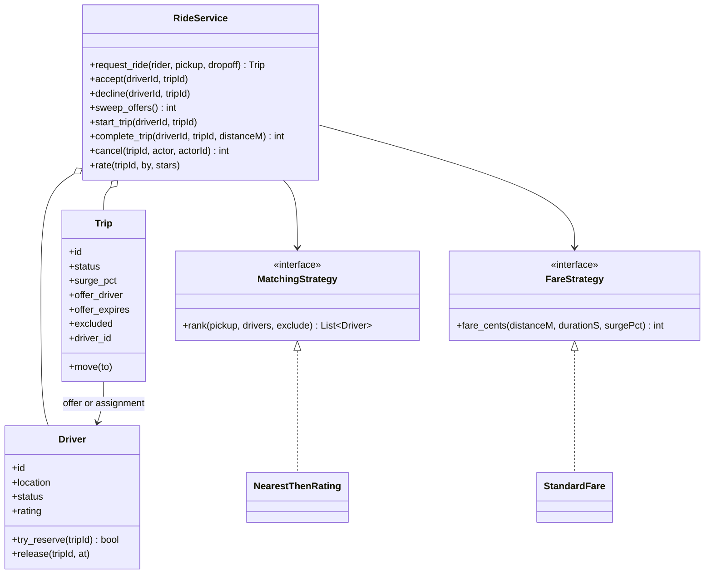

The two contended resources are the **driver** and the **trip**, so each owns a lock and its own state. The offer is not a separate entity: it is two fields on the trip (`offer_driver`, `offer_expires`) plus the driver's `RESERVED` status. Making `RESERVED` a real driver state (instead of leaving the driver `AVAILABLE` until they accept) is the key decision: it is what stops a second trip from being offered to a driver who is still looking at the first offer.

Matching and fares are interfaces because they are the parts that change: ETA-based ranking, batched matching, airport queues, or a new fare formula should not touch the lifecycle code. `Rider` is just an id here; it gains a class when rider ratings or payment methods enter scope.

#### Key patterns used

| Pattern | Where | Why |
|---|---|---|
| Strategy | `MatchingStrategy` (`NearestThenRating`), `FareStrategy` (`StandardFare`) | Ranking and pricing change by city and over time; tests inject simple versions |
| State (table-driven) | `ALLOWED` transitions and `Trip.move` | Every lifecycle change goes through one check; illegal moves raise instead of silently corrupting the trip |
| Conditional write (compare-and-set) | `Driver.try_reserve` | The claim "AVAILABLE -> RESERVED for trip T" is atomic; it is the in-memory form of a conditional `UPDATE` |
| Observer | `listeners` receive event strings | Push notifications, analytics, and audit hang off events without touching matching |
| Injected clock | `now` callable | Offer timeouts and cancellation windows are tested by moving fake time, not by sleeping |

#### Important flow: trip lifecycle and the offer loop

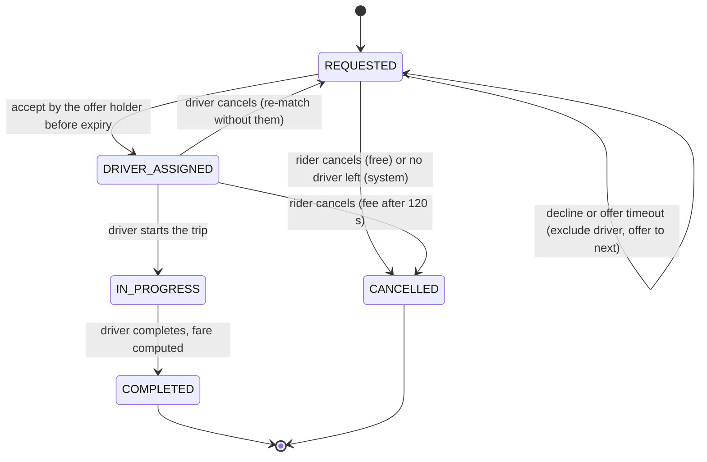

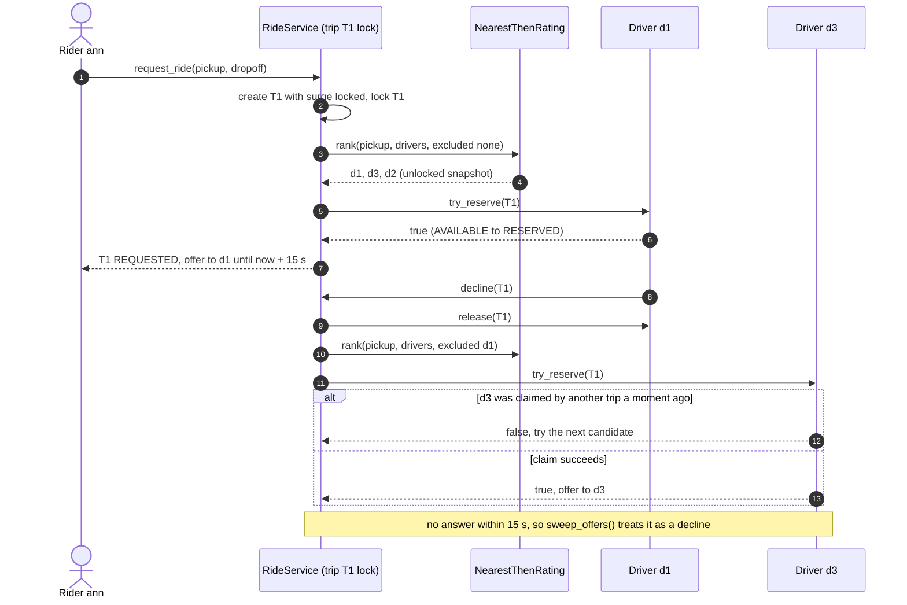

The ranking is computed from a snapshot read without any driver lock, so it can be stale: a driver it lists may already be reserved by another trip. That is fine because `try_reserve` re-checks under the driver's lock, and a failed claim just moves on to the next candidate. This is optimistic concurrency: no global "matching lock" serializes all riders, and the only atomic step is one driver's status change.

#### Concurrency and failure concerns

- **Invariant:** a driver holds at most one trip (offer or assignment), and a trip has at most one driver. `try_reserve` is the only way a driver gets a trip, and it is a compare-and-set under the driver's lock. With a database it is `UPDATE drivers SET status = 'RESERVED', trip_id = :t WHERE id = :d AND status = 'AVAILABLE'`, and the caller checks that one row changed.
- **Lock order:** trip lock, then driver lock, everywhere. No code path holds two driver locks or locks a trip while holding a driver lock, so there is no cycle. The registry lock guards only the two dictionaries and is never held while calling a strategy.
- **Timeout versus late accept:** both the sweeper and the lazy check in `accept` go through `_rematch` under the trip lock, so exactly one of "timeout" and "accept" wins. A driver who accepts after the deadline gets `OfferExpired` (or `NotAuthorized` if the sweeper already moved the offer on), never the trip.
- **Python and the GIL:** the GIL makes single bytecodes atomic, not "read status, compare, write status". The locks are still required; the 16-thread test with a barrier exercises exactly that window.
- **Duplicate requests:** a double-tapped "accept" fails cleanly because the offer is cleared on the first one. A retried `request_ride` would create a second trip; production attaches a client idempotency key to the request (see [section 4](../design-patterns/Low_Level_Design_Interview_Prep.md#4-designing-for-concurrency-and-failure)).
- **Crash recovery:** trips and driver states are durable rows. Because every offer carries an expiry, a crash between "reserve driver" and "notify driver" leaves at most a driver stuck in `RESERVED` until the sweeper releases them, never a permanent leak.
- **Scale:** matching state is per city. Partition by city or geo cell, keep live driver positions in an in-memory geo index, and keep the claim as a single-row conditional write in the trip store. The capacity numbers are in [HLD 6.6 Ride-Sharing Service](../computer-science/High_Level_Design.md#66-ride-sharing-service).

#### Reference implementation (Python 3)

The demo covers nearest-first matching with a rating tie-break, decline and timeout re-matching that never returns to an excluded driver, the fare formula with surge locked at request time (a mid-trip surge spike does not change the fare), all three cancellation rules, double-rating and post-completion cancel rejections, and a 16-thread race of riders against 4 drivers in which no driver ends up with two trips. It simplifies geography to planar meters and scans all drivers instead of using a geo index.

```python
"""ride_sharing.py -- run: python3 -I ride_sharing.py"""
from __future__ import annotations

import itertools
import threading
from concurrent.futures import ThreadPoolExecutor
from dataclasses import dataclass, field
from enum import Enum
from fractions import Fraction
from typing import Callable, Protocol, TypeVar

T = TypeVar("T")


class RideError(Exception): ...
class UnknownEntity(RideError): ...
class IllegalTransition(RideError): ...
class NotAuthorized(RideError): ...                       # wrong actor, or an offer that is no longer yours
class OfferExpired(RideError): ...


@dataclass(frozen=True)
class Point:
    x_m: int                                              # planar meters; production uses lat/lng + geo index
    y_m: int

    def dist2(self, other: Point) -> int:
        return (self.x_m - other.x_m) ** 2 + (self.y_m - other.y_m) ** 2


DriverStatus = Enum("DriverStatus", "OFFLINE AVAILABLE RESERVED ON_TRIP")    # RESERVED = holding one offer
TripStatus = Enum("TripStatus", "REQUESTED DRIVER_ASSIGNED IN_PROGRESS COMPLETED CANCELLED")
Actor = Enum("Actor", "RIDER DRIVER SYSTEM")
_S = TripStatus
ALLOWED: dict[TripStatus, set[TripStatus]] = {
    _S.REQUESTED: {_S.DRIVER_ASSIGNED, _S.CANCELLED},
    _S.DRIVER_ASSIGNED: {_S.IN_PROGRESS, _S.CANCELLED, _S.REQUESTED},     # REQUESTED: driver backs out
    _S.IN_PROGRESS: {_S.COMPLETED}, _S.COMPLETED: set(), _S.CANCELLED: set()}


@dataclass(eq=False)
class Driver:
    id: str
    location: Point
    status: DriverStatus = DriverStatus.OFFLINE
    trip_id: str | None = None
    rating_sum: int = 0
    rating_count: int = 0
    lock: threading.Lock = field(default_factory=threading.Lock, repr=False)

    @property
    def rating(self) -> Fraction:                         # exact, so ties compare exactly
        return Fraction(self.rating_sum, self.rating_count) if self.rating_count else Fraction(5)

    def try_reserve(self, trip_id: str) -> bool:
        """Conditional write AVAILABLE -> RESERVED: the only way a driver gets a trip."""
        with self.lock:
            if self.status is not DriverStatus.AVAILABLE:
                return False
            self.status, self.trip_id = DriverStatus.RESERVED, trip_id
            return True

    def release(self, trip_id: str, at: Point | None = None) -> None:
        with self.lock:
            if self.trip_id == trip_id:                   # idempotent; never frees someone else's trip
                self.status, self.trip_id = DriverStatus.AVAILABLE, None
                self.location = at or self.location


@dataclass(eq=False)
class Trip:
    id: str
    rider_id: str
    pickup: Point
    dropoff: Point
    surge_pct: int                                        # locked at request time: rider pays what was quoted
    status: TripStatus = TripStatus.REQUESTED
    driver_id: str | None = None
    offer_driver: str | None = None
    offer_expires: float = 0.0
    excluded: set[str] = field(default_factory=set)
    accepted_at: float = 0.0
    started_at: float = 0.0
    fare_cents: int = 0
    cancelled_by: Actor | None = None
    rated: set[Actor] = field(default_factory=set)
    lock: threading.Lock = field(default_factory=threading.Lock, repr=False)

    def move(self, to: TripStatus) -> None:
        if to not in ALLOWED[self.status]:
            raise IllegalTransition(f"{self.id}: {self.status.name} -> {to.name}")
        self.status = to


class MatchingStrategy(Protocol):
    def rank(self, pickup: Point, drivers: list[Driver], exclude: set[str]) -> list[Driver]: ...


class NearestThenRating:
    def __init__(self, radius_m: int = 5_000) -> None:
        self.r2 = radius_m * radius_m

    def rank(self, pickup: Point, drivers: list[Driver], exclude: set[str]) -> list[Driver]:
        # Unlocked snapshot: advisory only. Driver.try_reserve is the authority.
        cands = [d for d in drivers if d.status is DriverStatus.AVAILABLE
                 and d.id not in exclude and d.location.dist2(pickup) <= self.r2]
        return sorted(cands, key=lambda d: (d.location.dist2(pickup), -d.rating, d.id))


class FareStrategy(Protocol):
    def fare_cents(self, distance_m: int, duration_s: int, surge_pct: int) -> int: ...


def round_half_up(x: Fraction) -> int:
    return (x.numerator * 2 + x.denominator) // (x.denominator * 2)


@dataclass(frozen=True)
class StandardFare:
    base_cents: int = 250
    per_km_cents: int = 120
    per_min_cents: int = 30
    minimum_cents: int = 500

    def fare_cents(self, distance_m: int, duration_s: int, surge_pct: int) -> int:
        raw = (self.base_cents + Fraction(self.per_km_cents * distance_m, 1000)
               + Fraction(self.per_min_cents * duration_s, 60))
        return max(self.minimum_cents, round_half_up(raw * Fraction(surge_pct, 100)))


class RideService:
    def __init__(self, now: Callable[[], float], matcher: MatchingStrategy, fare: FareStrategy,
                 surge: Callable[[Point], int] = lambda p: 100, offer_ttl_s: float = 15,
                 free_cancel_s: float = 120, cancel_fee_cents: int = 500) -> None:
        self.now, self.matcher, self.fare, self.surge = now, matcher, fare, surge   # injected clock
        self.offer_ttl_s, self.free_cancel_s = offer_ttl_s, free_cancel_s
        self.cancel_fee_cents = cancel_fee_cents
        self.listeners: list[Callable[[str], None]] = []
        self._drivers: dict[str, Driver] = {}
        self._trips: dict[str, Trip] = {}
        self._reg = threading.Lock()                      # guards the two dicts only
        self._seq = itertools.count(1)

    # ---- drivers -----------------------------------------------------------------
    def add_driver(self, driver_id: str, at: Point, rating_sum: int = 0, rating_count: int = 0) -> None:
        with self._reg:
            if driver_id in self._drivers:
                raise ValueError(f"duplicate driver {driver_id}")
            self._drivers[driver_id] = Driver(driver_id, at, rating_sum=rating_sum, rating_count=rating_count)

    def set_online(self, driver_id: str, online: bool, at: Point | None = None) -> None:
        d = _get(self._drivers, driver_id)
        frm, to = DriverStatus.OFFLINE, DriverStatus.AVAILABLE
        if not online:
            frm, to = to, frm
        with d.lock:
            if d.status is not frm:                       # holding an offer or a trip: finish it first
                raise IllegalTransition(f"{driver_id} is {d.status.name}")
            d.status, d.location = to, at or d.location

    # ---- trip lifecycle (lock order everywhere: trip.lock, then driver.lock) ------
    def request_ride(self, rider_id: str, pickup: Point, dropoff: Point) -> Trip:
        with self._reg:
            trip = Trip(f"T{next(self._seq)}", rider_id, pickup, dropoff, self.surge(pickup))
            self._trips[trip.id] = trip
        with trip.lock:
            self._dispatch(trip)
        return trip

    def accept(self, driver_id: str, trip_id: str) -> None:
        trip, d = _get(self._trips, trip_id), _get(self._drivers, driver_id)
        with trip.lock:
            self._check_offer(trip, driver_id)
            trip.move(TripStatus.DRIVER_ASSIGNED)
            with d.lock:
                d.status = DriverStatus.ON_TRIP
            trip.driver_id, trip.offer_driver, trip.accepted_at = driver_id, None, self.now()
            self._emit(f"{trip.id} assigned {driver_id}")

    def decline(self, driver_id: str, trip_id: str) -> None:
        trip = _get(self._trips, trip_id)
        with trip.lock:
            self._check_offer(trip, driver_id)
            self._rematch(trip, driver_id)

    def sweep_offers(self) -> int:
        """Periodic job: offers nobody answered count as declines."""
        n = 0
        for trip in list(self._trips.values()):
            with trip.lock:
                if trip.offer_driver and self.now() >= trip.offer_expires:
                    self._rematch(trip, trip.offer_driver)
                    n += 1
        return n

    def start_trip(self, driver_id: str, trip_id: str) -> None:
        trip = _get(self._trips, trip_id)
        with trip.lock:
            if trip.driver_id != driver_id:
                raise NotAuthorized(f"{driver_id} is not the driver of {trip_id}")
            trip.move(TripStatus.IN_PROGRESS)
            trip.started_at = self.now()

    def complete_trip(self, driver_id: str, trip_id: str, distance_m: int) -> int:
        if distance_m < 0:
            raise ValueError("distance must be >= 0")
        trip, d = _get(self._trips, trip_id), _get(self._drivers, driver_id)
        with trip.lock:
            if trip.driver_id != driver_id:
                raise NotAuthorized(f"{driver_id} is not the driver of {trip_id}")
            trip.move(TripStatus.COMPLETED)
            duration = int(self.now() - trip.started_at)
            trip.fare_cents = self.fare.fare_cents(distance_m, duration, trip.surge_pct)
            d.release(trip.id, at=trip.dropoff)
            self._emit(f"{trip.id} completed fare={trip.fare_cents}")
            return trip.fare_cents

    def cancel(self, trip_id: str, actor: Actor, actor_id: str) -> int:
        """Rider: free until free_cancel_s after acceptance, fee after. Driver: only after accepting,
        and the trip goes back to matching. Nobody cancels IN_PROGRESS or a finished trip."""
        trip = _get(self._trips, trip_id)
        with trip.lock:
            if actor is Actor.DRIVER:
                if trip.driver_id != actor_id or trip.status is not TripStatus.DRIVER_ASSIGNED:
                    raise IllegalTransition(f"driver cannot cancel {trip_id} in {trip.status.name}")
                trip.move(TripStatus.REQUESTED)
                trip.driver_id = None
                self._rematch(trip, actor_id)
                return 0
            if actor is Actor.RIDER and trip.rider_id != actor_id:
                raise NotAuthorized(f"{actor_id} does not own {trip_id}")
            late = (trip.status is TripStatus.DRIVER_ASSIGNED
                    and self.now() - trip.accepted_at > self.free_cancel_s)
            trip.move(TripStatus.CANCELLED)
            for held in (trip.offer_driver, trip.driver_id):
                if held:
                    _get(self._drivers, held).release(trip.id)
            trip.offer_driver, trip.cancelled_by = None, actor
            return self.cancel_fee_cents if late and actor is Actor.RIDER else 0

    def rate(self, trip_id: str, by: Actor, stars: int) -> None:
        if not 1 <= stars <= 5:
            raise ValueError("stars must be 1..5")
        trip = _get(self._trips, trip_id)
        with trip.lock:
            if trip.status is not TripStatus.COMPLETED or by in trip.rated or by is Actor.SYSTEM:
                raise IllegalTransition(f"cannot rate {trip_id} as {by.name}")
            trip.rated.add(by)
            if by is Actor.RIDER:                         # drivers rating riders: same shape, omitted
                d = _get(self._drivers, trip.driver_id or "")
                with d.lock:
                    d.rating_sum, d.rating_count = d.rating_sum + stars, d.rating_count + 1

    # ---- internals (caller holds trip.lock) ----------------------------------------
    def _dispatch(self, trip: Trip) -> None:
        with self._reg:
            drivers = list(self._drivers.values())
        for d in self.matcher.rank(trip.pickup, drivers, trip.excluded):
            if d.try_reserve(trip.id):                    # lost the race? try the next candidate
                trip.offer_driver, trip.offer_expires = d.id, self.now() + self.offer_ttl_s
                self._emit(f"{trip.id} offered to {d.id}")
                return
        trip.move(TripStatus.CANCELLED)
        trip.cancelled_by = Actor.SYSTEM
        self._emit(f"{trip.id} no drivers")

    def _rematch(self, trip: Trip, driver_id: str) -> None:
        _get(self._drivers, driver_id).release(trip.id)
        trip.excluded.add(driver_id)
        trip.offer_driver = None
        self._dispatch(trip)

    def _check_offer(self, trip: Trip, driver_id: str) -> None:
        if trip.status is not TripStatus.REQUESTED or trip.offer_driver != driver_id:
            raise NotAuthorized(f"{driver_id} holds no offer for {trip.id}")
        if self.now() >= trip.offer_expires:
            self._rematch(trip, driver_id)                # lazy timeout, same as the sweeper
            raise OfferExpired(trip.id)

    def _emit(self, event: str) -> None:
        for listener in self.listeners:
            listener(event)


def _get(table: dict[str, T], key: str) -> T:
    if key not in table:
        raise UnknownEntity(key)
    return table[key]


def expect(exc: type[Exception], fn: Callable[[], object]) -> None:
    try:
        fn()
    except exc:
        return
    raise AssertionError(f"expected {exc.__name__}")


def main() -> None:
    clock = [0.0]                                         # fake time, advanced by hand
    svc = RideService(lambda: clock[0], NearestThenRating(), StandardFare(),
                      surge=lambda p: 150 if p.x_m < 0 else 100)    # 1.5x west of x = 0
    log: list[str] = []
    svc.listeners.append(log.append)
    for name, x, rs, rc in [("d1", 100, 0, 0), ("d2", 500, 18, 4), ("d3", -500, 19, 4), ("d4", 4_500, 0, 0)]:
        svc.add_driver(name, Point(x, 0), rs, rc)
        svc.set_online(name, True, Point(x, 0))

    # 1) Nearest wins; decline re-matches; d2 and d3 are equidistant so rating (4.75 > 4.5) breaks the tie.
    t = svc.request_ride("ann", Point(0, 0), Point(4_000, 3_000))
    assert t.offer_driver == "d1"
    svc.decline("d1", t.id)
    assert t.offer_driver == "d3" and t.excluded == {"d1"} and "T1 offered to d3" in log
    # 2) Timeout: d3 ignores the offer; the sweeper re-matches to d2, never back to d1 or d3.
    clock[0] += 15
    assert svc.sweep_offers() == 1 and t.offer_driver == "d2"
    expect(NotAuthorized, lambda: svc.accept("d3", t.id))         # its offer is gone
    svc.accept("d2", t.id)
    assert t.status is TripStatus.DRIVER_ASSIGNED and svc._drivers["d2"].status is DriverStatus.ON_TRIP
    # 3) Ride, fare = (250 + 5 km x 120 + 15 min x 30) x 1.0 = 1300; rider rates once.
    svc.start_trip("d2", t.id)
    clock[0] += 15 * 60
    assert svc.complete_trip("d2", t.id, distance_m=5_000) == 1300
    svc.rate(t.id, Actor.RIDER, 5)
    assert svc._drivers["d2"].rating == Fraction(23, 5)
    expect(IllegalTransition, lambda: svc.rate(t.id, Actor.RIDER, 5))           # rated twice
    expect(IllegalTransition, lambda: svc.cancel(t.id, Actor.RIDER, "ann"))     # already completed

    # 4) Surge locked at request (pickup x < 0 -> 1.5x), and rider cancellation rules.
    t2 = svc.request_ride("bob", Point(-300, 0), Point(0, 0))
    assert t2.surge_pct == 150 and t2.offer_driver == "d3"
    svc.accept("d3", t2.id)
    svc.start_trip("d3", t2.id)
    svc.surge = lambda p: 300                             # surge spikes mid-trip: bob keeps 1.5x
    clock[0] += 10 * 60
    assert svc.complete_trip("d3", t2.id, 2_000) == 1185          # (250 + 240 + 300) x 1.5 = 1185
    for who, wait_s, fee in (("cat", 60, 0), ("dan", 180, 500)):  # free window is 120 s after accept
        tr = svc.request_ride(who, Point(0, 0), Point(1_000, 0))
        svc.accept(tr.offer_driver or "", tr.id)
        busy = tr.driver_id or ""
        expect(IllegalTransition, lambda: svc.set_online(busy, False))  # cannot go offline mid-trip
        clock[0] += wait_s
        assert svc.cancel(tr.id, Actor.RIDER, who) == fee
    # 5) Driver cancels after accepting: the trip returns to matching, excluding that driver.
    t5 = svc.request_ride("eve", Point(0, 0), Point(1_000, 0))
    first = t5.offer_driver or ""
    svc.accept(first, t5.id)
    assert svc.cancel(t5.id, Actor.DRIVER, first) == 0
    assert t5.status is TripStatus.REQUESTED and t5.offer_driver not in (None, first)
    svc.cancel(t5.id, Actor.RIDER, "eve")
    assert all(d.status is DriverStatus.AVAILABLE for d in svc._drivers.values())

    # 6) Race: 16 riders request at once against 4 drivers. No driver may hold two trips.
    barrier = threading.Barrier(16)

    def rider(i: int) -> Trip:
        barrier.wait()
        return svc.request_ride(f"r{i}", Point(i * 10, 0), Point(0, 0))
    with ThreadPoolExecutor(16) as pool:
        trips = list(pool.map(rider, range(16)))
    offered = [tr.offer_driver for tr in trips if tr.offer_driver]
    assert len(offered) == 4 and len(set(offered)) == 4
    assert sum(tr.status is TripStatus.CANCELLED and tr.cancelled_by is Actor.SYSTEM for tr in trips) == 12
    assert all(d.status is DriverStatus.RESERVED and svc._trips[d.trip_id or ""].offer_driver == d.id
               for d in svc._drivers.values())
    print("all ride-sharing checks passed")


if __name__ == "__main__":
    main()
```

#### Extension questions

- **"Rank by ETA instead of straight-line distance":** write an `EtaMatching` strategy that pre-filters by distance (cheap), then asks a routing service for ETAs of the top 10 candidates in one batch call. The call happens before any lock is taken; staleness is handled by `try_reserve` exactly as today.
- **"Offer to three drivers at once, first to accept wins":** the contended resource becomes the trip, not the driver. Reserve nothing at offer time; on accept, run a compare-and-set on the trip (`REQUESTED -> DRIVER_ASSIGNED where offer_round = r`) and then claim the driver. Losers get "trip taken". This cuts rider wait at the cost of driver annoyance and wasted offers.
- **"Batched matching":** collect requests for 2 seconds per city cell, build a cost matrix (ETA), and solve the assignment problem (Hungarian algorithm or min-cost flow) for a global optimum. The output is a list of proposed (trip, driver) pairs, still committed one by one with `try_reserve`, because drivers may have changed state during the solve.
- **"How is surge computed?":** per geo cell, the ratio of open requests to available drivers over a sliding window, mapped to a multiplier with hysteresis so it does not flap. The rider receives a quote token (multiplier, expiry) and the trip stores the multiplier, which is why the trip has `surge_pct`.
- **"Shared rides (pool)":** a trip gains several riders and an ordered list of stops. Matching becomes route insertion: find the vehicle whose detour for the new pickup and dropoff is smallest and within each existing rider's tolerance.

#### Interview Q&A

**Q1.** Why does a matched driver go to `RESERVED` instead of staying `AVAILABLE` until they accept?

**A1.** Because the offer itself is a claim on the driver. If the driver stayed `AVAILABLE` while the first offer was on their screen, a second trip could be offered to them, and if they accepted both (or the app showed the second one over the first) one rider would be stranded. `RESERVED` makes "has an outstanding offer" visible to every other matcher, and the cost is small: at most 15 seconds of a driver being unavailable to others, bounded by the offer expiry. Release happens on decline, timeout, rider cancellation, and trip completion, all through the same idempotent `release(trip_id)` that only frees the driver if they are still held by that trip.

**Q2.** Two riders request at the same moment and the same driver is nearest to both. Walk through what happens.

**A2.** Both requests create separate trips and take only their own trip lock, so they run in parallel. Both rank candidates from an unlocked snapshot and both see the driver as `AVAILABLE`. Both call `try_reserve`. The driver's lock serializes them: the first sees `AVAILABLE`, writes `RESERVED` with its trip id, and returns true; the second sees `RESERVED`, returns false, and moves to its next candidate. No rider waits for the other's whole matching run, and nobody holds a lock on more than one driver. The demo's race test asserts exactly this with 16 riders and 4 drivers: 4 distinct drivers hold offers, 12 trips are cancelled by the system, and every driver's `trip_id` points at a trip whose `offer_driver` is that driver.

**Q3.** The driver accepts, then cancels on the way to the pickup. What happens to the rider, and why is that not modeled as `CANCELLED`?

**A3.** From the rider's point of view, nothing they did should end the trip, so the trip moves back to `REQUESTED`, the driver is released and added to the excluded set, and matching runs again. That is why the transition table includes `DRIVER_ASSIGNED -> REQUESTED`. If no other driver is available, the system cancels the trip and the rider pays nothing (the fee only applies to a rider's own late cancellation). The driver's cancellation is recorded separately for acceptance-rate metrics, which is a reporting concern, not a state of the trip.

**Q4.** How does this change if matching runs on several servers?

**A4.** The in-process locks become database or key-value atomics, and the structure stays the same. Driver status lives in a store that supports a conditional write (`UPDATE ... WHERE status = 'AVAILABLE'` or a Redis `WATCH`/`MULTI` or Lua script keyed by driver id), so two servers that both picked the same driver still produce one winner. Trip transitions are conditional on the current status (`UPDATE trips SET status = 'DRIVER_ASSIGNED' WHERE id = :t AND status = 'REQUESTED' AND offer_driver = :d AND offer_expires > now()`). Partitioning matching by city means most requests for one area hit one shard, so the conditional writes are local. The offer sweeper becomes a scheduled job per shard, and it is safe to run twice because every step is conditional.

See also: [HLD 6.6 Ride-Sharing Service](../computer-science/High_Level_Design.md#66-ride-sharing-service), [Geospatial indexing](../computer-science/High_Level_Design.md#48-geospatial-indexing), [Strategy pattern](../design-patterns/Design_Patterns_Python.md#24-strategy), [State pattern](../design-patterns/Design_Patterns_Python.md#23-state)

---

### A2. Food Delivery App

#### Requirements and assumptions

- A cart belongs to one customer and holds items from exactly one restaurant. Adding an item from a different restaurant raises `CartConflict` unless the caller passes `replace=True` (the app's "start a new cart?" dialog). Adding requires the restaurant to be open and the item available.
- `place_order` re-validates the cart (the restaurant may have closed since), snapshots each line's unit price into the order, charges the total, and clears the cart. It is idempotent on a client key: a retry returns the same order and never charges twice.
- Lifecycle transitions are a table from `(from, to)` to the roles allowed to make that move. Each role can act only on its own orders (the customer who placed it, the restaurant it was placed at, the assigned agent).
- On `ACCEPTED`, a delivery agent is assigned by a pluggable strategy (nearest idle agent). If every agent is busy, the order joins a FIFO waiting queue and is assigned when an agent frees up (delivery or cancellation).
- Refunds depend on the state at cancellation and on who cancelled:

| Cancelled from | By customer | By restaurant or system |
|---|---|---|
| `PLACED`, `ACCEPTED` | full refund | full refund |
| `PREPARING` | delivery fee + half the food (rounded up) | full refund |
| `READY_FOR_PICKUP` | delivery fee only (the food exists) | full refund |
| `PICKED_UP` and later | not allowed | not allowed |

- Out of scope: ratings, ETAs and routing, batching several orders per agent, menus with options, tips, taxes.

#### Core model

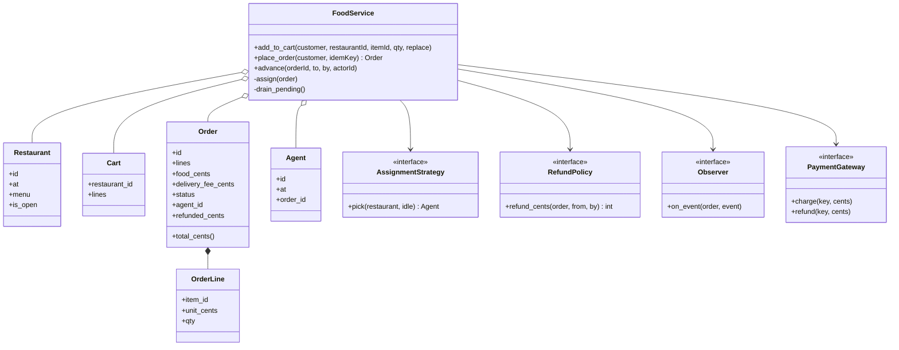

`Order` copies prices into `OrderLine` at placement: a menu edit five minutes later must not change what the customer was charged or what a refund computes. `Cart` is a separate, mutable, pre-order object; it is deleted on placement rather than turned into the order, because its validation rules (restaurant open, items available) are checked against the live menu while the order's rules are checked against the snapshot.

The transitions table encodes who may do what, so the state machine is data, not a ladder of `if` statements. Adding "the system rejects orders the restaurant ignored for 10 minutes" is one row (`(PLACED, REJECTED): {RESTAURANT, SYSTEM}`), not a new method.

#### Key patterns used

| Pattern | Where | Why |
|---|---|---|
| State (table-driven) | `TRANSITIONS: (from, to) -> roles` and `advance` | One place validates every move and every actor; the permission model is reviewable at a glance |
| Strategy | `AssignmentStrategy` (`NearestIdleAgent`), `RefundPolicy` (`StandardRefund`) | Dispatch logic and refund rules change by market and promotion without touching the lifecycle |
| Observer | `Observer.on_event`, three `Inbox` subscribers | Customer, restaurant, and agent each filter the events they care about; adding SMS or analytics is a new subscriber |
| Adapter | `PaymentGateway` | Isolates the provider; the fake enforces "never refund twice" as a test oracle |
| Idempotency key | `place_order(customer, key)` | Mobile clients retry on timeouts; the key turns a retry into a read |

#### Important flow: order state machine with roles

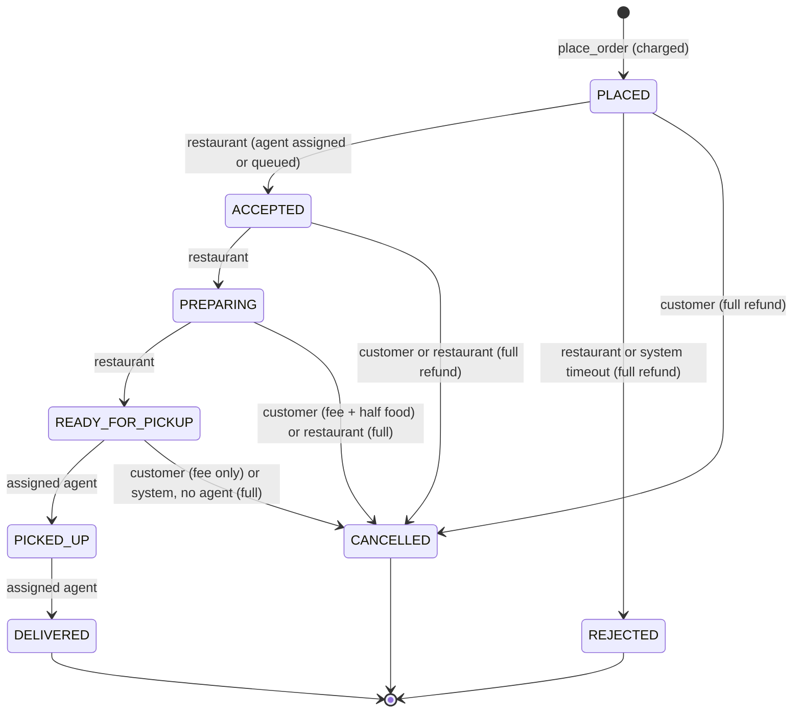

Every arrow is one row of `TRANSITIONS`. The side effects hang off the target state after the lock is released: entering `ACCEPTED` triggers assignment, entering a terminal state frees the agent and drains the waiting queue, and entering `CANCELLED` or `REJECTED` computes the refund from the *source* state through the `RefundPolicy`.

#### Concurrency and failure concerns

- **Serialization point:** each order has its own lock, and `advance` does "read status, check the table, check the actor, write status, compute refund" inside it. Concurrent "customer cancels" and "restaurant rejects" therefore serialize: exactly one sees `PLACED`, the other sees a terminal state and gets `IllegalTransition`. In a database this is `UPDATE orders SET status = 'CANCELLED' WHERE id = :id AND status IN ('PLACED', 'ACCEPTED', ...)` with an affected-row check.
- **Refund exactly once:** the refund is issued after the lock is released (no network I/O under a lock), but only by the thread whose transition won, and with the key `refund:<order id>` so a retried call is deduplicated by the provider. The fake gateway raises on a second refund for the same key, and the 40-order race test passes with every order refunded exactly once.
- **Placement without holding a lock across I/O:** phase 1 validates and prices under the service lock; the charge runs unlocked with the key `charge:<customer>:<client key>` (providers deduplicate on it); phase 2 commits the order only if no concurrent duplicate has committed first. Eight concurrent `place_order` calls with the same key produce one order and one charge.
- **Lock order:** service lock, then order lock (in `_assign`, which must re-check that the order is not cancelled before attaching an agent). `advance` never takes the service lock while holding an order lock, so no cycle exists.
- **Lost notifications:** observers run after the state change, in-process here. Production writes the event to an outbox table in the same transaction as the status change and delivers it asynchronously, so a crash cannot commit a status without its notification.
- **Stuck orders:** a restaurant that never accepts, or an order that waits too long for an agent, is handled by a sweeper that applies `SYSTEM` transitions (`PLACED -> REJECTED`, `READY_FOR_PICKUP -> CANCELLED`), which are already in the table.

#### Reference implementation (Python 3)

The code demonstrates the single-restaurant cart (conflict, then explicit replace), a restaurant closing while items sit in a cart, price snapshots and idempotent placement, the full happy path with nearest-agent assignment, role and ownership checks, the refund table at three cancellation points, the waiting queue when all agents are busy, and two races (duplicate placement and cancel-versus-reject). It simplifies locations to complex numbers and keeps notifications in memory.

```python
"""food_delivery.py -- run: python3 -I food_delivery.py"""
from __future__ import annotations

import itertools
import threading
from collections import deque
from concurrent.futures import ThreadPoolExecutor
from dataclasses import dataclass, field
from enum import Enum
from typing import Callable, Protocol


class DeliveryError(Exception): ...
class UnknownEntity(DeliveryError): ...
class NotOrderable(DeliveryError): ...                    # restaurant closed or item unavailable
class CartConflict(DeliveryError): ...
class IllegalTransition(DeliveryError): ...
class NotAuthorized(DeliveryError): ...


Status = Enum("Status", "PLACED ACCEPTED PREPARING READY_FOR_PICKUP PICKED_UP DELIVERED CANCELLED REJECTED")
Role = Enum("Role", "CUSTOMER RESTAURANT AGENT SYSTEM")
_S, _R = Status, Role
# (from, to) -> roles allowed to make that move. Anything missing is illegal.
TRANSITIONS: dict[tuple[Status, Status], set[Role]] = {
    (_S.PLACED, _S.ACCEPTED): {_R.RESTAURANT}, (_S.ACCEPTED, _S.PREPARING): {_R.RESTAURANT},
    (_S.PREPARING, _S.READY_FOR_PICKUP): {_R.RESTAURANT},
    (_S.READY_FOR_PICKUP, _S.PICKED_UP): {_R.AGENT}, (_S.PICKED_UP, _S.DELIVERED): {_R.AGENT},
    (_S.PLACED, _S.REJECTED): {_R.RESTAURANT, _R.SYSTEM},      # SYSTEM: restaurant never answered
    (_S.PLACED, _S.CANCELLED): {_R.CUSTOMER},
    (_S.ACCEPTED, _S.CANCELLED): {_R.CUSTOMER, _R.RESTAURANT},  # RESTAURANT: ran out of an item
    (_S.PREPARING, _S.CANCELLED): {_R.CUSTOMER, _R.RESTAURANT},
    (_S.READY_FOR_PICKUP, _S.CANCELLED): {_R.CUSTOMER, _R.SYSTEM},  # SYSTEM: no agent found in time
}
TERMINAL = {_S.DELIVERED, _S.CANCELLED, _S.REJECTED}


@dataclass
class MenuItem:
    price_cents: int
    available: bool = True


@dataclass(eq=False)
class Restaurant:
    id: str
    at: complex                                           # x + yj in km; production uses a geo index
    menu: dict[str, MenuItem]
    is_open: bool = True


@dataclass(frozen=True)
class OrderLine:                                          # price snapshot: later menu edits do not change it
    item_id: str
    unit_cents: int
    qty: int


@dataclass(eq=False)
class Order:
    id: str
    customer_id: str
    restaurant_id: str
    lines: tuple[OrderLine, ...]
    food_cents: int
    delivery_fee_cents: int
    status: Status = Status.PLACED
    agent_id: str | None = None
    refunded_cents: int = 0
    lock: threading.Lock = field(default_factory=threading.Lock, repr=False)

    @property
    def total_cents(self) -> int:
        return self.food_cents + self.delivery_fee_cents


@dataclass(eq=False)
class Agent:
    id: str
    at: complex
    order_id: str | None = None


@dataclass
class Cart:
    restaurant_id: str | None = None
    lines: dict[str, int] = field(default_factory=dict)


class AssignmentStrategy(Protocol):
    def pick(self, restaurant: Restaurant, idle: list[Agent]) -> Agent | None: ...


class NearestIdleAgent:
    def pick(self, restaurant: Restaurant, idle: list[Agent]) -> Agent | None:
        return min(idle, key=lambda a: (abs(a.at - restaurant.at), a.id), default=None)


class RefundPolicy(Protocol):
    def refund_cents(self, order: Order, frm: Status, by: Role) -> int: ...


class StandardRefund:
    """Customer cancels: pays for food already being made. Restaurant or system fault: full refund."""
    def refund_cents(self, order: Order, frm: Status, by: Role) -> int:
        if by is not Role.CUSTOMER or frm in (Status.PLACED, Status.ACCEPTED):
            return order.total_cents
        if frm is Status.PREPARING:
            return order.delivery_fee_cents + (order.food_cents + 1) // 2   # half the food, rounded up
        return order.delivery_fee_cents                   # READY_FOR_PICKUP: the food exists


class Observer(Protocol):
    def on_event(self, order: Order, event: str) -> None: ...


class Inbox:
    """Stands in for push/SMS adapters. Production: write to an outbox table, deliver async."""
    def __init__(self, recipient: Callable[[Order], str | None], wanted: set[str] | None = None) -> None:
        self.recipient, self.wanted = recipient, wanted
        self.sent: list[tuple[str, str]] = []

    def on_event(self, order: Order, event: str) -> None:
        to = self.recipient(order)
        if to and (self.wanted is None or event in self.wanted):
            self.sent.append((to, f"{order.id}:{event}"))


class PaymentGateway(Protocol):
    def charge(self, key: str, cents: int) -> None: ...
    def refund(self, key: str, cents: int) -> None: ...


class FakeGateway:
    def __init__(self) -> None:
        self.charges: dict[str, int] = {}
        self.refunds: dict[str, int] = {}
        self._lock = threading.Lock()

    def charge(self, key: str, cents: int) -> None:      # idempotent per key, like real providers
        with self._lock:
            self.charges.setdefault(key, cents)

    def refund(self, key: str, cents: int) -> None:
        with self._lock:
            if key in self.refunds:
                raise AssertionError(f"double refund {key}")
            self.refunds[key] = cents


class FoodService:
    def __init__(self, gateway: PaymentGateway, assigner: AssignmentStrategy, refunds: RefundPolicy,
                 delivery_fee_cents: int = 299) -> None:
        self.gateway, self.assigner, self.refunds, self.fee = gateway, assigner, refunds, delivery_fee_cents
        self.observers: list[Observer] = []
        self.restaurants: dict[str, Restaurant] = {}
        self.agents: dict[str, Agent] = {}
        self.orders: dict[str, Order] = {}
        self._carts: dict[str, Cart] = {}
        self._by_key: dict[str, str] = {}                 # idempotency key -> order id
        self._pending: deque[str] = deque()               # accepted orders waiting for an agent
        self._lock = threading.Lock()                     # registries, carts, agents; never held for I/O
        self._seq = itertools.count(1)

    def add_to_cart(self, customer: str, restaurant_id: str, item_id: str, qty: int = 1,
                    replace: bool = False) -> None:
        if qty <= 0:
            raise ValueError("qty must be positive")
        with self._lock:
            r = self._open_restaurant(restaurant_id)
            self._item(r, item_id)
            cart = self._carts.setdefault(customer, Cart())
            if cart.restaurant_id not in (None, restaurant_id):
                if not replace:                           # the UI asks "start a new cart?"
                    raise CartConflict(f"cart holds items from {cart.restaurant_id}")
                cart.lines.clear()
            cart.restaurant_id = restaurant_id
            cart.lines[item_id] = cart.lines.get(item_id, 0) + qty

    def place_order(self, customer: str, idem_key: str) -> Order:
        with self._lock:                                  # phase 1: validate and price, no I/O
            if idem_key in self._by_key:
                return self.orders[self._by_key[idem_key]]
            cart = self._carts.get(customer)
            if cart is None or not cart.lines or cart.restaurant_id is None:
                raise ValueError("empty cart")
            r = self._open_restaurant(cart.restaurant_id)
            lines = tuple(OrderLine(i, self._item(r, i).price_cents, q) 
                          for i, q in sorted(cart.lines.items()))
            food = sum(ln.unit_cents * ln.qty for ln in lines)
            draft = Order(f"O{next(self._seq)}", customer, r.id, lines, food, self.fee)
        self.gateway.charge(f"charge:{customer}:{idem_key}", draft.total_cents)   # provider dedupes the key
        with self._lock:                                  # phase 2: commit exactly once per key
            if idem_key in self._by_key:
                return self.orders[self._by_key[idem_key]]
            self.orders[draft.id], self._by_key[idem_key] = draft, draft.id
            self._carts.pop(customer, None)
        self._notify(draft, Status.PLACED.name)
        return draft

    def advance(self, order_id: str, to: Status, by: Role, actor_id: str = "") -> None:
        order = self.orders.get(order_id)
        if order is None:
            raise UnknownEntity(order_id)
        with order.lock:                                  # per-order state machine = serialization point
            frm = order.status
            if by not in TRANSITIONS.get((frm, to), set()):
                raise IllegalTransition(f"{order_id}: {frm.name} -> {to.name} by {by.name}")
            owner = {Role.CUSTOMER: order.customer_id, Role.RESTAURANT: order.restaurant_id,
                     Role.AGENT: order.agent_id}.get(by, actor_id)
            if owner != actor_id:
                raise NotAuthorized(f"{actor_id} cannot act on {order_id} as {by.name}")
            order.status, refund = to, 0
            if to in (Status.CANCELLED, Status.REJECTED):
                refund = order.refunded_cents = self.refunds.refund_cents(order, frm, by)
        if refund:                                        # outside the lock; the transition above ran once
            self.gateway.refund(f"refund:{order.id}", refund)
        self._notify(order, to.name)
        if to is Status.ACCEPTED:
            self._assign(order)
        elif to in TERMINAL and order.agent_id:
            with self._lock:
                self.agents[order.agent_id].order_id = None
            self._drain_pending()                         # a freed agent takes the oldest waiting order

    # ---- internals; lock order is always service lock, then order lock -----------
    def _assign(self, order: Order) -> None:
        with self._lock:
            idle = [a for a in self.agents.values() if a.order_id is None]
            agent = self.assigner.pick(self.restaurants[order.restaurant_id], idle)
            with order.lock:
                if order.status in TERMINAL:              # cancelled between accept and assignment
                    return
                if agent is None:
                    self._pending.append(order.id)
                    return
                agent.order_id, order.agent_id = order.id, agent.id
        self._notify(order, "AGENT_ASSIGNED")

    def _drain_pending(self) -> None:
        while True:
            with self._lock:
                if not self._pending or all(a.order_id for a in self.agents.values()):
                    return
                order = self.orders[self._pending.popleft()]
            self._assign(order)

    def _open_restaurant(self, rid: str) -> Restaurant:
        r = self.restaurants.get(rid)
        if r is None or not r.is_open:
            raise NotOrderable(f"{rid} is unknown or closed")
        return r

    @staticmethod
    def _item(r: Restaurant, item_id: str) -> MenuItem:
        item = r.menu.get(item_id)
        if item is None or not item.available:
            raise NotOrderable(f"{r.id}/{item_id}")
        return item

    def _notify(self, order: Order, event: str) -> None:
        for obs in self.observers:
            obs.on_event(order, event)


def expect(exc: type[Exception], fn: Callable[[], object]) -> None:
    try:
        fn()
    except exc:
        return
    raise AssertionError(f"expected {exc.__name__}")


def main() -> None:
    gw = FakeGateway()
    svc = FoodService(gw, NearestIdleAgent(), StandardRefund())
    customer_inbox = Inbox(lambda o: o.customer_id)
    agent_inbox = Inbox(lambda o: o.agent_id, {"AGENT_ASSIGNED", "READY_FOR_PICKUP", "CANCELLED"})
    svc.observers += [customer_inbox, agent_inbox]
    svc.restaurants["pizza"] = Restaurant("pizza", 0j, {
        "marg": MenuItem(1200), "cola": MenuItem(250)})
    svc.restaurants["sushi"] = Restaurant("sushi", 50 + 0j, {"roll": MenuItem(900)})
    svc.agents.update(a1=Agent("a1", 10 + 0j), a2=Agent("a2", 90 + 0j))
    S, R = Status, Role

    # 1) Cart is single-restaurant; replace=True starts over. Placement re-validates and snapshots prices.
    svc.add_to_cart("ann", "sushi", "roll")
    expect(CartConflict, lambda: svc.add_to_cart("ann", "pizza", "marg"))
    svc.add_to_cart("ann", "pizza", "marg", 2, replace=True)          # "start a new cart?" -> yes
    svc.add_to_cart("ann", "pizza", "cola")
    o1 = svc.place_order("ann", "k1")
    assert o1.total_cents == 2 * 1200 + 250 + 299 and svc.place_order("ann", "k1") is o1   # retry: same order
    svc.add_to_cart("ann", "sushi", "roll")
    svc.restaurants["sushi"].is_open = False                # closes while the roll sits in the cart
    expect(NotOrderable, lambda: svc.place_order("ann", "k2"))
    svc.restaurants["sushi"].is_open = True

    # 2) Happy path; nearest idle agent (a1) is assigned on accept and freed on delivery.
    svc.advance(o1.id, S.ACCEPTED, R.RESTAURANT, "pizza")
    assert o1.agent_id == "a1" and ("a1", f"{o1.id}:AGENT_ASSIGNED") in agent_inbox.sent
    expect(IllegalTransition, lambda: svc.advance(o1.id, S.PICKED_UP, R.AGENT, "a1"))   # food not ready
    expect(NotAuthorized, lambda: svc.advance(o1.id, S.PREPARING, R.RESTAURANT, "sushi"))
    for to, by, who in [(S.PREPARING, R.RESTAURANT, "pizza"), (S.READY_FOR_PICKUP, R.RESTAURANT, "pizza"),
                        (S.PICKED_UP, R.AGENT, "a1"), (S.DELIVERED, R.AGENT, "a1")]:
        svc.advance(o1.id, to, by, who)
    assert svc.agents["a1"].order_id is None and customer_inbox.sent[-1] == ("ann", f"{o1.id}:DELIVERED")
    expect(IllegalTransition, lambda: svc.advance(o1.id, S.CANCELLED, R.CUSTOMER, "ann"))

    # 3) Refund depends on the state at cancellation (food 2400, fee 299).
    refunds = []
    for steps in (0, 2, 3):                               # cancel in PLACED, PREPARING, READY_FOR_PICKUP
        svc.add_to_cart("bob", "pizza", "marg", 2)
        o = svc.place_order("bob", f"b{steps}")
        for to in (S.ACCEPTED, S.PREPARING, S.READY_FOR_PICKUP)[:steps]:
            svc.advance(o.id, to, R.RESTAURANT, "pizza")
        svc.advance(o.id, S.CANCELLED, R.CUSTOMER, "bob")
        refunds.append(o.refunded_cents)
    assert refunds == [2699, 299 + 1200, 299]
    assert all(a.order_id is None for a in svc.agents.values())

    # 4) No idle agent: the order waits in the pending queue and is assigned when one frees up.
    orders = []
    for i in range(3):
        svc.add_to_cart(f"c{i}", "sushi", "roll")
        orders.append(svc.place_order(f"c{i}", f"c{i}"))
        svc.advance(orders[-1].id, S.ACCEPTED, R.RESTAURANT, "sushi")
    assert [o.agent_id for o in orders] == ["a1", "a2", None]
    svc.advance(orders[0].id, S.CANCELLED, R.RESTAURANT, "sushi")       # restaurant fault: full refund
    assert orders[0].refunded_cents == 1199 and orders[2].agent_id == "a1"

    # 5) Races: same idempotency key from 8 threads -> one order, one charge. Then customer cancel
    #    races restaurant reject on 40 orders: exactly one wins each time, and each order refunds once.
    svc.add_to_cart("dup", "pizza", "cola")
    with ThreadPoolExecutor(8) as pool:
        placed = list(pool.map(lambda _: svc.place_order("dup", "same-key"), range(8)))
    assert len({o.id for o in placed}) == 1 and sum(k.startswith("charge:dup:") for k in gw.charges) == 1
    racers = []
    for i in range(40):
        svc.add_to_cart(f"r{i}", "pizza", "cola")
        racers.append(svc.place_order(f"r{i}", f"r{i}"))

    def attempt(job: tuple[str, Status, Role, str]) -> bool:
        try:
            svc.advance(*job)
            return True
        except IllegalTransition:
            return False
    jobs = [job for o in racers for job in ((o.id, S.CANCELLED, R.CUSTOMER, o.customer_id),
                                            (o.id, S.REJECTED, R.RESTAURANT, "pizza"))]
    with ThreadPoolExecutor(8) as pool:
        wins = list(pool.map(attempt, jobs))
    assert sum(wins) == 40 and all(wins[2 * i] != wins[2 * i + 1] for i in range(40))
    assert all(gw.refunds[f"refund:{o.id}"] == o.total_cents == 549 for o in racers)
    assert len(gw.charges) == 1 + 3 + 3 + 1 + 40 and o1.food_cents == 2650   # one charge per order
    print("all food delivery checks passed")


if __name__ == "__main__":
    main()
```

#### Extension questions

- **"Batch two orders from the same restaurant onto one agent":** change `Agent.order_id` to a small list with a capacity, and let the strategy prefer an agent already heading to that restaurant whose current order is not yet `PICKED_UP`. The waiting queue and the free-agent drain are unchanged.
- **"Assign the agent earlier so they arrive when the food is ready":** trigger assignment at `PREPARING` with an ETA-aware strategy that compares the restaurant's estimated prep time with the agent's travel time. It is a different trigger plus a different strategy, not a different state machine.
- **"Partial refunds when one item is missing":** model an `Adjustment` record (order, line, cents, reason) with its own idempotency key, and let `refunded_cents` become the sum of adjustments. The terminal-state refund then becomes one adjustment among several.
- **"The restaurant tablet is offline":** a timer (`accept_by = placed_at + 5 min`) plus the sweeper applies `PLACED -> REJECTED` by `SYSTEM`, which refunds in full and notifies the customer.

#### Interview Q&A

**Q1.** Why a transition table with roles instead of methods like `accept()`, `prepare()`, `cancel()`?

**A1.** The methods would each contain the same three checks (current state, role, ownership) in slightly different forms, and that is where bugs live: one method forgets the ownership check, another allows a cancel from `PICKED_UP`. A table puts the whole permission model in fifteen lines that a product manager can review, and `advance` enforces it uniformly. It also makes the state diagram and the code impossible to drift apart, because the diagram is a rendering of the table. Thin, readable wrappers such as `accept(order_id, restaurant_id)` can still exist for the API, delegating to `advance`.

**Q2.** The customer taps "cancel" at the same moment the restaurant taps "reject". What prevents a double refund?

**A2.** Both calls go through `advance`, which takes the order's lock before reading the status. Whichever thread gets the lock first sees `PLACED`, finds its transition in the table, writes the terminal status, and computes the refund. The second thread sees `CANCELLED` or `REJECTED`, finds no table entry for a move out of a terminal state, and raises `IllegalTransition` before any refund is computed. The refund call itself happens after the lock is released and is keyed by order id, so even a retried refund request after a timeout is deduplicated by the provider.

**Q3.** Why snapshot prices on the order instead of referencing the menu items?

**A3.** The order is a contract made at a point in time. If the restaurant raises a price after placement, the customer must not be charged more, and if it drops a price, the refund must not be computed from the new value. Referencing the live menu would also make historical orders unreproducible for support and accounting. The cost is a little duplication (item id, unit price, quantity per line), which is the standard trade in every order system.

**Q4.** Where should notifications be sent from, and what if sending fails?

**A4.** From a durable event, after the state change commits. Sending inside the lock would hold the order hostage to an SMS provider's latency, and sending before the commit could announce a change that then fails. The in-memory version calls observers after releasing the lock; the production version writes an outbox row in the same transaction as the status update, and a relay delivers it with retries and deduplication by event id. A failed push is retried or falls back to SMS; it never rolls back the order.

See also: [Inventory and order management](../design-patterns/Low_Level_Design_Interview_Prep.md#26-worked-design-inventory-and-order-management), [Observer pattern](../design-patterns/Design_Patterns_Python.md#22-observer), [State pattern](../design-patterns/Design_Patterns_Python.md#23-state), [HLD 6.7 Payment Processing](../computer-science/High_Level_Design.md#67-payment-processing)

---

### A3. Shopping Cart and Discount Engine

#### Requirements and assumptions

- Money is integer cents. Percentages are basis points (`1000` = 10%). Every division rounds **half up per line**, so the half cent goes to the customer, and the receipt's lines add up exactly to the total.
- A promotion has: an id, a priority, an optional **group** (members of a group are mutually exclusive), an **exclusive** flag (combines with nothing), and a level. Line-level promotions run before order-level ones; within a level, lower priority runs first, then id.
- Each promotion sees the **running** state: a percentage applies to the line's price after earlier discounts, and a threshold is checked against the subtotal after earlier discounts. This is a business decision to state up front; it is what makes combinations interact.
- No line and no order may go below zero: every adjustment is capped at what is left.
- The engine returns the **best legal combination** for the customer (largest total discount); ties go to fewer promotions, then lexicographic ids, so results are deterministic.
- A coupon is a code that wraps any promotion with an expiry and a global usage limit. Quoting has no side effects; `checkout` redeems usage atomically.
- Out of scope: tax, shipping, per-customer limits, currency.

#### Core model

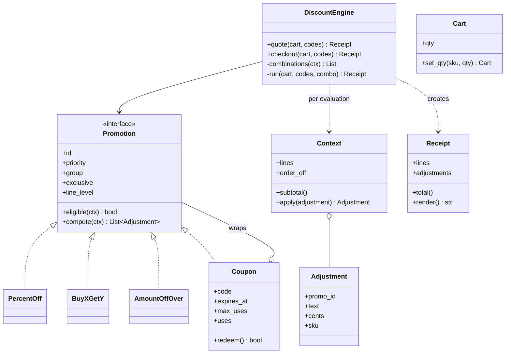

A promotion does not mutate anything: `compute(ctx)` returns proposed `Adjustment`s, and `Context.apply` caps and records them. That split keeps every promotion type a small pure function, puts the "never below zero" rule in one place, and makes the receipt a by-product of evaluation instead of a second computation. A fresh `Context` per candidate combination means trying 50 combinations is just running 50 independent, side-effect-free evaluations.

`Coupon` is a Decorator, not a fifth promotion type: "requires code X, valid until T, at most N uses" is orthogonal to what the discount is. Any promotion can be put behind a code without a new class.

#### Key patterns used

| Pattern | Where | Why |
|---|---|---|
| Strategy | `Promotion` implementations | Marketing adds rule types without touching the engine; each type is tested alone |
| Decorator | `Coupon` wraps any `Promotion` | Code, expiry, and usage limits compose with every discount type |
| Interpreter-like pipeline | `_run` applies promotions in a fixed order over a `Context` | Deterministic, explainable results; the order is part of the spec |
| Search over a small space | `_combinations` and `quote` | Greedy choice is wrong when promotions interact (shown below) |
| Conditional increment | `Coupon.redeem` | "Use one of the remaining N" is atomic, like `UPDATE ... WHERE uses < max_uses` |

#### Important flow: choosing the best combination

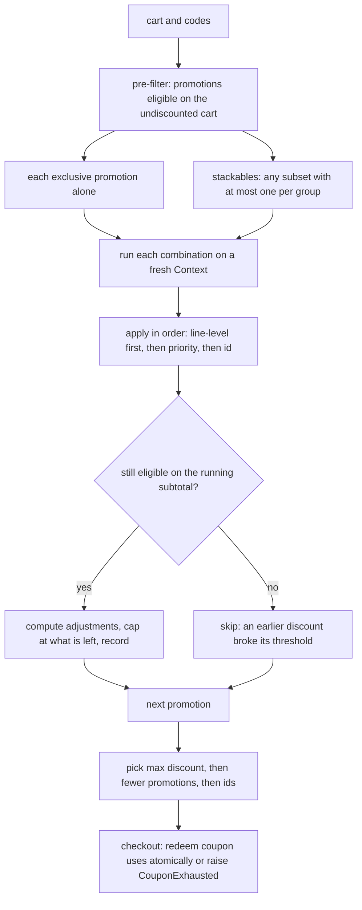

Why greedy fails, with the demo's numbers (2 shirts at 4000, jeans at 6000, a mug at 1500; subtotal 15,500):

```text
APPAREL20  20% off apparel (stackable, priority 10)      alone: 2,800
SITE10     10% off everything (group "sitewide")         alone: 1,550
30OFF130   3,000 off orders >= 13,000 (group "sitewide") alone: 3,000

Greedy "best of the group" picks 30OFF130, then stacks APPAREL20:
  APPAREL20 runs first (line-level): 15,500 - 2,800 = 12,700 < 13,000 -> 30OFF130 no longer applies
  total discount 2,800
Search:
  APPAREL20 + SITE10: 2,800 + 10% of 12,700 (640 + 480 + 150 = 1,270)  = 4,070  <- best
  30OFF130 alone:                                                      = 3,000
Without SITE10 in the catalog, the best is 30OFF130 alone (3,000 > 2,800):
  so even "always apply every stackable" is wrong.
```

The search space is `2^solo x product(group size + 1) + exclusives`. With 4 solo stackables and 2 groups of 3, that is 16 x 16 + exclusives, about 260 evaluations. One evaluation of the demo cart (3 lines, 4 promotions) takes about 6 microseconds in CPython, and a few dozen lines push it toward 40, so a quote stays around 10 ms at worst. With 20 eligible promotions it explodes (millions), so production engines first filter to promotions that touch this cart (usually fewer than 6), then fall back to branch-and-bound or a fixed priority order if the count still exceeds a cap.

#### Concurrency and failure concerns

- **Quotes are pure:** `quote` reads promotions and the clock and builds new objects, so any number of threads can quote concurrently with no locks. The only shared mutable state is a coupon's usage counter.
- **Coupon redemption** is a conditional increment under the coupon's lock. If a checkout needs two coupons and the second is exhausted, the first is released before raising (all-or-nothing). In SQL: `UPDATE coupons SET uses = uses + 1 WHERE code = :c AND uses < max_uses` and check one row changed; per-customer limits add a unique constraint on `coupon_redemption(code, customer_id)`.
- **Quote versus checkout drift:** a coupon can be exhausted, or expire, between the quote the user saw and the checkout. `checkout` re-quotes and raises `CouponExhausted` instead of silently charging more; the UI shows the new price. The 40-thread test asserts exactly 10 redemptions for a 10-use coupon.
- **Redeem at order, release on failure:** in a real checkout the redemption belongs in the same transaction as order creation, and a failed payment releases it (or it expires with the order's reservation). Otherwise abandoned payments burn coupon uses.
- **Rounding drift:** rounding per line means a 10% order-wide discount can differ by a cent from 10% of the total. That is intended: returns refund exactly what each receipt line shows. Pick one rule, write it down, and test it (`10% of 1005 = 101`).

#### Reference implementation (Python 3)

The demo proves the greedy trap (the best pair beats the individually best promotion), an exclusive coupon that wins only when it beats every stack, expiry falling back to the best stack, buy-2-get-1 stacking with a percentage on the reduced line, half-up rounding, the zero floor, an unknown-SKU rejection, and 40 concurrent checkouts racing for 10 coupon uses. It prints the itemized receipt for the main cart:

```text
jeans    x1       6000
mug      x1       1500
shirt    x2       8000
                 -1200  20% off apparel [jeans]
                 -1600  20% off apparel [shirt]
                  -480  10% off everything [jeans]
                  -150  10% off everything [mug]
                  -640  10% off everything [shirt]
subtotal 15500  discount 4070  total 11430
```

```python
"""discount_engine.py -- run: python3 -I discount_engine.py"""
from __future__ import annotations

import itertools
import threading
from collections import defaultdict
from concurrent.futures import ThreadPoolExecutor
from dataclasses import dataclass, field
from typing import Callable, Iterator, Protocol


class PricingError(Exception): ...
class UnknownProduct(PricingError): ...
class CouponExhausted(PricingError): ...


def bps_of(cents: int, bps: int) -> int:
    """cents * bps / 10_000 rounded half up: the half cent goes to the customer. 1000 bps = 10%."""
    return (cents * bps + 5_000) // 10_000


def share(cents: int, part: int, whole: int) -> int:
    """cents * part / whole rounded half up."""
    return (2 * cents * part + whole) // (2 * whole)


@dataclass(frozen=True)
class Product:
    sku: str
    category: str
    price_cents: int


class Cart:
    def __init__(self, catalog: dict[str, Product]) -> None:
        self.catalog = catalog
        self.qty: dict[str, int] = {}

    def set_qty(self, sku: str, qty: int) -> Cart:
        if sku not in self.catalog:
            raise UnknownProduct(sku)
        if qty < 0:
            raise ValueError("qty must be >= 0")
        if qty:
            self.qty[sku] = qty
        else:
            self.qty.pop(sku, None)
        return self


@dataclass
class Line:                                               # working copy for one evaluation
    product: Product
    qty: int
    net_cents: int                                        # after the discounts applied so far


@dataclass(frozen=True)
class Adjustment:
    promo_id: str
    text: str
    cents: int
    sku: str | None = None                                # None = order-level


@dataclass
class Context:
    lines: dict[str, Line]
    codes: frozenset[str]
    now: float
    order_off: int = 0

    @property
    def subtotal(self) -> int:
        return sum(ln.net_cents for ln in self.lines.values()) - self.order_off

    def apply(self, adj: Adjustment) -> Adjustment:
        """Cap so no line and no order ever goes below zero; return what was actually taken."""
        if adj.sku is not None:
            line = self.lines[adj.sku]
            cents = min(adj.cents, line.net_cents)
            line.net_cents -= cents
        else:
            cents = min(adj.cents, self.subtotal)
            self.order_off += cents
        return Adjustment(adj.promo_id, adj.text, cents, adj.sku)


class Promotion(Protocol):
    id: str
    priority: int                                         # lower runs first (within its level)
    group: str | None                                     # at most one promotion per group applies
    exclusive: bool                                       # combines with nothing else
    line_level: bool                                      # line-level promotions run before order-level

    def eligible(self, ctx: Context) -> bool: ...
    def compute(self, ctx: Context) -> list[Adjustment]: ...


@dataclass(frozen=True)
class PercentOff:
    id: str
    bps: int
    category: str | None = None                           # None = every line
    priority: int = 100
    group: str | None = None
    exclusive: bool = False
    line_level: bool = True

    def eligible(self, ctx: Context) -> bool:
        return True

    def compute(self, ctx: Context) -> list[Adjustment]:
        return [Adjustment(self.id, f"{self.bps / 100:g}% off {self.category or 'everything'}",
                           bps_of(ln.net_cents, self.bps), sku)
                for sku, ln in sorted(ctx.lines.items())
                if self.category in (None, ln.product.category)]


@dataclass(frozen=True)
class BuyXGetY:
    id: str
    sku: str
    buy: int
    get: int
    priority: int = 50
    group: str | None = None
    exclusive: bool = False
    line_level: bool = True

    def eligible(self, ctx: Context) -> bool:
        return self.sku in ctx.lines and ctx.lines[self.sku].qty >= self.buy + self.get

    def compute(self, ctx: Context) -> list[Adjustment]:
        ln = ctx.lines[self.sku]
        free = ln.qty // (self.buy + self.get) * self.get
        return [Adjustment(self.id, f"buy {self.buy} get {self.get} free: {free} free",
                           share(ln.net_cents, free, ln.qty), self.sku)]


@dataclass(frozen=True)
class AmountOffOver:
    id: str
    off_cents: int
    threshold_cents: int                                  # checked against the running subtotal
    priority: int = 100
    group: str | None = None
    exclusive: bool = False
    line_level: bool = False

    def eligible(self, ctx: Context) -> bool:
        return ctx.subtotal >= self.threshold_cents

    def compute(self, ctx: Context) -> list[Adjustment]:
        text = f"{self.off_cents} off orders over {self.threshold_cents}"
        return [Adjustment(self.id, text, self.off_cents)]


class Coupon:
    """Decorator: a code, an expiry, and a global usage limit around any promotion."""
    def __init__(self, code: str, inner: Promotion, expires_at: float, max_uses: int,
                 exclusive: bool = False) -> None:
        self.code, self.inner, self.expires_at, self.max_uses = code, inner, expires_at, max_uses
        self.id, self.priority, self.line_level = code, inner.priority, inner.line_level
        self.group, self.exclusive = inner.group, exclusive or inner.exclusive
        self.uses = 0
        self._lock = threading.Lock()

    def eligible(self, ctx: Context) -> bool:
        return (self.code in ctx.codes and ctx.now < self.expires_at
                and self.uses < self.max_uses and self.inner.eligible(ctx))

    def compute(self, ctx: Context) -> list[Adjustment]:
        return [Adjustment(self.code, f"coupon {self.code}: {a.text}", a.cents, a.sku)
                for a in self.inner.compute(ctx)]

    def redeem(self) -> bool:                             # UPDATE ... SET uses = uses + 1 WHERE uses < max
        with self._lock:
            if self.uses >= self.max_uses:
                return False
            self.uses += 1
            return True

    def unredeem(self) -> None:
        with self._lock:
            self.uses -= 1


@dataclass(frozen=True)
class Receipt:
    lines: tuple[tuple[str, int, int], ...]               # sku, qty, gross cents
    adjustments: tuple[Adjustment, ...]
    applied: tuple[str, ...]

    @property
    def subtotal(self) -> int:
        return sum(gross for _, _, gross in self.lines)

    @property
    def discount(self) -> int:
        return sum(a.cents for a in self.adjustments)

    @property
    def total(self) -> int:
        return self.subtotal - self.discount

    def render(self) -> str:
        out = [f"{sku:<8} x{qty:<3} {gross:>8}" for sku, qty, gross in self.lines]
        out += [f"{'':13}{-a.cents:>9}  {a.text}" + (f" [{a.sku}]" if a.sku else "")
                for a in self.adjustments]
        return "\n".join(out + [f"subtotal {self.subtotal}  discount {self.discount}  total {self.total}"])


class DiscountEngine:
    def __init__(self, promotions: list[Promotion], now: Callable[[], float]) -> None:
        self.promotions, self.now = promotions, now

    def quote(self, cart: Cart, codes: frozenset[str] = frozenset()) -> Receipt:
        """Best total discount over every legal combination; ties -> fewer promotions, then ids."""
        best: tuple[tuple[int, int, tuple[str, ...]], Receipt] | None = None
        for combo in self._combinations(self._context(cart, codes)):
            r = self._run(cart, codes, combo)
            key = (-r.discount, len(r.applied), r.applied)
            if best is None or key < best[0]:
                best = (key, r)
        assert best is not None                           # the empty combination is always legal
        return best[1]

    def checkout(self, cart: Cart, codes: frozenset[str] = frozenset()) -> Receipt:
        receipt = self.quote(cart, codes)
        coupons = [p for p in self.promotions if isinstance(p, Coupon) and p.code in receipt.applied]
        redeemed: list[Coupon] = []
        for c in coupons:
            if not c.redeem():                            # lost the race for the last use
                for done in redeemed:
                    done.unredeem()
                raise CouponExhausted(c.code)             # caller re-quotes and shows the new price
            redeemed.append(c)
        return receipt

    def _context(self, cart: Cart, codes: frozenset[str]) -> Context:
        lines = {sku: Line(cart.catalog[sku], q, cart.catalog[sku].price_cents * q)
                 for sku, q in cart.qty.items()}
        return Context(lines, codes, self.now())

    def _combinations(self, ctx: Context) -> Iterator[list[Promotion]]:
        """Each exclusive promotion alone; otherwise any subset with at most one per group.
        Stackables are optional too: one can push the subtotal under another's threshold.
        Eligibility here is a pre-filter; thresholds are re-checked against running totals in _run."""
        cands = [p for p in self.promotions if p.eligible(ctx)]
        yield from ([p] for p in cands if p.exclusive)
        groups: dict[str, list[Promotion]] = defaultdict(list)
        for p in cands:
            if not p.exclusive:
                groups[p.group or f"solo:{p.id}"].append(p)
        for pick in itertools.product(*([None, *members] for members in groups.values())):
            yield [p for p in pick if p is not None]  # 2^solo x prod(group size + 1): fine for tens

    def _run(self, cart: Cart, codes: frozenset[str], combo: list[Promotion]) -> Receipt:
        ctx = self._context(cart, codes)
        gross = tuple((sku, ln.qty, ln.net_cents) for sku, ln in sorted(ctx.lines.items()))
        adjustments: list[Adjustment] = []
        for p in sorted(combo, key=lambda p: (not p.line_level, p.priority, p.id)):
            if p.eligible(ctx):                           # an earlier discount can drop us below a threshold
                taken = [ctx.apply(a) for a in p.compute(ctx)]
                adjustments += [a for a in taken if a.cents > 0]
        applied = tuple(sorted({a.promo_id for a in adjustments}))
        return Receipt(gross, tuple(adjustments), applied)


def main() -> None:
    catalog = {p.sku: p for p in [Product("shirt", "apparel", 4000), Product("jeans", "apparel", 6000),
                                  Product("mug", "home", 1500), Product("pen", "office", 1005)]}
    clock = [0.0]
    apparel20 = PercentOff("APPAREL20", 2000, "apparel", priority=10)
    site10 = PercentOff("SITE10", 1000, group="sitewide")
    over130 = AmountOffOver("30OFF130", 3000, 13_000, group="sitewide")
    half = Coupon("HALF", PercentOff("half", 5000, "apparel"), expires_at=100, max_uses=10, exclusive=True)
    mugs = BuyXGetY("MUG3FOR2", "mug", buy=2, get=1)
    engine = DiscountEngine([apparel20, site10, over130, half, mugs], lambda: clock[0])

    # 1) Best combination, not greedy. Alone, 30OFF130 (3000) beats SITE10 (1550). But APPAREL20 runs
    #    first and drops the subtotal to 12700 < 13000, so the winning pair is APPAREL20 + SITE10.
    cart = Cart(catalog).set_qty("shirt", 2).set_qty("jeans", 1).set_qty("mug", 1)
    r = engine.quote(cart)
    assert r.subtotal == 15_500 and r.applied == ("APPAREL20", "SITE10")
    assert r.discount == 2800 + 1270 and r.total == 11_430
    assert "20% off apparel [shirt]" in r.render()
    no_site10 = DiscountEngine([apparel20, over130], lambda: clock[0])
    assert no_site10.quote(cart).applied == ("30OFF130",)  # 3000 alone beats 2800, so skip APPAREL20

    # 2) An exclusive coupon wins only if it beats every stack: 50% of 14000 apparel = 7000 > 4070.
    r = engine.quote(cart, frozenset({"HALF"}))
    assert r.applied == ("HALF",) and r.discount == 7000
    clock[0] = 100                                         # expired: falls back to the best stack
    assert engine.quote(cart, frozenset({"HALF"})).applied == ("APPAREL20", "SITE10")
    clock[0] = 0

    # 3) Buy 2 get 1 on mugs stacks with SITE10, which then applies to the reduced line.
    r = engine.quote(Cart(catalog).set_qty("mug", 3))
    assert r.adjustments[0] == Adjustment("MUG3FOR2", "buy 2 get 1 free: 1 free", 1500, "mug")
    assert r.discount == 1500 + 300 and r.total == 2700

    # 4) Rounding is explicit: 10% of 1005 = 100.5 -> 101 (half up, customer's favor). Never below zero.
    assert engine.quote(Cart(catalog).set_qty("pen", 1)).discount == 101
    ctx = Context({"pen": Line(catalog["pen"], 1, 50)}, frozenset(), 0)
    assert ctx.apply(Adjustment("x", "x", 80, "pen")).cents == 50 and ctx.subtotal == 0
    try:
        Cart(catalog).set_qty("nope", 1)
        raise AssertionError("unknown sku accepted")
    except UnknownProduct:
        pass

    # 5) Usage limit under contention: 40 checkouts race for 10 uses of HALF.
    def buy(_: int) -> bool:
        try:
            return engine.checkout(cart, frozenset({"HALF"})).applied == ("HALF",)
        except CouponExhausted:
            return False
    with ThreadPoolExecutor(8) as pool:
        wins = sum(pool.map(buy, range(40)))
    assert wins == 10 and half.uses == 10
    assert engine.quote(cart, frozenset({"HALF"})).applied == ("APPAREL20", "SITE10")   # exhausted
    print(engine.quote(cart).render())
    print("all discount engine checks passed")


if __name__ == "__main__":
    main()
```

#### Extension questions

- **"Allocate an order-level discount across lines (for returns and tax)":** distribute it proportionally to each line's net amount using the largest-remainder method: floor every share, then give the leftover cents one at a time to the lines with the largest fractional remainders. Shares then sum exactly to the discount, and a return of one line refunds that line's share.
- **"Per-customer coupon limits and first-order-only promotions":** add a customer to the `Context` and a redemption table keyed by `(code, customer_id)` with a unique constraint. Eligibility reads the table; redemption inserts into it in the order transaction.
- **"Show the customer how close they are to the next deal":** for each threshold promotion that did not apply, report `threshold - running subtotal` at its position in the order. This falls out of the same evaluation loop.
- **"Hundreds of promotions":** index promotions by category and SKU so only those that touch the cart are considered, cap the search, and precompute which pairs can interact (only threshold promotions are order-sensitive); non-interacting promotions can be decided independently.

#### Interview Q&A

**Q1.** Why not apply every eligible promotion greedily in priority order?

**A1.** Because promotions interact through the running subtotal. A line-level discount can push the subtotal below another promotion's threshold, and percentage discounts compound on already-reduced prices, so the value of a promotion depends on what ran before it. The demo shows a case where the individually largest promotion in a group (3,000) ends up worth zero when combined, while the smaller one yields the best total (4,070), and a second case where dropping a stackable promotion is better for the customer. Searching the legal combinations is cheap for the handful of promotions that touch a real cart, and it makes "best price" a property you can test, not a hope.

**Q2.** Where exactly does rounding happen, and why there?

**A2.** Once per adjustment, per line, half up (`(cents * bps + 5000) // 10000`). Rounding per line keeps the receipt self-consistent: every line's discount is an exact number of cents, and the total is their sum, so a return refunds exactly what the line shows. Rounding only on the order total would leave line amounts fractional and push the problem into returns and tax. Half up in the customer's favor is a policy choice; banker's rounding (half to even) is the other common choice. What matters is that it is one rule, written down, and covered by a test.

**Q3.** How do you stop a 10-use coupon from being used 11 times under load?

**A3.** Quoting only checks `uses < max_uses` as a hint; the authority is the conditional increment at checkout, which reads and increments under one lock (in SQL, one `UPDATE ... WHERE uses < max_uses` with a row-count check). Of 40 concurrent checkouts, the first 10 increments succeed and the rest fail and raise `CouponExhausted`, after releasing anything else they had redeemed. The client re-quotes and shows the new price. The usage counter is never decremented on quote, and a redemption tied to an order is released if that order's payment fails.

**Q4.** Why is `Coupon` a decorator rather than a subclass of each promotion?

**A4.** "Needs a code, expires, limited uses" is a cross-cutting rule that applies to every discount type. Subclassing would need `PercentOffCoupon`, `BuyXGetYCoupon`, `AmountOffCoupon`, and so on, multiplying with every new type. The decorator delegates `compute` to whatever it wraps, adds its own eligibility checks, and relabels the adjustments with the code so the receipt shows which coupon produced them. A new promotion type is immediately usable behind a code without any new class.

See also: [Strategy pattern](../design-patterns/Design_Patterns_Python.md#24-strategy), [Chain of Responsibility](../design-patterns/Design_Patterns_Python.md#16-chain-of-responsibility), [Inventory and order management](../design-patterns/Low_Level_Design_Interview_Prep.md#26-worked-design-inventory-and-order-management)

---

### A4. Car Rental System

#### Requirements and assumptions

- A customer reserves a **vehicle type** at a branch; the system assigns a specific vehicle (first fit by id, which keeps tests deterministic; a utilization-aware strategy is an extension).
- Reservations are half-open intervals `[start, end)`. With one hour of turnaround, a vehicle can take a reservation `r` only if, for every active booking `b` on it, `b.start >= r.end + 1h` or `r.start >= b.end + 1h`.
- A vehicle is wherever its last rental ended. For a reservation to fit, the vehicle must be at the pickup branch when it starts, and if the reservation is one-way, the vehicle's **next** booking must start at the new return branch (otherwise the next customer is stranded).
- An overdue car (picked up, past its end, not returned) is treated as busy until now: its effective end is `max(end, now)`.
- Lifecycle: `RESERVED -> PICKED_UP -> RETURNED`; `RESERVED -> CANCELLED` (free until 24 hours before start, then one day's rate); `RESERVED -> NO_SHOW` (2 hours after start, one day's rate).
- Pricing (a swappable strategy): each started 24-hour period costs the weekday or weekend rate of the day it starts on; add-ons cost per day; a one-way fee of 5,000 cents; late returns cost 1,000 cents per started hour after a 59-minute grace, capped at the cost of the extra days.
- `reserve` is idempotent on a client key. Out of scope: payments, damage, fleet maintenance, dynamic pricing.

#### Core model

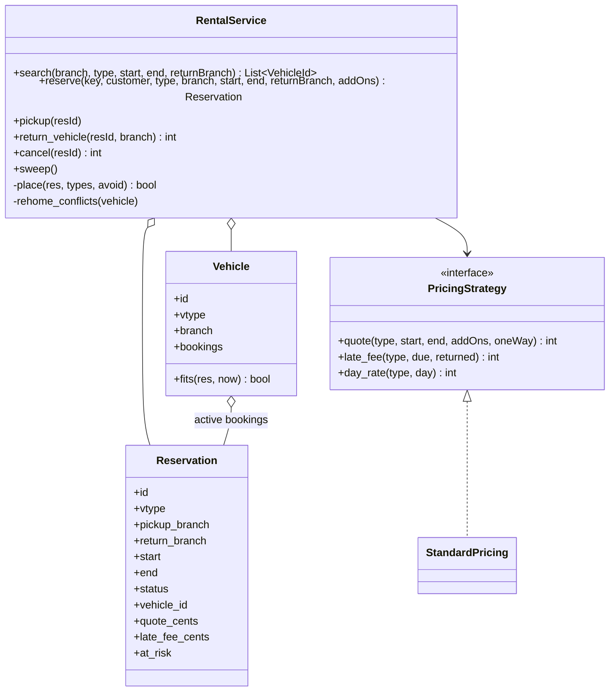

Availability lives on the **vehicle**, as its list of active bookings, because the invariant ("no two active bookings on one vehicle overlap") is per vehicle. That makes the vehicle the natural unit of locking: reserving one car never blocks reserving another. The branch is not a container of vehicles; it is a derived property of time (where the last rental ended), which is what makes one-way rentals and their chaining rule fall out naturally from `fits`.

Customers reserve a type, not a car. That is what gives the system freedom to move a reservation to another car (or a free upgrade) when a late return blocks the original, which is the main operational twist.

#### Key patterns used

| Pattern | Where | Why |
|---|---|---|
| Strategy | `PricingStrategy` (`StandardPricing`) | Rates, add-ons, and late-fee rules differ by market and season |
| State | `Status` and guarded transitions in `pickup`, `return_vehicle`, `cancel`, `sweep` | Illegal moves (pick up a cancelled reservation) raise |
| Per-resource lock with check-and-insert | `Vehicle.lock` around `fits` + append | Two customers can never both get the last car for overlapping dates |
| Idempotency key with in-flight marker | `_by_key` (`None` while running) | Retries return the original; concurrent duplicates get `RequestInFlight` |
| Periodic sweeper | `sweep()` | No-shows and bookings stuck behind overdue cars are handled before the customer shows up |

#### Important flow: late return re-homes the next booking

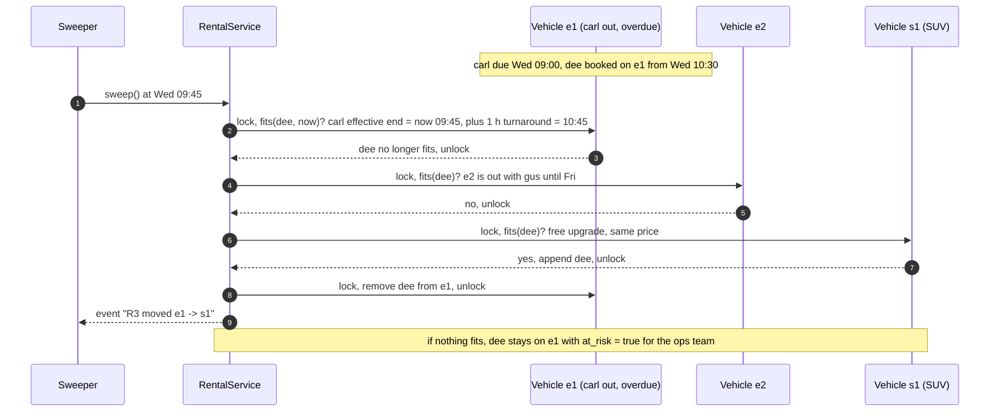

The order of the last two steps matters: insert on the new car first, then remove from the old one. In between, the reservation is briefly listed on two cars, which is conservative (at worst it blocks a search for a moment). The opposite order would leave a window in which it is on no car, and another customer could take the only replacement. No step holds two vehicle locks, so there is no lock-ordering problem to solve.

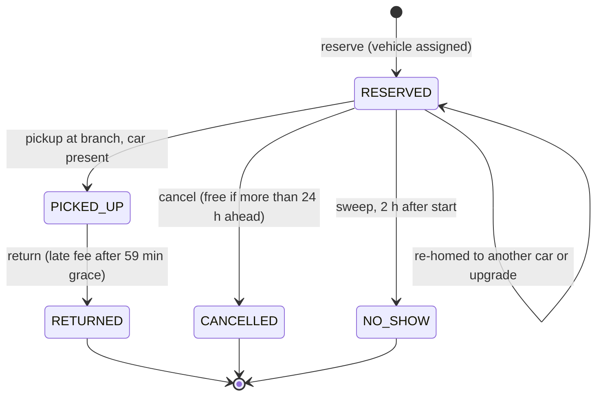

#### Concurrency and failure concerns

- **Invariant:** active bookings on one vehicle never overlap (including turnaround), and the vehicle is at the right branch at each pickup. `fits` checks it and the append happens under the same vehicle lock: check-and-insert is atomic. Search runs the same check but is advisory, since its answer can be stale by the time the customer clicks.
- **In a database** the strongest form is a constraint, not application code. PostgreSQL can enforce non-overlap directly: `EXCLUDE USING gist (vehicle_id WITH =, tsrange(start_at, end_at + interval '1 hour') WITH &&) WHERE (status IN ('RESERVED', 'PICKED_UP'))` (needs the `btree_gist` extension). Without it, `SELECT ... FROM vehicles WHERE id = :v FOR UPDATE`, then check overlaps and insert in the same transaction; the vehicle row is the lock.
- **Last car race:** sixteen threads reserving the only SUV for overlapping windows all pass `search`, but only the first to take `s1.lock` sees it free and appends; the other fifteen raise `NoVehicleAvailable`. The test asserts one winner and one booking.
- **Idempotency:** the key is claimed (`None` = in flight) before any work. A concurrent duplicate gets `RequestInFlight` (an HTTP 409; the client retries shortly and then receives the original). A failed attempt releases the key so the client can retry; a successful one maps it to the reservation.
- **Overdue cars:** `fits` uses `max(end, now)` for picked-up bookings, so an overdue car is never offered to a new customer. The sweeper re-checks the bookings behind it periodically instead of waiting for the return, which gives ops lead time.
- **Locks held:** the registry lock is never held together with a vehicle lock, and no path holds two vehicle locks. Scale is per branch and per vehicle; there is no global hot spot except id generation.

#### Reference implementation (Python 3)

The demo walks through weekday and weekend pricing with an add-on and a one-way fee, idempotent retry, the turnaround boundary, one-way chaining in both directions, cancellation fees by lead time, a 16-thread race for the last SUV, an overdue car whose next booking is moved proactively to a free upgrade, the late fee, and a reservation flagged at risk when no car can take it. It simplifies time to naive datetimes in one zone and assigns the first fitting vehicle.

```python
"""car_rental.py -- run: python3 -I car_rental.py"""
from __future__ import annotations

import itertools
import math
import threading
from concurrent.futures import ThreadPoolExecutor
from dataclasses import dataclass, field
from datetime import datetime, timedelta
from enum import Enum
from typing import Callable, Protocol


class RentalError(Exception): ...
class UnknownEntity(RentalError): ...
class NoVehicleAvailable(RentalError): ...
class IllegalTransition(RentalError): ...
class RequestInFlight(RentalError): ...


VehicleType = Enum("VehicleType", "ECONOMY SUV VAN")       # declaration order is the upgrade order
Status = Enum("Status", "RESERVED PICKED_UP RETURNED CANCELLED NO_SHOW")
ACTIVE = {Status.RESERVED, Status.PICKED_UP}
DAY, HOUR = timedelta(days=1), timedelta(hours=1)
TURNAROUND = HOUR                                           # cleaning and inspection between rentals


@dataclass(eq=False)
class Reservation:
    id: str
    customer: str
    vtype: VehicleType
    pickup_branch: str
    return_branch: str
    start: datetime                                         # half-open [start, end)
    end: datetime
    quote_cents: int
    vehicle_id: str = ""
    status: Status = Status.RESERVED
    late_fee_cents: int = 0
    fee_cents: int = 0                                      # cancellation or no-show fee
    at_risk: bool = False                                   # ops must act: no car could be found


@dataclass(eq=False)
class Vehicle:
    id: str
    vtype: VehicleType
    branch: str                                             # where it is parked (updated on return)
    bookings: list[Reservation] = field(default_factory=list)   # ACTIVE only
    lock: threading.Lock = field(default_factory=threading.Lock, repr=False)

    def fits(self, r: Reservation, now: datetime) -> bool:
        """Caller holds self.lock. No overlap (with turnaround), the car is at r.pickup_branch
        when r starts, and a one-way r does not strand the next renter at the wrong branch."""
        at, nxt = self.branch, None
        for b in sorted(self.bookings, key=lambda b: b.start):
            if b is r:
                continue
            b_end = max(b.end, now) if b.status is Status.PICKED_UP else b.end   # overdue car is still out
            if b.start < r.end + TURNAROUND and r.start < b_end + TURNAROUND:
                return False
            if b_end <= r.start:
                at = b.return_branch
            elif nxt is None:
                nxt = b
        return at == r.pickup_branch and (nxt is None or nxt.pickup_branch == r.return_branch)


class PricingStrategy(Protocol):
    def quote(self, vtype: VehicleType, start: datetime, end: datetime, add_ons: tuple[str, ...],
              one_way: bool) -> int: ...
    def late_fee(self, vtype: VehicleType, due: datetime, returned: datetime) -> int: ...
    def day_rate(self, vtype: VehicleType, day: datetime) -> int: ...


@dataclass(frozen=True)
class StandardPricing:
    weekday: dict[VehicleType, int]
    weekend: dict[VehicleType, int]
    add_on_daily: dict[str, int] = field(default_factory=lambda: {"gps": 500, "child_seat": 700})
    one_way_cents: int = 5_000
    late_hour_cents: int = 1_000
    grace: timedelta = timedelta(minutes=59)

    def day_rate(self, vtype: VehicleType, day: datetime) -> int:
        return (self.weekend if day.weekday() >= 5 else self.weekday)[vtype]

    def quote(self, vtype: VehicleType, start: datetime, end: datetime, add_ons: tuple[str, ...],
              one_way: bool) -> int:
        days = math.ceil((end - start) / DAY)               # any started day is a rental day
        if unknown := set(add_ons) - self.add_on_daily.keys():
            raise ValueError(f"unknown add-ons {unknown}")
        return (sum(self.day_rate(vtype, start + i * DAY) for i in range(days))
                + days * sum(self.add_on_daily[a] for a in add_ons) + (self.one_way_cents if one_way else 0))

    def late_fee(self, vtype: VehicleType, due: datetime, returned: datetime) -> int:
        late = returned - due
        if late <= self.grace:
            return 0
        hourly = math.ceil(late / HOUR) * self.late_hour_cents
        return min(hourly, math.ceil(late / DAY) * self.weekday[vtype])   # never worse than extra days


class RentalService:
    def __init__(self, branches: set[str], pricing: PricingStrategy, now: Callable[[], datetime]) -> None:
        self.branches, self.pricing, self.now = branches, pricing, now
        self.vehicles: dict[str, Vehicle] = {}
        self.reservations: dict[str, Reservation] = {}
        self.events: list[str] = []                         # Observer stand-in: ops dashboard, emails
        self._by_key: dict[str, str | None] = {}            # idempotency key -> id (None = in flight)
        self._lock = threading.Lock()                       # registries only; never held with a vehicle lock
        self._seq = itertools.count(1)

    def add_vehicle(self, vid: str, vtype: VehicleType, branch: str) -> None:
        self._check_branch(branch)
        self.vehicles[vid] = Vehicle(vid, vtype, branch)

    def search(self, branch: str, vtype: VehicleType, start: datetime, end: datetime,
               return_branch: str | None = None) -> list[str]:
        probe = Reservation("probe", "", vtype, branch, return_branch or branch, start, end, 0)
        out = []
        for v in self._of_type(vtype):
            with v.lock:
                if v.fits(probe, self.now()):
                    out.append(v.id)
        return out                                          # advisory: reserve() re-checks under the lock

    def reserve(self, key: str, customer: str, vtype: VehicleType, branch: str, start: datetime,
                end: datetime, return_branch: str | None = None,
                add_ons: tuple[str, ...] = ()) -> Reservation:
        return_branch = return_branch or branch
        self._check_branch(branch)
        self._check_branch(return_branch)
        if not self.now() <= start < end or end - start > 30 * DAY:
            raise ValueError("need now <= start < end and at most 30 days")
        with self._lock:
            if key in self._by_key:
                rid = self._by_key[key]
                if rid is None:
                    raise RequestInFlight(key)              # duplicate still running: client retries later
                return self.reservations[rid]
            self._by_key[key] = None
        try:
            quote = self.pricing.quote(vtype, start, end, add_ons, one_way=return_branch != branch)
            r = Reservation(f"R{next(self._seq)}", customer, vtype, branch, return_branch, start, end, quote)
            if not self._place(r, [vtype]):
                raise NoVehicleAvailable(f"{vtype.name} at {branch}")
        except Exception:
            with self._lock:
                del self._by_key[key]                       # failed requests may be retried with the same key
            raise
        with self._lock:
            self.reservations[r.id], self._by_key[key] = r, r.id
        return r

    def pickup(self, rid: str) -> None:
        r = self._get(rid)
        v = self.vehicles[r.vehicle_id]
        with v.lock:
            if r.status is not Status.RESERVED or self.now() < r.start - HOUR or v.branch != r.pickup_branch:
                raise IllegalTransition(f"cannot pick up {rid}")
            if any(b.status is Status.PICKED_UP for b in v.bookings):
                raise IllegalTransition(f"{v.id} is still out")   # sweep() should have moved r already
            r.status = Status.PICKED_UP

    def return_vehicle(self, rid: str, branch: str) -> int:
        self._check_branch(branch)
        r = self._get(rid)
        v = self.vehicles[r.vehicle_id]
        with v.lock:
            if r.status is not Status.PICKED_UP:
                raise IllegalTransition(f"{rid} is {r.status.name}")
            r.status, v.branch = Status.RETURNED, branch
            r.late_fee_cents = self.pricing.late_fee(r.vtype, r.end, self.now())
            v.bookings.remove(r)
        self._rehome_conflicts(v)
        return r.late_fee_cents

    def cancel(self, rid: str) -> int:
        r = self._get(rid)
        v = self.vehicles[r.vehicle_id]
        with v.lock:
            if r.status is not Status.RESERVED:
                raise IllegalTransition(f"{rid} is {r.status.name}")
            r.status = Status.CANCELLED
            r.fee_cents = 0 if self.now() <= r.start - DAY else self.pricing.day_rate(r.vtype, r.start)
            v.bookings.remove(r)
        return r.fee_cents

    def sweep(self) -> None:
        """Periodic job: mark no-shows (2 h after start) and re-home bookings behind overdue cars."""
        for v in self.vehicles.values():
            with v.lock:
                for r in [b for b in v.bookings
                          if b.status is Status.RESERVED and self.now() > b.start + 2 * HOUR]:
                    r.status, r.fee_cents = Status.NO_SHOW, self.pricing.day_rate(r.vtype, r.start)
                    v.bookings.remove(r)
            self._rehome_conflicts(v)

    # ---- internals ------------------------------------------------------------------
    def _place(self, r: Reservation, types: list[VehicleType], avoid: str = "") -> bool:
        for vtype in types:
            for v in self._of_type(vtype):
                if v.id == avoid:
                    continue
                with v.lock:                                # check-and-insert is atomic per vehicle
                    if v.fits(r, self.now()):
                        v.bookings.append(r)
                        r.vehicle_id = v.id
                        return True
        return False

    def _rehome_conflicts(self, v: Vehicle) -> None:
        """Bookings on v that no longer fit (late or wrong-branch return) move to another car of the
        same type, then to a free upgrade. Insert elsewhere first, then remove here, so a booking is
        never on zero cars; we never hold two vehicle locks at once."""
        with v.lock:
            broken = [b for b in v.bookings if b.status is Status.RESERVED and not v.fits(b, self.now())]
        for b in broken:
            upgrades = [t for t in VehicleType if t.value >= b.vtype.value]
            old = b.vehicle_id
            if self._place(b, upgrades, avoid=old):
                with v.lock:
                    v.bookings.remove(b)
                self.events.append(f"{b.id} moved {old} -> {b.vehicle_id}")
            elif not b.at_risk:
                b.at_risk = True
                self.events.append(f"{b.id} AT RISK on {old}")

    def _of_type(self, vtype: VehicleType) -> list[Vehicle]:
        return sorted((v for v in self.vehicles.values() if v.vtype is vtype), key=lambda v: v.id)

    def _get(self, rid: str) -> Reservation:
        if rid not in self.reservations:
            raise UnknownEntity(rid)
        return self.reservations[rid]

    def _check_branch(self, branch: str) -> None:
        if branch not in self.branches:
            raise UnknownEntity(branch)


def main() -> None:
    E, SUV = VehicleType.ECONOMY, VehicleType.SUV
    pricing = StandardPricing(weekday={E: 4_000, SUV: 7_000, VehicleType.VAN: 9_000},
                              weekend={E: 5_000, SUV: 8_500, VehicleType.VAN: 11_000})
    clock = [datetime(2026, 1, 5, 8, 0)]                    # Monday 08:00
    svc = RentalService({"AIR", "TOWN"}, pricing, lambda: clock[0])
    for vid, vtype, branch in [("e1", E, "AIR"), ("e2", E, "AIR"), ("s1", SUV, "AIR"), ("e3", E, "TOWN")]:
        svc.add_vehicle(vid, vtype, branch)

    def d(day: int, hour: int, minute: int = 0) -> datetime:
        return datetime(2026, 1, day, hour, minute)

    # 1) Pricing: Fri 10:00 -> Mon 10:00 is 3 days (Fri weekday, Sat and Sun weekend), GPS, one-way.
    r = svc.reserve("k1", "ann", E, "AIR", d(9, 10), d(12, 10), "TOWN", ("gps",))
    assert r.vehicle_id == "e1" and r.quote_cents == 4_000 + 5_000 + 5_000 + 3 * 500 + 5_000
    assert svc.reserve("k1", "ann", E, "AIR", d(9, 10), d(12, 10), "TOWN", ("gps",)) is r   # retry
    # 2) Turnaround and one-way chaining: e1 ends at TOWN, so it cannot start at AIR afterwards,
    #    and a one-way AIR -> TOWN may not be squeezed in before ann's AIR pickup.
    assert svc.search("AIR", E, d(12, 11), d(13, 10)) == ["e2"]
    assert svc.search("TOWN", E, d(12, 11), d(13, 10)) == ["e1", "e3"]
    assert svc.search("TOWN", E, d(12, 10, 30), d(13, 10)) == ["e3"]       # inside e1's turnaround
    assert svc.search("AIR", E, d(6, 9), d(7, 9), "TOWN") == ["e2"]
    # 3) Cancellation fee: free until 24 h before start, then one day's rate.
    assert svc.cancel(svc.reserve("k2", "bob", E, "AIR", d(6, 9), d(7, 9)).id) == 0
    clock[0] = d(6, 8)
    assert svc.cancel(svc.reserve("k3", "bob", E, "AIR", d(6, 9), d(7, 9)).id) == 4_000

    # 4) Race for the last SUV: 16 overlapping requests, exactly one wins.
    def grab(i: int) -> bool:
        try:
            svc.reserve(f"race{i}", f"u{i}", SUV, "AIR", d(20, 9) + i * HOUR, d(21, 9))
            return True
        except NoVehicleAvailable:
            return False
    with ThreadPoolExecutor(8) as pool:
        assert sum(pool.map(grab, range(16))) == 1
    assert len(svc.vehicles["s1"].bookings) == 1

    # 5) Late return collides with the next booking. Fresh fleet at AIR: e1, e2, s1.
    clock[0] = d(5, 8)
    svc = RentalService({"AIR"}, pricing, lambda: clock[0])
    for vid, vtype in [("e1", E), ("e2", E), ("s1", SUV)]:
        svc.add_vehicle(vid, vtype, "AIR")
    carl = svc.reserve("c", "carl", E, "AIR", d(6, 9), d(7, 9))          # e1, Tue 09:00 -> Wed 09:00
    gus = svc.reserve("g", "gus", E, "AIR", d(6, 9), d(9, 9))            # e2, Tue -> Fri
    dee = svc.reserve("d", "dee", E, "AIR", d(7, 10, 30), d(9, 10))      # e1 again, Wed 10:30
    assert (carl.vehicle_id, gus.vehicle_id, dee.vehicle_id) == ("e1", "e2", "e1")
    clock[0] = d(6, 9)
    svc.pickup(carl.id)
    svc.pickup(gus.id)
    clock[0] = d(7, 9, 45)                                  # carl is overdue: act before 10:30, not at it
    svc.sweep()
    assert dee.vehicle_id == "s1" and svc.events == [f"{dee.id} moved e1 -> s1"]   # free upgrade
    clock[0] = d(7, 10, 30)
    svc.pickup(dee.id)
    clock[0] = d(7, 11, 30)
    assert svc.return_vehicle(carl.id, "AIR") == 3 * 1_000  # 2.5 h late -> 3 started hours
    # 6) Nowhere to move: flagged for ops instead of silently double-booked.
    eve = svc.reserve("e", "eve", E, "AIR", d(7, 12), d(8, 12))           # e1
    fay = svc.reserve("f", "fay", E, "AIR", d(8, 13), d(9, 13))           # e1; e2 and s1 are out
    clock[0] = d(7, 12)
    svc.pickup(eve.id)
    clock[0] = d(8, 12, 30)
    svc.sweep()
    assert fay.at_risk and fay.vehicle_id == "e1" and svc.events[-1] == f"{fay.id} AT RISK on e1"
    try:
        svc.pickup(fay.id)
        raise AssertionError("picked up a car that is still out")
    except IllegalTransition:
        pass
    print("all car rental checks passed")


if __name__ == "__main__":
    main()
```

#### Extension questions

- **"Pick the vehicle that keeps the fleet most usable":** replace first-fit with a strategy that prefers the car whose existing gap is the tightest fit (best fit), which leaves long free intervals intact for long rentals. It is the same check-and-insert, with a different candidate order.
- **"Rebalancing one-way rentals":** track net flow per branch per day; when a branch is projected to run short, either raise the one-way fee into it (pricing strategy) or schedule relocation jobs, which are just internal reservations from branch A to branch B.
- **"Overbooking like airlines and hotels":** allow reservations up to `fleet x (1 + expected no-show rate)` per type and day, and accept that some customers are upgraded or "walked" to a partner. Then the at-risk path becomes a normal, priced outcome instead of an exception.
- **"Time zones and daylight saving":** store instants in UTC, store each branch's zone, and compute "rental days" and "weekend" in the pickup branch's local time. A 24-hour rental over a DST change is 23 or 25 local hours, and the pricing rule must say which one is billed.

#### Interview Q&A

**Q1.** Why lock per vehicle instead of per branch or per vehicle type?

**A1.** The invariant is per vehicle: overlapping bookings are only a problem on the same car. A per-vehicle lock lets reservations for different cars proceed in parallel, while still making the check-and-insert for one car atomic. A per-type lock would be simpler (one lock, then pick any free car), but it serializes every economy reservation at a busy airport branch. Per-vehicle locking does mean a reservation tries candidates one at a time and may lose a race on one car and win on the next, which is exactly what `_place` does.

**Q2.** A car comes back three hours late and the next customer arrives in one hour. What does the system do?

**A2.** It should have acted before the customer arrived. As soon as the car is overdue, its effective end is `now`, so the next booking stops fitting once `next.start < now + turnaround`. The sweeper finds that booking and tries to place it on another car of the same type at the same branch, then on a larger type at the same price. It inserts on the new car before removing from the old one. If nothing is free, the booking keeps its car, is flagged `at_risk`, and an event goes to the branch staff, who can call the customer, offer a partner car, or wait for the return. When the late car finally comes back, `return_vehicle` runs the same check again and charges the late fee (here 3 started hours x 1,000 cents, capped at one extra day).

**Q3.** How do one-way rentals interact with availability?

**A3.** A vehicle's location at a time is not stored, it is derived: the return branch of its last booking that ends before that time, or its current branch if none. A reservation fits only if the car is at the pickup branch at the start, and, for a one-way rental, only if the car's next booking starts where this one ends. Without the second check, a one-way rental inserted into a gap would move the car away from the branch where the next, already-confirmed customer expects it. The demo shows both: a car that ends up at TOWN cannot start at AIR afterward, and a one-way AIR to TOWN rental cannot be squeezed in before an existing AIR pickup.

**Q4.** Two identical reserve requests arrive concurrently with the same idempotency key. What happens?

**A4.** The first claims the key in the registry with an in-flight marker before doing any work. The second sees the marker and gets `RequestInFlight`, which maps to a "conflict, retry later" response; when it retries after the first completes, it gets the original reservation. Without the marker, both could run, both could find a free car (different cars), and the customer would hold two reservations. A failed request removes its marker so that a genuine retry can proceed. In a database the marker is a row in an `idempotency_keys` table with a unique constraint, inserted in its own short transaction at the start.

See also: [Hotel booking](../design-patterns/Low_Level_Design_Interview_Prep.md#22-worked-design-hotel-booking), [Movie ticket booking](../design-patterns/Low_Level_Design_Interview_Prep.md#17-worked-design-movie-ticket-booking-bookmyshow), [Designing for concurrency and failure](../design-patterns/Low_Level_Design_Interview_Prep.md#4-designing-for-concurrency-and-failure)

---

### A5. Digital Wallet with Double-Entry Ledger

#### Requirements and assumptions

- Every money movement is a `JournalEntry` of two or more postings. A posting is (account, `DEBIT` or `CREDIT`, positive cents). An entry whose debits do not equal its credits cannot be constructed.
- **Sign convention:** all balances are credit-normal, `balance = credits - debits`. A user wallet (money the platform owes the user) grows on credit. The bank settlement account goes negative as money comes in (it mirrors cash the platform holds). The sum of all account balances is therefore always zero, which is the trial-balance check.
- Wallets may not go negative; system accounts (settlement, fees) may.
- Entries and postings are append-only. A correction is a **reversal**: a new entry with every posting's side flipped, linked to the original. An entry can be reversed once, and a reversal cannot itself be reversed.
- Balances are cached on each account and updated in the same critical section that appends the postings; `verify()` recomputes them from postings.
- Every mutating call takes an idempotency key. Same key and same request: the original result (success or business error). Same key and a different request: `IdempotencyConflict`.
- Limits: each top-up, transfer, or withdrawal is between 1 cent and 100,000 cents ($1,000). Transfers carry a 1% fee, rounded half up.
- Out of scope: the actual bank rails, KYC, currencies, interest.

```text
top_up(ann, 50_000)            DEBIT  sys:settlement 50,000   CREDIT ann 50,000
transfer(ann -> bob, 10_000)   DEBIT  ann 10,100              CREDIT bob 10,000   CREDIT sys:fees 100
reverse(that transfer)         CREDIT ann 10,100              DEBIT  bob 10,000   DEBIT  sys:fees 100
withdraw(ann, 20_000)          DEBIT  ann 20,000              CREDIT sys:settlement 20,000
balances: ann 30,000 + bob 0 + fees 0 + settlement -30,000 = 0
```

#### Core model

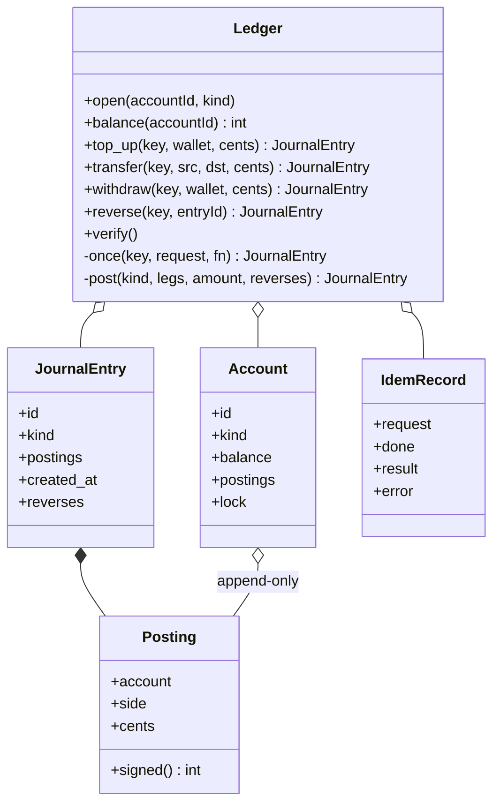

There is no `balance -= x` anywhere outside `_post`, and `_post` only ever appends postings and adds their signed amounts to the cached balances. `JournalEntry` and `Posting` are frozen dataclasses, so "immutable" is enforced by the type, and the balanced-entry rule is checked in `__post_init__`, so an unbalanced entry is unrepresentable rather than merely detected later.

Top-up, transfer, withdraw, and reversal are not separate mechanisms: each builds a list of legs and calls `_post`. Locking, validation, limits, and idempotency are therefore written once. A new money movement (cashback, chargeback, interest) is a new list of legs.

#### Key patterns used

| Pattern | Where | Why |
|---|---|---|
| Double-entry ledger (append-only log) | `JournalEntry`, `Posting`, `Account.postings` | Money can only move, never appear; every balance is explainable from history |
| Validate-then-mutate | `_post`: all checks under the locks, then appends that cannot fail | An entry is either fully posted or not at all |
| Deterministic lock ordering | Accounts sorted by id before locking | Opposite-direction transfers cannot deadlock |
| Idempotency record with a completion event | `_once` and `_IdemRecord` | Retries and concurrent duplicates get the first outcome; no double posting |
| Compensating entry | `reverse` | Corrections preserve the audit trail; nothing is deleted |

#### Important flow: two opposite transfers at once

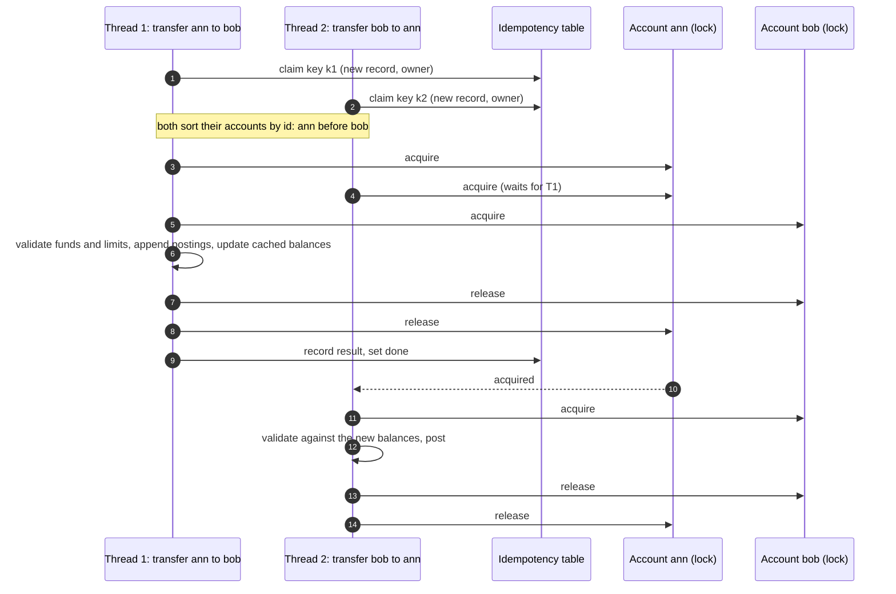

If each thread locked "source, then destination", thread 1 would hold ann and wait for bob while thread 2 held bob and waited for ann: a deadlock. Sorting by id gives every thread the same global order, so whoever gets the first lock gets both. This is not theoretical: replacing the sorted order with leg order in the reference implementation makes its stress test deadlock, and the join timeout turns that into an `AssertionError: deadlock`.

#### Concurrency and failure concerns

- **Invariants:** every entry balances; every cached balance equals the sum of its postings; the sum of all balances is zero; no wallet is negative. `verify()` checks all four, and the stress test runs it after 16 threads of random transfers in both directions plus retries.
- **Atomicity:** all locks for an entry are taken before any check, every check runs before any write, and the writes cannot fail. In SQL the same shape is one transaction: `SELECT ... FROM accounts WHERE id IN (:a, :b) ORDER BY id FOR UPDATE`, check balances, `INSERT` the entry and postings, `UPDATE accounts SET balance = balance + :delta`, commit.
- **Idempotency:** the first caller with a key creates a record (owner) and runs the operation; concurrent duplicates wait on the record's event and get the same entry or the same error. Business rejections (insufficient funds, limits) are recorded, so a retry is consistent; a genuinely new attempt uses a new key. An unexpected failure (a bug, a crash before posting) deletes the record so the client can retry. In a database the record is a row with a unique `(client_id, key)`, inserted first, holding a request hash and the response; keep keys for at least the client's retry window (24 hours to 7 days).
- **Double reversal:** the "already reversed?" check runs under the account locks. Two rival reversals of the same entry touch exactly the same accounts, so they serialize, and the second sees the first one's mark. In SQL, a unique constraint on `journal_entries(reverses)` makes it impossible regardless of code paths.
- **Reversal after the money is spent:** a reversal is a normal entry and obeys the same non-negative rule, so it fails with `InsufficientFunds`. The business then chooses: allow a negative wallet as a debt (a chargeback account type that may go negative), or reverse partially. Either way it is a new entry, never an edit.
- **Hot accounts:** every top-up and withdrawal touches `sys:settlement`, so its lock (or row) serializes them. Napkin math:

```text
One row update inside a committed transaction  ~ 1-5 ms of row-lock hold time
-> one hot settlement row caps at              ~ 200-1,000 top-ups/s
Shard settlement into 32 sub-accounts           ~ 6,000-30,000 top-ups/s (pick a shard by hash of wallet id)
or skip locking system accounts entirely: they have no non-negative rule, so their postings can be
appended without the lock and their balance derived by aggregation (or updated with an atomic increment).
```

#### Reference implementation (Python 3)

The code demonstrates balanced multi-leg entries (a transfer with a fee is three postings), cached balances checked against postings, idempotent retries and key-reuse conflicts, recorded rejections, limits, reversals and their two failure modes, and a 16-thread stress test with 10% retries plus 8 concurrent copies of one request. It uses daemon threads with a join timeout, so a deadlock fails the test instead of hanging it, and `sys.setswitchinterval` to force frequent thread switches. It simplifies persistence to in-memory lists.

```python
"""wallet_ledger.py -- run: python3 -I wallet_ledger.py"""
from __future__ import annotations

import itertools
import random
import sys
import threading
from collections import Counter
from contextlib import ExitStack
from dataclasses import dataclass, field
from enum import Enum
from typing import Callable


class LedgerError(Exception): ...
class UnknownAccount(LedgerError): ...
class InsufficientFunds(LedgerError): ...
class LimitExceeded(LedgerError): ...
class IdempotencyConflict(LedgerError): ...
class NotReversible(LedgerError): ...


Kind = Enum("Kind", "WALLET SETTLEMENT FEES")     # only WALLET accounts must stay >= 0
Side = Enum("Side", "DEBIT CREDIT")


@dataclass(frozen=True)
class Posting:
    account: str
    side: Side
    cents: int

    @property
    def signed(self) -> int:                      # credit-normal: a wallet (our liability) grows on credit
        return self.cents if self.side is Side.CREDIT else -self.cents


@dataclass(frozen=True)
class JournalEntry:
    id: str
    kind: str
    postings: tuple[Posting, ...]
    created_at: float
    reverses: str | None = None

    def __post_init__(self) -> None:              # an unbalanced entry cannot even be constructed
        if len(self.postings) < 2 or any(p.cents <= 0 for p in self.postings):
            raise ValueError(f"{self.id}: need >= 2 positive postings")
        if sum(p.signed for p in self.postings) != 0:
            raise ValueError(f"{self.id}: debits != credits")


@dataclass(eq=False)
class Account:
    id: str
    kind: Kind
    balance: int = 0                              # cache of sum(posting.signed); verify() recomputes it
    postings: list[tuple[str, Posting]] = field(default_factory=list)   # append-only (entry id, posting)
    lock: threading.Lock = field(default_factory=threading.Lock, repr=False)


@dataclass(eq=False)
class _IdemRecord:
    request: tuple[object, ...]
    done: threading.Event = field(default_factory=threading.Event)
    result: JournalEntry | None = None
    error: LedgerError | None = None


def bps_of(cents: int, bps: int) -> int:
    return (cents * bps + 5_000) // 10_000        # half up


class Ledger:
    SETTLEMENT, FEES = "sys:settlement", "sys:fees"

    def __init__(self, now: Callable[[], float], max_cents: int = 100_000, fee_bps: int = 100) -> None:
        self.now, self.max_cents, self.fee_bps = now, max_cents, fee_bps
        self.accounts: dict[str, Account] = {}
        self.entries: dict[str, JournalEntry] = {}
        self._reversed: set[str] = set()
        self._idem: dict[str, _IdemRecord] = {}
        self._meta = threading.Lock()             # guards the dicts, ids, idempotency table; held briefly
        self._seq = itertools.count(1)
        self.open(self.SETTLEMENT, Kind.SETTLEMENT)
        self.open(self.FEES, Kind.FEES)

    def open(self, account_id: str, kind: Kind = Kind.WALLET) -> None:
        with self._meta:
            if account_id in self.accounts:
                raise ValueError(f"duplicate account {account_id}")
            self.accounts[account_id] = Account(account_id, kind)

    def balance(self, account_id: str) -> int:
        a = self._account(account_id)
        with a.lock:
            return a.balance

    # ---- mutating API: every call carries an idempotency key -------------------------
    def top_up(self, key: str, wallet: str, cents: int) -> JournalEntry:
        return self._once(key, ("top_up", wallet, cents), lambda: self._post(
            "top_up", [(self.SETTLEMENT, Side.DEBIT, cents), (wallet, Side.CREDIT, cents)], cents))

    def withdraw(self, key: str, wallet: str, cents: int) -> JournalEntry:
        return self._once(key, ("withdraw", wallet, cents), lambda: self._post(
            "withdraw", [(wallet, Side.DEBIT, cents), (self.SETTLEMENT, Side.CREDIT, cents)], cents))

    def transfer(self, key: str, src: str, dst: str, cents: int) -> JournalEntry:
        if src == dst:
            raise ValueError("src == dst")
        fee = bps_of(cents, self.fee_bps)
        legs = [(src, Side.DEBIT, cents + fee), (dst, Side.CREDIT, cents)]
        if fee:
            legs.append((self.FEES, Side.CREDIT, fee))
        return self._once(key, ("transfer", src, dst, cents), lambda: self._post("transfer", legs, cents))

    def reverse(self, key: str, entry_id: str) -> JournalEntry:
        """Corrections are new entries with the sides swapped; nothing is ever updated or deleted."""
        def run() -> JournalEntry:
            orig = self.entries.get(entry_id)
            if orig is None or orig.reverses is not None:
                raise NotReversible(f"{entry_id} is unknown or is itself a reversal")
            flip = {Side.DEBIT: Side.CREDIT, Side.CREDIT: Side.DEBIT}
            legs = [(p.account, flip[p.side], p.cents) for p in orig.postings]
            return self._post("reversal", legs, None, reverses=entry_id)
        return self._once(key, ("reverse", entry_id), run)

    def verify(self) -> None:
        """Audit (call when quiescent, or against a snapshot): caches match postings, books balance."""
        for a in self.accounts.values():
            assert a.balance == sum(p.signed for _, p in a.postings), a.id
            assert a.kind is not Kind.WALLET or a.balance >= 0, a.id
        assert sum(a.balance for a in self.accounts.values()) == 0, "money created or destroyed"
        assert all(sum(p.signed for p in e.postings) == 0 for e in self.entries.values())

    # ---- internals ----------------------------------------------------------------
    def _once(self, key: str, request: tuple[object, ...], fn: Callable[[], JournalEntry]) -> JournalEntry:
        with self._meta:
            rec = self._idem.get(key)
            owner = rec is None
            if rec is None:
                rec = self._idem[key] = _IdemRecord(request)
        if rec.request != request:
            raise IdempotencyConflict(f"{key} reused for a different request")
        if not owner:
            rec.done.wait()                       # a concurrent duplicate waits for the first outcome
            if rec.error is not None:
                raise type(rec.error)(*rec.error.args)
            assert rec.result is not None
            return rec.result
        try:
            rec.result = fn()
            return rec.result
        except LedgerError as e:                  # business rejections are the recorded outcome
            rec.error = e
            raise
        except BaseException:
            rec.error = LedgerError(f"{key} failed unexpectedly; retry")
            with self._meta:                      # unexpected failure: nothing posted, allow a retry
                del self._idem[key]
            raise
        finally:
            rec.done.set()

    def _post(self, kind: str, legs: list[tuple[str, Side, int]], amount: int | None,
              reverses: str | None = None) -> JournalEntry:
        if amount is not None and not 0 < amount <= self.max_cents:
            raise LimitExceeded(f"{amount} not in (0, {self.max_cents}]")
        accounts = sorted({self._account(a) for a, _, _ in legs}, key=lambda a: a.id)
        with ExitStack() as stack:
            for a in accounts:                    # one global order (by id): two transfers A->B and
                stack.enter_context(a.lock)       # B->A can never hold one lock each and wait forever
            if reverses in self._reversed:       # rival reversals lock the same accounts: serialized
                raise NotReversible(f"{reverses} already reversed")
            delta: Counter[str] = Counter()
            for acct, side, cents in legs:
                delta[acct] += cents if side is Side.CREDIT else -cents
            for a in accounts:                    # validate everything before mutating anything
                if a.kind is Kind.WALLET and a.balance + delta[a.id] < 0:
                    raise InsufficientFunds(f"{a.id}: balance {a.balance}, change {delta[a.id]}")
            with self._meta:
                eid = f"J{next(self._seq)}"
            entry = JournalEntry(eid, kind, tuple(Posting(*leg) for leg in legs), self.now(), reverses)
            for p in entry.postings:              # cannot fail from here on
                acct = self.accounts[p.account]
                acct.postings.append((eid, p))
                acct.balance += p.signed
            with self._meta:
                self.entries[eid] = entry
                if reverses is not None:
                    self._reversed.add(reverses)
            return entry

    def _account(self, account_id: str) -> Account:
        if account_id not in self.accounts:
            raise UnknownAccount(account_id)
        return self.accounts[account_id]


def expect(exc: type[Exception], fn: Callable[[], object]) -> None:
    try:
        fn()
    except exc:
        return
    raise AssertionError(f"expected {exc.__name__}")


def main() -> None:
    sys.setswitchinterval(1e-5)                   # switch threads often so races actually interleave
    led = Ledger(now=lambda: 0.0)
    for w in ("ann", "bob"):
        led.open(w)

    # 1) Top-up and a 3-leg transfer (1% fee): debits == credits in every entry.
    led.top_up("t1", "ann", 50_000)
    e = led.transfer("x1", "ann", "bob", 10_000)
    assert [(p.account, p.side.name, p.cents) for p in e.postings] == [
        ("ann", "DEBIT", 10_100), ("bob", "CREDIT", 10_000), (Ledger.FEES, "CREDIT", 100)]
    assert (led.balance("ann"), led.balance("bob"), led.balance(Ledger.FEES)) == (39_900, 10_000, 100)
    # 2) Idempotency: a retry returns the same entry; the same key with a new payload is rejected.
    assert led.transfer("x1", "ann", "bob", 10_000) is e and len(led.entries) == 2
    expect(IdempotencyConflict, lambda: led.transfer("x1", "ann", "bob", 999))
    # 3) Rejections post nothing and are themselves idempotent; limits are enforced.
    expect(InsufficientFunds, lambda: led.transfer("x2", "bob", "ann", 10_000))   # 10_000 + 100 fee
    expect(InsufficientFunds, lambda: led.transfer("x2", "bob", "ann", 10_000))   # same recorded outcome
    expect(LimitExceeded, lambda: led.top_up("t2", "ann", 100_001))
    expect(LimitExceeded, lambda: led.withdraw("w0", "ann", 0))
    expect(UnknownAccount, lambda: led.top_up("t3", "zed", 1))
    assert led.balance("bob") == 10_000 and len(led.entries) == 2
    # 4) Reversal is a new, opposite entry; the original stays; a second reversal is refused.
    r = led.reverse("rv1", e.id)
    assert r.reverses == e.id and e.id in led.entries and len(led.entries) == 3
    assert (led.balance("ann"), led.balance("bob"), led.balance(Ledger.FEES)) == (50_000, 0, 0)
    expect(NotReversible, lambda: led.reverse("rv2", e.id))
    expect(NotReversible, lambda: led.reverse("rv3", r.id))
    led.withdraw("w1", "ann", 20_000)
    assert led.balance(Ledger.SETTLEMENT) == -30_000
    led.verify()

    # 5) Stress: 8 wallets, 16 threads, random transfers in both directions (deadlock bait without
    #    lock ordering), ~10% client retries reusing the previous key, plus a burst of duplicates.
    names = [f"w{i}" for i in range(8)]
    for n in names:
        led.open(n)
        led.top_up(f"seed-{n}", n, 100_000)
    led.open("burst-a")
    led.top_up("seed-burst", "burst-a", 1_000)
    before = sum(led.balance(n) for n in names) + led.balance(Ledger.FEES)

    def worker(tid: int) -> int:
        rng, ok, last = random.Random(tid), 0, None
        for i in range(400):
            retry = last is not None and rng.random() < 0.1
            if retry and last is not None:
                key, src, dst, amt = last         # client retry: same key, same request
            else:
                src, dst = rng.sample(names, 2)
                key, amt = f"{tid}-{i}", rng.randint(1, 30_000)
            try:
                led.transfer(key, src, dst, amt)
                ok += not retry                   # a retry returns the original entry, posts nothing
            except InsufficientFunds:
                pass
            last = (key, src, dst, amt)
        return ok

    successes: list[int] = []
    burst: list[str] = []
    threads = [threading.Thread(target=lambda t=t: successes.append(worker(t)), daemon=True)
               for t in range(16)]
    threads += [threading.Thread(target=lambda: burst.append(led.transfer("burst", "burst-a", "ann", 5).id),
                                 daemon=True) for _ in range(8)]
    for th in threads:
        th.start()
    for th in threads:
        th.join(timeout=60)
    assert not any(th.is_alive() for th in threads), "deadlock"   # daemon threads: fail, do not hang
    assert len(successes) == 16 and len(burst) == 8 and len(set(burst)) == 1
    led.verify()
    assert sum(led.balance(n) for n in names) + led.balance(Ledger.FEES) == before
    assert led.balance("burst-a") == 1_000 - 5 and len(led.entries) == 4 + 9 + sum(successes) + 1
    print("all wallet ledger checks passed")


if __name__ == "__main__":
    main()
```

#### Extension questions

- **"Holds and authorizations (pay later, cap now)":** add a `holds` account per wallet. Authorization posts wallet -> holds; capture posts holds -> merchant; release posts holds -> wallet. Available balance is the wallet balance; the held amount is still visible and auditable.
- **"Daily outgoing limit":** a per-wallet counter keyed by (wallet, date) that is checked and incremented inside the same locked section as the posting (or the same transaction). Reversals decrement it only if the business rule says they should.
- **"Multi-currency":** each account has one currency; an FX transfer is a four-posting entry through two FX accounts (one per currency), each currency balanced separately, with the rate stored on the entry.
- **"Reconciliation with the bank":** match each settlement posting to the bank's statement lines by external reference; unmatched items on either side go to a review queue. The ledger is the system of record for what we promised; the bank statement is the record of what moved.
- **"Balances at a past date":** sum postings with `created_at <= t`, accelerated by periodic snapshots (balance per account per day) plus the postings since the snapshot.

#### Interview Q&A

**Q1.** Why double-entry instead of a `balance` column that transfers decrement and increment?

**A1.** A balance column records the result and forgets the reason. When a customer disputes a balance, support needs to explain every cent, and finance needs to prove that no code path created money. Double-entry makes every change a balanced record, so the sum over all accounts is zero by construction and every balance is the sum of its history. The balance column can (and should) still exist as a cache for fast reads, updated in the same transaction as the postings, and a periodic job recomputes it from postings to catch bugs. The ledger becomes the source of truth; the cache is a derived index.

**Q2.** Why sort locks by account id, and what is the database equivalent?

**A2.** Deadlock needs a cycle of waiting, and a cycle needs two transactions that acquire the same locks in different orders. If every transaction acquires its locks in one global order (sorted ids), a cycle is impossible: the transaction holding the lowest contested lock can always proceed. In SQL, lock the rows explicitly in order before updating them (`SELECT ... FOR UPDATE ... ORDER BY id`), because a plain `UPDATE ... WHERE id IN (...)` locks rows in whatever order the plan visits them. As a second line of defense, treat deadlock errors (PostgreSQL `40P01`) as retryable, which is safe because the operation is idempotent.

**Q3.** What exactly does the idempotency layer store, and what happens if the first attempt is still running when the retry arrives?

**A3.** It stores the key, a fingerprint of the request (here the operation name and its arguments), and the outcome: the journal entry, or the business error. A retry with the same key and fingerprint gets the stored outcome; a different fingerprint is rejected as a conflict, which catches clients that accidentally reuse keys. If the first attempt is still running, the retry waits on the record's completion event and then returns the same outcome, so eight concurrent copies of one request produce one entry (the demo asserts this). Across servers, the "in flight" state is a row inserted first under a unique constraint; a duplicate either waits and polls or receives a 409 and retries.

**Q4.** How do you reverse a transfer when the recipient has already spent the money?

**A4.** Never by editing or deleting the original. The reversal is a new entry with every side flipped, and it goes through the same validation, so it fails if the recipient's wallet would go negative. Then it is a business decision: post a partial reversal for what is available, or move the shortfall to a receivable (a "negative balance" or debt account that is allowed to go below zero) and recover it from future credits. Every option is still a balanced entry, so the audit trail shows the original transfer, the reversal or partial reversal, and the debt.

See also: [Splitwise expense sharing](../design-patterns/Low_Level_Design_Interview_Prep.md#9-worked-design-splitwise-expense-sharing), [HLD 6.7 Payment Processing](../computer-science/High_Level_Design.md#67-payment-processing), [Designing for concurrency and failure](../design-patterns/Low_Level_Design_Interview_Prep.md#4-designing-for-concurrency-and-failure)

---

### A6. Online Auction (eBay)

#### Requirements and assumptions

- An auction has a seller, a starting price, a hidden reserve price, a minimum increment, a start time, an end time, and an anti-sniping window. All money is integer cents.
- `placeBid` takes the bidder's **maximum**, not a bid amount. The system keeps one leader and the leader's secret maximum, and shows a visible price equal to the second-highest maximum plus one increment, capped at the leader's maximum. The first bid opens the auction at the starting price.
- Validation: the auction must have started and not ended, the seller may not bid on their own item (shill bidding), a challenger's maximum must be at least the visible price plus one increment, and a leader may only raise their own maximum.
- Ties go to the earlier bid: a challenger whose maximum equals the leader's maximum loses, and the price rises to that maximum.
- Anti-sniping: a bid accepted less than `snipeWindow` before the end moves the end to `now + snipeWindow`. The window is per auction (30 seconds in the demo).
- `close` runs after the (possibly extended) end. The item sells if the leader's maximum reaches the reserve, at `max(price, reserve)` capped at the leader's maximum; otherwise it is unsold. Closing is idempotent because the scheduler that calls it retries.
- Events (`Outbid`, `Extended`, `Won`, `Sold`, `ReserveNotMet`) go to subscribed listeners; delivery (email, push) is out of scope.
- Assumptions: one process for the coding round, many auctions, many concurrent bidders per auction. Payment, listing search, and fraud scoring are out of scope.

#### Core model

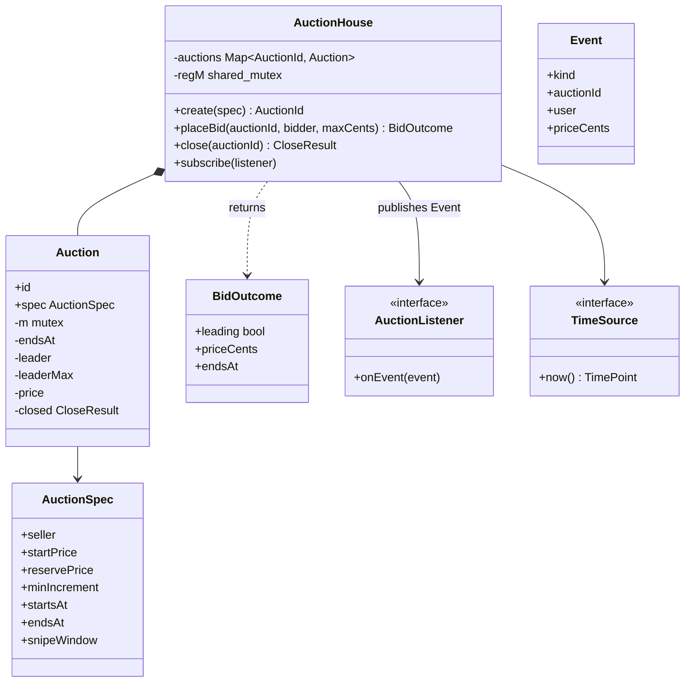

The key modeling decision is that an `Auction` stores only **three numbers of bidding state**: the leader, the leader's maximum, and the visible price. The proxy rule only ever needs the top two maxima, and the visible price already encodes the second one (it is that maximum plus one increment, or the leader's maximum on a tie). So there is no sorted set of all bids to keep consistent, and each bid is O(1) under the lock. In production every accepted bid is also appended to a bid log, which is the audit trail and the recovery source; the in-memory leader state is a projection of that log.

There is no `Bid` class in the core and no `Bidder` entity, because nothing in the bidding rules depends on them beyond an id. The auction lifecycle (`Scheduled`, `Open`, `Ended`, `Sold`, `Unsold`) is derived from the clock plus the `closed` field rather than stored as an enum, which removes a whole class of bugs where a stored state and the clock disagree (an auction marked `Open` whose end has passed).

#### Key patterns used

| Pattern | Where | Why |
|---|---|---|
| Monitor object | One `std::mutex` per `Auction` | Validation and mutation of one auction are atomic; different auctions never contend |
| Observer | `AuctionListener`, events published after unlock | Notifications, analytics, and websockets attach without touching bidding logic; a slow listener cannot stall bids |
| Injected clock | `TimeSource` | Start, end, and anti-sniping are tested by advancing a fake clock, not by sleeping |
| Result type | `std::variant<T, Error>` | Domain rejections (`BidTooLow`, `Ended`) are values the caller must handle, not exceptions |
| Idempotent command | `close` stores and returns its result | The close scheduler can retry after a crash without double-awarding |

#### Important flow: auction lifecycle and the proxy rule

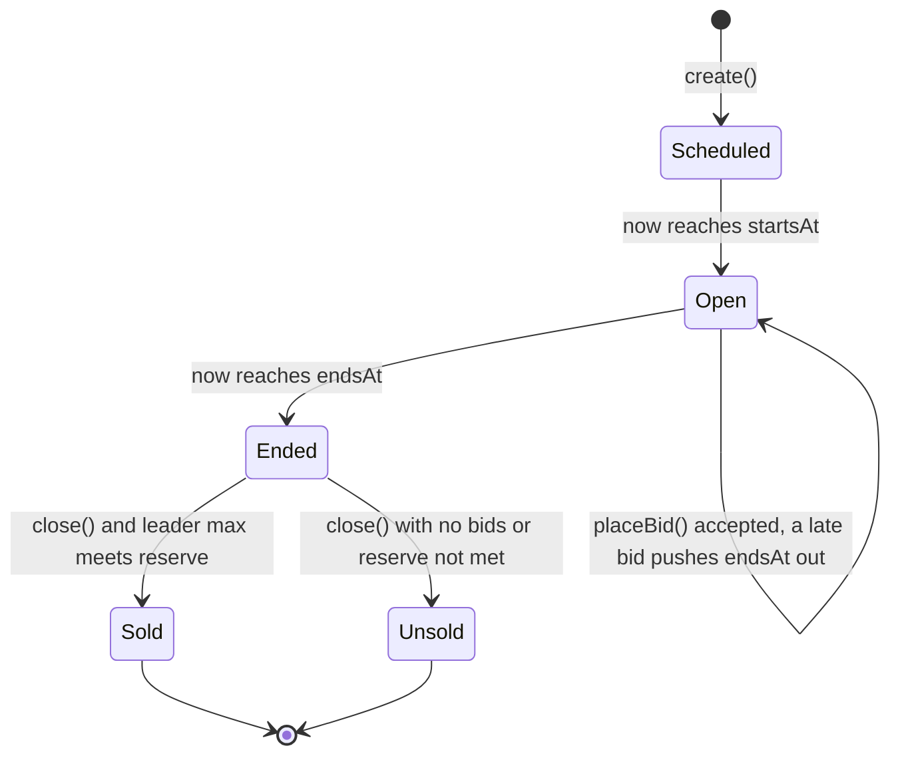

The proxy rule, worked through with the numbers from the demo (start 10.00, increment 1.00, reserve 50.00, snipe window 30 s):

```text
bid                         leader  leaderMax  price   why
ann max 40.00               ann     40.00      10.00   first bid opens at the start price
bob max 25.00               ann     40.00      26.00   proxy defends: min(40.00, 25.00 + 1.00); bob outbid
bob max 26.50               -       -          -       rejected: a challenger needs >= 26.00 + 1.00
bob max 60.00               bob     60.00      41.00   new leader: min(60.00, 40.00 + 1.00); ann outbid
bob max 70.00               bob     70.00      41.00   leader raises own max: price does not move
cat max 65.00 (end - 10 s)  bob     70.00      66.00   proxy defends; endsAt := now + 30 s
dan max 68.00               bob     70.00      69.00   proxy defends; still inside the window
close                       bob wins at 69.00          69.00 >= reserve 50.00
```

Why the visible price can never decrease: in the "challenger wins" case the new price is `min(M, leaderMax + inc)`, and the old price was at most `leaderMax`, so it rises. In the "proxy defends" case the challenger had to bid `M >= price + inc`, so `min(leaderMax, M + inc)` is at least `min(leaderMax, price + 2 inc)`, which is at least the old price. A leader raising their own maximum leaves the price unchanged. The concurrent test checks this invariant over 1,600 interleaved bid attempts.

#### Concurrency and failure concerns

- **Unit of serialization:** one mutex per auction. Every check (`now < endsAt`, `max >= price + inc`) and every write happens under it, so there is no check-then-act gap. The registry of auctions has its own `std::shared_mutex`, held only to look up the `shared_ptr`; it is never held while bidding.
- **Events are collected under the lock and published after it.** A listener that sends email or calls back into `placeBid` would otherwise either stall every bidder on that auction or deadlock on the non-recursive mutex. The cost is that two threads can publish events for the same auction in a different order than the bids were applied. If consumers care, stamp each event with a per-auction sequence number assigned under the lock and let consumers discard stale ones.
- **Bid versus close race:** both run under the same auction mutex, so exactly one goes first. If the late bid wins, it extends `endsAt` and `close` returns `NotEnded`; the scheduler re-arms for the new end. If `close` wins, the bid sees `closed` and gets `Ended`. Nothing is decided by "whose clock is right".
- **One time authority:** across servers, bid acceptance and closing must use the same clock (the database's `now()` or the single owner's clock), otherwise a bid accepted by a server whose clock runs 2 seconds slow can land after the auction was awarded.
- **Retries:** `close` is idempotent by construction. A client retrying `placeBid` after a timeout is mostly harmless (re-submitting the same maximum by the leader is rejected as `BidTooLow`; by a challenger it is evaluated again against the new price), but production APIs still take a client bid id and dedupe, so a retry never produces a second "outbid" email.
- **Across servers:** route every bid for an auction to one owner (partition by auction id, a single-threaded actor per hot auction), or make the store the lock with a conditional write: `UPDATE auction SET leader = ?, leader_max = ?, price = ?, ends_at = ?, version = version + 1 WHERE id = ? AND version = ? AND ends_at > now()`, retried on zero affected rows. A hot auction gets a few hundred bids in its last minute, well within one row's or one actor's throughput.
- **Crash recovery:** the bid log is the source of truth. Rebuild leader state by replaying the accepted bids in order; the proxy rule is deterministic, so the replay produces the same price.

#### Reference implementation (C++20)

One mutex per auction, a shared mutex for the registry, a fake clock, and a recording listener. `placeBid` implements the three proxy cases plus anti-sniping and returns typed errors; `close` applies the reserve rule and caches its result. The demo walks through the table above, the reserve rules, and a test where 8 threads place 200 bids each on one auction and the asserts check that the price history is sorted, the winner holds the highest accepted maximum, and the final price is `min(top, second + increment)`. It is clean under `-fsanitize=thread`. Simplified: bid ids, bid-log persistence, and the close scheduler.

```cpp
// auction.cpp -- build: g++ -std=c++20 -O2 -Wall -Wextra -pthread auction.cpp && ./a.out
// The asserts in main() are the tests; do not build with -DNDEBUG.
#include <algorithm>
#include <atomic>
#include <cassert>
#include <chrono>
#include <cstdint>
#include <iostream>
#include <memory>
#include <mutex>
#include <optional>
#include <random>
#include <shared_mutex>
#include <stdexcept>
#include <string>
#include <thread>
#include <unordered_map>
#include <variant>
#include <vector>

using namespace std::chrono_literals;
using Clock = std::chrono::steady_clock;
using Cents = std::int64_t;

struct TimeSource {
    virtual ~TimeSource() = default;
    virtual Clock::time_point now() const = 0;
};
struct FakeTime : TimeSource {
    Clock::time_point now() const override { std::lock_guard g(m); return t; }
    void advance(Clock::duration d) { std::lock_guard g(m); t += d; }
    mutable std::mutex m;
    Clock::time_point t{};
};

enum class EventKind { Outbid, Extended, Won, Sold, ReserveNotMet };
struct Event { EventKind kind; std::string auctionId, user; Cents priceCents; };
struct AuctionListener {  // Observer: email, push, websocket fan-out
    virtual ~AuctionListener() = default;
    virtual void onEvent(const Event& e) = 0;
};

enum class Error { UnknownAuction, NotStarted, Ended, SellerCannotBid, BidTooLow, NotEnded };
template <class T> using Result = std::variant<T, Error>;

struct AuctionSpec {
    std::string seller;
    Cents startPrice, reservePrice, minIncrement;
    Clock::time_point startsAt, endsAt;
    Clock::duration snipeWindow;  // a bid this close to the end pushes the end out
};
struct BidOutcome { bool leading; Cents priceCents; Clock::time_point endsAt; };
struct CloseResult { std::optional<std::string> winner; Cents priceCents; };

class Auction {
public:
    Auction(std::string id, AuctionSpec s) : id_(std::move(id)), spec_(std::move(s)), endsAt_(spec_.endsAt) {
        if (spec_.startPrice <= 0 || spec_.minIncrement <= 0 || spec_.reservePrice < 0)
            throw std::invalid_argument("prices must be positive");
        if (spec_.startsAt >= spec_.endsAt) throw std::invalid_argument("start must precede end");
    }
private:
    friend class AuctionHouse;
    std::string id_;
    AuctionSpec spec_;
    std::mutex m_;  // one lock per auction: auctions never contend with each other
    Clock::time_point endsAt_;
    std::optional<std::string> leader_;
    Cents leaderMax_ = 0, price_ = 0;
    std::vector<Cents> priceHistory_;  // for the monotonicity test; a bid log in production
    std::optional<CloseResult> closed_;
};

class AuctionHouse {
public:
    explicit AuctionHouse(const TimeSource& t) : time_(t) {}

    void subscribe(std::shared_ptr<AuctionListener> l) { std::unique_lock g(regM_); listeners_.push_back(std::move(l)); }

    std::string create(AuctionSpec spec) {
        auto a = std::make_shared<Auction>("A" + std::to_string(++seq_), std::move(spec));  // validates
        std::unique_lock g(regM_);
        auctions_[a->id_] = a;
        return a->id_;
    }

    // Proxy bid: maxCents is the most this bidder will pay; the house bids for them up to it.
    Result<BidOutcome> placeBid(const std::string& auctionId, const std::string& bidder, Cents maxCents) {
        auto a = find(auctionId);
        if (!a) return Error::UnknownAuction;
        std::vector<Event> events;  // collected under the lock, published after it
        BidOutcome out{};
        {
            std::lock_guard g(a->m_);
            auto now = time_.now();
            if (now < a->spec_.startsAt) return Error::NotStarted;
            if (a->closed_ || now >= a->endsAt_) return Error::Ended;
            if (bidder == a->spec_.seller) return Error::SellerCannotBid;  // shill bidding
            Cents inc = a->spec_.minIncrement;
            if (!a->leader_) {
                if (maxCents < a->spec_.startPrice) return Error::BidTooLow;
                a->leader_ = bidder; a->leaderMax_ = maxCents; a->price_ = a->spec_.startPrice;
            } else if (*a->leader_ == bidder) {
                if (maxCents <= a->leaderMax_) return Error::BidTooLow;  // raising your own ceiling only
                a->leaderMax_ = maxCents;                                // visible price unchanged
            } else {
                if (maxCents < a->price_ + inc) return Error::BidTooLow;
                if (maxCents > a->leaderMax_) {  // challenger takes the lead
                    events.push_back({EventKind::Outbid, a->id_, *a->leader_, 0});
                    a->price_ = std::min(maxCents, a->leaderMax_ + inc);
                    a->leader_ = bidder; a->leaderMax_ = maxCents;
                } else {                         // proxy defends; ties go to the earlier bid
                    a->price_ = std::min(a->leaderMax_, maxCents + inc);
                    events.push_back({EventKind::Outbid, a->id_, bidder, 0});
                }
            }
            if (a->endsAt_ - now < a->spec_.snipeWindow) {  // anti-sniping
                a->endsAt_ = now + a->spec_.snipeWindow;
                events.push_back({EventKind::Extended, a->id_, bidder, 0});
            }
            for (auto& e : events) e.priceCents = a->price_;
            a->priceHistory_.push_back(a->price_);
            out = {*a->leader_ == bidder, a->price_, a->endsAt_};
        }
        publish(events);
        return out;
    }

    // Called by a scheduler when endsAt passes. Idempotent: a second call returns the same result.
    Result<CloseResult> close(const std::string& auctionId) {
        auto a = find(auctionId);
        if (!a) return Error::UnknownAuction;
        std::vector<Event> events;
        CloseResult r{};
        {
            std::lock_guard g(a->m_);
            if (a->closed_) return *a->closed_;
            if (time_.now() < a->endsAt_) return Error::NotEnded;  // the end may have been extended
            if (a->leader_ && a->leaderMax_ >= a->spec_.reservePrice) {
                // Reserve met: price is at least the reserve, never more than the winner's max.
                r = {a->leader_, std::min(a->leaderMax_, std::max(a->price_, a->spec_.reservePrice))};
                events.push_back({EventKind::Won, a->id_, *a->leader_, r.priceCents});
                events.push_back({EventKind::Sold, a->id_, a->spec_.seller, r.priceCents});
            } else {
                r = {std::nullopt, 0};
                events.push_back({EventKind::ReserveNotMet, a->id_, a->spec_.seller, a->price_});
            }
            a->closed_ = r;
        }
        publish(events);
        return r;
    }

    std::vector<Cents> priceHistory(const std::string& auctionId) {
        auto a = find(auctionId);
        if (!a) return {};
        std::lock_guard g(a->m_);
        return a->priceHistory_;
    }

private:
    std::shared_ptr<Auction> find(const std::string& id) const {
        std::shared_lock g(regM_);
        auto it = auctions_.find(id);
        return it == auctions_.end() ? nullptr : it->second;
    }
    void publish(const std::vector<Event>& events) {  // no auction lock held: listeners may be slow
        std::vector<std::shared_ptr<AuctionListener>> ls;
        { std::shared_lock g(regM_); ls = listeners_; }
        for (auto& e : events) for (auto& l : ls) l->onEvent(e);
    }

    const TimeSource& time_;
    mutable std::shared_mutex regM_;  // guards the registry and listener list, not auction state
    std::unordered_map<std::string, std::shared_ptr<Auction>> auctions_;
    std::vector<std::shared_ptr<AuctionListener>> listeners_;
    std::atomic<std::uint64_t> seq_{0};
};

struct Recorder : AuctionListener {
    void onEvent(const Event& e) override { std::lock_guard g(m); events.push_back(e); }
    int count(EventKind k, const std::string& user) {
        std::lock_guard g(m);
        return static_cast<int>(std::count_if(events.begin(), events.end(),
                                              [&](const Event& e) { return e.kind == k && e.user == user; }));
    }
    std::mutex m;
    std::vector<Event> events;
};

template <class T> bool ok(const Result<T>& r) { return std::holds_alternative<T>(r); }
template <class T> Error err(const Result<T>& r) { return std::get<Error>(r); }

int main() {
    FakeTime clock;
    AuctionHouse house(clock);
    auto rec = std::make_shared<Recorder>();
    house.subscribe(rec);
    auto t0 = clock.now();
    AuctionSpec spec{"sam", 1000, 5000, 100, t0 + 1min, t0 + 1h, 30s};

    // 1) Validation and lifecycle errors.
    try { house.create({"sam", 1000, 0, 0, t0, t0 + 1h, 30s}); assert(false); } catch (const std::invalid_argument&) {}
    auto id = house.create(spec);
    assert(err(house.placeBid(id, "ann", 2000)) == Error::NotStarted);
    clock.advance(1min);
    assert(err(house.placeBid(id, "sam", 2000)) == Error::SellerCannotBid);
    assert(err(house.placeBid(id, "ann", 900)) == Error::BidTooLow);
    assert(err(house.placeBid("A99", "ann", 2000)) == Error::UnknownAuction);

    // 2) Proxy bidding: price = second-highest max + increment, capped at the leader's max.
    auto b = std::get<BidOutcome>(house.placeBid(id, "ann", 4000));
    assert(b.leading && b.priceCents == 1000);                       // first bid opens at start price
    b = std::get<BidOutcome>(house.placeBid(id, "bob", 2500));
    assert(!b.leading && b.priceCents == 2600);                      // ann's proxy defends at 2500 + 100
    assert(rec->count(EventKind::Outbid, "bob") == 1);
    assert(err(house.placeBid(id, "bob", 2650)) == Error::BidTooLow);  // must beat 2600 + 100
    b = std::get<BidOutcome>(house.placeBid(id, "bob", 6000));
    assert(b.leading && b.priceCents == 4100);                       // ann's max 4000 + 100
    assert(rec->count(EventKind::Outbid, "ann") == 1);
    b = std::get<BidOutcome>(house.placeBid(id, "bob", 7000));      // raise own ceiling: price unchanged
    assert(b.leading && b.priceCents == 4100);

    // 3) Anti-sniping: a bid 10 s before the end moves the end to now + 30 s.
    clock.advance(1h - 1min - 10s);
    b = std::get<BidOutcome>(house.placeBid(id, "cat", 6500));
    assert(!b.leading && b.priceCents == 6600 && b.endsAt == clock.now() + 30s);
    clock.advance(20s);                                               // past the original end
    assert(err(house.close(id)) == Error::NotEnded);
    assert(ok(house.placeBid(id, "dan", 6800)));                      // extended again
    clock.advance(30s);
    assert(err(house.placeBid(id, "eve", 9000)) == Error::Ended);

    // 4) Close: bob wins at dan's 6800 + 100; reserve 5000 met; idempotent.
    auto r = std::get<CloseResult>(house.close(id));
    assert(r.winner == "bob" && r.priceCents == 6900);
    assert(std::get<CloseResult>(house.close(id)).priceCents == 6900);
    assert(rec->count(EventKind::Won, "bob") == 1 && rec->count(EventKind::Sold, "sam") == 1);

    // 5) Reserve not met: no winner. Reserve met by max but not by price: price rises to reserve.
    auto id2 = house.create({"sam", 1000, 5000, 100, clock.now(), clock.now() + 1h, 30s});
    auto id3 = house.create({"sam", 1000, 5000, 100, clock.now(), clock.now() + 1h, 30s});
    (void)house.placeBid(id2, "ann", 3000);
    (void)house.placeBid(id3, "ann", 8000);
    clock.advance(1h);
    assert(!std::get<CloseResult>(house.close(id2)).winner);
    assert(std::get<CloseResult>(house.close(id3)).priceCents == 5000);
    assert(rec->count(EventKind::ReserveNotMet, "sam") == 1);

    // 6) Concurrency: 8 threads x 200 bids with distinct maxes. Price never decreases, the winner
    //    holds the highest accepted max, and the price is min(top, second + increment).
    auto id4 = house.create({"sam", 100, 0, 10, clock.now(), clock.now() + 1h, 1s});
    std::vector<std::vector<Cents>> accepted(8);
    {
        std::vector<std::jthread> ts;
        for (int t = 0; t < 8; ++t)
            ts.emplace_back([&, t] {
                std::mt19937 rng(static_cast<unsigned>(t));
                for (int i = 0; i < 200; ++i) {
                    Cents mx = (i * 1000 + static_cast<Cents>(rng() % 1000)) * 8 + t + 100;  // rising, distinct
                    if (ok(house.placeBid(id4, "u" + std::to_string(t), mx))) accepted[t].push_back(mx);
                }
            });
    }
    auto hist = house.priceHistory(id4);
    assert(hist.size() > 100 && std::is_sorted(hist.begin(), hist.end()));
    std::vector<std::pair<Cents, int>> best;  // each bidder's highest accepted max
    for (int t = 0; t < 8; ++t)
        if (!accepted[t].empty()) best.push_back({*std::max_element(accepted[t].begin(), accepted[t].end()), t});
    std::sort(best.rbegin(), best.rend());
    clock.advance(1h);
    auto r4 = std::get<CloseResult>(house.close(id4));
    assert(r4.winner == "u" + std::to_string(best[0].second));
    assert(best.size() < 2 || r4.priceCents == std::min(best[0].first, best[1].first + 10));
    std::cout << "online auction: all assertions passed\n";
}
```

What to point out while presenting this code:

- **The proxy state is three fields,** and the second-highest maximum is never stored. The concurrent test proves the claim independently: it collects every accepted maximum per bidder and recomputes the expected price from scratch.
- **Validation and mutation are in one critical section,** and the mutation phase cannot fail, so a rejected bid leaves no partial state (the same "validate everything, then mutate" shape as the seat hold in the movie-booking design).
- **The reserve is checked at close, not at bid time.** A bidder whose maximum is above the reserve but whose visible price is below it still wins, at the reserve (test 5 with `id3`). eBay applies the same rule at bid time so the visible price jumps to the reserve; either is defensible if stated.

#### Extension questions

- **"Increments depend on the price band (0.05 under 1.00, 0.25 under 5.00, ...)":** replace `minIncrement` with an `IncrementPolicy` strategy, `increment(priceCents) -> cents`, consulted inside the lock wherever `inc` is used. The monotonicity argument still holds because each step uses the increment at the current price.
- **"Add Buy It Now":** a separate command under the same auction lock that is valid only while there are no bids (or while the price is below a threshold), and that closes the auction immediately with the fixed price. It goes through the same `closed` field, so a racing bid gets `Ended`.
- **"Millions of auctions end every day; how do you close them on time?":** a delay queue or timing wheel keyed by `endsAt`, plus re-arming when an anti-sniping extension moves the end. Because `close` is idempotent and refuses before the end, an early or duplicate timer firing is harmless.
- **"Show bid history to everyone":** publish the sequence of visible prices and anonymized bidder handles, never the maxima. Revealing a leader's maximum would let a rival bid exactly one increment below it.

#### Interview Q&A

**Q1.** Why not store every bidder's maximum in a sorted structure and compute the price at close?

**A1.** Because bidders need the current price and their leading status at bid time: the outbid notification, the "you are the high bidder" response, and the minimum next bid all depend on it. Once the price is maintained incrementally, the only state the rule needs is the leader and their maximum; the second maximum is implied by the price. A sorted multiset would cost O(log n) per bid and introduce a second source of truth to keep consistent. The full list of bids still exists, in the append-only bid log, for audit and replay.

**Q2.** Why are listeners called after the mutex is released, and what does that cost?

**A2.** A listener is arbitrary code: it may send email over the network, take its own locks, or call back into `placeBid`. Under the auction mutex that would stall every other bidder on the hottest auction behind an SMTP round trip, or deadlock on re-entry. The cost is ordering: two threads can finish their critical sections in one order and publish in the other, so a consumer might see "ann outbid" after "bob outbid" even though it happened first. The fix is a per-auction event sequence number assigned under the lock; consumers apply events in sequence order and drop ones they have already superseded. In production the events go to an outbox table written in the same transaction as the bid, so they are never lost either.

**Q3.** How does anti-sniping interact with the job that closes auctions?

**A3.** The close job is scheduled for the original end time, but by then the end may have moved. `close` therefore re-checks `now >= endsAt` under the auction lock and returns `NotEnded` if a late bid extended it, and the job re-arms for the new `endsAt`. Bids and close serialize on the same lock, so there is no window where a bid is accepted after the winner is decided. Many sites also cap the total extension (for example 10 minutes) so two bots cannot extend an auction forever.

**Q4.** Two app servers receive bids for the same auction at the same moment. What prevents a lost update?

**A4.** Either routing or a conditional write. With routing, every auction id hashes to exactly one owner (a partition consumer or an actor) that applies bids one at a time, which is the in-process mutex scaled out. Without routing, each server reads the auction row with its `version`, applies the proxy rule in memory, and writes back with `WHERE id = ? AND version = ? AND ends_at > now()`; the loser of the race updates zero rows, re-reads, and re-applies the rule against the new leader. Because the rule is a pure function of (current state, new bid), retrying it is safe. A plain read-modify-write without the version check lets two challengers both become leader in turn and loses one of their maxima.

See also: [Designing for concurrency and failure](../design-patterns/Low_Level_Design_Interview_Prep.md#4-designing-for-concurrency-and-failure), [Monitor object](../design-patterns/Design_Patterns_Cpp.md#42-monitor-object), [Observer pattern](../design-patterns/Design_Patterns_Cpp.md#22-observer), [Pub-Sub message broker](../design-patterns/Low_Level_Design_Interview_Prep.md#20-worked-design-pub-sub-message-broker).

---

### A7. Order Book Matching Engine

#### Requirements and assumptions

- One instrument. Prices are integer ticks (a price of 101 means 101 ticks, for example 1.01 at a 0.01 tick size), quantities are integers. Integer prices make equality, map keys, and level aggregation exact.
- Order types: limit (price and quantity) and market (quantity only). Sides: buy and sell. Time in force: GTC (rest the remainder), IOC (cancel the remainder), FOK (fill completely now or do nothing). A market order never rests.
- Matching: price-time priority. An incoming buy matches the lowest asks first, and within a price level the oldest order first. A trade prints at the **resting** order's price, so an aggressive buyer at 102 against an ask at 101 pays 101.
- Partial fills on both sides. Every fill produces a trade report `{buyId, sellId, price, qty}`.
- Cancel by id. Amend by id: lowering the quantity at the same price keeps time priority; changing the price or raising the quantity is a cancel/replace that goes to the back of the queue, and it may trade immediately if the new price crosses.
- Duplicate order ids (including ids of orders that already filled) are rejected; non-positive quantities and limit prices throw at the boundary.
- **Single-threaded by design.** A sequencer in front of the engine assigns a total order to all inbound messages and journals them; the engine consumes them one at a time.

#### Core model

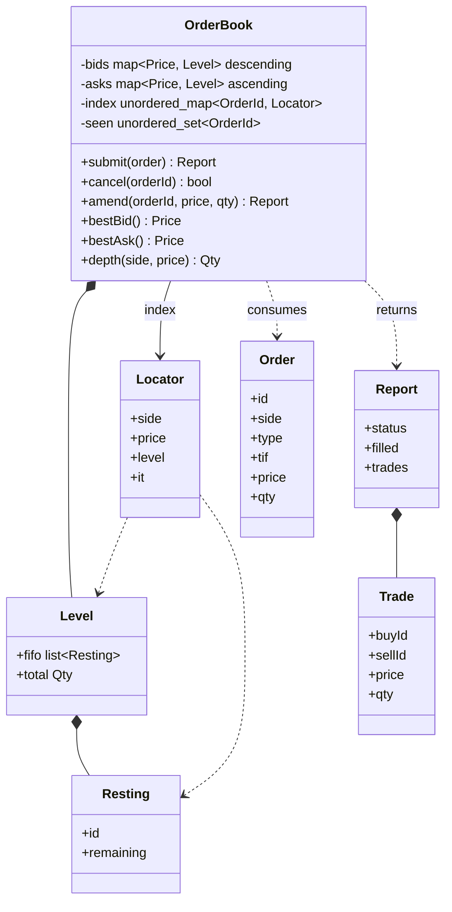

The design is mostly a data-structure question, and each structure answers one operation:

```text
operation                     structure                                    cost (L = price levels, ~10-1000)
best bid / best ask           bids.begin() / asks.begin()                  O(1)
match against the top         front of the best level's std::list          O(1) per fill
rest a new order              map[price] then list.push_back               O(log L); O(1) amortized with a hint
cancel                        index -> Locator{Level*, list iterator}      O(1); O(log L) only if the level empties
amend down (keep priority)    index -> iterator, edit remaining in place   O(1)
level depth (market data)     Level.total maintained on every change       O(1)
```

`std::map` gives ordered price levels, with `std::greater<>` on the bid side so `begin()` is always the best price on both sides. `std::list` per level gives FIFO order and, crucially, **stable iterators**: erasing one order invalidates no other order's iterator, so the id index can store a `list::iterator` and cancel in O(1). A `std::deque` or `std::vector` per level would make a cancel in the middle O(n) and invalidate stored positions. Map nodes are also stable, so the locator can keep a raw `Level*` instead of looking the level up again.

#### Key patterns used

| Pattern | Where | Why |
|---|---|---|
| Index into an intrusive-style structure | `index_` maps id to `{Level*, list iterator}` | O(1) cancel and amend without scanning a level |
| Template method over sides | `execute(o, opp, own)` instantiated for buy and sell | One matching loop; the side only changes which map is "opposite" and the crossing comparison |
| Cancel/replace as composition | `amend` = `cancel` + `submit` when priority is lost | Reuses the matching path, so a repriced order that crosses trades correctly |
| Deterministic state machine | Whole engine | Same input sequence, same trades: the basis for replay recovery and hot standby |

#### Important flow: submit

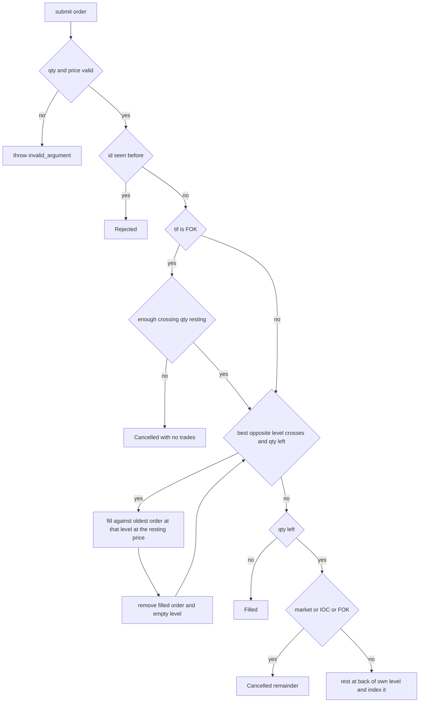

Two details make this flow correct. The FOK check is a **dry run** over the levels that cross, summing `Level.total` until it reaches the order quantity, before any state changes; if it falls short, nothing has been touched. And the loop always re-reads `opp.begin()`, because a fill can erase the best level, at which point the next level becomes the best.

Worked example from the demo:

```text
asks: 101 [id1:5, id2:5]   103 [id3:10]          bids: 99 [id4:10]
submit buy 102 x 7 (GTC)
  fill 5 vs id1 @101  (id1 first in time at 101)
  fill 2 vs id2 @101  (id2 keeps 3, still first in queue)
  remaining 0 -> Filled, 2 trades, best ask still 101 (3 left)
submit buy 101 x 5 (GTC)
  fill 3 vs id2 @101 -> level 101 empties and is erased
  103 does not cross 101 -> rest 2 @101 on the bid side; best bid 101 < best ask 103
```

#### Concurrency and failure concerns

- **Why single-threaded on a 64-core machine:** matching is inherently sequential per instrument. Every order's result depends on the book left by the previous one, so a lock around the book would serialize all work anyway, while adding lock hand-off latency and making the outcome depend on thread scheduling. Parallelism comes from sharding: one engine thread per instrument (or group of instruments), each pinned to a core.
- **Determinism is the replication and recovery story.** A sequencer stamps every inbound message with a sequence number and journals it before the engine sees it. A hot standby consumes the same sequenced stream and reaches the identical book; failover is a switch of which engine's output is published. Recovery is "load the last snapshot, replay the journal from its sequence number". This only works if the engine has no hidden inputs: no wall-clock reads inside matching (timestamps come from the sequencer), no randomness, and no iteration over the `unordered_map` that could leak hash order into outputs. The index is only ever used for point lookups.
- **Input path:** gateways do validation and risk checks in parallel, then hand messages to the engine through a single-producer, single-consumer ring buffer. The engine thread never blocks on I/O; trade reports and market data go out through another ring buffer.
- **Invariant after every message:** the book is never crossed (`bestBid < bestAsk`). Any order that would cross trades first, and only its remainder rests. The demo asserts `!crossed()` after the market sweep, and an amend that reprices through the ask trades instead of resting crossed.
- **Duplicate ids are rejected forever,** not just while the order rests. A client that retries a submit after a lost acknowledgment would otherwise create a second order once the first filled. In production the dedupe key is `(session, clientOrderId)` with a per-day window.
- **Latency hygiene:** `std::map` and `std::list` allocate a node per level and per order. Production engines pre-allocate order objects in a pool, link them intrusively, and replace the map with an array of levels indexed by `price - basePrice` (prices are bounded by price bands), which makes every operation O(1) and allocation-free on the hot path.

#### Reference implementation (C++20)

The book uses exactly the structures in the table: `std::map` per side with `std::greater<>` for bids, `std::list` FIFO per level with a running total, and an `unordered_map` from id to `{Level*, list iterator}`. One templated `execute` handles both sides; `amend` is in-place for a same-price reduction and cancel/replace otherwise. The demo checks resting, crossing with time priority, partial fills, cancel, both amend rules, a market sweep across levels, a market order larger than the book, IOC, a rejected and an accepted FOK, and duplicate ids. Simplified: no self-trade prevention, no stop or iceberg orders, and trades are returned rather than published.

```cpp
// order_book.cpp -- build: g++ -std=c++20 -O2 -Wall -Wextra order_book.cpp && ./a.out
// Single-threaded by design (a sequencer feeds one book). The asserts in main() are the tests;
// do not build with -DNDEBUG.
#include <algorithm>
#include <cassert>
#include <cstdint>
#include <functional>
#include <iostream>
#include <iterator>
#include <list>
#include <map>
#include <optional>
#include <stdexcept>
#include <unordered_map>
#include <unordered_set>
#include <vector>

using OrderId = std::uint64_t;
using Price = std::int64_t;  // integer ticks: no floating-point equality on prices
using Qty = std::int64_t;

enum class Side { Buy, Sell };
enum class Type { Limit, Market };
enum class Tif { GTC, IOC, FOK };  // good-till-cancel, immediate-or-cancel, fill-or-kill
enum class Status { Resting, Filled, Cancelled, Rejected };

struct Order { OrderId id; Side side; Type type; Tif tif; Price price; Qty qty; };
struct Trade { OrderId buyId, sellId; Price price; Qty qty; };
struct Report { Status status; Qty filled; std::vector<Trade> trades; };

class OrderBook {
    struct Resting { OrderId id; Qty remaining; };  // list position is the time priority
    struct Level { std::list<Resting> fifo; Qty total = 0; };
    using Bids = std::map<Price, Level, std::greater<>>;  // best (highest) bid first
    using Asks = std::map<Price, Level, std::less<>>;     // best (lowest) ask first
    // std::map nodes and std::list nodes never move, so a raw Level* and a list iterator stay valid
    // until that level or order is erased.
    struct Locator { Side side; Price price; Level* level; std::list<Resting>::iterator it; };

public:
    Report submit(const Order& o) {
        if (o.qty <= 0 || (o.type == Type::Limit && o.price <= 0)) throw std::invalid_argument("bad order");
        if (!seen_.insert(o.id).second) return {Status::Rejected, 0, {}};  // duplicate id
        return o.side == Side::Buy ? execute(o, asks_, bids_) : execute(o, bids_, asks_);
    }

    bool cancel(OrderId id) {  // O(1); O(log levels) only when the level empties
        auto it = index_.find(id);
        if (it == index_.end()) return false;
        auto& loc = it->second;
        loc.level->total -= loc.it->remaining;
        loc.level->fifo.erase(loc.it);  // iterators to every other order stay valid
        if (loc.level->fifo.empty()) {
            if (loc.side == Side::Buy) bids_.erase(loc.price); else asks_.erase(loc.price);
        }
        index_.erase(it);
        return true;
    }

    // Cancel/replace semantics. Shrinking in place keeps time priority; a new price or a larger
    // quantity goes to the back of the queue (and may cross, so it re-enters matching).
    std::optional<Report> amend(OrderId id, Price newPrice, Qty newQty) {
        auto it = index_.find(id);
        if (it == index_.end()) return std::nullopt;
        if (newQty <= 0 || newPrice <= 0) throw std::invalid_argument("bad amend");
        auto& loc = it->second;
        if (newPrice == loc.price && newQty <= loc.it->remaining) {
            loc.level->total -= loc.it->remaining - newQty;
            loc.it->remaining = newQty;
            return Report{Status::Resting, 0, {}};
        }
        Side side = loc.side;
        cancel(id);
        seen_.erase(id);
        return submit({id, side, Type::Limit, Tif::GTC, newPrice, newQty});
    }

    std::optional<Price> bestBid() const { return bids_.empty() ? std::nullopt : std::optional(bids_.begin()->first); }
    std::optional<Price> bestAsk() const { return asks_.empty() ? std::nullopt : std::optional(asks_.begin()->first); }
    Qty depth(Side s, Price p) const {
        if (s == Side::Buy) { auto it = bids_.find(p); return it == bids_.end() ? 0 : it->second.total; }
        auto it = asks_.find(p);
        return it == asks_.end() ? 0 : it->second.total;
    }
    std::vector<OrderId> queueAt(Side s, Price p) const {
        std::vector<OrderId> out;
        auto collect = [&](const auto& book) {
            if (auto it = book.find(p); it != book.end()) for (auto& r : it->second.fifo) out.push_back(r.id);
        };
        s == Side::Buy ? collect(bids_) : collect(asks_);
        return out;
    }
    bool crossed() const { return bestBid() && bestAsk() && *bestBid() >= *bestAsk(); }

private:
    template <class Opp, class Own>
    Report execute(const Order& o, Opp& opp, Own& own) {
        auto crosses = [&](Price restingPrice) {
            if (o.type == Type::Market) return true;
            return o.side == Side::Buy ? restingPrice <= o.price : restingPrice >= o.price;
        };
        if (o.tif == Tif::FOK) {  // dry run: is enough crossing liquidity resting right now?
            Qty avail = 0;
            for (auto lv = opp.begin(); lv != opp.end() && crosses(lv->first) && avail < o.qty; ++lv)
                avail += lv->second.total;
            if (avail < o.qty) return {Status::Cancelled, 0, {}};  // kill: no partial fill, no trades
        }
        Report rep{Status::Filled, 0, {}};
        Qty left = o.qty;
        while (left > 0 && !opp.empty() && crosses(opp.begin()->first)) {
            auto lv = opp.begin();
            auto& r = lv->second.fifo.front();  // price-time priority: best level, oldest order
            Qty q = std::min(left, r.remaining);
            OrderId buy = o.side == Side::Buy ? o.id : r.id, sell = o.side == Side::Buy ? r.id : o.id;
            rep.trades.push_back({buy, sell, lv->first, q});  // trades print at the resting price
            left -= q; r.remaining -= q; lv->second.total -= q;
            if (r.remaining == 0) {
                index_.erase(r.id);
                lv->second.fifo.pop_front();
                if (lv->second.fifo.empty()) opp.erase(lv);
            }
        }
        rep.filled = o.qty - left;
        if (left == 0) return rep;
        if (o.type == Type::Market || o.tif != Tif::GTC) { rep.status = Status::Cancelled; return rep; }
        auto& level = own[o.price];
        level.fifo.push_back({o.id, left});
        level.total += left;
        index_[o.id] = {o.side, o.price, &level, std::prev(level.fifo.end())};
        rep.status = Status::Resting;
        return rep;
    }

    Bids bids_;
    Asks asks_;
    std::unordered_map<OrderId, Locator> index_;  // resting orders only
    std::unordered_set<OrderId> seen_;            // every id ever accepted (duplicate guard)
};

Order limit(OrderId id, Side s, Price p, Qty q, Tif t = Tif::GTC) { return {id, s, Type::Limit, t, p, q}; }
Order market(OrderId id, Side s, Qty q, Tif t = Tif::IOC) { return {id, s, Type::Market, t, 0, q}; }

int main() {
    using enum Side;
    OrderBook ob;

    // 1) Non-crossing orders rest; best bid < best ask.
    assert(ob.submit(limit(1, Sell, 101, 5)).status == Status::Resting);
    assert(ob.submit(limit(2, Sell, 101, 5)).status == Status::Resting);
    assert(ob.submit(limit(3, Sell, 103, 10)).status == Status::Resting);
    assert(ob.submit(limit(4, Buy, 99, 10)).status == Status::Resting);
    assert(*ob.bestBid() == 99 && *ob.bestAsk() == 101 && !ob.crossed());

    // 2) Crossing buy at 102 for 7: fills 5 from id 1 (time priority), 2 from id 2, at 101.
    auto r = ob.submit(limit(5, Buy, 102, 7));
    assert(r.status == Status::Filled && r.trades.size() == 2);
    assert(r.trades[0].sellId == 1 && r.trades[0].qty == 5 && r.trades[0].price == 101);
    assert(r.trades[1].sellId == 2 && r.trades[1].qty == 2);
    assert(ob.depth(Sell, 101) == 3);  // id 2 partially filled, still first in queue

    // 3) Partial fill then rest: buy 101 x 5 takes 3, rests 2 at 101 on the bid side.
    r = ob.submit(limit(6, Buy, 101, 5));
    assert(r.status == Status::Resting && r.filled == 3 && *ob.bestBid() == 101 && *ob.bestAsk() == 103);

    // 4) Cancel is O(1) via the index; cancelling twice is a no-op; empty level disappears.
    assert(ob.cancel(6) && !ob.cancel(6) && *ob.bestBid() == 99);

    // 5) Amend: shrinking keeps priority, growing loses it.
    ob.submit(limit(7, Buy, 99, 4));
    ob.submit(limit(8, Buy, 99, 4));
    assert((ob.queueAt(Buy, 99) == std::vector<OrderId>{4, 7, 8}));
    ob.amend(4, 99, 6);                                          // 10 -> 6: stays first
    assert((ob.queueAt(Buy, 99) == std::vector<OrderId>{4, 7, 8}) && ob.depth(Buy, 99) == 14);
    ob.amend(7, 99, 9);                                          // 4 -> 9: back of the queue
    assert((ob.queueAt(Buy, 99) == std::vector<OrderId>{4, 8, 7}) && ob.depth(Buy, 99) == 19);
    auto ar = ob.amend(8, 103, 4);                               // reprice through the ask: trades
    assert(ar && ar->status == Status::Filled && ar->trades[0].sellId == 3 && ob.depth(Sell, 103) == 6);
    assert(!ob.amend(42, 100, 1));                               // unknown order

    // 6) Market sell sweeps levels: 6 @99 (id 4) then 9 @99 (id 7), then 2 @98 (id 9). Book never crossed.
    ob.submit(limit(9, Buy, 98, 5));
    r = ob.submit(market(10, Sell, 17));
    assert(r.status == Status::Filled && r.trades.size() == 3);
    assert(r.trades[0].buyId == 4 && r.trades[1].buyId == 7 && r.trades[2].price == 98 && r.trades[2].qty == 2);
    assert(ob.depth(Buy, 98) == 3 && !ob.crossed());

    // 7) Market order larger than the book: fills what exists, remainder cancelled, never rests.
    r = ob.submit(market(11, Sell, 100));
    assert(r.status == Status::Cancelled && r.filled == 3 && !ob.bestBid());

    // 8) IOC: fill what crosses now, cancel the rest. FOK: all or nothing, no trades on reject.
    r = ob.submit(limit(12, Buy, 103, 10, Tif::IOC));
    assert(r.status == Status::Cancelled && r.filled == 6 && !ob.bestAsk() && !ob.bestBid());
    ob.submit(limit(13, Sell, 105, 4));
    ob.submit(limit(14, Sell, 106, 4));
    r = ob.submit(limit(15, Buy, 106, 9, Tif::FOK));
    assert(r.status == Status::Cancelled && r.trades.empty() && ob.depth(Sell, 105) == 4);
    r = ob.submit(limit(16, Buy, 106, 8, Tif::FOK));
    assert(r.status == Status::Filled && r.filled == 8 && !ob.bestAsk());

    // 9) Boundary validation and duplicate ids (even of orders that already left the book).
    assert(ob.submit(limit(1, Buy, 100, 1)).status == Status::Rejected);
    try { ob.submit(limit(17, Buy, 100, 0)); assert(false); } catch (const std::invalid_argument&) {}
    std::cout << "order book: all assertions passed\n";
}
```

What to point out while presenting this code:

- **`opp.begin()` is re-read every iteration,** never cached across a fill, because erasing an emptied level invalidates the iterator to it.
- **The FOK dry run stops as soon as it has enough** (`avail < o.qty` in the loop condition), so a small FOK against a deep book costs a level or two, not the whole side.
- **`amend` re-inserts the id into `seen_` through `submit`,** so the duplicate guard does not reject the replacement of its own order.

#### Extension questions

- **"Add self-trade prevention":** before filling, compare the trader id of the incoming and resting order; on a match apply a policy (cancel the resting order, cancel the incoming remainder, or cancel both). It is a check inside the match loop, and the policy is a strategy chosen per account.
- **"Add iceberg orders":** a resting order with a visible peak and a hidden reserve. When the visible part fills, refill it from the reserve and move it to the **back** of the level, because the refill is new displayed liquidity and must not jump the queue. `Level.total` should report only visible quantity to market data.
- **"Publish level-2 market data":** after each message, emit the changed `(side, price, total)` tuples. `Level.total` already makes this O(1) per changed level; batching per sequence number keeps the feed consistent.
- **"Support stop orders":** keep them in separate maps keyed by trigger price, outside the visible book. After each trade, check whether the last trade price crossed any triggers and inject the triggered orders as new market or limit orders in a deterministic order (by trigger time).

#### Interview Q&A

**Q1.** Why `std::list` per price level instead of `std::deque` or `std::vector`?

**A1.** Cancels hit arbitrary positions in a level, and most orders on real exchanges are cancelled rather than filled. With a list, the id index stores an iterator and the cancel is an O(1) unlink that invalidates no other iterator. A vector or deque would need an O(n) erase in the middle (or tombstones plus periodic compaction), and any stored index or iterator would shift or be invalidated on insertion. The list's weakness is one allocation per node and poor cache locality; production engines keep the same shape but use an intrusive doubly linked list over pool-allocated order objects, which removes the allocation and keeps O(1) unlink.

**Q2.** Why does an amend that increases quantity lose time priority, but a decrease does not?

**A2.** Time priority rewards whoever committed liquidity first at that price. Lowering the quantity gives liquidity back, so it cannot disadvantage anyone queued behind. Raising it would let a trader reserve a front-of-queue position with a tiny order and then grow it, jumping everyone who arrived in between; so the increase is treated as a new order at the back. A price change is a different queue altogether. Implementing the rule as "in-place edit for a same-price decrease, otherwise cancel plus submit" also guarantees that a repriced order goes through matching and cannot rest crossed.

**Q3.** How does FOK differ from IOC, and why is FOK implemented as a dry run?

**A3.** IOC fills whatever crosses right now and cancels the remainder, so a partial fill is fine. FOK must fill entirely or not at all. Matching first and undoing on shortfall would mean reversing trades that the engine has already reported, and putting resting orders back at their original queue positions, which is complex and error-prone. A dry run is simpler: sum `Level.total` over the crossing levels until the quantity is covered. Because the engine is single-threaded, nothing can change between the check and the fill, so the check is exact.

**Q4.** How would you recover the book after the engine process crashes?

**A4.** From the sequenced journal. Every inbound message was journaled with its sequence number before the engine applied it, and the engine is a deterministic function of that sequence. Periodically snapshot the book (levels, FIFO order, and the next expected sequence number), and on restart load the latest snapshot and replay the journal from there. Outputs (trades) carry the input sequence number that produced them, so downstream consumers can drop duplicates produced during replay. A hot standby that has been replaying all along makes failover take milliseconds instead of a snapshot load.

See also: [HLD mock: Stock exchange matching engine](HLD_Mock_Interviews.md#a10-stock-exchange-matching-engine), [Lock-free SPSC ring buffer](../design-patterns/Design_Patterns_Cpp.md#49-lock-free-spsc-ring-buffer), [Object pool](../design-patterns/Design_Patterns_Cpp.md#46-object-pool-and-resource-pools), [Designing for concurrency and failure](../design-patterns/Low_Level_Design_Interview_Prep.md#4-designing-for-concurrency-and-failure).

---

### A8. Text Editor with Undo and Redo

#### Requirements and assumptions

- One buffer of bytes (ASCII), one cursor, and an optional selection defined by an anchor and the cursor.
- Edits: type a character at the cursor (replacing the selection if there is one), backspace (deleting the selection if there is one), cut, paste (replacing the selection), and replace-all.
- Navigation and selection (`moveTo`, `select`) and `copy` are not edits: they never enter undo history.
- Undo restores both the text and the cursor position from before the edit. Redo re-applies. Any new edit clears the redo stack (linear history).
- Coalescing: consecutive typed characters at contiguous positions merge into one undo step, unless the cursor was moved in between or more than one second passed since the previous keystroke. The clock is injected.
- Replace-all and "type over a selection" are each one undo step.
- History is capped (1,000 steps by default) so memory is bounded.
- Out of scope: rendering, multiple cursors, Unicode, files, and collaborative editing.

#### Core model

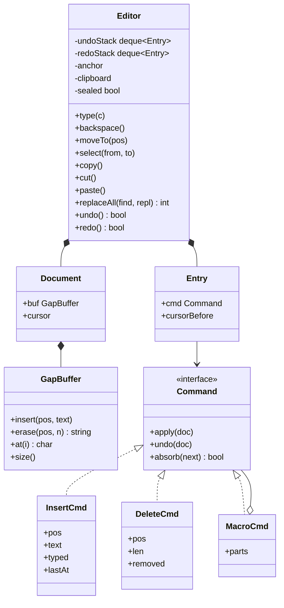

Every edit reduces to two primitives, insert text at a position and delete a range, and each is the other's inverse. So there are exactly two leaf commands, and everything compound (cut, paste over a selection, typing over a selection, replace-all) is a `MacroCmd` of leaves. `DeleteCmd` captures the removed text when it first runs, which is all its inverse needs. Commands operate on a `Document` (buffer plus cursor), not on the `Editor`, so they cannot touch history or the clipboard.

**Which backing store:** the three standard choices, for a 50 MB file:

| Structure | Edit at cursor | Jump and edit far away | Undo support | Used by |
|---|---|---|---|---|
| Gap buffer | O(1) amortized | O(distance) to move the gap, once | Commands with inverses | Emacs |
| Rope (balanced tree of strings) | O(log n) | O(log n) | Cheap snapshots via shared subtrees | Xi, many IDE editors |
| Piece table (original file plus append-only add buffer, with a list of pieces) | O(pieces) or O(log pieces) with a tree | Same | Natural: pieces are immutable, so old piece lists are old versions | VS Code (piece tree), Word |

A gap buffer wins for the interview: it is about 50 lines, typing is a single byte write into the gap, and real editing is local (people type in bursts at one place). Its weakness is a jump across a large file, which moves up to the whole file once (50 MB at memory bandwidth is a few milliseconds), and it holds the whole file in memory. A piece table never copies the original file (it can be memory-mapped) and makes undo nearly free, which is why large-file editors use it; a rope gives the best worst case for many cursors and huge files.

#### Key patterns used

| Pattern | Where | Why |
|---|---|---|
| Command | `InsertCmd`, `DeleteCmd` with `apply` and `undo` | Each edit is an object that knows its inverse; history is two stacks of them |
| Composite | `MacroCmd` holds commands, undoes them in reverse | Replace-all and replace-selection are one undo step without special cases in `undo()` |
| Coalescing (command merging) | `InsertCmd::absorb` plus the `sealed_` flag | Typing a word is one step; the merge policy lives in the command, the "something else happened" signal lives in the editor |
| Injected clock | `std::function<time_point()>` in `Editor` | The one-second idle rule is tested deterministically |
| Memento (contrast) | Not used: cursor only, via `Entry.cursorBefore` | Snapshotting a 50 MB buffer per keystroke is too expensive; inverses are O(edit size) |

#### Important flow: coalescing, undo, and redo

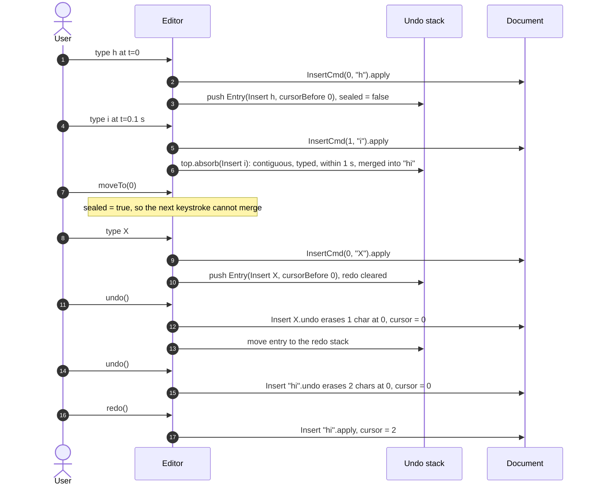

`execute` applies the command first and only then touches history, so a command that throws (a position past the end) never enters the undo stack and never clears redo. Merging is attempted only when the editor is not sealed: any cursor move, selection, undo, or redo seals it. The command itself decides whether the new keystroke is mergeable (both typed, contiguous, within one second).

#### Concurrency and failure concerns

- **Single-threaded by design:** the editor runs on the UI thread; every keystroke is a short in-memory operation. Background work (autosave, syntax highlighting, spell check) reads an immutable snapshot rather than locking the buffer. With a piece table or rope the snapshot is O(1) because the structure is persistent; with a gap buffer it is a copy, done rarely.
- **Exception safety:** `GapBuffer::insert` may grow (allocate) before writing; if the allocation throws, the old buffer is unchanged because the new vector is built aside and moved in. `execute` mutates history only after `apply` succeeds.
- **Macro partial failure:** if the third part of a macro threw, the first two would already be applied. Replace-all cannot hit this (positions come from the current text, applied right to left), but a general macro should catch, undo the applied parts in reverse, and rethrow, which is the same rollback as a database transaction.
- **Memory:** undo history holds only edit text, not snapshots, and is capped at 1,000 entries (oldest dropped). A huge paste is the one large entry; editors cap the size of an undoable paste or spill it to disk.
- **Positions are the fragile part:** commands store absolute positions, valid only if history is replayed strictly in order. That is why redo is cleared on a new edit: the old redo entries' positions refer to a text that no longer exists. Collaborative editing breaks exactly this assumption and needs operational transformation or CRDTs.

#### Reference implementation (C++20)

A gap buffer with doubling growth, two leaf commands with inverses, a macro command, and an editor with two deques of history entries, selection, clipboard, coalescing with an injected clock, and replace-all. The demo checks the gap buffer directly (scattered inserts, growth to 1,011 characters, a bounds error), then coalescing, the cursor-jump and idle breaks, redo cleared by a new edit, copy/cut/paste, typing over a selection, replace-all undone and redone as one step, and boundary errors. Simplified: ASCII only, no backspace coalescing, and `text()` copies the buffer.

```cpp
// text_editor.cpp -- build: g++ -std=c++20 -O2 -Wall -Wextra text_editor.cpp && ./a.out
// The asserts in main() are the tests; do not build with -DNDEBUG.
#include <algorithm>
#include <cassert>
#include <chrono>
#include <deque>
#include <functional>
#include <iostream>
#include <memory>
#include <optional>
#include <stdexcept>
#include <string>
#include <string_view>
#include <utility>
#include <vector>

using namespace std::chrono_literals;
using Clock = std::chrono::steady_clock;

// Text lives in [0, gapStart) and [gapEnd, cap). Edits at the cursor are O(1) amortized;
// moving the edit point costs O(distance moved), paid once per jump, not per keystroke.
class GapBuffer {
public:
    std::size_t size() const { return buf_.size() - (gapEnd_ - gapStart_); }
    char at(std::size_t i) const { return i < gapStart_ ? buf_[i] : buf_[i + gapEnd_ - gapStart_]; }
    std::string substr(std::size_t pos, std::size_t n) const {
        std::string out;
        for (std::size_t i = pos; i < pos + n; ++i) out.push_back(at(i));
        return out;
    }
    std::string text() const { return substr(0, size()); }

    void insert(std::size_t pos, std::string_view s) {
        check(pos);
        moveGap(pos);
        if (gapEnd_ - gapStart_ < s.size()) grow(s.size());
        std::copy(s.begin(), s.end(), buf_.begin() + static_cast<std::ptrdiff_t>(gapStart_));
        gapStart_ += s.size();
    }
    std::string erase(std::size_t pos, std::size_t n) {  // returns the removed text (for undo)
        check(pos + n);
        moveGap(pos);
        std::string out(buf_.begin() + static_cast<std::ptrdiff_t>(gapEnd_),
                        buf_.begin() + static_cast<std::ptrdiff_t>(gapEnd_ + n));
        gapEnd_ += n;  // widening the gap is the delete
        return out;
    }

private:
    void check(std::size_t pos) const { if (pos > size()) throw std::out_of_range("position past end"); }
    void moveGap(std::size_t pos) {
        auto b = buf_.begin();
        auto d = [](std::size_t x) { return static_cast<std::ptrdiff_t>(x); };
        if (pos < gapStart_) {         // shift [pos, gapStart) to the right end of the gap
            std::move_backward(b + d(pos), b + d(gapStart_), b + d(gapEnd_));
            gapEnd_ -= gapStart_ - pos;
            gapStart_ = pos;
        } else if (pos > gapStart_) {  // shift the text after the gap into its left end
            std::size_t n = pos - gapStart_;
            std::move(b + d(gapEnd_), b + d(gapEnd_ + n), b + d(gapStart_));
            gapStart_ += n;
            gapEnd_ += n;
        }
    }
    void grow(std::size_t need) {      // double, like std::vector: amortized O(1) per char
        std::size_t tail = buf_.size() - gapEnd_;
        std::vector<char> nb(std::max(buf_.size() * 2, size() + need + 16));
        std::copy_n(buf_.begin(), gapStart_, nb.begin());
        std::copy_n(buf_.end() - static_cast<std::ptrdiff_t>(tail), tail, nb.end() - static_cast<std::ptrdiff_t>(tail));
        gapEnd_ = nb.size() - tail;
        buf_ = std::move(nb);
    }
    std::vector<char> buf_;
    std::size_t gapStart_ = 0, gapEnd_ = 0;
};

struct Document { GapBuffer buf; std::size_t cursor = 0; };

struct Command {
    virtual ~Command() = default;
    virtual void apply(Document& d) = 0;
    virtual void undo(Document& d) = 0;
    virtual bool absorb(const Command&) { return false; }  // coalescing hook
};

struct InsertCmd : Command {
    InsertCmd(std::size_t p, std::string t, bool typed = false, Clock::time_point at = {})
        : pos(p), text(std::move(t)), typed(typed), lastAt(at) {}
    void apply(Document& d) override { d.buf.insert(pos, text); d.cursor = pos + text.size(); }
    void undo(Document& d) override { d.buf.erase(pos, text.size()); d.cursor = pos; }
    bool absorb(const Command& next) override {  // "hello" typed quickly is one undo step
        auto* n = dynamic_cast<const InsertCmd*>(&next);
        if (!n || !typed || !n->typed || n->pos != pos + text.size() || n->lastAt - lastAt > 1s) return false;
        text += n->text;
        lastAt = n->lastAt;
        return true;
    }
    std::size_t pos; std::string text; bool typed; Clock::time_point lastAt;
};

struct DeleteCmd : Command {
    DeleteCmd(std::size_t p, std::size_t n) : pos(p), len(n) {}
    void apply(Document& d) override { removed = d.buf.erase(pos, len); d.cursor = pos; }
    void undo(Document& d) override { d.buf.insert(pos, removed); d.cursor = pos + removed.size(); }
    std::size_t pos, len; std::string removed;  // captured on apply: the inverse needs it
};

struct MacroCmd : Command {  // Composite: one undo step for many edits
    void apply(Document& d) override { for (auto& c : parts) c->apply(d); }
    void undo(Document& d) override { for (auto it = parts.rbegin(); it != parts.rend(); ++it) (*it)->undo(d); }
    std::vector<std::unique_ptr<Command>> parts;
};

class Editor {
public:
    explicit Editor(std::function<Clock::time_point()> now, std::size_t maxHistory = 1000)
        : now_(std::move(now)), maxHistory_(maxHistory) {}

    std::string text() const { return doc_.buf.text(); }
    std::size_t cursor() const { return doc_.cursor; }

    void type(char c) {
        if (selection()) return replaceSelection(std::string(1, c));
        execute(std::make_unique<InsertCmd>(doc_.cursor, std::string(1, c), true, now_()));
    }
    void backspace() {
        if (selection()) return replaceSelection("");
        if (doc_.cursor > 0) execute(std::make_unique<DeleteCmd>(doc_.cursor - 1, 1));
    }
    void moveTo(std::size_t pos) {
        if (pos > doc_.buf.size()) throw std::out_of_range("cursor past end");
        doc_.cursor = pos; anchor_.reset(); sealed_ = true;  // a cursor jump ends the typing run
    }
    void select(std::size_t from, std::size_t to) { moveTo(from); moveTo(to); anchor_ = from; }
    void copy() { if (auto s = selection()) clipboard_ = doc_.buf.substr(s->first, s->second - s->first); }
    void cut() { copy(); if (selection()) replaceSelection(""); }
    void paste() { selection() ? replaceSelection(clipboard_) : execute(std::make_unique<InsertCmd>(doc_.cursor, clipboard_)); }

    // Find/replace-all as one macro command. Occurrences are found on the current text and applied
    // right to left, so earlier positions stay valid; undo runs the parts in reverse.
    int replaceAll(std::string_view find, std::string_view repl) {
        if (find.empty()) throw std::invalid_argument("empty search string");
        std::string t = text();
        std::vector<std::size_t> hits;
        for (auto p = t.find(find); p != std::string::npos; p = t.find(find, p + find.size())) hits.push_back(p);
        if (hits.empty()) return 0;
        auto macro = std::make_unique<MacroCmd>();
        for (auto it = hits.rbegin(); it != hits.rend(); ++it) {
            macro->parts.push_back(std::make_unique<DeleteCmd>(*it, find.size()));
            if (!repl.empty()) macro->parts.push_back(std::make_unique<InsertCmd>(*it, std::string(repl)));
        }
        execute(std::move(macro));
        return static_cast<int>(hits.size());
    }

    bool undo() {
        if (undo_.empty()) return false;
        auto e = std::move(undo_.back());
        undo_.pop_back();
        e.cmd->undo(doc_);
        doc_.cursor = e.cursorBefore;
        redo_.push_back(std::move(e));
        anchor_.reset(); sealed_ = true;
        return true;
    }
    bool redo() {
        if (redo_.empty()) return false;
        auto e = std::move(redo_.back());
        redo_.pop_back();
        e.cmd->apply(doc_);
        undo_.push_back(std::move(e));
        anchor_.reset(); sealed_ = true;
        return true;
    }
    std::size_t undoDepth() const { return undo_.size(); }

private:
    struct Entry { std::unique_ptr<Command> cmd; std::size_t cursorBefore; };

    std::optional<std::pair<std::size_t, std::size_t>> selection() const {
        if (!anchor_ || *anchor_ == doc_.cursor) return std::nullopt;
        return std::pair{std::min(*anchor_, doc_.cursor), std::max(*anchor_, doc_.cursor)};
    }
    void replaceSelection(const std::string& with) {  // delete + insert as one undo step
        auto [a, b] = *selection();
        auto macro = std::make_unique<MacroCmd>();
        macro->parts.push_back(std::make_unique<DeleteCmd>(a, b - a));
        if (!with.empty()) macro->parts.push_back(std::make_unique<InsertCmd>(a, with));
        anchor_.reset();
        execute(std::move(macro));
    }
    void execute(std::unique_ptr<Command> c) {
        std::size_t before = doc_.cursor;
        c->apply(doc_);                // throws before any history change if the edit is invalid
        redo_.clear();                 // a new edit forks history: the old future is gone
        bool merged = !sealed_ && !undo_.empty() && undo_.back().cmd->absorb(*c);
        if (!merged) undo_.push_back({std::move(c), before});
        if (undo_.size() > maxHistory_) undo_.pop_front();
        sealed_ = false;
    }

    Document doc_;
    std::function<Clock::time_point()> now_;
    std::size_t maxHistory_;
    std::deque<Entry> undo_, redo_;
    std::optional<std::size_t> anchor_;  // selection is [anchor, cursor) in either direction
    std::string clipboard_;
    bool sealed_ = true;                 // true: the next typed char must start a new undo step
};

int main() {
    // 1) Gap buffer: edits at scattered positions and growth past the initial capacity.
    GapBuffer gb;
    gb.insert(0, "hed");
    gb.insert(2, "llo worl");
    gb.insert(0, ">> ");
    assert(gb.text() == ">> hello world" && gb.erase(0, 3) == ">> " && gb.text() == "hello world");
    for (int i = 0; i < 1000; ++i) gb.insert(5, "x");
    assert(gb.size() == 1011 && gb.at(4) == 'o' && gb.at(1005) == ' ');
    try { gb.erase(1000, 50); assert(false); } catch (const std::out_of_range&) {}

    Clock::time_point t{};
    Editor ed([&] { return t; });
    auto typeStr = [&](std::string_view s) { for (char c : s) { ed.type(c); t += 100ms; } };

    // 2) Coalescing: five quick keystrokes are one undo step; redo restores them.
    typeStr("hello");
    assert(ed.text() == "hello" && ed.undoDepth() == 1);
    assert(ed.undo() && ed.text() == "" && ed.cursor() == 0);
    assert(ed.redo() && ed.text() == "hello" && ed.cursor() == 5);

    // 3) A cursor jump breaks the run; so does a 2 s pause.
    ed.moveTo(0);
    typeStr("Oh ");
    t += 2s;
    ed.moveTo(8);
    typeStr("!!");
    t += 2s;
    typeStr("?");
    assert(ed.text() == "Oh hello!!?" && ed.undoDepth() == 4);
    ed.undo();
    assert(ed.text() == "Oh hello!!");
    ed.undo();
    assert(ed.text() == "Oh hello" && ed.cursor() == 8);

    // 4) A new edit clears the redo stack.
    ed.undo();
    assert(ed.text() == "hello");
    ed.moveTo(5);
    typeStr(" world");
    assert(!ed.redo() && ed.text() == "hello world");

    // 5) Select, copy, paste, cut; typing over a selection is one step.
    ed.select(0, 5);
    ed.copy();
    ed.moveTo(11);
    ed.paste();
    assert(ed.text() == "hello worldhello");
    ed.select(5, 11);
    ed.cut();
    assert(ed.text() == "hellohello");
    ed.undo();
    assert(ed.text() == "hello worldhello");
    ed.select(11, 16);
    ed.type('!');
    assert(ed.text() == "hello world!");
    ed.undo();
    assert(ed.text() == "hello worldhello");

    // 6) Replace-all is one undo step, redoable; empty pattern is rejected.
    assert(ed.replaceAll("hello", "bye") == 2 && ed.text() == "bye worldbye");
    assert(ed.replaceAll("zzz", "q") == 0);
    std::size_t depth = ed.undoDepth();
    assert(ed.undo() && ed.text() == "hello worldhello" && ed.undoDepth() == depth - 1);
    assert(ed.redo() && ed.text() == "bye worldbye");
    try { ed.replaceAll("", "x"); assert(false); } catch (const std::invalid_argument&) {}

    // 7) Boundaries: backspace at 0 is a no-op; a cursor past the end throws; undo to empty.
    ed.moveTo(0);
    ed.backspace();
    assert(ed.text() == "bye worldbye");
    try { ed.moveTo(99); assert(false); } catch (const std::out_of_range&) {}
    while (ed.undo()) {}
    assert(ed.text() == "" && !ed.undo());
    std::cout << "text editor: all assertions passed\n";
}
```

What to point out while presenting this code:

- **Replace-all applies right to left,** so each occurrence's position, found on the original text, is still correct when it is applied; undo runs the parts in reverse (left to right), which again restores positions in order.
- **`cursorBefore` lives in the history entry, not the command,** so undoing a merged "hello" puts the cursor where it was before the `h`, and undoing a macro restores the cursor regardless of where its parts left it.
- **The gap moves only on a jump:** typing ten characters at one spot moves the gap once and then writes ten bytes; the `moveGap` cost is proportional to the distance jumped.

#### Extension questions

- **"Undo tree instead of discarding redo (Vim, Emacs undo-tree)":** keep history as a tree; a new edit after undo creates a sibling branch instead of clearing redo. Undo and redo move along the current branch, and a separate command switches branches. Commands are unchanged; only the history container changes.
- **"Persist undo history across restarts":** serialize commands as `(kind, pos, text)` records with a hash of the file content they apply to; on reopen, load the history only if the hash matches.
- **"Coalesce backspaces too":** give `DeleteCmd` an `absorb` that merges a delete ending exactly where the previous one started (backspace runs leftward), under the same sealing and idle rules.
- **"Two users edit the same document":** absolute positions no longer compose. Use operational transformation (a server orders operations and transforms concurrent ones against each other) or a sequence CRDT where each character has a stable identity; undo then means "invert my own operation, transformed against everything since", not "pop the global stack".

#### Interview Q&A

**Q1.** Command with inverse operations or Memento snapshots for undo?

**A1.** Inverses. A snapshot per edit costs O(document size) in time and memory, so for a 50 MB file every keystroke would copy 50 MB. An insert or delete command stores only the changed text and a position, O(edit size), and its inverse is the other primitive. Mementos make sense when the inverse is hard to compute or the state is small: a drawing program's object properties, or a game board in chess. A persistent structure (rope, piece table) blurs the line: a snapshot shares almost everything with the previous version, so it is O(log n) and both approaches converge.

**Q2.** Why does a new edit clear the redo stack?

**A2.** Redo entries are commands with absolute positions computed against the text as it was before they were undone. After a new edit at, say, position 0, every one of those positions is off by the new edit's length, so replaying them would corrupt the text. Linear history therefore discards them. Preserving them requires either an undo tree (keep the old branch, never replay it onto the new one) or transforming the old operations against the new one, which is operational transformation.

**Q3.** What exactly should break a coalesced typing run?

**A3.** Anything that makes "undo the whole run" surprising: moving the cursor (the user started editing somewhere else), a non-typing edit such as paste or delete, an undo or redo, and a pause (one second here). Many editors also break at word boundaries, so undo removes one word at a time. The split of responsibilities matters: the command answers "is this keystroke a contiguous continuation of me, within the time window?", while the editor answers "did anything else happen in between?" through the `sealed_` flag. Putting both in the command would require it to observe cursor moves, which it should not know about.

**Q4.** How would you open and edit a 2 GB log file?

**A4.** Not with a gap buffer, which needs the whole file in memory plus room to grow. A piece table can memory-map the original file read-only and keep edits in a small append-only buffer; the document is a sequence of pieces pointing into one or the other, stored in a balanced tree keyed by length so that position lookup is O(log pieces). Opening is O(1), the OS pages in only what is displayed, and undo is cheap because pieces are immutable. Line-number lookups need a per-piece newline count in the tree nodes.

See also: [Command pattern](../design-patterns/Design_Patterns_Cpp.md#17-command), [Memento pattern](../design-patterns/Design_Patterns_Cpp.md#21-memento), [Composite pattern](../design-patterns/Design_Patterns_Cpp.md#11-composite), [Chess: undo with commands](../design-patterns/Low_Level_Design_Interview_Prep.md#14-worked-design-chess).

---

### A9. Spreadsheet with Formulas

#### Requirements and assumptions

- A fixed grid (`cols` by `rows`; 8 by 20 in the demo). A cell holds nothing (reads as 0), a number, text, or a formula starting with `=`.
- Formula grammar: numbers, cell references, `+ - * /` with the usual precedence, unary minus, parentheses, and the functions `SUM`, `AVG`, `MIN`, `MAX`, whose arguments are expressions or ranges like `A1:A3` (reversed ranges such as `A3:A1` are normalized).
- Errors are cell values, not exceptions: `#DIV/0!` (division by zero, or `AVG` of no numbers), `#REF!` (a reference outside the grid), `#VALUE!` (text in arithmetic), `#CYCLE!`. Any error read by a formula propagates to it. Functions skip text inside ranges, like Excel.
- A syntax error is rejected at input (`FormulaSyntaxError`) and the cell keeps its previous content.
- After `set`, every cell downstream of the edit is up to date; nothing else is recomputed; each affected cell is evaluated once, after all its precedents.
- Cycles: the formula that would close a cycle is stored and shows `#CYCLE!` (and its dependents show the propagated error), but its edges never enter the dependency graph, so the graph stays acyclic. When a later edit breaks the cycle, the cell recovers automatically.
- Out of scope: formatting, inserting rows or columns, string functions, and volatile functions such as `NOW()`.

#### Core model

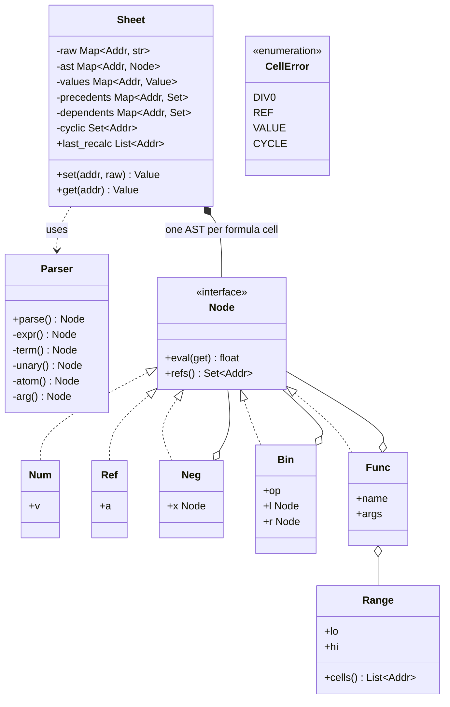

A formula is parsed **once**, when it is set, into an immutable AST; recalculation walks the tree and never re-parses text. Every node answers two questions: `eval` (its value, given a lookup for other cells) and `refs` (which cells it reads). `refs` is what builds the dependency graph, so the parser and the graph never drift apart: whatever the evaluator can read is, by construction, an edge. `Range` is not a `Node` because it is not a value on its own (`=A1:A3` alone is a syntax error); only functions accept it.

The sheet keeps the graph in **both directions**: `precedents[c]` (what `c` reads) is needed to remove `c`'s old edges when its formula changes and to detect cycles; `dependents[c]` (who reads `c`) is needed to find what to recompute after `c` changes. Values are cached in `values`, so reading a cell is O(1) and recomputation happens only on writes.

#### Key patterns used

| Pattern | Where | Why |
|---|---|---|
| Interpreter | AST node classes with `eval`, built by a recursive-descent `Parser` | One class per grammar rule; adding a function or operator is local |
| Composite | `Bin`, `Neg`, `Func` contain child nodes; `refs()` and `eval()` recurse | Uniform treatment of leaves and subtrees |
| Observer (as a graph) | `dependents` map drives recalculation | A cell does not know who reads it; the sheet notifies exactly the downstream cells, in order |
| Errors as values | `CellError` enum plus an internal `_Err` exception | Errors propagate through arbitrary nesting without every node checking every child; the exception never escapes `_evaluate` |

#### Important flow: set a cell

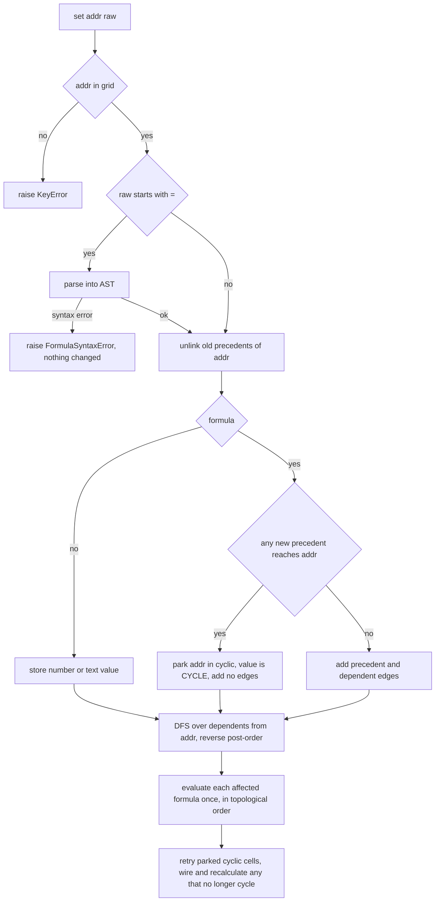

The recalculation order on the demo's sheet after `set("A1", "11")`:

```text
A1 -> B1 (=A1+A2*2), B2 (=SUM(A1:A3)), B3, B4, B5 (all read A1)
B1, B2 -> C1 (=B1+B2) -> C2 (=C1*2)
B1..B5 -> B6 (=SUM(A1:B5))
D1 (=A3) does not read A1 and is not touched

last_recalc: B5 B4 B3 B2 B1 C1 C2 B6   (C1 after B1 and B2; C2 after C1; B6 after B1..B5)
```

Reverse post-order of a DFS over `dependents` is a topological order of the affected subgraph, so every cell is evaluated after all of its affected precedents, and each exactly once. Naive "recompute each dependent recursively when notified" evaluates `C2` twice (once via `B1`, once via `B2`) and, worse, can evaluate it the first time with a stale `B2`; on a diamond-shaped sheet that is exponential.

#### Concurrency and failure concerns

- **Single writer per sheet:** an edit triggers a recalculation that must see a consistent graph, so edits are applied one at a time. In a collaborative product the server orders edits per sheet (one owner per sheet id) and broadcasts the resulting values; clients never recalculate authoritative values concurrently.
- **Atomicity of `set`:** parsing happens before any state changes, so a syntax error leaves the old formula, edges, and values intact. The cycle check runs before edges are added, so the graph is never cyclic and the DFS in `_recalc` always terminates.
- **Cycle recovery without a global rescan:** parked cells are retried after each edit. The parked set is tiny in practice (users fix cycles quickly), so the retry costs O(parked x graph reach) and avoids rescanning the whole sheet.
- **Ranges expand to cells:** `SUM(A1:A100000)` adds 100,000 edges. Production engines store range dependencies as intervals in an interval tree or per-column index, and look up "which ranges contain the changed cell" instead.
- **Deep chains:** `A2 = A1 + 1, A3 = A2 + 1, ...` down 100,000 rows makes the recursive DFS exceed Python's recursion limit; production code uses an iterative DFS or Kahn's algorithm over the affected subgraph.
- **Large recalculations can be parallelized** by topological level: all cells whose precedents are done can be evaluated concurrently, which is what Excel's multithreaded calculation does.

#### Reference implementation (Python 3)

A tokenizer and recursive-descent parser for the grammar in the `Parser` docstring, six frozen dataclass AST nodes with `eval` and `refs`, and a `Sheet` with two-way dependency maps, cycle detection by reachability over precedents, and DFS-based topological recalculation that records its order in `last_recalc`. The demo checks precedence, ranges, all four functions, text in ranges, the exact recalculation set and order after an edit, three kinds of cycles and their recovery, propagation and recovery of `#DIV/0!`, `#REF!`, `#VALUE!`, and rejection of bad input with the cell left untouched. Simplified: ranges are expanded cell by cell, and the DFS is recursive.

```python
"""spreadsheet.py -- run: python3 spreadsheet.py (the asserts in main() are the tests)"""
from __future__ import annotations

import operator
import re
from dataclasses import dataclass
from enum import Enum
from functools import reduce
from typing import Callable, Union


class CellError(Enum):
    DIV0 = "#DIV/0!"
    REF = "#REF!"
    VALUE = "#VALUE!"
    CYCLE = "#CYCLE!"


Value = Union[float, str, CellError]


class FormulaSyntaxError(ValueError):
    pass


class _Err(Exception):
    """Internal: unwinds evaluation; args[0] is the CellError that becomes the cell's value."""


def parse_addr(a: str) -> tuple[int, int]:
    m = re.fullmatch(r"([A-Z]+)([0-9]+)", a)
    if not m:
        raise FormulaSyntaxError(f"bad address {a!r}")
    return reduce(lambda col, ch: col * 26 + ord(ch) - 64, m.group(1), 0), int(m.group(2))


def addr(col: int, row: int) -> str:
    s = ""
    while col:
        col, r = divmod(col - 1, 26)
        s = chr(65 + r) + s
    return f"{s}{row}"


# ---- AST (Interpreter + Composite): every node evaluates itself and reports what it reads ----
Lookup = Callable[[str], Value]


@dataclass(frozen=True)
class Num:
    v: float
    def eval(self, get: Lookup) -> float: return self.v
    def refs(self) -> set[str]: return set()


@dataclass(frozen=True)
class Ref:
    a: str
    def eval(self, get: Lookup) -> float:
        v = get(self.a)
        if isinstance(v, CellError):
            raise _Err(v)                             # errors propagate through formulas
        if isinstance(v, str):
            raise _Err(CellError.VALUE)               # "abc" + 1
        return v
    def refs(self) -> set[str]: return {self.a}


@dataclass(frozen=True)
class Range:
    lo: str
    hi: str
    def cells(self) -> list[str]:
        (c1, r1), (c2, r2) = parse_addr(self.lo), parse_addr(self.hi)
        return [addr(c, r) for c in range(min(c1, c2), max(c1, c2) + 1)
                for r in range(min(r1, r2), max(r1, r2) + 1)]
    def refs(self) -> set[str]: return set(self.cells())


@dataclass(frozen=True)
class Neg:
    x: Num | Ref | Bin | Func | Neg
    def eval(self, get: Lookup) -> float: return -self.x.eval(get)
    def refs(self) -> set[str]: return self.x.refs()


@dataclass(frozen=True)
class Bin:
    op: str
    l: Num | Ref | Bin | Func | Neg
    r: Num | Ref | Bin | Func | Neg
    def eval(self, get: Lookup) -> float:
        a, b = self.l.eval(get), self.r.eval(get)
        if self.op == "/" and b == 0:
            raise _Err(CellError.DIV0)
        return OPS[self.op](a, b)
    def refs(self) -> set[str]: return self.l.refs() | self.r.refs()


@dataclass(frozen=True)
class Func:
    name: str
    args: tuple[Num | Ref | Bin | Func | Neg | Range, ...]
    def eval(self, get: Lookup) -> float:
        nums: list[float] = []
        for a in self.args:
            if isinstance(a, Range):
                for c in a.cells():
                    v = get(c)
                    if isinstance(v, CellError):
                        raise _Err(v)
                    if isinstance(v, float):          # text in a range is skipped, like Excel
                        nums.append(v)
            else:
                nums.append(a.eval(get))
        if self.name == "SUM":
            return sum(nums)
        if self.name == "AVG":
            if not nums:
                raise _Err(CellError.DIV0)
            return sum(nums) / len(nums)
        return (min if self.name == "MIN" else max)(nums) if nums else 0.0
    def refs(self) -> set[str]: return set().union(*(a.refs() for a in self.args))


Node = Num | Ref | Bin | Func | Neg
OPS = {"+": operator.add, "-": operator.sub, "*": operator.mul, "/": operator.truediv}
FUNCS = {"SUM", "AVG", "MIN", "MAX"}
TOKEN = re.compile(r"\s*(?:(\d+(?:\.\d+)?)|([A-Z]+[0-9]+)|([A-Z]+)|(.))")


class Parser:
    """expr := term (('+'|'-') term)* ; term := unary (('*'|'/') unary)* ;
    unary := '-' unary | atom ; atom := NUM | REF | FUNC '(' arg (',' arg)* ')' | '(' expr ')' ;
    arg := REF ':' REF | expr"""

    def __init__(self, src: str) -> None:
        self.toks: list[tuple[str, str]] = [   # (kind, text)
            ("num" if m[1] else "ref" if m[2] else "name" if m[3] else "op", m[0].strip())
            for m in TOKEN.finditer(src.upper()) if m[0].strip()]
        self.i = 0

    def parse(self) -> Node:
        node = self.expr()
        if self.i != len(self.toks):
            raise FormulaSyntaxError(f"unexpected {self.toks[self.i][1]!r}")
        return node

    def peek(self) -> str:
        return self.toks[self.i][1] if self.i < len(self.toks) else ""

    def take(self, expected: str | None = None) -> tuple[str, str]:
        if self.i >= len(self.toks) or (expected and self.toks[self.i][1] != expected):
            raise FormulaSyntaxError(f"expected {expected or 'more input'}")
        self.i += 1
        return self.toks[self.i - 1]

    def expr(self) -> Node:
        node = self.term()
        while self.peek() in ("+", "-"):
            node = Bin(self.take()[1], node, self.term())
        return node

    def term(self) -> Node:
        node = self.unary()
        while self.peek() in ("*", "/"):
            node = Bin(self.take()[1], node, self.unary())
        return node

    def unary(self) -> Node:
        if self.peek() == "-":
            self.take()
            return Neg(self.unary())
        return self.atom()

    def atom(self) -> Node:
        kind, text = self.take()
        if kind == "num":
            return Num(float(text))
        if kind == "ref":
            return Ref(text)
        if kind == "name" and text in FUNCS:
            self.take("(")
            args = [self.arg()]
            while self.peek() == ",":
                self.take()
                args.append(self.arg())
            self.take(")")
            return Func(text, tuple(args))
        if text == "(":
            node = self.expr()
            self.take(")")
            return node
        raise FormulaSyntaxError(f"unexpected {text!r}")

    def arg(self) -> Node | Range:
        if self.i + 2 < len(self.toks) and self.toks[self.i][0] == "ref" and self.toks[self.i + 1][1] == ":":
            lo = self.take()[1]
            self.take(":")
            kind, hi = self.take()
            if kind != "ref":
                raise FormulaSyntaxError("bad range")
            return Range(lo, hi)
        return self.expr()


class Sheet:
    def __init__(self, cols: int = 26, rows: int = 100) -> None:
        self.cols, self.rows = cols, rows
        self.raw: dict[str, str] = {}
        self.ast: dict[str, Node] = {}
        self.values: dict[str, Value] = {}
        self.precedents: dict[str, set[str]] = {}     # cell -> cells it reads
        self.dependents: dict[str, set[str]] = {}     # cell -> cells that read it
        self.cyclic: set[str] = set()                 # formulas parked outside the graph
        self.last_recalc: list[str] = []              # evaluation order of the last edit

    def _in_grid(self, a: str) -> bool:
        c, r = parse_addr(a)
        return 1 <= c <= self.cols and 1 <= r <= self.rows

    def get(self, a: str) -> Value:
        return self.values.get(a, 0.0)                # empty cells read as 0

    def set(self, a: str, raw: str) -> Value:
        if not self._in_grid(a):
            raise KeyError(a)
        node = Parser(raw[1:]).parse() if raw.startswith("=") else None   # syntax errors raise here,
        self._unlink(a)                                                   # before any state changes
        self.raw[a] = raw
        self.ast.pop(a, None)
        if node is not None:
            self.ast[a] = node
            self._wire(a)
        elif raw == "":
            self.values.pop(a, None)
        else:
            try:
                self.values[a] = float(raw)
            except ValueError:
                self.values[a] = raw                  # text
        self._recalc(a)
        for c in sorted(self.cyclic - {a}):           # an edit may have broken an earlier cycle
            self._unlink(c)
            if self._wire(c):
                self._recalc(c)
        return self.get(a)

    def _wire(self, a: str) -> bool:
        reads = self.ast[a].refs()
        if self._reaches(reads, a):                   # a reads something that (transitively) reads a
            self.cyclic.add(a)
            self.values[a] = CellError.CYCLE          # parked: its edges never enter the graph
            return False
        self.precedents[a] = reads
        for r in reads:
            self.dependents.setdefault(r, set()).add(a)
        return True

    def _unlink(self, a: str) -> None:
        self.cyclic.discard(a)
        for r in self.precedents.pop(a, set()):
            self.dependents[r].discard(a)

    def _reaches(self, starts: set[str], target: str) -> bool:
        stack, seen = list(starts), set()
        while stack:
            c = stack.pop()
            if c == target:
                return True
            if c not in seen:
                seen.add(c)
                stack.extend(self.precedents.get(c, ()))
        return False

    def _recalc(self, changed: str) -> None:
        """Re-evaluate only cells downstream of `changed`, each once, in topological order."""
        order: list[str] = []
        seen: set[str] = set()
        def visit(c: str) -> None:                    # recursion depth = longest chain (fine here)
            seen.add(c)
            for d in sorted(self.dependents.get(c, ())):   # sorted: same order on every run
                if d not in seen:
                    visit(d)
            order.append(c)                           # post-order: after everything downstream
        visit(changed)
        order.reverse()                               # reverse post-order = topological order
        self.last_recalc = [c for c in order if c in self.ast]
        for c in self.last_recalc:
            if c not in self.cyclic:                  # a parked cell keeps #CYCLE!
                self.values[c] = self._evaluate(self.ast[c])

    def _evaluate(self, node: Node) -> Value:
        if any(not self._in_grid(r) for r in node.refs()):
            return CellError.REF
        try:
            return float(node.eval(self.get))
        except _Err as e:
            return e.args[0]


def main() -> None:
    s = Sheet(cols=8, rows=20)

    # 1) Numbers, text, precedence, functions, and ranges.
    s.set("A1", "10"); s.set("A2", "20"); s.set("A3", "30"); s.set("A4", "label")
    assert s.set("B1", "=A1+A2*2") == 50.0
    assert s.set("B2", "=SUM(A1:A3)") == 60.0 and s.set("B3", "=AVG(A1:A3, 90)") == 37.5
    assert s.set("B4", "=MAX(A1:A3)-MIN(A3:A1)") == 20.0 and s.set("B5", "=-(A1-4)/2") == -3.0
    assert s.get("A4") == "label" and s.set("B6", "=SUM(A1:B5)") == 60 + 50 + 60 + 37.5 + 20 - 3

    # 2) Incremental recalculation: only downstream cells, each once, precedents first.
    s.set("C1", "=B1+B2"); s.set("C2", "=C1*2"); s.set("D1", "=A3")
    s.set("A1", "11")
    order = s.last_recalc
    assert set(order) == {"B1", "B2", "B3", "B4", "B5", "B6", "C1", "C2"} and "D1" not in order
    assert order.index("B1") < order.index("C1") < order.index("C2") and order.index("B2") < order.index("B6")
    assert s.get("C2") == 2 * (51 + 61) and s.get("B6") == 226.25

    # 3) Cycles: the edit is flagged #CYCLE!, other cells keep correct values, graph stays a DAG.
    assert s.set("A1", "=C2") == CellError.CYCLE
    assert s.get("C2") == CellError.CYCLE and s.get("D1") == 30.0   # error propagates downstream only
    assert s.set("E1", "=E1+1") == CellError.CYCLE                  # self-reference
    s.set("A1", "5")                                                # replacing the formula heals it
    assert s.get("C2") == 2 * (45 + 55) and "A1" not in s.cyclic
    s.set("F1", "=F2"); assert s.set("F2", "=F1") == CellError.CYCLE
    s.set("F1", "7")                                                # breaking the cycle elsewhere
    assert s.get("F2") == 7.0 and not s.cyclic - {"E1"}              # the parked cell recovers

    # 4) Error propagation: #DIV/0!, #REF! (outside the 8x20 grid), #VALUE! (text in arithmetic).
    assert s.set("G1", "=A1/(A2-20)") == CellError.DIV0
    assert s.set("G2", "=G1+1") == CellError.DIV0 and s.set("G3", "=SUM(G1:G2)") == CellError.DIV0
    s.set("A2", "25")
    assert s.get("G1") == 1.0 and s.get("G3") == 3.0                 # recovers when the cause is fixed
    assert s.set("G4", "=Z99+1") == CellError.REF
    assert s.set("G5", "=A4*2") == CellError.VALUE and s.set("G6", "=AVG(A4:A4)") == CellError.DIV0

    # 5) Syntax errors and off-grid cells are rejected at the boundary; the cell is untouched.
    for cell, bad in (("A3", "=1+"), ("A3", "=SUM(A1:)"), ("A3", "=FOO(1)"), ("A3", "=(1"), ("Z1", "1")):
        try:
            s.set(cell, bad)
            raise AssertionError(f"accepted {bad}")
        except (FormulaSyntaxError, KeyError):
            pass
    assert s.get("A3") == 30.0 and s.raw["A3"] == "30"
    print("all spreadsheet checks passed")


if __name__ == "__main__":
    main()
```

What to point out while presenting this code:

- **The cycle check is reachability over precedents:** the new formula for `a` closes a cycle exactly when one of the cells it reads already (transitively) reads `a`. That is one DFS bounded by the upstream cone of the new references, not a scan of the sheet.
- **`_Err` is an exception internally and a value externally.** Raising it lets an error unwind through any depth of nested expressions without every node checking every child, and `_evaluate` converts it back into a `CellError` value so the sheet never sees an exception from evaluation.
- **Test 2 asserts the recalculation set as well as the order:** `D1` reads `A3`, not `A1`, and is not in `last_recalc`. That is the "incremental" claim made checkable.

#### Extension questions

- **"Insert a row above row 5":** every reference to row 5 or below shifts down by one, in every formula on the sheet. Rewrite the ASTs (a Visitor over `Ref` and `Range`), re-key `values`, `precedents`, and `dependents`, and turn references into deleted rows into `#REF!`. This is why real engines store references relative to the formula's own cell.
- **"Add `NOW()` and `RAND()`":** volatile functions have no precedents but must recompute on every recalculation. Keep a set of volatile cells and seed every recalculation's DFS with them in addition to the edited cell.
- **"The sheet has 10 million cells; editing A1 recalculates for 3 seconds":** switch to lazy evaluation: an edit only marks downstream cells dirty (one DFS over `dependents`), and a dirty cell is evaluated when it is displayed or read, memoized per recalculation. Combined with recalculating only the visible viewport first, the user sees updates immediately.
- **"Add undo":** an edit is a command whose inverse is "set the previous raw string"; the recalculation machinery does the rest. Undoing a cycle-creating edit works for free because `set` handles the transition both ways.

#### Interview Q&A

**Q1.** Why keep both `precedents` and `dependents`, when one is the transpose of the other?

**A1.** They serve different operations, and each must be fast. When a cell's formula changes, its old outgoing edges must be removed: that needs `precedents[cell]`, otherwise you would scan every cell's dependent set. When a value changes, the sheet must find everything downstream: that needs `dependents[cell]`. Cycle detection also walks `precedents` from the new references. Keeping both doubles memory for edges, but every operation touches only the cells involved, and `_wire` and `_unlink` are the only two places that update them, always together.

**Q2.** How do you detect a cycle, and why not just add the edges and let evaluation hit the cycle?

**A2.** Before adding edges for `a = f(r1, r2, ...)`, run a DFS from `r1, r2, ...` along `precedents`; if it reaches `a`, the formula would close a cycle. If the edges were added anyway, the graph would no longer be a DAG: the topological DFS would no longer produce a valid order, every later recalculation through that region would need cycle handling, and an evaluate-on-read design would recurse forever. Parking the cell outside the graph keeps the invariant "the graph is acyclic" true at all times, which is what keeps every other algorithm simple; the cost is the small retry loop that re-wires parked cells when the cycle is broken elsewhere.

**Q3.** Why topological recalculation instead of evaluating cells recursively on read with memoization?

**A3.** Both are correct; they differ in when work happens. Eager topological recalculation (this design) makes reads O(1) and does exactly the affected work once per edit, which suits small and medium sheets and makes "which cells changed" available for the UI to repaint. Lazy evaluation marks cells dirty and computes on read, which wins when most affected cells are never looked at (huge sheets, off-screen cells). What must be avoided is the third option, recursive push without ordering, which evaluates diamond-shaped dependencies multiple times and can observe a stale precedent mid-update.

**Q4.** How does the grammar encode operator precedence?

**A4.** By nesting rules from lowest to highest precedence: `expr` handles `+` and `-` and calls `term`, which handles `*` and `/` and calls `unary`, which handles leading minus and calls `atom`. Because `term` is fully parsed before `expr` looks for the next `+`, `A1+A2*2` becomes `Bin(+, A1, Bin(*, A2, 2))`. Left associativity (`10-4-3` is `(10-4)-3`) comes from the loops that fold each new operand into the left-hand node, rather than recursing on the right.

See also: [Interpreter pattern](../design-patterns/Design_Patterns_Python.md#18-interpreter), [Composite pattern](../design-patterns/Design_Patterns_Python.md#11-composite), [Topological sort](../computer-science/LeetCode_Patterns.md#14-topological-sort), [KV store with transactions](../design-patterns/Low_Level_Design_Interview_Prep.md#24-worked-design-in-memory-key-value-store-with-transactions).

---

### A10. Chat Application (WhatsApp)

#### Requirements and assumptions

- Users register once; a connected user has one device connection (multi-device is an extension).
- Conversations are direct (exactly two members, fixed, one per pair) or groups. A group's creator is its first admin; only admins add members, remove others, or promote. Anyone may leave; if the last admin leaves, the member with the smallest id is promoted so a group is never adminless.
- `send` assigns a per-conversation sequence number under the conversation's lock, stores the message, and then fans out to the members at that moment. A member added later receives messages sent after joining; whether they may read older history is a product decision (the reference `history` returns the whole log to any current member).
- Delivery status per recipient: `SENT` (stored), `DELIVERED` (the device acknowledged the push), `READ` (the recipient opened the conversation past that sequence number). Status only moves forward. The sender sees the aggregate, the minimum over recipients, and is told only when the aggregate changes.
- Offline recipients get their messages from a per-user queue, in order, on `connect`. A push that fails marks the user offline and queues the message, so a dead socket loses nothing.
- `send` is idempotent on `(sender, client_msg_id)`: a client that retries after losing the acknowledgment gets the original message back, and nobody receives a duplicate.
- Out of scope: media, encryption, push notifications to phones, presence, and persistence (the dicts stand in for tables).

#### Core model

```mermaid
classDiagram
    class ChatServer {
        +register(user)
        +connect(user, conn) int
        +disconnect(user)
        +direct(a, b) ConvId
        +create_group(creator, members) ConvId
        +add_member(actor, convId, user)
        +remove_member(actor, convId, user)
        +promote(actor, convId, user)
        +send(sender, convId, clientMsgId, body) Message
        +mark_read(user, convId, upToSeq) int
        +history(user, convId, afterSeq) List~Message~
        -online Map~User, Connection~
        -offline Map~User, Deque~
        -dedupe Map~Key, Message~
    }
    class Conversation {
        +id
        +kind Kind
        +members Set
        +admins Set
        +log List~Message~
    }
    class Message {
        +id
        +conv_id
        +seq
        +sender
        +client_msg_id
        +body
        +sent_at
        +status Map~User, Status~
        +aggregate() Status
    }
    class Status {
        <<enumeration>>
        SENT
        DELIVERED
        READ
    }
    class Receipt {
        +message_id
        +status
    }
    class Connection {
        <<interface>>
        +push(event) bool
    }
    ChatServer *-- Conversation
    Conversation *-- Message
    Message --> Status
    ChatServer --> Connection : routes Message and Receipt
    ChatServer ..> Receipt : emits
```

The server is a **mediator**: clients never hold references to each other. A client sends to the server, and the server decides who receives what, records delivery, and reports receipts back. That keeps membership checks, ordering, and deduplication in one place. The `Connection` protocol is the seam to the network: in production it is a gateway's handle on a WebSocket, and `push` appends to that socket's outbox; in the tests it is a fake device that can be told to drop.

The modeling choice that matters most is where status lives. Here each `Message` carries a `status` map with one entry per recipient, which makes per-recipient state explicit and the aggregation rule a one-liner. It costs O(recipients) per message; the scaling alternative (per-member delivery and read cursors) is discussed below and in Q3.

#### Key patterns used

| Pattern | Where | Why |
|---|---|---|
| Mediator | `ChatServer` between all clients | Routing, membership, ordering, and dedupe are centralized; clients stay simple |
| Observer | Receipts pushed to the sender when the aggregate status changes | The sender's UI updates ticks without polling |
| State (monotonic) | `Status` as an `IntEnum`, `_set_status` refuses to move backwards | Late, duplicate, or reordered receipts are harmless; the merge is a max |
| Idempotency key | `(sender, client_msg_id)` dedupe map | At-least-once sending from clients without duplicate messages |
| Store and forward | Per-user offline queue drained on `connect` | Delivery survives disconnection and dead sockets |

#### Important flow: group send with an offline member, then receipts

```mermaid
sequenceDiagram
    autonumber
    actor A as ann (sender)
    participant S as ChatServer
    participant B as bob device (online)
    participant C as cat device (offline)
    A->>S: send(g1, client id c2, "lunch?")
    S->>S: lock, dedupe check, seq = 1, append to log, status bob SENT, cat SENT
    S->>B: push message 1
    B-->>S: ack (push returned True)
    S->>S: bob DELIVERED, aggregate still SENT (cat), no receipt
    S->>S: cat offline, append message 1 to cat queue
    S-->>A: message 1 (one tick)
    A->>S: retry send(g1, c2) after a lost ack
    S-->>A: same message 1, no fan-out
    C->>S: connect(cat)
    S->>C: push message 1 from the queue, in order
    S->>S: cat DELIVERED, aggregate becomes DELIVERED
    S->>A: Receipt(message 1, DELIVERED), two ticks
    B->>S: mark_read(bob, g1, 1)
    C->>S: mark_read(cat, g1, 1)
    S->>A: Receipt(message 1, READ), blue ticks
```

The sender hears about a message exactly when its aggregate changes: never for bob's individual delivery (cat still had one tick), once when cat's device acknowledged, and once when the last reader read. Step 2 persists before any fan-out, so the "one tick" the sender sees means "durably stored", and a crash during fan-out leaves only undelivered entries, which reconnecting clients pick up from history.

#### Concurrency and failure concerns

- **Ordering:** the sequence number is assigned and the message appended under the same lock, so sequence numbers per conversation are gapless and match log order. Pushes also happen under the lock, which here is an in-memory append to a connection outbox, so each device receives a conversation's messages in sequence order. Clients still sort and dedupe by `seq`, because across reconnects (queue flush plus a history fetch) the same message can arrive twice.
- **Lock scope:** the reference uses one lock for the whole server, which is enough for one process. In production the ordering authority is per conversation: route each conversation id to one partition owner, or allocate the next sequence number with a conditional write (`UPDATE conversation SET next_seq = next_seq + 1 WHERE id = ? RETURNING next_seq`) in the same transaction as the message insert.
- **At-least-once delivery, exactly-once effect:** a push can be delivered and its acknowledgment lost; the server then re-sends on reconnect, and the client drops the duplicate by message id. True exactly-once delivery across a network is not achievable; idempotent receivers make at-least-once look like exactly-once.
- **Dead sockets:** `push` returning False removes the user from `online` and queues the message. A real gateway detects this by missed heartbeats or write errors; until it does, messages pushed into a dead socket must stay unacknowledged, which is why `DELIVERED` comes from the device's ack, not from the server's write.
- **Receipts are a monotonic merge:** status per recipient is a max over `SENT < DELIVERED < READ`, so receipts can be retried, duplicated, or reordered without corrupting state, a small CRDT.
- **Dedupe memory:** the `(sender, client_msg_id)` map grows forever here. In production it is a unique index on the messages table, or a TTL cache sized for the client's retry horizon (minutes to days).
- **Large groups:** a 1,000-member group creates 1,000 status entries per message and up to 1,000 receipts. The cursor design in Q3 replaces this with O(members) state per conversation.

#### Reference implementation (Python 3)

A `ChatServer` mediator with conversations, an offline queue per user, a dedupe map, monotonic status updates, and receipts pushed to senders on aggregate changes. The `Connection` protocol has one method, `push(event) -> bool`, and `FakeDevice` records what it receives and can simulate a dead socket. The demo covers direct chats, offline delivery in order, read-receipt aggregation, duplicate send, admin and membership rules, a dropped connection, and 8 threads sending 400 messages to one group with gapless sequence numbers and per-sender order. Simplified: one lock for the whole server and in-memory storage.

```python
"""chat.py -- run: python3 chat.py (the asserts in main() are the tests)"""
from __future__ import annotations

import threading
from collections import defaultdict, deque
from dataclasses import dataclass, field
from enum import Enum, IntEnum
from typing import Callable, Protocol


class Status(IntEnum):        # ordered: a status only ever moves forward
    SENT = 1                  # one tick: stored on the server
    DELIVERED = 2             # two ticks: on every recipient's device
    READ = 3                  # blue ticks: every recipient opened it


class Kind(Enum):
    DIRECT = "direct"
    GROUP = "group"


@dataclass
class Message:
    id: str
    conv_id: str
    seq: int                  # per-conversation order; clients sort and dedupe by it
    sender: str
    client_msg_id: str
    body: str
    sent_at: float
    status: dict[str, Status] = field(default_factory=dict)   # per recipient

    def aggregate(self) -> Status:
        """What the sender sees: the least-advanced recipient wins."""
        return min(self.status.values(), default=Status.READ)


@dataclass(frozen=True)
class Receipt:
    message_id: str
    status: Status


@dataclass
class Conversation:
    id: str
    kind: Kind
    members: set[str]
    admins: set[str]
    log: list[Message] = field(default_factory=list)


class Connection(Protocol):   # a gateway's handle on one device socket
    def push(self, event: Message | Receipt) -> bool: ...     # True = device acknowledged


class ChatServer:
    """Mediator: clients never talk to each other; the server routes, stores, and tracks receipts."""

    def __init__(self, clock: Callable[[], float]) -> None:
        self._clock = clock
        self._lock = threading.Lock()     # one lock for the model; per-conversation shards in production
        self._users: set[str] = set()
        self._convs: dict[str, Conversation] = {}
        self._online: dict[str, Connection] = {}
        self._offline: dict[str, deque[Message]] = defaultdict(deque)
        self._dedupe: dict[tuple[str, str], Message] = {}      # (sender, client_msg_id) -> message
        self._groups = 0

    def register(self, user: str) -> None:
        with self._lock:
            self._users.add(user)

    def connect(self, user: str, conn: Connection) -> int:
        """Attach a device and flush its offline queue in order. Returns messages delivered."""
        with self._lock:
            self._require_user(user)
            self._online[user] = conn
            q, n = self._offline[user], 0
            while q and user in self._online:
                if not self._push(user, q[0]):
                    break                  # dropped again mid-flush: the rest stays queued
                self._set_status(q.popleft(), user, Status.DELIVERED)
                n += 1
            return n

    def disconnect(self, user: str) -> None:
        with self._lock:
            self._online.pop(user, None)

    def direct(self, a: str, b: str) -> str:
        with self._lock:
            self._require_user(a); self._require_user(b)
            if a == b:
                raise ValueError("cannot message yourself")
            cid = "dm:" + ":".join(sorted((a, b)))             # deterministic: one chat per pair
            self._convs.setdefault(cid, Conversation(cid, Kind.DIRECT, {a, b}, set()))
            return cid

    def create_group(self, creator: str, members: set[str]) -> str:
        with self._lock:
            for u in members | {creator}:
                self._require_user(u)
            self._groups += 1
            cid = f"g{self._groups}"
            self._convs[cid] = Conversation(cid, Kind.GROUP, members | {creator}, {creator})
            return cid

    def add_member(self, actor: str, cid: str, user: str) -> None:
        with self._lock:
            conv = self._admin_only(actor, cid)
            self._require_user(user)
            conv.members.add(user)         # sees messages sent from now on, not history

    def remove_member(self, actor: str, cid: str, user: str) -> None:
        with self._lock:
            conv = self._conv(cid)
            if actor != user:              # anyone may leave; only admins may remove others
                self._admin_only(actor, cid)
            conv.members.discard(user)
            conv.admins.discard(user)
            if conv.members and not conv.admins:
                conv.admins.add(min(conv.members))             # never leave a group without an admin

    def promote(self, actor: str, cid: str, user: str) -> None:
        with self._lock:
            conv = self._admin_only(actor, cid)
            if user not in conv.members:
                raise ValueError(f"{user} is not a member")
            conv.admins.add(user)

    def send(self, sender: str, cid: str, client_msg_id: str, body: str) -> Message:
        """Idempotent on (sender, client_msg_id): a retry after a lost ack returns the original."""
        if not body:
            raise ValueError("empty message")
        with self._lock:
            if (sender, client_msg_id) in self._dedupe:
                return self._dedupe[(sender, client_msg_id)]
            conv = self._conv(cid)
            if sender not in conv.members:
                raise PermissionError(f"{sender} is not in {cid}")
            seq = len(conv.log) + 1        # assigned under the lock: no gaps, no duplicates
            msg = Message(f"{cid}#{seq}", cid, seq, sender, client_msg_id, body, self._clock(),
                          {u: Status.SENT for u in conv.members - {sender}})
            conv.log.append(msg)           # persist before fan-out (the durable "one tick")
            self._dedupe[(sender, client_msg_id)] = msg
            for user in sorted(msg.status):
                if self._push(user, msg):
                    self._set_status(msg, user, Status.DELIVERED)
                else:
                    self._offline[user].append(msg)
            return msg

    def mark_read(self, user: str, cid: str, up_to_seq: int) -> int:
        """Reader opened the chat: everything up to `up_to_seq` from others becomes READ."""
        with self._lock:
            conv = self._conv(cid)
            n = 0
            for msg in conv.log[:up_to_seq]:
                if user in msg.status and msg.status[user] < Status.READ:
                    self._set_status(msg, user, Status.READ)
                    n += 1
            return n

    def history(self, user: str, cid: str, after_seq: int = 0) -> list[Message]:
        with self._lock:                   # resume cursor for reconnecting clients
            conv = self._conv(cid)
            if user not in conv.members:
                raise PermissionError(f"{user} is not in {cid}")
            return conv.log[after_seq:]

    # ---- internals (caller holds the lock) ----
    def _push(self, user: str, event: Message | Receipt) -> bool:
        conn = self._online.get(user)
        if conn is None:
            return False
        if conn.push(event):              # in-memory append to the gateway's outbox, not socket I/O
            return True
        self._online.pop(user, None)      # dead socket: treat the device as offline
        return False

    def _set_status(self, msg: Message, user: str, status: Status) -> None:
        if status <= msg.status[user]:
            return                         # late or duplicate receipt: never move backwards
        before = msg.aggregate()
        msg.status[user] = status
        if msg.aggregate() != before:      # Observer: tell the sender only when the ticks change
            self._push(msg.sender, Receipt(msg.id, msg.aggregate()))

    def _require_user(self, user: str) -> None:
        if user not in self._users:
            raise KeyError(f"unknown user {user}")

    def _conv(self, cid: str) -> Conversation:
        if cid not in self._convs:
            raise KeyError(f"unknown conversation {cid}")
        return self._convs[cid]

    def _admin_only(self, actor: str, cid: str) -> Conversation:
        conv = self._conv(cid)
        if conv.kind is not Kind.GROUP:
            raise ValueError("membership of a direct chat is fixed")
        if actor not in conv.admins:
            raise PermissionError(f"{actor} is not an admin of {cid}")
        return conv


class FakeDevice:
    def __init__(self) -> None:
        self.messages: list[Message] = []
        self.receipts: list[Receipt] = []
        self.drop = False                  # simulate a dead socket

    def push(self, event: Message | Receipt) -> bool:
        if self.drop:
            return False
        if isinstance(event, Message):
            self.messages.append(event)
        else:
            self.receipts.append(event)
        return True


def main() -> None:
    now = [1000.0]
    srv = ChatServer(lambda: now[0])
    dev = {u: FakeDevice() for u in ("ann", "bob", "cat", "dan")}
    for u in dev:
        srv.register(u)
    for u in ("ann", "bob"):
        srv.connect(u, dev[u])

    # 1) Direct chat: one id per pair; online delivery gives two ticks immediately.
    dm = srv.direct("ann", "bob")
    assert srv.direct("bob", "ann") == dm
    m = srv.send("ann", dm, "c1", "hi bob")
    assert dev["bob"].messages == [m] and m.aggregate() is Status.DELIVERED
    assert dev["ann"].receipts == [Receipt(m.id, Status.DELIVERED)]

    # 2) Group with an offline member: one tick until cat reconnects, then two ticks.
    g = srv.create_group("ann", {"bob", "cat"})
    m1 = srv.send("ann", g, "c2", "lunch?")
    m2 = srv.send("bob", g, "c3", "yes")
    assert (m1.seq, m2.seq) == (1, 2) and m1.aggregate() is Status.SENT
    assert srv.connect("cat", dev["cat"]) == 2
    assert [x.seq for x in dev["cat"].messages] == [1, 2]     # queued order preserved
    assert m1.aggregate() is Status.DELIVERED and Receipt(m1.id, Status.DELIVERED) in dev["ann"].receipts

    # 3) Read receipts aggregate: blue ticks only after every recipient has read.
    assert srv.mark_read("bob", g, 2) == 1                    # bob's own message is not counted
    assert m1.aggregate() is Status.DELIVERED
    assert srv.mark_read("cat", g, 2) == 2
    assert m1.aggregate() is Status.READ and dev["ann"].receipts[-1] == Receipt(m1.id, Status.READ)
    assert srv.mark_read("cat", g, 2) == 0 and len(dev["ann"].receipts) == 3   # repeat is a no-op

    # 4) Idempotent send: a retry with the same client id returns the original, no second copy.
    again = srv.send("ann", g, "c2", "lunch?")
    assert again is m1 and len(srv.history("ann", g)) == 2 and len(dev["bob"].messages) == 2

    # 5) Admin rules: members cannot add people; promoted members can; non-members cannot send.
    for call in (lambda: srv.add_member("bob", g, "dan"), lambda: srv.send("dan", g, "d1", "hey"),
                 lambda: srv.add_member("ann", dm, "dan")):
        try:
            call()
            raise AssertionError("allowed")
        except (PermissionError, ValueError):
            pass
    srv.promote("ann", g, "bob")
    srv.add_member("bob", g, "dan")
    srv.remove_member("ann", g, "ann")                        # the creator leaves; bob is still admin
    assert srv.history("dan", g, after_seq=2) == []

    # 6) A dropped socket: the push fails, dan is treated as offline, reconnect delivers.
    srv.connect("dan", dev["dan"])
    dev["dan"].drop = True
    m3 = srv.send("bob", g, "c4", "welcome dan")
    assert m3.status["dan"] is Status.SENT and m3.aggregate() is Status.SENT
    dev["dan"].drop = False
    assert srv.connect("dan", dev["dan"]) == 1 and m3.aggregate() is Status.DELIVERED

    # 7) Concurrency: 8 senders x 50 messages; seqs are gapless and per-sender order is kept.
    def burst(u: int) -> None:
        for i in range(50):
            srv.send("bob" if u % 2 else "cat", g, f"t{u}-{i}", f"{u}:{i}")
    threads = [threading.Thread(target=burst, args=(u,)) for u in range(8)]
    for t in threads:
        t.start()
    for t in threads:
        t.join()
    log = srv.history("bob", g)
    assert [x.seq for x in log] == list(range(1, 404))
    for u in range(8):
        mine = [int(x.body.split(":")[1]) for x in log if x.body.startswith(f"{u}:")]
        assert mine == list(range(50))
    assert [x.seq for x in dev["dan"].messages] == list(range(3, 404))   # pushed in seq order
    print("all chat checks passed")


if __name__ == "__main__":
    main()
```

What to point out while presenting this code:

- **`send` validates before mutating, and deduplicates before validating membership,** so a retry from a user who has since left the group still gets its original message back rather than a confusing permission error.
- **`_set_status` is the single place where status changes,** and it computes the aggregate before and after so it can emit exactly one receipt per tick change.
- **The concurrency test checks the two ordering guarantees that matter:** the log is `1..403` with no gaps or duplicates, and each sender's 50 messages appear in the order that sender sent them. It also checks that a connected device received the whole stream in sequence order.

#### Extension questions

- **"Multiple devices per user (phone, laptop, web)":** status per recipient becomes status per recipient device for delivery, while read is per user (reading on any device marks all). The aggregate for the sender's ticks is computed over each user's best device. `online` maps a user to a set of connections, and each device has its own delivery cursor.
- **"Edit and delete a message":** append an `Edit` or `Delete` event with its own sequence number that references the original message id, instead of mutating history; clients apply it when they reach that sequence number. Offline devices then converge by replaying the log, the same as for normal messages.
- **"Typing indicators and presence":** ephemeral, lossy, and high frequency: pushed only to currently connected members, never queued or persisted, and rate-limited (at most one typing event every few seconds).
- **"End-to-end encryption":** the server only routes ciphertext. Group messages are encrypted per recipient device (or with a group sender key), so the server can no longer search or moderate content, and history on a new device must come from another of the user's devices, not the server.

#### Interview Q&A

**Q1.** Why a per-conversation sequence number instead of ordering by timestamp?

**A1.** Timestamps from different senders come from different clocks, and even server timestamps can collide or go backwards across machines. Two messages sent in the same millisecond have no defined order, and a client cannot tell whether it has a gap. A sequence number assigned by one authority per conversation gives a total order that every member sees identically, makes gaps detectable (received 41 and 43, fetch 42), and doubles as a resume cursor: on reconnect a client asks for `history(after_seq = last_seen)`. Ordering is required only within a conversation, so the authority can be sharded by conversation id, with no global sequencer.

**Q2.** Walk through what makes `send` idempotent.

**A2.** The client generates `client_msg_id` (a UUID) once per message, before the first attempt, and reuses it on every retry. The server checks `(sender, client_msg_id)` before doing anything else; if it exists, it returns the stored message, with the same id and sequence number, and does not fan out again. The check and the insert happen under the same lock (or, with a database, a unique index on `(sender, client_msg_id)`, inserting and catching the conflict), so two concurrent retries cannot both create a message. Without it, the common mobile pattern of "send, lose connectivity before the ack, resend on reconnect" produces visible duplicates in the chat.

**Q3.** Storing a status for every recipient of every message is expensive for a 1,000-member group. What would you do?

**A3.** Store cursors instead of per-message state. For each `(conversation, member)` keep `delivered_seq` and `read_seq`, the highest sequence numbers delivered to and read by that member; because delivery and reading happen in sequence order, every message at or below the cursor has that status. A message's aggregate status is then derived: delivered to everyone if `min(delivered_seq over members) >= seq`, read by everyone if the minimum `read_seq` is. State is O(members) per conversation instead of O(messages x members), receipts become "advance my cursor to N" (one write that acknowledges many messages), and the minimum can be maintained incrementally. WhatsApp-scale systems also stop showing per-member read details for large groups at all.

**Q4.** Can the server guarantee that every message is delivered exactly once?

**A4.** It can guarantee that every message is delivered at least once and appears exactly once in the user's view. The server stores the message before acknowledging the sender and keeps it queued (or reachable from a delivery cursor) until the device acknowledges. If the acknowledgment is lost, the server delivers again, and the client deduplicates by message id or sequence number. Exactly-once transport is impossible when either side can crash between processing and acknowledging, so the design makes every step idempotent instead: idempotent send (client message id), idempotent delivery (dedupe by id), idempotent receipts (monotonic max).

See also: [HLD: Chat system](../computer-science/High_Level_Design.md#64-chat-system), [HLD mock: Chat system](HLD_Mock_Interviews.md#7-mock-4-chat-system), [Mediator pattern](../design-patterns/Design_Patterns_Python.md#20-mediator), [Pub-Sub message broker](../design-patterns/Low_Level_Design_Interview_Prep.md#20-worked-design-pub-sub-message-broker).

---

### A11. Social Media Feed (Twitter)

#### Requirements and assumptions

- Users post text of 1-280 characters. A post is an original, a reply (points at the post it answers), or a repost (points at the original; reposting a repost resolves to the original). One repost per user per original: a second request returns the existing repost id.
- The home timeline is the viewer's own posts plus the posts of everyone they follow, newest first, in pages of 1-100. It is generated at read time (fan-out on read); materializing it at write time is discussed below.
- Pagination uses an opaque cursor. Posts that arrive between page requests appear on the next fresh first page, never in the middle of an ongoing scroll.
- Visibility rules are evaluated at read time: mute hides an author from the viewer's timeline without unfollowing; block hides content in both directions, removes follow edges both ways, and forbids the blocked user from liking or replying. A reply is shown only if the viewer follows (or is) the person being replied to.
- Ranking is a pluggable strategy: reverse-chronological by default, engagement score as the alternative.
- Post ids are generated in-process from an injectable clock, sort by creation time, and stay unique if the clock stalls or steps backwards.
- Out of scope: persistence, media, search, notifications, and deletion (a tombstone filter is an extension).

#### Core model

```mermaid
classDiagram
    class FeedService {
        +add_users(uids)
        +follow(a, b)
        +unfollow(a, b)
        +mute(a, b)
        +block(a, b)
        +post(author, text, reply_to) int
        +repost(user, post_id) int
        +like(user, post_id) int
        +home_timeline(viewer, limit, cursor) Page
        +ranking
        -by_author
        -snapshots
    }
    class User {
        +id
        +following
        +blocked
        +muted
    }
    class Post {
        +id
        +author
        +kind
        +text
        +created_ms
        +ref
        +likes
        +replies
        +reposts
    }
    class Kind {
        <<enumeration>>
        ORIGINAL
        REPLY
        REPOST
    }
    class Page {
        +posts
        +next_cursor
    }
    class RankingStrategy {
        <<interface>>
        +streaming
        +rank(posts, now_ms) List~Post~
    }
    class ReverseChronological
    class EngagementScore {
        +gravity
        +score(post, now_ms) float
    }
    class SnowflakeIds {
        +next_id() int
    }
    class Clock {
        <<interface>>
        +now_ms() int
    }
    FeedService --> User
    FeedService --> Post
    FeedService --> RankingStrategy
    FeedService --> SnowflakeIds
    SnowflakeIds --> Clock
    Post --> Kind
    RankingStrategy <|.. ReverseChronological
    RankingStrategy <|.. EngagementScore
    FeedService ..> Page : returns
```

The central data structure is **`by_author`: one append-only list of post ids per author, sorted ascending**. Because ids are time-ordered (Snowflake style: milliseconds in the high bits, a sequence in the low bits), appending keeps each list sorted for free, a cursor is just an id, and "the newest post older than the cursor" is one `bisect`. The home timeline is then a k-way merge of the followees' lists, the same algorithm as merging k sorted arrays.

Replies and reposts are **one `Post` type with a `kind` and a `ref`**, not three subclasses: they store the same fields, and the only behavioral difference (visibility rules) lives in one function, `_visible`, that looks at both the post's author and the referenced post's author. Follow, mute, and block are sets on `User`, so every rule is an O(1) membership test during the merge.

#### Key patterns used

| Pattern | Where | Why |
|---|---|---|
| Strategy | `RankingStrategy` (`ReverseChronological`, `EngagementScore`) | Ranking changes often and independently of storage and pagination; swapped at runtime in the test |
| k-way merge with a heap | `_merge` | Newest-first across F sorted lists in O(F log n + k log F) for a page of k, without sorting everything |
| Snapshot cursor (Memento-like) | Ranked sessions in `_snapshots` | A ranked order is frozen once per scroll session so later pages cannot repeat or skip posts when scores move |
| Single visibility predicate | `_visible` | Mute, block (both directions), reply, and repost rules in one place, applied on every read path |
| Injected clock and id generator | `Clock`, `SnowflakeIds` | Deterministic ids and ages in tests; ids double as the pagination key |

#### Important flow: home timeline merge and pagination

```mermaid
flowchart TD
    A[home_timeline viewer, limit, cursor] --> B{ranking is streaming}
    B -- yes --> C[before = post id from cursor, or none]
    C --> D[for each followee and self, skipping muted and blocked: bisect for the newest id below before and push it on a max-heap]
    D --> E{heap not empty and page not full}
    E -- yes --> F[pop the newest id]
    F --> G{visible to viewer}
    G -- yes --> H[append to page]
    G -- no --> I[skip it]
    H --> J[push the next older id of the same author]
    I --> J
    J --> E
    E -- no --> K[next_cursor = id of last post if the page is full]
    B -- no --> L{cursor given}
    L -- no --> M[merge the newest 200 candidates, rank them, store the id list under a new token]
    L -- yes --> N[look up the snapshot and offset for the token]
    M --> O[slice limit ids from offset and re-check visibility]
    N --> O
```

The cursor is the id of the last post served, so the next page asks every author list for ids strictly below it. New posts always get larger ids, so they can never land in the middle of an ongoing scroll. Offset pagination fails exactly here:

```text
ann follows bob and cat; posts in id order: b1 c1 b2 a1 c2

id cursor (this design)                    offset pagination
page 1 (limit 2): c2 a1   cursor = id(a1)  page 1: items 0-1 = c2 a1
bob posts b3              id(b3) > id(c2)  bob posts b3; list is now b3 c2 a1 b2 c1 b1
page 2: b2 c1             cursor = id(c1)  page 2: items 2-3 = a1 b2   <- a1 shown twice
page 3: b1                cursor = None    page 3: items 4-5 = c1 b1
```

Cost per page, with F followees, n posts per author, k posts per page, and s posts skipped by filters: O(F log n) to position the cursors, O(F) to heapify, and O((k + s) log F) to pop. For F = 300 and k = 20, that is a few thousand comparisons in memory. The expensive part in a real system is not the heap but the F separate range reads, which is what drives the fan-out decision below.

#### Concurrency and failure concerns

- **Id assignment and append must be atomic together.** If thread A takes id 5, thread B takes id 6, and B appends first, the author's list becomes `[6, 5]` and `bisect` silently returns wrong pages. `_append` runs under the same lock as the id generator call. In a database this problem disappears because the per-author index is ordered by key (`PRIMARY KEY (author_id, post_id)`), not by insertion order.
- **Snowflake ids:** production layouts use 41 bits of milliseconds, 10 bits of worker id, and 12 bits of sequence, which allows 4,096 ids per millisecond per worker. When the sequence overflows, or the clock steps backwards after an NTP correction, the generator borrows the next millisecond (a logical clock) instead of waiting or issuing a duplicate. The threaded test posts 4,800 times in one frozen millisecond to force the overflow path.
- **Fan-out on read vs fan-out on write.** The numbers decide it (load figures from [HLD 6.3](../computer-science/High_Level_Design.md#63-news-feed)):

```text
Fan-out on read (this design), per page load:
  F = 300 followees                       -> 300 per-author range reads, merged with a heap
  175k page loads/s x 300                 = 52.5M range reads/s        -> far too many
Fan-out on write, per post:
  3.5k posts/s at peak x 200 followers    = 700k timeline inserts/s    -> large but uniform
  one celebrity post to 50M followers     = 50M inserts = ~71 s of that entire capacity
Hybrid:
  push posts of authors under ~100k followers into followers' cached timelines (ids only)
  pull the few celebrities a viewer follows (say up to 20) at read time
  read = 1 timeline fetch + ~20 range reads, merged with the same heap as _merge
```

  The switch point is per author, not global: fan out on write when the follower count is below a threshold, and merge on read above it. The heap merge in this design survives unchanged as the read-time step of the hybrid.
- **Unfollow and block are instant here** because nothing is materialized. With fan-out on write, a materialized timeline still contains the old entries, so the read path must apply `_visible` anyway (and a background job can prune). The read-time filter is required in both architectures.
- **Ranked snapshots** cost about 200 ids x 8 bytes = 1.6 KB per scroll session. Production keeps them in a cache with a TTL of 10-30 minutes; an expired token restarts at page 1. The token is bound to the viewer (another user's cursor is rejected with `Forbidden`) and should be signed so it cannot be forged.
- **Likes on a viral post** are a hot key. The set of likers (needed for idempotency) is a table keyed by `(post_id, user_id)`; the displayed count comes from a sharded counter that is aggregated asynchronously.

#### Reference implementation (Python 3)

The code demonstrates the heap merge over per-author sorted id lists, the id cursor, the snapshot cursor for ranked feeds, the visibility predicate, and a lock-protected Snowflake generator. It simplifies storage to dictionaries under one `RLock` and keeps ranked snapshots forever (no TTL).

```python
"""social_feed.py -- run: python3 -I social_feed.py (asserts are the tests)"""
from __future__ import annotations

import heapq
import threading
from bisect import bisect_left
from dataclasses import dataclass, field
from enum import Enum
from typing import Callable, Protocol


class FeedError(Exception): ...
class UnknownUser(FeedError): ...
class UnknownPost(FeedError): ...
class Forbidden(FeedError): ...


class Clock(Protocol):
    def now_ms(self) -> int: ...


@dataclass
class FakeClock:
    ms: int = 1_700_000_000_000

    def now_ms(self) -> int:
        return self.ms


class SnowflakeIds:
    """(millis << 12) | sequence: unique, monotonic, so id order is time order."""
    SEQ_BITS = 12

    def __init__(self, clock: Clock) -> None:
        self._clock, self._last_ms, self._seq = clock, 0, 0
        self._lock = threading.Lock()

    def next_id(self) -> int:
        with self._lock:
            ms = max(self._clock.now_ms(), self._last_ms)       # never go backwards (NTP step)
            if ms == self._last_ms:
                self._seq += 1
                if self._seq >> self.SEQ_BITS:                  # 4096 ids in one ms: borrow the next ms
                    ms, self._seq = ms + 1, 0
            else:
                self._seq = 0
            self._last_ms = ms
            return (ms << self.SEQ_BITS) | self._seq


class Kind(Enum):
    ORIGINAL = "original"
    REPLY = "reply"
    REPOST = "repost"


@dataclass
class Post:
    id: int
    author: str
    kind: Kind
    text: str
    created_ms: int
    ref: int | None = None                                      # reply-to or repost-of
    likes: set[str] = field(default_factory=set)
    replies: int = 0
    reposts: int = 0


@dataclass
class User:
    id: str
    following: set[str] = field(default_factory=set)
    blocked: set[str] = field(default_factory=set)
    muted: set[str] = field(default_factory=set)


@dataclass(frozen=True)
class Page:
    posts: list[Post]
    next_cursor: str | None


class RankingStrategy(Protocol):
    streaming: bool                                             # True: merge order is the ranking
    def rank(self, posts: list[Post], now_ms: int) -> list[Post]: ...


class ReverseChronological:
    streaming = True

    def rank(self, posts: list[Post], now_ms: int) -> list[Post]:
        return sorted(posts, key=lambda p: p.id, reverse=True)


class EngagementScore:
    """Hacker-News-style gravity: (1 + likes + 2 * reposts + replies) / (age_hours + 2) ** g."""
    streaming = False
    gravity = 1.5

    def score(self, p: Post, now_ms: int) -> float:
        engagement = 1 + len(p.likes) + 2 * p.reposts + p.replies
        return engagement / ((now_ms - p.created_ms) / 3_600_000 + 2) ** self.gravity

    def rank(self, posts: list[Post], now_ms: int) -> list[Post]:
        return sorted(posts, key=lambda p: (-self.score(p, now_ms), -p.id))


class FeedService:
    def __init__(self, clock: Clock, ids: SnowflakeIds | None = None,
                 ranking: RankingStrategy | None = None, candidate_window: int = 200) -> None:
        self._clock = clock
        self._ids = ids or SnowflakeIds(clock)
        self.ranking: RankingStrategy = ranking or ReverseChronological()
        self._window = candidate_window
        self._users: dict[str, User] = {}
        self._posts: dict[int, Post] = {}
        self._by_author: dict[str, list[int]] = {}               # ascending ids, append-only
        self._reposts: dict[tuple[str, int], int] = {}           # (user, original) -> repost id
        self._snapshots: dict[str, tuple[str, list[int]]] = {}   # ranked sessions (TTL in prod)
        self._lock = threading.RLock()

    def add_users(self, *uids: str) -> None:
        with self._lock:
            for uid in uids:
                self._users.setdefault(uid, User(uid))

    def _user(self, uid: str) -> User:
        if uid not in self._users:
            raise UnknownUser(uid)
        return self._users[uid]

    def _post(self, pid: int) -> Post:
        if pid not in self._posts:
            raise UnknownPost(pid)
        return self._posts[pid]

    def follow(self, a: str, b: str) -> None:
        with self._lock:
            ua, ub = self._user(a), self._user(b)
            if a == b:
                raise ValueError("cannot follow yourself")
            if b in ua.blocked or a in ub.blocked:
                raise Forbidden(f"{a} and {b} have a block")
            ua.following.add(b)

    def unfollow(self, a: str, b: str) -> None:
        with self._lock:
            self._user(a).following.discard(b)

    def block(self, a: str, b: str) -> None:
        with self._lock:
            ua, ub = self._user(a), self._user(b)
            ua.blocked.add(b)
            ua.following.discard(b)                             # a block severs both edges
            ub.following.discard(a)

    def mute(self, a: str, b: str) -> None:
        with self._lock:
            self._user(a).muted.add(self._user(b).id)           # still following, just hidden

    def post(self, author: str, text: str, reply_to: int | None = None) -> int:
        if not text or len(text) > 280:
            raise ValueError("text must be 1-280 characters")
        with self._lock:
            self._user(author)
            if reply_to is None:
                return self._append(author, Kind.ORIGINAL, text, None)
            target = self._post(reply_to)
            if author in self._users[target.author].blocked:
                raise Forbidden(f"{target.author} blocked {author}")
            target.replies += 1
            return self._append(author, Kind.REPLY, text, reply_to)

    def repost(self, user: str, post_id: int) -> int:
        with self._lock:
            self._user(user)
            orig = self._post(post_id)
            if orig.kind is Kind.REPOST and orig.ref is not None:
                orig = self._post(orig.ref)                     # repost of a repost -> the original
            if user in self._users[orig.author].blocked:
                raise Forbidden(f"{orig.author} blocked {user}")
            if (user, orig.id) in self._reposts:
                return self._reposts[(user, orig.id)]           # idempotent
            orig.reposts += 1
            pid = self._append(user, Kind.REPOST, "", orig.id)
            self._reposts[(user, orig.id)] = pid
            return pid

    def _append(self, author: str, kind: Kind, text: str, ref: int | None) -> int:
        pid = self._ids.next_id()                               # same lock as the append: lists stay sorted
        self._posts[pid] = Post(pid, author, kind, text, self._clock.now_ms(), ref)
        self._by_author.setdefault(author, []).append(pid)
        return pid

    def like(self, user: str, post_id: int) -> int:
        with self._lock:
            self._user(user)
            p = self._post(post_id)
            if user in self._users[p.author].blocked:
                raise Forbidden(f"{p.author} blocked {user}")
            p.likes.add(user)                                   # a set: liking twice is a no-op
            return len(p.likes)

    def _visible(self, viewer: User, p: Post) -> bool:
        authors = {p.author}
        if p.ref is not None:
            ref = self._posts[p.ref]
            authors.add(ref.author)
            if (p.kind is Kind.REPLY and ref.author not in (p.author, viewer.id)
                    and ref.author not in viewer.following):
                return False                                    # half of a conversation the viewer cannot see
        return not any(a in viewer.blocked or a in viewer.muted or viewer.id in self._users[a].blocked
                       for a in authors)

    def _merge(self, viewer: User, before_id: int | None, limit: int) -> list[Post]:
        """k-way merge of per-author id lists, newest first: O(F log n + (limit + skipped) log F)."""
        heap: list[tuple[int, str, int]] = []
        for author in viewer.following | {viewer.id}:
            if author in viewer.blocked or author in viewer.muted:
                continue
            ids = self._by_author.get(author, [])
            i = (len(ids) if before_id is None else bisect_left(ids, before_id)) - 1
            if i >= 0:
                heap.append((-ids[i], author, i))
        heapq.heapify(heap)
        out: list[Post] = []
        while heap and len(out) < limit:
            neg_id, author, i = heapq.heappop(heap)
            p = self._posts[-neg_id]
            if self._visible(viewer, p):
                out.append(p)
            if i > 0:
                heapq.heappush(heap, (-self._by_author[author][i - 1], author, i - 1))
        return out

    def home_timeline(self, viewer_id: str, limit: int = 20, cursor: str | None = None) -> Page:
        if not 1 <= limit <= 100:
            raise ValueError("limit must be 1-100")
        with self._lock:
            viewer = self._user(viewer_id)
            if self.ranking.streaming:                          # cursor = id of the last post served
                if cursor is not None and not (cursor[:1] == "c" and cursor[1:].isdigit()):
                    raise ValueError(f"bad cursor {cursor!r}")
                posts = self._merge(viewer, int(cursor[1:]) if cursor else None, limit)
                return Page(posts, f"c{posts[-1].id}" if len(posts) == limit else None)
            if cursor is None:                                  # ranked: snapshot the ordering once
                candidates = self._merge(viewer, None, self._window)
                token, offset = str(len(self._snapshots) + 1), 0
                ranked = self.ranking.rank(candidates, self._clock.now_ms())
                self._snapshots[token] = (viewer_id, [p.id for p in ranked])
            else:
                token, _, off = cursor[1:].partition(":")
                if not cursor.startswith("r") or token not in self._snapshots or not off.isdigit():
                    raise ValueError(f"bad cursor {cursor!r}")
                offset = int(off)
            owner, ids = self._snapshots[token]
            if owner != viewer_id:
                raise Forbidden("cursor belongs to another user")
            chunk = ids[offset:offset + limit]
            posts = [self._posts[i] for i in chunk if self._visible(viewer, self._posts[i])]
            end = offset + len(chunk)
            return Page(posts, f"r{token}:{end}" if end < len(ids) else None)


def texts(page: Page) -> list[str]:
    return [p.text or f"RT:{p.ref}" for p in page.posts]


def expect(exc: type[Exception], fn: Callable[[], object]) -> None:
    try:
        fn()
    except exc:
        return
    raise AssertionError(f"expected {exc.__name__}")


def main() -> None:
    clock = FakeClock()
    svc = FeedService(clock)
    svc.add_users("ann", "bob", "cat", "dan")
    svc.follow("ann", "bob")
    svc.follow("ann", "cat")
    ids: dict[str, int] = {}
    for author, text in [("bob", "b1"), ("cat", "c1"), ("bob", "b2"),
                         ("ann", "a1"), ("cat", "c2"), ("dan", "d1")]:
        clock.ms += 60_000
        ids[text] = svc.post(author, text)

    # 1) k-way merge: followees plus self, newest first; dan is not followed.
    assert texts(svc.home_timeline("ann")) == ["c2", "a1", "b2", "c1", "b1"]

    # 2) Cursor pagination is stable while new posts arrive between pages.
    p1 = svc.home_timeline("ann", limit=2)
    clock.ms += 1_000
    svc.post("bob", "b3")                                       # newer than the cursor: not on page 2
    p2 = svc.home_timeline("ann", limit=2, cursor=p1.next_cursor)
    p3 = svc.home_timeline("ann", limit=2, cursor=p2.next_cursor)
    assert texts(p1) + texts(p2) + texts(p3) == ["c2", "a1", "b2", "c1", "b1"]
    assert p3.next_cursor is None
    assert texts(svc.home_timeline("ann", limit=1)) == ["b3"]  # a fresh first page sees it

    # 3) Unfollow takes effect on the next read (fan-out on read has nothing to clean up).
    svc.unfollow("ann", "cat")
    assert texts(svc.home_timeline("ann")) == ["b3", "a1", "b2", "b1"]

    # 4) Reposts and replies: a reply to someone ann does not follow is hidden.
    clock.ms += 1_000
    rt = svc.repost("bob", ids["d1"])
    assert svc.repost("bob", rt) == rt                          # repost of a repost is the same repost
    clock.ms += 1_000
    svc.post("bob", "@dan agreed", reply_to=ids["d1"])
    svc.post("bob", "@ann thanks", reply_to=ids["a1"])
    assert texts(svc.home_timeline("ann", limit=3)) == ["@ann thanks", f"RT:{ids['d1']}", "b3"]

    # 5) Block hides dan's content everywhere, including bob's repost; blocked users cannot like.
    svc.block("ann", "dan")
    assert texts(svc.home_timeline("ann", limit=2)) == ["@ann thanks", "b3"]
    expect(Forbidden, lambda: svc.like("dan", ids["a1"]))

    # 6) Mute hides bob while ann still follows bob.
    svc.mute("ann", "bob")
    assert texts(svc.home_timeline("ann")) == ["a1"] and "bob" in svc._users["ann"].following

    # 7) Ranking switch: an older post with engagement outranks newer quiet posts.
    clock2 = FakeClock()
    feed = FeedService(clock2)
    feed.add_users("me", "x", "y", "f1", "f2", "f3")
    feed.follow("me", "x")
    feed.follow("me", "y")
    old = feed.post("x", "old but loved")
    clock2.ms += 3_600_000
    feed.post("y", "new and quiet")
    for fan in ("f1", "f2", "f3"):
        feed.like(fan, old)
    assert feed.like("f1", old) == 3                            # idempotent
    assert texts(feed.home_timeline("me")) == ["new and quiet", "old but loved"]
    feed.ranking = EngagementScore()
    r1 = feed.home_timeline("me", limit=1)
    assert texts(r1) == ["old but loved"]
    feed.post("y", "brand new")                                 # ranked snapshot is frozen per session
    r2 = feed.home_timeline("me", limit=1, cursor=r1.next_cursor)
    assert texts(r2) == ["new and quiet"] and r2.next_cursor is None
    for bad in ("c123", "rnope:0", "r1:x"):
        expect(ValueError, lambda: feed.home_timeline("me", cursor=bad))

    # 8) Ids stay unique and monotonic when the clock stalls or steps backwards.
    gen = SnowflakeIds(c3 := FakeClock(10))
    a, b = gen.next_id(), gen.next_id()
    c3.ms = 5
    assert a < b < gen.next_id()

    # 9) 8 threads post 4,800 times within one frozen millisecond: the 12-bit sequence
    #    overflows and borrows the next ms, every id is unique, and per-author lists stay sorted.
    busy = FeedService(FakeClock())
    busy.add_users(*(f"u{i}" for i in range(8)))
    threads = [threading.Thread(target=lambda u=f"u{i}": [busy.post(u, "hi") for _ in range(600)])
               for i in range(8)]
    for t in threads:
        t.start()
    for t in threads:
        t.join()
    assert len(busy._posts) == 4800
    assert all(lst == sorted(lst) for lst in busy._by_author.values())

    # 10) Boundary validation.
    expect(ValueError, lambda: svc.post("ann", ""))
    expect(UnknownUser, lambda: svc.post("zed", "hello"))
    print("all social feed checks passed")


if __name__ == "__main__":
    main()
```

What to point out while presenting this code:

- **The merge never sorts the whole feed.** Each author contributes one heap entry at a time, and the loop stops as soon as the page is full, so a page costs the same whether the viewer's followees have 10 posts or 10 million.
- **Filtered posts are popped and skipped, not counted.** A viewer who mutes most of their followees can make a page scan many posts; a production version caps the scan and returns a short page with a cursor, rather than looping indefinitely.
- **`streaming` is part of the strategy's contract.** Reverse-chronological order is exactly merge order, so it can paginate by id. An engagement ranking is not monotonic in id, so it needs a candidate window and a snapshot; asking the strategy which kind it is keeps `home_timeline` free of `isinstance` checks.
- **Visibility checks both authors.** A followee's repost of a blocked user's post would otherwise leak the blocked user's content, and test 5 checks exactly that.

#### Extension questions

- **"Switch normal users to fan-out on write":** on `post`, enqueue a job that pushes the post id into each follower's cached timeline (a capped list or sorted set of the newest 800 ids). Authors above the follower threshold are skipped and merged at read time. Users inactive for 30 days get no pushes; their timeline is rebuilt with `_merge` on their next login.
- **"Delete a post":** write a tombstone (mark the post deleted) rather than removing ids from every list or timeline; `_visible` returns false for tombstoned posts, and a background job compacts. Materialized timelines with stale ids are harmless because hydration filters them.
- **"Show a '12 new posts' banner":** run the same merge with an `after_id` (the newest id on the client's screen) instead of `before_id`, counting visible posts up to a cap such as 99. The client polls this cheaply and fetches a fresh first page when tapped.
- **"Persist it":** `posts(author_id, post_id, ...)` with primary key `(author_id, post_id DESC)` so the per-author list is a range scan; `follows(follower_id, followee_id)` plus a reverse index for follower counts; `likes(post_id, user_id)` with that pair as the primary key for idempotency.
- **"Make engagement ranking production-grade":** two stages. Candidate generation (the merge plus out-of-network sources) produces about 1,000 posts; a model scores them with features such as author affinity, engagement velocity, and age. The snapshot cursor design is unchanged.

#### Interview Q&A

**Q1.** Why paginate by post id instead of by offset or by timestamp?

**A1.** An offset is a position in a list that changes as posts arrive, so every new post shifts all later pages by one and the user sees a duplicate (or, with deletions, misses a post). A timestamp cursor is stable but not unique: two posts in the same millisecond straddle a page boundary and one of them is skipped or repeated, unless the cursor becomes the pair `(created_at, id)`. A Snowflake id already is that pair, encoded in one integer, so `id < cursor` is a total order that new posts can never enter. The cursor is still sent to clients as an opaque string, so the server can change its contents (for example, to a ranked-session token) without breaking clients.

**Q2.** A celebrity with 50 million followers posts. Walk me through what your design does, and when you would change it.

**A2.** In this design nothing happens at write time: the post is appended to one list, and each follower's next timeline read finds it during the merge. That is why pure fan-out on read handles celebrities well. Its problem is the opposite side: every page load does one range read per followee, and at 175k page loads per second with 300 followees that is about 52 million reads per second. Fan-out on write fixes reads but would make that one celebrity post cost 50 million inserts, about 71 seconds of the whole fan-out tier's capacity. So I would switch to the hybrid once read load dominates: precompute timelines for posts by ordinary authors, and keep pulling the few high-follower authors at read time with the same heap merge.

**Q3.** How does pagination stay correct when the feed is ranked by engagement?

**A3.** A ranked order is not stable: likes arrive between page requests and move posts up and down, so a cursor like "score below 0.7" would repeat posts that dropped and skip posts that rose. Re-ranking on every page has the same problem. The fix is to rank once per scroll session: the first request merges a candidate window (the newest 200 visible posts), ranks it, and stores the ordered id list under a token. Later pages are slices of that frozen list by offset, which is safe because the list no longer changes. Visibility is re-checked when slicing, so a block that happens mid-scroll still takes effect. The cost is a small cache entry per active session with a TTL.

**Q4.** How would you test the merge more thoroughly than with a few hand-written cases?

**A4.** With a property-based test against a brute-force oracle. Generate random users, follow edges, mutes, blocks, and posts with a seeded RNG and a fake clock; the oracle collects every post, filters with the same visibility rules, and sorts by id descending. Then page through `home_timeline` with random page sizes, inserting random new posts between pages, and assert that the concatenated pages equal the oracle's list as of the first request, with no duplicates. Running that for a few thousand seeds catches off-by-one errors in `bisect_left` versus `bisect_right`, cursor boundaries, and filter interactions that hand-written cases miss.

See also: [HLD 6.3 News Feed](../computer-science/High_Level_Design.md#63-news-feed), [Tail-latency amplification](../computer-science/High_Level_Design.md#57-tail-latency-amplification), [Strategy pattern](../design-patterns/Design_Patterns_Python.md#24-strategy), [Designing for concurrency and failure](../design-patterns/Low_Level_Design_Interview_Prep.md#4-designing-for-concurrency-and-failure)

---

### A12. Cricket Scoreboard (Cricbuzz)

#### Requirements and assumptions

- Limited-overs cricket: two innings, `max_overs` each, the chasing side's target is the first total plus one. Squads have 2-11 batters; an innings is all out when one batter remains.
- The scorer records one `Ball` per delivery: bowler, runs off the bat, an optional extra (wide, no-ball, bye, leg-bye) with its runs, and an optional wicket. **The ordered list of balls is the only stored state.** Score, figures, strike, and over progress are derived by folding over it (event sourcing).
- Laws modeled: wides and no-balls add one penalty run and are not legal deliveries; a no-ball is faced by the batter, a wide is not; byes and leg-byes are legal deliveries credited to extras and not charged to the bowler; six legal balls make an over; the bowler cannot change mid-over or bowl consecutive overs, and bowls at most a fifth of the overs.
- Strike: the batters swap ends after an odd number of runs actually run (bat runs plus wide/bye runs), and again at the end of an over.
- Wickets: only stumped, run out, or hit wicket on a wide; only run out on a no-ball; run outs may dismiss the non-striker and are not credited to the bowler. The new batter takes the dismissed batter's end (so after a catch, which scores nothing, the new batter is on strike, as the 2022 Laws require).
- Undo removes the last ball and must restore the exact previous state.
- Subscribers receive a commentary line for every ball and every correction.
- Simplifications: no free hits, penalty runs, retirements, or DLS; on a run out with runs, the scorer's "which end" detail is approximated by "replace at the dismissed batter's end, then cross on odd runs".

#### Core model

```mermaid
classDiagram
    class Match {
        +teams
        +squads
        +innings
        +start_chase() Innings
        +result() str
    }
    class Innings {
        +lineup
        +max_overs
        +target
        +events List~Ball~
        +state State
        +listeners
        +record(ball) State
        +undo() Ball
        +run_rate() float
        +required_rate() float
    }
    class Ball {
        <<value object>>
        +bowler
        +bat_runs
        +extra
        +extra_runs
        +wicket
        +out_batter
    }
    class State {
        <<projection>>
        +striker
        +non_striker
        +runs
        +wickets
        +legal
        +over_bowler
        +batting
        +bowling
        +done
    }
    class BatFig {
        +runs
        +balls
        +fours
        +sixes
        +out
    }
    class BowlFig {
        +legal
        +runs
        +wickets
        +maidens
        +overs
    }
    class Extra {
        <<enumeration>>
        WIDE
        NO_BALL
        BYE
        LEG_BYE
    }
    class Dismissal {
        <<enumeration>>
        BOWLED
        CAUGHT
        LBW
        STUMPED
        RUN_OUT
        HIT_WICKET
    }
    Match *-- Innings
    Innings *-- Ball : append-only log
    Innings --> State : derived by fold
    State *-- BatFig
    State *-- BowlFig
    Ball --> Extra
    Ball --> Dismissal
```

The modeling decision that makes everything else simple is **events in, projection out**. `Ball` is a frozen value: exactly what the scorer saw. `State` is a projection computed by `_apply`, a pure fold step `(State, Ball) -> State` that is used both live and on replay, so there is one implementation of the laws, not two. There is no `Over` class: an over is "every six legal balls", a derived fact, and storing it would create a second source of truth that undo has to keep in sync. The scorecard figures (`BatFig`, `BowlFig`) are part of the projection for the same reason.

#### Key patterns used

| Pattern | Where | Why |
|---|---|---|
| Event sourcing | `Innings.events` plus `_apply` | One source of truth; undo, audit, replays, and new statistics all come from the same log |
| Projection (read model) | `State`, scorecard figures | Queries read a ready-made state; nothing recomputes on each request |
| Validate on write, never on replay | `_validate` before append; `_apply` trusts the log | Historical events must always replay, even if validation rules change later |
| Observer | `listeners` receive commentary lines | Live text, push notifications, and widgets subscribe without touching scoring |
| Value object | frozen `Ball` | Events are immutable facts; safe to share, hash, and persist |

#### Important flow: applying one ball

```mermaid
flowchart TD
    A[record ball] --> B{validate against current state}
    B -- invalid --> X[raise and change nothing]
    B -- ok --> C[append ball to the event log]
    C --> D[runs += penalty + bat_runs + extra_runs]
    D --> E{wide}
    E -- no --> F[striker faced a ball, credit bat runs]
    E -- yes --> G[charge the bowler]
    F --> G
    G --> H{legal delivery}
    H -- yes --> I[legal balls += 1]
    H -- no --> J{wicket}
    I --> J
    J -- yes --> K[mark batter out, bring in next batter at that end]
    J -- no --> L{odd runs run}
    K --> L
    L -- yes --> M[swap striker and non-striker]
    L -- no --> N{sixth legal ball of the over}
    M --> N
    N -- yes --> O[swap ends, record maiden if nothing conceded, close the over]
    N -- no --> P[check all out, target reached, overs complete]
    O --> P
    P --> Q[notify listeners]
```

The order matters: the wicket replacement happens before the odd-runs swap, and the end-of-over swap happens last. The first over of the demo exercises every branch:

```text
ball  event                        total  legal  on strike  why
0.1   1 off the bat                1      1      a2         odd runs: batters crossed
0.1   wide                         2      1      a2         +1 penalty; not legal; a2 faced nothing
0.1   no-ball, 4 off the bat       7      1      a2         +1 penalty, 4 to a2; a2 faced it (1 ball)
0.2   1 leg-bye                    8      2      a1         legal, not a2's run, not b1's; crossed
0.3   a1 caught                    8      3      a3         new batter at the striker's end
0.4   dot                          8      4      a3
0.5   dot                          8      5      a3
1.0   2 off the bat                10     6      a2         even runs, then over complete: ends change
bowler b1: 1.0 overs, 9 runs (1 + 1 + 5 + 2; the leg-bye is not charged), 1 wicket; extras 3
```

Undo is `events.pop()` followed by a full replay from an empty state. An ODI innings has at most 300 legal balls plus extras, so replay costs microseconds, and it is correct by construction: there is no inverse of "swap strike, close the over, record a maiden" to get wrong.

#### Concurrency and failure concerns

- **Single writer per match.** One scorer (or one scoring service instance) owns a match, so the fold needs no locks. Readers never touch the log; they receive the projection after each ball.
- **Durable log with sequence numbers.** In production each event is stored as `(match_id, innings, seq)` with a unique key. The scorer app on flaky stadium Wi-Fi retries with the same `seq`, which makes appends idempotent. A second scorer device appends with optimistic concurrency: "insert seq 143 only if the last seq is 142"; a conflict means someone else scored, and the client refreshes.
- **Undo in a durable log is a new event**, not a delete: append `Void(seq=142)`, and the projection skips voided balls. The audit trail survives, and subscribers see an explicit correction (here the listeners receive a "correction" line).
- **Snapshots for speed, the log for truth.** Live readers get the projection after every ball; a cache keeps the latest projection per match. Replay from the log is needed only for recovery, corrections, and new statistics, and for long Test innings a snapshot every over bounds replay work.
- **Fan-out to millions of readers.** The in-process `listeners` become a publisher that writes each projection delta, with its `seq`, to a per-match topic; WebSocket gateways push it to clients. A client that sees a gap in `seq` refetches the full scorecard. See [HLD 4.12](../computer-science/High_Level_Design.md#412-change-data-capture-event-sourcing-cqrs-and-the-outbox).
- **Rule changes over time.** Because `_apply` is the only interpretation of events, a change to the Laws (the 2022 change to strike after a catch is a real example) must be versioned: matches replay with the rules in force when they were played.

#### Reference implementation (Python 3)

The code demonstrates the event log, a single fold used for both live scoring and replay, boundary validation of every law listed above, undo by replay, observers, derived run rates, and the match result. Squads of four keep the tests short; nothing in the code depends on the size.

```python
"""cricket.py -- run: python3 -I cricket.py (asserts are the tests)"""
from __future__ import annotations

import copy
from dataclasses import dataclass, field
from enum import Enum
from typing import Callable


class ScoringError(Exception): ...
class InningsOver(ScoringError): ...
class IllegalBowler(ScoringError): ...


class Extra(Enum):
    WIDE = "wd"
    NO_BALL = "nb"
    BYE = "b"
    LEG_BYE = "lb"


class Dismissal(Enum):
    BOWLED = "b"
    CAUGHT = "c"
    LBW = "lbw"
    STUMPED = "st"
    RUN_OUT = "run out"
    HIT_WICKET = "hit wkt"


PENALTY = {Extra.WIDE: 1, Extra.NO_BALL: 1}
ALLOWED_ON = {Extra.WIDE: {Dismissal.STUMPED, Dismissal.RUN_OUT, Dismissal.HIT_WICKET},
              Extra.NO_BALL: {Dismissal.RUN_OUT}}


@dataclass(frozen=True)
class Ball:
    """One delivery: the only thing ever stored. Everything else is derived by folding these."""
    bowler: str
    bat_runs: int = 0                       # runs off the bat (credited to the striker)
    extra: Extra | None = None
    extra_runs: int = 0                     # runs run or boundary on a wide/bye/leg-bye (penalty is implicit)
    wicket: Dismissal | None = None
    out_batter: str | None = None           # run outs can dismiss the non-striker; default is the striker


@dataclass
class BatFig:
    runs: int = 0
    balls: int = 0
    fours: int = 0
    sixes: int = 0
    out: str | None = None                  # None = not out


@dataclass
class BowlFig:
    legal: int = 0
    runs: int = 0
    wickets: int = 0
    maidens: int = 0

    @property
    def overs(self) -> str:
        return f"{self.legal // 6}.{self.legal % 6}"


@dataclass
class State:
    striker: str
    non_striker: str
    next_in: int = 2                        # index of the next batter in the lineup
    runs: int = 0
    wickets: int = 0
    legal: int = 0
    extras: int = 0
    over_runs: int = 0                      # conceded by the bowler this over (maiden check)
    over_bowler: str | None = None          # None between overs
    last_over_bowler: str | None = None
    batting: dict[str, BatFig] = field(default_factory=dict)
    bowling: dict[str, BowlFig] = field(default_factory=dict)
    done: str | None = None                 # "all out" | "overs complete" | "target reached"

    @property
    def overs(self) -> str:
        return f"{self.legal // 6}.{self.legal % 6}"


class Innings:
    def __init__(self, lineup: list[str], bowlers: list[str], max_overs: int,
                 target: int | None = None) -> None:
        if len(lineup) < 2 or len(set(lineup)) != len(lineup) or max_overs < 1:
            raise ValueError("need 2+ distinct batters and at least one over")
        self.lineup, self.bowlers, self.max_overs, self.target = lineup, set(bowlers), max_overs, target
        self.over_cap = -(-max_overs // 5)  # each bowler bowls at most a fifth of the overs (4 in a T20)
        self.events: list[Ball] = []        # append-only log: the source of truth
        self.listeners: list[Callable[[str, Innings], None]] = []
        self.state = self._replay()

    # ---- commands --------------------------------------------------------
    def record(self, ball: Ball) -> State:
        self._validate(self.state, ball)
        striker = self.state.striker
        self.events.append(ball)
        _apply(self.state, ball, self)
        self._emit(describe(self.state, ball, striker))
        return self.state

    def undo(self) -> Ball:
        if not self.events:
            raise ScoringError("nothing to undo")
        ball = self.events.pop()
        self.state = self._replay()         # rebuild from the log; O(balls) <= 300 in an ODI
        self._emit(f"correction: last ball removed, score {self.score}")
        return ball

    # ---- queries ---------------------------------------------------------
    @property
    def score(self) -> str:
        return f"{self.state.runs}/{self.state.wickets} ({self.state.overs} ov)"

    def run_rate(self) -> float:
        return 6 * self.state.runs / self.state.legal if self.state.legal else 0.0

    def required_rate(self) -> float | None:
        if self.target is None:
            return None
        left = self.max_overs * 6 - self.state.legal
        return 6 * max(0, self.target - self.state.runs) / left if left else None

    # ---- internals -------------------------------------------------------
    def _replay(self) -> State:
        s = State(self.lineup[0], self.lineup[1])
        s.batting = {self.lineup[0]: BatFig(), self.lineup[1]: BatFig()}
        for e in self.events:
            _apply(s, e, self)
        return s

    def _emit(self, line: str) -> None:
        for listener in self.listeners:
            listener(line, self)

    def _validate(self, s: State, b: Ball) -> None:
        if s.done:
            raise InningsOver(s.done)
        if b.bowler not in self.bowlers:
            raise ValueError(f"{b.bowler} is not in the bowling side")
        if s.over_bowler is None:           # first ball of an over
            if b.bowler == s.last_over_bowler:
                raise IllegalBowler(f"{b.bowler} bowled the previous over")
            if s.bowling.get(b.bowler, BowlFig()).legal >= self.over_cap * 6:
                raise IllegalBowler(f"{b.bowler} has bowled the maximum overs")
        elif b.bowler != s.over_bowler:
            raise IllegalBowler(f"{s.over_bowler} must finish the over")
        if not (0 <= b.bat_runs <= 7 and 0 <= b.extra_runs <= 7):
            raise ValueError("runs out of range")
        if b.extra in (Extra.WIDE, Extra.BYE, Extra.LEG_BYE) and b.bat_runs:
            raise ValueError("no runs off the bat on a wide, bye, or leg-bye")
        if b.extra in (None, Extra.NO_BALL) and b.extra_runs:
            raise ValueError("extra_runs only applies to wides, byes, and leg-byes")
        if b.extra in (Extra.BYE, Extra.LEG_BYE) and not b.extra_runs:
            raise ValueError("a bye needs at least one run")
        if b.wicket:
            if b.extra in ALLOWED_ON and b.wicket not in ALLOWED_ON[b.extra]:
                raise ValueError(f"{b.wicket.name} is impossible on a {b.extra.name}")
            if b.wicket is not Dismissal.RUN_OUT and (b.bat_runs or b.extra_runs or b.out_batter):
                raise ValueError("only a run out can score runs or dismiss the non-striker")
            if b.out_batter not in (None, s.striker, s.non_striker):
                raise ValueError(f"{b.out_batter} is not at the crease")


class Match:
    """Two limited-overs innings; the chasing side's target is the first total + 1."""
    def __init__(self, teams: tuple[str, str], squads: dict[str, list[str]], max_overs: int) -> None:
        self.teams, self.squads, self.max_overs = teams, squads, max_overs
        self.innings = [Innings(squads[teams[0]], squads[teams[1]], max_overs)]

    def start_chase(self) -> Innings:
        first = self.innings[0].state
        if not first.done or len(self.innings) > 1:
            raise ScoringError("first innings still in progress")
        a, b = self.teams
        self.innings.append(Innings(self.squads[b], self.squads[a], self.max_overs, first.runs + 1))
        return self.innings[1]

    def result(self) -> str | None:
        if len(self.innings) < 2 or not self.innings[1].state.done:
            return None
        (a, b), first, second = self.teams, self.innings[0].state, self.innings[1].state
        if second.runs > first.runs:
            return f"{b} won by {len(self.squads[b]) - 1 - second.wickets} wickets"
        return "tie" if second.runs == first.runs else f"{a} won by {first.runs - second.runs} runs"


def _apply(s: State, b: Ball, inn: Innings) -> None:
    """Pure fold step: mutate State by one already-validated Ball. Used live and on replay."""
    legal = b.extra not in (Extra.WIDE, Extra.NO_BALL)
    pen = PENALTY.get(b.extra, 0) if b.extra else 0
    s.runs += pen + b.bat_runs + b.extra_runs
    s.extras += pen + b.extra_runs
    bat = s.batting[s.striker]
    if b.extra is not Extra.WIDE:           # a no-ball is faced; a wide is not
        bat.balls += 1
    bat.runs += b.bat_runs
    bat.fours += b.bat_runs == 4
    bat.sixes += b.bat_runs == 6
    bowl = s.bowling.setdefault(b.bowler, BowlFig())
    conceded = pen + b.bat_runs + (b.extra_runs if b.extra is Extra.WIDE else 0)  # byes are not the bowler's
    bowl.runs += conceded
    s.over_runs += conceded
    s.over_bowler = b.bowler
    if legal:
        s.legal += 1
        bowl.legal += 1
    if b.wicket:
        s.wickets += 1
        out = b.out_batter or s.striker
        s.batting[out].out = f"{b.wicket.value} {b.bowler}" if b.wicket is not Dismissal.RUN_OUT else "run out"
        if b.wicket is not Dismissal.RUN_OUT:
            bowl.wickets += 1
        new = inn.lineup[s.next_in] if s.next_in < len(inn.lineup) else None
        if new:                             # the new batter takes the dismissed batter's end
            s.next_in += 1
            s.batting[new] = BatFig()
            if out == s.striker:
                s.striker = new
            else:
                s.non_striker = new
    if (b.bat_runs + b.extra_runs) % 2:     # odd runs completed: batters crossed
        s.striker, s.non_striker = s.non_striker, s.striker
    if legal and s.legal % 6 == 0:          # over complete: change ends
        s.striker, s.non_striker = s.non_striker, s.striker
        bowl.maidens += s.over_runs == 0
        s.last_over_bowler, s.over_bowler, s.over_runs = b.bowler, None, 0
    if s.wickets == len(inn.lineup) - 1:
        s.done = "all out"
    elif inn.target is not None and s.runs >= inn.target:
        s.done = "target reached"
    elif s.legal == inn.max_overs * 6:
        s.done = "overs complete"


def describe(s: State, b: Ball, striker: str) -> str:
    what = f"{b.bat_runs + b.extra_runs} run(s)"
    if b.bat_runs in (4, 6) and not b.extra:
        what = "FOUR" if b.bat_runs == 4 else "SIX"
    if b.extra:
        what = f"{b.extra.value} +{PENALTY.get(b.extra, 0) + b.extra_runs}"
    if b.wicket:
        what += f", OUT ({b.wicket.name.lower()})"
    return f"{s.overs} {b.bowler} to {striker}: {what}; {s.runs}/{s.wickets}"


def expect(exc: type[Exception], fn: Callable[[], object]) -> None:
    try:
        fn()
    except exc:
        return
    raise AssertionError(f"expected {exc.__name__}")


def main() -> None:
    lineup_a, lineup_b = ["a1", "a2", "a3", "a4"], ["b1", "b2", "b3", "b4"]  # 4-a-side keeps tests short
    match = Match(("A", "B"), {"A": lineup_a, "B": lineup_b}, max_overs=2)
    inn = match.innings[0]
    expect(ScoringError, match.start_chase)                  # first innings not finished
    feed: list[str] = []
    inn.listeners.append(lambda line, _: feed.append(line))

    # 1) Over 1. Extras do not count as legal balls; odd runs rotate the strike.
    inn.record(Ball("b1", bat_runs=1))                       # a1 1 -> a2 on strike
    s = inn.record(Ball("b1", extra=Extra.WIDE))             # +1, not a legal ball, a2 faced nothing
    assert (s.runs, s.legal, s.striker, s.batting["a2"].balls) == (2, 1, "a2", 0)
    s = inn.record(Ball("b1", bat_runs=4, extra=Extra.NO_BALL))  # +5: 4 to a2, 1 no-ball extra
    assert (s.runs, s.legal, s.batting["a2"].runs, s.batting["a2"].balls) == (7, 1, 4, 1)
    s = inn.record(Ball("b1", extra=Extra.LEG_BYE, extra_runs=1))  # legal; a2 faced it; crossed
    assert (s.runs, s.legal, s.striker, s.bowling["b1"].runs) == (8, 2, "a1", 7)
    expect(IllegalBowler, lambda: inn.record(Ball("b2")))     # cannot change bowler mid-over
    snapshot = copy.deepcopy(inn.state)
    s = inn.record(Ball("b1", wicket=Dismissal.BOWLED))      # a1 bowled, a3 in on strike
    assert (s.wickets, s.striker, s.batting["a1"].out) == (1, "a3", "b b1")
    inn.undo()                                               # scorer correction: it was caught, not bowled
    assert inn.state == snapshot and feed[-1].startswith("correction")
    s = inn.record(Ball("b1", wicket=Dismissal.CAUGHT))      # a1 caught, a3 in on strike
    inn.record(Ball("b1"))
    inn.record(Ball("b1"))
    s = inn.record(Ball("b1", bat_runs=2))                   # 6th legal ball: even runs, ends change
    assert (s.overs, s.striker, s.non_striker, s.over_bowler) == ("1.0", "a2", "a3", None)
    assert inn.score == "10/1 (1.0 ov)" and s.bowling["b1"].overs == "1.0"

    # 2) Over 2. The same bowler cannot bowl consecutive overs; a maiden is recorded.
    expect(IllegalBowler, lambda: inn.record(Ball("b1")))
    for _ in range(5):
        inn.record(Ball("b2"))
    s = inn.record(Ball("b2", extra=Extra.BYE, extra_runs=1))  # byes do not spoil the maiden
    assert s.bowling["b2"].maidens == 1 and s.done == "overs complete" and inn.score == "11/1 (2.0 ov)"
    expect(InningsOver, lambda: inn.record(Ball("b3")))
    assert match.result() is None

    # 3) Validation at the boundary.
    inn2 = match.start_chase()
    assert inn2.target == 12
    commentary: list[str] = []
    inn2.listeners.append(lambda line, _: commentary.append(line))
    expect(ValueError, lambda: inn2.record(Ball("a1", bat_runs=2, extra=Extra.WIDE)))
    expect(ValueError, lambda: inn2.record(Ball("a1", extra=Extra.WIDE, wicket=Dismissal.LBW)))
    expect(ValueError, lambda: inn2.record(Ball("zz")))

    # 4) The chase: run out of the non-striker, required rate, and completion mid-over.
    inn2.record(Ball("a1", bat_runs=6))
    assert commentary == ["0.1 a1 to b1: SIX; 6/0"]          # rejected balls never reached observers
    s = inn2.record(Ball("a1", bat_runs=1, wicket=Dismissal.RUN_OUT, out_batter="b2"))
    assert (s.runs, s.wickets, s.batting["b2"].out, s.striker) == (7, 1, "run out", "b3")
    assert s.batting["b1"].runs == 7 and s.bowling["a1"].wickets == 0  # run outs are not the bowler's
    for _ in range(4):
        inn2.record(Ball("a1"))
    assert inn2.required_rate() == 5.0 and inn2.run_rate() == 7.0  # 5 needed off 6 balls
    s = inn2.record(Ball("a2", extra=Extra.WIDE, extra_runs=4))   # 5 wides: target 12 reached
    assert s.done == "target reached" and s.runs == 12 and s.legal == 6
    expect(InningsOver, lambda: inn2.record(Ball("a2")))
    assert commentary[-1] == "1.0 a2 to b1: wd +5; 12/1"
    assert match.result() == "B won by 2 wickets"

    # 5) All out: with four batters the third wicket ends the innings.
    inn3 = Innings(lineup_a, lineup_b, max_overs=5)
    for kind in (Dismissal.BOWLED, Dismissal.LBW, Dismissal.STUMPED):
        s = inn3.record(Ball("b1", wicket=kind))
    assert s.done == "all out" and s.bowling["b1"].wickets == 3 and inn3.score == "0/3 (0.3 ov)"
    print("all cricket scoreboard checks passed")


if __name__ == "__main__":
    main()
```

What to point out while presenting this code:

- **`_apply` contains no validation and `_validate` contains no mutation.** That split is what lets `_replay` run the same `_apply` over historical events without ever rejecting one, and lets a rejected ball leave no trace (test 4 checks that the balls rejected in test 3 never reached the commentary).
- **Undo is tested by equality with a deep copy of the earlier state.** Comparing the whole `State` dataclass (including every figure) is stronger than spot-checking the score.
- **The chase ends on a wide.** Test 4 finishes the innings with "5 wides" while the legal-ball count stays at 6, a classic place for an over-counting bug.
- **Strike logic is two independent swaps.** Odd runs swap, the sixth legal ball swaps; with 1 run off the last ball of an over the striker keeps the strike, and the code never special-cases it.

#### Extension questions

- **"Add free hits":** a no-ball sets `free_hit = True` in `State`, and the next legal delivery clears it; `_validate` allows only a run out while it is set. It is a projection field, so undo and replay handle it with no extra code.
- **"Partnerships, fall of wickets, and a run-rate graph":** each is another fold over the same events, with no schema migration. This is the main payoff of event sourcing: new read models can be built from history.
- **"Support Test matches":** a match with up to four innings, declarations (an event that ends the innings), the follow-on decision, and no over limit. Move innings sequencing into a `MatchRules` strategy so limited-overs and Test formats share `Innings`.
- **"Rain interruptions (DLS)":** add a `TargetRevised(target, max_overs)` event emitted by an external calculator; required rate and innings end read the latest revision. Scoring itself does not change.

#### Interview Q&A

**Q1.** Why event sourcing here instead of a mutable scorecard that `record` updates?

**A1.** A mutable scorecard has many coupled fields (score, striker, balls faced, bowler's overs, maidens, over progress), and every correction would need a hand-written inverse for each of them, which is where scoring apps get bugs. With an append-only list of balls, the scorecard is a pure function of the log, so a correction is "remove or void an event and recompute", and the result is right by construction. The log is also the audit trail, the input for highlights and statistics, and the replication stream for live clients. The cost is recomputation, which is trivial: a few hundred events per innings.

**Q2.** Walk me through strike rotation on a wide that goes for four byes and on a single off the last ball of an over.

**A2.** The wide adds 1 penalty plus 4 runs, all charged to the bowler as wides; it is not a legal ball and the batter did not face it. The 4 runs were a boundary, an even number, so the batters stay. On a single off the sixth legal ball, the odd run swaps the batters, and then the over completes and swaps them again, so the batter who took the single keeps the strike for the next over. The code applies the two swaps independently, which produces both outcomes without special cases.

**Q3.** Why does `_apply` not validate, when validation would make it safer?

**A3.** Because validation belongs at the moment a fact is accepted, not when history is replayed. If validation rules change (a new playing condition, a bug fix in the bowler-limit check), replaying an old match with the new validation could reject a ball that was legal when it was bowled, and the match would become unreadable. So `record` validates against the current state and then appends; `_apply` trusts the log. It also keeps `_apply` a simple, fast fold, and keeps rejected input from producing partial updates.

**Q4.** How would you push ball-by-ball updates to 10 million concurrent viewers?

**A4.** The scoring service publishes each new projection delta, tagged with the event `seq`, to a per-match topic. A fleet of WebSocket or server-sent-events gateways subscribes and pushes to connected clients. Popular matches have millions of subscribers per topic, so the gateways are what scales, and each message is small (score, last ball, two batters, one bowler). Clients that detect a gap in `seq`, or reconnect, fetch the full scorecard from a cache in front of the projection store. Corrections are just another delta with a higher `seq`, so clients do not need special undo handling.

See also: [HLD 4.12 Event sourcing and CQRS](../computer-science/High_Level_Design.md#412-change-data-capture-event-sourcing-cqrs-and-the-outbox), [Observer pattern](../design-patterns/Design_Patterns_Python.md#22-observer), [Snake and Ladder (event stream for replay)](../design-patterns/Low_Level_Design_Interview_Prep.md#16-worked-design-snake-and-ladder)

---

### A13. Traffic Signal Controller

#### Requirements and assumptions

- Six movements: north-south through, east-west through, north-south protected left, east-west protected left, and the two crosswalks. A symmetric conflict table defines which movements may never be permissive at the same time.
- A timing plan is an ordered list of phases. Each phase lists its vehicle movements, the crosswalks it can serve on demand, and green, yellow, and all-red durations. Validation at construction: no conflicting movements within a phase, yellow at least 3 s, all-red at least 1 s, green at least 5 s.
- Safety invariant: at every instant, no two conflicting movements are permissive (green, yellow, walk, or flashing don't-walk). Yellow, all-red, and pedestrian clearance are never shortened, by anything.
- A pedestrian button latches a call. The next phase that can serve that crosswalk shows WALK for 7 s and FLASHING DON'T WALK for 12 s, extending the phase's green if it would not fit.
- Preemption (an emergency vehicle) truncates whatever other green is showing (after any pedestrian clearance), runs the normal yellow and all-red, then holds the requested movement green until the request clears; the interrupted phase is then served again.
- Fault mode: all vehicle signals flash red (an all-way stop) and crosswalks show DON'T WALK until cleared; restart goes through all-red.
- Tick-driven: `update()` is called periodically by a clock thread; time comes from an injected `TimeSource`, so tests simulate hours without sleeping.

#### Core model

```mermaid
classDiagram
    class Controller {
        +update()
        +pressPedButton(ped)
        +requestPreemption(movement)
        +clearPreemption()
        +reportFault(reason)
        +clearFault()
        +signals() Signals
        -interval Interval
        -phase int
        -deadline
        -preempt int
        -resume int
        -pedCall
    }
    class Phase {
        +name
        +vehicles
        +peds
        +green
        +yellow
        +allRed
    }
    class PedTiming {
        +walk
        +clearance
    }
    class ConflictTable {
        +conflicts(a, b) bool
    }
    class SafetyCheck {
        <<utility>>
        +safe(signals, conflicts) bool
    }
    class TimeSource {
        <<interface>>
        +now() TimePoint
    }
    class FakeTime
    class Interval {
        <<enumeration>>
        Green
        Yellow
        AllRed
        Fault
    }
    class Signal {
        <<enumeration>>
        Red
        Yellow
        Green
        FlashingRed
        DontWalk
        Walk
        FlashingDontWalk
    }
    Controller *-- Phase : timing plan
    Controller --> PedTiming
    Controller --> ConflictTable
    Controller ..> SafetyCheck : every tick
    Controller --> TimeSource
    TimeSource <|.. FakeTime
    Controller --> Interval
    Controller ..> Signal : produces
```

The controller's state is small: which **phase**, which **interval** within it (green, yellow, all-red, or fault), and the **deadline** at which the interval ends. Signals are not stored; `signals()` derives them from that state and the current time, so the displayed lamps can never disagree with the state machine. The conflict table is data (`Conflicts`, a symmetric 6x6 boolean matrix built from a list of pairs), and `safe()` is a free function that knows nothing about phases; it plays the role of the hardware conflict monitor in a real signal cabinet, which watches the outputs and forces flashing red if the controller ever misbehaves.

```text
conflicts       NS-thru  EW-thru  NS-left  EW-left  Ped-NS  Ped-EW
NS-through         .        X        X        X        .       X
EW-through         X        .        X        X        X       .
NS-left            X        X        .        X        X       X
EW-left            X        X        X        .        X       X
Ped-NS             .        X        X        X        .       .
Ped-EW             X        .        X        X        .       .
Ped-NS walks alongside north-south traffic, across the east-west road.
```

#### Key patterns used

| Pattern | Where | Why |
|---|---|---|
| State machine | `Interval` plus `advance()` | Every transition is in one switch; illegal sequences (green to green) cannot be expressed |
| Independent safety monitor | `safe()` called from `update()` and from tests | Checks outputs, not intentions; a logic bug becomes a fault, not a crash |
| Data-driven configuration | `Phase` list and conflict table | New intersections are new data; validation rejects unsafe plans at construction |
| Injected clock, tick-driven | `TimeSource`, `update()` | Deterministic tests of hours of operation; no threads sleeping inside the controller |
| Latched requests | `pedCall_`, `preempt_` | Button presses and preemption arrive asynchronously; the state machine consumes them at safe points |

#### Important flow: controller state machine

```mermaid
stateDiagram-v2
    [*] --> AllRed : power-up, 2 s startup clearance
    AllRed --> Green : clearance elapsed, pick preempt target, else resume, else next phase
    Green --> Yellow : green elapsed, or truncated by preemption after ped clearance
    Green --> Green : preempt target already green, hold until cleared
    Yellow --> AllRed : yellow elapsed, never shortened
    Green --> Fault : reportFault or conflict monitor
    Yellow --> Fault : reportFault or conflict monitor
    AllRed --> Fault : reportFault or conflict monitor
    Fault --> AllRed : clearFault, restart at phase 0
```

The normal cycle from the demo, and the two interruptions the tests exercise:

```text
cycle = (10+3+2) + (30+4+2) + (10+3+2) + (15+4+2) = 15 + 36 + 15 + 21 = 87 s
t (s)  0-2  2-12     12-15 15-17 17-47      47-51 51-53 53-63    63-66 66-68 68-83      83-87 87-89
       AR   NS-left  Y     AR    NS-thru    Y     AR    EW-left  Y     AR    EW-thru    Y     AR

ped call on Ped-EW: EW-through green at 68: WALK 68-75, FLASHING DON'T WALK 75-87,
                    green extended from 15 s to 19 s, yellow at 87
preemption for EW-through at t = 20 (NS-through green since 17):
  20-24 NS-through yellow (full 4 s), 24-26 all red, 26 EW-through green and held,
  cleared at 326: 326-330 yellow, 330-332 all red, 332 NS-through (the truncated phase) again
```

Two rules about time keep the state machine safe. First, **at most one transition per tick, timed from when it is displayed**: if the tick thread stalls for a minute, the next `update()` moves green to yellow and starts the full yellow from now, rather than racing through yellow and all-red in one call (which would put green after green on the lamps). Second, **requests are latched, not executed**: a button press or preemption sets a flag or moves a deadline, and the actual transition happens in `update()` under the same rules as every other transition.

#### Concurrency and failure concerns

- **Threads:** the tick thread calls `update()` (every 100 ms in practice, 1 s in tests); the button handler and the preemption receiver call `pressPedButton` and `requestPreemption` from other threads; the display reads `signals()`. One mutex guards all state, and nothing under it blocks or does I/O, so hold times are microseconds. Lock order is always controller mutex, then clock mutex, so there is no inversion.
- **The invariant is checked on outputs, every tick.** `update()` computes the signals it is about to show and calls `safe()`; a violation forces fault mode. The tests assert the same check independently on every simulated second of an 8-hour run with a button-mashing thread and 32 preemptions, plus a stronger property: two conflicting movements are separated by at least the all-red time.
- **What preemption may and may not cut:** it may truncate a green (including an extended pedestrian green) but not the 12 s pedestrian clearance once WALK has been shown, not a yellow, and not an all-red. A request that arrives during yellow or all-red just waits for the clearance to finish. Railroad preemption in some jurisdictions allows shortening pedestrian clearance; that is a policy flag, not a different design.
- **Fail-safe default:** fault mode is flashing red in every direction, which drivers treat as an all-way stop. Restart always goes through all-red, because after a fault the controller cannot assume what drivers last saw. A hardware watchdog (outside this code) switches to flash if `update()` stops being called.
- **Starvation:** a preemption hold is unbounded here; production adds a maximum hold time and alarms. After preemption the interrupted phase is re-served, so repeated preemptions cannot starve one approach forever; the long test asserts every movement got more than 100 greens.

#### Reference implementation (C++20)

The code demonstrates the tick-driven state machine, plan validation, an independent conflict checker, pedestrian calls with green extension, preemption that respects every clearance, fault mode, and an 8-hour simulated run with a concurrent button thread. It simplifies the intersection to one ring of four phases and omits vehicle detectors.

```cpp
// traffic_signal.cpp -- build: g++ -std=c++20 -O2 -Wall -Wextra -pthread traffic_signal.cpp && ./a.out
// The asserts in main() are the tests: never build this file with -DNDEBUG.
#include <array>
#include <cassert>
#include <chrono>
#include <iostream>
#include <mutex>
#include <random>
#include <stdexcept>
#include <string>
#include <thread>
#include <utility>
#include <vector>

using namespace std::chrono_literals;
using Clock = std::chrono::steady_clock;
using Sec = std::chrono::seconds;

struct TimeSource {
    virtual ~TimeSource() = default;
    virtual Clock::time_point now() const = 0;
};
struct FakeTime : TimeSource {
    Clock::time_point now() const override { std::lock_guard g(m); return t; }
    void advance(Clock::duration d) { std::lock_guard g(m); t += d; }
    mutable std::mutex m;
    Clock::time_point t{};
};

enum class Movement { NsThrough, EwThrough, NsLeft, EwLeft, PedNs, PedEw };
constexpr int kMovements = 6;
constexpr bool isPed(Movement m) { return m == Movement::PedNs || m == Movement::PedEw; }
enum class Signal { Red, Yellow, Green, FlashingRed, DontWalk, Walk, FlashingDontWalk };
using Signals = std::array<Signal, kMovements>;
using Conflicts = std::array<std::array<bool, kMovements>, kMovements>;

Conflicts standardConflicts() {
    using M = Movement;
    const std::pair<M, M> pairs[] = {
        {M::NsThrough, M::EwThrough}, {M::NsThrough, M::NsLeft}, {M::NsThrough, M::EwLeft},
        {M::NsThrough, M::PedEw}, {M::EwThrough, M::NsLeft}, {M::EwThrough, M::EwLeft},
        {M::EwThrough, M::PedNs}, {M::NsLeft, M::EwLeft}, {M::NsLeft, M::PedNs},
        {M::NsLeft, M::PedEw}, {M::EwLeft, M::PedNs}, {M::EwLeft, M::PedEw}};
    Conflicts c{};
    for (auto [a, b] : pairs) c[int(a)][int(b)] = c[int(b)][int(a)] = true;  // symmetric by construction
    return c;
}

// The safety invariant, checked independently of the controller (like a hardware conflict monitor).
bool safe(const Signals& s, const Conflicts& c) {
    auto permissive = [](Signal x) {
        return x == Signal::Green || x == Signal::Yellow || x == Signal::Walk || x == Signal::FlashingDontWalk;
    };
    for (int a = 0; a < kMovements; ++a)
        for (int b = a + 1; b < kMovements; ++b)
            if (c[a][b] && permissive(s[a]) && permissive(s[b])) return false;
    return true;
}

struct Phase {
    std::string name;
    std::vector<Movement> vehicles;
    std::vector<Movement> peds;  // served only when a button call is latched
    Sec green, yellow, allRed;
};
struct PedTiming { Sec walk = 7s, clearance = 12s; };

class Controller {
public:
    enum class Interval { Green, Yellow, AllRed, Fault };

    Controller(const TimeSource& t, std::vector<Phase> plan, Conflicts c, PedTiming ped = {})
        : time_(t), plan_(std::move(plan)), conflicts_(c), ped_(ped) {
        if (plan_.empty()) throw std::invalid_argument("empty plan");
        for (auto& p : plan_) {
            if (p.yellow < 3s || p.allRed < 1s || p.green < 5s)
                throw std::invalid_argument(p.name + ": timing too short");
            std::vector<Movement> all = p.vehicles;
            all.insert(all.end(), p.peds.begin(), p.peds.end());
            for (auto a : all)
                for (auto b : all)
                    if (conflicts_[int(a)][int(b)])
                        throw std::invalid_argument(p.name + ": conflicting movements");
        }
        enter(Interval::AllRed, int(plan_.size()) - 1, time_.now(), 2s);  // startup clearance, then phase 0
    }

    void update() {  // call every tick
        std::scoped_lock g(m_);
        auto now = time_.now();
        // At most one transition per tick, timed from when it is displayed: a stalled tick thread
        // must never skip a yellow or all-red that the lamps did not actually show.
        if (interval_ != Interval::Fault && now >= deadline_) advance(now);
        if (!safe(signalsLocked(now), conflicts_)) enterFault("conflict monitor");  // never expected
    }
    void pressPedButton(Movement ped) {
        if (!isPed(ped)) throw std::invalid_argument("not a crosswalk");
        std::scoped_lock g(m_);
        pedCall_[int(ped)] = true;
    }
    void requestPreemption(Movement m) {
        if (isPed(m)) throw std::invalid_argument("preemption is for vehicle movements");
        std::scoped_lock g(m_);
        int target = -1;
        for (int i = 0; i < int(plan_.size()) && target < 0; ++i)
            for (auto v : plan_[i].vehicles) if (v == m) target = i;
        if (target < 0) throw std::invalid_argument("no phase serves that movement");
        preempt_ = target;
        if (interval_ != Interval::Green) {  // in clearance: let it finish, then serve the target
            if (resume_ < 0) resume_ = next(phase_);
            return;
        }
        if (phase_ == target) { deadline_ = Clock::time_point::max(); return; }  // already green: hold it
        if (resume_ < 0) resume_ = phase_;  // the truncated phase is served again afterwards
        auto now = time_.now();
        if (walkEnd_ > now) { walkEnd_ = now; pedClearEnd_ = now + ped_.clearance; }  // never cut ped clearance
        deadline_ = std::max(now, pedClearEnd_);  // truncate green; yellow and all-red are never shortened
    }
    void clearPreemption() {
        std::scoped_lock g(m_);
        if (preempt_ < 0) return;
        bool holding = interval_ == Interval::Green && phase_ == preempt_;
        preempt_ = -1;
        if (holding) deadline_ = time_.now();  // end the hold: yellow, all-red, then resume
    }
    void reportFault(const std::string& why) { std::scoped_lock g(m_); enterFault(why); }
    void clearFault() {
        std::scoped_lock g(m_);
        if (interval_ != Interval::Fault) return;
        preempt_ = resume_ = -1;
        enter(Interval::AllRed, int(plan_.size()) - 1, time_.now(), 2s);
    }
    Signals signals() const { std::scoped_lock g(m_); return signalsLocked(time_.now()); }
    std::vector<std::string> log() const { std::scoped_lock g(m_); return log_; }

private:
    int next(int i) const { return (i + 1) % int(plan_.size()); }

    void advance(Clock::time_point t) {
        const Phase& p = plan_[phase_];
        switch (interval_) {
        case Interval::Green: enter(Interval::Yellow, phase_, t, p.yellow); break;
        case Interval::Yellow: enter(Interval::AllRed, phase_, t, p.allRed); break;
        case Interval::AllRed: {
            int n = preempt_ >= 0 ? preempt_ : resume_ >= 0 ? std::exchange(resume_, -1) : next(phase_);
            enter(Interval::Green, n, t, plan_[n].green);
            break;
        }
        case Interval::Fault: break;
        }
    }
    void enter(Interval iv, int phase, Clock::time_point t, Clock::duration d) {
        interval_ = iv;
        phase_ = phase;
        deadline_ = t + d;
        walkEnd_ = pedClearEnd_ = t;
        servedPeds_.clear();
        if (iv == Interval::Green) {
            const Phase& p = plan_[phase];
            if (phase == preempt_) deadline_ = Clock::time_point::max();  // hold until cleared
            for (auto ped : p.peds) if (pedCall_[int(ped)] && preempt_ < 0) {
                servedPeds_.push_back(ped);
                pedCall_[int(ped)] = false;
            }
            if (!servedPeds_.empty()) {  // insert the walk; extend green if it would not fit
                walkEnd_ = t + ped_.walk;
                pedClearEnd_ = walkEnd_ + ped_.clearance;
                deadline_ = std::max(deadline_, pedClearEnd_);
            }
        }
        static const char* names[] = {"GREEN", "YELLOW", "ALL_RED", "FAULT"};
        log_.push_back(iv == Interval::AllRed ? "ALL_RED" : plan_[phase].name + " " + names[int(iv)]);
    }
    void enterFault(const std::string& why) {
        interval_ = Interval::Fault;
        deadline_ = Clock::time_point::max();
        log_.push_back("FAULT " + why);
    }
    Signals signalsLocked(Clock::time_point now) const {
        Signals s{};
        for (int i = 0; i < kMovements; ++i) s[i] = isPed(Movement(i)) ? Signal::DontWalk : Signal::Red;
        if (interval_ == Interval::Fault) {
            for (int i = 0; i < kMovements; ++i) if (!isPed(Movement(i))) s[i] = Signal::FlashingRed;
            return s;
        }
        const Phase& p = plan_[phase_];
        if (interval_ == Interval::AllRed) return s;
        for (auto v : p.vehicles) s[int(v)] = interval_ == Interval::Green ? Signal::Green : Signal::Yellow;
        if (interval_ == Interval::Green)
            for (auto ped : servedPeds_)
                s[int(ped)] = now < walkEnd_ ? Signal::Walk : now < pedClearEnd_ ? Signal::FlashingDontWalk
                                                                                  : Signal::DontWalk;
        return s;
    }

    const TimeSource& time_;
    std::vector<Phase> plan_;
    Conflicts conflicts_;
    PedTiming ped_;
    mutable std::mutex m_;  // buttons and preemption arrive on other threads than the tick
    Interval interval_ = Interval::AllRed;
    int phase_ = 0, preempt_ = -1, resume_ = -1;
    Clock::time_point deadline_{}, walkEnd_{}, pedClearEnd_{};
    std::vector<Movement> servedPeds_;
    std::array<bool, kMovements> pedCall_{};
    std::vector<std::string> log_;
};

std::vector<Phase> fourPhasePlan() {  // cycle = 15 + 36 + 15 + 21 = 87 s
    using M = Movement;
    return {{"NS-left", {M::NsLeft}, {}, 10s, 3s, 2s},
            {"NS-through", {M::NsThrough}, {M::PedNs}, 30s, 4s, 2s},
            {"EW-left", {M::EwLeft}, {}, 10s, 3s, 2s},
            {"EW-through", {M::EwThrough}, {M::PedEw}, 15s, 4s, 2s}};
}

void runFor(FakeTime& clock, Controller& c, Sec d) {
    for (Sec i{}; i < d; i += 1s) { clock.advance(1s); c.update(); }
}

int main() {
    using M = Movement;
    const Conflicts conflicts = standardConflicts();
    auto sig = [](const Controller& c, M m) { return c.signals()[int(m)]; };

    // 1) Cycle order and timing: startup all-red 2 s, then each phase green -> yellow -> all-red.
    {
        FakeTime clock;
        Controller c(clock, fourPhasePlan(), conflicts);
        runFor(clock, c, 2s + 87s);
        auto log = c.log();
        const std::vector<std::string> expected = {
            "ALL_RED", "NS-left GREEN", "NS-left YELLOW", "ALL_RED", "NS-through GREEN",
            "NS-through YELLOW", "ALL_RED", "EW-left GREEN", "EW-left YELLOW", "ALL_RED",
            "EW-through GREEN", "EW-through YELLOW", "ALL_RED", "NS-left GREEN"};
        assert(log == expected);  // back at phase 0 exactly one 87 s cycle later
        clock.advance(60s);       // the tick thread stalls for a minute mid-green
        c.update();
        assert(c.signals()[int(M::NsLeft)] == Signal::Yellow);       // one step, full yellow from now
        runFor(clock, c, 2s);
        assert(c.signals()[int(M::NsLeft)] == Signal::Yellow);
    }
    // 2) A conflicting plan is rejected before it can ever run.
    {
        FakeTime clock;
        bool threw = false;
        try { Controller bad(clock, {{"bad", {M::NsThrough, M::EwLeft}, {}, 10s, 3s, 1s}}, conflicts); }
        catch (const std::invalid_argument&) { threw = true; }
        assert(threw);
        Signals s{};
        s.fill(Signal::Red);
        s[int(M::NsThrough)] = Signal::Yellow;
        s[int(M::EwThrough)] = Signal::Green;
        assert(!safe(s, conflicts));  // the checker itself catches yellow-vs-green
    }
    // 3) Pedestrian call: walk is inserted into EW-through, whose green is extended from 15 s to 19 s.
    {
        FakeTime clock;
        Controller c(clock, fourPhasePlan(), conflicts);
        c.pressPedButton(M::PedEw);
        runFor(clock, c, 2s + 51s);                                    // EW-through green starts at t = 68
        runFor(clock, c, 15s);
        assert(sig(c, M::EwThrough) == Signal::Green && sig(c, M::PedEw) == Signal::Walk);
        runFor(clock, c, 7s);                                          // t = 75: flashing don't walk
        assert(sig(c, M::PedEw) == Signal::FlashingDontWalk);
        runFor(clock, c, 11s);                                         // t = 86: still green (extended)
        assert(sig(c, M::EwThrough) == Signal::Green);
        runFor(clock, c, 1s);                                          // t = 87 = 68 + 7 + 12
        assert(sig(c, M::EwThrough) == Signal::Yellow && sig(c, M::PedEw) == Signal::DontWalk);
    }
    // 4) Emergency preemption: truncate NS-through, clear safely, hold EW-through, then resume.
    {
        FakeTime clock;
        Controller c(clock, fourPhasePlan(), conflicts);
        runFor(clock, c, 20s);                                         // NS-through green since t = 17
        c.requestPreemption(M::EwThrough);
        c.update();
        assert(sig(c, M::NsThrough) == Signal::Yellow);                // truncated now, full 4 s yellow
        runFor(clock, c, 4s);
        assert(sig(c, M::NsThrough) == Signal::Red && sig(c, M::EwThrough) == Signal::Red);
        runFor(clock, c, 2s);                                          // t = 26
        assert(sig(c, M::EwThrough) == Signal::Green);
        runFor(clock, c, 300s);                                        // held as long as requested
        assert(sig(c, M::EwThrough) == Signal::Green);
        c.clearPreemption();
        c.update();                                                    // t = 326: yellow starts now
        runFor(clock, c, 6s);                                          // yellow 4 s + all-red 2 s
        assert(sig(c, M::NsThrough) == Signal::Green);                 // the interrupted phase resumes
    }
    // 5) Fault mode: every vehicle signal flashes red until the fault is cleared.
    {
        FakeTime clock;
        Controller c(clock, fourPhasePlan(), conflicts);
        runFor(clock, c, 30s);
        c.reportFault("detector failure");
        runFor(clock, c, 200s);
        auto s = c.signals();
        assert(s[int(M::NsThrough)] == Signal::FlashingRed && s[int(M::EwLeft)] == Signal::FlashingRed);
        assert(s[int(M::PedNs)] == Signal::DontWalk);
        c.clearFault();
        runFor(clock, c, 2s);
        assert(sig(c, M::NsLeft) == Signal::Green);                    // restart: all-red, then phase 0
    }
    // 6) Long randomized run with a button thread: the invariant holds every second, conflicting
    //    movements are separated by at least the all-red interval, and nothing starves.
    {
        FakeTime clock;
        Controller c(clock, fourPhasePlan(), conflicts);
        std::mt19937 rng(42);
        std::array<Clock::time_point, kMovements> lastPermissive{};
        std::array<int, kMovements> greens{};
        Signals prev = c.signals();
        std::jthread buttons([&](std::stop_token st) {
            while (!st.stop_requested()) {
                c.pressPedButton(M::PedNs);
                c.pressPedButton(M::PedEw);
                std::this_thread::yield();
            }
        });
        for (int sec = 0; sec < 8 * 3600; ++sec) {
            if (sec % 900 == 300) c.requestPreemption(rng() % 2 ? M::EwThrough : M::NsLeft);
            if (sec % 900 == 360) c.clearPreemption();
            clock.advance(1s);
            c.update();
            Signals s = c.signals();
            assert(safe(s, conflicts));
            for (int m = 0; m < kMovements; ++m) {
                bool on = s[m] != Signal::Red && s[m] != Signal::DontWalk;
                bool wasOn = prev[m] != Signal::Red && prev[m] != Signal::DontWalk;
                if (on && !wasOn) {
                    ++greens[m];
                    for (int o = 0; o < kMovements; ++o)
                        if (conflicts[m][o] && greens[o] > 0) assert(clock.now() - lastPermissive[o] >= 2s);
                }
                if (on) lastPermissive[m] = clock.now();
            }
            prev = s;
        }
        buttons.request_stop();
        for (int m = 0; m < kMovements; ++m) assert(greens[m] > 100);  // every movement served
        for (auto& line : c.log()) assert(line.rfind("FAULT", 0) != 0);  // monitor never tripped
    }
    std::cout << "all traffic signal checks passed\n";
}
```

What to point out while presenting this code:

- **`signals()` is computed, never stored.** There is no second copy of "what the lamps show" that could drift from the state machine, and the conflict check runs on exactly what would be displayed.
- **Plan validation turns a class of runtime bugs into constructor errors.** A phase that lists north-south through and east-west left together never runs, which test 2 checks along with a negative test of `safe()` itself (yellow against green is a violation, not only green against green).
- **`deadline_ = time_point::max()` means "hold until an event"**, used by preemption and fault mode; `advance()` is never reached for it, so there is no overflow from adding to the maximum.
- **The stalled-tick test** in case 1 jumps the clock by 60 s and checks that the controller shows a full yellow, not a skipped one; it is the bug a "while (now >= deadline) advance()" loop would introduce.

#### Extension questions

- **"Add vehicle detectors (actuated control)":** each phase gets a minimum green, a passage time, and a maximum green. A detector actuation extends green by the passage time up to the maximum ("max-out"); no actuation for the passage time ends it early ("gap-out"); phases with no demand are skipped. These change only the deadline logic inside the Green interval.
- **"Coordinate a corridor (green wave)":** all intersections share a cycle length, and each has an offset from a common time reference. Phase ends are then scheduled against that reference instead of "now"; when a tick is late, the controller shortens or lengthens a later green to get back in step, never a clearance interval.
- **"Time-of-day plans":** store several plans and switch only at a cycle boundary (the all-red before phase 0), validating the new plan before activation, the same way the constructor does.
- **"Dual-ring NEMA operation":** eight phases in two rings separated by barriers, so, for example, northbound left can run with southbound through. The conflict table and `safe()` stay the same; only the phase sequencing becomes richer.

#### Interview Q&A

**Q1.** Your controller already only builds safe phases. Why check the invariant again on every tick?

**A1.** Because the state machine is where the bugs are, and the check must not share them. Plan validation proves that each phase is internally safe, but the danger is in transitions: a preemption that jumps phases, a resume that picks the wrong index, a ped clearance that runs into the next phase. `safe()` looks only at the computed outputs and the conflict table, so it catches those regardless of how they arose, and it costs 15 comparisons. Real signal cabinets do the same in hardware: the conflict monitor watches the field outputs and forces flashing red, independent of the controller CPU.

**Q2.** Why a tick-driven design instead of timers or a thread that sleeps for each interval?

**A2.** A sleeping thread hides time inside the controller, which makes tests slow and nondeterministic and makes asynchronous events (a button, a preemption) race with the sleeper. With ticks, all transitions happen in one method, under one lock, at a time read from an injected clock. Tests drive hours of simulated operation in milliseconds, and requests from other threads only set flags that the next tick consumes. The tick period sets timing resolution (100 ms is common), and the design has a defined behavior when ticks are late: one transition per tick, measured from when it is displayed.

**Q3.** An ambulance request arrives while pedestrians are crossing on WALK. What does your controller do?

**A3.** It ends WALK immediately but gives the pedestrians their full flashing-don't-walk clearance, because people already in the crosswalk need that time to finish crossing. Concretely, `requestPreemption` moves `walkEnd_` to now and the end of the green to now plus 12 s; then the normal yellow and all-red run, and only then does the requested direction get green. If the request arrives during yellow or all-red, the controller just lets it finish. The ambulance waits up to about 18 s in the worst case, which is the price of never shortening a clearance interval.

**Q4.** What happens if the tick thread is descheduled for ten seconds?

**A4.** The lamps keep showing whatever was last computed, which is a safe state because every displayed state passed the conflict check. When the thread resumes, `update()` makes exactly one transition, for example green to yellow, and the yellow lasts its full duration from that moment. A loop that caught up on every missed deadline would compute yellow, all-red, and the next green in one call and display green directly after green, skipping the clearance drivers rely on. If the stall is long enough to matter for safety, the external watchdog takes the intersection to flashing red.

See also: [Elevator state diagram](../design-patterns/Low_Level_Design_Interview_Prep.md#elevator-state-diagram), [State pattern](../design-patterns/Design_Patterns_Cpp.md#23-state), [Keep time and randomness injectable](../design-patterns/Low_Level_Design_Interview_Prep.md#keep-time-and-randomness-injectable)

---

### A14. Package Locker (Amazon Locker)

#### Requirements and assumptions

- A location has compartments of sizes S < M < L < XL. A deposit takes the smallest free, in-service compartment whose size is at least the package's size (best fit); ties break by compartment id so tests are deterministic.
- On deposit the customer is notified with a 6-digit one-time code. The service stores only a salted HMAC of the code (the HMAC key, or "pepper", lives in a key management service, not in the database), compares in constant time, and never writes the code to the audit log.
- The code alone identifies the parcel at a location, so active codes must be unique per location. Codes come from a cryptographically secure generator, injected for tests.
- Five consecutive wrong codes at a keypad lock it for 15 minutes, even for correct codes. A successful pickup resets the counter.
- Parcels expire 3 days after deposit. An expired parcel cannot be picked up even if the sweeper has not run (lazy expiry). The sweeper marks overdue parcels EXPIRED; a courier collects them, which frees the compartments.
- Concurrent deposits must never assign one compartment twice. Out-of-service compartments are skipped.
- Out of scope: door hardware, payments, choosing the locker location at checkout, and courier routing.

#### Core model

```mermaid
classDiagram
    class LockerService {
        +add_location(id, layout)
        +deposit(location, parcel, customer, size) str
        +pickup(location, code) str
        +expire_overdue() List~str~
        +collect_returns(location, courier) List~str~
        +set_in_service(location, compartment, ok)
        +audit List~AuditEvent~
    }
    class Location {
        +id
        +compartments
        +lock
        +failures
        +locked_until
    }
    class Compartment {
        +id
        +size Size
        +parcel_id
        +in_service
    }
    class Parcel {
        +id
        +customer
        +size Size
        +compartment_id
        +expires_at
        +salt
        +digest
        +status Status
    }
    class Size {
        <<enumeration>>
        S
        M
        L
        XL
    }
    class Status {
        <<enumeration>>
        AWAITING_PICKUP
        PICKED_UP
        EXPIRED
        RETURNED
    }
    class AuditEvent {
        +at
        +location_id
        +action
        +parcel_id
        +compartment_id
        +detail
    }
    class CodeGenerator {
        <<interface>>
        +next_code() str
    }
    class Clock {
        <<interface>>
        +now() datetime
    }
    LockerService *-- Location
    Location *-- Compartment
    LockerService --> Parcel
    LockerService --> CodeGenerator
    LockerService --> Clock
    LockerService *-- AuditEvent
    Compartment --> Size
    Parcel --> Status
```

`Location` is the unit of consistency: it owns its compartments, its lock, and its keypad's failure counter. Couriers and customers at different locations never contend, and every invariant ("one parcel per compartment", "codes unique within a location", "five failures lock this keypad") is local to one location. `Size` is an `IntEnum` so "fits" is a comparison and best fit is `min` over `(size, id)`. A `Parcel` holds a `salt` and a `digest`, never the code; the only place the plaintext exists is the notification call.

#### Key patterns used

| Pattern | Where | Why |
|---|---|---|
| Best-fit allocation | `deposit` | Keeps large compartments free for large parcels; upsizes only when smaller sizes are full |
| Check-then-claim under one lock | `with loc.lock` in `deposit` | The free check and the claim are atomic, so two couriers cannot take the same compartment |
| State machine | `Status` | Pickup, expiry, and return are explicit transitions; an expired code cannot open a door |
| Strategy for secrets | `CodeGenerator` (`RandomCodes`, `ScriptedCodes`) | CSPRNG in production, scripted codes to test collisions deterministically |
| Observer for notification | `notify` callback | The service never knows about SMS or email; the code leaves through one channel |
| Append-only audit log | `audit` | Every action and every failed attempt is recorded for disputes and fraud review |

#### Important flow: parcel lifecycle and deposit

```mermaid
stateDiagram-v2
    [*] --> AWAITING_PICKUP : deposit, best-fit compartment claimed, code sent
    AWAITING_PICKUP --> PICKED_UP : correct code before expiry, compartment freed
    AWAITING_PICKUP --> EXPIRED : sweeper, or lazily on a pickup attempt after expires_at
    EXPIRED --> RETURNED : courier collects, compartment freed
    PICKED_UP --> [*]
    RETURNED --> [*]
```

```mermaid
sequenceDiagram
    autonumber
    actor C as Courier
    participant S as LockerService
    participant L as Location L1 (lock)
    participant G as CodeGenerator
    actor U as Customer
    C->>S: deposit("L1", "p3", "cat", S)
    S->>L: acquire lock
    Note over S,L: free = in-service, empty, size >= S. S1 and S2 are taken, so best fit is M1.
    alt no compartment fits
        S->>L: audit deposit_rejected, release lock
        S-->>C: NoCompartmentAvailable
    end
    loop until the code matches no active parcel here
        S->>G: next_code()
        G-->>S: "222222" (collides with p2), then "333333"
    end
    S->>L: M1.parcel_id = p3, store salt and HMAC digest, audit deposited, release lock
    S->>U: notify(cat, p3, "333333") outside the lock
    S-->>C: "L1-M1"
```

The lock covers exactly the check (which compartments are free), the claim, and the code-uniqueness check, which reads the same set of active parcels. Notification happens after the lock is released because it is slow I/O. If it fails, the parcel is still safely in the compartment, and a "resend code" operation can issue a new code (replacing the digest) without touching the allocation.

#### Concurrency and failure concerns

- **The race:** two couriers both see "M1 is free" and both write their parcel into it. The fix is that check and claim happen under one per-location lock (test 7 runs 16 threads at one compartment; exactly one wins). Across servers, the database does the same job with one statement:

```sql
-- Claim the smallest free compartment that fits, atomically (PostgreSQL).
UPDATE compartment
   SET parcel_id = 'p3', claimed_at = now()
 WHERE id = (SELECT id FROM compartment
              WHERE location_id = 'L1' AND parcel_id IS NULL AND in_service AND size >= 1
              ORDER BY size, id
              LIMIT 1
              FOR UPDATE SKIP LOCKED)
RETURNING id;
-- Zero rows returned means nothing fits. SKIP LOCKED lets concurrent couriers each grab a
-- different compartment instead of queueing behind the first one's row lock.
```

- **Why limit attempts, in numbers:**

```text
code space                                 10^6 (6 digits)
active parcels at one location             up to 100
P(one random guess opens some compartment) 100 / 10^6 = 1 in 10,000
no limit, 1 guess per second               expected success in ~10^4 s, under 3 hours
5 guesses per 15 minutes (this design)     20 guesses/hour -> ~500 hours, about 3 weeks, of nonstop typing
stolen database, pepper not stolen         digests are useless: HMAC needs the key
stolen database and pepper                 10^6 HMACs per parcel, well under a second: hashing alone is not enough
```

  The attempt limit is the real defense; the HMAC keeps a database leak from immediately exposing every code; constant-time comparison keeps response timing from revealing how much of a digest matched.
- **Lockout as denial of service:** anyone can lock a keypad by typing five wrong codes. Mitigations: a short lockout (15 minutes, growing exponentially for repeat offenders), an app-based unlock path (Bluetooth or QR with the customer's authenticated session) that the keypad lockout does not affect, camera and alerting on repeated lockouts, and per-location rate dashboards.
- **Expiry is enforced lazily and swept periodically.** `pickup` checks `expires_at` itself, so a late or crashed sweeper never lets an expired parcel out; the sweeper exists to start the return flow and free compartments.
- **Door hardware failure:** in production the claim and the physical door command are two steps. Record the pickup as "opening", command the door, and confirm with the door sensor; if the door fails to open, revert to AWAITING_PICKUP and audit it, so the customer can retry without being charged an attempt.
- **Idempotent courier retries:** a courier app that retries `deposit` after a timeout must not claim a second compartment. Production makes `parcel_id` unique among active assignments and returns the existing assignment on retry; the demo rejects the duplicate with `ValueError`.

#### Reference implementation (Python 3)

The code demonstrates best-fit allocation with upsizing, check-then-claim under a per-location lock, salted HMAC digests compared with `hmac.compare_digest`, code uniqueness with retry, keypad lockout, lazy and swept expiry, the return flow, out-of-service compartments, a code-free audit log, and a 16-thread race for one compartment. It keeps the pepper in a constructor argument instead of a key management service.

```python
"""locker.py -- run: python3 -I locker.py (asserts are the tests)"""
from __future__ import annotations

import hashlib
import hmac
import secrets
import threading
from collections import deque
from dataclasses import dataclass, field
from datetime import datetime, timedelta
from enum import Enum, IntEnum
from typing import Callable, Protocol


class LockerError(Exception): ...
class UnknownLocation(LockerError): ...
class NoCompartmentAvailable(LockerError): ...
class InvalidCode(LockerError): ...
class KeypadLocked(LockerError): ...
class CodeExpired(LockerError): ...


class Size(IntEnum):                        # ordered, so "fits" is a comparison
    S = 1
    M = 2
    L = 3
    XL = 4


class Status(Enum):
    AWAITING_PICKUP = "awaiting pickup"
    PICKED_UP = "picked up"
    EXPIRED = "expired"                     # still in the compartment, waiting for the return courier
    RETURNED = "returned"


class Clock(Protocol):
    def now(self) -> datetime: ...


@dataclass
class FakeClock:
    t: datetime = datetime(2026, 1, 1, 9, 0)

    def now(self) -> datetime:
        return self.t


class CodeGenerator(Protocol):
    def next_code(self) -> str: ...


class RandomCodes:
    def next_code(self) -> str:
        return f"{secrets.randbelow(10**6):06d}"   # CSPRNG, never random.randint


class ScriptedCodes:
    def __init__(self, codes: list[str]) -> None:
        self._codes = deque(codes)

    def next_code(self) -> str:
        return self._codes.popleft()


@dataclass
class Compartment:
    id: str
    size: Size
    parcel_id: str | None = None
    in_service: bool = True


@dataclass
class Parcel:
    id: str
    customer: str
    size: Size
    location_id: str
    compartment_id: str
    expires_at: datetime
    salt: bytes
    digest: bytes                           # HMAC(pepper, salt + code); the code itself is never stored
    status: Status = Status.AWAITING_PICKUP


@dataclass
class Location:
    id: str
    compartments: dict[str, Compartment]
    lock: threading.Lock = field(default_factory=threading.Lock)
    failures: int = 0                       # consecutive wrong codes at this keypad
    locked_until: datetime | None = None


@dataclass(frozen=True)
class AuditEvent:
    at: datetime
    location_id: str
    action: str
    parcel_id: str | None
    compartment_id: str | None
    detail: str = ""


class LockerService:
    def __init__(self, clock: Clock, codes: CodeGenerator, pepper: bytes,
                 notify: Callable[[str, str, str], None], hold: timedelta = timedelta(days=3),
                 max_failures: int = 5, lockout: timedelta = timedelta(minutes=15)) -> None:
        self._clock, self._codes, self._pepper, self._notify = clock, codes, pepper, notify
        self._hold, self._max_failures, self._lockout = hold, max_failures, lockout
        self._locations: dict[str, Location] = {}
        self._parcels: dict[str, Parcel] = {}
        self.audit: list[AuditEvent] = []   # append-only; in production a separate durable log

    def add_location(self, loc_id: str, layout: dict[Size, int]) -> None:
        comps = {f"{loc_id}-{size.name}{i}": Compartment(f"{loc_id}-{size.name}{i}", size)
                 for size, n in sorted(layout.items()) for i in range(1, n + 1)}
        self._locations[loc_id] = Location(loc_id, comps)

    def _loc(self, loc_id: str) -> Location:
        if loc_id not in self._locations:
            raise UnknownLocation(loc_id)
        return self._locations[loc_id]

    def _log(self, loc: Location, action: str, p: Parcel | None, detail: str = "") -> None:
        self.audit.append(AuditEvent(self._clock.now(), loc.id, action, p.id if p else None,
                                     p.compartment_id if p else None, detail))

    def _digest(self, salt: bytes, code: str) -> bytes:
        return hmac.new(self._pepper, salt + code.encode(), hashlib.sha256).digest()

    def _active(self, loc: Location) -> list[Parcel]:
        return [self._parcels[c.parcel_id] for c in loc.compartments.values() if c.parcel_id]

    def _match(self, loc: Location, code: str) -> Parcel | None:
        """Compare against every occupied compartment, no early exit: timing is independent of position."""
        found = None
        for p in self._active(loc):
            if hmac.compare_digest(p.digest, self._digest(p.salt, code)):
                found = p
        return found

    # ---- deliverer -------------------------------------------------------
    def deposit(self, loc_id: str, parcel_id: str, customer: str, size: Size) -> str:
        """Best fit: the smallest free in-service compartment that fits. Returns the compartment id."""
        loc = self._loc(loc_id)
        if parcel_id in self._parcels:
            raise ValueError(f"duplicate parcel {parcel_id}")
        with loc.lock:                      # check-then-claim must be atomic per location
            free = [c for c in loc.compartments.values()
                    if c.parcel_id is None and c.in_service and c.size >= size]
            if not free:
                self._log(loc, "deposit_rejected", None, f"{parcel_id} size {size.name}")
                raise NoCompartmentAvailable(f"{loc_id} has no free compartment >= {size.name}")
            comp = min(free, key=lambda c: (c.size, c.id))
            code = self._unique_code(loc)
            salt = secrets.token_bytes(16)
            p = Parcel(parcel_id, customer, size, loc_id, comp.id, self._clock.now() + self._hold,
                       salt, self._digest(salt, code))
            comp.parcel_id = parcel_id
            self._parcels[parcel_id] = p
            self._log(loc, "deposited", p, f"size {size.name} in {comp.size.name}")
        self._notify(customer, parcel_id, code)  # the only place the plaintext code goes
        return comp.id

    def _unique_code(self, loc: Location) -> str:
        for _ in range(10):                 # a code must identify exactly one parcel at a location
            code = self._codes.next_code()
            if not (len(code) == 6 and code.isdigit()):
                raise ValueError("codes are 6 digits")
            if self._match(loc, code) is None:
                return code
        raise LockerError("could not generate a unique code")

    # ---- customer --------------------------------------------------------
    def pickup(self, loc_id: str, code: str) -> str:
        loc = self._loc(loc_id)
        now = self._clock.now()
        with loc.lock:
            if loc.locked_until and now < loc.locked_until:
                self._log(loc, "keypad_locked", None)
                raise KeypadLocked(f"try again after {loc.locked_until:%H:%M}")
            p = self._match(loc, code)
            if p is None or p.status is not Status.AWAITING_PICKUP:
                loc.failures += 1
                if loc.failures >= self._max_failures:
                    loc.locked_until, loc.failures = now + self._lockout, 0
                    self._log(loc, "keypad_lockout", None, f"{self._max_failures} wrong codes")
                self._log(loc, "bad_code", None)   # never log the code itself
                raise InvalidCode("code not recognized")
            loc.failures = 0
            if now >= p.expires_at:         # lazy expiry: correct even if the sweeper is late
                self._expire(loc, p)
                raise CodeExpired(f"{p.id} expired and is being returned")
            loc.compartments[p.compartment_id].parcel_id = None
            p.status = Status.PICKED_UP
            self._log(loc, "picked_up", p)
            return p.compartment_id

    # ---- operations ------------------------------------------------------
    def _expire(self, loc: Location, p: Parcel) -> None:
        p.status = Status.EXPIRED
        self._log(loc, "expired", p)

    def expire_overdue(self) -> list[str]:
        """Periodic sweeper: mark overdue parcels EXPIRED so the return courier collects them."""
        out = []
        for loc in self._locations.values():
            with loc.lock:
                for p in self._active(loc):
                    if p.status is Status.AWAITING_PICKUP and self._clock.now() >= p.expires_at:
                        self._expire(loc, p)
                        out.append(p.id)
        return out

    def collect_returns(self, loc_id: str, courier: str) -> list[str]:
        loc = self._loc(loc_id)
        with loc.lock:
            out = []
            for p in self._active(loc):
                if p.status is Status.EXPIRED:
                    loc.compartments[p.compartment_id].parcel_id = None
                    p.status = Status.RETURNED
                    self._log(loc, "returned", p, f"by {courier}")
                    out.append(p.id)
            return out

    def set_in_service(self, loc_id: str, comp_id: str, ok: bool) -> None:
        loc = self._loc(loc_id)
        with loc.lock:
            loc.compartments[comp_id].in_service = ok
            self._log(loc, "in_service" if ok else "out_of_service", None, comp_id)

    def status(self, parcel_id: str) -> Status:
        return self._parcels[parcel_id].status


def expect(exc: type[Exception], fn: Callable[[], object]) -> None:
    try:
        fn()
    except exc:
        return
    raise AssertionError(f"expected {exc.__name__}")


def main() -> None:
    clock = FakeClock()
    inbox: dict[str, str] = {}
    codes = ScriptedCodes(["111111", "222222", "222222", "333333", "444444", "555555"])
    svc = LockerService(clock, codes, pepper=b"from-kms",  # pepper lives in a KMS, not the database
                        notify=lambda customer, pid, code: inbox.update({pid: code}))
    svc.add_location("L1", {Size.S: 2, Size.M: 1, Size.L: 1})

    # 1) Best fit, upsizing when the small compartments are full, and a duplicate code retried.
    assert svc.deposit("L1", "p1", "ann", Size.S) == "L1-S1"
    assert svc.deposit("L1", "p2", "bob", Size.S) == "L1-S2"  # "222222" was unique here
    assert svc.deposit("L1", "p3", "cat", Size.S) == "L1-M1"  # S full: upsize to M; duplicate code skipped
    assert inbox["p3"] == "333333"
    assert svc.deposit("L1", "p4", "dan", Size.L) == "L1-L1"
    expect(NoCompartmentAvailable, lambda: svc.deposit("L1", "p5", "eve", Size.M))
    expect(UnknownLocation, lambda: svc.deposit("L9", "p6", "eve", Size.S))
    expect(ValueError, lambda: svc.deposit("L1", "p1", "eve", Size.S))

    # 2) Pickup frees the compartment; codes are one-time.
    assert svc.pickup("L1", inbox["p1"]) == "L1-S1"
    expect(InvalidCode, lambda: svc.pickup("L1", inbox["p1"]))
    assert svc.deposit("L1", "p5", "eve", Size.S) == "L1-S1"

    # 3) Five consecutive wrong codes (the reused code above was the first) lock the keypad,
    #    even for a correct code, until the lockout passes.
    for wrong in ("000000", "000001", "000002"):
        expect(InvalidCode, lambda: svc.pickup("L1", wrong))
    expect(InvalidCode, lambda: svc.pickup("L1", "000003"))  # 5th failure: lockout starts
    expect(KeypadLocked, lambda: svc.pickup("L1", inbox["p2"]))
    clock.t += timedelta(minutes=15)
    assert svc.pickup("L1", inbox["p2"]) == "L1-S2"

    # 4) Expiry: lazy on pickup, and the sweeper; the courier then frees the compartments.
    clock.t += timedelta(days=3)
    expect(CodeExpired, lambda: svc.pickup("L1", inbox["p3"]))
    assert svc.status("p3") is Status.EXPIRED
    assert sorted(svc.expire_overdue()) == ["p4", "p5"]
    assert sorted(svc.collect_returns("L1", "courier-7")) == ["p3", "p4", "p5"]
    assert svc.status("p4") is Status.RETURNED

    # 5) Out-of-service compartments are skipped by best fit.
    svc.set_in_service("L1", "L1-S1", False)
    svc.set_in_service("L1", "L1-S2", False)
    svc._codes = RandomCodes()                               # scripted codes are used up
    assert svc.deposit("L1", "p7", "fay", Size.S) == "L1-M1"

    # 6) Audit trail records every action and never contains a plaintext code.
    actions = [e.action for e in svc.audit]
    assert actions.count("bad_code") == 5 and "keypad_lockout" in actions and "returned" in actions
    assert not any(code in repr(e) for e in svc.audit for code in inbox.values())

    # 7) Race for the last compartment: 16 deliverers, exactly one wins.
    race = LockerService(FakeClock(), RandomCodes(), b"k", notify=lambda *_: None)
    race.add_location("R", {Size.M: 1})
    start, wins, losses = threading.Barrier(16), [], []

    def deliver(i: int) -> None:
        start.wait()
        try:
            wins.append(race.deposit("R", f"x{i}", f"c{i}", Size.S))
        except NoCompartmentAvailable:
            losses.append(i)

    threads = [threading.Thread(target=deliver, args=(i,)) for i in range(16)]
    for t in threads:
        t.start()
    for t in threads:
        t.join()
    assert wins == ["R-M1"] and len(losses) == 15
    print("all package locker checks passed")


if __name__ == "__main__":
    main()
```

What to point out while presenting this code:

- **`_match` compares against every occupied compartment and does not stop at the first match**, so the time taken does not reveal where in the list a match was. With a per-parcel salt there is no index to look codes up in; at up to about 100 compartments per location, 100 HMACs per attempt cost well under a millisecond.
- **The lockout check comes before the code check.** Otherwise an attacker could keep testing codes during the lockout and only the error message would change.
- **Lazy expiry raises `CodeExpired` but still records the transition.** The parcel moves to EXPIRED inside the same lock, so the sweeper does not report it again (test 4 checks that the sweeper returns only p4 and p5).
- **Test 6 greps the audit log for every code that was issued.** Making "never log secrets" an assertion turns it from a code-review comment into a regression test.

#### Extension questions

- **"Reserve a compartment at checkout":** when the customer chooses the locker, create a hold with a TTL (a lease, as in the movie-booking design) so the compartment is still free when the courier arrives two days later. Expired holds return to the pool lazily, like expired parcels.
- **"Size from dimensions":** sort the parcel's three dimensions and the compartment's three dimensions and compare element-wise; that handles rotation. Keep `Size` as a coarse index, then check exact fit among compartments of that size and above.
- **"One code for several parcels":** a customer with three parcels at the same location gets one code that maps to a pickup group; `pickup` opens every compartment in the group and audits each one.
- **"Make codes O(1) to look up at scale":** use `HMAC(pepper, location_id + code)` with no per-parcel salt, and a unique index on `(location_id, digest)` for active parcels. The secret pepper already prevents offline guessing without the key, the index enforces uniqueness in the database, and lookup is one indexed read.

#### Interview Q&A

**Q1.** A 6-digit code can be brute forced in under a second offline. Why hash it at all?

**A1.** Because hashing is one layer, and it is only weak if it is the only layer. With an HMAC whose key lives in a key management service, a stolen database dump is useless on its own: an attacker cannot compute any digest without the key. If the key is stolen too, the 10^6 space falls immediately, which is why the real protection against guessing is online: attempt limits at the keypad, lockouts, and monitoring. Storing plaintext codes would mean any database read access (a support tool, a backup, a log of a query) can open every locker, so hashing removes a large class of insider and leak risks for almost no cost.

**Q2.** Where exactly is the race in `deposit`, and how does your design prevent a double allocation?

**A2.** The race is between "find a free compartment" and "mark it occupied": two couriers can both find M1 free before either writes. The design makes those two steps one critical section under the location's lock, so the second courier's search runs after the first courier's claim and sees M1 as taken. The lock is per location, so unrelated locations never contend. In a multi-server deployment the same atomicity comes from one conditional `UPDATE ... WHERE parcel_id IS NULL` (or the `FOR UPDATE SKIP LOCKED` subquery shown above), and checking the affected row count; no distributed lock is needed.

**Q3.** Why best fit rather than first fit?

**A3.** Large compartments are the scarce resource: a location might have 40 S, 25 M, 10 L, and 3 XL compartments, and an XL parcel has nowhere else to go. First fit in id order could put small parcels into XL compartments while S ones are free, and then an XL delivery fails even though the location is half empty. Best fit uses a larger compartment only when every fitting smaller one is taken. A refinement is to reserve a small XL buffer that best fit may use for smaller parcels only when the location is nearly full.

**Q4.** Your keypad lockout is per location, not per parcel. Why?

**A4.** Because the keypad flow does not tell us which parcel the person is trying to open; the code itself is the identifier. A wrong code cannot be attributed to any parcel, so a per-parcel counter would never increment for an attacker typing random codes. Counting per keypad bounds the guessing rate for the whole location, which is the quantity the math above depends on. If a flow does identify the parcel first (scan a QR code from the app, then type a PIN), a per-parcel attempt limit becomes possible and lockout no longer blocks other customers.

See also: [Movie Ticket Booking (holds and conditional updates)](../design-patterns/Low_Level_Design_Interview_Prep.md#17-worked-design-movie-ticket-booking-bookmyshow), [Rate Limiter](../design-patterns/Low_Level_Design_Interview_Prep.md#10-worked-design-rate-limiter), [Designing for concurrency and failure](../design-patterns/Low_Level_Design_Interview_Prep.md#4-designing-for-concurrency-and-failure)

---

### A15. Circuit Breaker and Retry Library

#### Requirements and assumptions

- `CircuitBreaker` wraps any callable and is shared by all threads calling one dependency. CLOSED: calls pass through and their outcomes enter a count-based sliding window of the last N. When at least `minimumCalls` outcomes are in the window and the failure rate reaches the threshold, it opens.
- OPEN: calls throw `CircuitOpenError` immediately without touching the dependency. The first call after `openCooldown` moves it to HALF_OPEN.
- HALF_OPEN: exactly K trial calls are admitted; extra callers fail fast. All K succeeding closes the breaker (with an empty window); any failure reopens it and restarts the cooldown.
- Some errors say nothing about the dependency's health (a 400 caused by bad input, or a nested breaker's rejection). They count as neither success nor failure and give back a HALF_OPEN permit.
- `RetryPolicy` retries errors that a predicate calls retryable (transient errors by default, never `CircuitOpenError`), up to `maxAttempts`, sleeping with full-jitter exponential backoff, and gives up early if the next sleep would exceed the overall deadline. Giving up rethrows the last error.
- Composition: retry wraps the breaker (`retry.run([&] { return breaker.call(f); })`).
- Clock, sleeper, and RNG are injected; the library never sleeps on its own. Thread-safe, verified under ThreadSanitizer.
- Out of scope: time-based windows and slow-call detection (extensions), bulkheads, async APIs, and metrics export.

#### Core model

```mermaid
classDiagram
    class CircuitBreaker {
        +call(f) Result
        +state() BreakerState
        -acquire() uint64
        -record(generation, outcome)
        -transition(to)
        -ring
        -generation
        -probesIssued
        -probesSucceeded
    }
    class BreakerConfig {
        +window
        +minimumCalls
        +failureRateThreshold
        +openCooldown
        +halfOpenPermits
        +ignored
    }
    class RetryPolicy {
        +run(f) Result
        +backoff(attempt) Duration
    }
    class RetryConfig {
        +maxAttempts
        +baseDelay
        +maxDelay
        +deadline
        +retryable
    }
    class TimeSource {
        <<interface>>
        +now() TimePoint
    }
    class Sleeper {
        <<interface>>
        +sleep(duration)
    }
    class Random {
        <<interface>>
        +uniform01() double
    }
    class BreakerState {
        <<enumeration>>
        Closed
        Open
        HalfOpen
    }
    class Outcome {
        <<enumeration>>
        Success
        Failure
        Ignored
    }
    CircuitBreaker --> BreakerConfig
    CircuitBreaker --> TimeSource
    CircuitBreaker --> BreakerState
    CircuitBreaker ..> Outcome
    RetryPolicy --> RetryConfig
    RetryPolicy --> TimeSource
    RetryPolicy --> Sleeper
    RetryPolicy --> Random
    RetryPolicy ..> CircuitBreaker : wraps calls to
```

The breaker splits each call into **acquire** (decide, under the lock, whether this call may run, and return the current generation) and **record** (under the lock again, after the call). The protected call runs with no lock held, so a slow dependency never blocks other threads' bookkeeping. The **generation** counter increments on every state transition; an outcome is recorded only if its generation is still current, which discards results from calls that started under an earlier state. The window is a ring buffer of N bytes with a running failure count, so recording is O(1).

#### Key patterns used

| Pattern | Where | Why |
|---|---|---|
| State machine | `BreakerState` plus `transition()` | Exactly three states with explicit conditions; one place resets the window and permits |
| Proxy (decorator around a call) | `call(f)` and `run(f)` | Callers keep their function signature; resilience is added by wrapping, generic over return types |
| Strategy (predicates) | `ignored`, `retryable` | Which errors trip the breaker and which are retried are policy, not library code |
| Permit / lease accounting | `probesIssued_`, `Outcome::Ignored` | HALF_OPEN admits exactly K calls, and every exit path resolves its permit |
| Injected environment | `TimeSource`, `Sleeper`, `Random` | Deterministic, instant tests of cooldowns, backoff bounds, and deadlines |

#### Important flow: breaker states and the composed call

```mermaid
stateDiagram-v2
    [*] --> Closed
    Closed --> Open : calls in window at least minimumCalls and failure rate at least threshold
    Open --> Open : call before cooldown, fail fast with CircuitOpenError
    Open --> HalfOpen : first call after cooldown
    HalfOpen --> HalfOpen : more than K concurrent callers, extra ones fail fast
    HalfOpen --> Closed : all K trial calls succeeded, window reset
    HalfOpen --> Open : any trial call failed, cooldown restarts
```

```mermaid
sequenceDiagram
    autonumber
    participant C as Caller
    participant R as RetryPolicy
    participant B as CircuitBreaker
    participant D as Dependency
    C->>R: run(f)
    R->>B: call(f), attempt 1
    B->>D: f()
    D-->>B: TransientError (503)
    Note over B: 5th failure out of 5: failure rate 100%, Closed to Open
    B-->>R: TransientError
    R->>R: retryable, sleep uniform(0, 100 ms)
    R->>B: call(f), attempt 2
    Note over B: Open and cooldown not elapsed: dependency not called
    B-->>R: CircuitOpenError
    Note over R: not retryable: stop now, do not sleep again
    R-->>C: CircuitOpenError
```

The sequence is test 8 of the demo. Because the breaker is inside the retry loop, it sees every attempt (an honest failure rate) and, once open, its fast-fail error ends the retry loop immediately. Composed the other way, one breaker call would contain up to four attempts: the breaker would see one failure per four real failures and trip four times later, and while closed each failure would still cost the dependency four calls.

Backoff with full jitter, for the default configuration:

```text
sleep_n = uniform(0, min(maxDelay, base * 2^(n-1))),  base = 100 ms, maxDelay = 5 s
n:    1     2     3     4      5      6      7 and later
cap:  100   200   400   800    1600   3200   5000 ms
expected total sleep with maxAttempts = 4 (3 sleeps) = (100 + 200 + 400) / 2 = 350 ms
retry amplification without care: 3 layers x 3 attempts each = 3^3 = 27 calls at the bottom
```

#### Concurrency and failure concerns

- **No lock during the call.** `acquire` and `record` each take the mutex for a few instructions; the dependency call, the user's predicates, and every sleep run unlocked. Holding the breaker's lock across a 2 s timeout would serialize every caller of that dependency.
- **Stale results.** A call admitted while CLOSED may finish after the breaker opened and then half-opened; without the generation check its success would count as a HALF_OPEN probe success that was never admitted, and the breaker could close early. Results are discarded unless their generation is current.
- **Every exit path resolves its permit.** Success, failure, an ignored error, and a non-`std::exception` throw all reach `record`. Without the `Ignored` outcome, a 400 during HALF_OPEN would consume a permit forever: three of those and the breaker could never admit another probe. Test 3 checks the fix.
- **Exactly K probes under concurrency.** Test 4 starts 16 threads against a HALF_OPEN breaker with K = 3; the admitted probes block on a latch until the 13 others have been rejected, so the assertion "3 admitted, 13 rejected" is deterministic, not timing-dependent.
- **Thread safety of the environment:** the fake clock has its own mutex; the seeded RNG has a mutex (production code would use a thread-local generator to avoid contention). Lock order is always breaker mutex, then clock mutex. The hammer test (8 threads x 5,000 calls through alternating healthy and failing periods) runs clean under `-fsanitize=thread`.
- **Retry only what is safe to repeat.** A retried POST that timed out may already have succeeded. Retry idempotent operations, or send an idempotency key so the server deduplicates; the library cannot know, which is why `retryable` is the caller's predicate.

#### Reference implementation (C++20)

The code demonstrates a generic, thread-safe circuit breaker with a ring-buffer window, half-open permits, generations, and ignored errors; a retry policy with full jitter, a retryable predicate, and an overall deadline; their composition; and deterministic single- and multi-threaded tests. It uses exceptions for errors (a `std::expected`-based variant is an easy change) and a count-based window.

```cpp
// resilience.cpp -- build: g++ -std=c++20 -O2 -Wall -Wextra -pthread resilience.cpp && ./a.out
// The asserts in main() are the tests: never build this file with -DNDEBUG.
#include <algorithm>
#include <atomic>
#include <cassert>
#include <chrono>
#include <cstdint>
#include <functional>
#include <iostream>
#include <latch>
#include <mutex>
#include <random>
#include <stdexcept>
#include <string>
#include <thread>
#include <type_traits>
#include <vector>

using namespace std::chrono_literals;
using Clock = std::chrono::steady_clock;
using Ms = std::chrono::milliseconds;

// ---- injectable environment ------------------------------------------------
struct TimeSource { virtual ~TimeSource() = default; virtual Clock::time_point now() const = 0; };
struct Sleeper { virtual ~Sleeper() = default; virtual void sleep(Clock::duration d) = 0; };
struct Random { virtual ~Random() = default; virtual double uniform01() = 0; };  // [0, 1)

struct FakeTime : TimeSource, Sleeper {  // sleeping just advances the fake clock
    Clock::time_point now() const override { std::lock_guard g(m); return t; }
    void sleep(Clock::duration d) override { std::lock_guard g(m); t += d; slept.push_back(d); }
    void advance(Clock::duration d) { std::lock_guard g(m); t += d; }
    mutable std::mutex m;
    Clock::time_point t{};
    std::vector<Clock::duration> slept;
};
struct SeededRandom : Random {
    explicit SeededRandom(std::uint64_t seed) : rng(seed) {}
    double uniform01() override { std::lock_guard g(m); return std::uniform_real_distribution<>(0, 1)(rng); }
    std::mutex m;
    std::mt19937_64 rng;
};
struct MaxRandom : Random { double uniform01() override { return 0.999999; } };

// ---- errors ------------------------------------------------------------------
struct TransientError : std::runtime_error { using std::runtime_error::runtime_error; };  // timeout, 503
struct PermanentError : std::runtime_error { using std::runtime_error::runtime_error; };  // 400, bad input
struct CircuitOpenError : std::runtime_error { using std::runtime_error::runtime_error; };

// ---- circuit breaker -----------------------------------------------------------
enum class BreakerState { Closed, Open, HalfOpen };
enum class Outcome { Success, Failure, Ignored };

struct BreakerConfig {
    std::size_t window = 10;          // outcomes of the last N calls (count-based sliding window)
    std::size_t minimumCalls = 5;     // do not judge a failure rate on 1 sample
    double failureRateThreshold = 0.5;
    Clock::duration openCooldown = 30s;
    std::size_t halfOpenPermits = 3;  // trial calls; all must succeed to close
    // Errors that say nothing about the dependency's health: neither success nor failure.
    std::function<bool(const std::exception&)> ignored = [](const std::exception& e) {
        return dynamic_cast<const PermanentError*>(&e) || dynamic_cast<const CircuitOpenError*>(&e);
    };
};

class CircuitBreaker {
public:
    CircuitBreaker(BreakerConfig cfg, const TimeSource& time) : cfg_(cfg), time_(time), ring_(cfg.window) {
        if (cfg.window == 0 || cfg.minimumCalls == 0 || cfg.minimumCalls > cfg.window ||
            cfg.halfOpenPermits == 0 || cfg.failureRateThreshold <= 0 || cfg.failureRateThreshold > 1)
            throw std::invalid_argument("bad breaker config");
    }

    // Runs f under the breaker. Throws CircuitOpenError without calling f when rejecting.
    template <class F>
    std::invoke_result_t<F&> call(F&& f) {
        const std::uint64_t gen = acquire();
        try {
            if constexpr (std::is_void_v<std::invoke_result_t<F&>>) { f(); record(gen, Outcome::Success); }
            else { auto r = f(); record(gen, Outcome::Success); return r; }
        } catch (const std::exception& e) {
            record(gen, cfg_.ignored(e) ? Outcome::Ignored : Outcome::Failure);  // every path resolves
            throw;
        } catch (...) {
            record(gen, Outcome::Failure);
            throw;
        }
    }

    BreakerState state() const { std::scoped_lock g(m_); return state_; }

private:
    std::uint64_t acquire() {
        std::scoped_lock g(m_);
        if (state_ == BreakerState::Open) {
            if (time_.now() - openedAt_ < cfg_.openCooldown) throw CircuitOpenError("circuit open");
            transition(BreakerState::HalfOpen);
        }
        if (state_ == BreakerState::HalfOpen) {
            if (probesIssued_ == cfg_.halfOpenPermits) throw CircuitOpenError("half-open: probes in flight");
            ++probesIssued_;
        }
        return generation_;
    }

    void record(std::uint64_t gen, Outcome o) {
        std::scoped_lock g(m_);
        if (gen != generation_) return;  // started under an older state: its outcome is stale
        const bool ok = o == Outcome::Success;
        if (state_ == BreakerState::HalfOpen) {
            if (o == Outcome::Ignored) --probesIssued_;  // hand the permit back, or half-open sticks forever
            else if (!ok) transition(BreakerState::Open);
            else if (++probesSucceeded_ == cfg_.halfOpenPermits) transition(BreakerState::Closed);
            return;
        }
        if (state_ != BreakerState::Closed || o == Outcome::Ignored) return;
        if (count_ == cfg_.window) failures_ -= ring_[head_];  // evict the oldest outcome
        else ++count_;
        ring_[head_] = !ok;
        failures_ += !ok;
        head_ = (head_ + 1) % cfg_.window;
        if (count_ >= cfg_.minimumCalls && double(failures_) / double(count_) >= cfg_.failureRateThreshold)
            transition(BreakerState::Open);
    }

    void transition(BreakerState to) {  // caller holds m_
        state_ = to;
        ++generation_;
        probesIssued_ = probesSucceeded_ = 0;
        if (to == BreakerState::Open) openedAt_ = time_.now();
        if (to == BreakerState::Closed) {
            std::fill(ring_.begin(), ring_.end(), 0);
            count_ = failures_ = head_ = 0;
        }
    }

    const BreakerConfig cfg_;
    const TimeSource& time_;
    mutable std::mutex m_;  // never held while the protected call runs
    BreakerState state_ = BreakerState::Closed;
    std::uint64_t generation_ = 0;
    std::vector<std::uint8_t> ring_;
    std::size_t count_ = 0, failures_ = 0, head_ = 0, probesIssued_ = 0, probesSucceeded_ = 0;
    Clock::time_point openedAt_{};
};

// ---- retry ---------------------------------------------------------------------
struct RetryConfig {
    int maxAttempts = 4;
    Clock::duration baseDelay = 100ms, maxDelay = 5s;
    Clock::duration deadline = 10s;  // overall budget for all attempts and sleeps
    std::function<bool(const std::exception&)> retryable = [](const std::exception& e) {
        return dynamic_cast<const TransientError*>(&e) != nullptr;  // CircuitOpenError is not retried
    };
};

class RetryPolicy {
public:
    RetryPolicy(RetryConfig cfg, const TimeSource& t, Sleeper& s, Random& r)
        : cfg_(std::move(cfg)), time_(t), sleeper_(s), rng_(r) {
        if (cfg_.maxAttempts < 1 || cfg_.baseDelay <= 0s || cfg_.maxDelay < cfg_.baseDelay)
            throw std::invalid_argument("bad retry config");
    }

    // Full jitter (AWS): sleep = uniform(0, min(maxDelay, base * 2^(attempt - 1))).
    Clock::duration backoff(int attempt) const {
        auto cap = cfg_.maxDelay;
        int shift = std::min(attempt - 1, 30);  // no overflow for large attempt counts
        if (cfg_.baseDelay.count() <= cfg_.maxDelay.count() >> shift) cap = cfg_.baseDelay * (1LL << shift);
        return std::chrono::duration_cast<Clock::duration>(cap * rng_.uniform01());
    }

    template <class F>
    std::invoke_result_t<F&> run(F&& f) {
        const auto start = time_.now();
        for (int attempt = 1;; ++attempt) {
            try {
                return f();
            } catch (const std::exception& e) {
                if (!cfg_.retryable(e) || attempt >= cfg_.maxAttempts) throw;
                auto delay = backoff(attempt);
                if (time_.now() + delay - start >= cfg_.deadline) throw;  // would blow the budget: stop now
                sleeper_.sleep(delay);
            }
        }
    }

private:
    RetryConfig cfg_;
    const TimeSource& time_;
    Sleeper& sleeper_;
    Random& rng_;
};

template <class E, class F> bool throws(F&& f) {
    try { f(); } catch (const E&) { return true; }
    return false;
}

int main() {
    // 1) Tripping: needs minimumCalls, then trips when the failure rate reaches 50%.
    FakeTime clock;
    CircuitBreaker cb({}, clock);
    auto ok = [] { return 1; };
    auto fail = []() -> int { throw TransientError("503"); };
    for (int i = 0; i < 3; ++i) cb.call(ok);
    assert(throws<TransientError>([&] { cb.call(fail); }) && throws<TransientError>([&] { cb.call(fail); }));
    assert(cb.state() == BreakerState::Closed);                   // 2 / 5 = 40%
    assert(throws<TransientError>([&] { cb.call(fail); }));
    assert(cb.state() == BreakerState::Open);                     // 3 / 6 = 50%

    // 2) Fast-fail while open: the dependency is not called at all.
    int calls = 0;
    assert(throws<CircuitOpenError>([&] { cb.call([&] { return ++calls; }); }) && calls == 0);
    clock.advance(29s);
    assert(throws<CircuitOpenError>([&] { cb.call(ok); }));

    // 3) Half-open: a failed probe reopens (cooldown restarts); K successful probes close.
    clock.advance(1s);
    assert(throws<PermanentError>([&] { cb.call([]() -> int { throw PermanentError("400"); }); }));
    assert(cb.state() == BreakerState::HalfOpen);                 // ignored: the permit was handed back
    assert(cb.call(ok) == 1 && cb.state() == BreakerState::HalfOpen);
    assert(throws<TransientError>([&] { cb.call(fail); }) && cb.state() == BreakerState::Open);
    clock.advance(30s);
    for (int i = 0; i < 3; ++i) cb.call(ok);
    assert(cb.state() == BreakerState::Closed);
    for (int i = 0; i < 4; ++i) (void)throws<TransientError>([&] { cb.call(fail); });
    assert(cb.state() == BreakerState::Closed);                   // window was reset: 4 < minimumCalls

    // 4) Half-open admits exactly K concurrent probes; the rest fail fast.
    {
        FakeTime t;
        CircuitBreaker b({.window = 4, .minimumCalls = 1}, t);
        (void)throws<TransientError>([&] { b.call(fail); });
        t.advance(30s);
        std::latch release(1);
        std::atomic<int> admitted{0}, rejected{0};
        {
            std::vector<std::jthread> ts;
            for (int i = 0; i < 16; ++i)
                ts.emplace_back([&] {
                    try {
                        b.call([&] { ++admitted; release.wait(); return 0; });  // probe blocks
                    } catch (const CircuitOpenError&) {
                        if (++rejected == 13) release.count_down();
                    }
                });
        }
        assert(admitted == 3 && rejected == 13 && b.state() == BreakerState::Closed);
    }

    // 5) Backoff bounds: full jitter stays in [0, min(maxDelay, base * 2^(n-1))] and spans it.
    SeededRandom rng(7);
    RetryPolicy bounds({}, clock, clock, rng);
    for (int attempt = 1; attempt <= 40; ++attempt) {
        auto cap = std::min<Clock::duration>(5s, attempt <= 30 ? 100ms * (1LL << (attempt - 1)) : 5s);
        Clock::duration hi{};
        for (int i = 0; i < 2000; ++i) {
            auto d = bounds.backoff(attempt);
            assert(d >= 0s && d <= cap);
            hi = std::max(hi, d);
        }
        assert(hi > cap * 9 / 10);
    }

    // 6) Transient errors are retried with sleeps; permanent errors are not retried at all.
    {
        FakeTime t;
        RetryPolicy retry({}, t, t, rng);
        int attempts = 0;
        assert(retry.run([&] { if (++attempts < 3) throw TransientError("timeout"); return 42; }) == 42);
        assert(attempts == 3 && t.slept.size() == 2 && t.slept[1] <= 200ms);
        attempts = 0;
        auto permanent = [&]() -> int { ++attempts; throw PermanentError("400"); };
        auto transient = [&]() -> int { ++attempts; throw TransientError("x"); };
        assert(throws<PermanentError>([&] { retry.run(permanent); }));
        assert(attempts == 1 && t.slept.size() == 2);
        attempts = 0;
        assert(throws<TransientError>([&] { retry.run(transient); }));
        assert(attempts == 4 && t.slept.size() == 5);              // maxAttempts, 3 more sleeps
    }

    // 7) Overall deadline: worst-case sleeps 400 ms then 800 ms would exceed 1 s, so stop after 2 tries.
    {
        FakeTime t;
        MaxRandom worst;
        RetryPolicy retry({.maxAttempts = 10, .baseDelay = 400ms, .maxDelay = 5s, .deadline = 1s}, t, t, worst);
        int attempts = 0;
        auto transient = [&]() -> int { ++attempts; throw TransientError("x"); };
        assert(throws<TransientError>([&] { retry.run(transient); }));
        assert(attempts == 2 && t.slept.size() == 1);
    }

    // 8) Composition: retry OUTSIDE the breaker. Every attempt is counted, and once the breaker
    //    opens the CircuitOpenError is not retryable, so callers stop instead of sleeping.
    {
        FakeTime t;
        CircuitBreaker b({}, t);
        RetryPolicy retry({}, t, t, rng);
        int downstream = 0;
        auto flaky = [&]() -> int { ++downstream; throw TransientError("503"); };
        assert(throws<TransientError>([&] { retry.run([&] { return b.call(flaky); }); }));
        assert(downstream == 4 && b.state() == BreakerState::Closed);   // 4 < minimumCalls
        assert(throws<CircuitOpenError>([&] { retry.run([&] { return b.call(flaky); }); }));
        assert(downstream == 5 && b.state() == BreakerState::Open);     // 5th failure tripped it
    }

    // 9) Hammer: 8 threads x 5,000 calls in alternating healthy and failing blocks of 200, so the
    //    breaker cycles through every state concurrently; every call is either executed or rejected.
    {
        FakeTime t;
        CircuitBreaker b({.window = 20, .minimumCalls = 10, .openCooldown = 1ms}, t);
        std::atomic<long> executed{0}, rejected{0};
        {
            std::vector<std::jthread> ts;
            for (int w = 0; w < 8; ++w)
                ts.emplace_back([&, w] {
                    for (int i = 0; i < 5000; ++i) {
                        if (i % 50 == 0) t.advance(1ms);
                        try {
                            b.call([&] { ++executed; if ((i / 200) % 2) throw TransientError("x"); return w; });
                        } catch (const CircuitOpenError&) { ++rejected; } catch (const TransientError&) {}
                    }
                });
        }
        assert(executed + rejected == 40000 && rejected > 0);
    }
    std::cout << "all resilience checks passed\n";
}
```

What to point out while presenting this code:

- **`call` is generic over the return type,** including `void`, via `std::invoke_result_t` and `if constexpr`; the breaker never needs to know what the dependency returns.
- **`backoff` cannot overflow.** The shift is clamped and the cap is compared as `base <= maxDelay >> shift` before multiplying, so attempt 40 returns at most `maxDelay` instead of wrapping around to a negative duration. Test 5 samples attempts 1-40 and checks both bounds and that the distribution reaches 90% of the cap.
- **The deadline check runs before sleeping.** If the next sleep would end past the budget, the policy gives up immediately and rethrows the real error, instead of sleeping and then failing anyway. Test 7 stops after 2 attempts with a 1 s budget and worst-case jitter.
- **The fake sleeper advances the fake clock,** so cooldowns, deadlines, and backoff interact exactly as they would in real time, with no real sleeping anywhere in the tests.

#### Extension questions

- **"Use a time-based window":** keep 10 one-second buckets of `{calls, failures}` in a ring indexed by `second % 10`, zeroing a bucket when its second is reused. Evaluation sums 10 buckets. This adapts to traffic: a count window of N = 100 covers 0.1 s at 1,000 calls/s but 10 s at 10 calls/s.
- **"Trip on slowness, not just errors":** record calls slower than a threshold (for example, the dependency's p99) as slow, and open when the slow-call rate exceeds a limit. A dependency that answers in 9 s is often worse than one that fails fast.
- **"Limit retries globally":** add a retry budget, a token bucket where each first attempt adds 0.1 tokens and each retry spends one, so retries are capped at about 10% of traffic. When the budget is empty, fail without retrying. This stops retry storms that the per-call `maxAttempts` cannot see.
- **"Honor server pushback":** if the error carries `Retry-After`, sleep at least that long (still bounded by the deadline) and treat 429 as retryable but 400 as not.
- **"Bulkhead":** a per-dependency semaphore limiting concurrent calls (for example, 20), so a slow dependency can tie up at most 20 threads instead of the whole pool.

#### Interview Q&A

**Q1.** Why is retry outside the breaker and not inside it?

**A1.** Outside, every attempt is a separate breaker call, so the breaker's window sees the real failure rate, and a half-open probe is a single attempt rather than a burst of four. Once the breaker opens, its `CircuitOpenError` is not retryable, so the retry loop stops immediately instead of sleeping and hammering. With retry inside, the breaker sees one outcome per four attempts, trips late, and every failure while closed already cost the dependency four calls. Test 8 shows the good order: the fifth real failure trips the breaker and the next attempt fails fast without reaching the dependency.

**Q2.** Why full jitter instead of plain exponential backoff?

**A2.** Plain exponential backoff keeps clients synchronized: if a thousand clients fail at the same moment, they all retry at exactly 100 ms, then at 300 ms, and so on, in waves that hit a recovering service with the same spike every time. Full jitter spreads each retry uniformly over `[0, cap]`, which turns the wave into a flat rate. It also has the lowest total work among the common variants in published analyses, at the cost of sometimes retrying almost immediately. The cap and the overall deadline bound the worst case.

**Q3.** What goes wrong if you forget the generation counter?

**A3.** Calls admitted under one state report their outcome under another. A burst of slow calls admitted while CLOSED can finish during HALF_OPEN; their successes increment the probe-success count even though they were never probes, so the breaker can close after the first real probe, or with no real probe at all. In the other direction, slow failures from before the trip can land in a fresh CLOSED window and reopen the breaker immediately after recovery. Tagging each permit with the generation at acquire time and ignoring stale results makes each state judge only the calls it admitted.

**Q4.** How do you choose the thresholds and the cooldown?

**A4.** From the dependency's traffic and recovery behavior, not by guessing. The window must hold enough calls to make the rate meaningful at normal traffic (a few seconds' worth, or a time-based window), and `minimumCalls` prevents tripping on 1 failure out of 1 at night. The threshold sits well above the normal error rate (50% when normal is under 1%). The cooldown should match how long the dependency typically takes to recover or to be restarted, often 10-60 s, and half-open probes should be few, because they are the traffic you send to a service that just failed. Then verify with fault injection in staging, and alert on every state transition.

See also: [Resilience patterns](../computer-science/CS_Fundamentals.md#810-resilience-patterns), [Tail-latency amplification and retries](../computer-science/High_Level_Design.md#57-tail-latency-amplification), [Backpressure and load shedding](../computer-science/High_Level_Design.md#58-backpressure-and-load-shedding), [Rate Limiter](../design-patterns/Low_Level_Design_Interview_Prep.md#10-worked-design-rate-limiter)

---

### A16. Load Balancer

#### Requirements and assumptions

- A pool of backends, each with an id and an integer weight from 1 to 1000. The control plane replaces the whole set (add, remove, reweight); a replacement is all-or-nothing and invalid input (weight 0, duplicate id) is rejected without touching the live set.
- Four selection strategies behind one interface: round-robin, smooth weighted round-robin (nginx), weighted least connections, and consistent hashing on a request key with 160 virtual nodes per unit of weight.
- `acquire(key)` returns a lease, or nothing when no backend is healthy (the proxy answers 503). The lease is an RAII handle: its destructor decrements the backend's active-connection count, so error paths cannot leak a connection.
- Health is two-sided. Passive: request outcomes reported through the lease; 3 consecutive failures eject the backend. Active: an injected prober runs on a timer; 3 failed probes eject, 2 consecutive good probes re-admit.
- Selection is hot (thousands per second per instance, many threads); configuration changes are rare (a few per minute). Readers must never wait for a writer to rebuild the hash ring.
- Health state is per load-balancer instance. Sharing it across a fleet, request retries, and slow start are discussed, not built.

#### Core model

```mermaid
classDiagram
    class LoadBalancer {
        +setBackends(specs) void
        +acquire(key) Lease
        +runHealthChecks() void
        +onResult(backend, ok) void
        +snapshot() Snapshot
        -writeMu
        -snap atomic shared_ptr
    }
    class Snapshot {
        +version
        +backends
        +weights
        +ring sorted points
    }
    class Backend {
        +id
        +active atomic
        +healthy atomic
        +failures atomic
        +successes atomic
    }
    class Lease {
        +backend() string
        +succeeded() void
        +failed() void
        -release() void
    }
    class Strategy {
        <<interface>>
        +pick(snapshot, key) index
    }
    class RoundRobin
    class SmoothWeightedRoundRobin
    class LeastConnections
    class ConsistentHash
    class Prober {
        <<interface>>
        +probe(backendId) bool
    }
    class HealthPolicy {
        +ejectAfterFailures
        +readmitAfterSuccesses
        +vnodesPerWeight
    }
    LoadBalancer --> Snapshot : publishes immutable
    LoadBalancer --> Strategy
    LoadBalancer --> Prober
    LoadBalancer --> HealthPolicy
    Snapshot o-- Backend : shared_ptr
    Lease --> Backend : shared_ptr
    Strategy <|.. RoundRobin
    Strategy <|.. SmoothWeightedRoundRobin
    Strategy <|.. LeastConnections
    Strategy <|.. ConsistentHash
```

The central decision is to split **configuration** from **runtime state**. A `Snapshot` holds what the control plane decides (which backends, their weights, the precomputed hash ring) and is immutable once published. A `Backend` holds what traffic changes (active connections, health, failure streaks) in atomics. When a new backend set arrives, backends whose id survives are carried into the new snapshot as the same `shared_ptr<Backend>`, so a reweight does not reset connection counts or health, and a removed backend stays alive as long as some lease still points at it.

Strategies are stateless with respect to the snapshot: they receive it and return an index. The only stateful one, smooth WRR, keys its running weights by backend id so the state survives a snapshot swap. Consistent hashing needs the ring, which is derived from the backend set, so the ring is built once per snapshot by the writer rather than lazily by readers.

#### Key patterns used

| Pattern | Where | Why |
|---|---|---|
| Strategy | `RoundRobin`, `SmoothWeightedRoundRobin`, `LeastConnections`, `ConsistentHash` | Selection policy varies per listener; adding Maglev or power-of-two choices touches nothing else |
| Copy-on-write snapshot (read-copy-update) | `setBackends` builds a new `Snapshot`, publishes with one `store` | Readers take one atomic load and never see a half-built ring; writers never block readers |
| RAII | `Lease` increments `active` in its constructor and decrements in its destructor | Exact connection counts on every path, including exceptions and early returns |
| Dependency injection | `Prober`, `HealthPolicy` | Deterministic health tests; real probes (HTTP `/healthz`, TCP connect) plug in unchanged |
| Outlier ejection (circuit breaker per backend) | `recordFailure`, `runHealthChecks` | Stop sending traffic to a failing backend, then probe it back in |

#### Important flow: smooth weighted round-robin and backend health

Smooth WRR adds each backend's weight to its running "current" value, picks the largest, then subtracts the total weight from the winner. With weights 5, 1, 1 (total 7):

```text
round   current before pick (a, b, c)   pick   after winner -= 7
1        5,  1,  1                      a      -2,  1,  1
2        3,  2,  2                      a      -4,  2,  2
3        1,  3,  3                      b       1, -4,  3
4        6, -3,  4                      a      -1, -3,  4
5        4, -2,  5                      c       4, -2, -2
6        9, -1, -1                      a       2, -1, -1
7        7,  0,  0                      a       0,  0,  0     <- back to the start, period = total weight
sequence: a a b a c a a   (classic WRR would send a a a a a b c, a burst of 5 to one backend)
```

Health is a small state machine per backend, driven by two inputs (passive request outcomes and active probes):

```mermaid
stateDiagram-v2
    [*] --> Healthy
    Healthy --> Healthy : success resets the failure streak
    Healthy --> Ejected : 3 consecutive failures, passive or probe
    Ejected --> Ejected : probe fails, success streak resets
    Ejected --> Healthy : 2 consecutive good probes
    note right of Ejected
        no new leases are handed out
        existing leases run to completion
    end note
```

And the read path versus a concurrent configuration change:

```mermaid
sequenceDiagram
    autonumber
    participant R as Request thread
    participant LB as LoadBalancer
    participant S as snap_ atomic shared_ptr
    participant W as Control-plane thread
    R->>LB: acquire("user-42")
    LB->>S: load() (refcount +1 on snapshot v7)
    LB->>LB: strategy.pick(v7, key) -> index 3
    LB-->>R: Lease(backend b3) (b3.active +1)
    W->>LB: setBackends(new list)
    LB->>LB: lock writeMu_, reuse Backend objects by id, build and sort ring off to the side
    LB->>S: store(v8)
    Note over R,S: R still holds v7 through its local shared_ptr. v7 is freed when the last reader drops it.
    R->>R: request finishes, Lease destructor runs
    R->>LB: b3.active -1 on the same Backend object, even if b3 is not in v8
```

The writer does all expensive work (hashing 160 points per weight unit and sorting) before the single `store`, so the only thing a reader can ever observe is a complete v7 or a complete v8.

#### Concurrency and failure concerns

- **Hot path cost:** one `std::atomic<std::shared_ptr>` load plus the strategy. In libstdc++ that atomic is not lock-free (`is_lock_free()` returns false; it uses a lock bit on the control-block pointer), but the critical section is a reference-count increment, not the ring rebuild. At very high request rates the shared refcount cache line becomes the bottleneck; the fix is a per-thread cached `shared_ptr` revalidated by a version number, or a true RCU scheme (see the RCU link below).
- **Writers serialize on `writeMu_`**, which readers never take. Validation happens before anything is published, so a bad push leaves the old set live.
- **Strategy contention:** round-robin is one relaxed `fetch_add`; least connections scans atomics; consistent hashing is a binary search over a sorted vector (16,000 points for 100 backends is 14 comparisons). Smooth WRR takes a mutex because the running weights must be updated together. nginx avoids that contention by keeping WRR state per worker process, and a sharded or per-thread WRR state works the same way at the cost of exact global interleaving.
- **Least-connections race:** two threads can read the same counts and both pick the emptiest backend. The skew is bounded by the number of concurrent pickers and self-corrects; making it exact would require a lock around pick-and-increment, which is not worth it.
- **"Consecutive" is approximate under concurrency:** passive and active updates interleave on separate atomics. `healthy.exchange(false)` makes the ejection itself happen exactly once, which is what matters.
- **Removal with live leases:** the lease holds `shared_ptr<Backend>`, so the counters outlive the snapshot that removed the backend. The lease also holds a raw `LoadBalancer*` for health reporting, so leases must not outlive the balancer; a production design gives the lease a `shared_ptr` to a health tracker instead.
- **Everything ejected:** this code returns `nullopt` (503). Envoy instead enters panic mode when the healthy fraction falls below a threshold (50% by default) and spreads traffic over all hosts, on the theory that health checking is more likely wrong than every backend at once. A max-ejection-percent cap prevents passive ejection from removing more than a fraction of the pool.

Consistent-hash numbers from the test below:

```text
20,000 keys, 10 backends x 160 vnodes = 1,600 ring points
load per backend: measured 1,805 .. 2,218 around a mean of 2,000 (about +-10%);
                  with V vnodes the spread is roughly 1/sqrt(V) = 1/sqrt(160) = 7.9% standard deviation
add an 11th backend: expected movement 1/11 = 9.1% = 1,818 keys; measured 1,889 (9.4%), all to b10
the same change with hash(key) % N: a key stays only if h mod 10 == h mod 11, i.e. 10 of every 110
                  residues, so 100/110 = 91% of keys move
ring rebuild for 100 backends: 16,000 x (hash a short string) + sort 16,000 pairs: well under 10 ms, off the hot path
```

#### Reference implementation (C++20)

The four strategies, the RAII lease, passive and active health, and the copy-on-write `setBackends` with `std::atomic<std::shared_ptr<const Snapshot>>`. The demo asserts the exact smooth-WRR sequence and the 5:1:1 ratio, least-connections choice after a release, the consistent-hash load spread and movement bound (and that removing a backend moves only its own keys), ejection and re-admission, validation, a lease that outlives its backend's removal, and a test with 8 request threads, a writer swapping backend sets 200 times, and a health-check thread, clean under ThreadSanitizer. Simplified: no slow start, no panic mode, and hashing uses FNV-1a with a murmur finalizer instead of a cryptographic or Maglev scheme.

```cpp
// load_balancer.cpp -- build: g++ -std=c++20 -O2 -Wall -Wextra -pthread load_balancer.cpp && ./a.out
// The asserts in main() are the tests: never build this file with -DNDEBUG.
#include <algorithm>
#include <atomic>
#include <cassert>
#include <cstdint>
#include <iostream>
#include <map>
#include <memory>
#include <mutex>
#include <optional>
#include <set>
#include <stdexcept>
#include <string>
#include <string_view>
#include <thread>
#include <unordered_map>
#include <utility>
#include <vector>

// Runtime state shared across snapshots: survives a backend-set swap if the id is kept.
struct Backend {
    explicit Backend(std::string i) : id(std::move(i)) {}
    const std::string id;
    std::atomic<int> active{0};     // open leases
    std::atomic<bool> healthy{true};
    std::atomic<int> failures{0};   // consecutive failures (passive or active)
    std::atomic<int> successes{0};  // consecutive successful probes while ejected
};

// Immutable once published. Config (weights, ring) lives here; mutable counters live in Backend.
struct Snapshot {
    std::uint64_t version = 0;
    std::vector<std::shared_ptr<Backend>> backends;
    std::vector<int> weights;
    std::vector<std::pair<std::uint64_t, std::size_t>> ring;  // (point, backend index), sorted
};

inline std::uint64_t hash64(std::string_view s) {
    std::uint64_t h = 1469598103934665603ULL;  // FNV-1a, then murmur3 fmix64 for avalanche
    for (unsigned char c : s) { h ^= c; h *= 1099511628211ULL; }
    h ^= h >> 33; h *= 0xff51afd7ed558ccdULL; h ^= h >> 33; h *= 0xc4ceb9fe1a85ec53ULL; h ^= h >> 33;
    return h;
}

struct Strategy {  // returns an index into snap.backends of a healthy backend
    virtual ~Strategy() = default;
    virtual std::optional<std::size_t> pick(const Snapshot& snap, std::string_view key) = 0;
};

class RoundRobin : public Strategy {
    std::atomic<std::uint64_t> next_{0};
public:
    std::optional<std::size_t> pick(const Snapshot& s, std::string_view) override {
        const std::size_t n = s.backends.size();
        const std::uint64_t start = next_.fetch_add(1, std::memory_order_relaxed);
        for (std::size_t i = 0; i < n; ++i)
            if (std::size_t idx = (start + i) % n; s.backends[idx]->healthy) return idx;
        return std::nullopt;
    }
};

// nginx smooth WRR: weights 5,1,1 yield a a b a c a a (no burst of five a's in a row).
class SmoothWeightedRoundRobin : public Strategy {
    std::mutex m_;
    std::unordered_map<std::string, std::int64_t> current_;  // keyed by id so it survives swaps
public:
    std::optional<std::size_t> pick(const Snapshot& s, std::string_view) override {
        std::scoped_lock g(m_);
        std::int64_t total = 0, bestWeight = 0;
        std::optional<std::size_t> best;
        for (std::size_t i = 0; i < s.backends.size(); ++i) {
            if (!s.backends[i]->healthy) continue;
            std::int64_t& cw = current_[s.backends[i]->id];
            cw += s.weights[i];
            total += s.weights[i];
            if (!best || cw > bestWeight) { best = i; bestWeight = cw; }
        }
        if (best) current_[s.backends[*best]->id] -= total;
        return best;
    }
};

// Weighted least-connections: minimize active/weight (compared by cross-multiplication).
class LeastConnections : public Strategy {
    std::atomic<std::uint64_t> tie_{0};  // rotate the scan start so ties do not all hit index 0
public:
    std::optional<std::size_t> pick(const Snapshot& s, std::string_view) override {
        const std::size_t n = s.backends.size();
        const std::uint64_t start = tie_.fetch_add(1, std::memory_order_relaxed);
        std::optional<std::size_t> best;
        for (std::size_t k = 0; k < n; ++k) {
            std::size_t i = (start + k) % n;
            if (!s.backends[i]->healthy) continue;
            if (!best || std::int64_t{s.backends[i]->active} * s.weights[*best] <
                             std::int64_t{s.backends[*best]->active} * s.weights[i]) best = i;
        }
        return best;
    }
};

// Ketama-style ring: walk clockwise from hash(key), skipping ejected backends.
class ConsistentHash : public Strategy {
public:
    std::optional<std::size_t> pick(const Snapshot& s, std::string_view key) override {
        if (s.ring.empty()) return std::nullopt;
        auto it = std::lower_bound(s.ring.begin(), s.ring.end(), std::pair{hash64(key), std::size_t{0}});
        for (std::size_t step = 0; step < s.ring.size(); ++step, ++it) {
            if (it == s.ring.end()) it = s.ring.begin();
            if (s.backends[it->second]->healthy) return it->second;
        }
        return std::nullopt;
    }
};

struct Prober {  // active health check, injected (HTTP GET /healthz in production)
    virtual ~Prober() = default;
    virtual bool probe(const std::string& backendId) = 0;
};

struct HealthPolicy {
    int ejectAfterFailures = 3;
    int readmitAfterSuccesses = 2;
    int vnodesPerWeight = 160;
};

class LoadBalancer;

class Lease {  // RAII: holding one counts as an active connection on its backend
public:
    Lease(std::shared_ptr<Backend> b, LoadBalancer* lb) : b_(std::move(b)), lb_(lb) { ++b_->active; }
    Lease(Lease&& o) noexcept : b_(std::move(o.b_)), lb_(o.lb_) {}
    Lease& operator=(Lease&& o) noexcept {
        if (this != &o) { release(); b_ = std::move(o.b_); lb_ = o.lb_; }
        return *this;
    }
    Lease(const Lease&) = delete;
    Lease& operator=(const Lease&) = delete;
    ~Lease() { release(); }
    const std::string& backend() const { return b_->id; }
    void succeeded();
    void failed();  // passive health signal: connect error, 5xx, timeout
private:
    void release() { if (b_) { --b_->active; b_.reset(); } }
    std::shared_ptr<Backend> b_;  // keeps a removed backend's counters alive until the last lease ends
    LoadBalancer* lb_;
};

class LoadBalancer {
public:
    LoadBalancer(std::unique_ptr<Strategy> s, Prober& p, HealthPolicy hp = {})
        : strategy_(std::move(s)), prober_(p), hp_(hp), snap_(std::make_shared<const Snapshot>()) {}

    // Writer: build a new snapshot off to the side, then publish it with one atomic store.
    void setBackends(const std::vector<std::pair<std::string, int>>& specs) {
        std::scoped_lock g(writeMu_);  // serializes writers only; readers never take it
        auto old = snap_.load();
        auto next = std::make_shared<Snapshot>();
        next->version = old->version + 1;
        std::set<std::string> seen;
        for (const auto& [id, w] : specs) {
            if (id.empty() || w < 1 || w > 1000) throw std::invalid_argument("bad backend " + id);
            if (!seen.insert(id).second) throw std::invalid_argument("duplicate backend " + id);
            auto same = std::find_if(old->backends.begin(), old->backends.end(),
                                     [&](const auto& b) { return b->id == id; });
            next->backends.push_back(same != old->backends.end() ? *same : std::make_shared<Backend>(id));
            next->weights.push_back(w);
        }
        for (std::size_t i = 0; i < next->backends.size(); ++i)
            for (int v = 0; v < hp_.vnodesPerWeight * next->weights[i]; ++v)
                next->ring.emplace_back(hash64(next->backends[i]->id + "#" + std::to_string(v)), i);
        std::sort(next->ring.begin(), next->ring.end());
        snap_.store(std::move(next));
    }

    std::optional<Lease> acquire(std::string_view key = {}) {
        auto s = snap_.load();  // lock-free for readers in the common case; never blocks on writers
        auto idx = strategy_->pick(*s, key);
        if (!idx) return std::nullopt;  // caller returns 503
        return Lease(s->backends[*idx], this);
    }

    void runHealthChecks() {  // called by a timer thread; probes are I/O, so no lock is held
        auto s = snap_.load();
        for (const auto& b : s->backends) {
            if (prober_.probe(b->id)) {
                b->failures = 0;
                if (!b->healthy && ++b->successes >= hp_.readmitAfterSuccesses) {
                    b->successes = 0;
                    b->healthy = true;
                }
            } else {
                b->successes = 0;
                recordFailure(*b);
            }
        }
    }

    void onResult(Backend& b, bool ok) { if (ok) b.failures = 0; else recordFailure(b); }

    std::shared_ptr<const Snapshot> snapshot() const { return snap_.load(); }
    const Backend& find(const std::string& id) const {
        auto s = snap_.load();
        for (const auto& b : s->backends) if (b->id == id) return *b;
        throw std::out_of_range("unknown backend " + id);
    }

private:
    void recordFailure(Backend& b) {
        if (++b.failures >= hp_.ejectAfterFailures && b.healthy.exchange(false)) b.successes = 0;
    }
    std::unique_ptr<Strategy> strategy_;
    Prober& prober_;
    HealthPolicy hp_;
    std::mutex writeMu_;
    std::atomic<std::shared_ptr<const Snapshot>> snap_;
};

void Lease::succeeded() { lb_->onResult(*b_, true); }
void Lease::failed() { lb_->onResult(*b_, false); }

struct FakeProber : Prober {
    bool probe(const std::string& id) override { std::scoped_lock g(m); return !down.contains(id); }
    void set(const std::string& id, bool up) { std::scoped_lock g(m); if (up) down.erase(id); else down.insert(id); }
    std::mutex m;
    std::set<std::string> down;
};

std::vector<std::pair<std::string, int>> named(int n) {
    std::vector<std::pair<std::string, int>> v;
    for (int i = 0; i < n; ++i) v.emplace_back("b" + std::to_string(i), 1);
    return v;
}

int main() {
    FakeProber prober;
    std::vector<std::pair<std::string, int>> abc{{"a", 1}, {"b", 1}, {"c", 1}};

    // 1) Smooth WRR: exact nginx interleaving and exact 5:1:1 ratio.
    LoadBalancer wrr(std::make_unique<SmoothWeightedRoundRobin>(), prober);
    wrr.setBackends({{"a", 5}, {"b", 1}, {"c", 1}});
    std::string seq;
    for (int i = 0; i < 7; ++i) seq += wrr.acquire()->backend();
    assert(seq == "aabacaa");
    std::map<std::string, int> count;
    for (int i = 0; i < 700; ++i) ++count[wrr.acquire()->backend()];
    assert(count["a"] == 500 && count["b"] == 100 && count["c"] == 100);

    // 2) Least connections: three leases spread out; releasing one makes that backend the choice.
    LoadBalancer lc(std::make_unique<LeastConnections>(), prober);
    lc.setBackends(abc);
    std::vector<Lease> held;
    for (int i = 0; i < 3; ++i) held.push_back(*lc.acquire());
    std::set<std::string> distinct;
    for (auto& l : held) distinct.insert(l.backend());
    assert(distinct.size() == 3);
    std::string freed = held[1].backend();
    held.erase(held.begin() + 1);  // RAII: active count drops
    assert(lc.find(freed).active == 0 && lc.acquire()->backend() == freed);
    held.clear();
    assert(lc.find("a").active == 0 && lc.find("b").active == 0 && lc.find("c").active == 0);

    // 3) Consistent hashing: adding an 11th backend moves about 1/11 of keys, all to the new one.
    LoadBalancer ch(std::make_unique<ConsistentHash>(), prober);
    ch.setBackends(named(10));
    constexpr int kKeys = 20000;
    auto route = [&] {
        std::vector<std::string> r;
        for (int k = 0; k < kKeys; ++k) r.push_back(ch.acquire("user-" + std::to_string(k))->backend());
        return r;
    };
    auto before = route();
    std::map<std::string, int> load;
    for (auto& b : before) ++load[b];
    for (auto& [_, n] : load) assert(n > kKeys / 10 * 8 / 10 && n < kKeys / 10 * 12 / 10);  // within 20% of mean
    ch.setBackends(named(11));
    auto after = route();
    int moved = 0;
    for (int k = 0; k < kKeys; ++k)
        if (before[k] != after[k]) { ++moved; assert(after[k] == "b10"); }
    assert(moved > kKeys * 4 / 100 && moved < kKeys * 15 / 100);  // expected 1/11 = 9.1%
    auto specs = named(11);
    specs.erase(specs.begin() + 3);  // remove b3: only b3's keys move
    ch.setBackends(specs);
    auto removed = route();
    for (int k = 0; k < kKeys; ++k) assert(after[k] == "b3" ? removed[k] != "b3" : removed[k] == after[k]);

    // 4) Passive ejection after 3 consecutive failures, re-admission after 2 good probes.
    LoadBalancer rr(std::make_unique<RoundRobin>(), prober);
    rr.setBackends(abc);
    for (int fails = 0; fails < 3;)
        if (auto l = rr.acquire(); l->backend() == "b") { l->failed(); ++fails; }
    assert(!rr.find("b").healthy);
    for (int i = 0; i < 30; ++i) assert(rr.acquire()->backend() != "b");
    rr.runHealthChecks();
    assert(!rr.find("b").healthy);  // one good probe is not enough
    rr.runHealthChecks();
    assert(rr.find("b").healthy);
    prober.set("c", false);  // active checks eject c after 3 failed probes
    for (int i = 0; i < 3; ++i) rr.runHealthChecks();
    assert(!rr.find("c").healthy && rr.find("a").healthy);
    prober.set("a", false);
    prober.set("b", false);
    for (int i = 0; i < 3; ++i) rr.runHealthChecks();
    assert(!rr.acquire().has_value());  // nothing healthy -> 503
    for (auto id : {"a", "b", "c"}) prober.set(id, true);

    // 5) Validation and copy-on-write: an old snapshot is unchanged; a lease outlives removal.
    bool threw = false;
    try { rr.setBackends({{"x", 0}}); } catch (const std::invalid_argument&) { threw = true; }
    assert(threw);
    threw = false;
    try { rr.setBackends({{"x", 1}, {"x", 2}}); } catch (const std::invalid_argument&) { threw = true; }
    assert(threw);
    LoadBalancer cow(std::make_unique<RoundRobin>(), prober);
    cow.setBackends({{"old", 1}});
    auto oldSnap = cow.snapshot();
    auto lease = cow.acquire();
    cow.setBackends({{"new", 1}});
    assert(oldSnap->backends.size() == 1 && oldSnap->backends[0]->id == "old");
    assert(oldSnap->backends[0]->active == 1 && cow.acquire()->backend() == "new");
    lease.reset();
    assert(oldSnap->backends[0]->active == 0);

    // 6) Concurrency: 8 readers, a writer swapping sets, and a health checker. Run under TSan.
    LoadBalancer mt(std::make_unique<LeastConnections>(), prober);
    mt.setBackends(abc);
    std::atomic<int> served{0};
    std::atomic<bool> stop{false};
    {
        std::vector<std::jthread> ts;
        for (int t = 0; t < 8; ++t)
            ts.emplace_back([&] {
                for (int i = 0; i < 5000; ++i)
                    if (auto l = mt.acquire("k" + std::to_string(i))) { ++served; if (i % 97 == 0) l->succeeded(); }
            });
        ts.emplace_back([&] {
            for (int i = 0; i < 200; ++i)
                mt.setBackends(i % 2 ? abc : std::vector<std::pair<std::string, int>>{{"a", 1}, {"b", 2}, {"c", 1}, {"d", 1}});
        });
        ts.emplace_back([&] { while (!stop) mt.runHealthChecks(); });
        for (int t = 0; t < 9; ++t) ts[t].join();  // readers and writer, then stop the checker
        stop = true;
    }
    assert(served == 8 * 5000);
    for (const auto& b : mt.snapshot()->backends) assert(b->active == 0);
    std::cout << "load balancer: all assertions passed\n";
}
```

What to point out while presenting this code:

- **Ring order is `(hash, index)` pairs sorted once.** Lookup is `lower_bound` and a clockwise walk that skips ejected backends, so an ejected backend's keys spill to the next distinct backends on the ring instead of all landing on one neighbor (each of its 160 points has a different successor).
- **Why reuse `Backend` objects by id:** if `setBackends` created fresh objects, every config push would zero the connection counts (least connections would stampede the backends) and re-admit ejected backends.
- **The movement test is the proof of minimal disruption:** every key that moved after adding `b10` moved to `b10`, and after removing `b3` only `b3`'s keys moved. Both are properties of the ring, not of the hash function.
- **Round-robin skipping an ejected backend** gives the next backend double traffic for that slot. Smooth WRR does not have this problem because ejected backends simply do not accumulate weight.

#### Extension questions

- **"Least connections at 50 backends is a linear scan on every request. Make it cheaper.":** use power of two choices: pick two random healthy backends and take the one with fewer active connections. It is O(1), avoids the herd effect of everyone choosing the single least-loaded backend, and its maximum load is exponentially better than random choice. This is what Envoy's `LEAST_REQUEST` does by default.
- **"One key (a celebrity's user id) overloads its backend under consistent hashing.":** use consistent hashing with bounded loads: cap every backend at `c` times the average load (for example c = 1.25) and walk clockwise past full backends. Movement stays small, and no backend exceeds the cap. Alternatively detect the hot key and spread it with a suffix (`key#0..k`).
- **"Replace the ring with something faster.":** Maglev hashing builds a lookup table (65,537 entries for up to a few hundred backends) from per-backend permutations, giving O(1) lookups and near-perfect balance with minimal disruption on changes. The table is rebuilt off the hot path and swapped exactly like the snapshot here.
- **"A re-admitted backend has a cold cache and falls over again.":** add slow start: the effective weight ramps from 10% to 100% over 30 to 60 seconds after re-admission. It is a function of `(weight, readmittedAt, now)` applied when the strategy reads the weight, so it needs the injected clock.
- **"Several load balancer instances disagree about health.":** that is acceptable and normal; each instance ejects based on what it sees. Sharing health through a control plane adds a dependency and delay, so most systems share only active-check results (or not at all) and keep passive ejection local.

#### Interview Q&A

**Q1.** Why `std::atomic<std::shared_ptr>` and not a `std::shared_mutex` around the backend list?

**A1.** With a reader-writer lock, every `acquire` takes the shared lock, and a writer rebuilding a 16,000-point ring holds the exclusive lock for the whole rebuild, so every request stalls during a config push. Writer-preferring implementations also block new readers as soon as a writer is waiting. The copy-on-write snapshot moves all the expensive work outside any reader-visible critical section: the writer builds the new snapshot privately and publishes it with one atomic store, and readers only ever pay for one atomic load and a reference count increment. The cost is memory (two snapshots alive during the swap) and the refcount cache line, both acceptable for a structure that changes a few times per minute.

**Q2.** What exactly is "smooth" about nginx's weighted round-robin?

**A2.** Classic weighted round-robin expands weights into a schedule (`a` five times, then `b`, then `c`), which sends a burst of five consecutive requests to `a`. Smooth WRR spreads the heavy backend's turns evenly: each round every backend's current value grows by its weight, the largest wins, and the winner pays back the total. Over one period (the sum of weights) each backend is picked exactly `weight` times, and the picks for `a` are interleaved with `b` and `c` (a a b a c a a). The test asserts both the exact sequence and the 500:100:100 ratio over 700 picks. It also behaves well when a backend is ejected: that backend stops accumulating, and the others share its slots in proportion to their weights.

**Q3.** How do you choose the number of virtual nodes?

**A3.** The load imbalance of a ring falls roughly as 1 over the square root of points per backend: with 1 point per backend some backends get several times the average; with 160 the standard deviation is about 8%, which matches the measured plus or minus 10% across 10 backends. More points cost memory (16 bytes each) and a slightly longer binary search, and they make ring rebuilds slower, so 100 to 200 points per backend is the usual range (ketama uses 160). Weights scale the number of points, which is how a weight-2 backend gets twice the keys.

**Q4.** Passive health checks say a backend is failing, but its active health check is green. Which wins?

**A4.** Treat them as independent detectors and eject if either one trips, because they see different failures: the probe hits a cheap `/healthz` endpoint, while passive signals reflect real requests (a bad deploy that returns 500s for one route, a saturated database behind the backend). Re-admission is driven by active probes only, because an ejected backend receives no traffic and therefore produces no passive signal. Guard against false positives with a minimum request volume before passive ejection counts, and with a max-ejection percentage so a shared dependency failure cannot eject the whole pool.

See also: [Load balancing](../computer-science/CS_Fundamentals.md#52-load-balancing), [Consistent hashing](../computer-science/CS_Fundamentals.md#58-consistent-hashing), [RCU and read-mostly patterns](../design-patterns/Design_Patterns_Cpp.md#52-rcu-and-read-mostly-patterns), [Designing for concurrency and failure](../design-patterns/Low_Level_Design_Interview_Prep.md#4-designing-for-concurrency-and-failure).

---

### A17. Workflow DAG Engine

#### Requirements and assumptions

- A DAG is a set of tasks with declared upstream dependencies. It is validated once, when it is constructed: duplicate ids, unknown dependencies, and cycles raise before any run exists.
- A run executes every task at most `retries + 1` times. Tasks whose dependencies are satisfied run in parallel, bounded by `parallelism`.
- Each task instance moves through PENDING, READY, RUNNING, and one terminal state: SUCCEEDED, FAILED, SKIPPED, or UPSTREAM_FAILED. A failed attempt with retries left goes to UP_FOR_RETRY and becomes READY again after an exponential backoff (`retry_delay * 2^(attempt-1)`, capped).
- Trigger rules decide when a PENDING task becomes READY: `all_success` (default), `all_done` (cleanup that must always run), and `one_failed` (alerting).
- A task's return value is its XCom. Downstream tasks can read only the results of their declared upstream tasks, so data flow cannot bypass the graph.
- A timeout fails the attempt. Python threads cannot be killed, so cancellation is cooperative through an event in the task context.
- A failed run can be resumed in place: failed tasks and everything downstream of them are reset; succeeded tasks keep their results and do not run again.
- Out of scope: cron scheduling, a metadata database, distributed workers, and dynamic task mapping. The run record is shaped like the `task_instance` table so the persistence story is direct.

#### Core model

```mermaid
classDiagram
    class Task {
        +task_id
        +fn(ctx) Any
        +upstream
        +retries
        +retry_delay
        +timeout
        +trigger_rule
    }
    class DAG {
        +tasks
        +downstream
        +order topological
        -toposort() list
    }
    class DagRun {
        +run_id
        +ti map of TaskInstance
        +xcom
        +log
        +clear_failed() set
        +succeeded bool
    }
    class TaskInstance {
        +state
        +attempt
        +retry_at
        +started
        +error
    }
    class TaskContext {
        +run_id
        +task_id
        +attempt
        +inputs
        +cancelled Event
        +pull(task_id) Any
    }
    class Engine {
        +run(dag_run) DagRun
        -promote(run)
        -launch(run, tid)
        -finish(run, tid, future)
        -expire_timeouts(run, running)
    }
    class Clock {
        <<interface>>
        +now() float
        +sleep(seconds) void
    }
    class Executor {
        <<interface>>
        +submit(fn, ctx) Future
    }
    DAG *-- Task
    DagRun --> DAG
    DagRun *-- TaskInstance
    Engine --> Executor : ThreadPoolExecutor or InlineExecutor
    Engine --> Clock : RealClock or ManualClock
    Engine ..> TaskContext : creates per attempt
```

`DAG` is the immutable definition (validated, with a precomputed topological order) and `DagRun` is the mutable execution record. Keeping them separate is what makes resume and concurrent runs of the same DAG trivial: a run owns its task instances and XComs, and the DAG is shared read-only. `TaskInstance` deliberately mirrors a database row, so every state change in the engine corresponds to one conditional `UPDATE` in a persistent version.

The `Engine` owns scheduling policy and nothing else. Execution is delegated to a `concurrent.futures.Executor` (a real `ThreadPoolExecutor`, or an `InlineExecutor` that runs the task inside `submit` for deterministic tests), and time comes from an injected `Clock`, so retry backoff is tested by advancing a fake clock instead of sleeping.

#### Key patterns used

| Pattern | Where | Why |
|---|---|---|
| State machine | `State` and the transitions in `_promote`, `_finish`, `_fail` | Every legal transition is in one place; resume is "reset to PENDING" |
| Strategy (table-driven) | `trigger(rule, upstream_states)` | New rules (`none_failed`, `one_success`) are one branch, not scattered checks |
| Single-writer scheduler | `Engine.run` owns all `DagRun` state; workers only return values | No locks on run state; workers communicate through futures |
| Dependency injection | `Executor`, `Clock` | Deterministic tests for ordering, backoff, and bounded launch |
| Memento-like run record | `DagRun` with `clear_failed` | Resume reuses the record; succeeded work is kept |

#### Important flow: task-instance state machine

```mermaid
stateDiagram-v2
    [*] --> PENDING
    PENDING --> READY : trigger rule satisfied
    PENDING --> UPSTREAM_FAILED : all_success and an upstream failed
    PENDING --> SKIPPED : upstream skipped, or one_failed and nothing failed
    READY --> RUNNING : a slot is free
    RUNNING --> SUCCEEDED : returned, value stored as XCom
    RUNNING --> SKIPPED : raised SkipTask
    RUNNING --> UP_FOR_RETRY : error or timeout, attempts left
    RUNNING --> FAILED : error or timeout, no attempts left
    UP_FOR_RETRY --> READY : clock reaches retry_at
    FAILED --> PENDING : clear_failed for resume
    UPSTREAM_FAILED --> PENDING : clear_failed for resume
```

The trigger rules, given the states of a task's upstream tasks:

| Rule | Becomes READY when | Becomes terminal without running |
|---|---|---|
| `all_success` | every upstream SUCCEEDED | UPSTREAM_FAILED as soon as any upstream is FAILED or UPSTREAM_FAILED; SKIPPED if all are done and any is SKIPPED |
| `all_done` | every upstream is terminal, whatever the outcome | never |
| `one_failed` | any upstream is FAILED or UPSTREAM_FAILED (without waiting for the rest) | SKIPPED if all are done and none failed |

One scheduler iteration: promote (walk tasks in topological order so UPSTREAM_FAILED cascades down a chain in a single pass, and move due UP_FOR_RETRY tasks to READY), launch READY tasks up to the free slots, wait for the first future to complete (or a 10 ms poll), record outcomes, then expire timeouts. When nothing is running and nothing is ready, the scheduler either sleeps on the clock until the earliest `retry_at` or exits because every task is terminal.

```text
retry backoff, retry_delay = 10 s, doubling, cap 300 s
attempt 1 at t = 0     fails -> retry_at = 0 + 10       = 10
attempt 2 at t = 10    fails -> retry_at = 10 + 20      = 30
attempt 3 at t = 30    succeeds                          (the test asserts exactly 0, 10, 30)
with retries = 6: delays 10, 20, 40, 80, 160, 300 (capped) -> last attempt starts at t = 610
```

#### Concurrency and failure concerns

- **One writer:** only the scheduler thread reads or writes `DagRun`. Worker threads receive a `TaskContext` with a copy of their upstream XComs and return a value through a `Future`. That removes every data race on run state without a single lock, and it is the same architecture as Airflow (one scheduler loop, many workers).
- **RUNNING means executing, not queued:** the engine launches at most `parallelism - len(running)` tasks, so nothing waits inside the executor's queue. Otherwise a task's timeout would start counting while it sat in the queue.
- **Timeouts are cooperative:** on timeout the engine sets `ctx.cancelled`, forgets the future, and fails the attempt. A task that ignores the event keeps a pool thread busy until it returns (a zombie), and its late result is ignored. Real isolation needs a process per task: Airflow runs each task instance in its own process and sends SIGTERM, then SIGKILL after a grace period.
- **At-least-once execution:** retries and resume re-execute tasks, and a crash after a task's side effect but before its SUCCEEDED write re-runs it. Tasks must therefore be idempotent, for example writing to a partition keyed by `run_id` with overwrite semantics, never appending.
- **Persistence and multiple schedulers:** each transition becomes a conditional write (`UPDATE task_instance SET state = 'running' WHERE dag_id = ? AND run_id = ? AND task_id = ? AND state = 'queued'`) and the affected-row count decides who won, so two scheduler replicas cannot launch the same task. On restart, RUNNING instances whose worker heartbeat is stale are zombies and are failed or retried.
- **Cost:** each iteration re-evaluates PENDING tasks, O(V + E) per iteration, and there are O(V) iterations, so O(V(V + E)) for a run. Fine for hundreds of tasks; for tens of thousands, keep per-task counters of unfinished upstreams and update only the downstream of the task that just finished.

#### Reference implementation (Python 3)

Definition-time validation with Kahn's algorithm, the single-threaded scheduler loop over a pluggable executor and clock, all three trigger rules, `SkipTask` branching, retries with capped exponential backoff, cooperative timeouts, XCom restricted to declared upstreams, and `clear_failed` for resume. The demo checks cycle and unknown-dependency rejection, the launch of both transforms together after `extract`, true concurrency with a `threading.Barrier` that only passes if two tasks run at once, a bounded launch of six tasks two at a time, retry times 0, 10, 30 on a fake clock, failure propagation with `all_done` and `one_failed`, a hung task failed by its 0.05 s timeout (asserted to take under 2 s), and a resume that re-runs only `load` and `report`. Simplified: in-memory run record, no task pools or priorities, and no cron.

```python
"""dag_engine.py -- run: python3 -I dag_engine.py  (the asserts in main() are the tests)"""
from __future__ import annotations

import enum
import threading
import time
from collections import Counter, deque
from concurrent.futures import FIRST_COMPLETED, Executor, Future, ThreadPoolExecutor, wait
from dataclasses import dataclass, field
from typing import Any, Callable, Protocol


State = enum.Enum("State", "PENDING READY RUNNING SUCCEEDED FAILED UP_FOR_RETRY SKIPPED UPSTREAM_FAILED")
TriggerRule = enum.Enum("TriggerRule", "ALL_SUCCESS ALL_DONE ONE_FAILED")
TERMINAL = {State.SUCCEEDED, State.FAILED, State.SKIPPED, State.UPSTREAM_FAILED}
FAILED_LIKE = {State.FAILED, State.UPSTREAM_FAILED}


class CycleError(ValueError): ...
class UnknownTaskError(ValueError): ...
class SkipTask(Exception): ...          # raised by a task to mark itself SKIPPED (branching)
class TaskTimeout(Exception): ...


class Clock(Protocol):
    def now(self) -> float: ...
    def sleep(self, seconds: float) -> None: ...


class RealClock:
    now, sleep = staticmethod(time.monotonic), staticmethod(time.sleep)


class ManualClock:
    """Test clock: sleep() advances time instantly, so backoff is exact and free."""
    def __init__(self) -> None: self.t = 0.0
    def now(self) -> float: return self.t
    def sleep(self, seconds: float) -> None: self.t += seconds


class InlineExecutor(Executor):
    """Runs each task inside submit(): deterministic ordering for tests."""
    def submit(self, fn, /, *args, **kwargs) -> Future:  # type: ignore[override]
        f: Future = Future()
        try:
            f.set_result(fn(*args, **kwargs))
        except BaseException as e:  # noqa: BLE001 -- surfaced through the future
            f.set_exception(e)
        return f


@dataclass
class TaskContext:
    run_id: str
    task_id: str
    attempt: int
    inputs: dict[str, Any]              # XCom: results of declared upstream tasks only
    cancelled: threading.Event          # cooperative cancellation on timeout

    def pull(self, task_id: str) -> Any:
        return self.inputs[task_id]


@dataclass(frozen=True)
class Task:
    task_id: str
    fn: Callable[[TaskContext], Any]
    upstream: tuple[str, ...] = ()
    retries: int = 0
    retry_delay: float = 0.0            # first backoff; doubles per attempt
    max_retry_delay: float = 300.0
    timeout: float | None = None
    trigger_rule: TriggerRule = TriggerRule.ALL_SUCCESS


class DAG:
    def __init__(self, dag_id: str, tasks: list[Task]) -> None:
        self.dag_id = dag_id
        self.tasks: dict[str, Task] = {}
        for t in tasks:
            if t.task_id in self.tasks:
                raise ValueError(f"duplicate task {t.task_id}")
            self.tasks[t.task_id] = t
        self.downstream: dict[str, list[str]] = {tid: [] for tid in self.tasks}
        for t in tasks:
            for u in t.upstream:
                if u not in self.tasks:
                    raise UnknownTaskError(f"{t.task_id} depends on unknown {u}")
                self.downstream[u].append(t.task_id)
        self.order = self._toposort()   # validated at definition time, never at run time

    def _toposort(self) -> list[str]:  # Kahn's algorithm; leftovers are on or behind a cycle
        indeg = {tid: len(t.upstream) for tid, t in self.tasks.items()}
        queue = deque(tid for tid, d in indeg.items() if d == 0)
        order: list[str] = []
        while queue:
            tid = queue.popleft()
            order.append(tid)
            for d in self.downstream[tid]:
                indeg[d] -= 1
                if indeg[d] == 0:
                    queue.append(d)
        if len(order) != len(self.tasks):
            raise CycleError(f"cycle among {sorted(set(self.tasks) - set(order))}")
        return order


@dataclass
class TaskInstance:
    state: State = State.PENDING
    attempt: int = 0
    retry_at: float = 0.0
    started: float = 0.0
    error: str = ""


@dataclass
class DagRun:
    """The persisted run record (a metadata DB row per task instance in production)."""
    dag: DAG
    run_id: str
    ti: dict[str, TaskInstance] = field(default_factory=dict)
    xcom: dict[str, Any] = field(default_factory=dict)
    log: list[str] = field(default_factory=list)

    def __post_init__(self) -> None:
        self.ti = {tid: TaskInstance() for tid in self.dag.order}

    def state(self, tid: str) -> State:
        return self.ti[tid].state

    @property
    def succeeded(self) -> bool:
        return all(ti.state in (State.SUCCEEDED, State.SKIPPED) for ti in self.ti.values())

    def clear_failed(self) -> set[str]:
        """Resume support: reset failed tasks and everything downstream; keep successes."""
        stack = [tid for tid, ti in self.ti.items() if ti.state in FAILED_LIKE]
        cleared: set[str] = set()
        while stack:
            tid = stack.pop()
            if tid not in cleared:
                cleared.add(tid)
                stack.extend(self.dag.downstream[tid])
        for tid in cleared:
            self.ti[tid] = TaskInstance()
            self.xcom.pop(tid, None)
        return cleared


def trigger(rule: TriggerRule, ups: list[State]) -> State | None:
    """Decide a PENDING task's next state from its upstream states (None = keep waiting)."""
    failed = any(s in FAILED_LIKE for s in ups)
    done = all(s in TERMINAL for s in ups)
    if rule is TriggerRule.ALL_SUCCESS:
        if failed:
            return State.UPSTREAM_FAILED
        if not done:
            return None
        return State.SKIPPED if State.SKIPPED in ups else State.READY
    if rule is TriggerRule.ALL_DONE:
        return State.READY if done else None
    if failed:                                    # ONE_FAILED fires as soon as one upstream fails
        return State.READY
    return State.SKIPPED if done else None


class Engine:
    """Single scheduler thread owns all run state; workers only execute callables."""
    def __init__(self, executor: Executor, parallelism: int,
                 clock: Clock | None = None, poll: float = 0.01) -> None:
        if parallelism < 1:
            raise ValueError("parallelism must be >= 1")
        self.executor, self.parallelism = executor, parallelism
        self.clock, self.poll = clock or RealClock(), poll

    def run(self, run: DagRun) -> DagRun:
        running: dict[Future, tuple[str, TaskContext]] = {}
        while True:
            self._promote(run)
            ready = [tid for tid in run.dag.order if run.state(tid) is State.READY]
            batch = ready[: self.parallelism - len(running)]       # bounded worker pool
            if batch:
                run.log.append("launch " + ",".join(batch))
            for tid in batch:
                fut, ctx = self._launch(run, tid)
                running[fut] = (tid, ctx)
            if not running:                       # nothing in flight: wait for a retry or finish
                retry_at = [ti.retry_at for ti in run.ti.values() if ti.state is State.UP_FOR_RETRY]
                if not retry_at:
                    break
                self.clock.sleep(max(0.0, min(retry_at) - self.clock.now()))
                continue
            done, _ = wait(running, timeout=self.poll, return_when=FIRST_COMPLETED)
            for fut in done:
                tid, _ctx = running.pop(fut)
                self._finish(run, tid, fut)
            self._expire_timeouts(run, running)
        assert all(ti.state in TERMINAL for ti in run.ti.values())
        return run

    def _promote(self, run: DagRun) -> None:
        now = self.clock.now()
        for tid in run.dag.order:                 # topological order: propagation cascades in one pass
            ti, task = run.ti[tid], run.dag.tasks[tid]
            if ti.state is State.UP_FOR_RETRY and now >= ti.retry_at:
                ti.state = State.READY
            elif ti.state is State.PENDING:
                nxt = trigger(task.trigger_rule, [run.state(u) for u in task.upstream])
                if nxt is not None:
                    ti.state = nxt

    def _launch(self, run: DagRun, tid: str) -> tuple[Future, TaskContext]:
        ti, task = run.ti[tid], run.dag.tasks[tid]
        ti.attempt += 1
        ti.state, ti.started = State.RUNNING, self.clock.now()
        run.log.append(f"start {tid}#{ti.attempt}@{ti.started:g}")
        inputs = {u: run.xcom[u] for u in task.upstream if u in run.xcom}
        ctx = TaskContext(run.run_id, tid, ti.attempt, inputs, threading.Event())
        return self.executor.submit(task.fn, ctx), ctx

    def _finish(self, run: DagRun, tid: str, fut: Future) -> None:
        ti = run.ti[tid]
        try:
            run.xcom[tid] = fut.result()
            ti.state = State.SUCCEEDED
        except SkipTask:
            ti.state = State.SKIPPED
        except Exception as e:  # noqa: BLE001 -- any task error is a failed attempt
            self._fail(run, tid, e)

    def _fail(self, run: DagRun, tid: str, err: Exception) -> None:
        ti, task = run.ti[tid], run.dag.tasks[tid]
        ti.error = f"{type(err).__name__}: {err}"
        if ti.attempt <= task.retries:
            delay = min(task.max_retry_delay, task.retry_delay * 2 ** (ti.attempt - 1))
            ti.state, ti.retry_at = State.UP_FOR_RETRY, self.clock.now() + delay
        else:
            ti.state = State.FAILED

    def _expire_timeouts(self, run: DagRun, running: dict[Future, tuple[str, TaskContext]]) -> None:
        now = self.clock.now()
        for fut, (tid, ctx) in list(running.items()):
            timeout = run.dag.tasks[tid].timeout
            if timeout is not None and now - run.ti[tid].started >= timeout:
                ctx.cancelled.set()               # threads cannot be killed: ask the task to stop
                del running[fut]                  # a late result from this attempt is ignored
                self._fail(run, tid, TaskTimeout(f"{tid} exceeded {timeout}s"))


def main() -> None:
    calls: Counter[str] = Counter()

    def ok(ctx: TaskContext) -> str:
        calls[ctx.task_id] += 1
        return ctx.task_id

    def boom(ctx: TaskContext) -> Any:
        raise RuntimeError("boom")

    # 1) Definition-time validation: cycles and unknown dependencies are rejected.
    for bad, err in (([Task("a", ok, ("c",)), Task("b", ok, ("a",)), Task("c", ok, ("b",))], CycleError),
                     ([Task("a", ok, ("ghost",))], UnknownTaskError)):
        try:
            DAG("bad", bad)
            raise AssertionError("accepted an invalid DAG")
        except err:
            pass

    # 2) Ready set and XCom: after extract, both transforms are ready together.
    dag = DAG("etl", [Task("extract", lambda c: 21),
                      Task("t1", lambda c: c.pull("extract") * 2, ("extract",)),
                      Task("t2", lambda c: c.pull("extract") + 1, ("extract",)),
                      Task("load", lambda c: c.pull("t1") + c.pull("t2"), ("t1", "t2"))])
    run = Engine(InlineExecutor(), parallelism=4, clock=ManualClock()).run(DagRun(dag, "r1"))
    assert "launch t1,t2" in run.log and run.succeeded and run.xcom["load"] == 64

    # 3) Real parallelism: t1 and t2 meet at a barrier, so they must run at the same time.
    barrier = threading.Barrier(2, timeout=5)
    par = DAG("par", [Task("extract", ok), Task("t1", lambda c: barrier.wait(), ("extract",)),
                      Task("t2", lambda c: barrier.wait(), ("extract",))])
    with ThreadPoolExecutor(max_workers=2) as pool:
        assert Engine(pool, parallelism=2).run(DagRun(par, "r2")).succeeded

    # 4) Bounded pool: six independent ready tasks, parallelism 2, never more than 2 in flight.
    wide = DAG("wide", [Task(f"w{i}", ok) for i in range(6)])
    run = Engine(InlineExecutor(), 2, ManualClock()).run(DagRun(wide, "r3"))
    assert [e for e in run.log if e.startswith("launch")] == ["launch w0,w1", "launch w2,w3", "launch w4,w5"]

    # 5) Retry then success with exponential backoff on a fake clock: attempts at t=0, 10, 30.
    def flaky(ctx: TaskContext) -> str:
        if ctx.attempt < 3:
            raise ConnectionError("transient")
        return "ok"
    run = Engine(InlineExecutor(), 1, ManualClock()).run(
        DagRun(DAG("retry", [Task("flaky", flaky, retries=3, retry_delay=10)]), "r4"))
    assert [e for e in run.log if e.startswith("start")] == ["start flaky#1@0", "start flaky#2@10", "start flaky#3@30"]
    assert run.state("flaky") is State.SUCCEEDED and run.ti["flaky"].attempt == 3

    # 6) Failure propagation and trigger rules: b and c are UPSTREAM_FAILED, x is unaffected,
    #    alert (one_failed) and cleanup (all_done) run, and a skipped branch skips its child.
    def skip(ctx: TaskContext) -> None:
        raise SkipTask()
    dag = DAG("fail", [Task("a", boom, retries=1), Task("b", ok, ("a",)), Task("c", ok, ("b",)),
                       Task("x", ok), Task("alert", ok, ("a", "x"), trigger_rule=TriggerRule.ONE_FAILED),
                       Task("cleanup", ok, ("c", "x"), trigger_rule=TriggerRule.ALL_DONE),
                       Task("branch", skip), Task("child", ok, ("branch",))])
    run = Engine(InlineExecutor(), 4, ManualClock()).run(DagRun(dag, "r5"))
    assert run.state("a") is State.FAILED and run.ti["a"].attempt == 2 and "boom" in run.ti["a"].error
    assert run.state("b") is State.UPSTREAM_FAILED and run.state("c") is State.UPSTREAM_FAILED
    assert run.state("x") is State.SUCCEEDED and run.state("alert") is State.SUCCEEDED
    assert run.state("cleanup") is State.SUCCEEDED and run.state("child") is State.SKIPPED
    assert not run.succeeded
    happy = Engine(InlineExecutor(), 4, ManualClock()).run(DagRun(DAG("ok", [
        Task("a", ok), Task("alert", ok, ("a",), trigger_rule=TriggerRule.ONE_FAILED)]), "r6"))
    assert happy.state("alert") is State.SKIPPED and happy.succeeded

    # 7) Timeout: the hung task is cancelled cooperatively and marked FAILED quickly.
    def hang(ctx: TaskContext) -> None:
        ctx.cancelled.wait(5)
    t0 = time.monotonic()
    with ThreadPoolExecutor(max_workers=1) as pool:
        run = Engine(pool, 1).run(DagRun(DAG("slow", [Task("hang", hang, timeout=0.05)]), "r7"))
    assert run.state("hang") is State.FAILED and "TaskTimeout" in run.ti["hang"].error
    assert time.monotonic() - t0 < 2

    # 8) Idempotent resume: rerunning the failed run executes only the failed task and its downstream.
    broken = {"on": True}

    def load(ctx: TaskContext) -> str:
        ok(ctx)
        if broken["on"]:
            raise IOError("warehouse down")
        return ctx.pull("transform") + "+load"
    calls.clear()
    dag = DAG("resume", [Task("extract", ok), Task("transform", ok, ("extract",)),
                         Task("load", load, ("transform",)), Task("report", ok, ("load",))])
    engine = Engine(InlineExecutor(), 2, ManualClock())
    run = engine.run(DagRun(dag, "r8"))
    assert run.state("load") is State.FAILED and run.state("report") is State.UPSTREAM_FAILED
    broken["on"] = False
    assert run.clear_failed() == {"load", "report"}
    engine.run(run)
    assert run.succeeded and run.xcom["load"] == "transform+load"
    assert calls == Counter({"extract": 1, "transform": 1, "load": 2, "report": 1})
    print("all workflow dag engine checks passed")


if __name__ == "__main__":
    main()
```

What to point out while presenting this code:

- **The barrier test proves parallelism, not just correctness:** `threading.Barrier(2, timeout=5)` only releases when both tasks are inside it at once. A scheduler that ran them one after the other would fail with `BrokenBarrierError`, which surfaces as a task failure.
- **Topological order in `_promote` is what makes propagation one pass:** when `a` fails, `b` becomes UPSTREAM_FAILED, and because `c` comes after `b` in the order, `c` sees it in the same sweep.
- **`clear_failed` clears downstream too,** including tasks that SUCCEEDED after the failure (an `all_done` cleanup). They ran against the failed state, so they must run again against the repaired one.
- **`InlineExecutor` makes concurrency tests deterministic:** the order of the log is exactly the order of decisions, so assertions like "launch w0,w1 then w2,w3 then w4,w5" are stable.

#### Extension questions

- **"Run tasks on a fleet of workers instead of threads.":** replace the executor with a queue (Celery, Kubernetes jobs): `submit` enqueues a message with `(dag_id, run_id, task_id, attempt)`, workers heartbeat while running and write the outcome. The scheduler's `wait` becomes polling the task-instance table or consuming a completion queue. The state machine does not change.
- **"Some tasks need a GPU and we only have four.":** add pools: each task declares a pool and a slot count, and `_launch` takes a READY task only if its pool has free slots. Priority weights decide which READY tasks get scarce slots first.
- **"Thousands of tasks retry at the same moment after an outage.":** add jitter to the backoff (full jitter: a uniform random delay in `[0, base * 2^n]`) from an injected RNG, so retries spread out instead of arriving as a thundering herd.
- **"Fan out over a list whose length is only known at runtime.":** dynamic task mapping: a task returns a list, and the scheduler expands a mapped downstream task into N task instances keyed by `(task_id, map_index)`. Validation still happens on the static DAG; only instances are dynamic.

#### Interview Q&A

**Q1.** Why validate the DAG at definition time instead of letting the scheduler discover a cycle?

**A1.** A cycle at run time looks like a hang: the tasks on the cycle stay PENDING forever while the scheduler has nothing to launch. Detecting it at definition time turns that into an immediate error with the names of the tasks involved, before any side effect has happened. Kahn's algorithm gives two results for the price of one: the topological order used by every scheduler pass, and cycle detection (whatever is left with nonzero in-degree is on a cycle or downstream of one). DFS with three colors would also work and can report the exact cycle path.

**Q2.** Why does `one_failed` fire before all upstream tasks finish, while `all_done` waits?

**A2.** They answer different questions. `one_failed` exists for alerting, and the useful moment to page someone is as soon as anything fails, not after the slowest sibling completes. `all_done` exists for cleanup (drop a temporary table, release a cluster), which must not run while an upstream task is still using the resource. The same asymmetry is why `all_success` marks a task UPSTREAM_FAILED as soon as one upstream fails: waiting would only delay an outcome that is already decided.

**Q3.** How do you guarantee a task runs exactly once?

**A3.** You cannot, end to end, because a worker can crash after the side effect and before the SUCCEEDED write, and the scheduler cannot tell that apart from a crash before the side effect. The engine gives at-least-once execution, and exactly-once effects come from idempotent tasks: write outputs to a location derived from `(dag_id, run_id, task_id)` with overwrite semantics, use upserts keyed by a natural id, and pass an idempotency key derived from the same tuple to external APIs. Resume relies on the same property: re-running `load` after fixing the warehouse must produce the same result as if it had succeeded the first time.

**Q4.** The interviewer asks for a "DAG run timeout" in addition to per-task timeouts. Where does it go?

**A4.** In the scheduler loop, as a deadline on the run: when `clock.now()` passes it, set `cancelled` on every running context, mark running and READY tasks FAILED with a timeout error, and let `_promote` cascade UPSTREAM_FAILED to the rest. `all_done` cleanup tasks then still run, which is usually what you want. The deadline belongs to `DagRun`, not to the engine, because two runs of the same DAG can have different deadlines (a backfill versus the daily run).

See also: [Worked design: task scheduler](../design-patterns/Low_Level_Design_Interview_Prep.md#13-worked-design-task-scheduler), [HLD: distributed job scheduler](../computer-science/High_Level_Design.md#612-distributed-job-scheduler), [Mock 7: distributed job scheduler](HLD_Mock_Interviews.md#10-mock-7-distributed-job-scheduler), [Designing for concurrency and failure](../design-patterns/Low_Level_Design_Interview_Prep.md#4-designing-for-concurrency-and-failure).

---

### A18. Feature-Flag Evaluator

#### Requirements and assumptions

- A flag has named variants (two for a boolean flag, any number for multivariate), an `enabled` switch, an off variant, individual user targets, an ordered list of rules, and a fallthrough. A serve is either a fixed variant or a percentage rollout.
- Evaluation order is fixed and documented: flag disabled, then prerequisites, then individual targets, then rules in order (first match wins, clauses in a rule are ANDed), then fallthrough. The returned `Detail` carries a `Reason` that names which step decided and, for rules, which rule.
- Clause operators: `EQUALS`, `IN`, `SEMVER_GTE` (numeric comparison of major, minor, patch), `REGEX` (search), and `IN_SEGMENT`. A segment has explicit includes, explicit excludes (which win), and optional rule-based membership. A missing attribute never matches, even for a negated clause.
- Bucketing: `sha256(f"{flag_key}.{salt}.{user_value}")`, first 8 bytes as an unsigned integer, modulo 100,000. Deterministic across processes, languages, and releases; independent between flags; monotonic as a rollout percentage grows.
- Config arrives as a full snapshot with a version. It is validated completely before it can be used (unknown variants, weights that do not sum to 100,000, bad regex or semver literals, unknown segments, missing prerequisites, prerequisite cycles). An invalid or stale snapshot is rejected and the last known good one stays live.
- `evaluate` never raises: an unknown flag or a user without a key returns the caller's default with an ERROR reason.
- Out of scope: the streaming connection, analytics and experiment exposure events, and server-side flag management.

#### Core model

```mermaid
classDiagram
    class Evaluator {
        +evaluate(flagKey, user, default) Detail
        +update(snapshot) bool
        +kill(flagKey) void
        -snap Snapshot
        -write Lock
    }
    class Snapshot {
        +version
        +flags
        +segments
        +patterns compiled regex
        -validate(flag)
        -check_cycles()
    }
    class Flag {
        +key
        +variants
        +off_variant
        +targets
        +rules
        +fallthrough Serve
        +prerequisites
        +enabled
        +salt
    }
    class Rule {
        +rule_id
        +clauses
        +serve Serve
    }
    class Clause {
        +attribute
        +op Op
        +values
        +negate
    }
    class Serve {
        +variant
        +rollout variant and weight pairs
        +bucket_by
    }
    class Segment {
        +included
        +excluded
        +clauses
    }
    class Prerequisite {
        +flag_key
        +variant
    }
    class Detail {
        +value
        +variant
        +reason Reason
    }
    class Reason {
        +kind
        +rule_id
        +in_rollout
        +prerequisite
        +error
    }
    Evaluator --> Snapshot : one reference, swapped whole
    Snapshot *-- Flag
    Snapshot *-- Segment
    Flag *-- Rule
    Flag *-- Prerequisite
    Flag --> Serve : fallthrough
    Rule *-- Clause
    Rule --> Serve
    Evaluator ..> Detail : returns
    Detail --> Reason
```

Every config class is a frozen dataclass and the `Snapshot` is never mutated after its constructor returns. That single decision gives thread safety (readers share immutable objects), atomic updates (swap one reference), and cheap validation (done once per snapshot, not per evaluation). Regexes are compiled during validation and cached on the snapshot, so the hot path does no parsing.

`Serve` unifies "fixed variant" and "percentage rollout", so rules and fallthrough share one code path, and a rule can roll out gradually ("internal users with app version 2.4 or newer: 20% on") without a special case. `Reason` exists purely for humans: when a support engineer asks "why does this customer see the old checkout?", the answer is `PREREQUISITE_FAILED: payments-v2`, not a guess.

#### Key patterns used

| Pattern | Where | Why |
|---|---|---|
| Interpreter / rule engine | `Rule`, `Clause`, `Evaluator._match` | Targeting is data, edited by product managers, evaluated by a small fixed interpreter |
| Immutable snapshot with atomic swap | `Snapshot`, `Evaluator.update` | Readers never lock and never see a mix of two versions |
| Validate at the boundary | `Snapshot.__init__` | Invalid config is rejected once, before it reaches the hot path; last known good stays live |
| Deterministic hashing | `bucket()` | Same user, same flag, same variant in every process and every SDK language |
| Graph cycle detection | `Snapshot._check_cycles` (DFS, three colors) | Prerequisite cycles are config errors, not infinite recursion at request time |

#### Important flow: one evaluation

```mermaid
flowchart TD
    A[evaluate flag_key, user, default] --> B{flag in snapshot?}
    B -- no --> E1[default, ERROR FLAG_NOT_FOUND]
    B -- yes --> C{user has key?}
    C -- no --> E2[default, ERROR USER_KEY_MISSING]
    C -- yes --> D{flag enabled?}
    D -- no --> OFF[off variant, OFF]
    D -- yes --> P{every prerequisite enabled and serving the required variant?}
    P -- no --> PF[off variant, PREREQUISITE_FAILED]
    P -- yes --> T{user key in a target list?}
    T -- yes --> TM[that variant, TARGET_MATCH]
    T -- no --> R{first rule whose clauses all match}
    R -- found --> S1[serve of that rule, RULE_MATCH with rule_id]
    R -- none --> S2[fallthrough serve, FALLTHROUGH]
    S1 --> Z{fixed variant or rollout?}
    S2 --> Z
    Z -- fixed --> V[variant]
    Z -- rollout --> H[bucket = sha256 of flag key, salt, user value mod 100000, walk cumulative weights]
```

The evaluator reads `self._snap` once at the top, so the whole evaluation, including recursive prerequisite evaluations, uses one version. That is what the concurrency test checks: in odd versions `new-checkout` requires `payments-v2 == on` and `payments-v2` serves `on`; in even versions both say `off`. An evaluation that read the prerequisite from one version and the requirement from another would report PREREQUISITE_FAILED, and across 24,000 evaluations during 398 swaps none does.

```text
bucketing and tolerance math (10,000 users, values measured by the test data)
bucket("checkout", "s1", "user-42") = 70,775 (pinned in the test; changing the hash would reshuffle every user)
modulo bias: 2^64 is about 1.8e19; 1.8e19 / 100,000 buckets leaves a bias below 1 in 1.8e14 per bucket
rollout 10%: expected 1,000, sd = sqrt(10,000 x 0.1 x 0.9) = 30, measured 1,003
rollout 25%: expected 2,500, sd = 43, measured 2,548
rollout 50%: expected 5,000, sd = 50, measured 5,034        test tolerance +-250 is at least 5 sd
two different 50% flags: overlap expected 2,500 if independent, measured 2,549
three-way 33.333/33.333/33.334: measured 3,412 / 3,322 / 3,266 (expected 3,333, sd 47)
cost in CPython: about 1.5 us for a rules-only evaluation, 2.3 us with a sha256 rollout
```

#### Concurrency and failure concerns

- **Readers are lock-free:** `evaluate` reads one reference. In CPython a reference assignment is atomic; in Java or Go the same design uses an `AtomicReference` or `atomic.Pointer`, and in C++ `std::atomic<std::shared_ptr>`. Writers (`update`, `kill`) serialize on a lock so version checks and swaps cannot interleave.
- **Stale and replayed updates:** `update` rejects a version that is not newer, so an out-of-order delivery after a reconnect cannot roll the config back.
- **Local kill switch versus server versions:** `kill` publishes `version + 1` locally. A server snapshot with that same number would then be rejected as stale, so a production SDK keeps local overrides in a separate layer applied on top of server snapshots, or issues kills only from the server, where the streaming connection delivers them in well under a second.
- **Fail safe on bad config:** a snapshot that fails validation raises `ConfigError` in the update path, which logs, alerts, and keeps serving the previous version. The hot path never sees invalid config, so it never needs defensive checks.
- **Fail safe on bad input:** a missing attribute makes a clause false; an unparseable version string never matches `SEMVER_GTE`; a missing user key returns the default with a reason. Nothing on the hot path raises.
- **Regex risk:** Python's `re` backtracks, so a pathological pattern from the config can take exponential time on a crafted attribute value. Limit pattern length and attribute length, or use a linear-time engine (RE2) for user-supplied patterns.
- **Startup:** before the first snapshot arrives, every evaluation returns the caller's default. SDKs usually block initialization for a bounded time (for example 5 seconds), then start with defaults or a snapshot cached on disk.

#### Reference implementation (Python 3)

Frozen dataclasses for the config, a validating `Snapshot` with precompiled regexes and three-color DFS for prerequisite cycles, an `Evaluator` that reads its snapshot once per call, sha256 bucketing, and a `percent()` helper that always lists the "on" variant first (the property that makes rollouts monotonic). The demo checks rule order and reasons, numeric semver comparison and segment include and exclude, the pinned bucket, nested 10%, 25%, and 50% cohorts with sizes within tolerance, independence between flags, a three-way split, prerequisite failure, rejection of a cycle and of two other invalid configs, the kill switch, an unknown flag, a stale update, and 8 reader threads during 398 snapshot swaps. Simplified: no streaming, no event reporting, and the kill switch shares the server's version counter.

```python
"""feature_flags.py -- run: python3 -I feature_flags.py  (the asserts in main() are the tests)"""
from __future__ import annotations

import dataclasses
import enum
import hashlib
import re
import threading
from dataclasses import dataclass, field
from typing import Any, Mapping

BUCKETS = 100_000                       # 0.001% rollout granularity


class ConfigError(ValueError): ...


Op = enum.Enum("Op", "EQUALS IN SEMVER_GTE REGEX IN_SEGMENT")
Kind = enum.Enum("Kind", "OFF TARGET_MATCH RULE_MATCH FALLTHROUGH PREREQUISITE_FAILED ERROR")


@dataclass(frozen=True)
class Clause:
    attribute: str
    op: Op
    values: tuple[Any, ...]
    negate: bool = False


@dataclass(frozen=True)
class Serve:
    """Either a fixed variant or a percentage rollout over variants (weights sum to BUCKETS)."""
    variant: str | None = None
    rollout: tuple[tuple[str, int], ...] = ()
    bucket_by: str = "key"


@dataclass(frozen=True)
class Rule:
    rule_id: str
    clauses: tuple[Clause, ...]         # AND within a rule; rules are tried in order
    serve: Serve


@dataclass(frozen=True)
class Prerequisite:
    flag_key: str
    variant: str


@dataclass(frozen=True)
class Flag:
    key: str
    variants: Mapping[str, Any]
    off_variant: str
    fallthrough: Serve
    rules: tuple[Rule, ...] = ()
    targets: Mapping[str, frozenset[str]] = field(default_factory=dict)   # variant -> user keys
    prerequisites: tuple[Prerequisite, ...] = ()
    enabled: bool = True                # False = kill switch
    salt: str = ""


@dataclass(frozen=True)
class Segment:
    key: str
    included: frozenset[str] = frozenset()
    excluded: frozenset[str] = frozenset()
    clauses: tuple[Clause, ...] = ()


@dataclass(frozen=True)
class Reason:
    kind: Kind
    rule_id: str | None = None
    in_rollout: bool = False
    prerequisite: str | None = None
    error: str | None = None


@dataclass(frozen=True)
class Detail:
    value: Any
    variant: str | None
    reason: Reason


def bucket(flag_key: str, salt: str, user_value: str) -> int:
    """sha256, not hash(): Python's str hash is randomized per process (PYTHONHASHSEED)."""
    digest = hashlib.sha256(f"{flag_key}.{salt}.{user_value}".encode()).digest()
    return int.from_bytes(digest[:8], "big") % BUCKETS


def parse_semver(s: Any) -> tuple[int, int, int] | None:
    m = re.match(r"v?(\d+)\.(\d+)\.(\d+)", str(s))
    return (int(m[1]), int(m[2]), int(m[3])) if m else None


class Snapshot:
    """Immutable, fully validated config. Built off the hot path, then swapped in whole."""
    def __init__(self, version: int, flags: list[Flag], segments: list[Segment] = ()) -> None:
        self.version = version
        self.flags = {f.key: f for f in flags}
        self.segments = {s.key: s for s in segments}
        self.patterns: dict[str, re.Pattern[str]] = {}
        for f in flags:
            self._validate(f)
        for s in segments:
            for c in s.clauses:
                self._validate_clause(c)
        self._check_cycles()

    def _validate(self, f: Flag) -> None:
        def need(variant: str | None) -> None:
            if variant not in f.variants:
                raise ConfigError(f"{f.key}: unknown variant {variant}")
        need(f.off_variant)
        for v in f.targets:
            need(v)
        for serve in [f.fallthrough] + [r.serve for r in f.rules]:
            if serve.rollout:
                for v, _w in serve.rollout:
                    need(v)
                if sum(w for _v, w in serve.rollout) != BUCKETS:
                    raise ConfigError(f"{f.key}: rollout weights must sum to {BUCKETS}")
            else:
                need(serve.variant)
        for r in f.rules:
            for c in r.clauses:
                self._validate_clause(c)
        for p in f.prerequisites:
            if p.flag_key not in self.flags or p.variant not in self.flags[p.flag_key].variants:
                raise ConfigError(f"{f.key}: bad prerequisite {p}")

    def _validate_clause(self, c: Clause) -> None:
        if c.op is Op.REGEX:
            for p in c.values:
                self.patterns[p] = re.compile(p)            # compiled once per snapshot
        elif c.op is Op.SEMVER_GTE and parse_semver(c.values[0]) is None:
            raise ConfigError(f"bad semver {c.values[0]}")
        elif c.op is Op.IN_SEGMENT and not set(c.values) <= self.segments.keys():
            raise ConfigError(f"unknown segment in {c.values}")

    def _check_cycles(self) -> None:                        # DFS with white/grey/black colors
        color: dict[str, int] = {}

        def visit(key: str, path: list[str]) -> None:
            color[key] = 1
            for p in self.flags[key].prerequisites:
                if color.get(p.flag_key) == 1:
                    raise ConfigError("prerequisite cycle: " + " -> ".join(path + [p.flag_key]))
                if p.flag_key not in color:
                    visit(p.flag_key, path + [p.flag_key])
            color[key] = 2
        for key in self.flags:
            if key not in color:
                visit(key, [key])


class Evaluator:
    """Local evaluation: no network on the hot path, one snapshot per evaluation."""
    def __init__(self, snapshot: Snapshot) -> None:
        self._snap = snapshot
        self._write = threading.Lock()                      # serializes writers only

    def update(self, snapshot: Snapshot) -> bool:
        with self._write:
            if snapshot.version <= self._snap.version:
                return False                                # stale or replayed update
            self._snap = snapshot                           # single reference store
            return True

    def kill(self, flag_key: str) -> None:
        with self._write:
            old = self._snap
            flags = [dataclasses.replace(f, enabled=False) if f.key == flag_key else f
                     for f in old.flags.values()]
            self._snap = Snapshot(old.version + 1, flags, list(old.segments.values()))

    @property
    def version(self) -> int:
        return self._snap.version

    def evaluate(self, flag_key: str, user: Mapping[str, Any], default: Any) -> Detail:
        snap = self._snap                                   # read the reference once
        flag = snap.flags.get(flag_key)
        if flag is None:
            return Detail(default, None, Reason(Kind.ERROR, error="FLAG_NOT_FOUND"))
        if "key" not in user:
            return Detail(default, None, Reason(Kind.ERROR, error="USER_KEY_MISSING"))
        return self._eval(snap, flag, user)

    def _eval(self, snap: Snapshot, flag: Flag, user: Mapping[str, Any]) -> Detail:
        off = lambda r: Detail(flag.variants[flag.off_variant], flag.off_variant, r)  # noqa: E731
        if not flag.enabled:
            return off(Reason(Kind.OFF))
        for p in flag.prerequisites:                        # acyclic: checked at snapshot build
            pre = snap.flags[p.flag_key]
            if not pre.enabled or self._eval(snap, pre, user).variant != p.variant:
                return off(Reason(Kind.PREREQUISITE_FAILED, prerequisite=p.flag_key))
        for variant, keys in flag.targets.items():
            if user["key"] in keys:
                return Detail(flag.variants[variant], variant, Reason(Kind.TARGET_MATCH))
        for rule in flag.rules:
            if all(self._match(snap, c, user) for c in rule.clauses):
                return self._serve(flag, rule.serve, user, Reason(Kind.RULE_MATCH, rule_id=rule.rule_id))
        return self._serve(flag, flag.fallthrough, user, Reason(Kind.FALLTHROUGH))

    def _serve(self, flag: Flag, serve: Serve, user: Mapping[str, Any], reason: Reason) -> Detail:
        if serve.variant is not None:
            return Detail(flag.variants[serve.variant], serve.variant, reason)
        b = bucket(flag.key, flag.salt, str(user.get(serve.bucket_by, user["key"])))
        cumulative = 0
        for variant, weight in serve.rollout:               # order matters: see monotonic rollout
            cumulative += weight
            if b < cumulative:
                return Detail(flag.variants[variant], variant, dataclasses.replace(reason, in_rollout=True))
        raise AssertionError("unreachable: weights sum to BUCKETS")

    def _match(self, snap: Snapshot, c: Clause, user: Mapping[str, Any]) -> bool:
        if c.op is Op.IN_SEGMENT:
            hit = any(self._in_segment(snap, snap.segments[s], user) for s in c.values)
        elif c.attribute not in user:
            return False                                    # missing attribute never matches
        else:
            v = user[c.attribute]
            if c.op is Op.EQUALS:
                hit = v == c.values[0]
            elif c.op is Op.IN:
                hit = v in c.values
            elif c.op is Op.SEMVER_GTE:
                sv = parse_semver(v)
                hit = sv is not None and sv >= parse_semver(c.values[0])  # type: ignore[operator]
            else:
                hit = any(snap.patterns[p].search(str(v)) for p in c.values)
        return hit != c.negate

    def _in_segment(self, snap: Snapshot, seg: Segment, user: Mapping[str, Any]) -> bool:
        key = user["key"]                                   # exclude beats include beats rules
        return key not in seg.excluded and (key in seg.included or (
            bool(seg.clauses) and all(self._match(snap, c, user) for c in seg.clauses)))


def percent(variant_on: str, pct: float, other: str) -> Serve:
    on = round(pct * BUCKETS / 100)
    return Serve(rollout=((variant_on, on), (other, BUCKETS - on)))


def main() -> None:
    bool_vars = {"on": True, "off": False}
    internal = Segment("internal", included=frozenset({"alice"}), excluded=frozenset({"mallory"}),
                       clauses=(Clause("plan", Op.EQUALS, ("enterprise",)),))
    theme = Flag("theme", {"control": "blue", "beta": "green", "us": "red"}, "control", Serve("control"),
                 rules=(Rule("amd-staff", (Clause("email", Op.REGEX, (r"@amd\.com$",)),), Serve("beta")),
                        Rule("north-america", (Clause("country", Op.IN, ("US", "CA")),), Serve("us"))),
                 targets={"us": frozenset({"vip"})})
    fast = Flag("fast-path", bool_vars, "off", Serve("off"),
                rules=(Rule("new-clients", (Clause("app_version", Op.SEMVER_GTE, ("2.4.0",)),
                                            Clause("", Op.IN_SEGMENT, ("internal",))), Serve("on")),))
    ev = Evaluator(Snapshot(1, [theme, fast], [internal]))

    # 1) Rules are evaluated in order; targets win over rules; the reason says why.
    d = ev.evaluate("theme", {"key": "u1", "email": "x@amd.com", "country": "US"}, "blue")
    assert (d.value, d.reason.kind, d.reason.rule_id) == ("green", Kind.RULE_MATCH, "amd-staff")
    d = ev.evaluate("theme", {"key": "u2", "country": "CA"}, "blue")
    assert (d.variant, d.reason.rule_id) == ("us", "north-america")
    assert ev.evaluate("theme", {"key": "u3"}, "blue").reason.kind is Kind.FALLTHROUGH
    assert ev.evaluate("theme", {"key": "vip", "email": "v@amd.com"}, "blue").reason.kind is Kind.TARGET_MATCH

    # 2) Semver compares numerically (2.10.0 > 2.4.0, unlike strings); segments honor include/exclude.
    on = lambda u: ev.evaluate("fast-path", u, False).value                     # noqa: E731
    assert on({"key": "alice", "app_version": "2.10.0"})                         # included
    assert on({"key": "bob", "app_version": "v3.0.1", "plan": "enterprise"})     # rule membership
    assert not on({"key": "alice", "app_version": "2.3.9"})
    assert not on({"key": "mallory", "app_version": "9.0.0", "plan": "enterprise"})  # excluded wins
    assert not on({"key": "alice", "app_version": "banana"})                     # unparseable -> no match

    # 3) Bucketing is pinned (stable across processes and releases) and evenly spread.
    assert bucket("checkout", "s1", "user-42") == bucket("checkout", "s1", "user-42") == 70_775
    users = [{"key": f"user-{i}"} for i in range(10_000)]

    def cohort(pct: float, key: str = "checkout") -> set[str]:
        e = Evaluator(Snapshot(1, [Flag(key, bool_vars, "off", percent("on", pct, "off"), salt="s1")]))
        return {u["key"] for u in users if e.evaluate(key, u, False).value}
    c10, c25, c50 = cohort(10), cohort(25), cohort(50)
    assert c10 <= c25 <= c50                            # monotonic: raising the % never removes a user
    for got, want in ((c10, 1000), (c25, 2500), (c50, 5000)):
        assert abs(len(got) - want) < 250               # sd at 50% is sqrt(10000*0.25) = 50
    overlap = len(c50 & cohort(50, "search"))           # different flag key -> independent buckets
    assert abs(overlap - 2500) < 250
    three = Flag("algo", {"a": 1, "b": 2, "c": 3}, "a",
                 Serve(rollout=(("a", 33_333), ("b", 33_333), ("c", 33_334))))
    e3 = Evaluator(Snapshot(1, [three]))
    counts = {v: 0 for v in "abc"}
    for u in users:
        detail = e3.evaluate("algo", u, 0)
        counts[detail.variant] += 1
        assert detail.reason.in_rollout
    assert all(abs(n - 3333) < 250 for n in counts.values())

    # 4) Prerequisites: new-checkout needs payments-v2 == on; a cycle is rejected at load time.
    pay = Flag("payments-v2", bool_vars, "off", Serve("off"), targets={"on": frozenset({"alice"})})
    checkout = Flag("new-checkout", bool_vars, "off", Serve("on"),
                    prerequisites=(Prerequisite("payments-v2", "on"),))
    ev2 = Evaluator(Snapshot(1, [pay, checkout]))
    assert ev2.evaluate("new-checkout", {"key": "alice"}, False).value is True
    d = ev2.evaluate("new-checkout", {"key": "bob"}, False)
    assert d.value is False and d.reason == Reason(Kind.PREREQUISITE_FAILED, prerequisite="payments-v2")
    for bad in ([dataclasses.replace(pay, prerequisites=(Prerequisite("new-checkout", "on"),)), checkout],
                [Flag("x", bool_vars, "off", Serve("on"), rules=(Rule("r", (), Serve("nope")),))],
                [Flag("y", bool_vars, "off", Serve(rollout=(("on", 99_999),)))]):
        try:
            Snapshot(2, bad)
            raise AssertionError("invalid config accepted")
        except ConfigError:
            pass

    # 5) Kill switch, unknown flag, and stale updates.
    ev2.kill("new-checkout")
    d = ev2.evaluate("new-checkout", {"key": "alice"}, False)
    assert (d.value, d.reason.kind, ev2.version) == (False, Kind.OFF, 2)
    d = ev2.evaluate("nope", {"key": "a"}, "dflt")
    assert d == Detail("dflt", None, Reason(Kind.ERROR, error="FLAG_NOT_FOUND"))
    assert not ev2.update(Snapshot(2, [pay]))           # same version: rejected, last-known-good kept

    # 6) Concurrency: readers never see a half-applied config. In v(odd) the prerequisite wants
    #    "on" and pay serves on; in v(even) it wants "off" and pay serves off. Mixing would fail.
    def config(v: int) -> Snapshot:
        want = "on" if v % 2 else "off"
        return Snapshot(v, [dataclasses.replace(pay, fallthrough=Serve(want), targets={}),
                            dataclasses.replace(checkout, prerequisites=(Prerequisite("payments-v2", want),))])
    live, failures = Evaluator(config(1)), []

    def reader() -> None:
        for i in range(3000):
            if live.evaluate("new-checkout", {"key": f"u{i}"}, False).reason.kind is not Kind.FALLTHROUGH:
                failures.append(i)
    threads = [threading.Thread(target=reader) for _ in range(8)]
    for t in threads:
        t.start()
    for v in range(2, 400):
        live.update(config(v))
    for t in threads:
        t.join()
    assert not failures and live.version == 399
    print("all feature flag checks passed")


if __name__ == "__main__":
    main()
```

What to point out while presenting this code:

- **Monotonic rollout comes from variant order, not from the hash.** A user is "on" when `bucket < on_weight`. Raising the weight only grows the interval `[0, on_weight)`, so nobody leaves. If an editor listed the variants as `(off, on)` instead, "on" would be the interval `[off_weight, 100000)`, and changing the split would move users in both directions. The test `c10 <= c25 <= c50` would catch that.
- **The flag key is in the hash input,** so the same user lands in unrelated buckets for different flags. Without it, the same 10% of users would be the guinea pigs for every rollout, and experiments would be confounded. The `salt` lets an operator deliberately reshuffle one flag (for example to re-randomize an experiment).
- **`bucket_by`** chooses the attribute to hash. For B2B products, bucketing by `account_id` keeps every user of one customer on the same variant, which avoids support tickets about colleagues seeing different screens.
- **Semver must be compared as tuples:** as strings, `"2.10.0" < "2.4.0"`. The test uses exactly that pair.

#### Extension questions

- **"Run an A/B experiment on this flag.":** the evaluator already returns `in_rollout`; add an exposure event `(flag, variant, user, version)` emitted when the variant is actually used, batched and sampled off the hot path. Analysis must use only users who were bucketed (the `in_rollout` reason), never everyone who requested the flag.
- **"Segments with a million user ids.":** ship large segments as a separate, versioned artifact (a sorted id file or a Bloom filter with an exact backing check on positives) instead of inlining them into every snapshot, and fetch them lazily on first reference.
- **"Mobile clients cannot hold the full config (it contains other customers' targeting rules).":** evaluate on the server for that client and send only the results for its user (client-side SDKs in LaunchDarkly work this way), refreshing on context change. The evaluator code is the same; only where it runs changes.
- **"Scheduled rollout: 5% today, 25% Monday, 100% next week.":** store the schedule in the flag and have the control plane publish a new snapshot at each step. Keeping the SDK free of time-based logic keeps evaluation deterministic and testable.

#### Interview Q&A

**Q1.** Why not bucket with Python's `hash(user_id) % 100`?

**A1.** Three problems. Python randomizes string hashing per process (`PYTHONHASHSEED`), so the same user would get different buckets in different processes and on every restart; the user would see the feature flicker on and off. Other SDKs (Go, JavaScript, Java) must compute the same bucket for the same user, so the function must be a specified, portable algorithm such as sha256 over a defined string. And `% 100` gives 1% granularity; enterprises roll out to 0.1% of a large user base, so the evaluator uses 100,000 buckets. The test pins the bucket for one user to a literal, which catches any accidental change to the formula.

**Q2.** How do you test that the rollout is "about right" without making the test flaky?

**A2.** Compute the standard deviation of the expected count, sqrt(n x p x (1 - p)), and set the tolerance at several standard deviations: for 10,000 users at 50% that is 50, and the test allows 250 (5 sd). Because the hash is deterministic and the user list is fixed, the test is not actually random; it either always passes or always fails. The statistical bound is what makes the chosen tolerance defensible. For a stronger check over many buckets, run a chi-square goodness-of-fit test against the uniform distribution.

**Q3.** Why validate prerequisites for cycles when the snapshot loads instead of guarding during evaluation?

**A3.** A cycle is a configuration error that is the same for every user, so detecting it once per snapshot costs O(flags + edges) and never touches the hot path. Guarding during evaluation would need a visited set on every call and would turn a config mistake into a per-request error that is hard to see. Rejecting the snapshot keeps the last known good config live and gives the operator a precise message (`prerequisite cycle: payments-v2 -> new-checkout -> payments-v2`). The server should run the same validation before publishing; the SDK checks again because it cannot trust its input.

**Q4.** Why evaluate locally in the SDK instead of calling a flag service per request?

**A4.** Latency and availability. A local evaluation costs about 2 microseconds in this Python code and has no failure modes beyond stale config, while a network call per flag check adds milliseconds and makes every request depend on the flag service. The cost is propagating config to every process (streaming with a full snapshot on connect and deltas after), memory for the rules, and the fact that targeting rules are visible to the process, which is why browser and mobile SDKs evaluate on the server instead.

See also: [HLD mock answer: feature flags and dynamic configuration](HLD_Mock_Interviews.md#a13-feature-flags-and-dynamic-configuration), [RCU and read-mostly patterns](../design-patterns/Design_Patterns_Cpp.md#52-rcu-and-read-mostly-patterns), [Interpreter pattern](../design-patterns/Design_Patterns_Python.md#18-interpreter), [Designing for concurrency and failure](../design-patterns/Low_Level_Design_Interview_Prep.md#4-designing-for-concurrency-and-failure).

---

### A19. GPU Caching Memory Allocator

#### Requirements and assumptions

- The allocator sits between tensors and an expensive device API. `hipMalloc` maps pages and `hipFree` implicitly synchronizes the device, so the allocator should call them rarely and never on the steady-state path of a training loop.
- Size classes follow PyTorch's caching allocator: requests are rounded up to 512 B; requests of at most 1 MiB use the small pool, whose segments are 2 MiB; larger requests use the large pool, whose segments are 20 MiB for requests under 10 MiB and the request rounded up to 2 MiB above that.
- Best fit within a pool: the smallest cached block of the same stream that is at least the rounded size. If the leftover is worth keeping (at least 512 B in the small pool, more than 1 MiB in the large pool), the block is split and the tail stays cached. On free, a block merges with free neighbors in its segment.
- Pools are per stream. Kernels on one stream execute in order, so a block freed on stream A can be handed to the next allocation on stream A immediately even if the GPU has not finished with it. Reuse on another stream is never automatic.
- `recordStream(ptr, s)` declares that stream `s` also uses the block. Its free is then deferred: one event is recorded on each such stream, and the block becomes reusable only when all of them complete.
- `emptyCache()` returns fully free segments to the device. On device OOM, the allocator releases all fully free cached segments and retries once; if that fails it throws `OutOfMemory` with the current numbers.
- Stats: allocated, reserved, peak allocated, device mallocs and frees, OOM retries, and fragmentation (bytes free inside partially used segments, and the largest free block).
- One mutex protects all allocator state. The device is an interface; tests use a fake that tracks real capacity, so no GPU is needed.

#### Core model

```mermaid
classDiagram
    class CachingAllocator {
        +malloc(bytes, stream) uintptr
        +free(ptr) void
        +recordStream(ptr, stream) void
        +emptyCache() void
        +stats() Stats
        -small_ Pool
        -large_ Pool
        -live_ map ptr to Block
        -pending_ blocks waiting on events
        -m_ mutex
    }
    class Block {
        +stream
        +size
        +ptr
        +pool
        +allocated
        +prev
        +next
        +usedOn streams
        +events
    }
    class Pool {
        set of Block ordered by stream, size, ptr
    }
    class Device {
        <<interface>>
        +malloc(bytes) optional ptr
        +free(ptr) void
        +recordEvent(stream) EventId
        +eventDone(event) bool
    }
    class FakeDevice {
        +finishStream(stream) void
        +used() size
    }
    class Stats {
        +allocated
        +reserved
        +peakAllocated
        +deviceMallocs
        +deviceFrees
        +oomRetries
        +inactiveSplit
        +largestFree
    }
    CachingAllocator *-- Pool : small and large
    Pool o-- Block
    Block --> Block : prev and next in segment
    CachingAllocator --> Device
    Device <|.. FakeDevice
    CachingAllocator ..> Stats
```

A **segment** is one device allocation; a **block** is a contiguous piece of a segment. Blocks of one segment form a doubly linked list in address order (`prev`, `next`), and a block with no `prev` is the segment head whose address is what the device must eventually free. Splitting inserts a node after the block; coalescing removes a node and grows its neighbor. Because merges only ever happen with linked neighbors, two blocks from different segments are never merged even if their addresses happen to be adjacent.

Each pool is a `std::set<Block*>` ordered by `(stream, size, ptr)`. Best fit is then one `lower_bound` with the key `(stream, rounded size, 0)`: the first element at or after the key is the smallest block of that stream that fits, and the lowest address among equals. If that element belongs to a different stream, nothing in this stream's part of the pool fits. Including the address in the key makes it a strict total order, so blocks of equal size coexist in the set and allocation order is deterministic.

```text
request        rounded       pool    new segment if no cached block fits
1 B            512 B         small   2 MiB          (tail of 2 MiB - 512 B stays cached)
1,000 B        1,024 B       small   2 MiB
1 MiB          1 MiB         small   2 MiB          (tail 1 MiB, kept: >= 512 B)
4 MiB          4 MiB         large   20 MiB         (tail 16 MiB, kept: > 1 MiB)
9.5 MiB        9.5 MiB       large   20 MiB         (tail 10.5 MiB)
14 MiB         14 MiB        large   14 MiB         (>= 10 MiB: rounded to 2 MiB, no tail)
19.5 MiB       19.5 MiB      large   20 MiB         (tail 512 KiB, not kept: <= 1 MiB, the block keeps it)
40 MiB + 1 B   40 MiB+512 B  large   42 MiB         (tail 2 MiB - 512 B, kept: > 1 MiB)
```

#### Key patterns used

| Pattern | Where | Why |
|---|---|---|
| Object pool (caching) | `small_`, `large_` | Reuse freed device memory instead of paying for driver calls and implicit syncs |
| Best fit over an ordered set | `BlockLess` and `lower_bound` | O(log n) smallest-fitting block, stream-partitioned by the key prefix |
| Boundary-tag style coalescing | `prev`/`next` links and `release` | O(1) merge with free neighbors limits fragmentation |
| Deferred reclamation | `pending_` with device events | A block is not reused while another stream may still read it |
| Adapter / dependency injection | `Device` and `FakeDevice` | Tests count real mallocs and frees without a GPU and can force OOM and event completion |
| Monitor | one `std::mutex` around all state | Simple and correct; the critical section is short |

#### Important flow: block lifecycle

```mermaid
stateDiagram-v2
    [*] --> Allocated : malloc, cache hit or new segment, split if the tail is worth keeping
    Allocated --> Cached : free, no other stream used it, merge with free neighbors
    Allocated --> PendingEvents : free after recordStream, one event per user stream
    PendingEvents --> Cached : all events done, checked at the next malloc or emptyCache
    Cached --> Allocated : best fit on the same stream
    Cached --> [*] : emptyCache or OOM retry frees whole segments
```

Why the `PendingEvents` state exists: a tensor is allocated on the compute stream, a copy stream reads it, and then the tensor's last Python reference dies while the copy is still queued. The free happens on the CPU immediately. Without `recordStream`, the allocator puts the block back in the compute stream's pool, the next allocation on the compute stream gets the same address, and a kernel overwrites memory the copy stream has not read yet. Ordering within the compute stream does not help, because the reader is on another stream. With `recordStream(ptr, copyStream)`, the free records an event on the copy stream, and the block stays out of the pool until that event completes. Test 4 shows exactly this: the pending block is skipped (`r2 != r`), and once the fake device finishes stream 2, the next allocation gets it back (`r3 == r`).

The fragmentation test in the same terms:

```text
20 MiB segment after malloc(4 MiB) x and malloc(4 MiB) y:   [x 4 | y 4 | free 12]
free(x):                                                     [free 4 | y 4 | free 12]
free bytes in this segment: 16 MiB (stats.inactiveSplit), largest free block: 12 MiB
malloc(14 MiB): no single block fits -> a new 14 MiB segment from the device (deviceMallocs 2 -> 3)
free(y): y merges with both neighbors -> [free 20], inactiveSplit = 0, largestFree = 20 MiB
```

#### Concurrency and failure concerns

- **One mutex, short critical sections:** malloc is a `lower_bound`, maybe a split, and a hash-map insert, all O(log n). PyTorch also uses a single lock per device. The device call on a cache miss happens under the lock here; it is rare in steady state, and releasing the lock around it would require handling two threads that both miss and both allocate a segment.
- **Per-stream pools instead of synchronization:** reuse within a stream is safe without waiting because the stream itself orders the old reader before the new writer. That is the whole reason for per-stream pools: it turns a GPU synchronization into a CPU bookkeeping rule.
- **Events are polled, not waited on:** `processEvents` runs at the start of every malloc and in `emptyCache`, and it queries events without blocking. A block whose event is still pending simply stays out of the pool.
- **OOM path:** the first failed device malloc releases every fully free cached segment (any stream) and retries once. Segments with a live block cannot be released, which is why a fragmented cache can still OOM with plenty of "free" memory. PyTorch's message distinguishes reserved from allocated memory for exactly this reason, and the `OutOfMemory` message here includes both numbers.
- **Misuse fails loudly:** double free and unknown pointers throw `std::invalid_argument`; the fake device throws on a free of an address it never handed out, which is how the tests would catch a bookkeeping bug in segment release.
- **Threaded test:** 8 threads on 2 streams allocate random sizes (mostly up to 64 KiB, sometimes up to 12 MiB) and free them. Each thread publishes its live ranges in a shared map and checks every new range against its neighbors; any overlap would mean two live tensors share memory. A thread removes a range from the map before calling `free`, so the allocator can never reuse a range that still looks live.
- **What the sanitizers do and do not see:** ASan, UBSan, and TSan check the allocator's own bookkeeping (block nodes, sets, maps, the lock). Device memory is fake, so device-side races are invisible to them by construction; on real hardware that is the job of stream-ordering discipline and tools such as a GPU memory checker.

#### Reference implementation (C++20)

The allocator with both pools, best fit through `std::set::lower_bound`, splitting and coalescing over the segment's linked list, per-stream pools, event-deferred reuse after `recordStream`, `emptyCache`, the OOM release-and-retry path, and statistics including fragmentation. `FakeDevice` enforces a capacity, hands out fresh address ranges, and lets the test complete a stream's events. The demo covers rounding, reuse without a device call, split and coalesce, the 14 MiB fragmentation miss, per-stream isolation, `recordStream`, `emptyCache` keeping a segment with a live block, a successful OOM retry, a genuine OOM, bad frees, the destructor returning every segment, and the 8-thread overlap test. It builds with zero warnings and runs clean under `-fsanitize=address,undefined` and `-fsanitize=thread`. Simplified: no expandable segments, no `max_split_size`, and stats are recomputed by scanning the pools.

```cpp
// caching_allocator.cpp -- build: g++ -std=c++20 -O2 -Wall -Wextra -pthread caching_allocator.cpp && ./a.out
// The asserts in main() are the tests: never build with -DNDEBUG. No GPU needed: FakeDevice stands in.
#include <algorithm>
#include <cassert>
#include <cstdint>
#include <iostream>
#include <map>
#include <mutex>
#include <optional>
#include <random>
#include <set>
#include <stdexcept>
#include <string>
#include <thread>
#include <tuple>
#include <unordered_map>
#include <vector>

using StreamId = int;
using EventId = std::size_t;
constexpr std::size_t KiB = 1024, MiB = 1024 * KiB;
constexpr std::size_t kMinBlock = 512;         // every request is rounded up to 512 B
constexpr std::size_t kSmallSize = 1 * MiB;    // <= 1 MiB: small pool
constexpr std::size_t kSmallBuffer = 2 * MiB;  // small pool segment size
constexpr std::size_t kMinLargeAlloc = 10 * MiB;
constexpr std::size_t kLargeBuffer = 20 * MiB; // segment for 1-10 MiB requests
constexpr std::size_t kRoundLarge = 2 * MiB;   // > 10 MiB: round the segment to 2 MiB

constexpr std::size_t roundUp(std::size_t n, std::size_t to) { return (n + to - 1) / to * to; }

struct Device {  // the expensive driver API (hipMalloc / hipFree / hipEventRecord / hipEventQuery)
    virtual ~Device() = default;
    virtual std::optional<std::uintptr_t> malloc(std::size_t bytes) = 0;  // nullopt = out of memory
    virtual void free(std::uintptr_t ptr) = 0;
    virtual EventId recordEvent(StreamId s) = 0;
    virtual bool eventDone(EventId e) = 0;
};

struct OutOfMemory : std::runtime_error { using std::runtime_error::runtime_error; };

struct BlockLess;
struct Block {
    Block(StreamId s, std::size_t n, std::uintptr_t p, std::set<Block*, BlockLess>* pl)
        : stream(s), size(n), ptr(p), pool(pl) {}
    StreamId stream;
    std::size_t size;
    std::uintptr_t ptr;
    std::set<Block*, BlockLess>* pool;  // the pool its segment belongs to (small or large)
    bool allocated = false;
    Block* prev = nullptr;  // neighbors inside the same segment; prev == nullptr marks the segment head
    Block* next = nullptr;
    std::set<StreamId> usedOn;    // recordStream(): other streams that may still read this block
    std::vector<EventId> events;  // outstanding events; non-empty = freed but not yet reusable
};

struct BlockLess {  // best fit: same stream, smallest size >= request, then lowest address
    bool operator()(const Block* a, const Block* b) const {
        return std::tie(a->stream, a->size, a->ptr) < std::tie(b->stream, b->size, b->ptr);
    }
};
using Pool = std::set<Block*, BlockLess>;

struct Stats {  // inactiveSplit and largestFree measure fragmentation
    std::size_t allocated = 0, reserved = 0, peakAllocated = 0, deviceMallocs = 0, deviceFrees = 0;
    std::size_t oomRetries = 0, inactiveSplit = 0, largestFree = 0;
};

class CachingAllocator {
public:
    explicit CachingAllocator(Device& d) : dev_(d) {}
    CachingAllocator(const CachingAllocator&) = delete;  // owns raw Block pointers and device segments
    CachingAllocator& operator=(const CachingAllocator&) = delete;
    ~CachingAllocator() {
        std::vector<Block*> all(pending_.begin(), pending_.end());
        for (auto* pool : {&small_, &large_}) all.insert(all.end(), pool->begin(), pool->end());
        for (auto& [_, b] : live_) all.push_back(b);
        for (Block* b : all) if (!b->prev) dev_.free(b->ptr);
        for (Block* b : all) delete b;
    }

    std::uintptr_t malloc(std::size_t bytes, StreamId stream) {
        if (bytes == 0) throw std::invalid_argument("zero-byte allocation");
        std::scoped_lock g(m_);
        processEvents();
        const std::size_t size = roundUp(bytes, kMinBlock);
        Pool& pool = size <= kSmallSize ? small_ : large_;
        Block key{stream, size, 0, &pool};
        auto it = pool.lower_bound(&key);
        const bool hit = it != pool.end() && (*it)->stream == stream;  // cache hit: no device call
        Block* b = hit ? *it : newSegment(size, stream, pool);
        if (hit) pool.erase(it);
        if (const std::size_t rest = b->size - size; &pool == &small_ ? rest >= kMinBlock : rest > kSmallSize) {
            auto* tail = new Block{stream, rest, b->ptr + size, &pool};  // split: the tail stays cached
            tail->prev = b;
            tail->next = b->next;
            if (b->next) b->next->prev = tail;
            b->next = tail;
            b->size = size;
            pool.insert(tail);
        }
        b->allocated = true;
        stats_.allocated += b->size;
        stats_.peakAllocated = std::max(stats_.peakAllocated, stats_.allocated);
        live_[b->ptr] = b;
        return b->ptr;
    }

    void free(std::uintptr_t ptr) {
        std::scoped_lock g(m_);
        auto it = live_.find(ptr);
        if (it == live_.end()) throw std::invalid_argument("free of unknown pointer or double free");
        Block* b = it->second;
        live_.erase(it);
        b->allocated = false;
        stats_.allocated -= b->size;
        if (!b->usedOn.empty()) {  // another stream may still be reading: defer reuse until its event fires
            for (StreamId s : b->usedOn) b->events.push_back(dev_.recordEvent(s));
            b->usedOn.clear();
            pending_.push_back(b);
            return;
        }
        release(b);
    }

    void recordStream(std::uintptr_t ptr, StreamId stream) {
        std::scoped_lock g(m_);
        auto it = live_.find(ptr);
        if (it == live_.end()) throw std::invalid_argument("recordStream on unknown pointer");
        if (stream != it->second->stream) it->second->usedOn.insert(stream);
    }

    void emptyCache() {  // torch.cuda.empty_cache(): give fully free segments back to the driver
        std::scoped_lock g(m_);
        processEvents();
        releaseCachedSegments();
    }

    Stats stats() const {
        std::scoped_lock g(m_);
        Stats s = stats_;
        for (auto* pool : {&small_, &large_})
            for (const Block* b : *pool) {
                if (b->prev || b->next) s.inactiveSplit += b->size;
                s.largestFree = std::max(s.largestFree, b->size);
            }
        return s;
    }

private:
    static std::size_t segmentSize(std::size_t size) {
        if (size <= kSmallSize) return kSmallBuffer;
        if (size < kMinLargeAlloc) return kLargeBuffer;
        return roundUp(size, kRoundLarge);
    }

    Block* newSegment(std::size_t size, StreamId stream, Pool& pool) {
        const std::size_t bytes = segmentSize(size);
        auto ptr = dev_.malloc(bytes);
        if (!ptr) {  // OOM path: return every fully free cached segment to the device, retry once
            ++stats_.oomRetries;
            releaseCachedSegments();
            ptr = dev_.malloc(bytes);
        }
        if (!ptr)
            throw OutOfMemory("tried to allocate " + std::to_string(bytes) + " B with " +
                              std::to_string(stats_.allocated) + " B allocated");
        ++stats_.deviceMallocs;
        stats_.reserved += bytes;
        return new Block{stream, bytes, *ptr, &pool};
    }

    void release(Block* b) {  // return to the pool, coalescing with free neighbors in the segment
        for (Block* n : {b->prev, b->next}) {
            if (!n || n->allocated || !n->events.empty()) continue;
            b->pool->erase(n);
            Block* lo = n == b->prev ? n : b;
            Block* hi = n == b->prev ? b : n;
            lo->size += hi->size;
            lo->next = hi->next;
            if (hi->next) hi->next->prev = lo;
            delete hi;
            b = lo;
        }
        b->pool->insert(b);
    }

    void processEvents() {
        std::erase_if(pending_, [&](Block* b) {
            std::erase_if(b->events, [&](EventId e) { return dev_.eventDone(e); });
            if (!b->events.empty()) return false;
            release(b);
            return true;
        });
    }

    void releaseCachedSegments() {
        for (auto* pool : {&small_, &large_})
            for (auto it = pool->begin(); it != pool->end();) {
                Block* b = *it;
                if (b->prev || b->next) { ++it; continue; }  // only whole, fully free segments
                dev_.free(b->ptr);
                ++stats_.deviceFrees;
                stats_.reserved -= b->size;
                it = pool->erase(it);
                delete b;
            }
    }

    Device& dev_;
    mutable std::mutex m_;
    Pool small_, large_;
    std::unordered_map<std::uintptr_t, Block*> live_;
    std::vector<Block*> pending_;
    Stats stats_;
};

class FakeDevice : public Device {  // tracks real "device" memory so tests can count driver calls
public:
    explicit FakeDevice(std::size_t capacity) : capacity_(capacity) {}
    std::optional<std::uintptr_t> malloc(std::size_t n) override {
        std::scoped_lock g(m_);
        if (used_ + n > capacity_) return std::nullopt;
        std::uintptr_t p = next_;
        next_ += roundUp(n, kRoundLarge);  // fresh virtual range every time
        used_ += n;
        live_[p] = n;
        return p;
    }
    void free(std::uintptr_t p) override {
        std::scoped_lock g(m_);
        used_ -= live_.at(p);  // throws std::out_of_range on a bad device free
        live_.erase(p);
    }
    EventId recordEvent(StreamId s) override {
        std::scoped_lock g(m_);
        events_.push_back({s, false});
        return events_.size() - 1;
    }
    bool eventDone(EventId e) override { std::scoped_lock g(m_); return events_.at(e).second; }
    void finishStream(StreamId s) {  // the stream's queued kernels completed
        std::scoped_lock g(m_);
        for (auto& [stream, done] : events_) done = done || stream == s;
    }
    std::size_t used() const { std::scoped_lock g(m_); return used_; }
private:
    mutable std::mutex m_;
    std::size_t capacity_, used_ = 0;
    std::uintptr_t next_ = std::uintptr_t{1} << 40;
    std::map<std::uintptr_t, std::size_t> live_;
    std::vector<std::pair<StreamId, bool>> events_;
};

template <class F> bool throws(F f) {
    try { f(); } catch (const std::exception&) { return true; }
    return false;
}

int main() {
    FakeDevice dev(64 * MiB);
    {
        CachingAllocator a(dev);

        // 1) Rounding to 512 B and reuse of a freed block without a second device malloc.
        auto p = a.malloc(1, 0);
        assert(a.stats().allocated == 512 && a.stats().deviceMallocs == 1 && a.stats().reserved == 2 * MiB);
        a.free(p);
        auto q = a.malloc(1000, 0);
        assert(q == p && a.stats().allocated == 1024 && a.stats().deviceMallocs == 1);
        a.free(q);

        // 2) Split and coalesce in the large pool: two 4 MiB blocks carved from one 20 MiB segment.
        auto x = a.malloc(4 * MiB, 0), y = a.malloc(4 * MiB, 0);
        assert(y == x + 4 * MiB && a.stats().deviceMallocs == 2 && a.stats().reserved == 22 * MiB);
        a.free(x);
        auto s = a.stats();  // 4 MiB hole + 12 MiB tail, separated by y: 16 MiB free, largest 12 MiB
        assert(s.inactiveSplit == 16 * MiB && s.largestFree == 12 * MiB);
        auto z = a.malloc(14 * MiB, 0);  // fits in total free space but not in any block: fragmentation
        assert(a.stats().deviceMallocs == 3);
        a.free(z);
        a.free(y);  // y merges with both neighbors: the segment is whole again
        s = a.stats();
        assert(s.inactiveSplit == 0 && s.largestFree == 20 * MiB && s.allocated == 0);

        // 3) Per-stream pools: a block cached for stream 0 is not handed to stream 1.
        a.free(a.malloc(4 * MiB, 1));
        assert(a.stats().deviceMallocs == 4);

        // 4) recordStream: a block used on stream 2 is not reused until stream 2's event completes.
        auto r = a.malloc(4 * MiB, 0);
        a.recordStream(r, 2);
        a.free(r);
        auto r2 = a.malloc(4 * MiB, 0);
        assert(r2 != r);  // r is pending: served from the other free 4 MiB+ block instead
        dev.finishStream(2);
        auto r3 = a.malloc(4 * MiB, 0);
        assert(r3 == r);  // event done: r returned to the pool and reused
        a.free(r2);
        a.free(r3);

        // 5) emptyCache releases fully free segments; a segment with a live block stays.
        auto keep = a.malloc(512, 0);
        a.emptyCache();
        s = a.stats();
        assert(s.reserved == 2 * MiB && dev.used() == 2 * MiB && s.deviceFrees == 3);
        a.free(keep);

        // 6) OOM: free cached segments and retry once; then a real OOM; then bad input fails loudly.
        a.free(a.malloc(40 * MiB, 3));  // 40 MiB cached for stream 3, plus the 2 MiB small segment
        auto other = a.malloc(30 * MiB, 4);  // 42 + 30 > 64: fails, frees cache, retry succeeds
        s = a.stats();
        assert(s.oomRetries == 1 && s.reserved == 30 * MiB && dev.used() == 30 * MiB);
        assert(throws([&] { (void)a.malloc(40 * MiB, 4); }));
        s = a.stats();
        assert(s.oomRetries == 2 && s.allocated == 30 * MiB && s.peakAllocated == 40 * MiB);
        a.free(other);
        assert(throws([&] { a.free(other); }) && throws([&] { (void)a.malloc(0, 0); }));  // double free, 0 B
    }
    assert(dev.used() == 0);  // destructor returned every segment

    // 8) Threads: 8 threads on 2 streams; live ranges must never overlap.
    FakeDevice dev2(1024 * MiB);
    CachingAllocator a(dev2);
    std::mutex liveMu;
    std::map<std::uintptr_t, std::size_t> live;
    bool overlap = false;
    {
        std::vector<std::jthread> ts;
        for (int t = 0; t < 8; ++t)
            ts.emplace_back([&, t] {
                std::mt19937 rng(t);
                std::vector<std::uintptr_t> mine;
                auto release = [&](std::uintptr_t p) {
                    { std::scoped_lock g(liveMu); live.erase(p); }  // unpublish before the allocator can reuse it
                    a.free(p);
                };
                for (int i = 0; i < 2000; ++i) {
                    if (mine.size() > 16 || (!mine.empty() && rng() % 3 == 0)) {
                        release(mine.back());
                        mine.pop_back();
                        continue;
                    }
                    std::size_t n = rng() % 4 == 0 ? 1 + rng() % (12 * MiB) : 1 + rng() % (64 * KiB);
                    auto p = a.malloc(n, t % 2);
                    std::scoped_lock g(liveMu);
                    auto it = live.lower_bound(p);
                    overlap |= (it != live.end() && it->first < p + n) ||
                               (it != live.begin() && std::prev(it)->first + std::prev(it)->second > p);
                    live[p] = n;
                    mine.push_back(p);
                }
                for (auto p : mine) release(p);
            });
    }
    assert(!overlap && a.stats().allocated == 0);
    a.emptyCache();
    assert(a.stats().reserved == 0 && dev2.used() == 0);
    std::cout << "caching allocator: all assertions passed\n";
}
```

What to point out while presenting this code:

- **The split rule differs by pool on purpose:** a large-pool remainder of 1 MiB or less is not kept as a separate block, because it would be too small for any large-pool request (all of which are above 1 MiB) and would only fragment the segment. The allocated block keeps the extra bytes instead; `allocated` counts the block size, not the request.
- **`release` merges in a fixed order,** previous neighbor first, then next. The neighbors are captured before the loop, so merging with `prev` (which deletes the current node) does not invalidate the second iteration.
- **Pending blocks are not in any pool,** so they can neither be handed out nor merged into by a neighbor (`!n->events.empty()` blocks the merge). When their events complete they go through the normal `release` path and merge then.
- **Why `Block` carries a pool pointer:** a fully coalesced small-pool segment is 2 MiB, which is larger than the 1 MiB small-request limit, so the pool cannot be inferred from the block size.

#### Extension questions

- **"Fragmentation still causes OOMs in a long training run with variable sequence lengths.":** PyTorch's `expandable_segments` reserves a large virtual address range per stream and maps physical pages into it on demand, so a segment can grow instead of a new one being created next to it, and freed tails can be unmapped. That removes most "free but not contiguous" waste. On ROCm the setting is `PYTORCH_HIP_ALLOC_CONF=expandable_segments:True`.
- **"Stop huge cached blocks from being split for small requests.":** `max_split_size_mb`: blocks above the threshold are never split, and a request above the threshold only takes a block that is close to its size. It keeps big blocks available for big requests at the cost of some cached memory.
- **"Two processes need to share a tensor.":** IPC handles describe a whole device allocation, so the allocator must export the segment's handle plus the block's offset within it, and must not release that segment while another process has it open.
- **"Make the hot path faster than one global mutex.":** keep a small per-thread cache of recently freed small blocks per stream (as tcmalloc does for host memory) and fall back to the locked pools on a miss. Cross-stream rules still apply, so the thread cache is keyed by stream.

#### Interview Q&A

**Q1.** `rocm-smi` shows 30 GB used, but `torch.cuda.memory_allocated()` says 12 GB. Is there a leak?

**A1.** Probably not. `rocm-smi` sees reserved memory: every segment the caching allocator obtained from the driver, including blocks that are free inside the cache. `memory_allocated` counts only blocks currently backing live tensors. The difference is cached memory, kept on purpose so the next iteration does not call `hipMalloc`. `rocm-smi` shows roughly `torch.cuda.memory_reserved()` plus the runtime's own overhead (context, code objects). `torch.cuda.empty_cache()` returns fully free segments, which lowers the reserved number but makes the next allocations slower and does not help another tensor in the same process. If allocated memory itself keeps growing every iteration, that is a real leak, usually a tensor kept alive by a Python reference such as a list of losses that still hold their graphs.

**Q2.** Why per-stream pools instead of one global pool with synchronization?

**A2.** A global pool would make cross-stream reuse possible, but every reuse would then need a guarantee that all streams that touched the block have finished with it, which means recording and waiting on events or synchronizing the device: exactly the cost the allocator exists to avoid. Per-stream pools make the common case free: a block freed on stream A and reused on stream A is ordered by the stream itself. The cost is that memory cached for one stream is unavailable to others, which is why the OOM path releases cached segments from every stream before giving up.

**Q3.** Why is best fit implemented with `std::set` ordered by `(stream, size, address)` rather than a free list per size class?

**A3.** Sizes are continuous after 512 B rounding, so size classes would either be very numerous or waste memory by rounding up further. An ordered set gives exact best fit in O(log n) with one `lower_bound`, keeps all blocks of one stream contiguous in the order (the stream is the key prefix), and breaks ties by address so the result is deterministic. A tree is slower than a bucket lookup in the abstract, but the set holds only cached blocks (hundreds to low thousands), and the operation replaces a driver call that costs orders of magnitude more.

**Q4.** What exactly does `recordStream` protect against, and what is the alternative?

**A4.** It protects a block that is freed on the CPU while another stream still has queued work that reads or writes it. Without it, the allocator returns the block to the allocating stream's pool and a new tensor on that stream can overwrite the memory before the other stream's work runs, a silent data race that produces wrong numbers rather than a crash. The alternatives are to synchronize the other stream before the tensor dies (correct but serializing) or to allocate the tensor on the stream that consumes it last. `recordStream` is the cheap option, at the cost of the block staying unavailable until the recorded events complete.

See also: [Stream-ordered memory allocation and memory pools](../ml-gpu/Parallel_GPU_Programming.md#354-stream-ordered-memory-allocation-and-memory-pools), [Object pool and resource pools](../design-patterns/Design_Patterns_Cpp.md#46-object-pool-and-resource-pools), [Environment variable cheat sheet (PYTORCH_HIP_ALLOC_CONF)](../ml-gpu/ML_AI_Frameworks.md#476-environment-variable-cheat-sheet), [Designing for concurrency and failure](../design-patterns/Low_Level_Design_Interview_Prep.md#4-designing-for-concurrency-and-failure).

---

### A20. GPU Profiler Counter-Collection Framework

#### Requirements and assumptions

- Users ask for derived metrics by name. A metric is an arithmetic expression over raw hardware counters and per-architecture constants (`CU_NUM`, `CLOCK_GHZ`), for example `100 * TCC_HIT / (TCC_HIT + TCC_MISS)`.
- Each counter belongs to one hardware block, and each block has a fixed number of counter registers per pass. The limits used here are the public `perfmon_config` values: SQ 8, SPI 6, TCP 4, TCC 4, TA 2, TD 2, GRBM 2. Counter names, CU counts, and clocks in the plugins are illustrative.
- Pipeline: resolve metrics to counters (deduplicated across metrics), plan passes (each counter exactly once, no block over its limit, as few passes as practical, a metric's counters together when possible), run one replay per pass through a backend, merge, evaluate.
- Expressions come from configuration, so they are parsed by a small recursive-descent parser over an explicit token grammar: numbers, names, `+ - * /`, unary minus, parentheses. No `eval`, no attribute access, no calls.
- Division by zero (an idle kernel, a cache with no accesses) yields NaN and a `MetricWarning`; it never aborts the run.
- Architecture plugins register by gfx target and are validated when loaded: every counter's block must have a limit, and every name in every metric must be a known counter or constant (a typo fails at load, not halfway through a profiling session).
- Out of scope: accumulator counters (each needs a dedicated pass), per-instance counters (per XCD, per TCC channel), SPM sampling, and the replay mechanism itself.

#### Core model

```mermaid
classDiagram
    class Profiler {
        +resolve(metrics) map metric to counters
        +profile(kernel, metrics) Result
    }
    class ArchSpec {
        +name
        +block_limits
        +counters counter to block
        +constants
        +metrics
        +compiled metric to AST
    }
    class MetricDef {
        +name
        +expr
        +unit
    }
    class Bin {
        +op
        +left
        +right
    }
    class CounterBackend {
        <<interface>>
        +run_pass(kernel, program) map counter to value
    }
    class FakeReplayBackend {
        +passes_run
        +run_pass(kernel, program) map
    }
    class Result {
        +values
        +passes
        +split_metrics
    }
    class Plugins {
        +PLUGINS gfx to factory
        +register(gfx) decorator
        +load_arch(gfx) ArchSpec
    }
    Profiler --> ArchSpec
    Profiler --> CounterBackend
    CounterBackend <|.. FakeReplayBackend
    ArchSpec *-- MetricDef
    ArchSpec ..> Bin : compiled expressions
    Plugins ..> ArchSpec : builds lazily
    Profiler ..> Result
```

The `ArchSpec` is the unit of variation: everything that differs between gfx90a and gfx942 (counter names, which block owns each counter, block limits, constants, metric formulas) lives in data owned by one plugin, and nothing else in the framework mentions an architecture. The counter-to-block map comes from the plugin's catalog, not from splitting the name at the first underscore: real names do not follow the prefix rule reliably (SQC counters share the SQ slots, and `TCP_TCC_READ_REQ` is a TCP counter that mentions TCC).

The AST is deliberately tiny: a node is a number, a name, or a binary operator (`Bin`). Unary minus is parsed as `0 - x`. With only three node kinds, `names()` (dependency extraction) and `evaluate()` are a few lines each, and there is no node type that could reach Python objects.

#### Key patterns used

| Pattern | Where | Why |
|---|---|---|
| Plugin registry | `@register("gfx942")`, `load_arch` | New GPUs are added by registering data, without touching the planner or evaluator |
| Interpreter | `parse`, `evaluate` over `Bin` nodes | Safe evaluation of user-supplied formulas with an explicit grammar |
| Greedy first-fit decreasing | `plan_passes` | Practical answer to an NP-hard packing problem, with a provable lower bound to compare against |
| Adapter / dependency injection | `CounterBackend`, `FakeReplayBackend` | Tests run without a GPU; the fake enforces hardware limits so a bad plan fails loudly |
| Validate at load | `ArchSpec.__post_init__` | Typos and unknown blocks fail before any replay is spent |

#### Important flow: from metric names to values

```mermaid
flowchart LR
    M[metric names] --> R[resolve: names in each AST that are counters]
    R --> D[dedupe across metrics]
    D --> P[plan: first-fit decreasing by block pressure]
    P --> X1[replay pass 1]
    P --> X2[replay pass 2]
    X1 --> G[merge counter values]
    X2 --> G
    G --> E[evaluate each AST with constants and counters]
    E --> V[values, NaN plus warning on divide by zero]
    G --> S[split metrics: counters from more than one replay]
```

Planning is multi-dimensional bin packing: a pass is a bin with one capacity per block, and each counter consumes one unit of its block's capacity. Packing items into the fewest bins is NP-hard even with one dimension; with two or more dimensions (vector bin packing) it is also APX-hard. Two facts make a greedy heuristic good enough here: the input is small (tens to a few hundred counters), and there is an easy lower bound to compare against: no plan can use fewer than `max over blocks of ceil(counters in block / slots in block)` passes.

```text
the 11 demo metrics on gfx90a: 18 distinct counters
block   counters   slots   ceil(counters / slots)
SQ      8          8       1
TCC     4          4       1
TCP     2          4       1
TA      3          2       2      <- bottleneck block
GRBM    1          2       1      (GRBM_GUI_ACTIVE is used by 4 metrics, collected once)
lower bound = 2 passes; greedy plan = 2 passes
pass 1: TA 2/2, GRBM 1/2, TCC 4/4, SQ 7/8, TCP 2/4
pass 2: SQ 1/8 (SQ_WAVES), TA 1/2 (TA_FLAT_READ_WAVEFRONTS)
split metric: Avg Wave Lifetime = SQ_WAVE_CYCLES (pass 1) / SQ_WAVES (pass 2)
same metrics with SQ limited to 2 slots: lower bound ceil(8 / 2) = 4, greedy = 4
why it matters: rocprof-compute's documented MI325X example takes 13 replays (6 regular + 7 accumulator
passes); a 2-minute application then costs about 26 minutes of profiling
```

The greedy order: sort metric groups by the pressure on their scarcest block (`counters in block / slots`), then by total slot usage, and place each group's not-yet-placed counters into the first pass where all of them fit. Hard groups go first, while passes are still empty. A group too large for any single pass is split and placed counter by counter, scarcest block first.

#### Concurrency and failure concerns

- **Counters are global per block, so replays are serialized:** counter collection programs the block's registers for the whole GPU, and per-kernel attribution is only exact if that kernel runs alone. That is why passes run one after another on a device, and why a profiled run loses kernel concurrency.
- **Cross-pass variance is a correctness issue:** every pass is a separate execution. If a metric divides a counter from pass 1 by one from pass 2, run-to-run variation (clocks, cache state, nondeterministic scheduling) leaks into the ratio, and percentages can exceed 100%. The planner keeps each metric's counters together when it can, and `Result.split_metrics` reports the ones it could not keep together so the UI can flag them.
- **Partial failure:** if one pass crashes, its counters are missing. The right behavior is to retry that pass alone and, if it still fails, evaluate everything that does not depend on the missing counters and report the rest as unavailable with a reason, never discard the passes that succeeded.
- **Untrusted formulas:** the tokenizer rejects any character outside the grammar (so `__import__('os')` fails on the quote, `TCC_HIT.real` on the dot), and the parser rejects `A ** 2`, `OPEN(A)`, and dangling operators. One more hardening step for production is a limit on nesting depth, because a pathological input such as 10,000 opening parentheses would otherwise hit Python's recursion limit.
- **NaN instead of exceptions:** a profiling session over hundreds of kernels must not abort because one idle kernel has zero L2 accesses. NaN propagates through later arithmetic, the warning names the metric, and the report shows "N/A".
- **Plugins are validated once, at load:** an unknown counter in a formula raises `UnknownCounterError` with the metric name before any replay is spent. Requesting a metric that the architecture does not define raises `UnknownMetricError` at request time, and an unknown gfx target raises `KeyError` listing the known ones.

#### Reference implementation (Python 3)

The tokenizer and recursive-descent parser, `names` and `evaluate` over a three-kind AST, `ArchSpec` with load-time validation, a decorator-based plugin registry with gfx90a and gfx942 plugins (renamed EA counters and different constants), the lower bound and the greedy planner, a fake replay backend that raises `HardwareLimitError` if a pass ever exceeds a block's slots, and the `Profiler` facade that merges per-pass results, warns on NaN, and reports split metrics. The demo checks parser precedence and rejection, dedupe, the pass count against the lower bound, per-block limits, every metric value, NaN with a warning, the architecture switch, a hypothetical part with 2 SQ slots, and all three error paths. Simplified: no accumulator or per-instance counters, and values are one number per counter rather than per-dispatch columns.

```python
"""counter_framework.py -- run: python3 -I counter_framework.py  (the asserts in main() are the tests)

Toy model of rocprof-compute profile mode: derived metrics -> raw counters -> replay passes. Counter
names, CU counts and clocks are illustrative; slot limits match the public perfmon_config values.
"""
from __future__ import annotations

import math
import operator
import re
import warnings
from collections import Counter
from dataclasses import dataclass, field
from typing import Callable, Mapping, Protocol, Union


class ParseError(ValueError): ...
class UnknownCounterError(KeyError): ...
class UnknownMetricError(KeyError): ...
class HardwareLimitError(RuntimeError): ...
class MetricWarning(UserWarning): ...


# ---- Tiny expression language: numbers, names, + - * /, unary minus, parentheses. No eval(). ----
@dataclass(frozen=True)
class Bin:
    op: str
    left: Node
    right: Node


Node = Union[float, str, Bin]                      # number literal, counter/constant name, operator
TOKEN = re.compile(r"\d+(?:\.\d*)?(?:[eE][-+]?\d+)?|[A-Za-z_]\w*|[-+*/()]")
OPS: dict[str, Callable[[float, float], float]] = {
    "+": operator.add, "-": operator.sub, "*": operator.mul,
    "/": lambda a, b: a / b if b != 0 else math.nan}       # NaN propagates; the caller warns


def parse(text: str) -> Node:
    """Recursive descent: expr := term (+|- term)*, term := unary (*|/ unary)*."""
    tokens = TOKEN.findall(text)
    if "".join(tokens) != re.sub(r"\s+", "", text):          # something the grammar has no token for
        raise ParseError(f"unexpected character in {text!r}")
    tokens.append("<end>")
    i = 0

    def take(expected: str | None = None) -> str:
        nonlocal i
        tok = tokens[i]
        if expected is not None and tok != expected:
            raise ParseError(f"expected {expected!r}, got {tok!r} in {text!r}")
        i += 1
        return tok

    def expr() -> Node:
        node = term()
        while tokens[i] in ("+", "-"):
            node = Bin(take(), node, term())
        return node

    def term() -> Node:
        node = unary()
        while tokens[i] in ("*", "/"):
            node = Bin(take(), node, unary())
        return node

    def unary() -> Node:
        if tokens[i] == "-":
            take()
            return Bin("-", 0.0, unary())
        tok = take()
        if tok == "(":
            node = expr()
            take(")")
            return node
        if tok[0].isdigit():
            return float(tok)
        if tok[0].isalpha() or tok[0] == "_":
            return tok
        raise ParseError(f"unexpected token {tok!r} in {text!r}")

    node = expr()
    take("<end>")
    return node


def names(node: Node) -> set[str]:
    if isinstance(node, Bin):
        return names(node.left) | names(node.right)
    return {node} if isinstance(node, str) else set()


def evaluate(node: Node, env: Mapping[str, float]) -> float:
    if isinstance(node, Bin):
        return OPS[node.op](evaluate(node.left, env), evaluate(node.right, env))
    return env[node] if isinstance(node, str) else node


# ---- Architecture plugins ----
@dataclass(frozen=True)
class MetricDef:
    name: str
    expr: str
    unit: str


@dataclass
class ArchSpec:
    name: str
    block_limits: dict[str, int]                   # counter registers per block per pass
    counters: dict[str, str]                       # counter -> block (from the catalog, not the prefix)
    constants: dict[str, float]
    metrics: dict[str, MetricDef]
    compiled: dict[str, Node] = field(default_factory=dict)

    def __post_init__(self) -> None:               # validate once, when the plugin is loaded
        for counter, block in self.counters.items():
            if block not in self.block_limits:
                raise ValueError(f"{self.name}: {counter} is in unknown block {block}")
        for m in self.metrics.values():
            node = parse(m.expr)
            unknown = names(node) - self.counters.keys() - self.constants.keys()
            if unknown:
                raise UnknownCounterError(f"{self.name}: metric {m.name!r} uses unknown {sorted(unknown)}")
            self.compiled[m.name] = node


ArchFactory = Callable[[], ArchSpec]
PLUGINS: dict[str, ArchFactory] = {}               # gfx target -> plugin factory (lazy)


def register(gfx: str) -> Callable[[ArchFactory], ArchFactory]:
    def deco(factory: ArchFactory) -> ArchFactory:
        PLUGINS[gfx] = factory
        return factory
    return deco


def load_arch(gfx: str) -> ArchSpec:
    if gfx not in PLUGINS:
        raise KeyError(f"no plugin for {gfx}; known: {sorted(PLUGINS)}")
    return PLUGINS[gfx]()


LIMITS = {"SQ": 8, "SPI": 6, "TCP": 4, "TCC": 4, "TA": 2, "TD": 2, "GRBM": 2}
SQ_COUNTERS = ["SQ_WAVES", "SQ_WAVE_CYCLES", "SQ_BUSY_CU_CYCLES", "SQ_ACTIVE_INST_VALU",
               "SQ_INSTS_VALU", "SQ_INSTS_SALU", "SQ_INSTS_SMEM", "SQ_INSTS_LDS"]


def _common(ea: str) -> tuple[dict[str, str], dict[str, MetricDef]]:
    counters = {c: "SQ" for c in SQ_COUNTERS} | {
        "TCC_HIT": "TCC", "TCC_MISS": "TCC", f"{ea}_RDREQ": "TCC", f"{ea}_WRREQ": "TCC",
        "TCP_TCC_READ_REQ": "TCP", "TCP_TOTAL_CACHE_ACCESSES": "TCP", "GRBM_GUI_ACTIVE": "GRBM",
        "TA_BUSY": "TA", "TA_DATA_STALLED_BY_TC_CYCLES": "TA", "TA_FLAT_READ_WAVEFRONTS": "TA"}
    defs = [MetricDef("VALU Utilization", "100 * SQ_ACTIVE_INST_VALU / (GRBM_GUI_ACTIVE * CU_NUM)", "pct"),
            MetricDef("VALU IPC", "SQ_INSTS_VALU / SQ_BUSY_CU_CYCLES", "instr/cycle"),
            MetricDef("SALU Mix", "100 * SQ_INSTS_SALU / (SQ_INSTS_VALU + SQ_INSTS_SALU + SQ_INSTS_SMEM"
                      " + SQ_INSTS_LDS)", "pct"),
            MetricDef("Wave Occupancy", "SQ_WAVE_CYCLES / GRBM_GUI_ACTIVE", "waves"),
            MetricDef("Avg Wave Lifetime", "SQ_WAVE_CYCLES / SQ_WAVES", "cycles"),
            MetricDef("L2 Hit Rate", "100 * TCC_HIT / (TCC_HIT + TCC_MISS)", "pct"),
            MetricDef("HBM Bandwidth", f"64 * ({ea}_RDREQ + {ea}_WRREQ) / (GRBM_GUI_ACTIVE / CLOCK_GHZ)", "GB/s"),
            MetricDef("vL1D Hit Rate", "100 - 100 * TCP_TCC_READ_REQ / TCP_TOTAL_CACHE_ACCESSES", "pct"),
            MetricDef("TA Busy", "100 * TA_BUSY / GRBM_GUI_ACTIVE", "pct"),
            MetricDef("TA Stall", "100 * TA_DATA_STALLED_BY_TC_CYCLES / TA_BUSY", "pct"),
            MetricDef("Flat Reads per Wave", "TA_FLAT_READ_WAVEFRONTS / SQ_WAVES", "ratio")]
    return counters, {d.name: d for d in defs}


@register("gfx90a")
def gfx90a() -> ArchSpec:                           # MI210-like: 104 CUs, 1.7 GHz
    counters, metrics = _common("TCC_EA")
    return ArchSpec("gfx90a", dict(LIMITS), counters, {"CU_NUM": 104, "CLOCK_GHZ": 1.7}, metrics)


@register("gfx942")
def gfx942() -> ArchSpec:                           # MI300X-like: 304 CUs, 2.1 GHz, renamed EA counters
    counters, metrics = _common("TCC_EA0")
    return ArchSpec("gfx942", dict(LIMITS), counters, {"CU_NUM": 304, "CLOCK_GHZ": 2.1}, metrics)


# ---- Planning: multi-dimensional bin packing, greedy first-fit decreasing ----
Pass = dict[str, list[str]]                         # block -> counters programmed in that pass


def lower_bound(counters: list[str], arch: ArchSpec) -> int:
    per_block = Counter(arch.counters[c] for c in counters)
    return max((math.ceil(n / arch.block_limits[b]) for b, n in per_block.items()), default=0)


def plan_passes(groups: list[list[str]], arch: ArchSpec) -> list[Pass]:
    """Place each metric's counters in one pass when possible (one replay = no cross-run noise).
    Groups go in order of decreasing pressure on their scarcest block, then total slot usage."""
    block, limit = arch.counters, arch.block_limits

    def pressure(group: list[str]) -> tuple[float, float]:
        use = Counter(block[c] for c in group)
        return max(n / limit[b] for b, n in use.items()), sum(n / limit[b] for b, n in use.items())

    def fits(p: Pass, cs: list[str]) -> bool:
        return all(len(p.get(b, [])) + n <= limit[b] for b, n in Counter(block[c] for c in cs).items())

    def place(cs: list[str]) -> bool:
        target = next((p for p in passes if fits(p, cs)), None)
        if target is None:
            if not fits({}, cs):
                return False
            target = {}
            passes.append(target)
        for c in cs:
            target.setdefault(block[c], []).append(c)
            placed.add(c)
        return True

    passes: list[Pass] = []
    placed: set[str] = set()
    for group in sorted(groups, key=pressure, reverse=True):
        todo = [c for c in dict.fromkeys(group) if c not in placed]   # dedupe across metrics
        if todo and not place(todo):                # group larger than one pass: split it
            for c in sorted(todo, key=lambda c: -1 / limit[block[c]]):
                place([c])
    return passes


# ---- Execution ----
class CounterBackend(Protocol):
    def run_pass(self, kernel: str, program: Pass) -> dict[str, float]: ...


class FakeReplayBackend:
    """Stands in for kernel replay via aqlprofile; enforces the hardware slot limits."""
    def __init__(self, arch: ArchSpec, truth: dict[str, dict[str, float]]) -> None:
        self.arch, self.truth, self.passes_run = arch, truth, 0

    def run_pass(self, kernel: str, program: Pass) -> dict[str, float]:
        for b, cs in program.items():
            if len(cs) > self.arch.block_limits[b]:
                raise HardwareLimitError(f"{b}: {len(cs)} counters > {self.arch.block_limits[b]} slots")
        self.passes_run += 1
        return {c: self.truth[kernel][c] for cs in program.values() for c in cs}


@dataclass
class Result:
    values: dict[str, float]
    passes: list[Pass]
    split_metrics: list[str]                        # counters from different replays: watch variance


class Profiler:
    def __init__(self, arch: ArchSpec, backend: CounterBackend) -> None:
        self.arch, self.backend = arch, backend

    def resolve(self, metrics: list[str]) -> dict[str, list[str]]:
        out = {}
        for m in metrics:
            if m not in self.arch.metrics:
                raise UnknownMetricError(f"{m!r} is not defined for {self.arch.name}")
            out[m] = sorted(names(self.arch.compiled[m]) & self.arch.counters.keys())
        return out

    def profile(self, kernel: str, metrics: list[str]) -> Result:
        groups = self.resolve(metrics)
        passes = plan_passes(list(groups.values()), self.arch)
        raw: dict[str, float] = {}
        where: dict[str, int] = {}
        for i, program in enumerate(passes):        # one application replay per pass
            for counter, value in self.backend.run_pass(kernel, program).items():
                raw[counter], where[counter] = value, i
        env = {**self.arch.constants, **raw}
        values = {}
        for m in metrics:
            values[m] = evaluate(self.arch.compiled[m], env)
            if math.isnan(values[m]):
                warnings.warn(f"{m}: division by zero, reported as NaN", MetricWarning, stacklevel=2)
        split = [m for m, cs in groups.items() if len({where[c] for c in cs}) > 1]
        return Result(values, passes, split)


def expect(err: type[Exception], action: Callable[[], object]) -> None:
    try:
        action()
    except err:
        return
    raise AssertionError(f"expected {err.__name__}")


def main() -> None:
    # 1) Parser: precedence, unary minus, parentheses; anything outside the grammar is rejected.
    env = {"A": 2.0, "B": 3.0}
    assert evaluate(parse("A + B * 4"), env) == 14 and evaluate(parse("-(A - 5) / B"), env) == 1
    assert evaluate(parse("A * 1e1 - B"), env) == 17 and math.isnan(evaluate(parse("B / (A - 2)"), env))
    for bad in ("__import__('os').system('x')", "TCC_HIT.real", "A +", "OPEN(A)", "A B", "A ** 2"):
        expect(ParseError, lambda: parse(bad))

    gemm = {c: 0.0 for c in SQ_COUNTERS} | {
        "GRBM_GUI_ACTIVE": 1e6, "SQ_ACTIVE_INST_VALU": 52e6, "SQ_INSTS_VALU": 3e6, "SQ_BUSY_CU_CYCLES": 2e6,
        "SQ_INSTS_SALU": 1e6, "SQ_INSTS_SMEM": 5e5, "SQ_INSTS_LDS": 5e5, "SQ_WAVE_CYCLES": 8e6, "SQ_WAVES": 4e3,
        "TCC_HIT": 75e4, "TCC_MISS": 25e4, "TCC_EA_RDREQ": 20e6, "TCC_EA_WRREQ": 6_562_500,
        "TCP_TCC_READ_REQ": 1e5, "TCP_TOTAL_CACHE_ACCESSES": 4e5,
        "TA_BUSY": 6e5, "TA_DATA_STALLED_BY_TC_CYCLES": 1.5e5, "TA_FLAT_READ_WAVEFRONTS": 8e3}
    arch = load_arch("gfx90a")
    backend = FakeReplayBackend(arch, {"gemm": gemm, "idle": gemm | {"TCC_HIT": 0, "TCC_MISS": 0}})
    prof = Profiler(arch, backend)
    every = list(arch.metrics)

    # 2) Dedupe: 11 metrics reference 18 distinct counters (GRBM_GUI_ACTIVE is used by 4 of them).
    needed = sorted({c for cs in prof.resolve(every).values() for c in cs})
    assert len(needed) == 18 and sum("GRBM_GUI_ACTIVE" in cs for cs in prof.resolve(every).values()) == 4

    # 3) Pass count: TA needs 3 counters with 2 slots, so 2 passes is optimal; greedy reaches it.
    res = prof.profile("gemm", every)
    collected = [c for p in res.passes for cs in p.values() for c in cs]
    assert sorted(collected) == needed                     # every counter exactly once
    assert len(res.passes) == lower_bound(needed, arch) == 2 == backend.passes_run
    assert all(len(cs) <= arch.block_limits[b] for p in res.passes for b, cs in p.items())
    assert res.split_metrics == ["Avg Wave Lifetime"]      # SQ_WAVES landed in pass 2

    # 4) Metric values.
    v = res.values
    assert v["VALU Utilization"] == 50 and v["VALU IPC"] == 1.5 and v["SALU Mix"] == 20
    assert v["L2 Hit Rate"] == 75 and v["vL1D Hit Rate"] == 75 and v["TA Stall"] == 25
    assert math.isclose(v["HBM Bandwidth"], 2890.0)        # 1.7e9 B in 1e6 cycles at 1.7 GHz
    assert v["Wave Occupancy"] == 8 and v["Avg Wave Lifetime"] == 2000

    # 5) Divide-by-zero is NaN plus a warning, not a crash.
    with warnings.catch_warnings(record=True) as caught:
        warnings.simplefilter("always")
        idle = prof.profile("idle", ["L2 Hit Rate", "TA Busy"])
    assert math.isnan(idle.values["L2 Hit Rate"]) and idle.values["TA Busy"] == 60
    assert [w.category for w in caught] == [MetricWarning]

    # 6) Architecture switch: same metric name, different counter names and constants.
    mi300 = load_arch("gfx942")
    truth = {k.replace("TCC_EA_", "TCC_EA0_"): x for k, x in gemm.items()}
    r942 = Profiler(mi300, FakeReplayBackend(mi300, {"gemm": truth})).profile("gemm", ["HBM Bandwidth"])
    assert math.isclose(r942.values["HBM Bandwidth"], 1.7e9 / (1e6 / 2.1))
    assert "TCC_EA_RDREQ" not in mi300.counters and "TCC_EA0_RDREQ" in r942.passes[0]["TCC"]

    # 7) Tighter limits (a hypothetical part with 2 SQ slots) -> more passes, limits still respected.
    tiny = ArchSpec("tiny", LIMITS | {"SQ": 2}, arch.counters, arch.constants, arch.metrics)
    tiny_backend = FakeReplayBackend(tiny, {"gemm": gemm})
    res = Profiler(tiny, tiny_backend).profile("gemm", every)
    assert len(res.passes) >= lower_bound(needed, tiny) == 4 and tiny_backend.passes_run == len(res.passes)
    assert res.values == v                                  # same numbers, more replays

    # 8) Errors: unknown counter at plugin load, unknown metric and architecture at request time.
    typo = {"X": MetricDef("X", "TCC_HITT / 2", "pct")}
    expect(UnknownCounterError, lambda: ArchSpec("bad", LIMITS, arch.counters, {}, typo))
    expect(UnknownMetricError, lambda: prof.resolve(["Bogus Metric"]))
    expect(KeyError, lambda: load_arch("gfx1100"))
    print("all counter framework checks passed")


if __name__ == "__main__":
    main()
```

What to point out while presenting this code:

- **The fake backend is the limit checker.** The planner could have a bug that puts 9 counters in SQ; real hardware would then fail or silently drop a counter. Making the fake raise turns "limits never exceeded" into something every test checks for free.
- **`dict.fromkeys(group)`** dedupes a group while keeping order, and the `placed` set dedupes across groups, so `GRBM_GUI_ACTIVE` (used by four metrics) is programmed once and `sorted(collected) == needed` holds.
- **Constants and counters share one namespace in expressions,** and the plugin validation rejects any name that is neither. A per-architecture constant like `CU_NUM` is what keeps "VALU Utilization" comparable between a 104-CU and a 304-CU part.
- **The planner takes a list of groups, not metric objects,** so the policy "keep these counters together" can come from anywhere, for example a per-architecture grouping policy file that pins HBM read and write counters into one pass.

#### Extension questions

- **"Add accumulator counters (`*_ACCUM`) that integrate a level such as `SQ_INST_LEVEL_VMEM` over time.":** they need a dedicated pass each, with a slot reserved for the paired level event. Model them as groups flagged `exclusive`: the planner opens a new pass for each and places nothing else there except its partner counter.
- **"Profile 500 kernels in one application.":** passes are per application replay, and each replay collects every kernel's counters for that pass, so the cost is passes x application time, not passes x kernels. Merge by `(kernel, dispatch id, pass)` and aggregate per kernel afterwards; note that dispatch ids must line up across replays, which assumes the application launches the same kernels in the same order every time.
- **"Find the true minimum number of passes.":** formulate it as an integer program: binary `x[c][p]` (counter c in pass p), `y[p]` (pass p used), one constraint per (block, pass) for the slot limit, each counter assigned once, minimize the sum of `y[p]` plus a penalty for each metric split across passes. With a few hundred counters a MILP solver handles it in seconds, and the greedy plan is a good starting incumbent.
- **"Support conditionals and functions in metric formulas.":** extend the grammar, not the evaluator's power: add `Call` nodes whose names must be in an allow-list (`MIN`, `MAX`, `SUM`) and a ternary node. The safety argument still holds because evaluation can only reach the functions in that table.

#### Interview Q&A

**Q1.** Why replay the workload once per pass instead of multiplexing counters in time like Linux `perf`?

**A1.** Multiplexing rotates counter groups during a single run and scales each count by the fraction of time it was active. That is fine for long, steady CPU workloads, but GPU kernels are short and phase-heavy, so an extrapolated count for a 50-microsecond kernel can be badly wrong, and per-dispatch attribution needs exact counts for that dispatch. Replay gives exact per-dispatch values at the cost of running the workload once per pass and of cross-pass variance for metrics whose counters are split. That cost is why the planner minimizes passes and why the tool lets users select only the metrics they need.

**Q2.** rocprof-compute parses formulas with Python's `ast` module and evaluates with restricted builtins. Why write a parser here?

**A2.** Both approaches are allow-lists; they differ in what is allowed by default. Parsing with `ast` accepts all of Python's syntax and then rejects node types; it must remember to exclude `Attribute` (which enables escapes like `().__class__.__base__.__subclasses__()`), and any new node type in a future Python version has to be considered. A purpose-built grammar accepts only what it defines, so there is nothing to forget, and evaluation never calls `eval` at all. The trade is expressiveness: the real tool needs conditionals, aggregations, and vectorized evaluation over per-dispatch columns, which is a reason to use `ast` there. In an interview, either is fine if you can explain the attack you are preventing.

**Q3.** Is the greedy planner optimal?

**A3.** Not always. Take one block with 8 slots and five metrics needing disjoint groups of 4, 3, 3, 3, and 3 counters: 16 counters, so the lower bound is 2 passes. But no combination of whole groups adds up to exactly 8, so keeping every group together needs 3 passes. Splitting one group of 3 across two passes achieves 2 passes at the price of one metric whose counters come from different replays. That is the real trade-off: fewer replays versus more split metrics, and the policy should be explicit (for example, never split metrics listed in a grouping-policy file, split others if it saves a pass). For one-dimensional bin packing, first-fit decreasing is guaranteed to use at most 11/9 of the optimum plus a small constant; the per-block lower bound is the practical check here.

**Q4.** How do you add support for a new GPU architecture?

**A4.** Register a new plugin that returns an `ArchSpec`: its counter catalog with block ownership, the per-block slot limits for that hardware, its constants, and its metric formulas (usually inherited from the previous generation with renamed counters, as `_common` does for the EA counters here). Validation at load catches formulas that still reference counters the new part does not have. Then add golden tests: run a small, known kernel (a stream copy for bandwidth, a pure FMA loop for VALU) and assert that the metrics land in the expected ranges. Nothing in the resolver, planner, or evaluator changes, which is the point of the registry.

See also: [How GPU profilers work internally](../ml-gpu/AMD_GPU_Architecture_and_Profiling.md#6-how-gpu-profilers-work-internally), [Dispatch counter collection via injected packets](../ml-gpu/AMD_GPU_Architecture_and_Profiling.md#67-dispatch-counter-collection-via-injected-packets), [rocprof-compute: why multiple passes](../career/Project_Deep_Dive_rocprof-compute.md#62-why-multiple-passes-hardware-counter-slots), [rocprof-compute: expression engine](../career/Project_Deep_Dive_rocprof-compute.md#73-expression-engine-parse-allow-list-rewrite-evaluate), [Plugin and registry architecture](../design-patterns/Design_Patterns_Cpp.md#48-plugin-and-registry-architecture).
