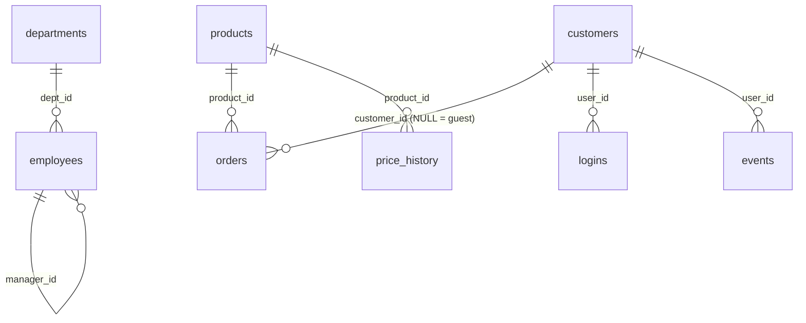

# SQL and Pandas Exercises -- Comprehensive Interview Practice Set

> 30 classic SQL interview problems, each solved twice: once in SQL and once in pandas. The problems run against one small sample schema (employees, departments, customers, orders, products, price history, logins, events, logs) that you can build in SQLite in under a second. They cover the patterns that come up again and again in data-heavy SWE, ML-infra, and analytics screens: Nth highest, top-N per group, anti-joins, NULL traps, gaps and islands, sessionization, running and moving aggregates, cohorts, funnels, pivots, recursive CTEs, and Pareto analysis.
>
> Versions assumed: SQLite 3.46 (window functions need 3.25+, `RANGE` frames with offsets 3.28+, `FILTER` and `NULLS FIRST/LAST` 3.30+), Python 3.11+, pandas 3.1 (outputs verified on 3.1; the APIs used also exist in pandas 2.2). All SQL was executed against the schema in Section 2, and every expected output in the [Answers](#answers) section was produced by running the solution. Each pandas solution was checked row by row against the SQL result.

See also: [Pandas -- SQL to pandas Translation](../languages/Pandas.md#26-sql-to-pandas-translation) (construct-by-construct mapping) · [Pandas -- NULL Semantics](../languages/Pandas.md#264-null-semantics-sql-three-valued-logic-vs-nan--na) · [Pandas -- Window Functions](../languages/Pandas.md#21-window-functions) · [CS Fundamentals -- SQL Essentials](../computer-science/CS_Fundamentals.md#32-sql-essentials) · [CS Fundamentals -- Indexing](../computer-science/CS_Fundamentals.md#34-indexing) · [Coding Problem List](Coding_Problem_List.md)

---

## Table of Contents

1. [How to Use This File](#1-how-to-use-this-file)
2. [Sample Schema and Data](#2-sample-schema-and-data)
    - [2.1 Entity Overview](#21-entity-overview)
    - [2.2 CREATE TABLE and INSERT Script (SQLite)](#22-create-table-and-insert-script-sqlite)
    - [2.3 Build the Database and Load DataFrames](#23-build-the-database-and-load-dataframes)
    - [2.4 SQLite vs PostgreSQL Dialect Notes](#24-sqlite-vs-postgresql-dialect-notes)
3. [Exercises: Ranking, Top-N, and Medians](#3-exercises-ranking-top-n-and-medians) (E1-E6)
4. [Exercises: Duplicates, Anti-Joins, and NULL Traps](#4-exercises-duplicates-anti-joins-and-null-traps) (E7-E11)
5. [Exercises: Self-Joins, Hierarchies, and Relational Division](#5-exercises-self-joins-hierarchies-and-relational-division) (E12-E14)
6. [Exercises: Sequences, Streaks, and Sessions](#6-exercises-sequences-streaks-and-sessions) (E15-E18)
7. [Exercises: Time-Series Metrics](#7-exercises-time-series-metrics) (E19-E22)
8. [Exercises: Shares, Reshaping, and Distributions](#8-exercises-shares-reshaping-and-distributions) (E23-E27)
9. [Exercises: Product Analytics](#9-exercises-product-analytics) (E28-E30)
10. [Pattern Cheat Sheet](#10-pattern-cheat-sheet)
11. [Interview Follow-Up Questions](#11-interview-follow-up-questions)
12. [Answers](#answers)

---

## 1. How to Use This File

1. Build the database once (Section 2.3). It takes about a second.
2. For each exercise, write the SQL first and run it with `sqlite3 interview.db` or Python's `sqlite3` module. Then write the pandas version and check that both return the same rows.
3. Only then open the answer. Each answer has the SQL, the exact expected output, a pandas solution, **why** the solution works, and the **pitfalls and follow-ups** an interviewer is likely to raise.
4. Time yourself. Easy problems should take about 5 minutes in an interview, Medium about 10-15, and Hard about 20. Say your assumptions out loud: ties, NULLs, empty groups, and time zones.

The questions an interviewer is really asking in almost every SQL problem:

| Hidden question | Where it bites |
|---|---|
| What happens with **ties**? | Nth highest, top-N, first/last, Pareto, running totals |
| What happens with **NULL**? | `NOT IN`, `COUNT(col)`, `AVG`, `<>` filters, `GROUP BY`, `ORDER BY` placement |
| What if a group or date has **no rows**? | Histograms, date spines, pivots, cohorts, "return NULL if none" |
| Is the window frame **ROWS or RANGE**? | Running totals with duplicate dates, `LAST_VALUE` |
| Does the filter run **before or after** the window function? | Moving averages, "rank, then keep rank 1" |
| Is it **deterministic**? | `ROW_NUMBER` without a unique tie-breaker, `LIMIT` without `ORDER BY` |

---

## 2. Sample Schema and Data

The data is small enough to check by hand, but every table hides at least one trap:

- **employees**: Bob and Carol tie on salary. Grace has a NULL salary. Judy has a NULL department. Heidi and Judy reuse Alice's and Bob's emails. Ivan earns more than his manager.
- **departments**: Legal (4) has no employees.
- **customers**: Leo (6) and Kim (7) never ordered.
- **orders**: order 19 is a guest checkout with `customer_id = NULL`. Customer 1 has two orders on the same day. Laptop and Phone dominate revenue, and Headphones and Chair tie on revenue.
- **price_history**: an append-only feed with an exact duplicate row.
- **logins**: several logins on the same day, and streaks of different lengths.
- **events**: inter-event gaps of exactly 30 minutes and 31 minutes (session boundaries), and a user who adds to cart without viewing (funnel ordering).
- **logs**: runs of repeated numbers for the "consecutive numbers" problem.

### 2.1 Entity Overview



### 2.2 CREATE TABLE and INSERT Script (SQLite)

Save this as `interview.sql`. It is plain SQL and also runs on PostgreSQL after small edits (Section 2.4).

```sql
-- interview.sql : sample schema for the exercises (SQLite 3.25+; tested on 3.46)
DROP TABLE IF EXISTS events;
DROP TABLE IF EXISTS logins;
DROP TABLE IF EXISTS logs;
DROP TABLE IF EXISTS price_history;
DROP TABLE IF EXISTS orders;
DROP TABLE IF EXISTS products;
DROP TABLE IF EXISTS customers;
DROP TABLE IF EXISTS employees;
DROP TABLE IF EXISTS departments;

CREATE TABLE departments (
    dept_id   INTEGER PRIMARY KEY,
    dept_name TEXT    NOT NULL
);

CREATE TABLE employees (
    emp_id     INTEGER PRIMARY KEY,
    name       TEXT    NOT NULL,
    email      TEXT    NOT NULL,
    dept_id    INTEGER REFERENCES departments(dept_id),   -- NULL = unassigned
    manager_id INTEGER REFERENCES employees(emp_id),      -- NULL = top of the tree
    salary     INTEGER,                                   -- NULL = not yet set
    hire_date  TEXT    NOT NULL                           -- 'YYYY-MM-DD'
);

CREATE TABLE customers (
    customer_id INTEGER PRIMARY KEY,
    name        TEXT NOT NULL,
    country     TEXT NOT NULL,
    signup_date TEXT NOT NULL
);

CREATE TABLE products (
    product_id INTEGER PRIMARY KEY,
    name       TEXT    NOT NULL,
    category   TEXT    NOT NULL,
    price      INTEGER NOT NULL
);

CREATE TABLE orders (
    order_id    INTEGER PRIMARY KEY,
    customer_id INTEGER REFERENCES customers(customer_id), -- NULL = guest checkout
    product_id  INTEGER NOT NULL REFERENCES products(product_id),
    quantity    INTEGER NOT NULL,
    amount      INTEGER NOT NULL,                          -- quantity * unit price paid
    order_date  TEXT    NOT NULL
);

CREATE TABLE price_history (            -- append-only feed; may contain re-delivered rows
    product_id     INTEGER NOT NULL,
    price          INTEGER NOT NULL,
    effective_date TEXT    NOT NULL
);

CREATE TABLE logins (                   -- one row per login, several per day possible
    user_id    INTEGER NOT NULL,        -- = customers.customer_id
    login_date TEXT    NOT NULL
);

CREATE TABLE events (
    event_id   INTEGER PRIMARY KEY,
    user_id    INTEGER NOT NULL,        -- = customers.customer_id
    event_type TEXT    NOT NULL,        -- view | add_to_cart | checkout | purchase
    event_ts   TEXT    NOT NULL         -- 'YYYY-MM-DD HH:MM:SS'
);

CREATE TABLE logs (                     -- LeetCode 180 style
    id  INTEGER PRIMARY KEY,
    num INTEGER NOT NULL
);

INSERT INTO departments VALUES
    (1, 'Engineering'), (2, 'Sales'), (3, 'Marketing'), (4, 'Legal');

INSERT INTO employees VALUES
    ( 1, 'Alice', 'alice@x.com', 1,    NULL, 200000, '2015-01-10'),
    ( 2, 'Bob',   'bob@x.com',   1,    1,    150000, '2017-03-15'),
    ( 3, 'Carol', 'carol@x.com', 1,    1,    150000, '2018-07-01'),
    ( 4, 'Dan',   'dan@x.com',   1,    2,    120000, '2020-02-01'),
    ( 5, 'Erin',  'erin@x.com',  2,    1,    130000, '2016-05-20'),
    ( 6, 'Frank', 'frank@x.com', 2,    5,     90000, '2019-09-09'),
    ( 7, 'Grace', 'grace@x.com', 2,    5,      NULL, '2023-01-05'),
    ( 8, 'Heidi', 'alice@x.com', 3,    1,    110000, '2021-04-12'),
    ( 9, 'Ivan',  'ivan@x.com',  3,    8,    115000, '2022-06-30'),
    (10, 'Judy',  'bob@x.com',   NULL, 2,     70000, '2024-01-15');

INSERT INTO customers VALUES
    (1, 'Ann', 'US', '2024-01-03'),
    (2, 'Raj', 'IN', '2024-01-15'),
    (3, 'Mei', 'CN', '2024-02-02'),
    (4, 'Tom', 'US', '2024-02-20'),
    (5, 'Zoe', 'UK', '2024-03-05'),
    (6, 'Leo', 'US', '2024-03-18'),
    (7, 'Kim', 'KR', '2024-03-25');

INSERT INTO products VALUES
    (1, 'Laptop',     'Electronics', 1200),
    (2, 'Phone',      'Electronics',  800),
    (3, 'Headphones', 'Electronics',  150),
    (4, 'Desk',       'Furniture',    300),
    (5, 'Chair',      'Furniture',    150),
    (6, 'Lamp',       'Furniture',     40),
    (7, 'Notebook',   'Stationery',     5),
    (8, 'Pen',        'Stationery',     2);

INSERT INTO orders VALUES
    ( 1, 1,    1,  1, 1200, '2024-01-05'),
    ( 2, 1,    7, 10,   50, '2024-01-05'),
    ( 3, 2,    2,  1,  800, '2024-01-20'),
    ( 4, 1,    3,  2,  300, '2024-02-03'),
    ( 5, 3,    4,  1,  300, '2024-02-05'),
    ( 6, 3,    5,  2,  300, '2024-02-05'),
    ( 7, 2,    8, 20,   40, '2024-02-14'),
    ( 8, 4,    1,  1, 1200, '2024-02-25'),
    ( 9, 2,    1,  1, 1200, '2024-02-28'),
    (10, 1,    6,  1,   40, '2024-03-02'),
    (11, 3,    2,  1,  800, '2024-03-10'),
    (12, 5,    5,  1,  150, '2024-03-11'),
    (13, 4,    7,  4,   20, '2024-03-11'),
    (14, 1,    2,  1,  800, '2024-04-01'),
    (15, 3,    3,  1,  150, '2024-04-08'),
    (16, 5,    1,  1, 1200, '2024-04-09'),
    (17, 4,    6,  2,   80, '2024-04-20'),
    (18, 1,    8,  5,   10, '2024-04-22'),
    (19, NULL, 7,  2,   10, '2024-04-25');

INSERT INTO price_history VALUES
    (1, 1300, '2023-06-01'),
    (1, 1200, '2024-01-01'),
    (2,  850, '2023-09-01'),
    (2,  800, '2024-01-01'),
    (2,  800, '2024-01-01'),            -- exact duplicate (re-delivered)
    (3,  150, '2024-01-01'),
    (4,  320, '2023-01-01'),
    (4,  300, '2023-12-15');

INSERT INTO logins VALUES
    (1, '2024-03-01'), (1, '2024-03-02'), (1, '2024-03-02'), (1, '2024-03-03'),
    (1, '2024-03-05'), (1, '2024-03-06'),
    (2, '2024-03-01'), (2, '2024-03-03'), (2, '2024-03-04'), (2, '2024-03-05'),
    (2, '2024-03-06'),
    (3, '2024-03-10'),
    (4, '2024-03-02'), (4, '2024-03-03');

INSERT INTO events VALUES
    ( 1, 1, 'view',        '2024-03-01 09:00:00'),
    ( 2, 1, 'view',        '2024-03-01 09:10:00'),
    ( 3, 1, 'add_to_cart', '2024-03-01 09:25:00'),
    ( 4, 1, 'checkout',    '2024-03-01 09:50:00'),
    ( 5, 1, 'purchase',    '2024-03-01 10:30:00'),
    ( 6, 1, 'view',        '2024-03-01 13:00:00'),
    ( 7, 2, 'view',        '2024-03-01 10:00:00'),
    ( 8, 2, 'add_to_cart', '2024-03-01 10:05:00'),
    ( 9, 2, 'view',        '2024-03-01 11:00:00'),
    (10, 3, 'view',        '2024-03-02 08:00:00'),
    (11, 3, 'view',        '2024-03-02 08:29:00'),
    (12, 3, 'view',        '2024-03-02 08:59:00'),
    (13, 3, 'add_to_cart', '2024-03-02 09:30:00'),
    (14, 3, 'checkout',    '2024-03-02 09:35:00'),
    (15, 3, 'purchase',    '2024-03-02 09:40:00'),
    (16, 4, 'view',        '2024-03-02 12:00:00'),
    (17, 5, 'add_to_cart', '2024-03-03 15:00:00');

INSERT INTO logs VALUES
    (1, 1), (2, 1), (3, 1), (4, 2), (5, 1), (6, 2), (7, 2), (8, 2), (9, 3);
```

### 2.3 Build the Database and Load DataFrames

```bash
sqlite3 interview.db < interview.sql          # with the sqlite3 CLI, or:
python3 -c "import sqlite3; sqlite3.connect('interview.db').executescript(open('interview.sql').read())"
sqlite3 -header -column interview.db "SELECT * FROM employees;"
```

The pandas solutions assume these DataFrames are in scope. `convert_dtypes()` maps SQL `INTEGER` columns that contain NULL to the nullable `Int64` dtype. Without it they would become `float64`, and `customer_id` 1 would print as `1.0`. It also makes missing values behave much more like SQL NULL (see [Pandas 26.4](../languages/Pandas.md#264-null-semantics-sql-three-valued-logic-vs-nan--na)).

```python
# load_tables.py -- load every table from interview.db into nullable-dtype DataFrames
import sqlite3

import pandas as pd

con = sqlite3.connect('interview.db')

def load(table, dates=()):
    df = pd.read_sql_query(f'SELECT * FROM {table}', con, parse_dates=list(dates))
    return df.convert_dtypes()      # INTEGER with NULL -> Int64 (not float64), TEXT -> string

departments   = load('departments')
employees     = load('employees', dates=['hire_date'])
customers     = load('customers', dates=['signup_date'])
products      = load('products')
orders        = load('orders', dates=['order_date'])
price_history = load('price_history', dates=['effective_date'])
logins        = load('logins', dates=['login_date'])
events        = load('events', dates=['event_ts'])
logs          = load('logs')
```

> **Tip -- run SQL against DataFrames directly.** `pip install duckdb`, then `duckdb.sql("SELECT ... FROM employees").df()` queries in-scope DataFrames by variable name. It is the fastest way to diff your pandas answer against a SQL answer. DuckDB is PostgreSQL-flavoured, so watch the dialect differences below.

### 2.4 SQLite vs PostgreSQL Dialect Notes

The answers use SQLite. Interviews are usually PostgreSQL-, MySQL-, or "generic ANSI"-flavoured, so know these translations:

| Need | SQLite (used here) | PostgreSQL | Note |
|---|---|---|---|
| Month bucket | `strftime('%Y-%m', d)` | `date_trunc('month', d)` or `to_char(d, 'YYYY-MM')` | MySQL: `DATE_FORMAT(d, '%Y-%m')` |
| Add a day | `date(d, '+1 day')` | `d + INTERVAL '1 day'` | |
| Days between | `julianday(b) - julianday(a)` (a float) | `b - a` (for `date`, an integer) | |
| Epoch seconds | `CAST(strftime('%s', ts) AS INTEGER)` or `unixepoch(ts)` (3.38+) | `EXTRACT(EPOCH FROM ts)` | |
| Date series | recursive CTE | `generate_series(a, b, interval '1 day')` | |
| Median | none built in; use `ROW_NUMBER` + `COUNT` | `PERCENTILE_CONT(0.5) WITHIN GROUP (ORDER BY x)` | MySQL has neither |
| NULL sort position | NULL is smallest: first in `ASC`, last in `DESC` | NULL is largest: last in `ASC`, **first in `DESC`** | Postgres/SQLite 3.30+ accept `NULLS FIRST/LAST` |
| `int / int` | integer division | integer division | MySQL `/` returns a decimal; use `DIV` |
| Boolean in `SUM` | `SUM(x > 0)` works (booleans are 0/1) | needs `COUNT(*) FILTER (WHERE x > 0)` or `SUM(CASE ...)` | |
| Bare column with `MAX` | `SELECT k, v, MAX(t) ... GROUP BY k` returns `v` from the max row | error (`v` must appear in `GROUP BY`) | Never rely on this in an interview |
| `QUALIFY` | not supported | not supported | Snowflake, BigQuery, DuckDB, Databricks support it |

---

## 3. Exercises: Ranking, Top-N, and Medians

### E1. Second Highest Salary

**Difficulty:** Easy · **Tables:** `employees` · **Answer:** [A1](#a1-second-highest-salary)

Return the second highest **distinct** salary as a single row with one column, `second_highest_salary`. If there is no second highest salary, return one row containing NULL, not zero rows.

### E2. Nth Highest Salary (Ties and NULL)

**Difficulty:** Medium · **Tables:** `employees` · **Answer:** [A2](#a2-nth-highest-salary-ties-and-null)

Return the Nth highest distinct salary for N = 3 as `nth_highest_salary`. Tied salaries count once. NULL salaries are ignored. If fewer than N distinct salaries exist (try N = 9), return a single NULL row.

### E3. Department Highest Salary

**Difficulty:** Medium · **Tables:** `employees`, `departments` · **Answer:** [A3](#a3-department-highest-salary)

For every department, list the employee(s) with the highest salary: `dept_name, name, salary`. If several employees tie for the top, return all of them. Order by `dept_name`.

### E4. Top-N per Group

**Difficulty:** Hard · **Tables:** `employees`, `departments` · **Answer:** [A4](#a4-top-n-per-group)

For each department, return every employee whose salary is among the **top 2 distinct salaries** in that department (LeetCode 185 uses the top 3). Columns: `dept_name, name, salary`. Order by `dept_name`, then `salary` descending, then `name`. Then explain how the answer changes if the requirement is "exactly 2 people per department".

### E5. ROW_NUMBER vs RANK vs DENSE_RANK

**Difficulty:** Easy · **Tables:** `employees` · **Answer:** [A5](#a5-row_number-vs-rank-vs-dense_rank)

Rank all employees by salary, highest first. Show `name, salary, row_num, rnk, dense_rnk` using `ROW_NUMBER` (break ties by `emp_id`), `RANK`, and `DENSE_RANK`. Predict where Grace (NULL salary) lands before you run it, and say how the answer differs on PostgreSQL.

### E6. Median Salary per Department

**Difficulty:** Medium · **Tables:** `employees` · **Answer:** [A6](#a6-median-salary-per-department)

Return `dept_id, median_salary` for every department value, including the NULL department. Ignore NULL salaries. For an even count, average the two middle values. SQLite has no `MEDIAN` or `PERCENTILE_CONT`, so build it from window functions.

---

## 4. Exercises: Duplicates, Anti-Joins, and NULL Traps

### E7. Duplicate Emails

**Difficulty:** Easy · **Tables:** `employees` · **Answer:** [A7](#a7-duplicate-emails)

List every email that appears more than once, with its count `n`. Order by `email`.

### E8. Delete Duplicates, Keep the Lowest ID

**Difficulty:** Medium · **Tables:** `employees` (work on a copy) · **Answer:** [A8](#a8-delete-duplicates-keep-the-lowest-id)

Copy `(emp_id, email)` into a temporary table `emp_emails`. Write a `DELETE` that removes duplicate emails, keeping the row with the smallest `emp_id` for each email. Then show the remaining rows ordered by `emp_id`.

### E9. Deduplicate, Keep the Latest Row

**Difficulty:** Medium · **Tables:** `price_history` · **Answer:** [A9](#a9-deduplicate-keep-the-latest-row)

`price_history` is an append-only feed, and it sometimes re-delivers rows. Return the current price of each product, which is the row with the latest `effective_date`: `product_id, price, effective_date`. The result must contain exactly one row per product, even when exact duplicates exist.

### E10. Customers Who Never Ordered (Anti-Join)

**Difficulty:** Easy · **Tables:** `customers`, `orders` · **Answer:** [A10](#a10-customers-who-never-ordered-anti-join)

Return `customer_id, name` for customers with no orders. Write it at least two ways, then explain why the third obvious way, `NOT IN (SELECT customer_id FROM orders)`, returns nothing on this data.

### E11. NULL Semantics Traps

**Difficulty:** Medium · **Tables:** `employees`, `customers`, `orders` · **Answer:** [A11](#a11-null-semantics-traps)

Predict the output of each query **before** running it:

```sql
-- (a)
SELECT COUNT(*) AS n FROM customers
WHERE customer_id NOT IN (SELECT customer_id FROM orders);

-- (b)
SELECT COUNT(*), COUNT(salary), COUNT(DISTINCT salary),
       AVG(salary), SUM(salary) * 1.0 / COUNT(*)
FROM employees;

-- (c)
SELECT dept_id, COUNT(*) AS n FROM employees GROUP BY dept_id ORDER BY dept_id;

-- (d)
SELECT COUNT(*) AS n FROM employees WHERE dept_id <> 1;
```

Then write the pandas equivalents and point out where pandas silently disagrees with SQL.

---

## 5. Exercises: Self-Joins, Hierarchies, and Relational Division

### E12. Employees Earning More Than Their Manager

**Difficulty:** Easy · **Tables:** `employees` · **Answer:** [A12](#a12-employees-earning-more-than-their-manager)

(a) List every employee with their manager's name, using NULL for the top of the tree. (b) Return `employee, manager, salary, manager_salary` for employees who earn more than their direct manager.

### E13. Org Chart with a Recursive CTE

**Difficulty:** Hard · **Tables:** `employees` · **Answer:** [A13](#a13-org-chart-with-a-recursive-cte)

Starting from every employee with no manager, walk the reporting tree. Return `emp_id, name, depth, path`, where `depth` is 0 for the root and `path` looks like `Alice > Bob > Dan`. Order by `path`. Follow-up: count the total (direct + indirect) reports of each manager.

### E14. Customers Active in Every Month

**Difficulty:** Medium · **Tables:** `orders` · **Answer:** [A14](#a14-customers-active-in-every-month)

Return the `customer_id` of registered customers who placed at least one order in **every** month that appears in `orders` (January through April 2024). This is relational division.

---

## 6. Exercises: Sequences, Streaks, and Sessions

### E15. Consecutive Numbers

**Difficulty:** Medium · **Tables:** `logs` · **Answer:** [A15](#a15-consecutive-numbers)

Find every `num` that appears at least three times in a row, ordered by `id`. Return distinct values as `consecutive_num`. Follow-up: generalize to K in a row, and handle gaps in `id`.

### E16. Consecutive Login Days (Gaps and Islands)

**Difficulty:** Hard · **Tables:** `logins` · **Answer:** [A16](#a16-consecutive-login-days-gaps-and-islands)

For each user, return their longest streak of consecutive login days: `user_id, streak_start, streak_end, streak_len`. If a user has two equally long streaks, return the earlier one. Multiple logins on the same day count once.

### E17. Sessionization with a 30-Minute Gap

**Difficulty:** Hard · **Tables:** `events` · **Answer:** [A17](#a17-sessionization-with-a-30-minute-gap)

A new session starts at a user's first event, and again whenever more than 30 minutes have passed since the user's previous event. A gap of exactly 30 minutes stays in the same session. Return `user_id, session_num, session_start, session_end, n_events, duration_min`, with sessions numbered from 1 for each user.

### E18. First and Last Event per User

**Difficulty:** Medium · **Tables:** `events` · **Answer:** [A18](#a18-first-and-last-event-per-user)

For each user, return `user_id, first_event, last_event, first_ts, last_ts, n_events`, where `first_event` and `last_event` are the event types of the earliest and latest events. Break timestamp ties by `event_id`. Explain why a naive `LAST_VALUE(event_type) OVER (PARTITION BY user_id ORDER BY event_ts)` gives the wrong answer.

---

## 7. Exercises: Time-Series Metrics

### E19. Running Totals

**Difficulty:** Medium · **Tables:** `orders` · **Answer:** [A19](#a19-running-totals)

For customers 1 and 2, list every order with the customer's running total of `amount` ordered by `order_date`: `customer_id, order_id, order_date, amount, running_total, running_total_default_range`. The first running total must increase on every row, even when two orders share a date. The second must use the window's default frame. Explain the difference.

### E20. 7-Day Moving Average

**Difficulty:** Hard · **Tables:** `orders` · **Answer:** [A20](#a20-7-day-moving-average)

Compute total revenue per **calendar** day (days with no orders count as 0) and its trailing 7-day average (the day itself plus the 6 days before it), rounded to 2 decimals. Report `day, revenue, ma_7d` for 2024-02-01 through 2024-02-14 only. The average for Feb 1 must still include the January days in its window.

### E21. Month-over-Month Growth

**Difficulty:** Medium · **Tables:** `orders` · **Answer:** [A21](#a21-month-over-month-growth)

Return `month, revenue, prev_revenue, mom_pct`, where `mom_pct` is the percentage change from the previous month, rounded to 2 decimals. The first month has a NULL `prev_revenue` and a NULL `mom_pct`.

### E22. Date Spine Join (Fill Missing Days)

**Difficulty:** Medium · **Tables:** `orders` · **Answer:** [A22](#a22-date-spine-join-fill-missing-days)

Return one row for **every** day from 2024-03-01 to 2024-03-14: `day, n_orders, revenue`. Days with no orders show `0, 0`.

---

## 8. Exercises: Shares, Reshaping, and Distributions

### E23. Percentage of Total

**Difficulty:** Easy · **Tables:** `orders`, `products` · **Answer:** [A23](#a23-percentage-of-total)

Return `category, revenue, pct_of_total` (rounded to 2 decimals), ordered by revenue descending. Use a single `SELECT` with no subquery that computes the total separately.

### E24. Pivot: Revenue by Customer and Month

**Difficulty:** Medium · **Tables:** `orders`, `customers` · **Answer:** [A24](#a24-pivot-revenue-by-customer-and-month)

Build a wide table with one row per registered customer who ordered, `name, jan, feb, mar, apr`, holding revenue for each month of 2024. Months with no orders show 0. Order by `name`.

### E25. Unpivot: Wide to Long

**Difficulty:** Easy · **Tables:** an inline table · **Answer:** [A25](#a25-unpivot-wide-to-long)

Given `targets(dept_id, q1, q2, q3, q4) = (1, 100, 120, NULL, 150), (2, 80, 90, 95, NULL)`, produce the long form `dept_id, quarter, target` with NULL targets dropped. Order by `dept_id, quarter`.

### E26. Histogram Buckets (Including Empty Ones)

**Difficulty:** Medium · **Tables:** `employees` · **Answer:** [A26](#a26-histogram-buckets-including-empty-ones)

Bucket non-NULL salaries into half-open bins of width 25,000 (`[50000, 75000)`, `[75000, 100000)`, ...), from the bin containing the minimum salary to the bin containing the maximum. Return `bucket_lo, bucket_hi, n`. Empty bins must appear with `n = 0`.

### E27. Pareto: Products Driving 80% of Revenue

**Difficulty:** Hard · **Tables:** `orders`, `products` · **Answer:** [A27](#a27-pareto-products-driving-80-of-revenue)

Sort products by revenue, highest first. Return the smallest prefix of products whose combined revenue reaches at least 80% of total revenue: `name, revenue, cum_pct`. The product that crosses the 80% line is included. Break revenue ties by `product_id`.

---

## 9. Exercises: Product Analytics

### E28. Retention Cohort Table

**Difficulty:** Hard · **Tables:** `orders` · **Answer:** [A28](#a28-retention-cohort-table)

A customer's cohort is the month of their first order. For each cohort, count how many of its customers ordered in month offsets 0, 1, 2, and 3 after their cohort month: `cohort, cohort_size, m0, m1, m2, m3`. Exclude guest orders. Then convert the counts to retention percentages, and explain what is misleading about the zeros in the bottom-right of the table.

### E29. Funnel Conversion

**Difficulty:** Hard · **Tables:** `events` · **Answer:** [A29](#a29-funnel-conversion)

The funnel is `view -> add_to_cart -> checkout -> purchase`. A user reaches a step only if they performed it at or after the time they reached the previous step. Return `step_no, step, users, pct_of_prev, pct_of_top`, with percentages rounded to 2 decimals.

### E30. New vs Returning Customers per Month

**Difficulty:** Medium · **Tables:** `orders` · **Answer:** [A30](#a30-new-vs-returning-customers-per-month)

For each month, count the registered customers who ordered that month for the first time ever (`new_customers`), and those who had also ordered in an earlier month (`returning_customers`).

---

## 10. Pattern Cheat Sheet

| Pattern | SQL idiom | pandas idiom | Exercises |
|---|---|---|---|
| Nth distinct value, NULL if missing | `DENSE_RANK() ... = N` wrapped in `MAX()`, or a scalar subquery with `LIMIT 1 OFFSET N-1` | `drop_duplicates().nlargest(N)`, then guard on length | E1, E2 |
| Top-N per group | `DENSE_RANK() OVER (PARTITION BY g ORDER BY v DESC) <= N` | `groupby(g)[v].rank(method='dense', ascending=False) <= N` | E3, E4 |
| One row per key (latest) | `ROW_NUMBER() OVER (PARTITION BY k ORDER BY t DESC, tiebreak) = 1` | `sort_values([k, t]).drop_duplicates(k, keep='last')` | E9, E18 |
| Duplicates | `GROUP BY k HAVING COUNT(*) > 1` | `value_counts()` / `duplicated(keep=False)` | E7, E8 |
| Anti-join | `NOT EXISTS` or `LEFT JOIN ... WHERE r.key IS NULL` | `~a[k].isin(b[k])` or `merge(indicator=True)` | E10, E11 |
| Self-join | `JOIN t m ON m.id = e.parent_id` | `merge(t, left_on='parent_id', right_on='id', suffixes=...)` | E12 |
| Hierarchy | `WITH RECURSIVE` | loop of merges (BFS by level) | E13 |
| Relational division ("in all X") | `GROUP BY k HAVING COUNT(DISTINCT x) = (SELECT COUNT(DISTINCT x) ...)` | `groupby(k)[x].nunique() == total` | E14 |
| Runs / islands | `value - ROW_NUMBER()` as a group key, or a `LAG` flag plus a running `SUM` | `(s != s.shift()).cumsum()`, or `date - cumcount()` | E15, E16 |
| Sessionization | `LAG` gap, `CASE` new-session flag, running `SUM` | `groupby().diff() > gap`, then `.cumsum()` per user | E17 |
| Running total | `SUM() OVER (... ROWS UNBOUNDED PRECEDING)` | `groupby().cumsum()` | E19 |
| Moving average | spine + `AVG() OVER (ROWS 6 PRECEDING)` | `resample('D').sum().rolling(7)` or `rolling('7D')` | E20 |
| Period-over-period | `LAG(v) OVER (ORDER BY period)` | `shift()` / `pct_change()` | E21 |
| Fill missing dates | recursive CTE / `generate_series` + `LEFT JOIN` | `pd.date_range` + `reindex` / `merge(how='left')` | E20, E22 |
| Share of total | `SUM(x) / SUM(SUM(x)) OVER ()` | `s / s.sum()` or `groupby().transform('sum')` | E23 |
| Pivot / unpivot | `SUM(CASE WHEN ...)`; `UNION ALL` | `pivot_table`; `melt` | E24, E25 |
| Histogram | integer division `v / w * w` + bucket spine | `(v // w) * w`, `value_counts().reindex()`, or `pd.cut` | E26 |
| Cumulative share | `SUM() OVER (ORDER BY v DESC, id ROWS ...) / SUM() OVER ()` | `cumsum() / sum()` | E27 |
| Cohorts | `MIN(month) OVER (PARTITION BY user)` + month offset | `groupby().transform('min')` + `pivot_table` | E28, E30 |
| Ordered funnel | chain of CTEs, each joined to the previous step's timestamp | loop of merges with a timestamp filter | E29 |

---

## 11. Interview Follow-Up Questions

**Q1.** What is the logical evaluation order of a `SELECT`, and why does it matter for window functions?

`FROM`/`JOIN` -> `WHERE` -> `GROUP BY` -> aggregates -> `HAVING` -> window functions -> `SELECT` aliases -> `DISTINCT` -> `ORDER BY` -> `LIMIT`. This order has three consequences. First, you cannot filter on a window function in `WHERE`; you need a subquery, a CTE, or `QUALIFY` where it is supported. Second, a window computed in the same query sees only rows that survived `WHERE`, so filtering the dates *before* a 7-day average silently shortens the first windows (E20). Third, a window function can wrap an aggregate, as in `SUM(SUM(x)) OVER ()` (E23), because aggregation has already happened when windows are evaluated.

**Q2.** `NOT IN` vs `NOT EXISTS` vs `LEFT JOIN ... IS NULL`: which should you use?

Prefer `NOT EXISTS`. `x NOT IN (subquery)` returns no rows if the subquery yields even one NULL: `x <> NULL` is UNKNOWN, so the whole conjunction can never be TRUE (E11a). `NOT EXISTS` is a correlated existence test with no NULL trap, and every major optimizer turns it into an anti-join. `LEFT JOIN ... WHERE right.pk IS NULL` is equivalent if you test a non-nullable column of the right table. It can be slower when the right side has many matches per key, because it materializes the join before filtering. In pandas, `~isin` behaves like `NOT EXISTS`.

**Q3.** Explain `ROWS` vs `RANGE` frames. What is the default?

With an `ORDER BY` and no frame clause, the default is `RANGE BETWEEN UNBOUNDED PRECEDING AND CURRENT ROW`. "Current row" then includes all **peers**, meaning rows with the same `ORDER BY` value. So a running `SUM` gives every tied row the same total (E19), and `LAST_VALUE` returns the last peer rather than the last row of the partition (E18). `ROWS` counts physical rows, so with a unique tie-breaker it gives the strictly increasing running total most people expect. Without an `ORDER BY`, the frame is the whole partition. `RANGE` with an offset (`RANGE BETWEEN 6 PRECEDING AND CURRENT ROW` over a day number) is a value-based window. It is the SQL analogue of pandas `rolling('7D')`.

**Q4.** Why must `ROW_NUMBER` have a unique tie-breaker?

Without one, the order among tied rows is unspecified. The same query can then return different rows from run to run, or after a plan change, an index rebuild, or a parallel scan. This produces flaky "dedup keep latest" results (E9) and non-reproducible top-N. Always end the `ORDER BY` with a key column. If ties should be kept, use `RANK` or `DENSE_RANK` instead.

**Q5.** How would you make a "latest row per key" query fast on a 1-billion-row table?

Create a composite index `(key, ts DESC)`. That lets the engine either do a per-key index seek (a loose index scan, or `LATERAL ... LIMIT 1` in PostgreSQL) or stream the window function without a sort. Alternatives: PostgreSQL `DISTINCT ON (key) ... ORDER BY key, ts DESC`; maintain a "current" table on write (upsert); or, in a warehouse, partition and cluster by key and use `QUALIFY ROW_NUMBER() ... = 1`. Use `EXPLAIN` to check that no full sort is happening. See [CS Fundamentals -- Indexing](../computer-science/CS_Fundamentals.md#34-indexing).

**Q6.** A window query is slow. What do you check?

(1) The **sort**. Each distinct `PARTITION BY` / `ORDER BY` combination can need its own sort, so give windows that share a sort a shared `WINDOW w AS (...)` definition and an index that matches it. (2) **Spills**: large partitions that exceed `work_mem` or the sort buffer spill to disk. (3) **Filtering late**: push `WHERE` predicates into the CTE before the window when that is semantically valid. (4) **Correlated subqueries** that run once per row, which should be rewritten as a window or a join. (5) **`COUNT(DISTINCT ...) OVER`** is unsupported in most engines, and workarounds such as `DENSE_RANK` forward plus backward can be expensive. Pre-aggregate instead.

**Q7.** When is pandas the wrong tool for these problems?

When the data does not fit comfortably in RAM (pandas often needs 5-10x the on-disk size during joins and groupbys), when the work is a multi-way join best done close to the data, or when you need incremental or concurrent updates. Push the heavy filtering and aggregation into SQL, DuckDB, or Polars, and pull only the result into pandas. pandas also has no query optimizer: a chain runs exactly as written, so filter early and select columns before a `merge`.

**Q8.** How do you test that a SQL answer and a pandas answer agree?

Run both on a small fixture that deliberately contains the traps: ties, NULLs, empty groups, duplicate timestamps, and boundary gaps (exactly 30 minutes). Sort both results by a full key, normalize the dtypes (nullable `Int64` vs `float64`, timestamps vs strings), and compare them with `pandas.testing.assert_frame_equal(check_dtype=False)`. This file was verified that way. In production, the same idea becomes golden-file tests over a fixture database.

---

## Answers

Each pandas snippet starts with `# fragment` because it uses the DataFrames loaded in [Section 2.3](#23-build-the-database-and-load-dataframes). Each one assigns its result to `ans`, and that result has the same rows as the SQL output shown.

### A1. Second Highest Salary

```sql
SELECT (
    SELECT DISTINCT salary
    FROM employees
    WHERE salary IS NOT NULL
    ORDER BY salary DESC
    LIMIT 1 OFFSET 1
) AS second_highest_salary;
```

```text
second_highest_salary
               150000
```

Alternative: `SELECT MAX(salary) AS second_highest_salary FROM employees WHERE salary < (SELECT MAX(salary) FROM employees);`

```python
# fragment -- uses the DataFrames from Section 2.3
top2 = employees['salary'].dropna().drop_duplicates().nlargest(2)
ans = pd.DataFrame({'second_highest_salary': [top2.iloc[1] if len(top2) == 2 else pd.NA]})
print(ans.to_string(index=False))
```

**Why it works.** The outer `SELECT (scalar subquery)` always returns exactly one row. If the subquery finds nothing, the scalar subquery evaluates to NULL, which meets the "return NULL, not zero rows" requirement (LeetCode 176). Without the wrapper, `LIMIT 1 OFFSET 1` on its own returns an empty result set. `DISTINCT` is what makes 150000 the answer: without it, the second row is Bob's 150000 only by luck, and with a three-way tie at the top it would be wrong.

**Pitfalls and follow-ups.**
- `WHERE salary IS NOT NULL` does not matter on SQLite, because NULL sorts last in `DESC`. On PostgreSQL, NULL sorts **first** in `DESC`, so without the filter the "highest" salary would be NULL. Alternatively, write `ORDER BY salary DESC NULLS LAST`.
- The `MAX(...) WHERE salary < MAX` version only generalizes to "second". For N, use E2.

### A2. Nth Highest Salary (Ties and NULL)

```sql
-- N = 3: change the literal 3 (or bind it as a parameter, e.g. :n)
SELECT MAX(salary) AS nth_highest_salary  -- an aggregate over 0 rows returns one NULL row
FROM (
    SELECT salary,
           DENSE_RANK() OVER (ORDER BY salary DESC) AS drk
    FROM employees
    WHERE salary IS NOT NULL
)
WHERE drk = 3;
```

```text
nth_highest_salary
            130000
```

With `drk = 9`, the same query returns one row containing `NULL`, because there are only 8 distinct non-NULL salaries.

```python
# fragment -- uses the DataFrames from Section 2.3
def nth_highest(s: pd.Series, n: int):
    distinct = s.dropna().drop_duplicates().sort_values(ascending=False)
    return distinct.iloc[n - 1] if len(distinct) >= n else pd.NA

ans = pd.DataFrame({'nth_highest_salary': [nth_highest(employees['salary'], 3)]})
print(ans.to_string(index=False))
print(nth_highest(employees['salary'], 9))    # <NA>
```

**Why it works.** `DENSE_RANK` gives tied salaries the same rank and leaves no gaps, so rank N is exactly the Nth distinct salary. Wrapping the result in `MAX()` turns "zero matching rows" into "one NULL row", and collapses several tied rows into one value. `RANK` would be wrong here: with salaries 200, 150, 150, 130, `RANK` gives 130 rank 4, so "3rd highest" would find nothing.

**Pitfalls and follow-ups.**
- LeetCode 177 wants a PostgreSQL/MySQL function. The body is the same query with `N` as a parameter. In MySQL you cannot write `LIMIT N-1` inside the function body; compute `SET N = N - 1;` first.
- "Nth highest **including** duplicates" (Nth row) uses `ROW_NUMBER` or `LIMIT 1 OFFSET N-1` without `DISTINCT`. Ask which one the interviewer means.
- pandas: `Series.nlargest(n, keep='all')` keeps ties at the boundary, but it counts **rows**, not distinct values. Deduplicate first.

### A3. Department Highest Salary

```sql
SELECT d.dept_name, e.name, e.salary
FROM employees e
JOIN departments d ON d.dept_id = e.dept_id
WHERE e.salary = (SELECT MAX(e2.salary)
                  FROM employees e2
                  WHERE e2.dept_id = e.dept_id)
ORDER BY d.dept_name;
```

```text
  dept_name  name salary
Engineering Alice 200000
  Marketing  Ivan 115000
      Sales  Erin 130000
```

Window alternative: `SELECT ... FROM (SELECT e.*, RANK() OVER (PARTITION BY dept_id ORDER BY salary DESC) AS rk FROM employees e WHERE salary IS NOT NULL) WHERE rk = 1`.

```python
# fragment -- uses the DataFrames from Section 2.3
dept_max = employees.groupby('dept_id')['salary'].transform('max')
ans = (employees[employees['salary'] == dept_max]       # <NA> in the mask counts as False
       .merge(departments, on='dept_id')
       .sort_values('dept_name')
       [['dept_name', 'name', 'salary']])
print(ans.to_string(index=False))
```

**Why it works.** The correlated subquery computes each department's maximum, and the equality keeps every employee who matches it, so ties are included automatically. `transform('max')` is the pandas equivalent: it broadcasts the group maximum back onto each row (see [Pandas -- agg vs transform](../languages/Pandas.md#19-agg-vs-transform-vs-filter-vs-apply)).

**Pitfalls and follow-ups.**
- `GROUP BY dept_id` with `MAX(salary)` alone cannot return the **name**: a non-aggregated column in the `SELECT` is an error in PostgreSQL. SQLite returns the name from **one** of the max rows (a documented quirk, and ties are lost). MySQL with `ONLY_FULL_GROUP_BY` off returns an indeterminate name that need not belong to the max row.
- The inner join drops Judy (NULL department) and Legal (no employees). Ask whether they should appear. If so, use `LEFT JOIN` from `departments`.
- Grace's NULL salary is ignored by `MAX`. If a department's salaries were all NULL, `MAX` is NULL, `salary = NULL` is never true, and the department disappears.

### A4. Top-N per Group

```sql
WITH ranked AS (
    SELECT e.*,
           DENSE_RANK() OVER (PARTITION BY e.dept_id ORDER BY e.salary DESC) AS drk
    FROM employees e
    WHERE e.salary IS NOT NULL
)
SELECT d.dept_name, r.name, r.salary
FROM ranked r
JOIN departments d ON d.dept_id = r.dept_id
WHERE r.drk <= 2
ORDER BY d.dept_name, r.salary DESC, r.name;
```

```text
  dept_name  name salary
Engineering Alice 200000
Engineering   Bob 150000
Engineering Carol 150000
  Marketing  Ivan 115000
  Marketing Heidi 110000
      Sales  Erin 130000
      Sales Frank  90000
```

```python
# fragment -- uses the DataFrames from Section 2.3
e = employees.dropna(subset=['salary'])
e = e.assign(drk=e.groupby('dept_id')['salary'].rank(method='dense', ascending=False))
ans = (e[e['drk'] <= 2]
       .merge(departments, on='dept_id')
       .sort_values(['dept_name', 'salary', 'name'], ascending=[True, False, True])
       [['dept_name', 'name', 'salary']])
print(ans.to_string(index=False))
```

**Why it works.** The window ranks salaries independently inside each department. `DENSE_RANK <= 2` keeps the top two salary **levels**, so Engineering returns three people: Alice, plus Bob and Carol, who tie at 150000. The filter has to go in an outer query because window functions are evaluated after `WHERE`.

**Pitfalls and follow-ups.**
- "Exactly 2 people per department": use `ROW_NUMBER() OVER (PARTITION BY dept_id ORDER BY salary DESC, emp_id)`. Engineering then returns Alice and Bob, and the tie-breaker decides that Bob beats Carol. "Top 2, but include anyone tied with #2": use `RANK() <= 2`.
- pandas shortcut for exactly N rows: `e.sort_values(['dept_id', 'salary', 'emp_id'], ascending=[True, False, True]).groupby('dept_id').head(2)`.
- Pre-window-function version (MySQL 5.7 and older): `WHERE e.salary IS NOT NULL AND (SELECT COUNT(DISTINCT e2.salary) FROM employees e2 WHERE e2.dept_id = e.dept_id AND e2.salary > e.salary) < 2`. It is O(n^2) per department, but interviewers sometimes ask for it. Keep the `IS NOT NULL` guard: without it, `e2.salary > NULL` is UNKNOWN for every row, the count is 0, and Grace's NULL salary counts as being in the top N. Judy (NULL `dept_id`) also passes the subquery and is removed only by the join to `departments`.
- `groupby('dept_id')` drops Judy's NA key, so her rank is NaN and the `<= 2` filter removes her. This matches the inner join.

### A5. ROW_NUMBER vs RANK vs DENSE_RANK

```sql
SELECT name, salary,
       ROW_NUMBER() OVER (ORDER BY salary DESC, emp_id) AS row_num,
       RANK()       OVER (ORDER BY salary DESC)         AS rnk,
       DENSE_RANK() OVER (ORDER BY salary DESC)         AS dense_rnk
FROM employees
ORDER BY row_num;
```

```text
 name salary row_num rnk dense_rnk
Alice 200000       1   1         1
  Bob 150000       2   2         2
Carol 150000       3   2         2
 Erin 130000       4   4         3
  Dan 120000       5   5         4
 Ivan 115000       6   6         5
Heidi 110000       7   7         6
Frank  90000       8   8         7
 Judy  70000       9   9         8
Grace   NULL      10  10         9
```

```python
# fragment -- uses the DataFrames from Section 2.3
e = employees.sort_values(['salary', 'emp_id'], ascending=[False, True], na_position='last')
ans = e.assign(
    row_num=range(1, len(e) + 1),
    rnk=e['salary'].rank(method='min', ascending=False, na_option='bottom').astype('Int64'),
    dense_rnk=e['salary'].rank(method='dense', ascending=False, na_option='bottom').astype('Int64'),
)[['name', 'salary', 'row_num', 'rnk', 'dense_rnk']]
print(ans.to_string(index=False))
```

**Why it works.**

| Function | Ties | Gaps after ties | pandas `rank(method=...)` |
|---|---|---|---|
| `ROW_NUMBER` | different numbers (arbitrary unless you add a tie-breaker) | n/a | `'first'` (after a sort), or `cumcount() + 1` |
| `RANK` | same number | yes (1, 2, 2, **4**) | `'min'` |
| `DENSE_RANK` | same number | no (1, 2, 2, **3**) | `'dense'` |
| `PERCENT_RANK` | `(rank - 1) / (n - 1)` | yes | `rank(pct=True)` uses a different formula |
| `NTILE(k)` | splits rows into k near-equal buckets | n/a | `pd.qcut(..., k)` (value-based, not row-based) |

**Pitfalls and follow-ups.**
- **NULL placement**: SQLite treats NULL as the smallest value, so Grace is last in `DESC`. **PostgreSQL ranks Grace #1**, because NULLs are largest and come first in `DESC`. Add `NULLS LAST`, or filter NULLs out.
- Adding `emp_id` to the `ORDER BY` of `RANK` would break the tie and silently turn it into `ROW_NUMBER`. Each function needs its own `ORDER BY`.
- pandas `rank` returns floats and gives NaN to missing values unless you pass `na_option`.

### A6. Median Salary per Department

```sql
WITH ranked AS (
    SELECT dept_id, salary,
           ROW_NUMBER() OVER (PARTITION BY dept_id ORDER BY salary) AS rn,
           COUNT(*)     OVER (PARTITION BY dept_id)                 AS cnt
    FROM employees
    WHERE salary IS NOT NULL
)
SELECT dept_id, AVG(salary) AS median_salary
FROM ranked
WHERE rn IN ((cnt + 1) / 2, (cnt + 2) / 2)    -- integer division
GROUP BY dept_id
ORDER BY dept_id;
```

```text
dept_id median_salary
   NULL       70000.0
      1      150000.0
      2      110000.0
      3      112500.0
```

```python
# fragment -- uses the DataFrames from Section 2.3
ans = (employees.groupby('dept_id', dropna=False)['salary']
       .median()                                   # skips NA salaries
       .reset_index(name='median_salary')
       .sort_values('dept_id', na_position='first'))   # SQLite sorts NULL first; pandas puts NA last
print(ans.to_string(index=False))
```

**Why it works.** For `cnt = 4`, `(cnt+1)/2 = 2` and `(cnt+2)/2 = 3`, so the two middle rows are averaged. For `cnt = 3`, both expressions give 2, so one row is "averaged" with itself. For `cnt = 1`, both give 1. Because `WHERE salary IS NOT NULL` filters before the window, `cnt` counts only real salaries. Sales therefore has a median of (90000 + 130000) / 2, and Grace is ignored.

**Pitfalls and follow-ups.**
- PostgreSQL: `PERCENTILE_CONT(0.5) WITHIN GROUP (ORDER BY salary)` interpolates. `PERCENTILE_DISC(0.5)` returns an actual value (the lower middle). SQL Server's `PERCENTILE_CONT` is a **window** function only, so you need `SELECT DISTINCT dept_id, PERCENTILE_CONT(0.5) WITHIN GROUP (ORDER BY salary) OVER (PARTITION BY dept_id)`.
- Without the NULL filter, `ROW_NUMBER` would number the NULL row too (it sorts first in `ASC` on SQLite), which shifts the middle.
- A median cannot be combined from partial medians, unlike `SUM`/`COUNT` (distributive) or `AVG` carried as a `(sum, count)` pair (algebraic; partial averages themselves cannot be averaged). The median is holistic, so at scale use approximate quantiles (t-digest, `approx_percentile`).
- pandas `groupby(...).median()` drops the NA key unless `dropna=False`, and it places the NA group **last**. The NULL department is the first row of the SQL output because SQLite sorts NULL first, which is why the pandas version re-sorts with `na_position='first'`.

### A7. Duplicate Emails

```sql
SELECT email, COUNT(*) AS n
FROM employees
GROUP BY email
HAVING COUNT(*) > 1
ORDER BY email;
```

```text
      email n
alice@x.com 2
  bob@x.com 2
```

```python
# fragment -- uses the DataFrames from Section 2.3
counts = employees.groupby('email').size()
ans = counts[counts > 1].reset_index(name='n')
print(ans.to_string(index=False))
# all duplicated ROWS (both copies): employees[employees.duplicated('email', keep=False)]
```

**Why it works.** `HAVING` filters groups after aggregation, and `WHERE` cannot reference `COUNT(*)`.

**Pitfalls and follow-ups.**
- Real emails need normalizing first: `GROUP BY LOWER(TRIM(email))`, and for Gmail, also strip dots and `+tags`. Ask whether the comparison should be case-insensitive.
- "Return the full rows of the duplicates": join back to the grouped keys, or use `COUNT(*) OVER (PARTITION BY email) > 1` in a subquery.
- To prevent duplicates going forward: `CREATE UNIQUE INDEX ux_emp_email ON employees(LOWER(email))`. Expression indexes are supported in SQLite and PostgreSQL.

### A8. Delete Duplicates, Keep the Lowest ID

```sql
CREATE TEMP TABLE emp_emails AS
SELECT emp_id, email FROM employees;

DELETE FROM emp_emails
WHERE emp_id NOT IN (                 -- safe: MIN(emp_id) is never NULL here
    SELECT MIN(emp_id) FROM emp_emails GROUP BY email
);

SELECT emp_id, email FROM emp_emails ORDER BY emp_id;
```

```text
emp_id       email
     1 alice@x.com
     2   bob@x.com
     3 carol@x.com
     4   dan@x.com
     5  erin@x.com
     6 frank@x.com
     7 grace@x.com
     9  ivan@x.com
```

Equivalent correlated form: `DELETE FROM emp_emails AS a WHERE EXISTS (SELECT 1 FROM emp_emails b WHERE b.email = a.email AND b.emp_id < a.emp_id);`

```python
# fragment -- uses the DataFrames from Section 2.3
ans = (employees[['emp_id', 'email']]
       .sort_values('emp_id')
       .drop_duplicates('email', keep='first'))
print(ans.to_string(index=False))
```

**Why it works.** For each email, the subquery keeps exactly one survivor (the minimum id), and everything else is deleted. Heidi (8) and Judy (10) are removed.

**Pitfalls and follow-ups.**
- **MySQL** rejects a subquery that reads the table being modified (error 1093). Use the self-join form `DELETE p1 FROM t p1 JOIN t p2 ON p1.email = p2.email AND p1.emp_id > p2.emp_id;`, or wrap the subquery in a derived table.
- **PostgreSQL**, for exact duplicate rows with no key: `DELETE FROM t WHERE ctid NOT IN (SELECT MIN(ctid) FROM t GROUP BY ...)`. On SQLite the equivalent uses `rowid`.
- On a large table, `CREATE TABLE new AS SELECT ... ROW_NUMBER() ... = 1` followed by a swap is usually faster than a massive `DELETE`, and it avoids lock and transaction-log bloat.
- This `NOT IN` is safe only because the subquery cannot produce NULL. See E11.

### A9. Deduplicate, Keep the Latest Row

```sql
WITH ranked AS (
    SELECT product_id, price, effective_date,
           ROW_NUMBER() OVER (PARTITION BY product_id
                              ORDER BY effective_date DESC, price DESC) AS rn
    FROM price_history
)
SELECT product_id, price, effective_date
FROM ranked
WHERE rn = 1
ORDER BY product_id;
```

```text
product_id price effective_date
         1  1200     2024-01-01
         2   800     2024-01-01
         3   150     2024-01-01
         4   300     2023-12-15
```

```python
# fragment -- uses the DataFrames from Section 2.3
ans = (price_history
       .sort_values(['product_id', 'effective_date', 'price'])
       .drop_duplicates('product_id', keep='last'))
print(ans.to_string(index=False))
```

**Why it works.** `ROW_NUMBER` picks exactly one row per partition, even when rows are byte-for-byte identical (product 2). `MAX(effective_date)` joined back to the table would return product 2 **twice**.

**Pitfalls and follow-ups.**
- The tie-breaker (`price DESC`) makes the choice deterministic when two different prices share a date. In a real feed, use an ingestion sequence number or `loaded_at` column.
- `RANK() = 1` keeps both identical rows, which is the wrong choice for dedup.
- SQLite-only shortcut: `SELECT product_id, price, MAX(effective_date) FROM price_history GROUP BY product_id` happens to work, because of SQLite's bare-column rule for `MIN`/`MAX`. It is an error in PostgreSQL.
- PostgreSQL idiom: `SELECT DISTINCT ON (product_id) * FROM price_history ORDER BY product_id, effective_date DESC;`
- pandas alternative: `price_history.loc[price_history.groupby('product_id')['effective_date'].idxmax()]`. In pandas 3, `idxmax` raises on an all-NA group, so drop NaT values first.

### A10. Customers Who Never Ordered (Anti-Join)

```sql
SELECT c.customer_id, c.name
FROM customers c
WHERE NOT EXISTS (SELECT 1 FROM orders o WHERE o.customer_id = c.customer_id)
ORDER BY c.customer_id;
```

```text
customer_id name
          6  Leo
          7  Kim
```

```sql
-- equivalent: LEFT JOIN anti-join (test a column that can only be NULL when there is no match)
SELECT c.customer_id, c.name
FROM customers c
LEFT JOIN orders o ON o.customer_id = c.customer_id
WHERE o.order_id IS NULL
ORDER BY c.customer_id;
```

```python
# fragment -- uses the DataFrames from Section 2.3
ans = customers.loc[~customers['customer_id'].isin(orders['customer_id'].dropna()),
                    ['customer_id', 'name']]
print(ans.to_string(index=False))

# merge-based anti-join (works for multi-column keys too)
m = customers.merge(orders[['customer_id']].drop_duplicates(), how='left', indicator=True)
print(m.loc[m['_merge'] == 'left_only', ['customer_id', 'name']].to_string(index=False))
```

**Why it works.** `NOT EXISTS` asks, for each customer, "is there any order row with my id?". NULL `customer_id` values in `orders` never equal anything, so the guest order cannot affect the result. The `LEFT JOIN` version keeps unmatched customers with NULL-extended order columns, and then keeps only those rows.

**Pitfalls and follow-ups.**
- `NOT IN (SELECT customer_id FROM orders)` returns **0 rows** here because of guest order 19. See A11(a). Fix it with `WHERE customer_id IS NOT NULL` inside the subquery, or simply use `NOT EXISTS`.
- In the `LEFT JOIN` version, an extra predicate on `o` must go in the `ON` clause, not in `WHERE`. For example, "customers with no orders **in March**": `... ON o.customer_id = c.customer_id AND o.order_date >= '2024-03-01'`. Putting it in `WHERE` turns the outer join into an inner join and returns nothing.
- Semi-join (customers who **did** order): `EXISTS`, or in pandas `isin`. Do not use an inner join plus `DISTINCT`, which multiplies rows before deduplicating.

### A11. NULL Semantics Traps

```sql
-- (a) NOT IN with a NULL in the list
SELECT COUNT(*) AS n FROM customers
WHERE customer_id NOT IN (SELECT customer_id FROM orders);

-- (b) COUNT(*) vs COUNT(col) vs AVG
SELECT COUNT(*)                          AS all_rows,
       COUNT(salary)                     AS non_null_salaries,
       COUNT(DISTINCT salary)            AS distinct_salaries,
       ROUND(AVG(salary), 2)             AS avg_ignoring_nulls,
       ROUND(SUM(salary) * 1.0 / COUNT(*), 2) AS avg_null_as_zero
FROM employees;

-- (c) NULL forms its own group
SELECT dept_id, COUNT(*) AS n FROM employees GROUP BY dept_id ORDER BY dept_id;

-- (d) <> silently drops NULL rows
SELECT COUNT(*) AS n FROM employees WHERE dept_id <> 1;
```

```text
-- (a) NOT IN with a NULL in the list
n
0

-- (b) COUNT(*) vs COUNT(col) vs AVG
all_rows non_null_salaries distinct_salaries avg_ignoring_nulls avg_null_as_zero
      10                 9                 8          126111.11         113500.0

-- (c) NULL forms its own group
dept_id n
   NULL 1
      1 4
      2 3
      3 2

-- (d) <> silently drops NULL rows
n
5
```

```python
# fragment -- uses the DataFrames from Section 2.3
# (a) pandas has no NOT IN trap: isin uses plain set membership, so an NA in the lookup values does not poison the other comparisons -> ~isin behaves like NOT EXISTS
print('a:', (~customers['customer_id'].isin(orders['customer_id'])).sum())

# (b)
s = employees['salary']
print('b:', len(s), s.count(), s.nunique(), round(s.mean(), 2), round(s.fillna(0).mean(), 2))

# (c) groupby drops the NA key unless dropna=False
g = employees.groupby('dept_id', dropna=False).size()
print('c:', g.index.tolist(), g.tolist())
g = employees.groupby('dept_id').size()
print('c (default dropna=True):', g.index.tolist(), g.tolist())

# (d) depends on the dtype
print('d Int64  :', (employees['dept_id'] != 1).sum())                  # NA != 1 -> <NA>, which sum skips
print('d float64:', (employees['dept_id'].astype('float64') != 1).sum())  # NaN != 1 -> True
ans = None
```

```text
a: 2
b: 10 9 8 126111.11 113500.0
c: [1, 2, 3, <NA>] [4, 3, 2, 1]
c (default dropna=True): [1, 2, 3] [4, 3, 2]
d Int64  : 5
d float64: 6
```

**Why it works.**
- **(a)** `x NOT IN (1, 2, NULL)` means `x <> 1 AND x <> 2 AND x <> NULL`. The last term is UNKNOWN, so the conjunction is at best UNKNOWN and never TRUE. **Every** row is filtered out, including Leo and Kim. `IN` does not have this problem, because `x = NULL` makes a disjunction UNKNOWN only when there is no other match.
- **(b)** `COUNT(*)` counts rows, `COUNT(col)` counts non-NULL values, and `COUNT(DISTINCT col)` counts distinct non-NULL values. `AVG` divides by the non-NULL count: 1,135,000 / 9 = 126,111.11, not / 10. Decide whether a missing salary means "unknown" (skip it) or "zero" (use `COALESCE(salary, 0)`).
- **(c)** `GROUP BY` puts all NULLs in **one** group, even though `NULL = NULL` is not true. `DISTINCT` and `UNION` do the same. pandas drops the NA group by default.
- **(d)** `NULL <> 1` is UNKNOWN, so Judy is excluded. The result is 5, not 6. To include her, write `WHERE dept_id <> 1 OR dept_id IS NULL`, or use `dept_id IS NOT 1` (SQLite) / `IS DISTINCT FROM 1` (PostgreSQL and the SQL standard). pandas matches SQL only with nullable dtypes. With `float64` NaN the comparison is `True`, and the row is kept.

**Other NULL traps to mention.** `SUM` over zero rows or all-NULL rows is NULL, not 0 (pandas returns 0). `NULL || 'x'` is NULL. `CASE WHEN x = NULL` is never true (use `IS NULL`). `UNIQUE` constraints allow many NULLs in SQLite and PostgreSQL. Foreign keys accept NULL. In pandas, `merge` **matches** NaN keys to each other, which SQL never does.

### A12. Employees Earning More Than Their Manager

```sql
-- (a) every employee with their manager (LEFT JOIN keeps the root)
SELECT e.name AS employee, m.name AS manager
FROM employees e
LEFT JOIN employees m ON m.emp_id = e.manager_id
ORDER BY e.emp_id;

-- (b) employees who out-earn their direct manager
SELECT e.name AS employee, m.name AS manager, e.salary, m.salary AS manager_salary
FROM employees e
JOIN employees m ON m.emp_id = e.manager_id
WHERE e.salary > m.salary;
```

```text
-- (a) every employee with their manager (LEFT JOIN keeps the root)
employee manager
   Alice    NULL
     Bob   Alice
   Carol   Alice
     Dan     Bob
    Erin   Alice
   Frank    Erin
   Grace    Erin
   Heidi   Alice
    Ivan   Heidi
    Judy     Bob

-- (b) employees who out-earn their direct manager
employee manager salary manager_salary
    Ivan   Heidi 115000         110000
```

```python
# fragment -- uses the DataFrames from Section 2.3
pairs = employees.merge(employees[['emp_id', 'name', 'salary']],
                        left_on='manager_id', right_on='emp_id',
                        how='left', suffixes=('', '_mgr'))
print(pairs[['name', 'name_mgr']].to_string(index=False))          # (a)
ans = (pairs[pairs['salary'] > pairs['salary_mgr']]                 # (b)
       .rename(columns={'name': 'employee', 'name_mgr': 'manager',
                        'salary_mgr': 'manager_salary'})
       [['employee', 'manager', 'salary', 'manager_salary']])
print(ans.to_string(index=False))
```

**Why it works.** A self-join treats the same table as two roles. Aliases `e` (employee) and `m` (manager) make the join direction explicit: `m.emp_id = e.manager_id`.

**Pitfalls and follow-ups.**
- Swapping the join condition (`e.emp_id = m.manager_id`) answers the inverse question, "managers earning more than their reports".
- Grace has a NULL salary, so `NULL > x` is UNKNOWN and she is excluded. The pandas `Int64` comparison yields `<NA>`, which the mask treats as False. That matches SQL.
- "Managers with at least N direct reports" (LeetCode 570 uses N = 5; N = 3 here): `SELECT manager_id FROM employees GROUP BY manager_id HAVING COUNT(*) >= 3`, then join to get the names. Here only Alice qualifies, with 4 direct reports.

### A13. Org Chart with a Recursive CTE

```sql
WITH RECURSIVE org(emp_id, name, depth, path) AS (
    SELECT emp_id, name, 0, name                      -- anchor: the root(s)
    FROM employees
    WHERE manager_id IS NULL
    UNION ALL
    SELECT e.emp_id, e.name, o.depth + 1, o.path || ' > ' || e.name
    FROM employees e
    JOIN org o ON e.manager_id = o.emp_id             -- recursive step: children of the previous level
)
SELECT emp_id, name, depth, path
FROM org
ORDER BY path;
```

```text
emp_id  name depth                 path
     1 Alice     0                Alice
     2   Bob     1          Alice > Bob
     4   Dan     2    Alice > Bob > Dan
    10  Judy     2   Alice > Bob > Judy
     3 Carol     1        Alice > Carol
     5  Erin     1         Alice > Erin
     6 Frank     2 Alice > Erin > Frank
     7 Grace     2 Alice > Erin > Grace
     8 Heidi     1        Alice > Heidi
     9  Ivan     2 Alice > Heidi > Ivan
```

```python
# fragment -- uses the DataFrames from Section 2.3
level = (employees.loc[employees['manager_id'].isna(), ['emp_id', 'name']]
         .assign(depth=0, path=lambda d: d['name']))
frames = [level]
while not level.empty:                                  # BFS, one merge per level
    level = (employees[['emp_id', 'name', 'manager_id']]
             .merge(level[['emp_id', 'depth', 'path']], left_on='manager_id',
                    right_on='emp_id', suffixes=('', '_mgr'))
             .assign(depth=lambda d: d['depth'] + 1,
                     path=lambda d: d['path'] + ' > ' + d['name'])
             [['emp_id', 'name', 'depth', 'path']])
    frames.append(level)
ans = pd.concat(frames, ignore_index=True).sort_values('path')
print(ans.to_string(index=False))
```

**Why it works.** A recursive CTE is iterated to a fixed point. The anchor produces level 0. Each iteration joins `employees` against only the rows produced by the **previous** iteration (the working table), and recursion stops when an iteration produces no rows. The pandas loop does the same thing explicitly, one merge per level.

**Follow-up: total reports per manager.** Carry the root of each subtree instead of the path:

```sql
WITH RECURSIVE sub(ancestor, emp_id) AS (
    SELECT manager_id, emp_id FROM employees WHERE manager_id IS NOT NULL
    UNION ALL
    SELECT s.ancestor, e.emp_id FROM sub s JOIN employees e ON e.manager_id = s.emp_id
)
SELECT m.name, COUNT(*) AS total_reports
FROM sub JOIN employees m ON m.emp_id = sub.ancestor
GROUP BY m.name
ORDER BY total_reports DESC, m.name;
```

```text
 name total_reports
Alice             9
  Bob             2
 Erin             2
Heidi             1
```

**Pitfalls and follow-ups.**
- **Cycles** (bad data in which A manages B and B manages A) recurse forever. Guard against them with a depth limit (`WHERE o.depth < 50`), with a path check (`WHERE o.path NOT LIKE '%' || e.name || '%'`, which is crude), or with PostgreSQL 14+ `CYCLE emp_id SET is_cycle USING path_ids`.
- `UNION` (rather than `UNION ALL`) deduplicates each iteration. It can stop some cycles but costs a hash per row.
- SQL Server does not accept the `RECURSIVE` keyword (recursion is implicit). PostgreSQL and MySQL 8 require it. SQLite accepts it but does not require it.
- Sorting by the `path` string produces a readable tree order, but compares names lexicographically. Sorting by a path of zero-padded ids is more robust.
- At scale, consider alternative hierarchy encodings: adjacency list (this table), **closure table** (every ancestor-descendant pair, O(1) subtree queries), materialized path, or nested sets. PostgreSQL's `ltree` extension implements materialized paths.

### A14. Customers Active in Every Month

```sql
WITH cust_months AS (
    SELECT DISTINCT customer_id, strftime('%Y-%m', order_date) AS month
    FROM orders
    WHERE customer_id IS NOT NULL
)
SELECT customer_id
FROM cust_months
GROUP BY customer_id
HAVING COUNT(*) = (SELECT COUNT(DISTINCT strftime('%Y-%m', order_date)) FROM orders)
ORDER BY customer_id;
```

```text
customer_id
          1
```

```python
# fragment -- uses the DataFrames from Section 2.3
o = orders.assign(month=orders['order_date'].dt.to_period('M'))
n_months = o['month'].nunique()
per_cust = o.dropna(subset=['customer_id']).groupby('customer_id')['month'].nunique()
ans = per_cust[per_cust == n_months].reset_index()[['customer_id']]
print(ans.to_string(index=False))
```

**Why it works.** This is relational division: find X related to **all** Y. Deduplicate to (customer, month) pairs, then count each customer's months and compare with the total number of months. The classic textbook form is a double negation, "there is no month in which this customer did not order":

```sql
SELECT DISTINCT o.customer_id
FROM orders o
WHERE o.customer_id IS NOT NULL
  AND NOT EXISTS (
      SELECT 1 FROM (SELECT DISTINCT strftime('%Y-%m', order_date) AS month FROM orders) m
      WHERE NOT EXISTS (
          SELECT 1 FROM orders o2
          WHERE o2.customer_id = o.customer_id
            AND strftime('%Y-%m', o2.order_date) = m.month));
```

**Pitfalls and follow-ups.**
- Without `DISTINCT` in `cust_months`, a customer with 4 orders in one month would "qualify".
- "Every month" is ambiguous. If a calendar month had **no** orders from anyone, it would be missing from the denominator. When you mean every calendar month in a range, build the denominator from a date spine (E22).
- Common variants: "customers who bought every product" (LeetCode 1045 "Customers Who Bought All Products"), "users who bought every product in category C", and "students who took all required courses". The shape is the same.

### A15. Consecutive Numbers

```sql
SELECT DISTINCT num AS consecutive_num
FROM (
    SELECT num,
           LAG(num, 1) OVER (ORDER BY id) AS prev1,
           LAG(num, 2) OVER (ORDER BY id) AS prev2
    FROM logs
)
WHERE num = prev1 AND num = prev2
ORDER BY num;
```

```text
consecutive_num
              1
              2
```

General K (here K = 3) with gaps and islands. This form handles gaps in `id`, because it numbers rows instead of trusting `id`:

```sql
WITH numbered AS (
    SELECT num,
           ROW_NUMBER() OVER (ORDER BY id)
         - ROW_NUMBER() OVER (PARTITION BY num ORDER BY id) AS grp
    FROM logs
)
SELECT DISTINCT num AS consecutive_num
FROM numbered
GROUP BY num, grp
HAVING COUNT(*) >= 3
ORDER BY num;
```

```python
# fragment -- uses the DataFrames from Section 2.3
s = logs.sort_values('id')['num']
run_id = s.ne(s.shift()).fillna(True).cumsum()          # new run whenever the value changes
run_len = s.groupby(run_id).transform('size')
ans = pd.DataFrame({'consecutive_num': s[run_len >= 3].unique()})
print(ans.to_string(index=False))
```

**Why it works.** `LAG` looks back one and two rows in `id` order. In the island version, both row numbers increase by 1 on each row while `num` stays the same. Their difference is therefore constant within a run and changes as soon as the run is broken. In pandas, `ne(shift())` flags the first row of each run, and `cumsum` turns those flags into run ids.

**Pitfalls and follow-ups.**
- The LeetCode-classic self-join `l1.id = l2.id - 1 AND l2.id = l3.id - 1` silently breaks when `id` has gaps (deleted rows). Number the rows first.
- `.fillna(True)` is needed with nullable dtypes, because the first row compares against `<NA>`. With plain `int64`, `shift()` produces `NaN` and the comparison is already `True`.
- Return the **runs** (start id, end id, length) instead of the values: group by `(num, grp)` and select `MIN(id), MAX(id), COUNT(*)`.

### A16. Consecutive Login Days (Gaps and Islands)

```sql
WITH days AS (
    SELECT DISTINCT user_id, login_date FROM logins          -- one row per user-day
),
islands AS (
    SELECT user_id, login_date,
           julianday(login_date)
         - ROW_NUMBER() OVER (PARTITION BY user_id ORDER BY login_date) AS grp
    FROM days
),
streaks AS (
    SELECT user_id,
           MIN(login_date) AS streak_start,
           MAX(login_date) AS streak_end,
           COUNT(*)        AS streak_len
    FROM islands
    GROUP BY user_id, grp
),
best AS (
    SELECT *, ROW_NUMBER() OVER (PARTITION BY user_id
                                 ORDER BY streak_len DESC, streak_start) AS rn
    FROM streaks
)
SELECT user_id, streak_start, streak_end, streak_len
FROM best
WHERE rn = 1
ORDER BY user_id;
```

```text
user_id streak_start streak_end streak_len
      1   2024-03-01 2024-03-03          3
      2   2024-03-03 2024-03-06          4
      3   2024-03-10 2024-03-10          1
      4   2024-03-02 2024-03-03          2
```

```python
# fragment -- uses the DataFrames from Section 2.3
d = logins.drop_duplicates().sort_values(['user_id', 'login_date'])
grp = d['login_date'] - pd.to_timedelta(d.groupby('user_id').cumcount(), unit='D')
streaks = (d.assign(grp=grp)
           .groupby(['user_id', 'grp'])['login_date']
           .agg(streak_start='min', streak_end='max', streak_len='size')
           .reset_index())
ans = (streaks
       .sort_values(['user_id', 'streak_len', 'streak_start'], ascending=[True, False, True])
       .drop_duplicates('user_id')
       [['user_id', 'streak_start', 'streak_end', 'streak_len']])
print(ans.to_string(index=False))
```

**Why it works.** This is the **gaps-and-islands** trick. On consecutive days, the date and the row number both increase by 1 per row, so `date - row_number` is constant across a streak and jumps at every gap. For user 2:

| login_date | row_number | date - row_number |
|---|---|---|
| 03-01 | 1 | 02-29 (island A) |
| 03-03 | 2 | 03-01 (island B) |
| 03-04 | 3 | 03-01 (island B) |
| 03-05 | 4 | 03-01 (island B) |
| 03-06 | 5 | 03-01 (island B) |

**Pitfalls and follow-ups.**
- **Deduplicate first.** User 1 logged in twice on 03-02. Without `DISTINCT`, the row number advances while the date does not, which splits the streak.
- The alternative formulation is a flag plus running sum: `CASE WHEN julianday(login_date) - julianday(LAG(login_date) OVER w) = 1 THEN 0 ELSE 1 END`, then `SUM(flag) OVER w` gives island ids. The same flag-and-cumsum structure handles "gap <= 30 minutes" (E17) and "same value as before" (E15). Learn it as the general pattern.
- "Users with a streak of 3 or more days" (e.g., LeetCode 1454 Active Users, which uses 5) adds `HAVING COUNT(*) >= 3` on `streaks`. Here that gives users 1 and 2.
- With timestamps, convert to the **user's local date** before taking the date, or a streak can break at UTC midnight.

### A17. Sessionization with a 30-Minute Gap

```sql
WITH gaps AS (
    SELECT *,
           CAST(strftime('%s', event_ts) AS INTEGER)
         - CAST(strftime('%s', LAG(event_ts) OVER (PARTITION BY user_id
                                                   ORDER BY event_ts, event_id)) AS INTEGER)
           AS gap_sec
    FROM events
),
flags AS (
    SELECT *, CASE WHEN gap_sec IS NULL OR gap_sec > 30 * 60 THEN 1 ELSE 0 END AS is_new
    FROM gaps
),
sessions AS (
    SELECT *, SUM(is_new) OVER (PARTITION BY user_id ORDER BY event_ts, event_id
                                ROWS UNBOUNDED PRECEDING) AS session_num
    FROM flags
)
SELECT user_id, session_num,
       MIN(event_ts) AS session_start,
       MAX(event_ts) AS session_end,
       COUNT(*)      AS n_events,
       (MAX(CAST(strftime('%s', event_ts) AS INTEGER))
      - MIN(CAST(strftime('%s', event_ts) AS INTEGER))) / 60 AS duration_min
FROM sessions
GROUP BY user_id, session_num
ORDER BY user_id, session_num;
```

```text
user_id session_num       session_start         session_end n_events duration_min
      1           1 2024-03-01 09:00:00 2024-03-01 09:50:00        4           50
      1           2 2024-03-01 10:30:00 2024-03-01 10:30:00        1            0
      1           3 2024-03-01 13:00:00 2024-03-01 13:00:00        1            0
      2           1 2024-03-01 10:00:00 2024-03-01 10:05:00        2            5
      2           2 2024-03-01 11:00:00 2024-03-01 11:00:00        1            0
      3           1 2024-03-02 08:00:00 2024-03-02 08:59:00        3           59
      3           2 2024-03-02 09:30:00 2024-03-02 09:40:00        3           10
      4           1 2024-03-02 12:00:00 2024-03-02 12:00:00        1            0
      5           1 2024-03-03 15:00:00 2024-03-03 15:00:00        1            0
```

```python
# fragment -- uses the DataFrames from Section 2.3
e = events.sort_values(['user_id', 'event_ts', 'event_id'])
gap = e.groupby('user_id')['event_ts'].diff()
is_new = gap.isna() | (gap > pd.Timedelta(minutes=30))
e = e.assign(session_num=is_new.astype(int).groupby(e['user_id']).cumsum())
ans = (e.groupby(['user_id', 'session_num'])
        .agg(session_start=('event_ts', 'min'), session_end=('event_ts', 'max'),
             n_events=('event_id', 'size'))
        .reset_index())
ans['duration_min'] = (ans['session_end'] - ans['session_start']).dt.total_seconds() // 60
print(ans.to_string(index=False))
```

**Why it works.** This uses the flag-and-running-sum pattern from A16. `LAG` gives the previous event's time. A row starts a session when there is no previous event or when the gap exceeds 30 minutes, and the running `SUM` of those flags numbers the sessions. User 3 shows both boundaries: 08:29 -> 08:59 is exactly 30 minutes (same session), and 08:59 -> 09:30 is 31 minutes (new session).

**Pitfalls and follow-ups.**
- **Use integer seconds, not `julianday` differences.** `(julianday(b) - julianday(a)) * 1440` is a float. On SQLite 3.46 an exact 30-minute gap such as 08:29 -> 08:59 evaluates to 30.000000223..., so `> 30` wrongly starts a new session. PostgreSQL: `ts - LAG(ts) OVER w > INTERVAL '30 minutes'`.
- The running `SUM` needs a `ROWS` frame (or a unique `ORDER BY`). With the default `RANGE` frame, two events sharing a timestamp would receive the same, possibly wrong, cumulative value.
- A globally unique session id is `user_id || '-' || session_num`, or a hash of the user and the session start.
- Follow-ups: average session length, sessions per user per day, and the bounce rate (sessions with exactly 1 event, 5 of 9 here). In streaming systems (Flink, Kafka Streams) this is a **session window**, and late events can merge two sessions.

### A18. First and Last Event per User

```sql
WITH ranked AS (
    SELECT user_id, event_type, event_ts,
           ROW_NUMBER() OVER (PARTITION BY user_id ORDER BY event_ts,      event_id)      AS rn_first,
           ROW_NUMBER() OVER (PARTITION BY user_id ORDER BY event_ts DESC, event_id DESC) AS rn_last
    FROM events
)
SELECT user_id,
       MAX(CASE WHEN rn_first = 1 THEN event_type END) AS first_event,
       MAX(CASE WHEN rn_last  = 1 THEN event_type END) AS last_event,
       MIN(event_ts) AS first_ts,
       MAX(event_ts) AS last_ts,
       COUNT(*)      AS n_events
FROM ranked
GROUP BY user_id
ORDER BY user_id;
```

```text
user_id first_event  last_event            first_ts             last_ts n_events
      1        view        view 2024-03-01 09:00:00 2024-03-01 13:00:00        6
      2        view        view 2024-03-01 10:00:00 2024-03-01 11:00:00        3
      3        view    purchase 2024-03-02 08:00:00 2024-03-02 09:40:00        6
      4        view        view 2024-03-02 12:00:00 2024-03-02 12:00:00        1
      5 add_to_cart add_to_cart 2024-03-03 15:00:00 2024-03-03 15:00:00        1
```

```python
# fragment -- uses the DataFrames from Section 2.3
ans = (events.sort_values(['user_id', 'event_ts', 'event_id'])
       .groupby('user_id')
       .agg(first_event=('event_type', 'first'), last_event=('event_type', 'last'),
            first_ts=('event_ts', 'min'), last_ts=('event_ts', 'max'),
            n_events=('event_id', 'size'))
       .reset_index())
print(ans.to_string(index=False))
```

**Why it works.** Two `ROW_NUMBER`s in opposite directions mark the first and last rows. Conditional aggregation (`MAX(CASE ...)`) then pivots those marked rows into columns in a single pass.

**The `LAST_VALUE` trap.** `LAST_VALUE(event_type) OVER (PARTITION BY user_id ORDER BY event_ts)` uses the default frame, `RANGE BETWEEN UNBOUNDED PRECEDING AND CURRENT ROW`, so it returns the **current row's** value (or the last of its peers). Either specify the full frame:

```sql
LAST_VALUE(event_type) OVER (PARTITION BY user_id ORDER BY event_ts, event_id
                             ROWS BETWEEN UNBOUNDED PRECEDING AND UNBOUNDED FOLLOWING)
```

or use `FIRST_VALUE(...) OVER (... ORDER BY event_ts DESC, event_id DESC)`, which works with the default frame.

**Pitfalls and follow-ups.**
- pandas `'first'`/`'last'` in `agg` **skip NaN**. If the first event's type were missing, you would get the second event's type. Use `.nth(0)` / `.nth(-1)`, or `.head(1)` / `.tail(1)`, to take the actual first and last rows.
- "Time to first purchase" per user: `MIN(CASE WHEN event_type = 'purchase' THEN event_ts END) - MIN(event_ts)`.

### A19. Running Totals

```sql
SELECT customer_id, order_id, order_date, amount,
       SUM(amount) OVER (PARTITION BY customer_id
                         ORDER BY order_date, order_id
                         ROWS BETWEEN UNBOUNDED PRECEDING AND CURRENT ROW) AS running_total,
       SUM(amount) OVER (PARTITION BY customer_id
                         ORDER BY order_date)                    AS running_total_default_range
FROM orders
WHERE customer_id IN (1, 2)
ORDER BY customer_id, order_date, order_id;
```

```text
customer_id order_id order_date amount running_total running_total_default_range
          1        1 2024-01-05   1200          1200                        1250
          1        2 2024-01-05     50          1250                        1250
          1        4 2024-02-03    300          1550                        1550
          1       10 2024-03-02     40          1590                        1590
          1       14 2024-04-01    800          2390                        2390
          1       18 2024-04-22     10          2400                        2400
          2        3 2024-01-20    800           800                         800
          2        7 2024-02-14     40           840                         840
          2        9 2024-02-28   1200          2040                        2040
```

```python
# fragment -- uses the DataFrames from Section 2.3
o = (orders[orders['customer_id'].isin([1, 2])]
     .sort_values(['customer_id', 'order_date', 'order_id']))
o['running_total'] = o.groupby('customer_id')['amount'].cumsum()                  # ROWS semantics
o['running_total_default_range'] = (o.groupby(['customer_id', 'order_date'])     # peers share the total
                                    ['running_total'].transform('last'))
ans = o[['customer_id', 'order_id', 'order_date', 'amount',
         'running_total', 'running_total_default_range']]
print(ans.to_string(index=False))
```

**Why it works.** Orders 1 and 2 share the date 2024-01-05. With `ROWS` and the `order_id` tie-breaker, the running total goes 1200, then 1250. The default `RANGE` frame treats both rows as **peers**, so both rows get 1250. pandas `cumsum` is always row-based, so reproducing SQL's default requires the extra `transform('last')` over peers.

**Pitfalls and follow-ups.**
- A pre-window-function running total is a correlated subquery (`SELECT SUM(amount) FROM orders o2 WHERE o2.customer_id = o.customer_id AND o2.order_date <= o.order_date`). It is O(n^2), and it has RANGE semantics.
- Company-wide running total: drop the `PARTITION BY`. A running total that resets each month: `PARTITION BY customer_id, strftime('%Y-%m', order_date)`.
- A running `COUNT(DISTINCT x)` is not supported as a window function in most engines. Flag each value's first occurrence (`ROW_NUMBER() OVER (PARTITION BY x ORDER BY t) = 1`), then take a running `SUM` of the flags.
- `SUM` skips NULL, but `cumsum` leaves NaN on that row. Use `fillna(0)` first if needed.

### A20. 7-Day Moving Average

```sql
WITH RECURSIVE spine(day) AS (
    SELECT MIN(order_date) FROM orders
    UNION ALL
    SELECT date(day, '+1 day') FROM spine
    WHERE day < (SELECT MAX(order_date) FROM orders)
),
daily AS (
    SELECT s.day, COALESCE(SUM(o.amount), 0) AS revenue
    FROM spine s
    LEFT JOIN orders o ON o.order_date = s.day
    GROUP BY s.day
),
ma AS (
    SELECT day, revenue,
           ROUND(AVG(revenue) OVER (ORDER BY day
                                    ROWS BETWEEN 6 PRECEDING AND CURRENT ROW), 2) AS ma_7d
    FROM daily
)
SELECT day, revenue, ma_7d
FROM ma
WHERE day BETWEEN '2024-02-01' AND '2024-02-14'      -- filter AFTER the window is computed
ORDER BY day;
```

```text
       day revenue   ma_7d
2024-02-01       0     0.0
2024-02-02       0     0.0
2024-02-03     300   42.86
2024-02-04       0   42.86
2024-02-05     600  128.57
2024-02-06       0  128.57
2024-02-07       0  128.57
2024-02-08       0  128.57
2024-02-09       0  128.57
2024-02-10       0   85.71
2024-02-11       0   85.71
2024-02-12       0     0.0
2024-02-13       0     0.0
2024-02-14      40    5.71
```

Without a spine, use a value-based `RANGE` frame over the day number, and divide by 7 rather than by the number of rows present:

```sql
WITH daily AS (
    SELECT order_date AS day, SUM(amount) AS revenue FROM orders GROUP BY order_date
)
SELECT day, revenue,
       ROUND(SUM(revenue) OVER (ORDER BY julianday(day)
                                RANGE BETWEEN 6 PRECEDING AND CURRENT ROW) / 7.0, 2) AS ma_7d
FROM daily
WHERE day BETWEEN '2024-02-01' AND '2024-02-14';   -- caution: this WHERE runs BEFORE the window
```

The second query is shown to illustrate the trap. Its `WHERE` runs before the window, so January days are not in the frame, and it returns only the three days that had orders (02-03: 42.86, 02-05: 128.57, 02-14: 5.71). Here those numbers happen to match the spine version, because January 27-31 had no revenue. Move the filter to an outer query to make it correct in general.

```python
# fragment -- uses the DataFrames from Section 2.3
daily = orders.set_index('order_date')['amount'].resample('D').sum()      # missing days -> 0
ma = daily.rolling(7, min_periods=1).mean().round(2)                       # 7 ROWS of a dense daily series
ans = (pd.DataFrame({'day': daily.index, 'revenue': daily.to_numpy(), 'ma_7d': ma.to_numpy()})
       .query("'2024-02-01' <= day <= '2024-02-14'"))
print(ans.to_string(index=False))
# time-based alternative (no densify needed): daily.rolling('7D').sum() / 7
```

**Why it works.** A `ROWS 6 PRECEDING` window equals "7 calendar days" **only** on a dense series with one row per day. The spine guarantees that: days without orders become explicit zeros. The report filter has to sit in the outer query. If it ran in `WHERE` before the window, the Feb 1-6 windows would lose their January days.

**Pitfalls and follow-ups.**
- Decide whether a missing day means 0 (no sales) or unknown (no data). The two give different averages.
- At the start of the series, `AVG` over a partial frame averages fewer than 7 values. Either require 7 points (`CASE WHEN COUNT(*) OVER w = 7 THEN ... END`, or `min_periods=7`) or document the behaviour.
- `rolling(7)` counts rows and `rolling('7D')` is a time window. They agree only on a dense daily index (see [Pandas 26 Q6](../languages/Pandas.md#2614-interview-questions)).
- Per-store moving average: add `PARTITION BY store_id`, and build the spine per store with a `CROSS JOIN` of the stores and the days.

### A21. Month-over-Month Growth

```sql
WITH monthly AS (
    SELECT strftime('%Y-%m', order_date) AS month, SUM(amount) AS revenue
    FROM orders
    GROUP BY month
)
SELECT month, revenue,
       LAG(revenue) OVER w AS prev_revenue,
       ROUND(100.0 * (revenue - LAG(revenue) OVER w)
             / NULLIF(LAG(revenue) OVER w, 0), 2) AS mom_pct
FROM monthly
WINDOW w AS (ORDER BY month)
ORDER BY month;
```

```text
  month revenue prev_revenue mom_pct
2024-01    2050         NULL    NULL
2024-02    3340         2050   62.93
2024-03    1010         3340  -69.76
2024-04    2250         1010  122.77
```

```python
# fragment -- uses the DataFrames from Section 2.3
m = orders.groupby(orders['order_date'].dt.to_period('M'))['amount'].sum()
ans = pd.DataFrame({
    'month': m.index.astype(str),
    'revenue': m.to_numpy(),
    'prev_revenue': m.shift().to_numpy(),
    'mom_pct': (m.pct_change() * 100).round(2).to_numpy(),
})
print(ans.to_string(index=False))
```

**Why it works.** `LAG` reads the previous row in month order, so the formula is `(cur - prev) / prev`. A named `WINDOW` clause avoids repeating the window definition three times.

**Pitfalls and follow-ups.**
- `100.0 *` forces floating-point arithmetic. `(revenue - prev) / prev` on integers truncates toward zero in SQLite and PostgreSQL (0, 0, 1 here instead of 0.63, -0.70, 1.23).
- `NULLIF(prev, 0)` turns division by zero into NULL. SQLite returns NULL for `x / 0` anyway, but PostgreSQL raises an error.
- **Missing months.** If a month had no orders, `LAG` silently compares with the month **before** it. Join to a month spine first.
- Year-over-year on monthly data: `LAG(revenue, 12)`, which needs a spine. Or self-join on `month = prev_month + 12 months`.
- pandas `pct_change` forward-filled NaNs by default before 3.0 (deprecated in 2.1). On 2.x, pass `fill_method=None` so that a missing month yields NaN instead of a silently filled value.

### A22. Date Spine Join (Fill Missing Days)

```sql
WITH RECURSIVE spine(day) AS (
    SELECT '2024-03-01'
    UNION ALL
    SELECT date(day, '+1 day') FROM spine WHERE day < '2024-03-14'
)
SELECT s.day,
       COUNT(o.order_id)          AS n_orders,      -- COUNT(col), not COUNT(*)
       COALESCE(SUM(o.amount), 0) AS revenue        -- SUM over no rows is NULL
FROM spine s
LEFT JOIN orders o ON o.order_date = s.day
GROUP BY s.day
ORDER BY s.day;
```

```text
       day n_orders revenue
2024-03-01        0       0
2024-03-02        1      40
2024-03-03        0       0
2024-03-04        0       0
2024-03-05        0       0
2024-03-06        0       0
2024-03-07        0       0
2024-03-08        0       0
2024-03-09        0       0
2024-03-10        1     800
2024-03-11        2     170
2024-03-12        0       0
2024-03-13        0       0
2024-03-14        0       0
```

```python
# fragment -- uses the DataFrames from Section 2.3
spine = pd.DataFrame({'day': pd.date_range('2024-03-01', '2024-03-14', freq='D')})
ans = (spine.merge(orders, left_on='day', right_on='order_date', how='left')
       .groupby('day')
       .agg(n_orders=('order_id', 'count'), revenue=('amount', 'sum'))   # pandas sum of all-NA is 0
       .reset_index())
print(ans.to_string(index=False))
# Series version: orders.groupby('order_date')['amount'].sum().reindex(spine['day'], fill_value=0)
```

**Why it works.** The spine provides the rows. The `LEFT JOIN` attaches orders where they exist and NULLs where they do not. `COUNT(o.order_id)` ignores those NULLs, which gives 0, and `COALESCE` turns the NULL `SUM` into 0.

**Pitfalls and follow-ups.**
- `COUNT(*)` would report **1** order on empty days, because the spine row itself is counted.
- A filter on `orders` (for example `o.amount > 100`) placed in `WHERE` discards the NULL-extended rows, so the empty days disappear again. Put it in the `ON` clause.
- If the column is a **timestamp**, join on `date(o.order_ts) = s.day`, or better, on the sargable range `o.order_ts >= s.day AND o.order_ts < date(s.day, '+1 day')`, which can use an index.
- PostgreSQL: `FROM generate_series(date '2024-03-01', date '2024-03-14', interval '1 day') AS s(day)`. Data warehouses usually keep a permanent `dim_date` table.
- Always include the termination predicate in the recursive member. A forgotten `WHERE day < ...` loops until memory runs out (PostgreSQL and SQLite have no default depth limit; SQL Server stops at `MAXRECURSION` 100; MySQL at `cte_max_recursion_depth` 1000).

### A23. Percentage of Total

```sql
SELECT p.category,
       SUM(o.amount) AS revenue,
       ROUND(100.0 * SUM(o.amount) / SUM(SUM(o.amount)) OVER (), 2) AS pct_of_total
FROM orders o
JOIN products p ON p.product_id = o.product_id
GROUP BY p.category
ORDER BY revenue DESC;
```

```text
   category revenue pct_of_total
Electronics    7650        88.44
  Furniture     870        10.06
 Stationery     130          1.5
```

```python
# fragment -- uses the DataFrames from Section 2.3
rev = (orders.merge(products, on='product_id')
       .groupby('category')['amount'].sum()
       .sort_values(ascending=False))
ans = pd.DataFrame({'category': rev.index, 'revenue': rev.to_numpy(),
                    'pct_of_total': (100 * rev / rev.sum()).round(2).to_numpy()})
print(ans.to_string(index=False))
```

**Why it works.** Window functions are evaluated after `GROUP BY`, so `SUM(SUM(amount)) OVER ()` sums the per-category sums across the whole result set. That gives the grand total on every row, in one pass and without a second scan.

**Pitfalls and follow-ups.**
- `100 * a / b` with integers truncates. Use `100.0` or `CAST(... AS REAL)`.
- Rounded percentages may not sum to exactly 100 (here 88.44 + 10.06 + 1.50 = 100.00, but that is luck). If the display must sum to 100, use the largest-remainder method.
- Share **within** a group, such as each product's share of its category: `SUM(o.amount) / SUM(SUM(o.amount)) OVER (PARTITION BY p.category)`. In pandas: `groupby('category')['rev'].transform('sum')`.
- The guest order is included, because revenue is revenue. Ask whether guest orders should count.

### A24. Pivot: Revenue by Customer and Month

```sql
SELECT c.name,
       SUM(CASE WHEN strftime('%m', o.order_date) = '01' THEN o.amount ELSE 0 END) AS jan,
       SUM(CASE WHEN strftime('%m', o.order_date) = '02' THEN o.amount ELSE 0 END) AS feb,
       SUM(CASE WHEN strftime('%m', o.order_date) = '03' THEN o.amount ELSE 0 END) AS mar,
       SUM(CASE WHEN strftime('%m', o.order_date) = '04' THEN o.amount ELSE 0 END) AS apr
FROM orders o
JOIN customers c ON c.customer_id = o.customer_id
WHERE o.order_date >= '2024-01-01' AND o.order_date < '2025-01-01'
GROUP BY c.customer_id, c.name
ORDER BY c.name;
```

```text
name  jan  feb mar  apr
 Ann 1250  300  40  810
 Mei    0  600 800  150
 Raj  800 1240   0    0
 Tom    0 1200  20   80
 Zoe    0    0 150 1200
```

```python
# fragment -- uses the DataFrames from Section 2.3
ans = (orders.merge(customers, on='customer_id')
       .assign(month=lambda d: d['order_date'].dt.strftime('%b').str.lower())
       .pivot_table(index='name', columns='month', values='amount',
                    aggfunc='sum', fill_value=0)
       [['jan', 'feb', 'mar', 'apr']]                 # fix the column order
       .reset_index()
       .rename_axis(columns=None))
print(ans.to_string(index=False))
```

**Why it works.** Conditional aggregation is the portable way to pivot: each output column is an aggregate over the subset of rows that match its condition. `ELSE 0` makes empty cells 0 instead of NULL.

**Pitfalls and follow-ups.**
- Standard SQL needs the column list **at query-writing time**. Dynamic pivots need generated SQL, or engine-specific `PIVOT` (SQL Server, Snowflake, DuckDB) or `crosstab()` (the PostgreSQL `tablefunc` extension).
- SQLite 3.30+ and PostgreSQL also accept `SUM(o.amount) FILTER (WHERE ...)`. That yields NULL rather than 0 for empty cells, so wrap it in `COALESCE`.
- `pivot` (no aggregation) raises on duplicate index/column pairs, while `pivot_table` aggregates them (`aggfunc='mean'` by default). Always pass `aggfunc` explicitly.
- Grouping by `name` alone would merge two customers who share a name. Group by the key and display the name.

### A25. Unpivot: Wide to Long

```sql
WITH targets(dept_id, q1, q2, q3, q4) AS (
    VALUES (1, 100, 120, NULL, 150),
           (2,  80,  90,   95, NULL)
),
long AS (
    SELECT dept_id, 'q1' AS quarter, q1 AS target FROM targets
    UNION ALL SELECT dept_id, 'q2', q2 FROM targets
    UNION ALL SELECT dept_id, 'q3', q3 FROM targets
    UNION ALL SELECT dept_id, 'q4', q4 FROM targets
)
SELECT dept_id, quarter, target
FROM long
WHERE target IS NOT NULL
ORDER BY dept_id, quarter;
```

```text
dept_id quarter target
      1      q1    100
      1      q2    120
      1      q4    150
      2      q1     80
      2      q2     90
      2      q3     95
```

```python
# fragment -- uses the DataFrames from Section 2.3
targets = pd.DataFrame({'dept_id': [1, 2], 'q1': [100, 80], 'q2': [120, 90],
                        'q3': pd.array([None, 95], dtype='Int64'),
                        'q4': pd.array([150, None], dtype='Int64')})
ans = (targets.melt(id_vars='dept_id', var_name='quarter', value_name='target')
       .dropna(subset=['target'])
       .sort_values(['dept_id', 'quarter']))
print(ans.to_string(index=False))
```

**Why it works.** Each `UNION ALL` branch emits one (key, column-name, value) row per input row, and `melt` does the same in a single call. `UNION ALL`, not `UNION`, is required: `UNION` would deduplicate, and it would sort or hash for no benefit.

**Pitfalls and follow-ups.**
- PostgreSQL scans the table once instead of four times: `SELECT t.dept_id, v.quarter, v.target FROM targets t CROSS JOIN LATERAL (VALUES ('q1', t.q1), ('q2', t.q2), ('q3', t.q3), ('q4', t.q4)) AS v(quarter, target)`.
- SQL Server's `UNPIVOT` drops NULLs automatically, which surprises people who expected them to be kept.
- The value columns must have compatible types. Unpivoting a mix of numeric and text columns forces a cast to text.

### A26. Histogram Buckets (Including Empty Ones)

```sql
WITH RECURSIVE bounds AS (
    SELECT MIN(salary) / 25000 * 25000 AS lo, MAX(salary) AS hi    -- integer division floors
    FROM employees
),
buckets(lo) AS (
    SELECT lo FROM bounds
    UNION ALL
    SELECT lo + 25000 FROM buckets WHERE lo + 25000 <= (SELECT hi FROM bounds)
)
SELECT b.lo AS bucket_lo,
       b.lo + 25000 AS bucket_hi,
       COUNT(e.emp_id) AS n
FROM buckets b
LEFT JOIN employees e
       ON e.salary >= b.lo AND e.salary < b.lo + 25000
GROUP BY b.lo
ORDER BY b.lo;
```

```text
bucket_lo bucket_hi n
    50000     75000 1
    75000    100000 1
   100000    125000 3
   125000    150000 1
   150000    175000 2
   175000    200000 0
   200000    225000 1
```

```python
# fragment -- uses the DataFrames from Section 2.3
w = 25000
lo = (employees['salary'].dropna() // w) * w
ans = (lo.value_counts()
       .reindex(range(lo.min(), lo.max() + 1, w), fill_value=0)    # add the empty buckets
       .rename_axis('bucket_lo').reset_index(name='n')
       .assign(bucket_hi=lambda d: d['bucket_lo'] + w)
       [['bucket_lo', 'bucket_hi', 'n']])
print(ans.to_string(index=False))
# pd.cut(s, bins=range(50000, 225001, w), right=False).value_counts(sort=False) gives interval labels
```

**Why it works.** `salary / 25000 * 25000` floors each value to its bucket's lower edge (integer division). The quick version, `SELECT salary / 25000 * 25000 AS bucket, COUNT(*) FROM employees WHERE salary IS NOT NULL GROUP BY bucket`, omits the empty `[175000, 200000)` bin. Generating the buckets and `LEFT JOIN`ing the data back keeps empty bins, and `COUNT(e.emp_id)` counts them as 0.

**Pitfalls and follow-ups.**
- Integer division floors only for non-negative integers. For negative values or floats, use `FLOOR(x / w) * w` (SQLite 3.35+ has `floor()` when compiled with its math functions enabled). In MySQL, `/` returns a decimal, so use `FLOOR` or `DIV`.
- Half-open bins `[lo, hi)` avoid double-counting values that sit exactly on an edge. pandas `pd.cut` defaults to `right=True`, which gives `(lo, hi]` bins.
- PostgreSQL has `width_bucket(salary, 50000, 225000, 7)`.
- "Histogram of a count", for example how many customers placed 0, 1, 2, ... orders, is a two-level aggregation: count per customer first (using a `LEFT JOIN` so that 0 appears), then count customers per value.

### A27. Pareto: Products Driving 80% of Revenue

```sql
WITH rev AS (
    SELECT p.product_id, p.name, SUM(o.amount) AS revenue
    FROM orders o
    JOIN products p ON p.product_id = o.product_id
    GROUP BY p.product_id, p.name
),
cum AS (
    SELECT *,
           SUM(revenue) OVER (ORDER BY revenue DESC, product_id
                              ROWS UNBOUNDED PRECEDING) AS cum_rev,
           SUM(revenue) OVER ()                         AS total
    FROM rev
)
SELECT name, revenue, ROUND(100.0 * cum_rev / total, 2) AS cum_pct
FROM cum
WHERE cum_rev - revenue < 0.8 * total      -- the share BEFORE this product is still under 80%
ORDER BY revenue DESC, product_id;
```

```text
  name revenue cum_pct
Laptop    4800   55.49
 Phone    2400   83.24
```

```python
# fragment -- uses the DataFrames from Section 2.3
rev = (orders.groupby('product_id', as_index=False)['amount'].sum()
       .rename(columns={'amount': 'revenue'})
       .merge(products[['product_id', 'name']], on='product_id')
       .sort_values(['revenue', 'product_id'], ascending=[False, True]))
cum = rev['revenue'].cumsum()
total = rev['revenue'].sum()
ans = (rev.assign(cum_pct=(100 * cum / total).round(2))
       .loc[(cum - rev['revenue']) < 0.8 * total, ['name', 'revenue', 'cum_pct']])
print(ans.to_string(index=False))
```

**Why it works.** Sort products by revenue, take a running sum, and divide by the total. Testing the **previous** cumulative value (`cum_rev - revenue < 0.8 * total`) includes the product that crosses the threshold. Testing `cum_rev <= 0.8 * total` would return only Laptop (55.49%), which does not reach 80%.

**Pitfalls and follow-ups.**
- **Ties.** Headphones and Chair both have revenue 450. With the default `RANGE` frame, both would get the same cumulative value. The `product_id` tie-breaker and `ROWS` make the running sum strictly increasing and deterministic.
- Products with zero sales do not appear, because they come from an inner join. For "what fraction of the catalogue drives 80%", the denominator must include them (`LEFT JOIN` from `products`).
- ABC analysis is the generalization: A = the first 80%, B = the next 15%, C = the rest, computed with `CASE` on the previous cumulative share.

### A28. Retention Cohort Table

```sql
WITH cust_months AS (
    SELECT DISTINCT customer_id, strftime('%Y-%m', order_date) AS month
    FROM orders
    WHERE customer_id IS NOT NULL
),
cohorts AS (
    SELECT customer_id, MIN(month) AS cohort
    FROM cust_months
    GROUP BY customer_id
),
activity AS (
    SELECT c.cohort, cm.customer_id,
           (CAST(substr(cm.month, 1, 4) AS INTEGER) - CAST(substr(c.cohort, 1, 4) AS INTEGER)) * 12
         + (CAST(substr(cm.month, 6, 2) AS INTEGER) - CAST(substr(c.cohort, 6, 2) AS INTEGER))
           AS month_offset
    FROM cust_months cm
    JOIN cohorts c ON c.customer_id = cm.customer_id
)
SELECT cohort,
       COUNT(DISTINCT customer_id)                                 AS cohort_size,
       COUNT(DISTINCT CASE WHEN month_offset = 0 THEN customer_id END) AS m0,
       COUNT(DISTINCT CASE WHEN month_offset = 1 THEN customer_id END) AS m1,
       COUNT(DISTINCT CASE WHEN month_offset = 2 THEN customer_id END) AS m2,
       COUNT(DISTINCT CASE WHEN month_offset = 3 THEN customer_id END) AS m3
FROM activity
GROUP BY cohort
ORDER BY cohort;
```

```text
 cohort cohort_size m0 m1 m2 m3
2024-01           2  2  2  1  1
2024-02           2  2  2  2  0
2024-03           1  1  1  0  0
```

```python
# fragment -- uses the DataFrames from Section 2.3
o = orders.dropna(subset=['customer_id']).copy()
o['m'] = o['order_date'].dt.year * 12 + o['order_date'].dt.month - 1   # month as an integer
o['cohort_m'] = o.groupby('customer_id')['m'].transform('min')
o['month_offset'] = o['m'] - o['cohort_m']
o['cohort'] = o.groupby('customer_id')['order_date'].transform('min').dt.strftime('%Y-%m')

counts = o.pivot_table(index='cohort', columns='month_offset', values='customer_id',
                       aggfunc='nunique', fill_value=0)
counts.columns = [f'm{k}' for k in counts.columns]
ans = counts.reset_index()
ans.insert(1, 'cohort_size', ans['m0'])          # same rows as the SQL output

retention_pct = counts.div(counts['m0'], axis=0).mul(100).round(1)   # row-normalize by cohort size
print(retention_pct)
```

```text
            m0     m1     m2    m3
cohort                            
2024-01  100.0  100.0   50.0  50.0
2024-02  100.0  100.0  100.0   0.0
2024-03  100.0  100.0    0.0   0.0
```

**Why it works.** Three steps: (1) deduplicate to one row per (customer, active month); (2) attach each customer's cohort (their minimum month); (3) compute an integer month offset and count distinct customers for each (cohort, offset). Computing months as `year * 12 + month` avoids calendar arithmetic bugs across year boundaries.

**The misleading zeros (right-censoring).** The data ends in April 2024. The 2024-03 cohort's `m2` and `m3` (May, June) and the 2024-02 cohort's `m3` (May) lie in the future, so those cells are **unobserved**, not zero. A correct report shows them as NULL/blank, for example `CASE WHEN cohort_month + k > max_month THEN NULL ELSE ... END`. It also computes averages across cohorts only over observed cells. Otherwise retention appears to collapse for recent cohorts.

**Pitfalls and follow-ups.**
- Retention definitions vary: **classic** (active in exactly month k), **rolling/unbounded** (active in month k **or later**), and **bracket**. Ask which one is wanted.
- Using `signup_date` as the cohort (acquisition cohort) instead of the first order (activation cohort) changes the table. Customers who signed up and never ordered then appear with `m0 = 0`.
- Day-N retention for apps (D1/D7/D30) uses the same pattern with a day offset, `julianday(day) - julianday(first_day)`.

### A29. Funnel Conversion

```sql
WITH s1 AS (
    SELECT user_id, MIN(event_ts) AS ts
    FROM events WHERE event_type = 'view'
    GROUP BY user_id
),
s2 AS (
    SELECT e.user_id, MIN(e.event_ts) AS ts
    FROM events e JOIN s1 ON s1.user_id = e.user_id AND e.event_ts >= s1.ts
    WHERE e.event_type = 'add_to_cart'
    GROUP BY e.user_id
),
s3 AS (
    SELECT e.user_id, MIN(e.event_ts) AS ts
    FROM events e JOIN s2 ON s2.user_id = e.user_id AND e.event_ts >= s2.ts
    WHERE e.event_type = 'checkout'
    GROUP BY e.user_id
),
s4 AS (
    SELECT e.user_id, MIN(e.event_ts) AS ts
    FROM events e JOIN s3 ON s3.user_id = e.user_id AND e.event_ts >= s3.ts
    WHERE e.event_type = 'purchase'
    GROUP BY e.user_id
),
counts(step_no, step, users) AS (
    SELECT 1, 'view',        COUNT(*) FROM s1 UNION ALL
    SELECT 2, 'add_to_cart', COUNT(*) FROM s2 UNION ALL
    SELECT 3, 'checkout',    COUNT(*) FROM s3 UNION ALL
    SELECT 4, 'purchase',    COUNT(*) FROM s4
)
SELECT step_no, step, users,
       ROUND(100.0 * users / LAG(users) OVER (ORDER BY step_no), 2)        AS pct_of_prev,
       ROUND(100.0 * users / FIRST_VALUE(users) OVER (ORDER BY step_no), 2) AS pct_of_top
FROM counts
ORDER BY step_no;
```

```text
step_no        step users pct_of_prev pct_of_top
      1        view     4        NULL      100.0
      2 add_to_cart     3        75.0       75.0
      3    checkout     2       66.67       50.0
      4    purchase     2       100.0       50.0
```

```python
# fragment -- uses the DataFrames from Section 2.3
steps = ['view', 'add_to_cart', 'checkout', 'purchase']
reached = events[events['event_type'] == steps[0]].groupby('user_id')['event_ts'].min()
users = [len(reached)]
for step in steps[1:]:
    e = events[events['event_type'] == step].merge(
        reached.rename('prev_ts'), left_on='user_id', right_index=True)   # inner: must have reached prev step
    reached = e[e['event_ts'] >= e['prev_ts']].groupby('user_id')['event_ts'].min()
    users.append(len(reached))
ans = pd.DataFrame({'step_no': range(1, len(steps) + 1), 'step': steps, 'users': users})
ans['pct_of_prev'] = (100 * ans['users'] / ans['users'].shift()).round(2)
ans['pct_of_top'] = (100 * ans['users'] / ans['users'].iloc[0]).round(2)
print(ans.to_string(index=False))
```

**Why it works.** Each step keeps only users who reached the previous step, and uses the **earliest** qualifying timestamp. That is the greedy choice: the earliest time gives later steps the most room to qualify. User 5 added to the cart without ever viewing, so they are not counted at step 2. A naive "count distinct users per event type" funnel reports 4 users at `add_to_cart`, not 3.

**Pitfalls and follow-ups.**
- **Unordered vs ordered funnels.** The naive version (`COUNT(DISTINCT CASE WHEN event_type = ... THEN user_id END)` per step) is a single scan, but it can show more users at a later step than at an earlier one. Say which one you are computing.
- **Conversion window**: "purchase within 24 hours of the first view" adds `AND e.event_ts <= datetime(s1.ts, '+1 day')`, carrying `s1.ts` forward.
- **Per-session funnels**: run sessionization (E17) first, then group by `(user_id, session_num)` instead of `user_id`.
- Warehouse engines have built-ins: ClickHouse `windowFunnel`, and `MATCH_RECOGNIZE` in Snowflake and Oracle.

### A30. New vs Returning Customers per Month

```sql
WITH cust_months AS (
    SELECT DISTINCT customer_id, strftime('%Y-%m', order_date) AS month
    FROM orders
    WHERE customer_id IS NOT NULL
),
flagged AS (
    SELECT customer_id, month,
           MIN(month) OVER (PARTITION BY customer_id) AS first_month
    FROM cust_months
)
SELECT month,
       SUM(CASE WHEN month = first_month THEN 1 ELSE 0 END) AS new_customers,
       SUM(CASE WHEN month > first_month THEN 1 ELSE 0 END) AS returning_customers
FROM flagged
GROUP BY month
ORDER BY month;
```

```text
  month new_customers returning_customers
2024-01             2                   0
2024-02             2                   2
2024-03             1                   3
2024-04             0                   4
```

```python
# fragment -- uses the DataFrames from Section 2.3
cm = (orders.dropna(subset=['customer_id'])
      .assign(month=lambda d: d['order_date'].dt.strftime('%Y-%m'))
      [['customer_id', 'month']].drop_duplicates())
cm['is_new'] = cm['month'] == cm.groupby('customer_id')['month'].transform('min')
ans = (cm.groupby('month')['is_new']
       .agg(new_customers='sum', returning_customers=lambda s: (~s).sum())
       .reset_index())
print(ans.to_string(index=False))
```

**Why it works.** `MIN(month) OVER (PARTITION BY customer_id)` attaches each customer's first month to every one of their rows without collapsing them. Each (customer, month) row is then classified as either new or returning. Comparing `'YYYY-MM'` strings works because that format sorts lexicographically in date order.

**Pitfalls and follow-ups.**
- Deduplicate to (customer, month) first. Otherwise a customer with 2 orders in their first month is counted as 2 new customers.
- "Returning" here means "has ordered in any earlier month". "**Resurrected**" (active this month, inactive last month, but active before) and "**churned**" (active last month, not this month) need `LAG(month)` per customer and a month spine. Together they make up the growth-accounting identity: active(t) = new + retained + resurrected, and active(t-1) = retained + churned.
- In SQLite and MySQL, `SUM(month = first_month)` is a shorter form. It is not portable to PostgreSQL, which needs `COUNT(*) FILTER (WHERE ...)`.
