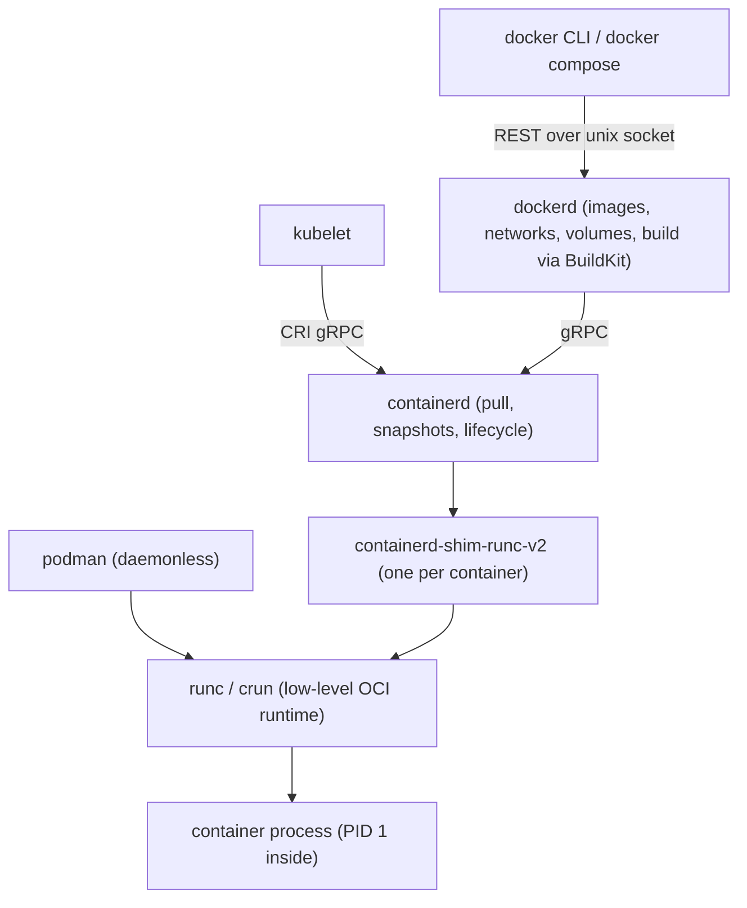
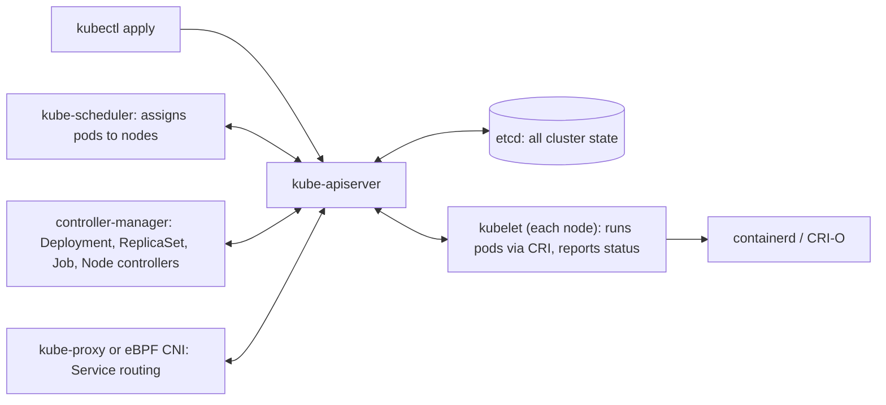
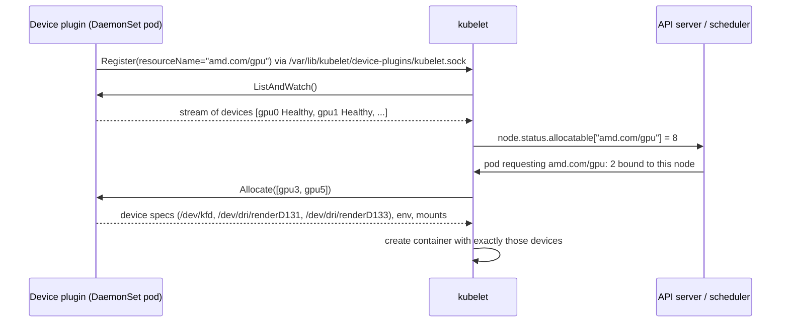
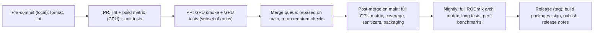
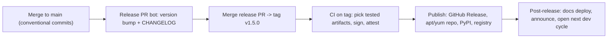

# Containers and CI -- Comprehensive Reference (Docker, ROCm Containers, Kubernetes, CI/CD)

> Last reviewed: 2026-11 · Versions assumed: Linux with cgroups v2, Docker Engine 28-29 (BuildKit default), containerd 2.x, Kubernetes 1.34-1.36, ROCm 7.x (Docker Hub `rocm/dev-ubuntu-24.04:7.2.4`), AMD Container Toolkit 1.x, NVIDIA Container Toolkit 1.17+, Apptainer 1.3+, GitHub Actions (checkout@v7, cache@v6, upload-artifact@v7)

> A practitioner's reference for the infrastructure side of GPU, HPC, ML-infra, and systems interviews. It covers how containers actually work (namespaces, cgroups v2, OverlayFS, OCI images, runc/containerd), how to write good Dockerfiles, how to run ROCm and CUDA workloads in containers (including profiling with rocprof-compute and rocprofv3), Apptainer on HPC clusters, Kubernetes with GPU scheduling, and how to design a CI/CD system for a GPU library that has to build across compilers, ROCm versions, and GPU architectures. Every section ends with interview questions and full answers.
>
> The kernel-level isolation theory (the full namespace table, cgroup v2 files, `chroot` vs `pivot_root`, hypervisor internals) lives in [CS Fundamentals 1.13](../computer-science/CS_Fundamentals.md#113-containers-and-virtualization-isolation-theory). This file summarizes it and focuses on using it.

---

## Table of Contents

### Part 1: Container Fundamentals

1. [What a Container Really Is](#1-what-a-container-really-is)
2. [Namespaces in Practice](#2-namespaces-in-practice)
3. [cgroups v2 Controllers](#3-cgroups-v2-controllers)
4. [OverlayFS and Union Filesystems](#4-overlayfs-and-union-filesystems)
5. [Images, Layers, and the OCI Specifications](#5-images-layers-and-the-oci-specifications)
6. [Container Runtimes and the Docker Stack](#6-container-runtimes-and-the-docker-stack)
7. [Containers vs VMs and Hypervisors](#7-containers-vs-vms-and-hypervisors)

### Part 2: Docker in Practice

8. [Dockerfile Best Practices](#8-dockerfile-best-practices)
9. [docker run Essentials](#9-docker-run-essentials)

### Part 3: GPU Containers and HPC

10. [Running ROCm Containers](#10-running-rocm-containers)
11. [NVIDIA Container Toolkit Compared](#11-nvidia-container-toolkit-compared)
12. [Apptainer and Singularity on HPC](#12-apptainer-and-singularity-on-hpc)

### Part 4: Kubernetes

13. [Kubernetes Architecture and Core Objects](#13-kubernetes-architecture-and-core-objects)
14. [Resource Requests, Limits, and QoS](#14-resource-requests-limits-and-qos)
15. [GPU Scheduling: Device Plugins, Node Selectors, and Taints](#15-gpu-scheduling-device-plugins-node-selectors-and-taints)
16. [Jobs, CronJobs, and Batch Workloads](#16-jobs-cronjobs-and-batch-workloads)

### Part 5: CI/CD Design

17. [CI/CD Pipeline Design](#17-cicd-pipeline-design)
18. [Matrix Builds: Compilers, ROCm Versions, and GPU Architectures](#18-matrix-builds-compilers-rocm-versions-and-gpu-architectures)
19. [Caching in CI](#19-caching-in-ci)
20. [Self-Hosted GPU Runners](#20-self-hosted-gpu-runners)
21. [Flaky Tests and Quarantine](#21-flaky-tests-and-quarantine)
22. [Artifacts, Supply Chain, and Release Automation](#22-artifacts-supply-chain-and-release-automation)
23. [A Complete GitHub Actions Workflow](#23-a-complete-github-actions-workflow)

### Part 6: Review

24. [Scenario Interview Questions](#24-scenario-interview-questions)
25. [Quick Reference Cheat Sheet](#25-quick-reference-cheat-sheet)

---

# Part 1: Container Fundamentals

---

## 1. What a Container Really Is

### 1.1 The One-Line Definition

A container is an **ordinary Linux process tree** that the kernel gives a restricted view of the system and a resource budget. There is no "container" object in the kernel. A container is assembled from independent kernel features:

```text
container  =  namespaces          what the process can SEE    (pid, net, mnt, uts, ipc, user, cgroup, time)
           +  cgroups v2          what the process can USE    (cpu, memory, io, pids, devices)
           +  root filesystem     what files it has           (image layers via OverlayFS + a writable layer)
           +  security policy     what it may DO              (capabilities, seccomp-bpf, AppArmor/SELinux, no_new_privs)
```

All containers on a host **share the host kernel**. That one fact explains most container behavior:
- Startup takes milliseconds, because nothing boots.
- A container cannot load a different kernel or kernel module.
- GPU drivers (amdgpu/KFD, nvidia.ko) live on the host. A container only receives device nodes and user-space libraries.
- A kernel exploit is a container escape.

### 1.2 What Happens on `docker run`

Walking through `docker run --rm -it ubuntu:24.04 bash` is a classic interview question. The answer touches every layer of the stack:

| Step | Component | What happens |
|---|---|---|
| 1 | `docker` CLI | Sends a REST request over `/var/run/docker.sock` to `dockerd` |
| 2 | `dockerd` | Resolves `ubuntu:24.04` to a digest. Asks containerd to pull if the image is missing. |
| 3 | containerd | Fetches the image **index**, picks the manifest for `linux/amd64`, and downloads any missing layer blobs (content-addressed by sha256) |
| 4 | containerd snapshotter | Unpacks the layers and prepares an **overlay** mount: read-only image layers as `lowerdir`, a fresh `upperdir` for this container |
| 5 | containerd | Writes an **OCI runtime bundle**: `config.json` (namespaces, cgroup limits, mounts, capabilities, seccomp, env, args) plus the rootfs path |
| 6 | `containerd-shim-runc-v2` | Starts and stays as the container's parent. It holds stdio and collects the exit status. |
| 7 | `runc create/start` | `clone()` with `CLONE_NEWPID`, `CLONE_NEWNS`, `CLONE_NEWNET`, and so on. Creates the cgroup and writes limits. Mounts `/proc`, `/dev`, and `/sys`, then `pivot_root`s into the rootfs. Drops capabilities, sets `no_new_privs`, loads the seccomp filter, switches UID, and `execve("bash")`. runc then exits. |
| 8 | `dockerd` | Connects the network namespace to the `docker0` bridge with a veth pair, assigns an IP, and attaches your terminal to the shim's stdio |
| 9 | `--rm` | On exit, the shim reports the status. Docker deletes the writable layer and the container metadata. |

```bash
# See for yourself: a container is a host process
docker run -d --name sleeper ubuntu:24.04 sleep 1000
pid=$(docker inspect --format '{{.State.Pid}}' sleeper)
ps -o pid,ppid,user,cmd -p "$pid"           # an ordinary process on the host
ls -l /proc/$pid/ns                          # its namespace handles
cat /proc/$pid/cgroup                        # 0::/system.slice/docker-<id>.scope
sudo nsenter -t "$pid" -a ps aux             # enter all its namespaces: sleep is PID 1
docker rm -f sleeper
```

### 1.3 Interview Questions

**Q1.** Is a container a lightweight VM?

No. A VM virtualizes **hardware** and runs its own kernel. A container virtualizes the **view of the OS**: it is a host process with namespaces, cgroups, and a different root filesystem. The practical differences all follow from this. Containers start in milliseconds and cost almost nothing per instance, but they share the host kernel. That makes them a weaker isolation boundary, and they cannot run a different OS or kernel version. The best one-sentence answer: "namespaces control what a process can see, cgroups control what it can use, and the image provides its filesystem."

**Q2.** Which process is the parent of a container's PID 1 on the host, and why is it not `dockerd`?

It is `containerd-shim-runc-v2`. runc creates the container and then exits, so something must stay behind to hold the container's stdio pipes, reap PID 1, and record its exit code. The shim does that. Because containers are not children of `dockerd` or `containerd`, those daemons can restart or upgrade without killing running containers ("live restore").

**Q3.** Why can't I `modprobe` inside a container, even as root?

Kernel modules load into the **shared host kernel**. Docker drops `CAP_SYS_MODULE` by default, and the default seccomp profile blocks `init_module` and `finit_module`. Even with `--privileged`, loading a module affects the whole host, not the container. The right model is to install drivers (amdgpu-dkms, nvidia) on the host and give containers only device nodes plus a compatible user-space stack.

---

## 2. Namespaces in Practice

### 2.1 Summary Table

| Namespace | Isolates | Practical consequence | Share with host via |
|---|---|---|---|
| **pid** | Process IDs | Your entrypoint is PID 1, which must reap zombies and handle signals | `--pid=host` |
| **net** | Interfaces, routes, iptables, ports | Own `eth0` (veth to a bridge), own `localhost` | `--network=host` |
| **mnt** | Mount table | Own `/`, own `/proc`, bind mounts visible only inside | (always private) |
| **uts** | Hostname, domain name | `hostname` inside does not touch the host | `--uts=host` |
| **ipc** | SysV IPC, POSIX message queues, **`/dev/shm`** | Default `/dev/shm` is only **64 MB** in Docker | `--ipc=host` or `--shm-size` |
| **user** | UID/GID mappings | Root inside maps to an unprivileged UID outside (rootless Docker/Podman) | `--userns=host` |
| **cgroup** | View of `/sys/fs/cgroup` | The container sees its own cgroup as `/` | `--cgroupns=host` |
| **time** (5.6+) | `CLOCK_MONOTONIC`/`BOOTTIME` offsets | Used by checkpoint/restore (CRIU) | -- |

The full clone-flag table and an `unshare` walkthrough are in [CS Fundamentals 1.13](../computer-science/CS_Fundamentals.md#113-containers-and-virtualization-isolation-theory).

### 2.2 Sharing Namespaces Deliberately

Namespaces are per-process handles, so two containers can **join** each other's namespaces. That is how Kubernetes pods and debugging sidecars work.

```bash
# Run a debug container inside an existing container's network and PID namespaces
docker run -it --rm --network=container:web --pid=container:web nicolaka/netshoot
# Now `ss -ltnp` shows web's listening sockets and `ps` shows web's processes.

# Kubernetes equivalent (ephemeral debug container)
kubectl debug -it pod/web --image=busybox:1.36 --target=web
```

A **Kubernetes pod** is a group of containers sharing the **net** and **ipc** namespaces (and optionally **pid** with `shareProcessNamespace: true`). A tiny `pause` container is created first to own these namespaces. App containers join it, so they can crash and restart without losing the pod's IP. This is why containers in a pod talk over `localhost` and cannot both bind port 8080.

### 2.3 Capabilities, seccomp, and Rootless

Namespaces alone do not make root safe. Docker also:
- **Drops capabilities.** It keeps 14 by default (`CHOWN`, `DAC_OVERRIDE`, `FOWNER`, `FSETID`, `KILL`, `SETGID`, `SETUID`, `SETPCAP`, `NET_BIND_SERVICE`, `NET_RAW`, `SYS_CHROOT`, `MKNOD`, `AUDIT_WRITE`, `SETFCAP`). Notably **missing**: `SYS_ADMIN`, `SYS_PTRACE`, `SYS_NICE`, `NET_ADMIN`, `SYS_MODULE`, and `PERFMON`.
- **Applies a seccomp-bpf allowlist** that blocks roughly 40+ syscalls, including `mount`, `kexec_load`, `init_module`, `perf_event_open`, and `bpf`. Some, like `mbind` and `set_mempolicy`, are allowed only with `CAP_SYS_NICE`.
- Applies an **AppArmor** profile (`docker-default`) or SELinux labels.

| Flag | What it does | When you need it |
|---|---|---|
| `--cap-add=SYS_PTRACE` | Allow `ptrace`/`process_vm_readv` | gdb/rocgdb attach, py-spy, some profilers |
| `--cap-add=SYS_NICE` | Allow NUMA policy syscalls, real-time priority | `numactl --membind`, pinning |
| `--security-opt seccomp=unconfined` | Disable the syscall filter entirely | Profilers (`perf_event_open`), HPC NUMA tooling; ROCm docs recommend it |
| `--privileged` | All capabilities, all devices, no seccomp/AppArmor | Almost never. It is effectively root on the host. |

**Rootless containers** (rootless Docker, Podman) run the whole stack inside a **user namespace**. Container root is your UID on the host, so even an escape lands as an unprivileged user. The costs: no binding to ports below 1024 without a sysctl, slirp4netns/pasta networking overhead, and fuse-overlayfs or kernel-native rootless overlay.

### 2.4 Interview Questions

**Q1.** Why does PyTorch's `DataLoader` crash with "bus error" in Docker but not on the host?

`DataLoader` workers pass tensors to the main process through shared memory in `/dev/shm`. Docker gives each container its own IPC namespace with a **64 MB** `/dev/shm` tmpfs. A batch larger than that triggers `SIGBUS` when the worker touches a page beyond the tmpfs limit. Fix it with `--shm-size=8g` (or larger), or `--ipc=host` to share the host's `/dev/shm`. Both appear in AMD's recommended `rocm/pytorch` command. In Kubernetes, mount an `emptyDir` with `medium: Memory` at `/dev/shm`.

**Q2.** What does `--network=host` give up, and when is it worth it?

It gives up network isolation. The container uses the host's interfaces and port space directly, so port conflicts and exposure are your problem. It is worth it for **multi-node RCCL/NCCL and MPI jobs**, where you want RDMA/InfiniBand/RoCE interfaces and no NAT or veth overhead on the data path, and for latency-sensitive services where the bridge's iptables DNAT hop matters.

**Q3.** How do containers in the same pod communicate, and what do they not share by default?

They share the network namespace (same IP, `localhost`, port space) and the IPC namespace. They do **not** share a filesystem: each has its own image rootfs. To share files, mount the same `volume` (usually `emptyDir`) into both. They also do not share a PID namespace unless `shareProcessNamespace: true` is set.

---

## 3. cgroups v2 Controllers

### 3.1 The Controllers

cgroups v2 is a single hierarchy at `/sys/fs/cgroup`. Docker, containerd, and the kubelet (with the `systemd` cgroup driver) create one cgroup per container and write limits into the controller files.

| Controller | Key files | What it limits | Failure mode when exceeded |
|---|---|---|---|
| **cpu** | `cpu.max` (quota/period), `cpu.weight` (1-10000) | CPU bandwidth and proportional share | **Throttling**: runnable threads wait until the next period |
| **cpuset** | `cpuset.cpus`, `cpuset.mems` | Which cores and NUMA nodes | None; placement only |
| **memory** | `memory.max`, `memory.high`, `memory.low`, `memory.swap.max` | Anonymous + **page cache** + kernel memory | Reclaim, then **cgroup OOM kill** (exit 137) |
| **io** | `io.max`, `io.weight` | Block-device bandwidth and IOPS | Throttling |
| **pids** | `pids.max` | Number of tasks (processes + threads) | `fork`/`clone` fails with `EAGAIN` |
| **hugetlb** | `hugetlb.2MB.max` | Huge page usage | Allocation failure / `SIGBUS` |
| **rdma** | `rdma.max` | RDMA/IB handles | Allocation failure |
| **misc** | `misc.max` | Scalar host resources (e.g. SEV ASIDs) | Allocation failure |
| *devices* | (eBPF program, no files) | Which device nodes may be opened | `open()` returns `EPERM` |

In v2, **device access** is not a file-based controller. The runtime attaches a `BPF_PROG_TYPE_CGROUP_DEVICE` program to the cgroup. `--device=/dev/kfd` therefore does two things: it creates the node inside the container, and it adds an allow rule to that eBPF program. Bind-mounting `/dev/kfd` with `-v` without `--device` gives you a file you cannot open.

### 3.2 Mapping Runtime Flags to cgroup Files

| Docker flag | Kubernetes field | cgroup v2 file |
|---|---|---|
| `--cpus=2` | `limits.cpu: "2"` | `cpu.max = 200000 100000` |
| `--cpu-shares` | `requests.cpu` | `cpu.weight` (converted from shares) |
| `--cpuset-cpus=0-7` | static CPU manager policy (Guaranteed pods) | `cpuset.cpus` |
| `--memory=16g` | `limits.memory: 16Gi` | `memory.max` |
| `--memory-reservation` | (`requests.memory` is used only for scheduling) | `memory.low` |
| `--pids-limit=4096` | kubelet `podPidsLimit` | `pids.max` |
| `--device-read-bps` | -- | `io.max` |

```bash
# Inspect a running container's limits from the host
cid=$(docker run -d --cpus=2 --memory=1g ubuntu:24.04 sleep 600)
cat /sys/fs/cgroup/system.slice/docker-$cid.scope/cpu.max      # 200000 100000
cat /sys/fs/cgroup/system.slice/docker-$cid.scope/memory.max   # 1073741824
docker stats --no-stream "$cid"
docker rm -f "$cid"
```

### 3.3 The Two Classic cgroup Bugs

**Bug 1: CPU-count blindness and throttling.** `nproc`, `os.cpu_count()`, and `std::thread::hardware_concurrency()` report **host** CPUs, not the CFS quota. A container with `--cpus=2` on a 64-core host starts 64 worker threads. They burn the 200 ms quota in about 3 ms of wall time, and the cgroup is then throttled for the rest of each 100 ms period. p99 latency jumps by tens of milliseconds while average CPU looks fine. Check `nr_throttled` and `throttled_usec` in `cpu.stat`. The worked example is in [CS Fundamentals 1.13](../computer-science/CS_Fundamentals.md#113-containers-and-virtualization-isolation-theory).

A cgroup-aware CPU count:

```python
"""Effective CPU count inside a container (cgroup v2 aware)."""
import math
import os
from pathlib import Path


def cgroup_cpu_quota(root: Path = Path("/sys/fs/cgroup")) -> float | None:
    """Return the CPU quota in CPUs from cpu.max, or None if unlimited/unknown."""
    # /proc/self/cgroup on v2 has one line: "0::/some/path"
    try:
        line = Path("/proc/self/cgroup").read_text().splitlines()[0]
        rel = line.split("::", 1)[1] if "::" in line else "/"
    except (OSError, IndexError):
        rel = "/"
    # Inside a container with a cgroup namespace, rel is usually "/".
    # Walk up: a parent's limit also constrains us; take the tightest.
    best = None
    path = (root / rel.lstrip("/")).resolve()
    while True:
        f = path / "cpu.max"
        if f.exists():
            quota, period = f.read_text().split()
            if quota != "max":
                cpus = int(quota) / int(period)
                best = cpus if best is None else min(best, cpus)
        if path == root or root not in path.parents:
            break
        path = path.parent
    return best


def effective_cpus() -> int:
    affinity = len(os.sched_getaffinity(0))    # cpuset / taskset restriction
    quota = cgroup_cpu_quota()                  # CFS bandwidth limit
    if quota is None:
        return affinity
    return max(1, min(affinity, math.ceil(quota)))


if __name__ == "__main__":
    print(f"os.cpu_count()        = {os.cpu_count()}")
    print(f"sched_getaffinity     = {len(os.sched_getaffinity(0))}")
    print(f"cgroup cpu.max quota  = {cgroup_cpu_quota()}")
    print(f"effective CPUs to use = {effective_cpus()}")
```

Under `docker run --cpus=2` on a 64-core host this prints 64, 64, 2.0, and 2. Python 3.13 added `os.process_cpu_count()`, which respects affinity but **not** the quota. Go (1.25+), recent JVMs, and .NET read the quota automatically. C++ and older Python do not.

**Bug 2: page cache counts against `memory.max`.** A container that reads a 20 GB dataset through the page cache can hit its 16 GB limit even though RSS is only 2 GB. The kernel reclaims clean cache first, so this usually causes slowness rather than an OOM. Dirty pages and `tmpfs` (including `/dev/shm`) cannot be dropped, though, so writing large files to `/dev/shm` or `emptyDir: {medium: Memory}` **does** lead to OOM kills. Watch `memory.stat` (`anon`, `file`, `shmem`) and `memory.events` (`oom_kill`).

### 3.4 Interview Questions

**Q1.** A service in Kubernetes has `limits.cpu: 2` and shows 40% average CPU, yet p99 latency is bad. What is going on?

Most likely **CFS throttling**. The limit becomes `cpu.max = 200000 100000`. The service runs more threads than 2 (GC threads, a thread pool sized from the host's 64 cores), so it uses its 200 ms of CPU time in a short burst early in each 100 ms period and then waits about 90 ms. The average is low because the window is mostly idle; the tail is bad because requests wait for the next period. Confirm with `cpu.stat` (`nr_throttled / nr_periods` greater than a few percent). Fixes, in order: size thread pools from the quota; raise or remove the CPU **limit** while keeping the **request** (many teams run without CPU limits for latency-sensitive services); or use Guaranteed QoS with the static CPU manager for exclusive cores.

**Q2.** What does exit code 137 mean, and how do you tell an OOM kill from a manual `kill -9`?

137 = 128 + 9: the process received `SIGKILL`. To tell an OOM kill apart, check `docker inspect --format '{{.State.OOMKilled}}'`, Kubernetes `lastState.terminated.reason: OOMKilled`, the cgroup's `memory.events` (`oom_kill` counter incremented), or `dmesg` ("Memory cgroup out of memory: Killed process ..."). A manual `kill -9` or a `docker stop` timeout does not touch those counters.

**Q3.** Why did cgroups v1 need to be replaced?

v1 had **one hierarchy per controller**, so a process could sit in `/cpu/a` and `/memory/b`. That made writeback accounting (memory + io) impossible to attribute correctly, and each controller had its own inconsistent semantics. v2 has a single tree, the "no internal processes" rule, consistent `max`/`high`/`low` semantics, pressure stall information (PSI) per cgroup, and eBPF device control. It is the default on current distributions, systemd, Docker, and Kubernetes. Kubernetes moved cgroup v1 support to maintenance mode in 1.31.

---

## 4. OverlayFS and Union Filesystems

### 4.1 How Layers Become a Root Filesystem

```text
merged/      <- what the container sees as /
  ^ union view
upperdir/    <- writable, per container: new files, copied-up files, whiteouts
lowerdir/    <- image layers, read-only, shared:  L4 (COPY app) : L3 (pip install) : L2 (apt) : L1 (ubuntu)
workdir/     <- scratch space OverlayFS uses for atomic copy-up
```

```bash
docker run -d --name ov ubuntu:24.04 sleep 600
# Classic overlay2 storage driver: Docker reports the directories directly
docker inspect --format '{{json .GraphDriver.Data}}' ov | python3 -m json.tool
# LowerDir: /var/lib/docker/overlay2/<id>/diff:..., UpperDir: ..., MergedDir: ...
# containerd image store (default on fresh Docker 29 installs) or any runtime:
findmnt -t overlay            # the overlay mount, with lowerdir=... upperdir=... options
docker rm -f ov
```

### 4.2 Consequences You Must Know

| Behavior | Consequence | What to do |
|---|---|---|
| Reads fall through to the topmost layer that has the file | Layers are shared; ten containers of one image store it once | -- |
| **Copy-up on first write** copies the *whole* file to `upperdir` | Appending 1 byte to a 5 GB file inside a container copies 5 GB | Put mutable data in **volumes** |
| Deletion creates a **whiteout** in the upper layer | `RUN rm big.tar` in a later layer does **not** shrink the image | Create and delete in the **same** `RUN`, or use multi-stage builds |
| The writable layer disappears with the container | Logs and outputs written inside are lost on `docker rm` | Write to volumes or bind mounts, log to stdout |
| `overlay2` needs d_type support on the backing filesystem | Old XFS formatted with `ftype=0` breaks | Use ext4 or XFS with `ftype=1` |
| Many layers slow lookups slightly | Deep chains (100+ layers) hurt metadata-heavy workloads | Keep images to tens of layers |

### 4.3 Interview Questions

**Q1.** My Dockerfile downloads a 2 GB tarball, extracts it, and deletes the tarball in the next `RUN`. Why is the image still 2 GB bigger than expected?

Each `RUN` produces a new **immutable layer**. The tarball was committed in the layer created by the first `RUN`. Deleting it later only adds a whiteout entry to the next layer; the bytes remain in the earlier layer and are pulled by every user. Do download, extract, and delete in **one** `RUN` (`curl ... | tar -x && ...`), use `RUN --mount=type=cache` or `--mount=type=bind` for transient inputs, or use a multi-stage build and copy only the result.

**Q2.** Why are database files and training checkpoints put on volumes rather than in the container filesystem?

Three reasons. Performance: copy-up and overlay metadata overhead hurt write-heavy workloads, while a volume is a plain directory on the host filesystem with no union logic. Durability: the writable layer is deleted with the container. Sharing: volumes can be mounted by other containers or survive upgrades of the image.

---

## 5. Images, Layers, and the OCI Specifications

### 5.1 The Three OCI Specs

The **Open Container Initiative** (OCI, under the Linux Foundation, founded 2015) standardizes the formats so that images built by Docker run on containerd, CRI-O, Podman, Apptainer, and Kubernetes.

| Spec | Defines | Key objects |
|---|---|---|
| **Image spec** | What an image *is* | Image **index** (multi-platform list) -> **manifest** (one platform) -> **config** + ordered **layers** |
| **Runtime spec** | How to *run* a filesystem bundle | `config.json` (process, mounts, namespaces, cgroups, hooks) + `rootfs/` |
| **Distribution spec** | How registries serve content | HTTP API: `GET /v2/<name>/manifests/<ref>`, `GET /v2/<name>/blobs/<digest>`, chunked uploads |

### 5.2 Anatomy of an Image

```text
ghcr.io/acme/app:1.4.2                 tag (mutable pointer)
   |
   v
image index  sha256:aa...              media type application/vnd.oci.image.index.v1+json
   |-- manifest for linux/amd64  sha256:bb...
   |      |-- config   sha256:cc...    JSON: env, entrypoint, cmd, user, workdir, history, rootfs.diff_ids
   |      |-- layer 1  sha256:d1...    tar+gzip (or zstd) of filesystem changes
   |      |-- layer 2  sha256:d2...
   |      `-- layer 3  sha256:d3...
   `-- manifest for linux/arm64  sha256:ee...
```

- Everything is **content-addressed**: a digest is the sha256 of the exact bytes. If a single byte changes, the digest changes. Registries deduplicate blobs, and clients skip layers they already have.
- A **layer digest** (compressed blob) differs from its **diff_id** (sha256 of the uncompressed tar, recorded in the config). The same filesystem compressed differently produces a different blob digest.
- With Docker's classic store, the **image ID** is the digest of the config. With the containerd image store (the default on new Docker 29 installs) and in containerd/Kubernetes generally, the ID shown is the index or manifest digest. The **repo digest** is always the manifest (or index) digest.
- **Multi-arch**: `docker pull python:3.12` fetches the index and picks the manifest matching your platform. Build one with `docker buildx build --platform linux/amd64,linux/arm64 --push`.

```bash
docker buildx imagetools inspect rocm/dev-ubuntu-24.04:7.2.4   # index and manifests, no pull
docker image inspect --format '{{.RootFS.Layers}}' ubuntu:24.04  # diff_ids
docker history --no-trunc ubuntu:24.04                           # which instruction made which layer
skopeo inspect docker://ubuntu:24.04                             # registry-side metadata (skopeo/crane)
```

### 5.3 Tags vs Digests

| | Tag (`:7.2.4`, `:latest`) | Digest (`@sha256:...`) |
|---|---|---|
| Mutable? | **Yes**: the publisher can repoint it | No: content-addressed |
| Reproducible builds | No | Yes |
| Security patches | Picked up automatically on next pull | Must bump explicitly (Renovate/Dependabot automate this) |
| Use for | Humans, dev loops | Production deploys, CI base images, Kubernetes manifests |

Best of both: `FROM ubuntu:24.04@sha256:<digest>`. The tag documents intent, the digest is what gets used, and a bot opens PRs to bump it.

### 5.4 Interview Questions

**Q1.** Two CI runs built "the same" Dockerfile on the same commit and got different image digests. Why?

Image digests depend on exact bytes. Common sources of difference: file **timestamps** in layers (mtime is part of the tar), a moving base tag (`ubuntu:24.04` repointed between builds), unpinned `apt-get install` or `pip install` pulling newer versions, build metadata in the config (`created` time, history), and compression settings. For reproducible images: pin the base by digest, pin package versions, set `SOURCE_DATE_EPOCH` (BuildKit honors it to normalize timestamps), and use lockfiles.

**Q2.** How does a registry avoid re-uploading layers that already exist?

The client does a `HEAD /v2/<name>/blobs/<digest>` for each layer. If the registry already has that digest (from this or another repository in the same registry, through cross-repo mount), the upload is skipped. Only the manifest, a few hundred bytes, is always pushed. This is why ordering a Dockerfile so that big dependency layers rarely change also speeds up pushes and pulls, not just builds.

---

## 6. Container Runtimes and the Docker Stack

### 6.1 The Layers



| Level | Examples | Job |
|---|---|---|
| **High-level runtime / engine** | containerd, CRI-O, dockerd, Podman | Pull and store images, manage snapshots, networking hooks, expose an API (CRI for Kubernetes) |
| **Shim** | containerd-shim-runc-v2, conmon (Podman/CRI-O) | Parent of the container: holds stdio, reaps, reports exit; lets the daemon restart |
| **Low-level (OCI) runtime** | **runc** (Go, reference implementation), **crun** (C, faster, lower memory), **youki** (Rust) | Take a bundle (`config.json` + rootfs) and create namespaces, cgroups, mounts, then `exec` |
| **Sandboxed runtimes** | **gVisor** (`runsc`: a user-space kernel intercepts syscalls), **Kata Containers** (each pod in a lightweight VM) | Stronger isolation for untrusted or multi-tenant code, at some performance and compatibility cost |

Facts worth knowing:
- Kubernetes talks to runtimes through the **Container Runtime Interface** (CRI). The built-in Docker adapter, **dockershim**, was removed in Kubernetes **1.24** (2022). Clusters run containerd or CRI-O directly. Docker-built images still work because they are OCI images.
- **BuildKit** has been Docker's default builder since Engine 23.0. It builds a DAG of stages in parallel, skips unused stages, and supports cache and secret mounts.
- **Podman** is daemonless and rootless by default, with a Docker-compatible CLI. **Buildah** builds images without a daemon. **nerdctl** is a Docker-compatible CLI for containerd. **crictl** debugs CRI runtimes on Kubernetes nodes.

### 6.2 Interview Questions

**Q1.** "Kubernetes removed Docker support." Do I need to rebuild my images?

No. Kubernetes removed **dockershim**, the adapter that let the kubelet drive `dockerd`. Nodes now run containerd or CRI-O through CRI. Images built with `docker build` are OCI images and run unchanged. What changes: node-level debugging uses `crictl` rather than `docker ps`, and anything that mounted `/var/run/docker.sock` into pods (Docker-in-Docker CI builders) must change, for example to BuildKit, Kaniko, or Buildah.

**Q2.** Why does the shim exist? Why not let containerd be the parent?

If containerd were the parent of every container, restarting or upgrading containerd would kill or orphan all containers, and their stdio pipes would close. The per-container shim decouples container lifetime from the daemon. It is also where runtime-specific logic lives (the Kata shim talks to a VM, the runc shim to runc), which is what makes runtimes pluggable.

---

## 7. Containers vs VMs and Hypervisors

### 7.1 Summary

| Aspect | Containers | Virtual machines |
|---|---|---|
| Boundary | Namespaces + cgroups + seccomp; **shared kernel** | Hardware virtualization (VT-x/AMD-V, EPT/NPT); own kernel |
| Start time | ~100 ms (process start + setup) | Seconds to minutes; microVMs (Firecracker) ~125 ms |
| Overhead | Near zero CPU; memory = the processes | Guest kernel + reserved RAM per VM; small CPU overhead |
| Density | Hundreds to thousands per host | Tens per host |
| OS flexibility | Same kernel ABI (Linux on Linux) | Any guest OS and kernel version |
| GPU access | Device nodes + user space; host driver | PCIe passthrough (VFIO/IOMMU) or SR-IOV virtual functions; driver in the guest |
| Typical use | Packaging, CI, microservices, reproducible ML/ROCm environments | Multi-tenant cloud isolation, different OSes, kernel/driver development |

**Hypervisor types:**
- **Type 1 (bare-metal)** runs directly on hardware: VMware ESXi, Xen, Hyper-V, and **KVM**. KVM turns Linux itself into the hypervisor and is generally classed as Type 1. Every public cloud runs Type 1 hypervisors (AWS Nitro is KVM-based).
- **Type 2 (hosted)** runs as an application on a host OS: VirtualBox, VMware Workstation/Fusion, Parallels. It is used for desktops and development.

The details (two-dimensional page walks, IOMMU, SR-IOV, virtio) are in [CS Fundamentals 1.13](../computer-science/CS_Fundamentals.md#113-containers-and-virtualization-isolation-theory).

**Common combinations:** containers *inside* VMs are the cloud norm (EKS/GKE nodes are VMs). Kata Containers and Firecracker give each pod or function its own microVM while keeping the container workflow.

### 7.2 Interview Questions

**Q1.** When would you choose a VM over a container for a GPU workload?

When tenants are mutually untrusted. A shared kernel plus a shared GPU driver is a large attack surface, so a cloud provider gives each customer a VM with a passed-through GPU or an SR-IOV virtual function (for example AMD MxGPU on Instinct). Also when you need a different kernel or driver version than the host: testing a new amdgpu driver, kernel-driver development, or running a guest OS that needs its own driver stack. For a single trusted team on bare metal, containers are simpler and have zero overhead.

**Q2.** Why are containers "not a security boundary" while VMs are, and what narrows the gap?

A container process makes syscalls directly into the **host** kernel, so any exploitable kernel bug (there are dozens of privilege-escalation CVEs per year) is a potential escape. A VM's guest can only reach the host through the much smaller hypervisor interface (VM exits, virtio devices). Ways to narrow the gap: rootless or user-namespace remapping (an escape lands as an unprivileged user), strict seccomp and dropped capabilities, read-only rootfs, no `--privileged`, gVisor (a user-space kernel answers syscalls), and Kata or Firecracker (hardware isolation with container ergonomics).

---

# Part 2: Docker in Practice

---

## 8. Dockerfile Best Practices

### 8.1 Instruction Cheat Sheet

| Instruction | Creates a layer? | Notes |
|---|---|---|
| `FROM image AS name` | Starts a stage | Pin by digest for reproducibility. `ARG` before `FROM` is only visible to `FROM` lines. |
| `RUN` | Yes | Chain related commands with `&&` and clean up in the **same** `RUN` |
| `COPY` | Yes | Prefer over `ADD`. `--chown=user:group`, `--from=stage`, `--link` (layer independent of the previous one) |
| `ADD` | Yes | Also auto-extracts local tarballs and fetches URLs. That magic surprises people, so use it only when you want it. |
| `ENV` | Metadata | Persists into the running container |
| `ARG` | Metadata | Build-time only; **still visible in `docker history`**, so never pass secrets this way |
| `WORKDIR` | Metadata | Creates the directory; prefer it over `RUN cd` |
| `USER` | Metadata | Run as non-root from here on |
| `EXPOSE` | Metadata | Documentation only; does not publish ports |
| `ENTRYPOINT` / `CMD` | Metadata | `ENTRYPOINT` is the executable, `CMD` its default args. Use **exec form** (`["a","b"]`). |
| `HEALTHCHECK` | Metadata | Docker/Compose use it; Kubernetes ignores it and uses probes |
| `LABEL` | Metadata | `org.opencontainers.image.source`, `.revision`, `.version` for traceability |

**Exec form vs shell form.** `CMD python app.py` (shell form) runs `/bin/sh -c "python app.py"`. `sh` becomes PID 1 and does not forward `SIGTERM` to Python. `docker stop` then waits the full 10 s grace period and sends `SIGKILL`. `CMD ["python", "app.py"]` makes Python PID 1 directly. Add `--init` (tini) or install tini in the image if the process spawns children it does not reap. See [CS Fundamentals 1.9](../computer-science/CS_Fundamentals.md#19-linux-process-lifecycle-signals-and-file-descriptors).

### 8.2 Layer Caching: The Rules

BuildKit reuses a cached layer when the instruction **and everything before it** is unchanged:
- For `RUN`, the cache key is the command string plus the parent layer. BuildKit does **not** notice that `apt-get update` would fetch something new today.
- For `COPY`/`ADD`, the key includes a **checksum of the copied files' contents** (mtime is ignored).
- **Once one layer misses, every later layer rebuilds.**

So order instructions from least to most frequently changing: base image, then system packages, then dependency manifests and install, then source code.

```dockerfile
# fragment -- BAD: any source edit reinstalls every dependency
FROM python:latest
COPY . /app
RUN pip install -r /app/requirements.txt
CMD python /app/main.py
```

What is wrong:
- A mutable, huge base tag (`latest`, the full Debian image).
- `COPY .` before `pip install` busts the dependency layer on every edit.
- No `.dockerignore`, so `.git` and local virtualenvs are sent as build context.
- Runs as root.
- Shell-form `CMD` swallows signals.

```dockerfile
# fragment -- GOOD (replace <digest> with the real index digest)
FROM python:3.12-slim-trixie@sha256:<digest>

ENV PYTHONDONTWRITEBYTECODE=1 \
    PYTHONUNBUFFERED=1

RUN useradd --create-home --uid 10001 app
WORKDIR /app

# 1. Dependencies: this layer is reused until requirements.txt changes.
COPY requirements.txt .
RUN --mount=type=cache,target=/root/.cache/pip \
    pip install --require-hashes -r requirements.txt

# 2. Source code: changes often, so it comes last.
COPY --chown=app:app src/ ./src/

USER app
ENTRYPOINT ["python", "-m", "src.service"]
```

`--require-hashes` needs a lockfile with hashes (`pip-compile --generate-hashes`, or `uv pip compile --generate-hashes`). The cache mount keeps pip's download cache **outside** the image while still speeding up rebuilds.

### 8.3 Multi-Stage Builds (C++ Example)

A multi-stage build compiles with a full toolchain and ships only the binary. The final image does not contain the compiler, headers, or source.

Project layout:

```text
hello/
|-- .dockerignore
|-- CMakeLists.txt
|-- Dockerfile
`-- src/main.cpp
```

```cpp
// src/main.cpp
#include <cstdio>
#include <thread>

int main() {
    std::printf("hello from a %u-thread container\n",
                std::thread::hardware_concurrency());
    return 0;
}
```

```cmake
# CMakeLists.txt
cmake_minimum_required(VERSION 3.25)
project(hello LANGUAGES CXX)
add_executable(hello src/main.cpp)
target_compile_features(hello PRIVATE cxx_std_20)
# GCC 15's libstdc++ is newer than the runtime image's; link it statically.
target_link_options(hello PRIVATE -static-libstdc++ -static-libgcc)
install(TARGETS hello RUNTIME DESTINATION bin)
```

```dockerfile
# syntax=docker/dockerfile:1
ARG GCC_IMAGE=gcc:15-trixie

# ---------- stage 1: build ----------
FROM ${GCC_IMAGE} AS build
# Debian images delete downloaded .debs after install; keep them for the cache mount.
RUN rm -f /etc/apt/apt.conf.d/docker-clean
RUN --mount=type=cache,target=/var/cache/apt,sharing=locked \
    --mount=type=cache,target=/var/lib/apt,sharing=locked \
    apt-get update && apt-get install -y --no-install-recommends cmake ninja-build
WORKDIR /src
COPY CMakeLists.txt .
COPY src/ src/
RUN cmake -S . -B build -G Ninja -DCMAKE_BUILD_TYPE=Release -DCMAKE_CXX_COMPILER=g++ \
 && cmake --build build \
 && cmake --install build --prefix /out

# ---------- stage 2: runtime ----------
FROM gcr.io/distroless/cc-debian13:nonroot AS runtime
COPY --from=build /out/bin/hello /usr/local/bin/hello
USER nonroot
ENTRYPOINT ["/usr/local/bin/hello"]
```

```text
# .dockerignore -- keep the build context small and the cache stable
.git
build/
out/
**/__pycache__
*.log
.venv
Dockerfile*
.dockerignore
```

```bash
docker build -t hello:dev .                    # builds only what 'runtime' needs
docker build --target build -t hello:build .   # stop at the build stage (debugging)
docker run --rm hello:dev
docker image ls hello                          # tens of MB instead of over 1 GB for the gcc image
```

Why the static `libstdc++`: the binary is built against GCC 15's `libstdc++`, but the distroless Debian 13 image ships Debian's older system `libstdc++`. A dynamically linked binary would fail at start with `version 'GLIBCXX_3.4.xx' not found`. Statically linking `libstdc++`/`libgcc` leaves only a glibc dependency, and both stages are Debian 13 (trixie), so glibc matches. The general rule: **the runtime stage must provide every shared library the binary needs, at a version at least as new as the one it was built against.** Check with `ldd` in the build stage.

### 8.4 Choosing a Base Image

| Base | Size (compressed, approx.) | Has shell / package manager | Good for | Watch out for |
|---|---|---|---|---|
| `scratch` | 0 | No / No | Fully static Go/Rust/C binaries | No CA certs, no `/etc/passwd`, no timezone data |
| `gcr.io/distroless/static` | ~1 MB | No / No | Static binaries that need CA certs and a nonroot user | Debug with `:debug` variants |
| `gcr.io/distroless/cc` | ~10 MB | No / No | C/C++ with glibc + libgcc | Must match the glibc of the build stage |
| `alpine:3.22` | ~4 MB | Yes / apk | Small tool images | **musl libc**: different DNS resolver and malloc behavior; many Python packages lack musllinux wheels and compile from source; ROCm and CUDA do not support musl |
| `debian:trixie-slim` / `bookworm-slim` | ~30 MB | Yes / apt | General purpose glibc | -- |
| `ubuntu:24.04` | ~30 MB | Yes / apt | Matching ROCm's supported distros | Ships a `ubuntu` user with **UID 1000**, so `useradd -u 1000` fails |
| `rocm/dev-ubuntu-24.04:7.2.4` | ~1.2 GB | Yes / apt | HIP build stage (`rocm-dev`: compilers, runtime, tools) | Large; not a runtime base |
| `rocm/dev-ubuntu-24.04:7.2.4-complete` | ~7.4 GB | Yes / apt | Builds that need math libraries (`rocm-dev` + `rocm-libs`) | Very large; cache it on runners |

Sizes are compressed pulls from Docker Hub as of late 2026 and move with every release.

### 8.5 Security and Reproducibility Checklist

- **Non-root user.** Add `USER 10001` (or distroless `:nonroot`, UID 65532). Root in a container is root on the host kernel's view of files you bind-mount, and with no user namespace, an escape as root is game over.
- **Read-only root filesystem.** Run with `--read-only --tmpfs /tmp`, or set `readOnlyRootFilesystem: true` in Kubernetes.
- **Secrets.** Use `RUN --mount=type=secret,id=npmrc,target=/root/.npmrc npm ci` with `docker build --secret id=npmrc,src=$HOME/.npmrc`. The secret is never written to a layer. `ARG`/`ENV` secrets end up in `docker history`.
- **Pin everything.** Base image by digest. `apt-get install pkg=1.2.3-1` for packages that matter. Lockfiles with hashes. Pinned action versions in CI.
- **But rebuild regularly.** Pinning freezes CVEs too. Automate digest bumps (Renovate/Dependabot) and rebuild weekly to pick up patched layers.
- **Scan and attest.** `hadolint` lints Dockerfiles. `trivy image` or `grype` scans for CVEs. Generate SBOMs and provenance with `docker buildx build --sbom=true --provenance=mode=max`.
- **One concern per container.** Log to stdout/stderr, keep configuration in env vars or mounted files (12-factor), and avoid `sshd` or `cron` inside app containers.
- **apt hygiene.** Use `apt-get update && apt-get install -y --no-install-recommends ...` in one `RUN`. If you do not use a cache mount, end with `rm -rf /var/lib/apt/lists/*`.

### 8.6 Interview Questions

**Q1.** Your image build takes 20 minutes on every commit even though only Python source changed. How do you fix it?

Find the first cache miss: `docker build --progress=plain` shows `CACHED` per step. Usually a `COPY . .` sits before the dependency install, so any source change invalidates `pip install`. Fixes:
- Copy only the dependency manifest first and install, then copy the source.
- Add a `.dockerignore` so `.git` and build outputs do not change the context checksum.
- Use `RUN --mount=type=cache` for pip/apt/ccache so even real misses are faster.
- In CI, where the builder is fresh, export and import the cache: `--cache-to type=registry,ref=...,mode=max --cache-from type=registry,ref=...`, or `type=gha` on GitHub Actions.

**Q2.** What is the difference between `ENTRYPOINT` and `CMD`, and how do they combine?

`ENTRYPOINT` is the fixed executable, and `CMD` provides default arguments that `docker run image <args>` replaces. With `ENTRYPOINT ["rocprofv3"]` and `CMD ["--help"]`, `docker run img --kernel-trace -- ./app` runs `rocprofv3 --kernel-trace -- ./app`. If only `CMD` is set, the run arguments replace the whole command. `--entrypoint` overrides `ENTRYPOINT`. In Kubernetes, `command:` overrides `ENTRYPOINT` and `args:` overrides `CMD`. That naming mismatch is a common trap.

**Q3.** Why use multi-stage builds instead of deleting the compiler at the end of one stage?

Deleting files in a later layer does not remove them from earlier layers (OverlayFS whiteouts), so the image stays large and still contains the toolchain and possibly secrets or source. A multi-stage build starts the final stage from a clean base and copies only named artifacts. Other benefits: build stages run in parallel, `--target` lets you build a test or debug stage from the same file, and a smaller final image has fewer packages and therefore fewer CVEs.

**Q4.** How do you get a credential into a build without leaking it into the image?

Use a BuildKit secret mount: `RUN --mount=type=secret,id=token,env=TOKEN ...`, invoked with `docker build --secret id=token,env=TOKEN`. The secret is exposed only for that `RUN`, as a tmpfs file or an env var, and never committed to a layer. For SSH (private git dependencies), use `RUN --mount=type=ssh` with `docker build --ssh default`. Never use `ARG`/`ENV` (visible in `docker history` and the image config), and never `COPY` a key and then delete it (it stays in the earlier layer).

---

## 9. docker run Essentials

### 9.1 The Flags You Actually Use

| Flag | Meaning | Example |
|---|---|---|
| `-it` | Interactive + TTY | `docker run -it ubuntu:24.04 bash` |
| `--rm` | Delete the container on exit | Always, for one-off runs |
| `-d` / `--name` | Detach / give it a name | `docker run -d --name db postgres:17` |
| `-e`, `--env-file` | Environment variables | `-e HIP_VISIBLE_DEVICES=0` |
| `-v src:dst[:ro]` / `--mount` | Bind mount or named volume | `-v "$PWD":/work -w /work` |
| `--tmpfs /tmp` | In-memory scratch | With `--read-only` |
| `-p 8080:80` | Publish a container port on the host | Host 8080 -> container 80 |
| `--network` | `bridge` (default), `host`, `none`, a user network, `container:<id>` | `--network=host` for RCCL/MPI |
| `-u 1000:1000` | Run as this UID:GID | Matches bind-mounted file ownership |
| `--cpus`, `--memory`, `--pids-limit` | cgroup limits | `--cpus=8 --memory=32g` |
| `--shm-size` / `--ipc=host` | Size or share `/dev/shm` | `--shm-size=16g` for PyTorch |
| `--init` | Run tini as PID 1 to forward signals and reap zombies | Any multi-process entrypoint |
| `--device` | Expose a device node and allow it in the device cgroup | `--device=/dev/kfd` |
| `--group-add` | Add a supplementary group (name or numeric GID) | `--group-add video` |
| `--cap-add` / `--security-opt` | Capabilities, seccomp, AppArmor | `--cap-add=SYS_PTRACE` |
| `--ulimit` | Resource limits | `--ulimit memlock=-1` for RDMA |
| `--entrypoint` | Override `ENTRYPOINT` | `--entrypoint bash` to debug an image |
| `--platform` | Select an architecture | `--platform linux/arm64` (emulated with QEMU if needed) |

### 9.2 Volumes vs Bind Mounts vs tmpfs

| Type | Syntax | Lives in | Use for |
|---|---|---|---|
| **Named volume** | `-v data:/var/lib/postgresql/data` | `/var/lib/docker/volumes/` (Docker-managed) | Databases, caches that should survive the container |
| **Bind mount** | `-v /host/path:/ctr/path` | Anywhere on the host | Source code in dev loops, datasets, writing results back to the host |
| **tmpfs** | `--tmpfs /scratch:size=4g` | RAM (counts against the memory limit) | Secrets, fast scratch space |

Pitfall: files created in a bind mount by a container running as root are **owned by root on the host**. Run with `-u "$(id -u):$(id -g)"` so outputs (profiles, build trees) belong to you.

### 9.3 Lifecycle and Debugging Commands

```bash
docker ps -a                                   # all containers, including exited
docker logs -f --tail=100 web                  # stdout/stderr of PID 1
docker exec -it web bash                       # new process in the same namespaces
docker inspect web | less                      # full config: mounts, env, network, State
docker stats                                   # live CPU/mem/IO from cgroups
docker cp web:/app/out.csv .                   # copy files out
docker stop -t 30 web                          # SIGTERM, then SIGKILL after 30 s (default 10 s)
docker system df && docker system prune -af    # disk usage and cleanup (careful: deletes images)
docker run --rm -it --entrypoint sh img        # get a shell in an image whose entrypoint is not a shell
```

### 9.4 Exit Codes

| Code | Meaning |
|---|---|
| 0 | Success |
| 1 | Application error |
| **125** | `docker run` itself failed (bad flag, daemon error) |
| **126** | Command found but not executable (permissions, wrong architecture) |
| **127** | Command not found in the image |
| **137** | 128 + 9 = `SIGKILL`: OOM kill or a stop timeout |
| **139** | 128 + 11 = `SIGSEGV` |
| **143** | 128 + 15 = `SIGTERM`, not handled |

### 9.5 Handling SIGTERM in a C++ Entrypoint

PID 1 in a PID namespace is special: the kernel **does not deliver** signals whose disposition is the default action. A C++ server that never installs a `SIGTERM` handler ignores `docker stop` and `kubectl delete pod`, so it is killed after the grace period without flushing anything. Always handle `SIGTERM`:

```cpp
// graceful.cpp -- a container entrypoint that shuts down cleanly on SIGTERM.
// Build: g++ -std=c++17 -O2 -Wall -Wextra graceful.cpp -o graceful
#include <atomic>
#include <chrono>
#include <csignal>
#include <cstdio>
#include <thread>

namespace {
std::atomic<bool> g_stop{false};  // lock-free atomics are async-signal-safe

extern "C" void on_signal(int) { g_stop.store(true, std::memory_order_relaxed); }
}  // namespace

int main() {
    static_assert(std::atomic<bool>::is_always_lock_free);
    struct sigaction sa {};
    sa.sa_handler = on_signal;
    sigemptyset(&sa.sa_mask);
    // Installing a handler matters for PID 1: the kernel drops signals whose
    // disposition is SIG_DFL for a PID-namespace init process.
    sigaction(SIGTERM, &sa, nullptr);
    sigaction(SIGINT, &sa, nullptr);

    std::printf("worker started\n");
    std::fflush(stdout);  // stdout is a pipe under docker: flush or lose logs
    int ticks = 0;
    while (!g_stop.load(std::memory_order_relaxed)) {
        std::this_thread::sleep_for(std::chrono::milliseconds(100));
        ++ticks;
    }
    // Drain in-flight work, flush buffers, close files, then exit 0.
    std::printf("SIGTERM received after %d ticks; draining and exiting\n", ticks);
    return 0;
}
```

Run it as PID 1 with `docker run --rm img` and `docker stop` returns in milliseconds with exit code 0. Without the handler it takes 10 s and exits 137.

### 9.6 Interview Questions

**Q1.** `docker stop` takes exactly 10 seconds for your container. Why?

`docker stop` sends `SIGTERM`, waits 10 s by default, then sends `SIGKILL`. A container that always takes 10 s ignores `SIGTERM`. The two usual causes: shell-form `CMD`/`ENTRYPOINT`, which makes `/bin/sh` PID 1 and does not forward signals, or a PID-1 program with no `SIGTERM` handler (the kernel ignores default-action signals for a namespace's init). Fix with exec form, `exec "$@"` at the end of entrypoint scripts, a real handler, or `--init`.

**Q2.** How does `-p 8080:80` work under the hood?

The container sits on the `docker0` bridge with a private IP (such as 172.17.0.2), connected by a veth pair. Docker installs iptables (or nftables) **DNAT** rules: traffic to host port 8080 is rewritten to 172.17.0.2:80, and **MASQUERADE** handles outbound traffic. For connections from the host to itself, `docker-proxy` (a userland proxy) may handle hairpin cases. Consequence: published ports bypass some host firewall rules (`ufw`), which is a well-known security footgun. Bind to localhost with `-p 127.0.0.1:8080:80` when you do not want exposure.

**Q3.** Your container writes results into a bind-mounted directory and you cannot delete them on the host. Why?

The process ran as root (UID 0) inside the container. Without a user namespace, UID 0 inside **is** UID 0 on the host filesystem, so the files are root-owned. Run with `-u "$(id -u):$(id -g)"`, set `USER` in the image to a UID that matches the host user, or use rootless Docker/Podman, where container root maps to your own UID.

---

# Part 3: GPU Containers and HPC

---

## 10. Running ROCm Containers

### 10.1 How AMD GPUs Reach a Container

```text
 Host kernel:  amdgpu.ko (includes KFD, the compute driver)
                 |                         |
            /dev/kfd                 /dev/dri/renderD128, renderD129, ...
   (one node, compute interface      (one render node per GPU, or per partition;
    shared by all GPUs: queues,       ROCr only uses GPUs whose render node it
    memory, events, topology)         can open)
                 |                         |
 Container:  ROCm user space from the IMAGE: libhsa-runtime64 (ROCr), libamdhip64 (HIP),
             rocBLAS/MIOpen/..., amdclang, rocprofv3, rocprof-compute
```

Key facts:
- The **kernel driver stays on the host**. The host needs only the amdgpu driver (inbox or `amdgpu-dkms`); it does **not** need ROCm user space installed.
- The **whole ROCm user space comes from the image**. Unlike CUDA (Section 11), no driver library is injected from the host. The container's ROCr talks to the host's KFD through ioctls.
- Therefore the **container's ROCm version must be compatible with the host's amdgpu/KFD version**. AMD documents a supported compatibility window between user space and kernel driver versions. An image far newer than the host driver can fail with obscure HSA errors or miss features. Check the driver version with `amd-smi version` on the host and compare with the ROCm compatibility matrix.
- **GPU selection is done by render nodes.** `/dev/kfd` is shared, but the ROCr runtime enumerates GPUs from the KFD topology (`/sys/class/kfd/kfd/topology/nodes/`) and skips any GPU whose render node it cannot open. Passing `--device=/dev/dri/renderD128` only therefore exposes exactly one GPU.

### 10.2 The Canonical Command

From the ROCm documentation for PyTorch containers:

```bash
docker run -it --rm \
  --device=/dev/kfd --device=/dev/dri \
  --group-add video \
  --cap-add=SYS_PTRACE --security-opt seccomp=unconfined \
  --ipc=host --shm-size 8G \
  -v "$HOME/work":/work -w /work \
  rocm/pytorch:rocm7.2.4_ubuntu24.04_py3.12_pytorch_release_2.10.0
```

| Flag | Why |
|---|---|
| `--device=/dev/kfd` | The compute interface. Without it, `rocminfo` fails and HIP reports no devices. |
| `--device=/dev/dri` | All DRI nodes, including the per-GPU render nodes. To limit GPUs, pass specific `/dev/dri/renderD*` nodes instead. |
| `--group-add video` | Device nodes are owned by groups `video` and/or `render` on the host. Needed when the container process is **not** root. |
| `--security-opt seccomp=unconfined` | ROCm docs recommend it for HPC workloads (memory mapping, `numactl` NUMA policies). Also unblocks `perf_event_open` for CPU-side profilers. |
| `--cap-add=SYS_PTRACE` | Debuggers (`rocgdb`), attaching profilers, py-spy |
| `--ipc=host` / `--shm-size 8G` | PyTorch `DataLoader` and RCCL use `/dev/shm`; the default 64 MB is too small |

For multi-node RCCL training, also add `--network=host`, `--device=/dev/infiniband` (RDMA NICs), and `--ulimit memlock=-1` (RDMA must pin memory).

### 10.3 Restricting GPUs: Isolation vs Filtering

| Mechanism | Example | Enforced by | Isolation? |
|---|---|---|---|
| Pass specific render nodes | `--device=/dev/kfd --device=/dev/dri/renderD128 --device=/dev/dri/renderD129` | Device cgroup + ROCr enumeration | **Yes**: other GPUs cannot be opened |
| AMD Container Toolkit | `--runtime=amd -e AMD_VISIBLE_DEVICES=0,1` or CDI `--device amd.com/gpu=0` | Runtime injects only those nodes | **Yes** |
| `ROCR_VISIBLE_DEVICES=0,1` | env var | ROCr runtime (affects HIP, OpenCL, everything on ROCr) | No: the process could unset it |
| `HIP_VISIBLE_DEVICES=0,1` | env var | HIP runtime only | No |

- Use device-level restriction for multi-tenant runners and anything that should not see other GPUs. Use env vars for convenience within a job.
- Indices inside a restricted container are **renumbered from 0**. Render node numbers (`renderD128 + n`) are assigned in DRM probe order and do not necessarily match `amd-smi` or HIP ordering. Map them through PCI addresses: `ls -l /sys/class/drm/renderD*/device` and `amd-smi list`.
- On partitioned Instinct GPUs (for example MI300X or MI350X in DPX, QPX, or CPX compute-partition mode), **each partition is its own render node**. CPX mode on an 8-GPU MI300X node yields 64 render nodes and 64 schedulable devices.

### 10.4 Groups and Non-Root Users

A classic failure: the image runs as a non-root user, and `rocminfo` prints `HSA_STATUS_ERROR_OUT_OF_RESOURCES` or HIP reports `hipErrorNoDevice`, even though `--device` flags are present. The device nodes exist but are not readable by that user.

- On the host, `/dev/kfd` and `/dev/dri/renderD*` belong to group `render` (Ubuntu 20.04+), and card nodes to `video`. Check with `ls -ln /dev/kfd /dev/dri`.
- `--group-add NAME` resolves the name using the **container's** `/etc/group`, but the kernel checks the **numeric GID**. AMD's `rocm/dev-ubuntu-*` Dockerfiles create `render` with **GID 109**. If the host's `render` group is GID 992, `--group-add render` adds 109, which does not grant access.
- The robust fix is to pass numeric GIDs from the host:

```bash
docker run --rm -u "$(id -u):$(id -g)" \
  --device=/dev/kfd --device=/dev/dri \
  --group-add "$(getent group render | cut -d: -f3)" \
  --group-add "$(getent group video  | cut -d: -f3)" \
  rocm/dev-ubuntu-24.04:7.2.4 rocminfo | grep -E 'Marketing Name|gfx'
```

### 10.5 The AMD Container Toolkit

The [AMD Container Toolkit](https://instinct.docs.amd.com/projects/container-toolkit/en/latest/container-runtime/overview.html) (`amd-container-toolkit` package, CLI `amd-ctk`) is AMD's counterpart to the NVIDIA Container Toolkit. It removes the need to map render nodes by hand.

```bash
# Option 1: Docker runtime (Docker only)
sudo amd-ctk runtime configure          # adds an "amd" runtime to /etc/docker/daemon.json
sudo systemctl restart docker
docker run --rm --runtime=amd -e AMD_VISIBLE_DEVICES=all rocm/rocm-terminal rocm-smi
docker run --rm --runtime=amd -e AMD_VISIBLE_DEVICES=0-3 ...      # indices, ranges, or UUIDs
amd-ctk gpu list                         # indices and UUIDs

# Option 2: CDI (Container Device Interface) -- works with any CDI-aware runtime (Docker, Podman, containerd)
sudo amd-ctk cdi generate --output=/etc/cdi/amd.json
docker run --rm --device amd.com/gpu=all rocm/rocm-terminal rocm-smi
docker run --rm --device amd.com/gpu=0 ...
```

Since Docker 28.3, the standard `--gpus` flag also works with the AMD runtime: `docker run --runtime=amd --gpus all ...` or `--gpus '"device=0,1"'`. As with NVIDIA, the inner quotes are needed because of the comma. The `AMD_VISIBLE_DEVICES` syntax deliberately mirrors `NVIDIA_VISIBLE_DEVICES` to ease migration. Requirements: Docker 25+ and a supported distribution. Docker Desktop on Linux is not supported for GPU workloads.

### 10.6 Images

| Image | Contents | Use |
|---|---|---|
| `rocm/dev-ubuntu-24.04:<ver>` | Ubuntu + `rocm-dev`: compilers (amdclang, hipcc), HIP/ROCr runtime, tools (rocminfo, rocprofv3, amd-smi) | Build stages, CI for HIP code |
| `rocm/dev-ubuntu-24.04:<ver>-complete` | `rocm-dev` + `rocm-libs` (rocBLAS, hipBLASLt, rocFFT, MIOpen, RCCL, ...) | Building or testing code that links ROCm math libraries |
| `rocm/dev-ubuntu-22.04`, `rocm/dev-almalinux-8`, `rocm/dev-manylinux2014_x86_64` | Other distros, manylinux for building Python wheels | Matrix builds, wheel builds |
| `rocm/pytorch:rocm<ver>_ubuntu24.04_py3.12_pytorch_release_<ver>` | PyTorch built for ROCm | Training and inference; pin the full tag, not `latest` |
| `rocm/vllm`, `rocm/jax`, `rocm/megatron-lm`, `rocm/sgl-dev` | Framework images validated by AMD | LLM serving and training |
| `rocm/rocm-terminal` | Minimal ROCm user environment | Smoke tests |

### 10.7 A Multi-Stage HIP Image

```dockerfile
# syntax=docker/dockerfile:1
ARG ROCM_VERSION=7.2.4

# ---------- build: full ROCm toolchain ----------
FROM rocm/dev-ubuntu-24.04:${ROCM_VERSION} AS build
# Fat binary for every architecture we ship (CDNA2, CDNA3, CDNA4, RDNA3)
ARG GPU_ARCHS="gfx90a;gfx942;gfx950;gfx1100"
RUN apt-get update \
 && apt-get install -y --no-install-recommends cmake ninja-build \
 && rm -rf /var/lib/apt/lists/*
WORKDIR /src
COPY CMakeLists.txt .
COPY src/ src/
RUN cmake -S . -B build -G Ninja -DCMAKE_BUILD_TYPE=Release \
      -DCMAKE_HIP_ARCHITECTURES="${GPU_ARCHS}" \
 && cmake --build build \
 && cmake --install build --prefix /out

# ---------- runtime: only the HIP runtime from repo.radeon.com ----------
FROM ubuntu:24.04 AS runtime
ARG ROCM_VERSION
RUN apt-get update \
 && apt-get install -y --no-install-recommends ca-certificates curl gnupg \
 && mkdir -p /etc/apt/keyrings \
 && curl -fsSL https://repo.radeon.com/rocm/rocm.gpg.key | gpg --dearmor -o /etc/apt/keyrings/rocm.gpg \
 && echo "deb [arch=amd64 signed-by=/etc/apt/keyrings/rocm.gpg] https://repo.radeon.com/rocm/apt/${ROCM_VERSION} noble main" \
      > /etc/apt/sources.list.d/rocm.list \
 && printf 'Package: *\nPin: release o=repo.radeon.com\nPin-Priority: 600\n' > /etc/apt/preferences.d/rocm-pin-600 \
 && apt-get update \
 && apt-get install -y --no-install-recommends hip-runtime-amd \
 && apt-get purge -y curl gnupg && apt-get autoremove -y \
 && rm -rf /var/lib/apt/lists/*
ENV LD_LIBRARY_PATH=/opt/rocm/lib
COPY --from=build /out/bin/ /usr/local/bin/
# The ubuntu image already has UID 1000 ("ubuntu"); use a distinct UID.
RUN useradd --uid 10001 --no-create-home app
USER app
ENTRYPOINT ["/usr/local/bin/app"]
```

The runtime stage installs only `hip-runtime-amd`, so it is a few hundred MB instead of the 1.2 GB dev image. If the program links rocBLAS or other libraries, install those packages too (`rocblas`, `hipblaslt`, ...). The pin file stops Ubuntu's own older ROCm packages in `universe` from being chosen over AMD's repository. Build-time GPU access is **not** needed: `--offload-arch` compiles for named architectures without a GPU present, which is what lets CPU-only CI runners build GPU code.

### 10.8 Profiling and Debugging Inside Containers

Profiling a containerized workload with `rocprofv3` or `rocprof-compute` (Omniperf) works like on bare metal, with a few container-specific points:

```bash
docker run --rm -it \
  --device=/dev/kfd --device=/dev/dri --group-add video \
  --security-opt seccomp=unconfined --cap-add=SYS_PTRACE \
  -u "$(id -u):$(id -g)" -v "$PWD":/work -w /work \
  rocm/dev-ubuntu-24.04:7.2.4-complete \
  rocprofv3 --kernel-trace --stats --output-format csv -d /work/prof -- ./my_app
```

- **Tool versions follow the image.** `rocprofv3` and `rocprof-compute` must match the ROCm runtime they instrument. Profile with the same image that runs the workload, or a sibling image with the same ROCm version.
- **seccomp and capabilities.** GPU counters are collected through the ROCm runtime and the KFD driver. Several surrounding features, though, use syscalls Docker blocks by default: `perf_event_open` for CPU sampling (and the host's `kernel.perf_event_paranoid` still applies), `ptrace` for attaching, and `mbind`/`set_mempolicy` for NUMA pinning. Hence `seccomp=unconfined` plus `SYS_PTRACE`, rather than `--privileged`.
- **Exclusive GPUs for counters.** Hardware counter collection, and especially multi-pass collection like rocprof-compute's, assumes nothing else is running on that GPU. Two containers profiling, or one profiling while another trains on the same device, produce corrupted or contended numbers. Give profiling jobs dedicated render nodes or partitions.
- **Write output to a bind mount** and run as your UID so the results are yours on the host. rocprof-compute writes a workload directory per run, so keep it outside the container's writable layer.
- **Sanity-check visibility first:** `rocminfo | grep gfx` and `amd-smi list` inside the container. Most "profiler shows nothing" reports are really "the container sees no GPU".

### 10.9 Troubleshooting Table

| Symptom | Likely cause | Fix |
|---|---|---|
| `hipErrorNoDevice` / `rocminfo` lists only CPU agents | `/dev/kfd` or render nodes missing | Add `--device=/dev/kfd --device=/dev/dri` |
| `HSA_STATUS_ERROR_OUT_OF_RESOURCES` from `rocminfo` as non-root | No permission on device nodes | `--group-add` the host's numeric `render`/`video` GIDs |
| Works as root, fails as user | Same as above | Same as above |
| `hipErrorNoBinaryForGpu` / "invalid device function" | Binary not built for this `gfx` target | Add the arch to `CMAKE_HIP_ARCHITECTURES`, rebuild |
| Random HSA errors after host driver upgrade or new image | ROCm user space outside the host driver's compatibility window | Align the image's ROCm version with the host driver |
| `DataLoader` "bus error" | 64 MB `/dev/shm` | `--ipc=host` or `--shm-size` |
| `numactl --membind` fails with "Operation not permitted" | seccomp / missing `CAP_SYS_NICE` | `--security-opt seccomp=unconfined` or `--cap-add=SYS_NICE` |
| Container sees 8 GPUs, but only GPU 3 was intended | Env var filtering only, no device restriction | Pass specific render nodes or use `AMD_VISIBLE_DEVICES` |

### 10.10 Interview Questions

**Q1.** Why does a ROCm container need `/dev/kfd` *and* `/dev/dri`? What does each do?

`/dev/kfd` is the Kernel Fusion Driver interface: a single node through which the ROCr runtime creates user-mode queues, allocates GPU-accessible memory, and waits on events for **all** GPUs. `/dev/dri/renderD*` are per-GPU DRM render nodes. ROCr uses them to access each GPU's memory and treats "can I open this render node?" as "may I use this GPU?". So `/dev/kfd` is required for any compute, and the set of render nodes passed in decides which GPUs are visible. `/dev/dri/card*` nodes (display/modesetting) are not needed for compute.

**Q2.** A CUDA container gets the driver library from the host. What about ROCm, and what problem does that create?

With NVIDIA, `libcuda.so` must exactly match the host's kernel module, so the NVIDIA toolkit **injects** it from the host at container start. With ROCm, the entire user space, including the thunk layer that issues KFD ioctls, ships **inside** the image, and nothing is injected. Upside: images are self-contained and you can run several ROCm versions side by side on one host. Downside: compatibility between the image's ROCm and the host's amdgpu/KFD is your responsibility. An image much newer than the host driver may fail or miss features, so CI hosts must keep drivers current enough for the newest ROCm image in the matrix.

**Q3.** How would you give each of 8 CI jobs on one MI300X node exclusive access to one GPU?

Start each job's container with `--device=/dev/kfd` plus exactly one render node (`/dev/dri/renderD128 + n`, mapped through PCI addresses), or use the AMD Container Toolkit with `AMD_VISIBLE_DEVICES=n` or CDI `amd.com/gpu=n`. Each container then sees only "GPU 0". Do not rely on `HIP_VISIBLE_DEVICES`, which a test can override and which leaves other GPUs openable. If you need more than 8 concurrent jobs, switch the GPUs to CPX compute-partition mode, where each XCD becomes its own render node. For Kubernetes runners, the AMD device plugin does this mapping for you through `amd.com/gpu: 1`.

**Q4.** Why does profiling inside a container sometimes need `seccomp=unconfined`, and why is that better than `--privileged`?

Docker's default seccomp profile blocks `perf_event_open` (CPU sampling and tracing) and gates `ptrace` and the NUMA syscalls behind capabilities the container does not have. Profilers and HPC launchers (`numactl`) use these. `seccomp=unconfined` removes only the syscall filter. `--privileged` also grants every capability, exposes all host devices, and disables AppArmor, which is effectively root on the host. Least privilege is `--security-opt seccomp=unconfined` (or a custom seccomp profile that allows just `perf_event_open`) plus `--cap-add=SYS_PTRACE` when attaching is needed.

---

## 11. NVIDIA Container Toolkit Compared

### 11.1 How NVIDIA GPUs Reach a Container

```bash
# Install nvidia-container-toolkit on the host, then:
sudo nvidia-ctk runtime configure --runtime=docker && sudo systemctl restart docker
docker run --rm --gpus all nvidia/cuda:13.0.2-base-ubuntu24.04 nvidia-smi
docker run --rm --gpus '"device=0,1"' ...                 # quotes needed because of the comma
# CDI mode
sudo nvidia-ctk cdi generate --output=/etc/cdi/nvidia.yaml
docker run --rm --device nvidia.com/gpu=all ...
```

At container creation, the NVIDIA runtime (through an OCI hook or a CDI spec) does three things:
1. Adds device nodes: `/dev/nvidia0..N`, `/dev/nvidiactl`, `/dev/nvidia-uvm`, `/dev/nvidia-uvm-tools`.
2. **Bind-mounts the host driver's user-space libraries** into the container: `libcuda.so`, `libnvidia-ml.so`, and `nvidia-smi`. The set is controlled by `NVIDIA_DRIVER_CAPABILITIES` (`compute,utility`, ...).
3. Sets up the device cgroup.

CUDA images contain the **toolkit and runtime** (`libcudart`, cuBLAS, ...) but never `libcuda`. That library must match the kernel module exactly, so it comes from the host.

### 11.2 Side-by-Side

| Aspect | AMD ROCm | NVIDIA CUDA |
|---|---|---|
| Kernel driver | amdgpu (with KFD), on host | nvidia.ko + nvidia-uvm.ko, on host |
| Device nodes | `/dev/kfd` + `/dev/dri/renderD*` | `/dev/nvidia*`, `/dev/nvidiactl`, `/dev/nvidia-uvm` |
| Driver user-space library | **In the image** (ROCr thunk) | **Injected from the host** (`libcuda.so`) |
| Works without a toolkit? | **Yes**: plain `--device` flags | Not practically (libraries must be injected) |
| Toolkit | AMD Container Toolkit (`amd-ctk`, `--runtime=amd`, CDI) | NVIDIA Container Toolkit (`nvidia-ctk`, `--gpus`, CDI) |
| Select GPUs | `AMD_VISIBLE_DEVICES`, render nodes, `--gpus` (Docker 28.3+) | `NVIDIA_VISIBLE_DEVICES`, `--gpus` |
| Version coupling | Image ROCm vs host KFD compatibility window | Image CUDA runtime vs host driver: the driver must be new enough (minor-version compatibility within a CUDA major; forward-compat packages for datacenter GPUs) |
| Kubernetes resource | `amd.com/gpu` | `nvidia.com/gpu` |
| Operator | AMD GPU Operator | NVIDIA GPU Operator |
| Sharing / partitioning | Compute partitions (SPX/DPX/QPX/CPX) + memory partitions (NPS1/NPS4) on MI300-class GPUs | MIG (up to 7 instances on A100/H100), time-slicing, MPS |

### 11.3 Interview Questions

**Q1.** Why can't you just `apt install` the CUDA driver inside the container?

`libcuda.so` talks to `nvidia.ko` through a private ioctl interface that changes with every driver release, so the user-space driver must be the **exact same version** as the host's kernel module. An image cannot know which driver the host runs. The NVIDIA runtime solves this by mounting the host's own copy in at start time. The CUDA *runtime* (`libcudart`) is versioned separately and can be older than the driver, which is why images carry it.

**Q2.** What is CDI and why are both vendors moving to it?

The **Container Device Interface** is a CNCF-hosted spec: a JSON/YAML file in `/etc/cdi/` that describes, per named device (`amd.com/gpu=0`, `nvidia.com/gpu=all`), which device nodes, mounts, env vars, and hooks to add to the OCI spec. Any CDI-aware runtime (recent Docker, Podman, containerd, CRI-O) can apply it with no vendor-specific runtime binary. Benefits: one mechanism across runtimes, simpler debugging (the spec is a readable file), and it is the basis for Kubernetes DRA drivers.

---

## 12. Apptainer and Singularity on HPC

### 12.1 Why HPC Centers Do Not Run Docker

- **The Docker daemon runs as root**, and membership in the `docker` group is equivalent to root on the node: `docker run -v /:/host` reads anything. Shared clusters with thousands of users cannot allow that.
- **Batch schedulers** (Slurm, PBS) must own process lifetime, cgroups, and accounting. A daemon that parents containers outside the job's cgroup breaks that.
- **MPI and fast interconnects** need host networking, the host's fabric drivers, and tight integration with the launcher.

**Apptainer** (formerly Singularity; the project joined the Linux Foundation and was renamed in 2021, while Sylabs continues **SingularityCE**) was designed for exactly this:

| Property | Docker | Apptainer |
|---|---|---|
| Daemon | Root daemon | None: the container is a child of your shell or job step |
| Identity inside | Root by default | **You**: same UID/GID, same groups |
| Image format | Layered OCI image in a daemon store | **SIF**: one squashfs file, can be signed, lives on a parallel filesystem |
| Default mounts | Nothing from the host | `$HOME`, `$PWD`, `/tmp`, and admin-configured paths |
| Network | Own network namespace | **Host network** (no namespace by default) |
| Environment | Clean | **Host environment is passed in** (use `--cleanenv`) |
| Writable | Writable layer | Read-only (`--writable-tmpfs` or overlays for scratch) |
| GPUs | `--device` / toolkits | `--rocm` / `--nv` flags, or CDI |
| Scheduler integration | Poor | Runs as an ordinary job step under Slurm/PBS |

### 12.2 Usage

```bash
# Convert an OCI image from a registry into a SIF file (no root needed)
apptainer build rocm-dev.sif docker://rocm/dev-ubuntu-24.04:7.2.4

# Run with AMD GPUs: --rocm ensures /dev/dri is available and binds host ROCm libraries if present
# (host /dev, including /dev/kfd, is mounted by default unless you use --contain)
apptainer exec --rocm rocm-dev.sif rocminfo
apptainer exec --rocm --bind /scratch/$USER:/data rocm-dev.sif ./train --data /data

# Avoid host environment leaking in (LD_LIBRARY_PATH, PYTHONPATH, module-loaded paths)
apptainer exec --rocm --cleanenv rocm-dev.sif python3 -c 'import sys; print(sys.path)'

# Slurm + MPI "hybrid" model: the host launcher starts one container per rank
srun -N 2 --ntasks-per-node=8 --gpus-per-node=8 \
     apptainer exec --rocm app.sif ./app --config run.yaml
```

A definition file for custom images:

```text
Bootstrap: docker
From: rocm/dev-ubuntu-24.04:7.2.4

%post
    apt-get update && apt-get install -y --no-install-recommends cmake ninja-build
    rm -rf /var/lib/apt/lists/*

%environment
    export PATH=/opt/rocm/bin:$PATH

%runscript
    exec "$@"
```

```bash
apptainer build --fakeroot app.sif app.def    # build without real root, via user namespaces
```

What `--rocm` does, per the Apptainer docs: it makes the `/dev/dri` devices available and binds the host's basic ROCm libraries into the container, setting `LD_LIBRARY_PATH`. When the image ships its own ROCm (as `rocm/dev-*` images do), the docs note that the container's copies usually take precedence. The application must be built for a ROCm version compatible with the host driver, and the container and host glibc must not be too far apart when host libraries are bound in.

### 12.3 The MPI Problem

In the hybrid model, the host's `srun`/`mpirun` launches ranks, and the MPI library **inside** the container must interoperate with the host's process-management interface (PMI/PMIx) and use the fabric (Slingshot/libfabric, InfiniBand/UCX):
- **Matching**: build the container's MPI to match the host's version and PMIx.
- **Bind model**: bind-mount the host MPI and fabric libraries into the container at run time. You get native performance at the cost of portability.

The same tension shows up with RCCL: network plugins such as aws-ofi-rccl (libfabric, for Slingshot or EFA) need host-specific fabric libraries.

Other HPC container tools: **Podman** (rootless; NERSC's `podman-hpc`), NVIDIA **Enroot + Pyxis** (Slurm `srun --container-image=...`), and **Charliecloud**.

### 12.4 Interview Questions

**Q1.** A user's job works with `apptainer exec` on the login node but imports the wrong Python package on compute nodes. Why?

Apptainer passes the **host environment** into the container by default, and bind-mounts `$HOME`. A `PYTHONPATH` or `LD_LIBRARY_PATH` set by `module load` in the job script, or packages in `~/.local/lib/python3.x/site-packages` from the home directory, shadow what is in the image. Use `--cleanenv` (and `--no-home` or `--containall` for stronger isolation), or set `PYTHONNOUSERSITE=1`.

**Q2.** Why is a single SIF file better than an OCI layer store on a parallel filesystem?

An unpacked OCI image is tens of thousands of small files. Starting a 1,000-node job means every node doing metadata operations on Lustre/GPFS, which overwhelms the metadata servers. A SIF is **one large file**, a squashfs mounted read-only (with the kernel or squashfuse). Nodes read big sequential blocks that the parallel filesystem serves well and that cache well, and the MDS sees one `open`. It can also be cryptographically signed and verified.

---

# Part 4: Kubernetes

---

## 13. Kubernetes Architecture and Core Objects

### 13.1 The Control Loop Model

Kubernetes is a **declarative reconciliation system**. You store desired state (YAML objects) in the API server. Controllers continuously compare the desired state with the actual state and act to close the gap. Nothing is "run once": if a node dies, the ReplicaSet controller notices it has fewer pods than desired and creates replacements.



| Component | Role |
|---|---|
| **kube-apiserver** | The only component that talks to etcd. Validates, authenticates, and admits objects; serves watches. |
| **etcd** | Raft-replicated key-value store holding all state |
| **kube-scheduler** | For each unscheduled pod: **filter** nodes (resources, taints, selectors, affinity), **score** the rest, and **bind** to the best |
| **controller-manager** | Runs reconciliation loops (Deployment -> ReplicaSet -> Pods, Job, Node lifecycle, ...) |
| **kubelet** | Node agent: pulls images, starts containers through CRI, runs probes, enforces limits, reports node capacity (including device-plugin resources) |
| **kube-proxy / CNI** | Implements Service virtual IPs (iptables, IPVS, or nftables; or eBPF with Cilium) and pod networking |

### 13.2 Core Objects

| Object | What it is | Typical use |
|---|---|---|
| **Pod** | One or more containers sharing net/IPC namespaces and volumes; the scheduling unit | Rarely created directly |
| **Deployment** | Manages ReplicaSets for stateless pods; rolling updates and rollbacks | Web services, inference servers |
| **StatefulSet** | Stable pod names (`db-0`, `db-1`), stable per-pod volumes, ordered rollout | Databases, distributed training rendezvous |
| **DaemonSet** | One pod per (matching) node | Device plugins, log shippers, node exporters |
| **Job / CronJob** | Run to completion / on a schedule | Tests, batch inference, nightly benchmarks |
| **Service** | Stable virtual IP + DNS name in front of a set of pods (selected by labels) | Service discovery and load balancing |
| **Ingress / Gateway API** | HTTP(S) routing from outside the cluster | Public endpoints |
| **ConfigMap / Secret** | Configuration data and credentials, as env vars or files | 12-factor config |
| **PersistentVolumeClaim** | A request for storage, bound to a PersistentVolume | Datasets, checkpoints |
| **Namespace** | Scope for names, quotas, and RBAC | Team or environment isolation |

### 13.3 A Deployment, Service, and ConfigMap

```yaml
apiVersion: v1
kind: ConfigMap
metadata:
  name: infer-config
data:
  MODEL_NAME: "llama-3.1-8b"
  MAX_BATCH: "32"
---
apiVersion: apps/v1
kind: Deployment
metadata:
  name: infer
spec:
  replicas: 3
  selector:
    matchLabels: {app: infer}
  strategy:
    type: RollingUpdate
    rollingUpdate: {maxSurge: 1, maxUnavailable: 0}   # never drop below 3 ready
  template:
    metadata:
      labels: {app: infer}
    spec:
      terminationGracePeriodSeconds: 60                # time to drain after SIGTERM
      containers:
        - name: server
          image: ghcr.io/acme/infer@sha256:4f1c2d3e4f5a6b7c8d9e0f1a2b3c4d5e6f7a8b9c0d1e2f3a4b5c6d7e8f9a0b1c
          ports: [{containerPort: 8000}]
          envFrom: [{configMapRef: {name: infer-config}}]
          resources:
            requests: {cpu: "4", memory: 16Gi}
            limits: {memory: 16Gi}
          startupProbe:                                # model loading can take minutes
            httpGet: {path: /health, port: 8000}
            periodSeconds: 10
            failureThreshold: 60
          readinessProbe:                              # gate traffic
            httpGet: {path: /ready, port: 8000}
            periodSeconds: 5
          livenessProbe:                               # restart if wedged
            httpGet: {path: /health, port: 8000}
            periodSeconds: 10
            failureThreshold: 3
---
apiVersion: v1
kind: Service
metadata:
  name: infer
spec:
  selector: {app: infer}
  ports: [{port: 80, targetPort: 8000}]
  type: ClusterIP          # reachable in-cluster as infer.<namespace>.svc.cluster.local
```

(The image digest is illustrative.)

**Service types:**
- **ClusterIP** (default): an internal virtual IP.
- **NodePort**: also opens a port in 30000-32767 on every node.
- **LoadBalancer**: also provisions a cloud load balancer.
- **Headless** (`clusterIP: None`): no virtual IP. DNS returns the individual pod IPs. StatefulSets and distributed training use it so that `trainer-0.trainer` resolves to a specific pod.

**Probes:**
- **startup**: holds off the other probes until the app is up.
- **readiness**: a failing pod is removed from Service endpoints but not restarted.
- **liveness**: a failing container is restarted. Never make liveness depend on downstream services, or one database outage restarts your whole fleet.

### 13.4 kubectl Essentials

```bash
kubectl apply -f app.yaml                      # create/update declaratively
kubectl get pods -o wide -l app=infer          # which node, which IP
kubectl describe pod infer-7d9f-abc            # events: scheduling failures, OOMKilled, probe failures
kubectl logs -f infer-7d9f-abc --previous      # logs of the crashed previous container
kubectl exec -it infer-7d9f-abc -- bash
kubectl rollout status deploy/infer && kubectl rollout undo deploy/infer
kubectl top pods                               # needs metrics-server
kubectl get events --sort-by=.lastTimestamp
kubectl explain deployment.spec.strategy       # built-in API docs
```

### 13.5 Interview Questions

**Q1.** Walk through what happens after `kubectl apply` of a Deployment with 3 replicas.

1. kubectl sends the object to the API server, which authenticates, authorizes (RBAC), runs admission (defaults, policies), and persists it to etcd.
2. The **Deployment controller** sees the new Deployment and creates a ReplicaSet.
3. The **ReplicaSet controller** creates 3 Pod objects with no `nodeName`.
4. The **scheduler** watches for unscheduled pods. For each, it filters nodes (enough allocatable CPU/memory/GPU for the **requests**, taints tolerated, selectors and affinity satisfied), scores them (spread, bin-packing, image locality), and writes the binding.
5. The **kubelet** on each chosen node sees a pod bound to it. It pulls the image through containerd, sets up the pod sandbox (pause container, CNI networking), and starts the containers with cgroup limits.
6. Probes run. Once readiness passes, the EndpointSlice controller (in kube-controller-manager) adds the pod IP to the Service's EndpointSlice, and kube-proxy/CNI routes traffic to it.

**Q2.** Your pod is stuck in `Pending`. How do you debug it?

`kubectl describe pod` and read the Events. `Pending` means the pod is not scheduled yet or its image is not pulled. Typical scheduler messages:
- "0/12 nodes are available: 8 Insufficient amd.com/gpu, 4 node(s) had untolerated taint". Requests exceed free capacity, or the pod lacks a toleration.
- Node selector or affinity matches nothing (typo in a label).
- A PVC is unbound (no matching StorageClass or capacity).
- A ResourceQuota is exceeded (that shows as a ReplicaSet event, not a pod).

If the pod is scheduled but still not running, look for `ImagePullBackOff` (registry auth or wrong tag) or `ContainerCreating` (volume mount or CNI problems).

**Q3.** What is the difference between readiness and liveness probes, and how can a liveness probe cause an outage?

Readiness controls **traffic**: failing pods leave the load-balancing set and come back when healthy. Liveness controls **restarts**. If liveness checks a dependency (database, model store) or uses a tight timeout, a transient dependency slowdown makes every pod fail liveness at once. Kubernetes restarts the whole fleet, the restarts add load (cold caches, model reloads), and a blip becomes an outage. Liveness should check only "is this process wedged?". Use readiness for dependency health, and a startup probe for slow initialization so liveness does not kill pods that are still loading.

---

## 14. Resource Requests, Limits, and QoS

### 14.1 Requests vs Limits

| | **Request** | **Limit** |
|---|---|---|
| Used by | **Scheduler** (bin-packing against node allocatable) | **Kernel**, via cgroups at run time |
| CPU | `cpu.weight`: proportional share under contention | `cpu.max`: hard quota, **throttles** |
| Memory | Scheduling, plus eviction ranking | `memory.max`: exceeding it means **OOMKilled** |
| GPU / extended resources | Must equal the limit; integers only; no overcommit | Same value |

Units: `cpu: 500m` is half a core. `memory: 16Gi` is 16 x 2^30 bytes (`16G` is 16 x 10^9, a frequent off-by-7% bug).

### 14.2 QoS Classes

| Class | Condition | OOM score adj | Evicted under node memory pressure |
|---|---|---|---|
| **Guaranteed** | Every container has CPU and memory requests **equal to** limits | -997 | Last |
| **Burstable** | At least one request or limit, but not Guaranteed | Between 2 and 999 (lower for larger requests) | After BestEffort, starting with pods most over their request |
| **BestEffort** | No requests or limits at all | 1000 | First |

With the kubelet's **static CPU manager policy**, Guaranteed pods with **integer** CPU requests get **exclusive cores** through `cpuset`. Combined with the **topology manager** (`single-numa-node`), the kubelet aligns those cores with the NUMA node of the allocated GPU or NIC. This matters for host-to-device bandwidth on multi-socket GPU servers.

### 14.3 Worked Example: Stranded GPUs

A node has allocatable **8 GPUs, 96 CPUs, 1,536 GiB memory** (after system reservations).

- A training pod requests `amd.com/gpu: 1, cpu: 24, memory: 256Gi`.
  - GPUs fit 8 pods. CPUs fit floor(96/24) = **4**. Memory fits floor(1536/256) = 6.
  - The node runs **4 pods**, and **4 GPUs sit idle** because CPU ran out first.
- The fix is to size CPU and memory requests as a **per-GPU slice** of the node: 96/8 = **12 CPUs** and 1536/8 = **192 GiB** per GPU.
  - A 1-GPU pod requests at most 12 CPU / 192 GiB. A 4-GPU pod requests 48 / 768.
  - Now every GPU can be allocated.
- If the data pipeline truly needs 24 CPUs per GPU, the hardware is mis-provisioned for this workload. Move preprocessing to CPU-only nodes, or offload it to the GPU (for example GPU JPEG decoding).

### 14.4 Interview Questions

**Q1.** Should you set CPU limits?

It depends, and saying why is the point:
- **Against**, for latency-sensitive services: CFS quota throttling causes tail-latency spikes even when the node has idle CPU. Requests already guarantee a fair share under contention through `cpu.weight`. Many teams set CPU **requests** without CPU **limits**.
- **For**: multi-tenant clusters that need hard isolation; batch jobs where predictability or chargeback matters; benchmarks that must not be affected by neighbors; and Guaranteed QoS for exclusive cores, which requires limit = request.
- **Memory** limits, by contrast, should almost always be set, and equal to the request for important pods. Memory cannot be throttled; overcommit is resolved by OOM kills and evictions.

**Q2.** A pod is `OOMKilled` but `kubectl top` showed it well below its limit. How?

`kubectl top` samples every ~15-60 s. A fast allocation spike (loading a model, a large batch, a pandas merge) can exceed `memory.max` between samples. Memory accounting also includes **page cache and tmpfs**: files written to `emptyDir: {medium: Memory}` or `/dev/shm` count and cannot be reclaimed. Check `kubectl describe pod` (`Last State: Terminated, Reason: OOMKilled, Exit Code: 137`), container-level metrics with a higher resolution (cAdvisor `container_memory_working_set_bytes`), and the cgroup's `memory.events`. For GPU workloads, note that **host** memory (pinned staging buffers, dataloader workers) is what this limit governs; GPU VRAM is not managed by cgroups.

---

## 15. GPU Scheduling: Device Plugins, Node Selectors, and Taints

### 15.1 The Device Plugin Framework

The kubelet does not know what a GPU is. Vendors ship a **device plugin**, usually a DaemonSet, that speaks gRPC to the kubelet:



Consequences of this design:
- GPUs are **opaque integer counters** to the scheduler. It knows "this node has 3 free `amd.com/gpu`", not which GPUs, their topology, or their memory. A `GetPreferredAllocation` call lets the plugin choose topologically good sets (for example GPUs on the same XGMI hive or PCIe switch).
- A pod requests GPUs only in `limits` (requests default to limits); fractional values are invalid.
- An unhealthy device reported by `ListAndWatch` reduces allocatable capacity.

### 15.2 AMD and NVIDIA Components

| Concern | AMD | NVIDIA |
|---|---|---|
| Device plugin | `ROCm/k8s-device-plugin` -> resource `amd.com/gpu` | `NVIDIA/k8s-device-plugin` -> `nvidia.com/gpu` |
| Node labels | AMD node labeller (labels for GPU family, device ID, VRAM, CU count, driver version) | GPU Feature Discovery (`nvidia.com/gpu.product`, `nvidia.com/gpu.memory`, ...) |
| Full-stack operator | **AMD GPU Operator**: driver install (through Kernel Module Management), device plugin, labeller, metrics exporter, test runner | **NVIDIA GPU Operator**: driver, container toolkit, device plugin, GFD, DCGM exporter |
| Metrics | AMD Device Metrics Exporter (Prometheus) | DCGM exporter |
| Partitioning | Compute/memory partitions surface as more devices | MIG strategies (`single`/`mixed`), time-slicing |

```bash
# Quick install of the AMD device plugin (see the project README for the current manifest)
kubectl create -f https://raw.githubusercontent.com/ROCm/k8s-device-plugin/master/k8s-ds-amdgpu-dp.yaml
kubectl get nodes -o custom-columns=NAME:.metadata.name,GPUS:.status.allocatable.amd\\.com/gpu
kubectl describe node mi300-node-01 | grep -i amd.com     # labels and capacity
```

Label keys from the node labeller depend on its version (older releases emit keys like `beta.amd.com/gpu.family.AI=1` and `beta.amd.com/gpu.vram.192G=1`). Check `kubectl describe node` on your cluster. Many platform teams also add their own stable labels, such as `gpu.example.com/arch=gfx942`.

### 15.3 Steering GPU Pods: Selectors, Affinity, Taints

- **Taints** go on nodes and repel pods. **Tolerations** go on pods and allow them onto tainted nodes. Taint GPU nodes so CPU-only pods do not land there and eat the CPU and memory that GPU pods need.
- **nodeSelector / node affinity** go on pods and *attract* them to nodes with labels. A toleration permits; it does not attract. You usually need both.

```bash
kubectl taint nodes mi300-node-01 amd.com/gpu=present:NoSchedule
kubectl label nodes mi300-node-01 gpu.example.com/arch=gfx942
```

```yaml
apiVersion: v1
kind: Pod
metadata:
  name: hip-test
spec:
  restartPolicy: Never
  nodeSelector:
    gpu.example.com/arch: gfx942          # attract: only MI300-class nodes
  tolerations:
    - key: amd.com/gpu                    # permit: tolerate the GPU-node taint
      operator: Exists
      effect: NoSchedule
  containers:
    - name: test
      image: rocm/dev-ubuntu-24.04:7.2.4
      command: ["bash", "-c", "rocminfo | grep -m1 gfx && ./run_tests.sh"]
      resources:
        limits:
          amd.com/gpu: 1                  # integer; request defaults to the limit
          cpu: "12"
          memory: 192Gi
        requests:
          cpu: "12"
          memory: 192Gi
      volumeMounts:
        - {name: dshm, mountPath: /dev/shm}
  volumes:
    - name: dshm                          # bigger /dev/shm for PyTorch/RCCL
      emptyDir: {medium: Memory, sizeLimit: 32Gi}
```

The NVIDIA equivalent swaps `amd.com/gpu` for `nvidia.com/gpu` and usually tolerates `nvidia.com/gpu`.

### 15.4 Beyond Counting GPUs

- **Dynamic Resource Allocation (DRA)**. Its core went GA in Kubernetes **1.34** (`resource.k8s.io/v1`). Instead of an opaque count, a vendor DRA driver publishes **ResourceSlices** describing devices with attributes (architecture, memory, partition, interconnect). Pods reference **ResourceClaims** with CEL selectors ("one GPU with at least 192 GiB on the same hive as claim X"), and the scheduler allocates against these attributes. AMD and NVIDIA both publish DRA drivers. This is the direction for partitioned and topology-aware GPU scheduling.
- **Gang scheduling.** A 64-GPU training job needs all 8 pods to start together. The default scheduler places pods one at a time and can deadlock two half-scheduled jobs. Batch schedulers and queueing layers such as **Kueue**, **Volcano**, and the JobSet API provide all-or-nothing admission, queues, quotas, and preemption.
- **Topology.** For collective-heavy jobs, place pods on nodes under the same network spine or rail, and allocate GPUs within one XGMI/NVLink domain. Use the topology manager on the node, and topology-aware placement in the queueing layer.

### 15.5 Interview Questions

**Q1.** How does a pod that requests `amd.com/gpu: 1` end up with exactly one GPU visible?

The device plugin advertises the node's GPUs to the kubelet, which reports `allocatable: amd.com/gpu: 8`. The scheduler treats it as a counter and binds the pod to a node with at least one free. At container creation the kubelet calls the plugin's `Allocate` with the chosen device ID. The plugin returns device specs, `/dev/kfd` plus that GPU's render node, and the kubelet passes them to the runtime as devices. The container's device cgroup allows only those nodes, and ROCr enumerates only GPUs whose render node it can open, so the application sees exactly one GPU, as device 0.

**Q2.** Why taint GPU nodes, and why is a toleration not enough to place a pod there?

Without a taint, CPU-only pods (web services, CI builds) get scheduled onto GPU nodes and consume CPU and memory, so GPU pods later fail to fit and expensive GPUs sit idle. The taint repels any pod lacking a toleration. A toleration only *allows* a pod onto tainted nodes; it does not *prefer* them. A tolerating pod could still land on an untainted CPU node. To force GPU placement, combine the toleration with a nodeSelector or node affinity (or just the GPU resource request, which only GPU nodes can satisfy).

**Q3.** What are the limits of the device plugin model, and what is replacing it?

Devices are identical, indivisible integers. The scheduler cannot express "a GPU with at least 192 GiB", "two GPUs on the same XGMI hive", or "one CPX partition", and plugins cannot reconfigure devices (for example change partition mode) per workload. Sharing needs workarounds (MIG or partition modes exposed as separate resource names, time-slicing that lies about counts). **Dynamic Resource Allocation** (GA in 1.34) replaces it for advanced cases: drivers publish devices with typed attributes, pods make claims with CEL selectors, and the scheduler allocates against the attributes, with claims shareable between pods.

---

## 16. Jobs, CronJobs, and Batch Workloads

### 16.1 Job Fields That Matter

| Field | Meaning | Typical value |
|---|---|---|
| `completions` | Number of successful pods needed | Number of test shards |
| `parallelism` | Maximum pods running at once | Number of available GPUs |
| `completionMode: Indexed` | Each pod gets `JOB_COMPLETION_INDEX` = 0..completions-1 | Sharded test suites, data partitions |
| `backoffLimit` | Total pod failures before the Job fails (default 6) | 0-2 for tests (do not hide flakes) |
| `backoffLimitPerIndex` | Retry budget per index in Indexed Jobs | 1 |
| `podFailurePolicy` | Fail fast on certain exit codes, ignore disruptions (preemption) | Exit code 1 -> FailJob; `DisruptionTarget` -> Ignore |
| `activeDeadlineSeconds` | Wall-clock limit for the whole Job | Prevents hung GPU tests from holding devices forever |
| `ttlSecondsAfterFinished` | Garbage-collect finished Jobs | 3600 |
| `restartPolicy` (pod) | Must be `Never` or `OnFailure` | `Never` keeps failed pods for logs |

### 16.2 A Sharded GPU Test Job

```yaml
apiVersion: batch/v1
kind: Job
metadata:
  name: hip-tests-gfx942
spec:
  completions: 8
  parallelism: 8
  completionMode: Indexed
  backoffLimitPerIndex: 1
  maxFailedIndexes: 2
  activeDeadlineSeconds: 3600
  ttlSecondsAfterFinished: 86400
  podFailurePolicy:
    rules:
      - action: Ignore                      # preemption/node drain: retry without counting
        onPodConditions: [{type: DisruptionTarget}]
  template:
    spec:
      restartPolicy: Never
      nodeSelector: {gpu.example.com/arch: gfx942}
      tolerations: [{key: amd.com/gpu, operator: Exists, effect: NoSchedule}]
      containers:
        - name: tests
          image: ghcr.io/acme/hiplib-tests@sha256:9a8b7c6d5e4f3a2b1c0d9e8f7a6b5c4d3e2f1a0b9c8d7e6f5a4b3c2d1e0f9a8b
          command: ["bash", "-c"]
          args:
            - |
              let start=JOB_COMPLETION_INDEX+1   # ctest numbers tests from 1
              ctest --test-dir /build --output-on-failure --timeout 600 \
                    --output-junit /out/junit-${JOB_COMPLETION_INDEX}.xml -I ${start},,8
          resources:
            limits: {amd.com/gpu: 1, cpu: "12", memory: 96Gi}
```

Notes on the shard command:
- `ctest -I start,,stride` runs tests `start`, `start + 8`, `start + 16`, ... CTest numbers tests from **1**, hence `JOB_COMPLETION_INDEX + 1`. Shard 0 runs tests 1, 9, 17, ... and shard 7 runs 8, 16, 24, ....
- The arithmetic uses `let` rather than `$((...))` on purpose. Kubernetes expands `$(NAME)` in `command`/`args` itself before the shell sees them, so avoiding `$(` sidesteps any confusion about who expands what.
- Round-robin striding balances load only if test durations are similar. For skewed suites, shard by recorded durations, or give each shard a CTest label.
- `/out` is shown without a volume for brevity. In a real setup, mount a PVC there or have a sidecar upload the JUnit files, because a pod's filesystem disappears with it.

A **CronJob** wraps the same template with `schedule: "17 2 * * *"` for nightly runs. Set `concurrencyPolicy: Forbid` so a slow night does not overlap the next one.

### 16.3 Interview Questions

**Q1.** Your nightly GPU test Job sometimes never finishes and blocks GPUs until someone notices. What do you change?

Add `activeDeadlineSeconds`, which kills the Job and its pods after a wall-clock budget, and per-test timeouts inside (`ctest --timeout`, GoogleTest's own watchdog), so a hung kernel fails one test instead of the Job. Set `backoffLimit` low and `restartPolicy: Never` so failures surface instead of retrying forever. Add `ttlSecondsAfterFinished` for cleanup. For a CronJob, use `concurrencyPolicy: Forbid` (or `Replace`) so runs cannot pile up. Finally, alert on Job duration, not just on failure.

**Q2.** Why might `backoffLimit: 6` (the default) be harmful for a test Job?

It retries failed pods up to six times. A flaky test that fails 50% of the time then has a 1 - 0.5^7, about 99%, chance of eventually "passing", so the Job reports success and the flake is invisible. It also multiplies GPU time for genuinely broken builds. For tests, use 0 or 1 retries, report each attempt's results (JUnit per attempt), and handle flakiness explicitly through quarantine (Section 21) rather than blind retries. Use `podFailurePolicy` to ignore only infrastructure disruptions such as preemption.

---

# Part 5: CI/CD Design

---

## 17. CI/CD Pipeline Design

### 17.1 Goals and Principles

A CI system exists to give developers **fast, trustworthy signal** and to make releases **boring**. Interviewers want to hear the tradeoffs among speed, coverage, cost, and trust.

| Principle | Meaning | Concrete practice |
|---|---|---|
| **Fast feedback** | Most failures should surface in minutes | Lint and unit tests first; fail fast; parallelize; cache |
| **Hermetic and reproducible** | Same commit, same result, anywhere | Build inside a pinned CI image; lockfiles; no "whatever is on the runner" |
| **Build once, promote** | The artifact you tested is the artifact you ship | Pass build outputs between jobs as artifacts; release by promoting, not rebuilding |
| **Trustworthy signal** | Red means broken | Quarantine flaky tests; no blind retries; deterministic seeds |
| **Tiered coverage** | Not every check on every commit | Small matrix per PR, full matrix nightly, exhaustive before release |
| **Least privilege** | CI holds keys to production | Read-only tokens by default; secrets only in protected jobs; no untrusted code on privileged runners |
| **Observable** | You can see why CI is slow or red | Track queue time, duration, flake rate, and cache hit rate per job |

### 17.2 Stages



| Tier | Trigger | Runs | Target time |
|---|---|---|---|
| Pre-commit | Local hook | clang-format, ruff, cmake-format, license headers | Under 10 s |
| PR | Every push to a PR | Lint, build (2-4 configs), unit tests, GPU smoke on 1-2 archs | Under 15-20 min |
| Merge queue | Approved PR | Required checks on the rebased commit | Under 30 min |
| Post-merge | Push to main | Full build matrix, all GPU archs, ASan/UBSan, coverage | Under 1 h |
| Nightly | Schedule | All ROCm versions x archs, large-size tests, TSan, perf regression | Hours |
| Release | Tag `v*` | Packaging, signing, provenance, publishing | Under 1 h |

The **merge queue** solves the "two green PRs that break main together" problem. Each PR is tested on top of the current main plus the PRs ahead of it in the queue, before it merges.

### 17.3 The CI Image

Build CI jobs inside a **CI image** defined in the repository (`ci/Dockerfile`), not on whatever is installed on the runner:
- Tag it with a content hash of its inputs, for example `ghcr.io/acme/ci:rocm7.2.4-<sha256 of ci/Dockerfile>`. Rebuild only when the Dockerfile changes.
- Developers reproduce CI failures locally with the same image: `docker run ... ghcr.io/acme/ci:<tag> ./ci/build.sh`.
- Keep the CI logic in **scripts in the repo** (`ci/build.sh`, `ci/test.sh`). The YAML only orchestrates. That keeps the logic testable, reviewable, and portable between GitHub Actions, GitLab, and Jenkins.

### 17.4 Interview Questions

**Q1.** CI takes 90 minutes per PR and developers are batching changes to avoid it. How do you bring it down?

Measure first: break the 90 minutes into queue time, setup (image pull, checkout), build, and test, per job, and look at the critical path. Typical wins, roughly in order:
1. **Caching**: ccache/sccache and dependency caches. A 95% ccache hit rate turns a 30-minute build into a few minutes.
2. **Parallelize**: split tests into shards across runners, and run independent jobs concurrently instead of in a chain.
3. **Tier the matrix**: per PR, build the full matrix but test GPU code on one or two representative archs; move the rest post-merge or nightly.
4. **Test selection**: run only tests affected by changed paths, with a full run post-merge as a safety net.
5. **Pre-pull large images** on self-hosted runners and keep them warm.
6. **Fix queue time**: if jobs wait 30 minutes for GPU runners, add capacity or move CPU-only work off GPU runners.

The goal is a PR loop under about 15 minutes with full coverage still running before release.

**Q2.** What is "build once, promote," and why does rebuilding at release time defeat the purpose of testing?

Every build is a new artifact. Rebuilding at release time can pick up a different base image, compiler patch, dependency version, or even a nondeterministic build output, so what ships is not what was tested. With build once, promote, CI builds an artifact once (identified by digest or version), all test stages consume **that** artifact, and release only re-labels and publishes it (a `docker tag` plus push, or moving a package to the stable repository). The release then provably matches the tested bits, and rollback means re-promoting the previous artifact.

---

## 18. Matrix Builds: Compilers, ROCm Versions, and GPU Architectures

### 18.1 The Combinatorial Problem

Suppose a HIP library supports:
- **Host compilers:** GCC 13, GCC 14, amdclang (from ROCm). That is 3.
- **ROCm versions:** 6.4, 7.0, 7.2. That is 3.
- **GPU architectures:** gfx90a (MI200), gfx942 (MI300), gfx950 (MI350), gfx1100 (RX 7900), gfx1201 (RX 9070). That is 5.
- **Build types:** Release, Debug + ASan. That is 2.

The naive full cross product is 3 x 3 x 5 x 2 = **90** jobs, each building *and* testing on a GPU. At 20 minutes each, that is 30 GPU-hours per commit.

The key observation is that **compilation does not need a GPU**. `--offload-arch` (or `CMAKE_HIP_ARCHITECTURES`) compiles for named architectures on any machine. So split building from testing:

| Stage | Matrix | Jobs | Runner |
|---|---|---|---|
| Build (fat binary for all 5 archs) | compiler x ROCm x build type = 3 x 3 x 2 | 18 | CPU runners (cheap, plentiful) |
| GPU test | ROCm x arch, Release with amdclang only = 3 x 5, minus unsupported pairs (gfx950 needs ROCm 7.0+) | 14 | One GPU each |
| GPU test, ASan build | Latest ROCm x 1 arch | 1 | GPU runner |

That is 18 CPU jobs plus 15 GPU jobs instead of 90 GPU jobs. Then tier it:
- **Per PR**: build 4 representative configs and GPU-test 2 archs on the latest ROCm.
- **Post-merge**: the full build matrix and all archs on the latest ROCm.
- **Nightly**: everything.

Most compiler bugs are caught by building. Most architecture bugs (wavefront size 64 vs 32, LDS size, missing instructions) are caught by testing one CDNA and one RDNA arch.

### 18.2 Expressing It in GitHub Actions

```yaml
# fragment -- the strategy block of a job
strategy:
  fail-fast: false              # see every failing config, not just the first
  max-parallel: 8               # protect a shared runner pool
  matrix:
    rocm: ["6.4.4", "7.0.2", "7.2.4"]
    arch: [gfx90a, gfx942, gfx950, gfx1100, gfx1201]
    variant: [release]
    exclude:
      - {rocm: "6.4.4", arch: gfx950}    # MI350 support starts in ROCm 7.0
    include:
      # 'variant: asan' would overwrite an original value, so it cannot merge
      # into an existing combination -> GitHub adds it as a NEW job.
      - {rocm: "7.2.4", arch: gfx942, variant: asan}
      # Only adds a key to existing combinations -> no new job, just extra data.
      - {arch: gfx1100, wave_size: 32}
```

That gives 3 x 5 - 1 = 14 release jobs plus 1 ASan job, for 15.

Semantics to know:
- `exclude` removes combinations from the cross product.
- For each `include` entry, GitHub adds its keys to every existing combination where doing so **does not overwrite an original matrix value**. If it cannot be added to any combination, it becomes a **new** combination. So `{rocm: "7.2.4", arch: gfx942, sanitizer: address}` (with no `variant` axis) would silently merge into the existing `{7.2.4, gfx942}` job and turn it into an ASan job instead of adding one. That is a common source of confusion.
- A matrix can generate at most **256 jobs** per workflow run.
- `fail-fast` defaults to `true`, which cancels sibling jobs on the first failure. For build matrices you usually want `false`.

### 18.3 Fat Binaries vs Per-Arch Builds

| | One fat binary (`gfx90a;gfx942;gfx950;gfx1100;gfx1201`) | Per-arch builds |
|---|---|---|
| Build time | Device code compiled once **per arch**, so roughly linear in the number of archs | Same total, but parallel across jobs |
| Artifact | One package works everywhere | N packages, and the installer must pick |
| Test | The same artifact is tested on every arch (build once, promote) | Each arch tests its own artifact |
| Size | Larger (one code object per arch in the offload bundle) | Smaller each |

Libraries usually ship fat binaries. That is why ROCm math libraries are large: kernels are compiled for every supported arch, often with many tuned variants. During development, build only for the local arch (`-DCMAKE_HIP_ARCHITECTURES=native` or a single gfx target) to cut build time.

Related: [CMake 64. HIP and ROCm with CMake](CMake_Fundamentals.md#64-hip-and-rocm-with-cmake) and [C++ Testing 41.7 GPU Tests in CI](../languages/CPP_Testing.md#417-gpu-tests-in-ci).

### 18.4 Interview Questions

**Q1.** Design the CI matrix for a HIP library supporting 3 ROCm versions and 5 GPU architectures with only 6 GPU machines.

Separate build from test, since compiling for an arch needs no GPU. Build fat binaries on CPU runners for every compiler, ROCm version, and build type (cheap and parallel). Upload the build trees or packages as artifacts. GPU jobs only download and run tests.
- **Per PR**: one CDNA (gfx942) and one RDNA (gfx1100) arch on the latest ROCm. Two GPU jobs of about 15 minutes each.
- **Post-merge**: all archs on the latest ROCm.
- **Nightly**: the full ROCm x arch matrix minus unsupported pairs, plus sanitizers and large tests.

With 6 machines, size each machine's GPUs as separate runners (8 GPUs means 8 runners, each with one device mapped in), so capacity is 48 concurrent GPU jobs, not 6. Track queue time to know when to add hardware.

**Q2.** Why set `fail-fast: false` on a build matrix but keep the default on some jobs?

With `fail-fast: true`, the first failing combination cancels all others. You lose the information about whether the failure is specific (only GCC 13, only ROCm 6.4) or universal, which is exactly what you need to diagnose it. For build and test matrices, use `false`. `fail-fast: true` makes sense when combinations are redundant and the goal is to save runner time on obviously broken commits, for example a large matrix of identical shards.

---

## 19. Caching in CI

### 19.1 What to Cache

| Cache | Speeds up | Key | Notes |
|---|---|---|---|
| **Compiler cache** (ccache/sccache) | C++/HIP compilation | Compiler + ROCm version + config + branch | The biggest win for C++. Works with amdclang/hipcc via `CMAKE_<LANG>_COMPILER_LAUNCHER`. |
| **Dependency cache** | pip/uv, apt, vcpkg, Conan, FetchContent downloads | Hash of the lockfile | Cache downloads, not installed environments |
| **Docker layer cache** | Image builds | Dockerfile + context | `--cache-to/--cache-from type=gha` or `type=registry` |
| **CI image pre-pull** | Job startup (ROCm images are 1-7 GB) | Image digest | On self-hosted runners, keep images warm |
| **Remote build cache** (Bazel, sccache with S3/GCS) | Whole actions, shared across all runners | Content hash of all inputs | Strongest, but needs hermetic builds |
| **Test result cache** | Skipping unchanged tests | Hash of test binary + inputs | Bazel does this natively |

### 19.2 ccache in Practice

```bash
# fragment -- CI build step
export CCACHE_DIR="$PWD/.ccache"        # inside the workspace so actions/cache can save it
export CCACHE_BASEDIR="$PWD"            # rewrite absolute paths -> hits across checkout dirs
export CCACHE_COMPILERCHECK=content     # key on the compiler binary's hash, not its mtime
export CCACHE_MAXSIZE=2G
ccache --zero-stats
cmake -S . -B build -G Ninja \
  -DCMAKE_CXX_COMPILER_LAUNCHER=ccache \
  -DCMAKE_HIP_COMPILER_LAUNCHER=ccache \
  -DCMAKE_HIP_ARCHITECTURES="gfx942;gfx1100"
cmake --build build
ccache --show-stats                     # print hit rate in the log; track it over time
```

The arithmetic of a hit rate: a 600-translation-unit build at 3 s per TU on 8 cores is 600 x 3 / 8 = **225 s** cold. At a 95% hit rate, only 30 TUs compile (11 s) plus 570 cache lookups at about 20 ms each (1.4 s across 8 cores). Including link time, a 4-minute build becomes about 30 s. The hit rate therefore matters far more than raw core count. A change to a widely included header causes a 0% hit rate for its dependents, which is one more reason to keep headers lean.

Things that silently destroy the hit rate:
- **Absolute paths** in compile commands, from different workspace paths. Fix with `CCACHE_BASEDIR`.
- `__DATE__`/`__TIME__` macros, or a generated `version.h` that changes every commit. Generate it in one TU, not in a widely included header.
- Different compiler flags between jobs that share a cache key.
- A cache too small for the matrix configuration (evictions). Check `ccache -s` for cleanups.
- Debug info paths. Use `-fdebug-prefix-map`, or rely on `CCACHE_BASEDIR`.

### 19.3 Cache Keys and Restore Keys

On GitHub Actions, a cache entry is **immutable** once saved under a key. The standard pattern for an incremental cache like ccache is a unique key per run plus a prefix fallback:

```yaml
# fragment
- uses: actions/cache@v6
  with:
    path: .ccache
    key: ccache-${{ matrix.rocm }}-${{ matrix.compiler }}-${{ github.ref_name }}-${{ github.sha }}
    restore-keys: |
      ccache-${{ matrix.rocm }}-${{ matrix.compiler }}-${{ github.ref_name }}-
      ccache-${{ matrix.rocm }}-${{ matrix.compiler }}-
```

- Restore finds the most recent entry matching the first prefix that hits (this branch first, then any branch the run may read).
- The run saves a new entry under the unique key.
- **Scoping**: a run can restore caches from its own branch and from the default branch (or a PR's base branch). Caches written by a PR are scoped to that PR's merge ref. A PR therefore cannot poison `main`'s cache.
- **Budget**: the default is 10 GB per repository, with least-recently-used eviction and removal of entries not accessed for 7 days. A large matrix of 2 GB ccache directories exhausts this quickly. Keep `CCACHE_MAXSIZE` modest, or use a remote backend (sccache with S3) on self-hosted runners.
- **Dependency caches** use an **exact** key from the lockfile hash: `key: pip-${{ hashFiles('requirements.lock') }}`. A miss means "the dependencies changed", which is correct.

### 19.4 Interview Questions

**Q1.** Your ccache hit rate in CI is 5% even for commits that only touch docs. Why?

Something in the cache key or the compile command changes every run. Common culprits:
- The workspace path differs per runner or job (`/home/runner/work/<repo>/<repo>` vs a container path) without `CCACHE_BASEDIR`.
- A generated header included everywhere embeds the commit SHA or a timestamp.
- `CCACHE_COMPILERCHECK=mtime` with a compiler freshly installed (new mtime) in every job.
- The cache was never restored: wrong path, key mismatch, or the cache was evicted under the 10 GB budget.
- The cache is saved before the build runs, or not at all on failed jobs.

Diagnose with `ccache --show-stats` (and `ccache -v` / `CCACHE_DEBUG=1` to see why a specific compile missed), then check whether the restore step reported a hit.

**Q2.** What are the risks of caching in CI?

- **Poisoning**: a malicious or broken job writes a bad cache entry that later privileged builds consume. Mitigate with branch-scoped caches, never sharing writable caches between untrusted PR jobs and release jobs, and building releases from a clean or exact-key cache.
- **Stale or incorrect hits**: an incomplete key (for example, ignoring the compiler version) returns objects built with the wrong toolchain, producing nondeterministic link or ABI errors. Make keys include every input that matters.
- **Masking non-hermetic builds**: if something works only with a warm cache, release builds from scratch break. Run a periodic cold build.

---

## 20. Self-Hosted GPU Runners

### 20.1 Why and How

GitHub-hosted runners offer only a few GPU types, so GPU CI on AMD Instinct or Radeon hardware runs on **self-hosted runners**.

| Model | How | Pros | Cons |
|---|---|---|---|
| Persistent bare-metal runner | Runner service on each GPU host, labels like `gpu-gfx942` | Simple; warm image cache | State leaks between jobs; security risk |
| **Ephemeral runner** | `./config.sh --ephemeral` or JIT config: one job, then deregister and wipe | Clean state per job | Needs an orchestrator to re-create runners |
| **Actions Runner Controller (ARC)** on Kubernetes | Runner scale sets; each runner is a pod requesting `amd.com/gpu: 1` | Autoscaling, per-GPU isolation through the device plugin, shared GPU pool | Kubernetes expertise; container-in-container for job containers |

A practical layout: **one runner per GPU** (or per partition), with exactly that GPU's render node mapped in. An 8-GPU MI300X node is then 8 runners. Label runners by arch (`gfx942`) and capability (`perf-exclusive` for benchmark machines).

### 20.2 Security

GitHub's own guidance is that self-hosted runners should almost never be used with **public** repositories. Anyone who can open a pull request can run arbitrary code on your hardware and network.
- **Never auto-run fork PRs on self-hosted runners.** Gate them with "require approval for outside contributors", a label applied by a maintainer, or a condition such as `github.event.pull_request.head.repo.full_name == github.repository`.
- **Beware `pull_request_target`.** It runs with the base repository's secrets and write token. Checking out and building PR code in it is the classic "pwn request" vulnerability.
- **Use ephemeral runners** so a compromised job cannot persist (backdoored toolchains, stolen tokens from a later job).
- Set **minimal `permissions:`** for `GITHUB_TOKEN` and scope secrets to environments with required reviewers.
- **Isolate the network** (egress allowlist, no access to internal services), and do not mount the Docker socket into untrusted jobs. It is root on the host.

### 20.3 GPU Hygiene

GPU state leaks between jobs in ways CPU state does not: leftover processes holding VRAM, a GPU wedged by a faulting kernel, or changed clocks or partition modes. Add **pre-job and post-job hooks**. The runner supports `ACTIONS_RUNNER_HOOK_JOB_STARTED` and `ACTIONS_RUNNER_HOOK_JOB_COMPLETED`, which point to scripts.

Pre-job checks:
- The GPU is visible and runs a kernel (the smoke test below).
- No foreign processes are on the device (`amd-smi process`), and VRAM usage is near zero.
- The expected partition mode and driver version are in place.

Post-job:
- Kill leftover containers and processes.
- Clean the workspace.
- If the smoke test fails, take the runner **offline** and alert, rather than letting it fail every subsequent job (a "black hole" runner).

A health check that verifies both visibility and actual execution:

```cpp
// gpu_smoke.hip -- CI runner health check: is a GPU visible and does a kernel run?
// Build: hipcc -O2 gpu_smoke.hip -o gpu_smoke
#include <hip/hip_runtime.h>
#include <cstdio>
#include <cstdlib>
#include <vector>

#define HIP_CHECK(expr)                                                     \
    do {                                                                    \
        hipError_t err_ = (expr);                                           \
        if (err_ != hipSuccess) {                                           \
            std::fprintf(stderr, "%s failed: %s\n", #expr,                  \
                         hipGetErrorString(err_));                          \
            std::exit(2);                                                   \
        }                                                                   \
    } while (0)

__global__ void add_one(int* x, int n) {
    int i = blockIdx.x * blockDim.x + threadIdx.x;
    if (i < n) x[i] += 1;
}

int main() {
    int count = 0;
    HIP_CHECK(hipGetDeviceCount(&count));
    for (int d = 0; d < count; ++d) {
        hipDeviceProp_t p;
        HIP_CHECK(hipGetDeviceProperties(&p, d));
        std::printf("device %d: %s (%s), %d CUs, %.1f GiB\n", d, p.name,
                    p.gcnArchName, p.multiProcessorCount,
                    p.totalGlobalMem / (1024.0 * 1024.0 * 1024.0));
    }
    const int n = 1 << 20;
    std::vector<int> h(n, 41);
    int* d_x = nullptr;
    HIP_CHECK(hipMalloc(&d_x, n * sizeof(int)));
    HIP_CHECK(hipMemcpy(d_x, h.data(), n * sizeof(int), hipMemcpyHostToDevice));
    add_one<<<(n + 255) / 256, 256>>>(d_x, n);
    HIP_CHECK(hipGetLastError());
    HIP_CHECK(hipMemcpy(h.data(), d_x, n * sizeof(int), hipMemcpyDeviceToHost));
    HIP_CHECK(hipFree(d_x));
    for (int v : h) {
        if (v != 42) { std::fprintf(stderr, "wrong result %d\n", v); return 1; }
    }
    std::printf("OK: %d devices, kernel verified\n", count);
    return 0;
}
```

On an MI350X node this prints one line per device (`AMD Instinct MI350X (gfx950:sramecc+:xnack-), 256 CUs, 252.0 GiB`) and then `OK: 8 devices, kernel verified`. With no device, `hipGetDeviceCount` fails and the program exits 2. Checking the device count alone is not enough: a GPU can enumerate but hang or fault on the first dispatch.

### 20.4 Performance Tests on CI

Benchmarks need different treatment from correctness tests:
- **Exclusive machines**: no co-scheduled jobs on the same GPU or even the same node (shared PCIe, CPU, and power budget).
- **Stable clocks**: use a performance-determinism or fixed-clock mode where the platform supports it, and record clocks, temperature, and driver version with every result.
- **Statistics**: compare against a rolling baseline with noise-aware thresholds (median of N runs, flag over 3 MAD or a fixed percentage beyond the measured noise), never a single run against a single run.
- **Track trends**: store results in a time series so slow drifts become visible, not just step changes.

See [C++ Testing 43.8 Performance-Regression Gating in CI](../languages/CPP_Testing.md#438-performance-regression-gating-in-ci).

### 20.5 Interview Questions

**Q1.** A self-hosted GPU runner started failing every job it picks up, and it picks up a lot because it fails fast. How do you prevent this?

That is a "black hole" runner: a broken node finishes jobs fastest, so the scheduler keeps feeding it. Fixes:
- A **pre-job health check** (device visible, smoke kernel passes, no stray VRAM usage). On failure, the hook marks the runner offline (removes it or stops the service) and pages someone, instead of failing the user's job.
- **Ephemeral runners** recreated from a known-good image.
- **Monitoring**: per-runner failure rate, compared to the fleet.
- An automatic **drain** (Kubernetes: cordon the node; ARC: the device plugin marks the GPU unhealthy) when the error rate spikes.

**Q2.** Why is running fork PRs on self-hosted runners dangerous even if the repository has no secrets?

The attacker's code runs on your machine with network access inside your perimeter. It can:
- Probe internal services and cloud metadata endpoints.
- Install persistence on non-ephemeral runners, then steal tokens or tamper with artifacts from later trusted jobs.
- Mine cryptocurrency on expensive GPUs.
- Read cached credentials, such as Docker logins or a cloud CLI config on the host.

Secrets are only one asset. The machine, its network position, and the integrity of future builds are others.

---

## 21. Flaky Tests and Quarantine

### 21.1 What Makes a Test Flaky

A test is **flaky** if it passes and fails on the **same code**. Flakiness destroys trust: once developers learn that "red is probably a flake", they rerun until green and stop reading failures, and real regressions slip through.

| Cause | GPU/HPC flavor | Fix |
|---|---|---|
| Races and missing synchronization | Missing `__syncthreads()`, reading results before `hipStreamSynchronize`, host/device races | TSan for host code; review sync; run under `HIP_LAUNCH_BLOCKING=1` to see if it disappears |
| Nondeterministic floating point | Atomic-add reductions finish in a different order each run, giving bitwise-different sums | Compare with tolerances (rtol/atol/ULPs), or use deterministic reduction paths in tests |
| Uninitialized memory | `hipMalloc` does not zero; garbage sometimes happens to pass | Initialize with a sentinel pattern (NaN or 0xCD) to make the failure deterministic |
| Timing assumptions | "Kernel finishes in under 5 ms" on a busy shared GPU | No wall-clock asserts in correctness tests; move them to the perf suite |
| Resource contention | Two tests on the same GPU run out of VRAM | CTest resource groups / `RESOURCE_LOCK`, one GPU per job |
| Order dependence | Test B passes only after A warmed a cache or set global state | `--gtest_shuffle`, `ctest --schedule-random`; fix the shared state |
| Infrastructure | Network fetch in a test, a runner with a sick GPU | Hermetic tests; runner health checks (Section 20) |
| Random inputs | Unseeded RNG hits a rare edge case | Fixed seeds, logged seeds on failure |

Details on concurrency flakes are in [C++ Testing 40.6 TSan in CI, Repeat, and Shuffle](../languages/CPP_Testing.md#406-tsan-in-ci-repeat-and-shuffle).

### 21.2 Detecting Flakes

- **Rerun on failure and record.** If a failed test passes on retry against the same commit, it is flaky by definition. Record it as a flake, not a pass.
- **Repeat to reproduce:** `ctest -R Gemm --repeat until-fail:200`, or `./tests --gtest_filter='Gemm.*' --gtest_repeat=500 --gtest_shuffle --gtest_break_on_failure`.
- **Mine history**: compare outcomes for the same commit across runs. The program below classifies tests from JUnit XML of repeated runs:

```python
"""Classify tests as stable, flaky, or broken from JUnit XML of repeated runs."""
import xml.etree.ElementTree as ET
from collections import defaultdict

# Three CI runs of the same commit (normally read from uploaded artifacts).
RUNS = [
    """<testsuites><testsuite name="Gemm">
         <testcase classname="Gemm" name="Fp32Small"/>
         <testcase classname="Gemm" name="Fp16Large"><failure message="mismatch"/></testcase>
         <testcase classname="Gemm" name="Bf16Tail"><failure message="mismatch"/></testcase>
       </testsuite></testsuites>""",
    """<testsuites><testsuite name="Gemm">
         <testcase classname="Gemm" name="Fp32Small"/>
         <testcase classname="Gemm" name="Fp16Large"/>
         <testcase classname="Gemm" name="Bf16Tail"><failure message="mismatch"/></testcase>
       </testsuite></testsuites>""",
    """<testsuites><testsuite name="Gemm">
         <testcase classname="Gemm" name="Fp32Small"/>
         <testcase classname="Gemm" name="Fp16Large"/>
         <testcase classname="Gemm" name="Bf16Tail"><failure message="mismatch"/></testcase>
       </testsuite></testsuites>""",
]


def outcomes(xml_text: str) -> dict[str, bool]:
    root = ET.fromstring(xml_text)
    result = {}
    for tc in root.iter("testcase"):
        if tc.find("skipped") is not None:
            continue
        failed = tc.find("failure") is not None or tc.find("error") is not None
        result[f"{tc.get('classname')}.{tc.get('name')}"] = not failed
    return result


def classify(runs: list[str]) -> dict[str, tuple[str, float]]:
    passes: dict[str, list[bool]] = defaultdict(list)
    for xml_text in runs:
        for test, ok in outcomes(xml_text).items():
            passes[test].append(ok)
    report = {}
    for test, results in sorted(passes.items()):
        fail_rate = results.count(False) / len(results)
        if fail_rate == 0:
            verdict = "stable"
        elif fail_rate == 1:
            verdict = "broken"  # deterministic: a real bug, do NOT quarantine
        else:
            verdict = "flaky"   # same commit, different outcome
        report[test] = (verdict, fail_rate)
    return report


if __name__ == "__main__":
    for test, (verdict, rate) in classify(RUNS).items():
        print(f"{test:<16} {verdict:<7} fail_rate={rate:.2f}")
```

Output:

```text
Gemm.Bf16Tail    broken  fail_rate=1.00
Gemm.Fp16Large   flaky   fail_rate=0.33
Gemm.Fp32Small   stable  fail_rate=0.00
```

How many reruns prove a fix? If a test failed with probability p before the fix, n consecutive passes happen by luck with probability (1 - p)^n. For p = 0.05, getting that below 1% needs n >= ln(0.01) / ln(0.95), which is about **90 runs**. Ten green reruns prove very little for a rare flake.

### 21.3 The Quarantine Workflow

Quarantine means: **keep running the test, stop letting it block merges, and make fixing it someone's job.**

1. **Detect.** A bot or a dashboard flags a test whose flake rate over the last N runs exceeds a threshold, for example 1%.
2. **Quarantine** by adding a label in the build system, not by deleting or `DISABLED_`-ing the test:

```cmake
# fragment -- tests/CMakeLists.txt (TEST_FILTER needs CMake 3.22+)
include(GoogleTest)
gtest_discover_tests(gemm_tests
  TEST_FILTER "-Gemm.Fp16Large"             # everything except the flaky test
  PROPERTIES LABELS "gpu")
gtest_discover_tests(gemm_tests
  TEST_FILTER "Gemm.Fp16Large"              # only the flaky test
  TEST_SUFFIX ".quarantine"                 # unique ctest name: Gemm.Fp16Large.quarantine
  PROPERTIES LABELS "gpu\;quarantine")      # escape ';' or "quarantine" is parsed as a property name
```

Why not `set_tests_properties(Gemm.Fp16Large PROPERTIES LABELS "gpu;quarantine")`? Tests from `gtest_discover_tests` are only created at build/test time, so at configure time CMake fails with "Can not find test to add properties to". `set_tests_properties` works only for tests registered explicitly with `add_test(NAME Gemm.Fp16Large ...)`.

3. **Run it non-blocking.** The blocking step uses `ctest -L gpu -LE quarantine`. A separate step with `continue-on-error` runs `ctest -L quarantine` and still uploads JUnit results, so you keep collecting data and know when it is fixed.
4. **Track.** Each quarantined test gets a ticket with an owner and a deadline (an SLA such as 2 weeks). A quarantine list that only grows becomes a graveyard of untested code.
5. **Release.** Return the test to the blocking set after enough consecutive passes (see the arithmetic above). Prefer a fix that removes the root cause over a looser tolerance or a longer timeout.

Rules that keep the system honest:
- **Broken is not flaky.** A test that fails on every run is a regression. Revert or fix it; never quarantine it.
- **Retries are telemetry, not a fix.** If you allow one automatic retry, report "passed on retry" as a flake event. Never retry silently.
- **Cap quarantine size** and review it weekly. A test quarantined for months is either testing something nobody cares about (delete it) or hiding a real bug.
- **GoogleTest `DISABLED_` prefix** removes the test from every run, so you lose the signal. Use labels for quarantine and reserve `DISABLED_` for tests that are known to be invalid.

### 21.4 Interview Questions

**Q1.** Your team's main branch is red 30% of the time, mostly from flaky tests, and people merge anyway. What do you do?

1. **Measure**: collect per-test outcomes with retries recorded, and rank tests by flake rate times frequency. Usually a handful of tests cause most of the red.
2. **Quarantine** the top offenders immediately (label + non-blocking run + ticket with owner). This restores the meaning of red within days.
3. **Fix systematically**, prioritizing by impact. Common GPU causes are missing synchronization, exact comparison of nondeterministic float reductions, uninitialized device memory, and GPU contention from co-scheduled tests.
4. **Prevent recurrence**: run new or changed tests N times in the PR (`--repeat until-fail:20`) before they join the blocking set, and track flake rate as a team metric with a target.
5. **Fix the culture**: make merges require green through a merge queue, so red is no longer ignorable.

**Q2.** A GPU reduction test fails about 1 in 50 runs with a tiny numerical mismatch. Is it flaky, and what is the right fix?

It is flaky by definition (same code, different results). The cause is almost certainly a reduction using atomics or nondeterministic scheduling: floating-point addition is not associative, so a different order gives bitwise-different results. If the kernel is *meant* to be nondeterministic, the test is wrong. Compare against a reference computed in higher precision, with a tolerance derived from the error bound (roughly n x eps x sum of |x_i| for naive summation), not `==`. If the product promises determinism (some users need reproducible training), then the **kernel** is wrong and needs a deterministic reduction order (tree reduction with fixed partitioning, then a fixed-order final pass). Widening the tolerance until the test passes without understanding the error bound is the wrong fix.

---

## 22. Artifacts, Supply Chain, and Release Automation

### 22.1 Artifact Types and Where They Live

| Artifact | Example | Store | Retention |
|---|---|---|---|
| Build outputs between jobs | Build tree, test binaries | CI artifact storage (GitHub artifacts: 90 days by default, configurable) | Days |
| Test results | JUnit XML, coverage reports, profiler output | CI artifacts, test-results dashboard | Weeks to months |
| Logs from failures | Core dumps, `dmesg`, `amd-smi` output, rocprofv3 traces | CI artifacts (upload with `if: always()` / `if: failure()`) | Weeks |
| Release packages | `.deb`/`.rpm` (CPack), Python wheels, tarballs | Package repository, PyPI, GitHub Releases | Forever |
| Container images | `ghcr.io/acme/lib:1.4.2` | OCI registry | Forever for releases; prune dev tags |
| Benchmarks | Time-series results | A database or dashboard | Forever (trends) |

Principles:
- **Immutable, versioned, addressable.** Never overwrite `1.4.2`. Identify builds by version + commit SHA + digest.
- **Upload diagnostics on failure.** A failed GPU test with no `dmesg`, `amd-smi` state, or core file is often impossible to debug after the runner is recycled.
- **Name artifacts by matrix coordinates** (`junit-gpu-7.2.4-gfx942`) so failures map to configurations at a glance.

### 22.2 Supply Chain Security

| Practice | What it gives | Tooling |
|---|---|---|
| **SBOM** (software bill of materials) | The list of components and versions in an artifact, for CVE response | Syft, `docker buildx --sbom`, CycloneDX/SPDX formats |
| **Signing** | Proof of who produced the artifact and that it has not changed | Sigstore **cosign** (keyless through OIDC), GPG for apt/rpm repositories |
| **Provenance** | Signed statement of *how* it was built (repository, commit, workflow, inputs) | SLSA provenance, `actions/attest-build-provenance`, `gh attestation verify` |
| **Pinned dependencies** | No surprise upstream changes | Lockfiles, image digests, actions pinned by commit SHA |
| **Least-privilege CI** | Smaller blast radius | `permissions:` per job, OIDC to clouds instead of long-lived keys, environment protection rules |

**SLSA** (Supply-chain Levels for Software Artifacts) grades how trustworthy a build's provenance is. Higher levels require a hosted, hardened build platform that generates the provenance itself, so a compromised developer machine cannot forge it.

Pin third-party actions by **full commit SHA**, for example `uses: some/action@<40-hex-sha> # v3.2.1`, because tags can be moved by whoever controls the action's repository. First-party `actions/*` pinned by major version is a common, accepted compromise. Dependabot can bump both.

### 22.3 Release Automation



- **Semantic versioning**: MAJOR for breaking API/ABI changes, MINOR for features, PATCH for fixes. For C++ libraries, track **ABI** separately with SOVERSION. See [CMake 39. ABI and SOVERSION](CMake_Fundamentals.md#39-abi-and-soversion).
- **Changelog from commits**: conventional commits (`feat:`, `fix:`, `feat!:`) let tools (release-please, semantic-release, git-cliff) compute the next version and write release notes.
- **Release branches** for maintained versions (`release/7.2`). Fixes land on main first, then are cherry-picked, so a fix is never lost in the next release.
- **Promotion, not rebuild**: the tag job publishes artifacts that already passed the pipeline (Section 17.2).
- **Rollback plan**: keep previous versions installable, and for services keep the previous image digest ready to redeploy. Rolling *forward* with a fix is often faster but should not be the only option.

### 22.4 Interview Questions

**Q1.** How would you make sure the `.deb` you publish is exactly the one that passed GPU tests?

Produce the package **in the same job** that produced the test binaries, from the same build tree, and upload both as artifacts of that run. Make the release job depend on the GPU test jobs (`needs:`) and download the package from the **same workflow run**, never rebuilding. Record its sha256 and attach a signed provenance attestation tying it to the commit and workflow run. Consumers, or a deployment gate, can then verify the attestation (`gh attestation verify`) and the checksum.

**Q2.** What is the risk of `uses: third-party/action@v2`, and what do you do instead?

`v2` is a **mutable git tag**. If that action's repository is compromised, or the maintainer is malicious, the tag can be moved to code that exfiltrates secrets or tampers with artifacts. Every workflow using `@v2` runs it on the next trigger. This happened in practice with the 2025 `tj-actions/changed-files` compromise. Pin to a full commit SHA with a comment noting the version, let Dependabot propose updates that are reviewed, restrict which actions are allowed at the organization level, and give jobs minimal `permissions`.

---

## 23. A Complete GitHub Actions Workflow

### 23.1 The Workflow

This workflow ties the previous sections together for a HIP library:
- A `plan` job picks the GPU tier: one config per PR, the full matrix otherwise.
- CPU runners build fat binaries for every ROCm version and host compiler, with ccache.
- Self-hosted GPU runners (one GPU each, labeled by arch) download the build trees and run tests, with quarantined tests reported but not blocking.
- Tags publish the already-tested `.deb` with a provenance attestation.

It passes `actionlint` (with the custom runner labels declared). It assumes the project defines CTest labels `cpu`, `gpu`, and `quarantine`, a `SANITIZER` CMake option, a CPack configuration, and a `tools/gpu_smoke` target.

```yaml
# .github/workflows/ci.yml -- HIP library CI: lint -> CPU build matrix -> GPU tests -> release
name: ci

on:
  pull_request:
  push:
    branches: [main]
    tags: ["v*"]
  schedule:
    - cron: "17 3 * * *"            # nightly: full matrix
  workflow_dispatch:

permissions:
  contents: read                     # least privilege; jobs widen it only where needed

concurrency:                         # a new push to a PR cancels its stale run
  group: ${{ github.workflow }}-${{ github.ref }}
  cancel-in-progress: ${{ github.event_name == 'pull_request' }}

env:
  GPU_ARCHS: "gfx90a;gfx942;gfx950;gfx1100"

jobs:
  lint:
    runs-on: ubuntu-24.04
    timeout-minutes: 10
    steps:
      - uses: actions/checkout@v7
      - run: pipx run pre-commit run --all-files --show-diff-on-failure

  plan:                              # pick the GPU matrix tier from the trigger
    runs-on: ubuntu-24.04
    outputs:
      gpu_matrix: ${{ steps.m.outputs.gpu_matrix }}
    steps:
      - id: m
        env:
          EVENT: ${{ github.event_name }}
        run: |
          if [ "$EVENT" = pull_request ]; then
            echo 'gpu_matrix={"rocm":["7.2.4"],"arch":["gfx942"]}' >> "$GITHUB_OUTPUT"
          else
            echo 'gpu_matrix={"rocm":["6.4.4","7.2.4"],"arch":["gfx90a","gfx942","gfx950"],"exclude":[{"rocm":"6.4.4","arch":"gfx950"}]}' >> "$GITHUB_OUTPUT"
          fi

  build:
    needs: lint
    runs-on: ubuntu-24.04            # CPU only: --offload-arch needs no GPU
    timeout-minutes: 90
    container:
      image: rocm/dev-ubuntu-24.04:${{ matrix.rocm }}
    strategy:
      fail-fast: false
      matrix:
        rocm: ["6.4.4", "7.2.4"]
        cxx: [g++, amdclang++]
        build_type: [Release]
        include:
          - {rocm: "7.2.4", cxx: amdclang++, build_type: Debug, sanitizer: address}
    env:
      CCACHE_DIR: ${{ github.workspace }}/.ccache
      CCACHE_BASEDIR: ${{ github.workspace }}
      CCACHE_COMPILERCHECK: content
      CCACHE_MAXSIZE: 1G
      SANITIZER: ${{ matrix.sanitizer }}
    steps:
      - uses: actions/checkout@v7
      - name: Install build tools
        run: apt-get update && apt-get install -y --no-install-recommends cmake ninja-build ccache
      - uses: actions/cache@v6
        with:
          path: .ccache
          key: ccache-${{ matrix.rocm }}-${{ matrix.cxx }}-${{ matrix.build_type }}-${{ github.sha }}
          restore-keys: |
            ccache-${{ matrix.rocm }}-${{ matrix.cxx }}-${{ matrix.build_type }}-
      - name: Configure
        run: |
          CXX_PATH=$(command -v "${{ matrix.cxx }}" || echo "/opt/rocm/bin/${{ matrix.cxx }}")
          cmake -S . -B build -G Ninja \
            -DCMAKE_BUILD_TYPE=${{ matrix.build_type }} \
            -DCMAKE_CXX_COMPILER="$CXX_PATH" \
            -DCMAKE_HIP_ARCHITECTURES="$GPU_ARCHS" \
            -DCMAKE_CXX_COMPILER_LAUNCHER=ccache \
            -DCMAKE_HIP_COMPILER_LAUNCHER=ccache \
            ${SANITIZER:+-DSANITIZER=$SANITIZER}
      - name: Build
        run: cmake --build build && ccache --show-stats
      - name: CPU-only tests
        run: ctest --test-dir build -L cpu --output-on-failure --timeout 300 --output-junit junit-cpu.xml
      - name: Package test tree for GPU jobs
        if: matrix.cxx == 'amdclang++'
        run: tar -czf build-tree.tgz build
      - uses: actions/upload-artifact@v7
        if: matrix.cxx == 'amdclang++'
        with:
          name: build-${{ matrix.rocm }}-${{ matrix.build_type }}
          path: build-tree.tgz
          retention-days: 7
      - name: Package (build once, promote later)
        if: matrix.cxx == 'amdclang++' && matrix.build_type == 'Release'
        run: cd build && cpack -G DEB
      - uses: actions/upload-artifact@v7
        if: matrix.cxx == 'amdclang++' && matrix.build_type == 'Release'
        with:
          name: deb-${{ matrix.rocm }}
          path: build/*.deb
      - uses: actions/upload-artifact@v7
        if: always()
        with:
          name: junit-cpu-${{ matrix.rocm }}-${{ matrix.cxx }}-${{ matrix.build_type }}
          path: build/junit-cpu.xml

  gpu-test:
    needs: [plan, build]
    # Never run fork PRs on self-hosted hardware.
    if: github.event_name != 'pull_request' || github.event.pull_request.head.repo.full_name == github.repository
    runs-on: [self-hosted, linux, "${{ matrix.arch }}"]
    timeout-minutes: 60
    container:
      image: rocm/dev-ubuntu-24.04:${{ matrix.rocm }}
      options: --device=/dev/kfd --device=/dev/dri --group-add video --shm-size=8g
    strategy:
      fail-fast: false
      matrix: ${{ fromJSON(needs.plan.outputs.gpu_matrix) }}
    steps:
      - uses: actions/checkout@v7      # tests may read data files from the source tree
      - uses: actions/download-artifact@v8
        with:
          name: build-${{ matrix.rocm }}-Release
      - run: tar -xzf build-tree.tgz
      - name: GPU smoke test
        run: rocminfo | grep -m1 -E "gfx[0-9a-f]+" && ./build/tools/gpu_smoke
      - name: GPU tests (blocking)
        run: >
          ctest --test-dir build -L gpu -LE quarantine
          --output-on-failure --timeout 600 --output-junit junit-gpu.xml
      - name: Quarantined tests (non-blocking, results still recorded)
        if: always()
        continue-on-error: true
        run: >
          ctest --test-dir build -L quarantine
          --output-on-failure --timeout 600 --output-junit junit-quarantine.xml
      - uses: actions/upload-artifact@v7
        if: always()
        with:
          name: junit-gpu-${{ matrix.rocm }}-${{ matrix.arch }}
          path: build/junit-*.xml

  release:
    needs: gpu-test                    # only artifacts that passed GPU tests are published
    if: startsWith(github.ref, 'refs/tags/v')
    runs-on: ubuntu-24.04
    permissions:
      contents: write                # create the GitHub release
      id-token: write                # OIDC token for keyless signing
      attestations: write            # store the provenance attestation
    steps:
      - uses: actions/download-artifact@v8
        with:
          name: deb-7.2.4              # produced by the same build the GPU jobs tested
          path: dist
      - uses: actions/attest-build-provenance@v4
        with:
          subject-path: dist/*
      - name: Publish release
        env:
          GH_TOKEN: ${{ github.token }}
        run: >
          gh release create "$GITHUB_REF_NAME" dist/*
          --repo "$GITHUB_REPOSITORY" --generate-notes --verify-tag
```

### 23.2 Design Notes

| Choice | Why |
|---|---|
| `permissions: contents: read` at the top | `GITHUB_TOKEN` defaults to read-only; only `release` gets `contents: write`, `id-token: write`, and `attestations: write` |
| `concurrency` with `cancel-in-progress` on PRs | A new push cancels the obsolete run and frees GPU runners. Not on `main`, where every commit should be verified. |
| `plan` job + `fromJSON` matrix | Tiering by trigger: PRs test one representative config, while pushes to main, tags, and nightly runs test everything |
| Build in `rocm/dev-ubuntu-24.04:<ver>` on hosted runners | Hermetic toolchain per ROCm version; compiling for gfx targets needs no GPU |
| ccache key `...-${{ github.sha }}` + prefix `restore-keys` | Immutable cache entries: restore the newest prefix match, save a fresh one |
| Upload the build tree, then test it on GPU runners | Build once, test many. Both jobs run in containers, so the workspace path (`/__w/<repo>/<repo>`) matches, which matters because CTest files embed absolute paths. |
| Package in the build job, publish in `release` | The published `.deb` comes from the exact build whose tree passed the GPU tests |
| Fork-PR guard on `gpu-test` | Untrusted code never reaches self-hosted GPU machines |
| `timeout-minutes` everywhere | A hung kernel cannot hold a GPU runner for the 6-hour default |
| `if: always()` on result uploads | You need JUnit and logs most when tests fail |
| `--group-add video` in container options | Matches the canonical ROCm flags. On hosts where the device nodes belong to `render`, add that group's numeric GID instead (Section 10.4). |

### 23.3 Equivalents in Other CI Systems

| Concept | GitHub Actions | GitLab CI | Jenkins (declarative) |
|---|---|---|---|
| Pipeline file | `.github/workflows/*.yml` | `.gitlab-ci.yml` | `Jenkinsfile` |
| Job container | `container: image:` | `image:` | `agent { docker { image '...' } }` |
| Matrix | `strategy.matrix` | `parallel: matrix:` | `matrix { axes { ... } }` |
| Runner selection | `runs-on: [self-hosted, gfx942]` | `tags: [gfx942]` | `agent { label 'gfx942' }` |
| Dependencies | `needs:` | `needs:` / `stages:` | Stage order, `parallel` |
| Caching | `actions/cache` | `cache: key: paths:` | Plugins / shared volumes |
| Artifacts | `upload-artifact` / `download-artifact` | `artifacts: paths:` (passed automatically to later stages) | `stash`/`unstash`, `archiveArtifacts` |
| Test reports | Third-party reporter actions | `artifacts: reports: junit:` (native) | `junit 'build/*.xml'` |

GitLab and Jenkins examples for JUnit reporting are in [C++ Testing 31. CI Reporters and JUnit XML](../languages/CPP_Testing.md#31-ci-reporters-and-junit-xml).

### 23.4 Interview Questions

**Q1.** Why do the GPU jobs download a build instead of building themselves?

GPU runners are the scarce, expensive resource, and compiling needs no GPU. Building on GPU runners wastes GPU-hours on CPU work and makes the GPU queue longer. Downloading also guarantees every arch tests the **same** binary (build once, test many), so an arch-specific failure is not confounded with build differences. The cost is artifact transfer (hundreds of MB), which is cheap compared with a 20-minute compile.

**Q2.** A teammate proposes `pull_request_target` so that fork PRs can run GPU tests with secrets. What do you say?

No, not as proposed. `pull_request_target` runs in the context of the **base** repository, with a write-capable token and access to secrets. If it checks out and executes the PR's code (building it is executing it, since CMake scripts run code), an attacker controls a privileged job on your self-hosted GPU machines. Safer patterns:
- Have a maintainer review the PR, then apply a label that triggers a workflow on trusted runners with no secrets and ephemeral machines.
- Or use a two-workflow split: the untrusted `pull_request` run produces artifacts with no privileges, and a separate privileged `workflow_run` only consumes the data, never executes the code.

---

# Part 6: Review

---

## 24. Scenario Interview Questions

**Q1.** A user reports "rocprof-compute says no GPU found" inside their Docker container. Walk through your debugging.

Work from the bottom of the stack up:
1. **Host:** does the host see the GPU? Run `amd-smi list` and `ls -l /dev/kfd /dev/dri/renderD*` on the host, and check `dmesg | grep -i amdgpu` for driver load errors. If the host cannot see it, no container will.
2. **Device nodes in the container:** `docker inspect` the container, or run `ls -l /dev/kfd /dev/dri` inside it. Missing nodes mean missing `--device=/dev/kfd --device=/dev/dri` (or the AMD runtime or CDI flags).
3. **Permissions:** check `id` inside the container against the nodes' group ownership. A non-root user needs the host's **numeric** `render`/`video` GIDs through `--group-add`. A typical symptom is `rocminfo` failing with `HSA_STATUS_ERROR_OUT_OF_RESOURCES`.
4. **Runtime:** `rocminfo | grep gfx` inside the container. If ROCr sees the GPU but HIP does not, look for `HIP_VISIBLE_DEVICES`/`ROCR_VISIBLE_DEVICES` set to something unexpected.
5. **Versions:** compare the image's ROCm version with the host driver's compatibility window. Run the profiler from the same ROCm installation the application uses.
6. **Profiler-specific:** confirm `--security-opt seccomp=unconfined` (and `SYS_PTRACE` if attaching), and that no other process holds the GPU for counter collection.

Most cases end at step 2 or 3.

**Q2.** Tests pass locally but fail in CI with "invalid device function". What happened?

The binary has no code object for the GPU it ran on. Locally, CMake auto-detected your GPU's architecture (for example gfx1100) through `rocm_agent_enumerator`. The CI build ran on a CPU-only runner, so it either detected nothing and fell back to a default, or was configured for a different list, and the GPU test runner has gfx942. Fix: set `CMAKE_HIP_ARCHITECTURES` explicitly in CI (and in presets), covering every architecture you test on. Add a smoke check that prints the arch in the log. The general lesson: never let a build depend on auto-detection of the machine it happens to run on.

**Q3.** Design the container strategy for distributing a GPU profiler such as rocprof-compute to users on many ROCm versions.

- **One image per supported ROCm version**, tagged `tool:<tool-version>-rocm<rocm-version>`, built `FROM rocm/dev-ubuntu-24.04:<rocm-version>`. The profiler must match the ROCm runtime it instruments, so a single image cannot serve all versions.
- **Matrix build** over the supported ROCm versions on CPU runners. **GPU smoke-profile** each image on one CDNA and one RDNA arch: profile a small known kernel and assert that key counters are present and sane.
- **Document the run command** with the minimal flags (`--device=/dev/kfd --device=/dev/dri`, group, `seccomp=unconfined`, an output bind mount, `-u $(id -u)`), plus an Apptainer recipe for HPC sites.
- **Profile-in-place mode**: users can also mount their own application into the image, or install the tool into their own ROCm image with pip/packages. The image is a convenience, not the only path.
- **Supply chain**: pin bases by digest, publish SBOMs, sign images, and rebuild weekly for CVEs.
- **Analysis-only image**: analyzing existing profiles needs no GPU, so a slim image without device flags serves analysis workflows (dashboards, CI comparisons).

**Q4.** You have 1,000 GPU tests averaging 3 minutes each (some take 30) and 32 GPUs. Can the nightly run finish in 2 hours, and how would you schedule it?

Total work is 1,000 x 3 = 3,000 GPU-minutes. Divided by 32 GPUs, that is about **94 minutes** if perfectly balanced, so 2 hours is feasible with about 25% slack. Naive round-robin sharding can leave one shard with several 30-minute tests and finish late. Use **longest-processing-time-first** scheduling with recorded durations: sort tests by descending duration and always give the next test to the least-loaded shard. LPT is guaranteed to be within 4/3 of optimal, and is typically much closer. Better still, use a **dynamic queue** where each GPU worker pulls the next test, which adapts to variance automatically. Add per-test timeouts so one hang cannot blow the budget, and track the trend: if total work grows 20% per quarter, you need more GPUs or more tiering soon.

**Q5.** A pod running a PyTorch job is killed with `OOMKilled`, but the logs show `hipErrorOutOfMemory` on another run. Are these the same problem?

No:
- **`OOMKilled`** (exit 137) is **host** memory: the container's cgroup `memory.max` was exceeded. Typical causes are dataloader workers, pinned staging buffers, a large `/dev/shm`, or loading a checkpoint into CPU RAM. Fix by raising the memory limit, reducing workers or prefetch, or streaming the checkpoint.
- **`hipErrorOutOfMemory`** is **device** memory (VRAM) on the GPU. cgroups do not see or limit it. Typical causes are batch size, activation memory, or fragmentation in the caching allocator. Fix by reducing the batch, using activation checkpointing, using mixed precision, or tuning `PYTORCH_HIP_ALLOC_CONF`.

The container memory limit and the GPU's memory are completely separate budgets.

**Q6.** How do you roll out a new ROCm version across a CI fleet without breaking everyone?

1. **Driver first.** New ROCm user space may need a newer kernel driver, while a newer driver usually supports older user space within the compatibility window. Upgrade the amdgpu driver on a **canary** subset of runners, labeled so they can be targeted, and run the existing matrix there.
2. **Add the new ROCm version to the matrix as non-blocking** (`continue-on-error`) on canary runners to collect failures.
3. Fix or triage the failures. Then make the new version blocking, roll the driver to the rest of the fleet in batches, and watch per-runner failure rates.
4. **Drop the oldest ROCm** from the matrix according to the support policy.

Keep the old runner image or driver package ready for rollback. Never upgrade the whole fleet's driver and the default image on the same day: if something breaks, you cannot tell which change caused it.

**Q7.** Containers vs Apptainer vs Kubernetes: which would you use for (a) a developer's HIP dev environment, (b) a 512-GPU training job at a national lab, and (c) an inference service with autoscaling?

- **(a) Docker or Podman** with a `rocm/dev-ubuntu` based image and the repository bind-mounted (or a devcontainer). Fast iteration, matches CI's image.
- **(b) Apptainer under Slurm.** Users cannot have root, the scheduler owns the job, MPI/RCCL need host networking and fabric libraries, and a single SIF file scales on the parallel filesystem.
- **(c) Kubernetes:** a Deployment with GPU requests, readiness probes, a horizontal autoscaler on queue depth or latency, rolling updates, and a Service or Gateway in front.

The same OCI image can often serve (a) and (c), and be converted to SIF for (b).

---

## 25. Quick Reference Cheat Sheet

### 25.1 Containers

```bash
# Inspect what a container really is
docker inspect --format '{{.State.Pid}}' c ; sudo nsenter -t <pid> -a bash ; lsns
cat /sys/fs/cgroup/<path>/cpu.max memory.max cpu.stat memory.events

# Build
docker build -t app:dev .                      # BuildKit is the default builder
docker build --target build -t app:build .     # stop at a stage
docker buildx build --platform linux/amd64,linux/arm64 -t reg/app:1.0 --push .
docker buildx build --cache-to type=registry,ref=reg/app:cache,mode=max \
                    --cache-from type=registry,ref=reg/app:cache -t reg/app:1.0 .
docker history --no-trunc app:dev ; docker buildx imagetools inspect reg/app:1.0

# Run
docker run --rm -it -u "$(id -u):$(id -g)" -v "$PWD":/w -w /w --init img cmd
docker run --rm --cpus=4 --memory=8g --pids-limit=4096 --read-only --tmpfs /tmp img
```

### 25.2 ROCm Containers

```bash
# Canonical (ROCm docs)
docker run -it --rm --device=/dev/kfd --device=/dev/dri --group-add video \
  --cap-add=SYS_PTRACE --security-opt seccomp=unconfined --ipc=host --shm-size 8G IMAGE

# One GPU only
docker run --rm --device=/dev/kfd --device=/dev/dri/renderD128 IMAGE rocminfo

# AMD Container Toolkit
docker run --rm --runtime=amd -e AMD_VISIBLE_DEVICES=0,1 IMAGE amd-smi list
docker run --rm --device amd.com/gpu=all IMAGE rocminfo        # CDI

# Apptainer
apptainer build img.sif docker://rocm/dev-ubuntu-24.04:7.2.4
apptainer exec --rocm --cleanenv img.sif rocminfo
```

### 25.3 Kubernetes

```bash
kubectl describe pod P            # Events: scheduling, OOMKilled, probe failures
kubectl logs P --previous         # logs from the crashed container
kubectl get nodes -o custom-columns=N:.metadata.name,GPU:.status.allocatable.amd\\.com/gpu
kubectl taint nodes N amd.com/gpu=present:NoSchedule
kubectl debug -it pod/P --image=busybox:1.36 --target=C
kubectl rollout undo deploy/D
```

| Remember | Value |
|---|---|
| GPU requests | Integers, set in `limits`, no overcommit |
| QoS Guaranteed | requests == limits for CPU and memory in every container |
| Exit 137 | `SIGKILL`: OOM or a grace-period timeout |
| Default grace period | Docker 10 s, Kubernetes 30 s |
| Docker `/dev/shm` default | 64 MB |
| DRA | GA in Kubernetes 1.34 (`resource.k8s.io/v1`) |
| dockershim | Removed in Kubernetes 1.24 |

### 25.4 CI

| Pattern | Snippet |
|---|---|
| Cancel stale PR runs | `concurrency: {group: ..., cancel-in-progress: true}` |
| See every matrix failure | `strategy.fail-fast: false` |
| Upload logs on failure | `if: always()` or `if: failure()` |
| Non-blocking step | `continue-on-error: true` |
| ccache key | `key: ...-${{ github.sha }}` + `restore-keys: ...-` |
| Quarantine | CTest label `quarantine`; `ctest -LE quarantine` (blocking) / `ctest -L quarantine` (non-blocking) |
| Reproduce a flake | `ctest -R T --repeat until-fail:200` ; `--gtest_repeat=500 --gtest_shuffle` |
| Fork safety | Never run fork PRs on self-hosted runners; avoid `pull_request_target` with PR code |
| Pin actions | Full commit SHA for third-party actions |

### 25.5 See Also

- [CS Fundamentals 1.13 Containers and Virtualization: Isolation Theory](../computer-science/CS_Fundamentals.md#113-containers-and-virtualization-isolation-theory): namespaces, cgroups, and hypervisors in depth
- [CS Fundamentals 1.9 Linux Process Lifecycle, Signals, and File Descriptors](../computer-science/CS_Fundamentals.md#19-linux-process-lifecycle-signals-and-file-descriptors): PID 1, signals, zombies
- [CMake 64. HIP and ROCm with CMake](CMake_Fundamentals.md#64-hip-and-rocm-with-cmake) and [CMake 26. Compiler Caches: ccache and sccache](CMake_Fundamentals.md#26-compiler-caches-ccache-and-sccache)
- [C++ Testing 41. Testing GPU / HIP Code](../languages/CPP_Testing.md#41-testing-gpu--hip-code) and [31. CI Reporters and JUnit XML](../languages/CPP_Testing.md#31-ci-reporters-and-junit-xml)
- [AMD GPU Architecture and Profiling](../ml-gpu/AMD_GPU_Architecture_and_Profiling.md) and [rocprof-compute Project Deep Dive](../career/Project_Deep_Dive_rocprof-compute.md)
- [ML Systems Design](../ml-gpu/ML_Systems_Design.md): training and inference platforms on Kubernetes
- [High Level Design](../computer-science/High_Level_Design.md): system-design interview process
- [Linux Command Line](Linux_Command_Line.md), [Debugging and Profiling Tools](Debugging_and_Profiling_Tools.md), and [Git Fundamentals](Git_Fundamentals.md)
