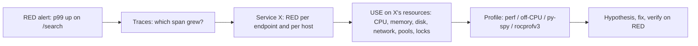

# Debugging and Profiling Tools -- Comprehensive Interview Reference

> Last reviewed: 2026-11 · Versions assumed: GDB 14-17, LLDB 18+, Linux perf 6.x-7.x, strace 6.x, bpftrace 0.22+ (BCC tools), Valgrind 3.22+, py-spy 0.4, Scalene 2.4, memray 1.20, Python 3.12-3.14, ROCm 6.x/7.x (rocgdb, rocprofv3, amd-smi)

> A practical, interview-focused reference for debugging and profiling native (C/C++) and Python programs on Linux. It covers the debuggers (gdb, lldb, rocgdb), core dumps, `perf` and hardware counters, flame graphs and off-CPU analysis, `perf c2c` for false sharing, `strace`/`ltrace`, binutils and ELF inspection, Valgrind and sanitizers, eBPF/bpftrace, Python tools (pdb, faulthandler, py-spy, Scalene, memray), a worked top-down (TMA) analysis, AMD IBS and `perf mem`, a map of the wider profiler landscape (VTune, uProf, toplev, likwid, Tracy, pprof, async-profiler, XRay), and the methods that tie them together: USE, RED, scientific debugging, and bisection. It ends with ten production scenarios ("the CPU is at 100%", "the process is hung", "the disk is full but `du` disagrees", "the GPU kernel got slower after a driver update") with step-by-step answers. Each major section closes with interview questions and full answers. The example programs were compiled with GCC 15 and run under GDB 17 on x86-64 Linux. Their gdb output is real, trimmed only for length. The perf, top-down, IBS and `perf c2c` measurements in Sections 8, 9 and 11 were taken on a 2-socket AMD EPYC 9655 (Zen 5) host running Linux 7.0 and perf 7.0, with each program pinned to one core (`taskset -c 16`) and the median of 3 runs reported.

---

## Table of Contents

**Part 1: Foundations**

1. [The Toolbox at a Glance](#1-the-toolbox-at-a-glance)
2. [Building for Debuggability](#2-building-for-debuggability)

**Part 2: Debuggers**

3. [GDB Essentials](#3-gdb-essentials)
4. [Watchpoints, Catchpoints, and Advanced GDB](#4-watchpoints-catchpoints-and-advanced-gdb)
5. [Attaching to Live Processes and Debugging Hangs](#5-attaching-to-live-processes-and-debugging-hangs)
6. [Core Dumps](#6-core-dumps)
7. [LLDB Equivalents and GPU Debuggers](#7-lldb-equivalents-and-gpu-debuggers)

**Part 3: CPU Profiling with perf**

8. [perf Fundamentals and Hardware Counters](#8-perf-fundamentals-and-hardware-counters)
   - [8.5 Top-Down Analysis, Worked](#85-top-down-analysis-worked)
   - [8.6 Interview Questions](#86-interview-questions)
9. [Sampling Profiles: perf record, report, top, and annotate](#9-sampling-profiles-perf-record-report-top-and-annotate)
   - [9.7 The Wider Profiler Landscape](#97-the-wider-profiler-landscape)
   - [9.8 Interview Questions](#98-interview-questions)
10. [Flame Graphs and Off-CPU Analysis](#10-flame-graphs-and-off-cpu-analysis)
11. [perf c2c and False Sharing](#11-perf-c2c-and-false-sharing)

**Part 4: Tracing, Binary Inspection, and Memory Tools**

12. [strace and ltrace](#12-strace-and-ltrace)
13. [binutils and ELF Inspection](#13-binutils-and-elf-inspection)
14. [Valgrind, Sanitizers, and Heap Profilers](#14-valgrind-sanitizers-and-heap-profilers)
15. [eBPF and bpftrace](#15-ebpf-and-bpftrace)
16. [Python Debugging and Profiling](#16-python-debugging-and-profiling)

**Part 5: Methodology**

17. [The USE Method and the RED Method](#17-the-use-method-and-the-red-method)
18. [Scientific Debugging and Bisecting](#18-scientific-debugging-and-bisecting)

**Part 6: Production Scenarios and Review**

19. [Production Debugging Scenarios](#19-production-debugging-scenarios)
20. [Quick Reference Card](#20-quick-reference-card)
21. [Cross-Cutting Interview Questions](#21-cross-cutting-interview-questions)

---

## 1. The Toolbox at a Glance

### 1.1 Four Kinds of Tool

Every tool in this document is one of four kinds. Knowing which kind you need is half of the answer to any "how would you debug X" question.

| Kind | Question it answers | Examples | Typical overhead |
|------|--------------------|----------|------------------|
| **Debugger** | "What is the exact state right now?" | gdb, lldb, rocgdb, pdb | Stops the process. Effectively unbounded while stopped. |
| **Counter** | "How many times did X happen?" | `perf stat`, `/proc`, `vmstat`, `amd-smi` | Near zero (hardware counts in parallel) |
| **Sampling profiler** | "Where does the time go, statistically?" | `perf record`, py-spy, rocprofv3 PC sampling | Proportional to sample rate. 1-5% at 99-1000 Hz. |
| **Tracer** | "What happened, in order, with timing?" | strace, ltrace, bpftrace, `perf trace`, rocprofv3 kernel trace | Per event. Cheap in-kernel (eBPF) up to very expensive (ptrace-based strace). |

A fifth category, **instrumentation and checking tools**, rewrites or emulates the program to catch bugs: sanitizers (compile-time instrumentation, 2-15x) and Valgrind (dynamic binary translation, 10-50x). Use them in test and staging, almost never in production.

### 1.2 Symptom-to-Tool Map

| Symptom | First tool | Then |
|---------|-----------|------|
| Crash (SIGSEGV, SIGABRT) | Core dump + `gdb ./app core` | ASan build to find the root cause |
| Hang, 0% CPU | `gdb -p PID -batch -ex 'thread apply all bt'` | `strace -p`, `/proc/PID/stack`, `lsof` |
| Hang, 100% CPU | `perf top -p PID`, `top -H` | `perf record -g`, gdb to inspect loop state |
| Slow, CPU-bound | `perf stat` (IPC, misses), then `perf record -g` and a flame graph | `perf annotate`, `perf c2c` |
| Slow, not CPU-bound | Off-CPU analysis (`offcputime`), `strace -c -w`, `iostat`, `ss` | bpftrace latency histograms |
| Memory growth | RSS over time, `smaps_rollup`, heaptrack / jemalloc profiling | BCC `memleak`, LSan, Massif |
| Wrong result, deterministic | gdb breakpoints and watchpoints, or `rr` | `git bisect` |
| Wrong result, intermittent | TSan, ASan, UBSan; `rr` chaos mode | Stress tests, scientific debugging |
| "Library not found" or "undefined symbol" | `ldd`, `readelf -d`, `LD_DEBUG=libs`, `nm -D -C` | `objdump -p` |
| Python slow or hung | `py-spy top` / `py-spy dump` | `py-spy record --native`, `faulthandler` |
| GPU kernel slow | `rocprofv3 --kernel-trace --stats` | `rocprof-compute` (speed-of-light, roofline) |

### 1.3 Observer Effect

Every tool perturbs what it measures. ptrace-based tools (gdb, strace, ltrace) stop the target on each event. Instrumentation changes code layout, inlining, and timing. A race that disappears under gdb or with `printf` added is a **Heisenbug**. When that happens, switch to lower-overhead observation: sampling, eBPF, core dumps, `rr` recording, or logging into a lock-free ring buffer that is dumped after the failure.

See also: [Performance Engineering](../computer-science/Performance_Engineering.md) for measurement methodology and statistics, [Linux Command Line](Linux_Command_Line.md) for shell fluency, and [CS Fundamentals: /proc and /sys](../computer-science/CS_Fundamentals.md#19-linux-process-lifecycle-signals-and-file-descriptors).

### 1.4 Interview Questions

**Q1.** "The application is slow." What is your first question, and why?

"Slow compared to what, measured how?" Establish the metric (latency percentile, throughput, job wall time), the baseline (last week, another host, the previous release), and the scope (all requests or some, all hosts or one). Then split the problem by kind: is the process **on-CPU** (CPU at 100% for its threads, so profile with `perf` or py-spy) or **off-CPU** (low CPU, so it is waiting on I/O, locks, or a downstream service: use off-CPU analysis, strace with timings, tracing)? Picking a tool before answering these questions is how people spend a day profiling CPU for a problem that is a slow DNS lookup.

**Q2.** Why not just add log statements instead of learning these tools?

Logging is valuable and often the only option in production, but it has limits: you must predict in advance what to log, each change needs a rebuild and redeploy, logging in hot paths changes timing (hiding races) and costs throughput, and logs cannot show where CPU time goes or what the kernel is doing. Debuggers inspect arbitrary state after the fact (cores), profilers measure without knowing where to look, and eBPF and tracers observe running production systems without redeploying. The right answer combines them: structured logs and metrics for "what and when", profilers and tracers for "where and why".

---

## 2. Building for Debuggability

### 2.1 Compiler Flags That Matter

| Flag | Effect | When to use |
|------|--------|-------------|
| `-g` (= `-g2`) | Emit DWARF debug info: line tables, types, variables. Debug info **does not change the generated code**. | Always, including release builds (strip it out later) |
| `-g3` | Also records macro definitions, so `p MY_MACRO` works in gdb | Local debugging of macro-heavy C |
| `-ggdb` | DWARF with GDB-specific extensions | When gdb is the only consumer |
| `-O0` | No optimization. Every variable lives in memory, one line maps to one block of instructions. | Interactive stepping |
| `-Og` | Optimizations that do not hurt debugging. Faster than `-O0`, mostly steppable. | Day-to-day debug builds |
| `-O2 -g` | Real optimized code with debug info. Expect `<optimized out>`, jumpy stepping, inlined frames. | Profiling, debugging release-only bugs |
| `-fno-omit-frame-pointer` | Keeps `rbp` as a frame chain so profilers can unwind cheaply | Builds you intend to profile |
| `-gsplit-dwarf` | Debug info goes into `.dwo` files and the linker skips it | Large C++ projects with slow links |
| `-D_GLIBCXX_ASSERTIONS` | Bounds checks in `operator[]`, null checks in smart pointers. Cheap. | Debug and CI builds, sometimes release |
| `-fsanitize=address,undefined` | Instrumentation for memory errors and UB | Test builds (see [Section 14](#14-valgrind-sanitizers-and-heap-profilers)) |

**Why optimized code is hard to debug.** At `-O2` the compiler keeps variables in registers and reuses those registers once the value is dead (gdb prints `<optimized out>`). It reorders and merges instructions from different lines, so `next` jumps backwards. It inlines functions, so a breakpoint on `foo` may hit at ten call sites, or at none if every call was inlined. Modern DWARF location lists recover much of this. GDB shows inlined frames in `bt`, and `addr2line -i` prints them.

**CMake mapping.** `Debug` is `-g` (at `-O0`), `RelWithDebInfo` is `-O2 -g -DNDEBUG`, `Release` is `-O3 -DNDEBUG` (no `-g`). Ship `RelWithDebInfo` builds with the debug info split out, so production crashes can be symbolized. See [CMake: Build Configurations](CMake_Fundamentals.md#20-build-configurations-and-multi-config-generators).

### 2.2 Frame Pointers and Stack Unwinding

Profilers and debuggers walk the stack in one of three ways:

| Method | How | Pros | Cons |
|--------|-----|------|------|
| **Frame pointer** | Follow the `rbp` chain: each frame stores the caller's `rbp` and return address | Very cheap. Works in-kernel (perf, eBPF). | Needs `-fno-omit-frame-pointer` in **every** library on the stack. Costs one register (about 1% typical, a few % worst case). |
| **DWARF CFI** (`.eh_frame`) | Interpret unwind tables | Works without frame pointers. This is what gdb and C++ exceptions use. | Too expensive to do in the kernel at sample time. `perf --call-graph dwarf` copies raw stack bytes and unwinds offline. |
| **Hardware** (Intel LBR, AMD Zen 4+ LBRv2 / Zen 3 BRS) | CPU records recent branches or calls | Cheap, needs no frame pointers | Limited depth (LBR: 32 entries on recent Intel cores). Vendor-specific. |

The kernel itself unwinds with **ORC**, compact unwind tables that `objtool` generates at build time (a software alternative to DWARF CFI), so kernel stacks are reliable even without frame pointers.

Fedora 38 and Ubuntu 24.04 rebuilt their distribution packages with frame pointers enabled, specifically so whole-system profiling produces complete stacks. A broken stack in a flame graph (frames attributed directly to `[unknown]` or a missing caller) is almost always a library compiled without frame pointers.

### 2.3 Split Debug Info, Build IDs, and debuginfod

Production binaries are stripped to save space and avoid leaking source details, but you still need symbols to analyze cores and profiles. The standard workflow:

```bash
g++ -O2 -g -fno-omit-frame-pointer -o app app.cpp     # build with debug info

objcopy --only-keep-debug app app.debug                # 1. copy debug info out
strip --strip-debug --strip-unneeded app               # 2. strip the shipped binary
objcopy --add-gnu-debuglink=app.debug app              # 3. record where debug info lives

readelf -n app | grep 'Build ID'                       # unique hash of the binary's contents
#     Build ID: 3f1c...e9
```

- **Build ID.** The linker writes a hash (`.note.gnu.build-id`, on by default in most distro toolchains) into the binary. Cores and `perf.data` record the build IDs of every mapped object. Tools then fetch the exact matching debug info. This avoids the classic mistake of symbolizing a core with a binary from a different build, which produces plausible but **wrong** line numbers.
- **debuginfod.** An HTTP server that serves debug info and sources indexed by build ID. Set `DEBUGINFOD_URLS` (most distros preconfigure theirs, for example `https://debuginfod.ubuntu.com`) and gdb, perf, valgrind, and elfutils download symbols on demand. Run your own debuginfod for internal builds.
- **Symbol stores.** Larger shops upload `app.debug` per build ID to an internal store, similar to Breakpad or Crashpad symbol servers, and keep them for as long as the binaries run in production.

### 2.4 Interview Questions

**Q1.** Does compiling with `-g` make the program slower?

No, for code generation. `-g` adds DWARF sections (`.debug_info`, `.debug_line`, ...) that are not loaded at runtime because they are not in a `PT_LOAD` segment. The machine code is identical with and without `-g` at the same `-O` level. GCC treats any difference as a bug and tests for it (`-fcompare-debug`). The costs are bigger files, slower links, and slower builds. That is why you ship `-O2 -g` builds and strip the debug info into a separate file. The follow-up "then why is my Debug build slow?" is answered by `-O0`, not `-g`.

**Q2.** A teammate says "the crash only happens in release, so I can't use the debugger." What do you tell them?

Build the release configuration **with** `-g` (`RelWithDebInfo`). The bug probably depends on optimization, so changing `-O` would hide it. Typical causes are undefined behavior the optimizer exploits (signed overflow, strict aliasing, an uninitialized variable), a data race that only shows up with the tighter timing, or a missing `volatile` or atomic. Debug the optimized build in gdb and accept `<optimized out>` (use `info registers` and `disassemble /s` when needed). Also run UBSan and ASan builds at `-O1` or `-O2`, and TSan if threads are involved. If the bug is deterministic, `rr record` gives replayable debugging of the exact failing execution.

**Q3.** Why does `perf report` show `[unknown]` frames or truncated stacks, and how do you fix it?

The default `perf record -g` unwinds with frame pointers. Any function compiled with `-fomit-frame-pointer`, the default at `-O1` and above on x86-64, breaks the chain, so callers get lost or attributed to `[unknown]`. Fixes, in order of preference: rebuild with `-fno-omit-frame-pointer` (including your own dependencies), use `--call-graph dwarf` (larger `perf.data`, slower post-processing, and stacks deeper than the copied 8 KB are truncated), or use `--call-graph lbr` on Intel. Also check that symbols are available: a stripped binary without its `.debug` file shows hex addresses instead of names.

---

## 3. GDB Essentials

### 3.1 A First Session: Finding a Null Dereference

```cpp
// segv.cpp -- g++ -std=c++20 -g -O0 -o segv segv.cpp
#include <cstdio>
#include <string>
#include <vector>

struct Config {
    std::string name;
    int retries;
};

int total_retries(const std::vector<Config*>& cfgs) {
    int sum = 0;
    for (const Config* c : cfgs) {
        sum += c->retries;  // crashes when c == nullptr
    }
    return sum;
}

int main() {
    Config a{"alpha", 3};
    Config b{"beta", 5};
    std::vector<Config*> cfgs{&a, nullptr, &b};
    std::printf("total = %d\n", total_retries(cfgs));
}
```

```text
$ gdb -q ./segv
(gdb) run
Program received signal SIGSEGV, Segmentation fault.
0x0000555555556308 in total_retries (cfgs=std::vector of length 3, capacity 3 = {...}) at segv.cpp:14
14	        sum += c->retries;  // crashes when c == nullptr
(gdb) bt
#0  0x0000555555556308 in total_retries (cfgs=std::vector of length 3, capacity 3 = {...}) at segv.cpp:14
#1  0x00005555555564ab in main () at segv.cpp:23
(gdb) p c
$1 = (const Config *) 0x0
(gdb) p cfgs
$2 = std::vector of length 3, capacity 3 = {0x7fffffffcee0, 0x0, 0x7fffffffcf10}
(gdb) frame 1
#1  0x00005555555564ab in main () at segv.cpp:23
(gdb) info locals
a = {name = "alpha", retries = 3}
b = {name = "beta", retries = 5}
cfgs = std::vector of length 3, capacity 3 = {0x7fffffffcee0, 0x0, 0x7fffffffcf10}
(gdb) p $_siginfo._sifields._sigfault.si_addr
$3 = (void *) 0x20
```

Read the last line carefully. The faulting address is `0x20`, not `0`. `Config::retries` sits at offset 32, after a 32-byte `std::string` in libstdc++. So `c->retries` with `c == nullptr` reads address `0 + 0x20`. **A small faulting address means a null pointer plus a member offset.** That is how you recognize a null dereference in a crash report even without a debugger.

GDB disables address-space randomization for programs it launches (`set disable-randomization on`). That is why the addresses look like `0x5555...`. The same binary run outside gdb gets a random PIE base, which can hide or expose bugs that depend on addresses.

### 3.2 Core Command Reference

| Task | Command | Notes |
|------|---------|-------|
| Start | `gdb --args ./app arg1 arg2`, then `run` | `start` runs to a temporary breakpoint at `main` |
| Breakpoint | `break file.cpp:42`, `break func`, `break Class::method`, `break *0x401136` | `b` for short. Overloads and templates get one location per instantiation. |
| Temporary breakpoint | `tbreak file.cpp:42` | Deleted after the first hit |
| Regex breakpoint | `rbreak ^Parser::` | Breakpoint on every matching function |
| Conditional breakpoint | `break file.cpp:13 if c == 0`, or `condition 2 i == 999` | The condition is evaluated in the debugger on every hit, which is slow in hot loops |
| Ignore N hits | `ignore 2 999` | Stop on the 1000th hit |
| Actions on hit | `commands 2` / `silent` / `print i` / `continue` / `end` | Cheap tracing without recompiling |
| Manage | `info breakpoints`, `disable 2`, `enable 2`, `delete 2` | |
| Step over / into | `next` (`n`), `step` (`s`) | `stepi`/`nexti` for one machine instruction |
| Run to end of function | `finish` | Prints the return value |
| Run past a loop | `until`, `advance file.cpp:50` | `until` at a loop's closing line runs until the loop exits |
| Continue | `continue` (`c`) | `c 5` ignores this breakpoint 4 more times |
| Backtrace | `bt`, `bt full` (with locals), `bt 5`, `bt -5` | `bt full` is the single most useful command on a core file |
| Select frame | `frame 2`, `up`, `down`, `info frame` | Locals and `p` operate on the selected frame |
| Locals and args | `info locals`, `info args` | |
| Print | `p expr`, `p/x val`, `p *arr@10`, `p $rip` | `@` prints N elements starting at an lvalue |
| Types | `ptype obj`, `whatis expr`, `ptype/o struct S` | `ptype/o` shows offsets, sizes, and padding holes |
| Raw memory | `x/16xb addr`, `x/4gx $sp`, `x/s str`, `x/10i $pc` | Format: count, format (x d s i), unit size (b h w g) |
| Auto-display | `display i`, `undisplay 1` | Printed at every stop |
| Change state | `set var x = 5`, `call f(3)`, `return`, `jump 42` | `jump` skips code, so be careful |
| Disassemble | `disassemble /s` (with source), `layout asm` | |
| Threads | `info threads`, `thread 3`, `thread apply all bt` | See [Section 5](#5-attaching-to-live-processes-and-debugging-hangs) |
| Shared libraries | `info sharedlibrary`, `info proc mappings` | Check which `.so` was really loaded |
| Signals | `handle SIGPIPE nostop noprint pass`, `info signals` | Stop gdb from halting on benign signals |
| Skip uninteresting code | `skip -gfi /usr/include/c++/*/bits/*` | `step` will not enter STL internals |

### 3.3 Stepping Through Optimized C++ Without Losing Your Mind

- `step` into a call like `process(make_key(x), cfg.get())` enters `make_key`, then `get`, then `process`. Use `finish` to return from the ones you do not care about, or `skip` them permanently (`skip function Config::get`, or `skip -gfi` for whole header trees).
- `p obj.method()` works only if the method was emitted out of line. Inlined-only functions have no address to call.
- Tag a source line you will return to with `tbreak` and `continue`, rather than pressing `next` thirty times.
- In a long-running loop, stop on a specific iteration with `break loop.cpp:30 if i == 123456` (slow) or `ignore`. For a hot loop, it is faster to add a temporary `if (i == 123456) __builtin_trap();` or `raise(SIGTRAP);` and recompile.

### 3.4 Interview Questions

**Q1.** Your program crashes with `SIGSEGV` and gdb says the fault address is `0x18`. What is your first hypothesis?

A null pointer dereference of a member at offset `0x18`, for example the fourth `int64_t` field or the field after a 24-byte `std::vector`. Check the faulting frame's `p this` or the pointer being dereferenced, and confirm with `ptype/o` on the struct to see which member sits at `0x18`. Addresses near `0` (the first page is never mapped) almost always mean "null plus offset". Addresses that look random (for example `0x6c6c6568`, which is ASCII "hell") suggest a pointer overwritten with data, i.e. memory corruption. For that, switch to ASan or a watchpoint on where the pointer lives.

**Q2.** What is the difference between `next`, `step`, `finish`, and `until`?

`next` executes the current source line, running any calls to completion. `step` enters the first call on the line (if it has line info). `finish` runs until the current function returns and prints its return value. `until` (with no argument) is like `next` but does not go backwards: at the last line of a loop body it runs until a line **greater** than the current one is reached, so it exits the loop. `until LOCATION` and `advance LOCATION` run to a location. `until` also stops if the current frame returns, `advance` does not.

**Q3.** How do you make gdb stop when a function is called with a specific argument, without editing code?

`break parse_record if id == 42`. For string arguments use the convenience functions: `break open_file if $_streq(path, "/etc/app.conf")`. Every hit traps into gdb to evaluate the condition (thousands of times per second at most), so on a hot path consider a hardware-assisted alternative: a `uprobe` with a bpftrace predicate (`uprobe:./app:parse_record /arg0 == 42/ { ... }`) costs microseconds per hit and needs no stop.

---

## 4. Watchpoints, Catchpoints, and Advanced GDB

### 4.1 Watchpoints: "Who Changed This Value?"

A **watchpoint** stops execution when a memory location changes (`watch`), is read (`rwatch`), or is accessed either way (`awatch`). On x86-64 gdb uses the CPU **debug registers** DR0-DR3: up to **4 hardware watchpoints**, each covering an aligned region of up to 8 bytes. Hardware watchpoints run at full speed. If the expression cannot fit, gdb falls back to a **software watchpoint** that single-steps the program and compares the value after every instruction, which is 100-1000x slower. gdb prints "Hardware watchpoint 2" or "Watchpoint 2" so you know which kind you got.

```cpp
// corrupt.cpp -- g++ -std=c++20 -g -O0 -o corrupt corrupt.cpp
#include <cstdio>
#include <cstring>

struct Session {
    char user[8];
    int  priv_level;   // something keeps changing this
};

void set_user(Session& s, const char* name) {
    std::strcpy(s.user, name);   // no bounds check
}

int main() {
    Session s{};
    s.priv_level = 1;
    set_user(s, "alice");
    set_user(s, "mallory_ad");  // 10 chars + NUL: overflows user[8] into priv_level
    std::printf("priv_level = %d\n", s.priv_level);
}
```

```text
$ ./corrupt
priv_level = 25697                     # 0x6461 = "ad" -- bytes of the name
$ gdb -q ./corrupt
(gdb) break 17
(gdb) run
(gdb) watch -l s.priv_level
Hardware watchpoint 2: -location s.priv_level
(gdb) continue
Hardware watchpoint 2: -location s.priv_level

Old value = 1
New value = 25697
__strcpy_evex () at ../sysdeps/x86_64/multiarch/strcpy-evex.S:225
(gdb) bt 3
#0  __strcpy_evex () at ../sysdeps/x86_64/multiarch/strcpy-evex.S:225
#1  0x00005555555551b0 in set_user (s=..., name=0x55555555600a "mallory_ad") at corrupt.cpp:11
#2  0x0000555555555210 in main () at corrupt.cpp:18
```

Key details:

- **`watch -l` (`-location`) watches the address, not the expression.** Plain `watch s.priv_level` is bound to the scope of `s`. It is deleted when the frame exits, and with a pointer expression like `p->x` it re-evaluates `p` itself. Use `-l` when you want "whoever writes to these 4 bytes".
- **Watchpoints report the instruction after the write.** The stop is in `strcpy` because that is where the write happened. `bt` shows the guilty caller.
- **Conditional watchpoints:** `watch -l counter if counter > 1000`.
- **Heap objects that are freed and reallocated** confuse watchpoints. If the watched memory is reused, you see writes from unrelated code. ASan catches that class of bug more directly.
- **Combine with `rr`** for the hardest corruption bugs: record the failing run, set a watchpoint on the corrupted value, then `reverse-continue` to go back to the last write.

### 4.2 Catchpoints: Exceptions, Syscalls, Signals, Forks

| Command | Stops when | Typical use |
|---------|-----------|-------------|
| `catch throw` | Any C++ exception is thrown | "Where does this `std::out_of_range` come from?" The stack is still intact at the throw site. |
| `catch throw std::bad_alloc` | The thrown type matches the regex | Filter noisy exception-heavy code |
| `catch catch`, `catch rethrow` | A handler is entered, or `throw;` | Finding who swallows exceptions |
| `catch syscall openat` | Entry and exit of a syscall | "Who opens this file?" |
| `catch signal SIGUSR1` | Signal delivery | |
| `catch fork`, `catch exec` | Process creation | Combine with `set follow-fork-mode child` and `set detach-on-fork off` |
| `catch load libhip` | A shared library matching the regex loads | Set breakpoints in a plugin loaded with `dlopen` |

Why `catch throw` matters: by the time a program reaches `std::terminate`, the throwing frames may already be gone. A `noexcept` boundary, a `catch (...) { throw; }`, or an exception carried across threads in a `std::future` all lose them (see Q2 below). `catch throw` stops inside `__cxa_throw` with the throwing frame still on the stack. The older idiom `break __cxa_throw` still works.

### 4.3 The TUI

`gdb -tui ./app`, or press `Ctrl-x a` inside gdb, splits the terminal into a source window and a command window.

| Keys / command | Effect |
|----------------|--------|
| `Ctrl-x a` | Toggle TUI on and off |
| `layout src`, `layout asm`, `layout split`, `layout regs` | Choose windows (`split` = source + assembly) |
| `Ctrl-x 2` | Cycle through layouts |
| `focus cmd` / `focus src` (or `Ctrl-x o`) | Move keyboard focus, so arrow keys scroll source or recall history |
| `Ctrl-l` or `refresh` | Redraw after program output corrupts the screen |

### 4.4 `.gdbinit`

gdb reads `~/.gdbinit` at startup, then `./.gdbinit` in the current directory **only if** that directory is on the `auto-load safe-path`. This protects you from a malicious repository running commands. Allow it explicitly with `add-auto-load-safe-path /path/to/project` in `~/.gdbinit`.

```text
# ~/.gdbinit
set history save on
set history size 10000
set history filename ~/.gdb_history
set print pretty on              # one struct member per line
set print object on              # print the dynamic type of polymorphic pointers
set print static-members off
set pagination off
set confirm off
set debuginfod enabled on        # fetch missing symbols by build ID
skip -gfi /usr/include/c++/*/bits/*

# User-defined command: dump all thread stacks to a file
define dumpstacks
  set logging file /tmp/stacks.txt
  set logging overwrite on
  set logging enabled on
  thread apply all bt
  set logging enabled off
end
```

`set logging enabled on` is the GDB 12+ spelling. Older versions use `set logging on`.

### 4.5 Pretty Printers

Without pretty printers, `p some_string` shows libstdc++ internals (`_M_dataplus`, `_M_local_buf`, ...). GCC ships Python pretty printers for libstdc++. Distros auto-load them with `libstdc++.so` from `/usr/share/gdb/auto-load/`, which is why `std::vector of length 3` appears above. `p/r obj` prints the raw form, and `info pretty-printer` lists what is loaded.

Write your own for project types with gdb's Python API:

```python
# config_printer.py -- load with: (gdb) source config_printer.py
import gdb
import gdb.printing


class ConfigPrinter:
    """Pretty-print `Config` as Config("alpha", retries=3)."""

    def __init__(self, val):
        self.val = val

    def to_string(self):
        name = self.val["name"]          # libstdc++ printer formats std::string
        retries = int(self.val["retries"])
        return f"Config({name}, retries={retries})"


def build_printer():
    pp = gdb.printing.RegexpCollectionPrettyPrinter("myproject")
    pp.add_printer("Config", "^Config$", ConfigPrinter)
    return pp


# current_objfile() is None when sourced by hand, which registers the printer globally.
gdb.printing.register_pretty_printer(gdb.current_objfile(), build_printer())
```

```text
(gdb) p a
$1 = Config("alpha", retries=3)
(gdb) p/r a
$2 = {name = {_M_dataplus = {... _M_p = 0x7fffffffcef0 "alpha"}, _M_string_length = 5, ...}, retries = 3}
```

For containers, also implement `children()`, returning `(name, value)` pairs, and `display_hint()` (`'array'` or `'map'`). To ship printers with a library, install the script as `<libname>-gdb.py` under the auto-load directory, or embed it in the `.debug_gdb_scripts` section.

### 4.6 Reverse Debugging and `rr`

- **`rr`** (Mozilla) records an execution once (about 1.2-2x slowdown for many workloads) and replays it deterministically under gdb any number of times. Replay supports `reverse-continue`, `reverse-next`, `reverse-step`, and `reverse-finish`, with watchpoints working **backwards in time**. The killer workflow for corruption: replay to the crash, `watch -l` the corrupted field, `reverse-continue`, and you land on the write. `rr record --chaos` randomizes scheduling to shake out intermittent races. Limitations: Linux only, x86-64 and AArch64, it needs hardware performance counters (no support for some VMs), it runs all threads on one core (so it serializes parallelism), and it cannot record GPU work. AMD Zen CPUs need a documented workaround from the rr wiki.
- **gdb `record full`** is built in, but it is extremely slow (it records every instruction's side effects) and only practical for short windows.

### 4.7 Interview Questions

**Q1.** How many hardware watchpoints can you set on x86-64, and what happens when you exceed them?

Four debug-address registers (DR0-DR3), each watching an aligned 1, 2, 4, or 8 bytes. Watching a larger object uses several registers. Beyond that, gdb either refuses ("Could not insert hardware watchpoint") or, for expressions it cannot place in hardware, falls back to a software watchpoint, single-stepping and comparing after each instruction, which is orders of magnitude slower. Practical tips: watch the specific field with `watch -l obj.field`, not the whole struct, and for multithreaded code remember that hardware watchpoints apply to all threads in gdb.

**Q2.** The program aborts with "terminate called after throwing an instance of `std::out_of_range`", but the core's backtrace does not show where it was thrown. Why, and how do you find the throw site?

First, why it is sometimes visible. Itanium C++ ABI unwinding (GCC and Clang on Linux) has two phases. Phase 1 searches for a handler **without** unwinding. If no handler exists anywhere, `__cxa_throw` calls `std::terminate` right there, so the core shows `abort` <- `std::terminate` <- `__cxa_throw` <- **the throwing frame**. The site is lost when something between the throw and the top of the stack "handles" it first:

- A `noexcept` function on the path. The standard leaves it implementation-defined whether the stack is unwound before `terminate`. With the usual GCC and Clang code generation, the `noexcept` frame acts as a catch-all landing pad, so phase 2 unwinds **up to** it and then calls `terminate`. Everything below the `noexcept` function is gone.
- `catch (...) { cleanup(); throw; }`. The core shows the rethrow, not the original throw.
- The exception was captured in a `std::exception_ptr` (`std::future`, a thread pool, `std::async`) and rethrown on another thread. The core shows the `future.get()` site.

To find the original site: run under gdb with `catch throw std::out_of_range` and `bt` when it stops. In production, log a stack trace at throw time. Options include a project exception base class that captures `std::stacktrace::current()` (C++23) or `boost::stacktrace` in its constructor, or reproducing in a canary with the throw logged.

**Q3.** What does `set print object on` do, and when do you need it?

It tells gdb to use RTTI (the vtable) to print a polymorphic object as its **dynamic** type. With `Base* p = new Derived;`, `p *p` normally shows only `Base` fields. With `print object on`, it shows `(Derived) {...}` with all fields. Essential when debugging plugin and visitor hierarchies.

---

## 5. Attaching to Live Processes and Debugging Hangs

### 5.1 Attaching

```bash
gdb -p 12345                     # attach; all threads stop
gdb ./app 12345                  # same, with an explicit binary (for symbol lookup)
gdb -p 12345 -batch -ex 'thread apply all bt' > stacks.txt   # snapshot and detach
gcore -o /tmp/app 12345          # write /tmp/app.12345 as a core file, process keeps running
```

When it fails with "ptrace: Operation not permitted", check:

| Cause | Check | Fix |
|-------|-------|-----|
| Yama ptrace scope | `cat /proc/sys/kernel/yama/ptrace_scope`. `0` = any process with the same UID, `1` = only descendants (Ubuntu default), `2` = admin only (`CAP_SYS_PTRACE`), `3` = never | `sudo gdb -p`, or `sudo sysctl kernel.yama.ptrace_scope=0` on a dev box |
| Container | ptrace needs `CAP_SYS_PTRACE` inside the container | `docker run --cap-add=SYS_PTRACE ...`, or debug from the host with `nsenter` |
| Already traced | `grep TracerPid /proc/12345/status` is non-zero | Only one tracer at a time: detach strace or the other gdb |
| Different UID or setuid binary | `ps -o uid,cmd -p 12345` | Use root |

**Attaching pauses the whole process.** In production every second attached is a second of outage for that process. Use the `-batch` form to grab stacks in well under a second and detach. Faster still for a snapshot: `eu-stack -p PID` (elfutils), which also uses ptrace but only reads stacks. Use `gcore` when you want to analyze offline at leisure, keeping in mind that it also pauses the process while writing the dump, which can take seconds for a large heap.

### 5.2 Diagnosing a Hang: Start From the Process State

```bash
grep -E 'State|Threads|ctxt' /proc/PID/status
```

| State | Meaning | Next step |
|-------|---------|-----------|
| `R` (running), high CPU | Busy loop, livelock, or a spin lock | `perf top -p PID`, `top -H -p PID` to find the hot thread, then gdb on that thread |
| `S` (sleeping), 0% CPU | Waiting on a lock, condition variable, socket, or pipe | `gdb -batch -ex 'thread apply all bt'`, `strace -p` for the blocking syscall, `ls -l /proc/PID/fd` for what the fd is |
| `D` (uninterruptible) | Stuck in the kernel, usually disk or NFS I/O, sometimes a driver | `cat /proc/PID/stack` (root), `cat /proc/PID/wchan`, `dmesg` for "blocked for more than 120 seconds" (hung-task detector). gdb **cannot** help: the process cannot even be stopped. |
| `Z` (zombie) | Exited, parent has not called `wait` | Fix the parent |
| `T` / `t` | Stopped by a signal or by a tracer | Is something else attached? `TracerPid` |

### 5.3 Worked Example: A Lock-Order Deadlock

```cpp
// deadlock.cpp -- g++ -std=c++20 -g -O0 -pthread -o deadlock deadlock.cpp
#include <chrono>
#include <cstdio>
#include <mutex>
#include <thread>

std::mutex accounts_mu;
std::mutex audit_mu;

void transfer() {  // locks accounts -> audit
    std::lock_guard<std::mutex> a(accounts_mu);
    std::this_thread::sleep_for(std::chrono::milliseconds(50));
    std::lock_guard<std::mutex> b(audit_mu);
    std::puts("transfer done");
}

void report() {  // locks audit -> accounts (opposite order)
    std::lock_guard<std::mutex> b(audit_mu);
    std::this_thread::sleep_for(std::chrono::milliseconds(50));
    std::lock_guard<std::mutex> a(accounts_mu);
    std::puts("report done");
}

int main() {
    std::thread t1(transfer);
    std::thread t2(report);
    t1.join();
    t2.join();
}
```

```text
$ ./deadlock &            # hangs forever at 0% CPU
$ grep -E 'State|Threads' /proc/$!/status
State:	S (sleeping)
Threads:	3
$ gdb -q -p $! -batch -ex 'info threads' -ex 'thread apply all bt' -ex 'p accounts_mu' -ex 'p audit_mu'
  Id   Target Id                                      Frame
* 1    Thread ... (LWP 2028825) "deadlock" __syscall_cancel_arch () ...
  2    Thread ... (LWP 2028828) "deadlock" futex_wait (futex_word=0x55b9a0bab040 <accounts_mu>, expected=2, ...)
  3    Thread ... (LWP 2028827) "deadlock" futex_wait (futex_word=0x55b9a0bab080 <audit_mu>, expected=2, ...)

Thread 3 (... LWP 2028827 ...):
#0  futex_wait (futex_word=0x55b9a0bab080 <audit_mu>, expected=2, private=0)
#1  __GI___lll_lock_wait (futex=0x55b9a0bab080 <audit_mu>, private=0) at ./nptl/lowlevellock.c:49
#3  ___pthread_mutex_lock (mutex=0x55b9a0bab080 <audit_mu>) at ./nptl/pthread_mutex_lock.c:87
#5  std::mutex::lock (this=0x55b9a0bab080 <audit_mu>) at /usr/include/c++/15/bits/std_mutex.h:115
#7  0x000055b9a0ba7357 in transfer () at deadlock.cpp:13
...
Thread 2 (... LWP 2028828 ...):
#0  futex_wait (futex_word=0x55b9a0bab040 <accounts_mu>, expected=2, private=0)
#3  ___pthread_mutex_lock (mutex=0x55b9a0bab040 <accounts_mu>) at ./nptl/pthread_mutex_lock.c:87
#7  0x000055b9a0ba744f in report () at deadlock.cpp:20
...
Thread 1 (... LWP 2028825 ...):
#6  0x00007c560e8f5f73 in std::thread::join() () from /usr/lib/x86_64-linux-gnu/libstdc++.so.6
#7  0x000055b9a0ba752d in main () at deadlock.cpp:27

$1 = {... _M_mutex = {__data = {__lock = 2, __count = 0, __owner = 2028827, ...}}}   # accounts_mu
$2 = {... _M_mutex = {__data = {__lock = 2, __count = 0, __owner = 2028828, ...}}}   # audit_mu
```

How to read it:

1. Two threads are in `__lll_lock_wait` / `futex_wait`, i.e. **blocked acquiring a mutex**. The symbol in angle brackets names the mutex: thread 3 waits for `audit_mu`, thread 2 waits for `accounts_mu`.
2. glibc stores the **owner's thread ID** in `__data.__owner`. `accounts_mu` is owned by LWP 2028827 (thread 3) and `audit_mu` by LWP 2028828 (thread 2).
3. That gives the **wait-for graph**: thread 3 holds `accounts_mu` and waits for `audit_mu`; thread 2 holds `audit_mu` and waits for `accounts_mu`. A cycle means deadlock. `__lock = 2` means "locked, with waiters".
4. The fix is a global lock order, or acquiring both atomically with `std::scoped_lock lk(accounts_mu, audit_mu);`, which uses a deadlock-avoidance algorithm.

For a 200-thread server, do not read every stack by hand. Group identical stacks: `thread apply all bt` into a file, then count unique stacks with a short script that strips addresses and thread IDs and groups by the remaining frames. One large group blocked in `pthread_mutex_lock` on the same address, plus one thread holding it and blocked on something else, is the usual signature.

Prevention and detection: TSan reports `lock-order-inversion (potential deadlock)` even on runs that **did not** deadlock, because it tracks the lock acquisition graph. Helgrind does the same. See [CS Fundamentals: Deadlock, Livelock, and Starvation](../computer-science/CS_Fundamentals.md#64-deadlock-livelock-and-starvation) and [Concurrency Coding Problems](../computer-science/Concurrency_Coding_Problems.md).

### 5.4 Other Hang Signatures

| Stack top | Likely situation |
|-----------|------------------|
| `pthread_cond_wait` / `futex_wait` on a condition variable | Lost wakeup (notify before wait without a predicate), or the producer died |
| `epoll_wait`, `poll`, `read` on a socket | Waiting for a peer. Find the fd with `ls -l /proc/PID/fd/N` and the connection with `ss -tanp`. |
| `pthread_join` in `main` | Main thread fine. Look at the thread it is joining. |
| A thread in the child of a multithreaded `fork` blocked in `__lll_lock_wait` / `futex_wait` | The child is waiting on an application or library lock (a logging mutex, or a custom allocator without atfork handlers). That lock was held by a thread that does not exist in the child. glibc's own malloc is reset across fork, but POSIX still allows only async-signal-safe calls between `fork` and `exec`. |
| `__GI___nanosleep` in a retry loop | Backoff loop that never succeeds. Inspect the loop's state. |
| Inside a signal handler that calls `malloc` or `printf` | Self-deadlock: the signal arrived while the thread already held the lock. Not async-signal-safe. |
| `hipDeviceSynchronize` / `hsa_signal_wait_*` | Waiting on the GPU. The kernel itself may be hung (see [Section 7.3](#73-gpu-debugging-rocgdb)). |

### 5.5 Interview Questions

**Q1.** A production service stopped responding. You have shell access. Walk through what you do in the first five minutes.

1. **Capture before you restart.** Note the PID and run `gdb -p PID -batch -ex 'thread apply all bt' > stacks.$(date +%s).txt`, or `eu-stack -p PID`. If allowed, `gcore PID` for offline analysis. A restart destroys the evidence.
2. Process state and CPU: `top -H -p PID` and `/proc/PID/status`. 0% CPU suggests a deadlock or waiting on I/O or a peer. 100% suggests a livelock or a loop. `D` suggests the kernel or storage.
3. What it is waiting on: `strace -p PID -f` for a few seconds (also stops briefly per syscall), `ls -l /proc/PID/fd`, `ss -tanp | grep PID` for connections, and `cat /proc/PID/stack` for `D` state.
4. Read the stacks for a lock cycle (mutex owners), a common wait point, or a thread stuck in a downstream call.
5. Mitigate (restart, fail over, drain) once evidence is saved, then root-cause offline.

**Q2.** How do you find which thread holds a `std::mutex` from a core file?

On glibc, `std::mutex` wraps `pthread_mutex_t`, whose `__data.__owner` field holds the owning thread's kernel TID (LWP). `p the_mutex` in gdb shows it. Map the LWP to a gdb thread with `info threads`. Then read that thread's backtrace to see what it is blocked on. For `std::shared_mutex` (rwlock) the writer is recorded in `__cur_writer`, but readers are not individually tracked, so finding a stuck reader means searching stacks for frames inside the read-locked region.

**Q3.** Why might `gdb -p` hang or be unable to stop a process?

A process in `D` state cannot handle the `SIGSTOP` that ptrace attach relies on until it leaves the kernel, so attach blocks. Also: another tracer is attached (`TracerPid`), the process is in a different PID namespace (use `nsenter` or attach from the host with the host PID), or Yama restricts attaching. For `D` state, read `/proc/PID/stack` and `wchan` instead.

---

## 6. Core Dumps

A **core dump** is a snapshot of a process's memory and registers at the moment it died, written as an ELF file of type `CORE`. With it you can run `bt`, `info threads`, and `p` as if you were attached at the moment of the crash, hours later and on another machine.

### 6.1 Making Sure Cores Get Written

Three things must all be true:

1. **The resource limit allows it.** `ulimit -c` is the per-process `RLIMIT_CORE`, inherited by children. It is often `0` by default.
   - Shell: `ulimit -c unlimited` (affects only processes started from that shell).
   - systemd service: `LimitCORE=infinity` in the unit file.
   - Docker: `docker run --ulimit core=-1 ...`.
   - Check a running process: `grep -i core /proc/PID/limits`.
2. **`core_pattern` sends it somewhere.** `/proc/sys/kernel/core_pattern` is either a file path template or a pipe to a handler program (if it starts with `|`).
3. **The process is dumpable.** setuid programs, or programs that called `prctl(PR_SET_DUMPABLE, 0)`, do not dump unless `fs.suid_dumpable` allows it. The target directory must be writable and the filesystem must have space.

| `core_pattern` value | Behavior |
|----------------------|----------|
| `core` | Writes `./core` in the process's current working directory (with `core_uses_pid=1`, `core.PID`) |
| `/var/crash/core.%e.%p.%t` | Absolute path. `%e` executable name (comm, truncated to 15 chars), `%p` PID, `%t` UNIX time, `%s` signal, `%h` hostname, `%u` UID. |
| `\|/usr/lib/systemd/systemd-coredump %P %u %g %s %t %c %h` | Pipe to **systemd-coredump**, which stores compressed cores under `/var/lib/systemd/coredump/` and logs metadata to the journal |
| `\|/usr/share/apport/apport ...` | Ubuntu's crash reporter. It may handle non-packaged binaries differently from the packaged ones. Check `/var/crash` and `/var/lib/apport/coredump`. |

```bash
cat /proc/sys/kernel/core_pattern
echo '/var/crash/core.%e.%p.%t' | sudo tee /proc/sys/kernel/core_pattern   # temporary
# Persistent: kernel.core_pattern = /var/crash/core.%e.%p.%t in /etc/sysctl.d/50-coredump.conf
```

**Containers.** `core_pattern` is a host-global setting, not per-namespace. A **pipe** handler runs on the host, in the host's namespaces. A **file path** is resolved in the crashing process's mount namespace, so cores land inside the container's filesystem and vanish with it unless that path is a volume. Plan for one of the two explicitly.

**Which memory gets dumped.** `/proc/PID/coredump_filter` is a bitmask of mapping types to include (default `0x33`: private and shared anonymous memory, ELF headers, private huge pages). File-backed read-only mappings (code) are not dumped, because they can be reloaded from the binary. That is why you need the **exact same binary and libraries** to analyze the core. Applications can exclude huge buffers with `madvise(MADV_DONTDUMP)`.

### 6.2 systemd-coredump and `coredumpctl`

```bash
coredumpctl list                       # all recorded crashes: time, PID, UID, signal, core present?, executable
coredumpctl list myservice             # filter by executable name
coredumpctl info 41234                 # metadata + a short backtrace of the crashing thread
coredumpctl debug 41234                # open gdb on it (older systemd versions call this "gdb")
coredumpctl dump 41234 -o core.41234   # extract the core file to analyze elsewhere
```

Settings live in `/etc/systemd/coredump.conf` (`Storage=external|journal|none`, `Compress=`, `ProcessSizeMax=`, `ExternalSizeMax=`, `MaxUse=`). If a crash shows up in `coredumpctl list` with the core "missing" or "truncated", a size cap was hit: raise `ProcessSizeMax` and `ExternalSizeMax` for processes with large heaps.

### 6.3 Analyzing a Core

```text
$ ulimit -c unlimited && ./segv
Segmentation fault (core dumped)
$ gdb -q ./segv core.2025841
Core was generated by `./segv'.
Program terminated with signal SIGSEGV, Segmentation fault.
#0  0x00005b32fabc4308 in total_retries (cfgs=...) at segv.cpp:14
14	        sum += c->retries;  // crashes when c == nullptr
(gdb) bt
#0  0x00005b32fabc4308 in total_retries (cfgs=std::vector of length 3, capacity 3 = {...}) at segv.cpp:14
#1  0x00005b32fabc44ab in main () at segv.cpp:23
(gdb) p $_siginfo._sifields._sigfault.si_addr
$1 = (void *) 0x20
(gdb) x/i $pc
=> 0x5b32fabc4308 <_Z13total_retriesRKSt6vectorIP6ConfigSaIS1_EE+95>:	mov    0x20(%rax),%eax
(gdb) p $rax
$2 = 0
```

The checklist for any core:

1. `bt` on the crashing thread, then `bt full` for locals.
2. `info threads` and `thread apply all bt`. Is another thread in the middle of modifying the same data? Is a thread inside `free` or `malloc` (heap corruption suspicion)?
3. `p $_siginfo` for the signal details: `si_signo`, `si_code`, and `si_addr` for SIGSEGV and SIGBUS.
4. `x/i $pc` and `info registers` to see the faulting instruction and the bad register, especially in optimized code where variables are `<optimized out>`. Here `mov 0x20(%rax),%eax` with `rax = 0` confirms "load field at offset 0x20 from a null pointer".
5. Walk up frames (`frame N`, `info locals`) to find where the bad value came from.
6. Classify: null or small address (logic bug), garbage address (corruption or use-after-free), crash in `malloc`/`free` (earlier heap corruption, so reproduce under ASan), `SIGABRT` from `assert` or `std::terminate` (read the message in the logs), stack overflow (very deep `bt` with a repeating pattern, fault address just below the stack's guard page).

**Analyzing on a different machine.** You need the core, the exact binary, the exact shared libraries, and their debug info.

```text
$ eu-unstrip -n --core=core.2025841        # list every mapped module and its build ID (elfutils)
(gdb) set sysroot /tmp/prod-root           # a copy of the production machine's /lib, /usr/lib, ...
(gdb) set solib-search-path /tmp/prod-libs
(gdb) file ./app                           # must match the core's build ID
(gdb) core-file core.2025841
```

With debuginfod configured, gdb fetches the matching debug info by build ID automatically. A warning like "core file may not match specified executable file" means the build IDs differ, so **do not trust the line numbers**.

### 6.4 No Core? Reading the Kernel's Segfault Line

The kernel logs unhandled segfaults (rate-limited, on by default on x86 via `debug.exception-trace`). Illustrative line, matching the core above:

```text
segv[2025841]: segfault at 20 ip 00005b32fabc4308 sp 00007ffc5a1e2f40 error 4 in segv[2308,5b32fabc4000+2000] likely on CPU 3 (core 3, socket 0)
```

| Field | Meaning |
|-------|---------|
| `segfault at 20` | Faulting data address (hex). Small value: null plus offset. |
| `ip 00005b32fabc4308` | Instruction pointer at the fault |
| `error 4` | Page-fault error code, **hex** bit field (table below) |
| `in segv[2308,5b32fabc4000+2000]` | Module name, then **file offset of `ip`** (newer kernels, around 6.9+), then the mapping's start and size |

Turning it into a source line:

```bash
# Newer kernels print the file offset directly. For typical binaries the executable
# segment's file offset equals its virtual address, so it can go straight to addr2line:
addr2line -e segv -f -C -i 0x2308
# total_retries(std::vector<Config*, std::allocator<Config*> > const&)
# /tmp/dbgex/segv.cpp:14

# Older kernels print only segv[5b32fabc4000+2000]: compute ip - mapping_start = 0x308,
# then add the offset of the executable (R E) LOAD segment from the program headers:
readelf -lW segv | grep 'LOAD.*R E'
#  LOAD  0x002000 0x0000000000002000 0x0000000000002000 0x001b45 0x001b45 R E 0x1000
# 0x308 + 0x2000 = 0x2308
```

The common mistake is passing `ip - mapping_start` (0x308) straight to `addr2line` for a PIE binary or shared library. The answer is `??:0` or, worse, a wrong function.

x86 page-fault error code bits:

| Bit | Value | Set means |
|-----|-------|-----------|
| 0 | `0x1` | Protection violation (page present). Clear means the page was not present. |
| 1 | `0x2` | Write access (clear = read) |
| 2 | `0x4` | Fault in user mode |
| 3 | `0x8` | Reserved bit set in a page-table entry |
| 4 | `0x10` | Instruction fetch |
| 5 | `0x20` | Protection-key violation |

| `error` | Decoded | Typical bug |
|---------|---------|-------------|
| `4` | User read, page not present | Null or wild pointer read |
| `6` | User write, page not present | Null or wild pointer write |
| `7` | User write, protection violation | Writing to read-only memory, e.g. a string literal |
| `5` | User read, protection violation | Reading a `PROT_NONE` guard page |
| `14` | User instruction fetch, not present | Calling a null or garbage function pointer (`ip` is also garbage) |
| `15` | User instruction fetch, protection violation | Executing a non-executable page (stack or heap): a smashed return address |

### 6.5 Interview Questions

**Q1.** A service crashes in production about once a week, never in testing, and leaves no core. What do you set up?

Make the next crash count. (1) Enable cores: `LimitCORE=infinity` in the unit, a `core_pattern` going to systemd-coredump (or a path on a volume in containers), and size caps big enough for the heap. (2) Make them analyzable: build with `-g`, keep split debug info per build ID in a symbol store or debuginfod, and keep the exact shipped binaries. (3) Add a crash handler that logs a symbolized backtrace to the logs as a fallback. Use a library such as Breakpad or Crashpad, which write minidumps from a separate process, because a signal handler running inside a corrupted process cannot safely call `malloc` or `printf`. (4) Meanwhile, use what you have: `journalctl -k | grep segfault` gives `ip` and the error code, so compute the file offset and run `addr2line`. (5) Run an ASan or TSan build on a canary or against replayed production traffic. Weekly crashes that never repro in test are usually races or input-dependent memory errors.

**Q2.** You open a core and gdb shows `#0 0x0000000000000000 in ?? ()` with a garbage backtrace. What happened, and how do you recover?

The program jumped to address 0, typically a call through a null function pointer, a null `std::function`, or a virtual call on an object whose vtable pointer was zeroed. Since `ip` is 0, gdb cannot unwind from the current frame. The **return address** that the `call` instruction pushed is still at the top of the stack: `x/gx $sp` gives it, and `info symbol <that address>` or `list *<that address>` names the caller. Some gdb versions let you rebuild the frame by hand: `set $pc = *(long*)$sp` and `set $sp = $sp + 8`, then `bt`. In the kernel log this shows up as `error 14` with `ip 0`.

**Q3.** `gdb ./app core` prints "warning: core file may not match specified executable file". Does it matter?

Yes. The binary you supplied has a different build ID from the one that crashed (a rebuild, a different release, or a hotfix). Function addresses and line tables may be shifted, so gdb shows a plausible but **wrong** backtrace. Find the exact binary: `eu-unstrip -n --core=core` lists the expected build IDs, then fetch that build from the artifact store or debuginfod. This is why release pipelines must archive binaries and debug info keyed by build ID.

**Q4.** What is the difference between `ulimit -c` and `core_pattern`, and why might cores still not appear after setting both?

`ulimit -c` (`RLIMIT_CORE`) is per process and inherited. It caps the core size, so `0` disables cores. It must be set in the environment that **starts** the process: setting it in your shell does nothing for an already-running systemd service. `core_pattern` is system-wide and decides where cores go. Cores still go missing when the target directory is not writable by the crashing UID, when the process is setuid or non-dumpable, when the disk is full, when a pipe handler (apport, systemd-coredump) drops or truncates them because of its own size limits or policy, or in a container where the path is inside an ephemeral filesystem.

---

## 7. LLDB Equivalents and GPU Debuggers

### 7.1 Why LLDB

LLDB is the LLVM project's debugger and the default on macOS. It often has better support for very new Clang features and for Swift and Objective-C. On Linux it works well with Clang-built code and libc++. Most interviews accept either debugger, but you should be able to translate.

### 7.2 GDB to LLDB Command Table

| Task | GDB | LLDB |
|------|-----|------|
| Launch with args | `gdb --args ./app a b` | `lldb -- ./app a b` |
| Run | `run` | `run` (`process launch`) |
| Break at line | `break file.cpp:42` | `b file.cpp:42` (`breakpoint set -f file.cpp -l 42`) |
| Break at function | `break func` | `b func` (`breakpoint set -n func`) |
| Conditional | `break file.cpp:42 if i == 5` | `breakpoint set -f file.cpp -l 42 -c 'i == 5'` |
| Add condition later | `condition 1 i == 5` | `breakpoint modify -c 'i == 5' 1` |
| One-shot | `tbreak func` | `tbreak func` (`breakpoint set -o true -n func`) |
| List / delete | `info breakpoints`, `delete 1` | `breakpoint list`, `breakpoint delete 1` |
| Watchpoint (write) | `watch -l var` | `watchpoint set variable var` (`w s v var`) |
| Watch an address | `watch -l *(int*)0x1234` | `watchpoint set expression -- 0x1234` |
| Catch C++ throw | `catch throw` | `breakpoint set -E c++` |
| Step over / into / out | `next` / `step` / `finish` | `n` / `s` / `finish` (`thread step-out`) |
| Instruction step | `stepi` | `si` (`thread step-inst`) |
| Backtrace | `bt` | `bt` (`thread backtrace`) |
| All threads | `thread apply all bt` | `bt all` (`thread backtrace all`) |
| Select frame | `frame 2`, `up`, `down` | `frame select 2` (`f 2`), `up`, `down` |
| Locals | `info locals` | `frame variable` (`v`) |
| Print expression | `p expr` | `p expr` (`expression -- expr`) |
| Print in hex | `p/x val` | `p/x val` |
| Memory | `x/16xb addr` | `memory read -s1 -fx -c16 addr` (`x/16xb` also accepted) |
| Registers | `info registers` | `register read` |
| Disassemble | `disassemble /s` | `disassemble -m` (mixed source), `di -f` (current function) |
| Threads | `info threads`, `thread 3` | `thread list`, `thread select 3` |
| Attach | `gdb -p 123` | `lldb -p 123` (`process attach --pid 123`) |
| Open core | `gdb ./app core` | `lldb ./app -c core` (`target create --core core`) |
| Write a core | `gcore` | `process save-core core.out` |
| Loaded libraries | `info sharedlibrary` | `image list` |
| Address to symbol | `info symbol 0x...`, `info line *0x...` | `image lookup -a 0x...` |
| Type layout | `ptype/o T` | `type lookup T`, `image lookup -t T` |
| Signal handling | `handle SIGPIPE nostop noprint` | `process handle SIGPIPE -s false -n false -p true` |
| Init file | `~/.gdbinit` | `~/.lldbinit` |
| Pretty printers | Python `gdb.printing` | `type summary add`, `type synthetic add` (Python data formatters) |
| Text UI | `layout src` / `Ctrl-x a` | `gui` |

`v` (`frame variable`) reads variables without running code in the target, so it is safe on cores and in odd states. `p` / `expression` may JIT-compile and run code.

### 7.3 GPU Debugging: rocgdb

**ROCgdb** is AMD's fork of GDB for heterogeneous debugging. It debugs host code and AMD GPU kernel code in the same session. Each **wavefront** shows up as a gdb thread named after its kernel, and you can set breakpoints in `__global__` functions, single-step, and inspect per-lane variables.

```bash
hipcc -ggdb -O0 --offload-arch=gfx942 -o saxpy saxpy.cpp   # device debug info needs -g; -O0 keeps variables
rocgdb ./saxpy
```

```text
(gdb) break saxpy_kernel             # breakpoint inside the GPU kernel
(gdb) set amdgpu precise-memory on    # wave waits on each memory op, so a fault stops at the faulting instruction
(gdb) run
(gdb) info agents                    # GPUs and CPUs; 'A' = debuggable, 'U' = unsupported
(gdb) info queues                    # HSA AQL queues and their read/write pointers
(gdb) info dispatches                # in-flight kernel dispatches: grid, workgroup, kernel name
(gdb) info threads                   # host threads and GPU wavefronts together
(gdb) info lanes                     # lanes of the current wave: A(ctive) / I(nactive)
(gdb) lane 5                         # switch to lane 5 and print variables as that work-item sees them
(gdb) p i
(gdb) break saxpy_kernel if $_dispatch == 6 && $_lane == 15
```

GPU agents appear in `info agents` only after the program starts running. Convenience variables (`$_agent`, `$_queue`, `$_dispatch`, `$_lane`) make conditional breakpoints per lane or per dispatch possible. A GPU memory violation is delivered to the faulting wave's "thread" as **SIGBUS**. Without `set amdgpu precise-memory on`, the reported PC can land several instructions **after** the faulting load or store, because memory operations complete asynchronously; with it on, the wave waits for each memory operation, which is slower but makes the stop point exact.

Debugging GPU problems without a debugger:

| Symptom | Tool or setting |
|---------|-----------------|
| "Memory access fault by GPU node-N ... on address 0x... Reason: Page not present or supervisor privilege." | Out-of-bounds or use-after-free in a kernel. Rebuild with ASan for GPU (`-fsanitize=address` with an `xnack+` target and `HSA_XNACK=1`), or use rocgdb to stop at the fault. |
| Which kernel or API call failed | `AMD_LOG_LEVEL=3` (or `4` for verbose) logs HIP runtime calls and errors |
| Asynchronous error reported far from its cause | `AMD_SERIALIZE_KERNEL=3` makes each launch wait for completion, so the failing kernel is the one that just ran |
| Kernel hangs | rocgdb: interrupt (`Ctrl-C`), `info dispatches`, `info threads` to see where waves are stuck, for example a `__syncthreads()` inside divergent control flow |
| Kernel slow | rocprofv3 traces and counters, rocprof-compute analysis |
| NVIDIA equivalents | `cuda-gdb`, `compute-sanitizer` (tools: memcheck, racecheck, initcheck, synccheck), `CUDA_LAUNCH_BLOCKING=1` |

See [AMD GPU Architecture and Profiling: GPU Debugging](../ml-gpu/AMD_GPU_Architecture_and_Profiling.md#7-gpu-debugging) (in particular [rocgdb](../ml-gpu/AMD_GPU_Architecture_and_Profiling.md#73-rocgdb), with a recorded fault session) for the deeper treatment, the same file for wavefronts, counters, and the profiling tools, and [Parallel GPU Programming](../ml-gpu/Parallel_GPU_Programming.md) for HIP programming patterns.

### 7.4 Interview Questions

**Q1.** You are on a Mac with only LLDB. How do you get all thread stacks of a hung process and inspect a variable in frame 3 of thread 7?

`lldb -p PID`, then `bt all` (or `thread backtrace all`). Then `thread select 7`, `frame select 3`, and `frame variable` (or `v name`). Finish with `detach` (or `process detach`) so the process keeps running. Note that on macOS attaching requires the debugger to be codesigned or SIP and developer-mode settings that allow it, so `sudo` may be necessary.

**Q2.** How does a GPU debugger show you "threads" when a GPU runs tens of thousands of work-items?

ROCgdb models each **wavefront** (64 or 32 work-items executing in lockstep on one SIMD) as a gdb thread, because the wavefront has a single program counter. Individual work-items are **lanes** within it. You switch lanes with `lane N` to evaluate expressions as one work-item sees them, and inactive lanes (masked off by divergent branches, per the EXEC mask) are shown as such. Stepping a wavefront steps all its active lanes at once. That is also why a breakpoint condition on `threadIdx.x` must be thought of per lane, not per thread.

**Q3.** A HIP application reports a memory access fault, but the API call that returns the error is an unrelated `hipMemcpy` later in the program. Why, and how do you localize it?

Kernel launches are asynchronous. The fault happens while the kernel runs, and the runtime reports it at the next synchronizing call. Set `AMD_SERIALIZE_KERNEL=3` (wait before and after each launch) so the error surfaces right after the faulting kernel, add `AMD_LOG_LEVEL=3` to see the sequence of launches, and then debug that kernel with rocgdb or a GPU ASan build. In CUDA, the equivalent is `CUDA_LAUNCH_BLOCKING=1` plus `compute-sanitizer`.

---

## 8. perf Fundamentals and Hardware Counters

### 8.1 What perf Is

`perf` (from `linux-tools`, built from the kernel tree) is the front end to the kernel's `perf_event_open(2)` subsystem. One syscall gives access to hardware counters, software counters, tracepoints, and dynamic probes, in two modes:

- **Counting** (`perf stat`): the kernel programs a counter, lets it run, and reads the total. Overhead is close to zero.
- **Sampling** (`perf record`, `perf top`): the counter is programmed to overflow every N events (or at a target frequency). Each overflow raises an interrupt that records the instruction pointer, optionally the call stack, PID/TID, timestamp, and so on. Overhead is proportional to the sample rate.

### 8.2 Event Types

| Type | Examples | Source |
|------|----------|--------|
| Hardware (generic aliases) | `cycles`, `instructions`, `cache-references`, `cache-misses`, `branches`, `branch-misses` | CPU PMU, mapped to vendor events by the kernel |
| Hardware cache | `L1-dcache-load-misses`, `LLC-load-misses`, `dTLB-load-misses` | CPU PMU (not every combination exists on every CPU) |
| Raw / vendor | `cpu/event=0xc0,umask=0x00/`, `r00c0`, or names from `perf list` (Intel: `mem_load_retired.l3_miss`; AMD Zen: `ls_*`, `ex_ret_*` families) | CPU PMU |
| Uncore | `amd_l3/...`, `amd_df/...` (data fabric), Intel `uncore_imc/...` (memory controller) | Per-socket or per-CCX PMUs. System-wide only. |
| Software | `task-clock`, `context-switches`, `cpu-migrations`, `page-faults`, `major-faults` | Kernel counters, available everywhere including VMs |
| Tracepoints | `sched:sched_switch`, `syscalls:sys_enter_openat`, `block:block_rq_issue` | Static kernel instrumentation |
| Dynamic probes | `perf probe -x ./app parse_record` (uprobe), `perf probe vfs_read` (kprobe) | Inserted at runtime |
| AMD IBS | `ibs_op//`, `ibs_fetch//` | Instruction-Based Sampling: precise sampling with data address and latency |

`perf list` shows what your CPU and kernel support. `perf list --details` adds descriptions.

**Hardware limits.** Each logical CPU has only a handful of programmable counters. Older Intel cores (Skylake era) have 4 general-purpose counters per hardware thread with SMT on (8 with SMT off). Ice Lake and later P-cores have 8 per thread, plus fixed counters for cycles, instructions, and top-down slots. AMD Zen cores have 6 core counters per thread. If you request more events than counters, the kernel **multiplexes**: it rotates event groups and scales each count by `time_enabled / time_running`. `perf stat` shows the fraction in brackets, for example `(66.67%)`. A scaled count is an estimate, so for ratios that must be exact (IPC), put the two events in one group so they are always scheduled together: `-e '{cycles,instructions}'`.

### 8.3 Permissions: `perf_event_paranoid`

| `kernel.perf_event_paranoid` | Unprivileged users may... |
|------------------------------|---------------------------|
| `-1` | Use almost all events, including raw tracepoints and system-wide |
| `0` | Profile CPU events system-wide, but not raw tracepoints |
| `1` | Profile their own processes, user and kernel space |
| `2` (upstream default) | Profile their own processes, **user space only** |
| `3`, `4` (Debian/Ubuntu patches) | Nothing at all without privilege |

On Ubuntu you will see "perf_event_paranoid setting is 4" and a refusal. Options: `sudo`, grant `CAP_PERFMON` (Linux 5.8+) to the perf binary or a group, or lower the sysctl on a dev box. In containers, perf also needs `perf_event_open` allowed by the seccomp profile, and usually `CAP_PERFMON` or `CAP_SYS_ADMIN`. `kernel.kptr_restrict` controls whether kernel symbols resolve.

### 8.4 `perf stat`

```bash
perf stat ./app                                       # default software + hardware set
perf stat -e cycles,instructions,cache-misses,branch-misses ./app
perf stat -d ./app                                    # add L1/LLC cache events (-d -d for more)
perf stat -r 10 ./app                                 # 10 runs: mean and +- stddev
perf stat -e '{cycles,instructions}' -p PID -- sleep 10   # attach for 10 s, grouped events
perf stat -a -I 1000 -e cycles,instructions           # system-wide, print every 1000 ms
perf stat -A -a -e cycles -- sleep 5                  # per-CPU breakdown
perf stat -x, -o stats.csv -e cycles,instructions ./app   # CSV for scripts
perf stat -M TopdownL1 ./app                          # Intel top-down level 1 (also --topdown)
perf stat -M PipelineL1,PipelineL2 ./app              # AMD Zen 4+ pipeline utilization, levels 1 and 2
```

Illustrative output for a CPU-bound program:

```text
 Performance counter stats for './app':

          1,234.56 msec task-clock                       #    0.998 CPUs utilized
                12      context-switches                 #    9.720 /sec
                 0      cpu-migrations                   #    0.000 /sec
            25,123      page-faults                      #   20.349 K/sec
     5,012,345,678      cycles                           #    4.060 GHz
     9,876,543,210      instructions                     #    1.97  insn per cycle
     1,987,654,321      branches                         #    1.610 G/sec
        19,876,543      branch-misses                    #    1.00% of all branches

       1.237000000 seconds time elapsed
```

How to read it:

- **CPUs utilized** about 1.0 means single-threaded and on-CPU the whole time. Much less than the thread count means waiting (I/O, locks), which calls for off-CPU analysis, not more CPU profiling.
- **IPC** (instructions per cycle) = 9.88e9 / 5.01e9 = 1.97. Modern cores can retire 4-8 instructions per cycle. IPC below about 1 usually means stalls (cache misses, TLB misses, mispredicts). IPC above 2 means the code is executing efficiently, so reduce the instruction count (better algorithm, vectorization). Caveat: a spin-wait loop has high IPC and does no useful work.
- **Branch misses.** 1% of 1.99e9 branches is about 2e7 mispredicts. At roughly 15-20 cycles each, that is 3-4e8 cycles, about 6-8% of the 5e9 total. Worth fixing only if it rises much higher, which happens with data-dependent branches on random data.
- **MPKI** (misses per 1000 instructions) normalizes cache misses: `cache-misses / instructions * 1000`. An LLC MPKI above roughly 5-10 means the working set does not fit and memory latency dominates.
- **page-faults** high at startup is normal (first touch). Steady growth during a run means continuous allocation and `mmap`/`munmap` churn.

**Top-down analysis (TMA)** splits pipeline slots into four buckets: **Retiring** (useful work), **Bad Speculation** (mispredicted work thrown away), **Frontend Bound** (instruction fetch or decode starved), and **Backend Bound** (split into Memory Bound and Core Bound). Start at level 1 and drill into the largest bucket. It is the CPU analogue of the GPU speed-of-light view in rocprof-compute. [Section 8.5](#85-top-down-analysis-worked) works through two programs on Zen 5, from counters to a fix and back.

**Measurement hygiene.** Use `-r` for repeated runs and report the spread. Pin to cores (`taskset -c 2`) to avoid migrations. Set the frequency governor to `performance` and watch for turbo and thermal variation. Warm caches and the page cache before measuring.

**Cycles are not frequency-proof.** When the clock moves, comparing cycles instead of wall time removes the frequency effect only for **core-bound** code, where every stall is a fixed number of cycles (an add's latency, a mispredict's flush). A DRAM miss costs a fixed number of **nanoseconds**, so it costs fewer cycles at a lower clock. Memory-bound code therefore shows fewer cycles and a higher IPC at a lower frequency while its wall time barely moves. Arithmetic with the pointer chase from Section 8.5: one dependent DRAM load takes about 116 ns, which is about 525 cycles at the 4.5 GHz this host ran at, but would be about 300 cycles at the 2.6 GHz base clock. For mixed code neither metric is frequency-proof, so pin the frequency (or at least record it: `cycles / ref-cycles`, see [Section 9.1](#91-perf-record)) and compare both wall time and cycles. See [Performance Engineering](../computer-science/Performance_Engineering.md).

### 8.5 Top-Down Analysis, Worked

Raw counters answer narrow questions ("how many L2 misses?") without saying whether they matter. Top-down analysis (Ahmad Yasin, "A Top-Down Method for Performance Analysis and Counters Architecture", ISPASS 2014, [PDF](https://rcs.uwaterloo.ca/~ali/cs854-f23/papers/topdown.pdf)) starts from the one resource every instruction needs, the **pipeline slot**, and asks where each slot went. The categories add up to 100%, so the biggest one is the bottleneck by construction, and you only drill into that branch of the tree.

#### The Slot Model

A slot is one opportunity to pass one micro-op from the frontend to the backend: `slots = width x cycles`. The width is the narrowest point at that boundary. Yasin's Intel implementation uses issue slots on a 4-wide core (`Slots = 4 * CPU_CLK_UNHALTED.THREAD`). Ice Lake and later expose `SLOTS` as fixed counter 3 plus a `PERF_METRICS` register, so level 1 costs no general-purpose counters ([kernel doc: topdown.txt](https://github.com/torvalds/linux/blob/master/tools/perf/Documentation/topdown.txt)). AMD Zen 4 and Zen 5 classify **dispatch** slots. Zen 5 dispatches up to 8 macro-ops per cycle ([AMD Zen 5 Software Optimization Guide 58455](https://docs.amd.com/v/u/en-US/58455_1.00), section 2.9.7), and perf defines `total_dispatch_slots = 8 * ls_not_halted_cyc`.

Each slot in each cycle is classified once:

```text
                         slot in this cycle
                                 |
                  did a micro-op go through it?
                   /                           \
                 yes                            no
                  |                              |
        did that op eventually retire?   was the backend stalled
          /                \             (no room: ROB, scheduler, LDQ full)?
        yes                 no             /                   \
         |                   |           yes                    no
     RETIRING        BAD SPECULATION   BACKEND BOUND       FRONTEND BOUND
   (useful work)    (wrong path, flush) (memory or core)   (fetch/decode starved)
```

Level 1 formulas, Intel from Yasin's Appendix 1 (Ivy Bridge event names) and AMD as defined by perf on this Zen 5 host (`sudo perf list --details metrics`):

| Category | Intel (Yasin 2014) | AMD Zen 5 (perf metric) |
|---|---|---|
| Retiring | `UOPS_RETIRED.RETIRE_SLOTS / Slots` | `ex_ret_ops / total_dispatch_slots` |
| Bad Speculation | `(UOPS_ISSUED.ANY - UOPS_RETIRED.RETIRE_SLOTS + 4 * INT_MISC.RECOVERY_CYCLES) / Slots` | `(de_src_op_disp.all - ex_ret_ops) / total_dispatch_slots` |
| Frontend Bound | `IDQ_UOPS_NOT_DELIVERED.CORE / Slots` | `de_no_dispatch_per_slot.no_ops_from_frontend / total_dispatch_slots` |
| Backend Bound | `1 - (Frontend + Bad Speculation + Retiring)` | `de_no_dispatch_per_slot.backend_stalls / total_dispatch_slots` |
| SMT contention | (not a category) | `de_no_dispatch_per_slot.smt_contention / total_dispatch_slots` |

Two differences matter when you compare reports across vendors. AMD measures Backend Bound directly rather than as the remainder, and it adds a fifth bucket for slots handed to the sibling SMT thread.

Level 2 splits each bucket in two:

| Level 1 | Level 2 (Intel TMA name / AMD perf name) | Split by | Typical first fix |
|---|---|---|---|
| Frontend Bound | Fetch Latency / `frontend_bound_by_latency` | cycles with no ops delivered at all (i-cache, i-TLB misses, redirects) | PGO, `-ffunction-sections` plus linker ordering, BOLT, fewer indirect calls |
| | Fetch Bandwidth / `frontend_bound_by_bandwidth` | some ops delivered, but fewer than the width (decoder, op cache) | tighter hot loops, avoid long or microcoded instructions |
| Bad Speculation | Branch Mispredicts / `bad_speculation_from_mispredicts` | share of mispredicts vs other flushes | branchless code, sort or partition data, better layout of `if` chains |
| | Machine Clears / `bad_speculation_from_pipeline_restarts` | memory-ordering clears, self-modifying code, resyncs | fix contended or falsely shared lines, avoid self-modifying code |
| Retiring | Light Operations / `retiring_from_fastpath` | ops from the normal decoders | vectorize, better algorithm (do less work) |
| | Heavy Operations, Microcode / `retiring_from_microcode` | microcoded ops | avoid microcoded instructions (the vendor latency tables mark them) |
| Backend Bound | Memory Bound / `backend_bound_by_memory` | AMD: backend share x (cycles the oldest op waits for load data / cycles the oldest op is not complete) | locality, blocking, prefetch, more misses in flight, huge pages |
| | Core Bound / `backend_bound_by_cpu` | the rest of the backend share | break dependency chains, cheaper instructions, use more ports |

Intel goes on to level 3 and below (L1, L2, L3 and DRAM Bound, ports utilization, and so on). perf on Zen 5 stops at level 2. For the memory branch, switch tools and sample the loads with IBS ([Section 9.6](#96-other-perf-subcommands-worth-knowing)).

#### Running It on Zen 5

```bash
sudo perf list metricgroups | grep -i pipeline        # PipelineL1, PipelineL2
sudo perf stat -M PipelineL1,PipelineL2 -- taskset -c 16 ./app
sudo perf stat --topdown ./app                        # Intel only: on this host it prints
                                                      # "Topdown requested but the topdown metric groups aren't present."
```

Each metric is its own event group, always paired with `ls_not_halted_cyc`, so a ratio such as Retiring is exact within its group. The groups share the 6 core counters by multiplexing, which is why every line shows `(25%)` or `(50%)`. That is fine for a steady loop, but not for a program whose phases change.

**Count only the region you care about.** The pointer-chase program below spends half a second building a 256 MiB permutation before the loop that matters. `perf stat -D -1` starts with counters disabled, and `--control` lets the program itself send `enable` and `disable` through a FIFO (the protocol is in `man perf-stat`):

```bash
mkfifo ctl.fifo ack.fifo
sudo PERF_CTL=$PWD/ctl.fifo PERF_ACK=$PWD/ack.fifo \
    perf stat -M PipelineL1 -D -1 --control fifo:ctl.fifo,ack.fifo -- taskset -c 16 ./chase serial
```

The program writes `enable\n` to the control FIFO and waits for `ack\n` before it starts the clock, and sends `disable\n` after it stops it. On Intel, `toplev` (below) and VTune offer the same with their own region APIs, and likwid has a marker API ([Section 9.7](#97-the-wider-profiler-landscape)).

#### Worked Example 1: A Pointer Chase (Memory Bound)

```cpp
// chase.cpp -- g++ -std=c++20 -O2 -g -Wall -Wextra -o chase chase.cpp
// ./chase serial        8 pointer chases run one after another
// ./chase interleaved   the same 8 chases advanced in lockstep (8 misses in flight)
// If PERF_CTL and PERF_ACK name perf's control FIFOs, only the timed loop is counted:
//   perf stat -D -1 --control fifo:ctl.fifo,ack.fifo -- ./chase serial
#include <chrono>
#include <cstdint>
#include <cstdlib>
#include <cstdio>
#include <cstring>
#include <random>
#include <utility>
#include <vector>

#include <fcntl.h>
#include <unistd.h>

constexpr std::size_t kN = std::size_t{1} << 25;   // 32 Mi entries x 8 B = 256 MiB, far beyond L3
constexpr int kChains = 8;
constexpr std::size_t kHops = 4'000'000;           // per chain

// Send "enable" or "disable" to perf and wait for its "ack" (no-op when not run under perf --control).
static void perf_ctl(const char* cmd) {
    static int ctl = -1, ack = -1;
    if (ctl < 0) {
        const char* c = std::getenv("PERF_CTL");
        const char* a = std::getenv("PERF_ACK");
        if (!c || !a) return;
        ctl = open(c, O_WRONLY);
        ack = open(a, O_RDONLY);
        if (ctl < 0 || ack < 0) return;
    }
    char buf[8];
    if (write(ctl, cmd, std::strlen(cmd)) < 0 || read(ack, buf, sizeof buf) < 0) std::perror("perf_ctl");
}

__attribute__((noinline)) void chase_serial(const std::uint64_t* next, std::uint64_t* p) {
    for (int c = 0; c < kChains; ++c) {             // each load depends on the previous one
        std::uint64_t q = p[c];
        for (std::size_t i = 0; i < kHops; ++i) q = next[q];
        p[c] = q;
    }
}

__attribute__((noinline)) void chase_interleaved(const std::uint64_t* next, std::uint64_t* p) {
    std::uint64_t q0 = p[0], q1 = p[1], q2 = p[2], q3 = p[3], q4 = p[4], q5 = p[5], q6 = p[6], q7 = p[7];
    for (std::size_t i = 0; i < kHops; ++i) {       // 8 independent loads per iteration
        q0 = next[q0]; q1 = next[q1]; q2 = next[q2]; q3 = next[q3];
        q4 = next[q4]; q5 = next[q5]; q6 = next[q6]; q7 = next[q7];
    }
    p[0] = q0; p[1] = q1; p[2] = q2; p[3] = q3; p[4] = q4; p[5] = q5; p[6] = q6; p[7] = q7;
}

int main(int argc, char** argv) {
    bool interleaved = argc > 1 && std::strcmp(argv[1], "interleaved") == 0;

    // Sattolo's algorithm: a random permutation that is one single cycle,
    // so consecutive hops land on unrelated cache lines and no prefetcher can guess the next one.
    std::vector<std::uint64_t> next(kN);
    for (std::size_t i = 0; i < kN; ++i) next[i] = i;
    std::mt19937_64 rng(42);
    for (std::size_t i = kN - 1; i > 0; --i) {
        std::uniform_int_distribution<std::size_t> d(0, i - 1);
        std::swap(next[i], next[d(rng)]);
    }

    std::uint64_t p[kChains];
    for (int c = 0; c < kChains; ++c) p[c] = static_cast<std::uint64_t>(c) * (kN / kChains);

    perf_ctl("enable\n");
    auto t0 = std::chrono::steady_clock::now();
    if (interleaved) chase_interleaved(next.data(), p);
    else chase_serial(next.data(), p);
    std::chrono::duration<double> dt = std::chrono::steady_clock::now() - t0;
    perf_ctl("disable\n");

    std::uint64_t sink = 0;
    for (int c = 0; c < kChains; ++c) sink ^= p[c];
    std::printf("%s: %.3f s, %.1f ns per hop (sink %llu)\n", interleaved ? "interleaved" : "serial",
                dt.count(), dt.count() * 1e9 / (kChains * kHops), static_cast<unsigned long long>(sink));
}
```

**Counters.** Level 1 on the serial version (real output, trimmed):

```text
$ sudo PERF_CTL=$PWD/ctl.fifo PERF_ACK=$PWD/ack.fifo taskset -c 16 \
      perf stat -M PipelineL1 -D -1 --control fifo:ctl.fifo,ack.fifo -- ./chase serial
serial: 3.722 s, 116.3 ns per hop (sink 3907956)

       152,510,727      de_src_op_disp.all               #      0.0 %ops  bad_speculation       (49.95%)
    16,835,340,004      ls_not_halted_cyc                                                       (49.95%)
       145,556,518      ex_ret_ops                       #      0.1 %slots  retiring            (49.95%)
                 0      de_no_dispatch_per_slot.smt_contention #      0.0 %slots  smt_contention      (49.98%)
       299,934,689      de_no_dispatch_per_slot.no_ops_from_frontend #      0.2 %slots  frontend_bound      (50.05%)
   134,229,711,115      de_no_dispatch_per_slot.backend_stalls #     99.6 %slots  backend_bound       (50.02%)
```

**Diagnosis.** 99.7% of the slots are Backend Bound, and level 2 puts all of it in Memory Bound. IPC is 0.009. 16.8 billion cycles for 32 million hops is about 525 cycles, or 116 ns, per hop: one full DRAM round trip per load, with nothing else to do meanwhile because each address comes out of the previous load. IBS confirms it ([Section 9.6](#96-other-perf-subcommands-worth-knowing)): the sampled loads are "RAM hit", with a median miss latency of 478 cycles, and they also miss the L2 TLB.

**Fix.** Software prefetch cannot help a single chain, because the next address is unknown until the current load returns. (Prefetch helps when addresses can be computed ahead, as in `a[idx[i + 16]]`. See [Performance Engineering: Prefetching](../computer-science/Performance_Engineering.md#57-prefetching).) What does help is **memory-level parallelism**: the workload consists of 8 independent chains, so advance them in lockstep, and the core keeps 8 misses in flight instead of 1. The Zen 5 load-store unit can track up to 124 outstanding cache misses (SOG 58455, section 2.12), so 8 is well within its reach.

**Re-measure** (medians of 3 runs, counters for the timed loop only):

| | serial | interleaved |
|---|---|---|
| Time, ns per hop | 3.71 s, 116.1 | 0.483 s, 15.1 |
| Cycles (cycles per hop) | 16.8 G (525) | 2.19 G (68) |
| IPC | 0.009 | 0.020 |
| Retiring | 0.10% | 0.23% |
| Bad Speculation | 0.00% | 0.04% |
| Frontend Bound | 0.18% | 0.20% |
| Backend Bound | 99.73% | 99.53% |
| of which Memory Bound | 99.70% | 99.50% |

The program is 7.7x faster, and the top-down profile **barely changed**. That is the main lesson of this example. Top-down shares say what kind of bottleneck you have, not how close you are to a limit. The loop is still waiting on DRAM in every slot. It now waits for 8 loads at a time, so the 116 ns latency is paid once per 8 hops (116 / 8 = 14.5 ns, against 15.1 ns measured). Judge a fix by time or cycles. Use the breakdown to choose the next fix: still memory-latency bound, so the next steps are more chains in flight, 2 MiB pages to remove the page walks that IBS shows ([Performance Engineering: TLB Effects and Huge Pages](../computer-science/Performance_Engineering.md#58-tlb-effects-and-huge-pages)), or a layout that turns chasing into streaming.

#### Worked Example 2: A Dense FP Loop in L1 (Core Bound)

```cpp
// dot.cpp -- g++ -std=c++20 -O2 -g -Wall -Wextra -o dot dot.cpp
// ./dot 1   one accumulator: every add waits for the previous add
// ./dot 8   eight independent accumulators
#include <chrono>
#include <cstdio>
#include <cstdlib>
#include <vector>

constexpr int kLen = 1024;          // 2 arrays x 8 KiB: fits in the 48 KiB L1D
constexpr int kReps = 2'000'000;

__attribute__((noinline)) double dot1(const double* a, const double* b) {
    double s = 0.0;
    for (int i = 0; i < kLen; ++i) s += a[i] * b[i];
    return s;
}

__attribute__((noinline)) double dot8(const double* a, const double* b) {
    double s0 = 0, s1 = 0, s2 = 0, s3 = 0, s4 = 0, s5 = 0, s6 = 0, s7 = 0;
    for (int i = 0; i < kLen; i += 8) {     // eight independent dependency chains
        s0 += a[i + 0] * b[i + 0]; s1 += a[i + 1] * b[i + 1];
        s2 += a[i + 2] * b[i + 2]; s3 += a[i + 3] * b[i + 3];
        s4 += a[i + 4] * b[i + 4]; s5 += a[i + 5] * b[i + 5];
        s6 += a[i + 6] * b[i + 6]; s7 += a[i + 7] * b[i + 7];
    }
    return ((s0 + s1) + (s2 + s3)) + ((s4 + s5) + (s6 + s7));
}

int main(int argc, char** argv) {
    int acc = argc > 1 ? std::atoi(argv[1]) : 1;
    std::vector<double> a(kLen), b(kLen);
    for (int i = 0; i < kLen; ++i) { a[i] = 1.0 + i * 1e-6; b[i] = 1.0 - i * 1e-6; }

    double total = 0.0;
    auto t0 = std::chrono::steady_clock::now();
    for (int r = 0; r < kReps; ++r) {
        total += acc == 8 ? dot8(a.data(), b.data()) : dot1(a.data(), b.data());
        a[r % kLen] += 1e-9;        // keeps the compiler from hoisting the call out of the loop
    }
    std::chrono::duration<double> dt = std::chrono::steady_clock::now() - t0;
    std::printf("%d accumulator(s): %.3f s, %.3f ns per element (total %.6e)\n", acc, dt.count(),
                dt.count() * 1e9 / (double(kLen) * kReps), total);
}
```

**Counters.** Level 2 on `./dot 1` (real output, trimmed):

```text
$ sudo taskset -c 16 perf stat -M PipelineL2 -- ./dot 1
1 accumulator(s): 0.859 s, 0.419 ns per element (total 2.048001e+09)

         2,196,539      ex_ret_brn_misp                  #      0.2 %ops  bad_speculation_from_mispredicts
                                                         #      0.0 %ops  bad_speculation_from_pipeline_restarts  (24.94%)
         8,025,659      ex_no_retire.load_not_complete   #     67.2 %slots  backend_bound_by_cpu
                                                         #      4.1 %slots  backend_bound_by_memory  (25.03%)
    22,184,724,798      de_no_dispatch_per_slot.backend_stalls                                        (25.03%)
       139,243,286      ex_no_retire.not_complete                                               (25.03%)
         1,621,888      ex_ret_ucode_ops                 #     26.5 %slots  retiring_from_fastpath
                                                         #      0.0 %slots  retiring_from_microcode  (25.04%)
       617,214,865      de_no_dispatch_per_slot.no_ops_from_frontend #      0.2 %slots  frontend_bound_by_bandwidth  (25.00%)
        68,655,884      cpu/de_no_dispatch_per_slot.no_ops_from_frontend,cmask=0x8/ #      1.8 %slots  frontend_bound_by_latency  (25.00%)
```

**Diagnosis.** IPC is 2.39, which the rule of thumb in Section 8.4 would call "executing efficiently". Top-down disagrees: on an 8-wide machine, 71% of the slots are Backend Bound, and almost all of that is **Core Bound**. The oldest op is waiting to execute, not waiting for a load. `perf annotate` (or `objdump -d`) shows why. GCC vectorized the multiplies, but without `-ffast-math` it must keep the additions in source order, so every `addsd` depends on the previous one:

```text
  movupd (%rdi,%rax,1),%xmm1
  movupd (%rsi,%rax,1),%xmm3
  add    $0x10,%rax
  mulpd  %xmm3,%xmm1          # 2 products at once, independent
  addsd  %xmm1,%xmm0          # s += p0   <- waits for the previous addsd
  unpckhpd %xmm1,%xmm1
  addsd  %xmm1,%xmm0          # s += p1   <- waits for the addsd above
  cmp    $0x2000,%rax
  jne    ...
```

`addsd` has a latency of 2 cycles on Zen 5 and a throughput of 2 per cycle (AMD's Zen 5 instruction latency table, shipped with SOG 58455). A chain of one add per element therefore costs 2 cycles per element. Measured: 3.88 G cycles / 2.048 G elements = 1.90 cycles per element. It comes in slightly under 2 because the out-of-order window (up to 448 macro-ops, 224 per thread in SMT mode, SOG section 2.10.3) lets the next call's chain start before the previous one finishes. The adder can do 4 adds in those 2 cycles and does 1.

**Fix.** Break the chain with independent accumulators. With 8 scalar sums, GCC packs them into 4 `addpd` chains of 2 lanes each. (This changes the rounding order, as `-ffast-math` would, which is why the compiler will not do it for you at `-O2`.)

**Re-measure** (medians of 3 runs):

| | `dot 1` | `dot 8` |
|---|---|---|
| Time, ns per element | 0.856 s, 0.418 | 0.227 s, 0.111 |
| Cycles per element | 1.90 | 0.50 |
| IPC | 2.39 | 5.05 |
| Retiring | 26.6% | 59.9% |
| Frontend Bound | 1.9% | 0.1% |
| Bad Speculation | 0.2% | 0.0% |
| Backend Bound | 71.4% | 39.8% |
| Core Bound | 68.1% | 29.0% |
| Memory Bound | 3.3% | 10.7% |

3.8x faster, and this time the profile moved: Retiring more than doubled. The new limit is 0.50 cycles per element. Each 8-element iteration issues 8 loads of 16 bytes, and Zen 5 executes at most two 128-, 256- or 512-bit loads per cycle (SOG 58455, section 2.12), so 8 / 2 = 4 cycles per 8 elements = 0.5. That is also why Memory Bound rose although everything hits L1. AMD's split asks "is the oldest op waiting for load data?", and an L1 hit still takes 7 cycles for an FP load. The next lever is wider loads. `-O3 -march=native -ffast-math` lets GCC reassociate and use 512-bit vectors: 0.057 ns per element (about 0.26 cycles per element), another 2x. Its single `zmm` accumulator is again a 2-cycle add chain, and `PipelineL2` duly reports Core Bound at 62-64%. The bottleneck moves with each fix, which is why you re-run level 1 after every change.

#### What the Numbers Decide

| Largest bucket | Next measurement | Typical fixes |
|---|---|---|
| Retiring high (over 50-60%) | Instruction count, vectorization report (`-fopt-info-vec`) | Do less work: better algorithm, SIMD, avoid recomputation |
| Backend, Memory | `perf mem` / IBS / PEBS load latency, `perf c2c`, `dTLB-load-misses` | Locality, blocking, more misses in flight, huge pages, fix false sharing |
| Backend, Core | `perf annotate` for long dependency chains, divides, port pressure | Multiple accumulators, cheaper instructions, unrolling |
| Bad Speculation | `perf record -b`, `branch-misses` by source line ([Section 9.1](#91-perf-record)) | Branchless code, sorting or partitioning, profile-guided layout |
| Frontend Bound | i-cache and i-TLB misses, code size | PGO, BOLT, hot/cold splitting, less inlining in cold code |

#### Intel: `perf stat --topdown` and toplev (Illustrative, Not Measured Here)

On Intel, `perf stat --topdown` uses the `TopdownL1` metric group, and on Ice Lake and later it reads the fixed `SLOTS` counter and `PERF_METRICS`. Example from the kernel's [topdown.txt](https://github.com/torvalds/linux/blob/master/tools/perf/Documentation/topdown.txt):

```text
% perf stat -a --topdown -I1000
#           time      %  tma_retiring %  tma_backend_bound %  tma_frontend_bound %  tma_bad_speculation
     1.001141351                 11.5                 34.9                  46.9                    6.7
     2.006141972                 13.4                 28.1                  50.4                    8.1
```

`toplev` from Andi Kleen's [pmu-tools](https://github.com/andikleen/pmu-tools) implements the full Intel TMA tree, including the levels below 2, downloads the event list for your CPU model on first run (cached in `~/.cache/pmu-events`), and prints only the nodes above threshold. Example from the [toplev manual](https://github.com/andikleen/pmu-tools/wiki/toplev-manual):

```text
% toplev.py -l3 --single-thread ./c1-unoptimized numbers
BE      Backend_Bound:                          60.42%
BE/Mem  Backend_Bound.Memory_Bound:             32.23%
BE/Mem  Backend_Bound.Memory_Bound.L1_Bound:    32.44%
BE/Core Backend_Bound.Core_Bound:               45.93%
```

Use `toplev.py -l2 --single-thread ./app` for levels 1 and 2, `--nodes` to pick subtrees, and `-v` to show nodes below threshold. VTune's Microarchitecture Exploration analysis presents the same tree in a GUI.

**AMD uProf** has the equivalent "pipeline utilization" view, supported on Zen 4 and later. It reports the same level 1 and level 2 metrics per core or system-wide, for example `sudo AMDuProfPcm -m pipeline_util -c core=0 -O /tmp/ -- /usr/bin/taskset -c 0 ./app` ([uProf Quick Reference Guide](https://docs.amd.com/api/khub/documents/nveV2jevKcum4LePBqpt3w/content)). It is not installed on this host, so the measurements above use perf's `PipelineL1`/`PipelineL2`, which are built on the same counters.

### 8.6 Interview Questions

**Q1.** `perf stat` shows `(50.00%)` next to some counters. What does it mean, and when is it a problem?

The events were multiplexed: more events were requested than there are hardware counters, so each was counted for only 50% of the run and scaled up by 2x. This is fine for steady-state workloads and misleading for phase-changing ones. A burst may happen while the counter is switched out, and ratios between two independently scaled events (misses per instruction) can be inconsistent. Fixes: fewer events per run, event groups (`{a,b}`) so related events are always counted together, or several runs with different event sets.

**Q2.** IPC dropped from 2.1 to 0.9 after a change, but the instruction count is the same. Where do you look?

Same work, more stall cycles. Check memory first: `perf stat -d` for L1 and LLC misses and `dTLB-load-misses`. Typical causes are a layout change (array-of-structs to a pointer-chasing structure, lost locality), a larger working set crossing a cache size, false sharing in a multithreaded change (look at `perf c2c`), or a data-dependent branch that became unpredictable (`branch-misses`). Then `perf record -e cycles:pp` (precise) plus `perf annotate` to find the stalled instructions. A top-down breakdown (`-M TopdownL1`, `-M PipelineL1` on AMD) tells you which bucket grew before you guess.

**Q3.** Why does `perf stat` inside a VM often show `<not supported>` for `cycles`?

The hypervisor does not expose a virtual PMU to the guest (or exposes a limited one). Software events (`task-clock`, `page-faults`) still work, and `perf record` falls back to `cpu-clock` (timer-based) sampling. On cloud instances, PMU access depends on the instance type: bare-metal or larger instances often expose it.

**Q4.** You interleaved independent pointer chases and the program got 7x faster, but top-down still reports 99% Backend Bound, Memory. Did the fix work? What does the breakdown tell you now?

It worked: judge a fix by wall time or cycles, never by the shares. Top-down percentages are fractions of the slots that were spent, so a program that is still waiting on DRAM in nearly every cycle stays at 99% Memory Bound even when it waits on 8 misses at once instead of 1. The profile tells you the bottleneck class did not change. You removed serialization, not the memory latency, so the next fixes are still on the memory side: more misses in flight (up to the core's miss-tracking limit, 124 on Zen 5), huge pages if IBS or PEBS shows TLB misses, or a layout that turns pointer chasing into sequential access. The breakdown only shifts when you remove the memory problem, as in the dot-product example, where Retiring went from 27% to 60% once the add chain was broken.

**Q5.** How do Intel's TMA metrics and AMD's pipeline-utilization metrics differ? Can you compare a top-down profile across the two vendors?

Same idea, different measurement points. Intel classifies issue (allocation) slots, on recent cores from a dedicated `SLOTS` counter plus `PERF_METRICS`, and Backend Bound is the remainder. AMD Zen 4 and Zen 5 classify dispatch slots (8 per cycle on Zen 5), measure Backend Bound directly with `de_no_dispatch_per_slot.backend_stalls`, and add an SMT-contention bucket. The level-2 Memory/Core split also differs. Intel uses execution-stall cycles with loads outstanding. AMD asks whether the oldest op in the retire queue is waiting for load data, so L1-hit latency on a long dependency chain can show up as "memory". Intel also has deeper levels (L1/L2/L3/DRAM Bound, ports), while AMD's level 3 is IBS sampling. Comparing the level-1 shape across vendors is reasonable ("memory bound on both"). Comparing exact percentages is not, because both the slot width and the definitions differ. Compare time and cycles for the same work instead.

---

## 9. Sampling Profiles: perf record, report, top, and annotate

### 9.1 `perf record`

```bash
perf record -F 99 -g ./app                      # sample at 99 Hz with frame-pointer call stacks
perf record -F 99 -g -p PID -- sleep 30         # attach to a running process for 30 s
perf record -F 99 -a -g -- sleep 30             # whole system, all CPUs
perf record --call-graph dwarf ./app            # unwind with DWARF (no frame pointers needed)
perf record --call-graph dwarf,16384 ./app      # copy 16 KB of stack per sample instead of 8 KB
perf record --call-graph lbr ./app              # Intel Last Branch Record call stacks (Intel only)
perf record -b ./app                            # branch stacks: last N taken branches per sample
perf record -e cycles:pp -g ./app               # precise sampling (PEBS on Intel, IBS on AMD)
perf record -e sched:sched_switch -a -g -- sleep 10   # sample a tracepoint, e.g. context switches
perf record -o run1.data ./app                  # output file (default perf.data)
```

- **Why 99 Hz and not 100?** Sampling at exactly the frequency of periodic activity (100 Hz or 1000 Hz timers, a 10 ms work loop) can lock step with it, so samples always land on the same phase and the profile is biased. 99 Hz avoids that. Use 999 or 4999 Hz for short runs that need more samples.
- **How many samples are enough?** Sample counts behave roughly like a binomial. At 99 Hz for 30 s on one busy CPU you get about 2,970 samples. A function at 1% gets about 30 samples, so its estimate has a relative standard error of about `sqrt(30)/30`, roughly 18%. To compare two versions of a 1% function, you need far more samples: profile longer, sample faster, or use counting instead.
- **`-g` vs `--call-graph dwarf`.** `-g` uses frame pointers (cheap, small files, breaks without `-fno-omit-frame-pointer`). `dwarf` copies 8 KB of user stack per sample and unwinds offline (works on any binary with `.eh_frame`, but `perf.data` grows by hundreds of MB per minute and deep stacks are truncated).
- **Skid.** When the counter overflows, the interrupt arrives a few instructions later, so the sample IP lands **after** the expensive instruction. Precise modifiers (`:p`, `:pp`) use hardware assistance (Intel PEBS, AMD IBS) to record the exact instruction. On AMD, `cycles:p` is forwarded to the `ibs_op` PMU automatically.

#### How Precise Sampling Works: PEBS and IBS

Plain sampling takes the IP from the interrupted register state when the overflow interrupt lands, which is some instructions after the event (skid). It also cannot say anything about the instruction beyond "the CPU was here". The two vendors fixed this in different ways.

- **Intel PEBS (Precise Event-Based Sampling)** is **event-driven, with a hardware buffer**. When a PEBS-enabled counter overflows, the CPU itself writes a record, with no interrupt, for the next instruction that causes the event: the IP, general registers, a timestamp, and for memory events the data address, the data source and the load latency. The record goes into a buffer in memory that the kernel registers through the Debug Store (DS) area. The kernel takes an interrupt only when the buffer crosses a threshold. When a sample needs nothing that the kernel must add per sample, perf uses "large PEBS" and drains many records per interrupt, which makes high sample rates cheap. Older PEBS records the IP of the instruction **after** the one that caused the event (off by one). Haswell and later also store the "eventing IP", and perf uses it for `:pp` ([kernel source, `arch/x86/events/intel/ds.c`](https://github.com/torvalds/linux/blob/master/arch/x86/events/intel/ds.c)). `perf mem` and `perf c2c` on Intel use the PEBS load-latency events.
- **AMD IBS (Instruction-Based Sampling)** is **op-driven, with tagging**. A counter counts cycles or dispatched ops. When it expires, the core **tags** the next op and follows that one op through the pipeline. When the op retires, IBS raises an interrupt with everything it saw: the exact IP (no skid), whether it was a load or store, the data cache and TLB levels it hit, the page size, the data source (L1, L2, L3, another core's cache, local or remote DRAM), the miss latency in cycles, the linear and physical data addresses, tag-to-retire cycles, and branch outcome for branches ([`man perf-amd-ibs`](https://github.com/torvalds/linux/blob/master/tools/perf/Documentation/perf-amd-ibs.txt)). There is one sample per interrupt and no buffer. IBS Fetch does the same for instruction fetches (i-cache, i-TLB, fetch latency).

The practical difference: PEBS samples **the event you chose** (every Nth L3 miss, say), so its histogram shows where that event happens. IBS samples **ops**, whatever they turn out to do, so it is an unbiased sample of the instruction stream, and you filter afterwards ("of the sampled loads, which went to DRAM?"). On a load-heavy workload most IBS samples are uninteresting L1 hits. Zen 4 added an L3-miss-only filter (`ibs_op/l3missonly=1/`), and Zen 5 added a load-latency threshold (`ibs_op/ldlat=128/`, 128 to 2048 cycles, used by `perf mem record --ldlat`). This host advertises both in `/sys/bus/event_source/devices/ibs_op/caps/` (`zen4_ibs_extensions`, `ldlat`).

What either one adds over plain cycle sampling: the exact instruction (no skid), **data addresses** (so you can group by data structure or cache line: `perf mem`, `perf c2c`), **where the data came from**, and **how long it took**. Cycle sampling tells you a load is hot. IBS or PEBS tells you it is hot because 90% of its executions miss to DRAM at about 480 cycles. [Section 9.6](#96-other-perf-subcommands-worth-knowing) shows a measured `perf mem` run.

The `:p` levels from `man perf-list`: 0 means arbitrary skid, 1 constant skid, 2 "requested" zero skid, 3 must have zero skid. Intel PEBS supports levels up to 2 (3 in special cases). AMD's core PMU is inherently imprecise and IBS is inherently precise, so `cycles:p` (event 0x76) and `r0C1:p` (retired ops) are redirected to `ibs_op` and all levels behave the same.

#### Branch Stacks: `perf record -b` and LBR

A branch stack records the last N taken branches (from, to, mispredicted or not) with every sample. Intel calls the hardware the Last Branch Record (LBR, 32 entries on recent cores, with cycle counts per branch). AMD Zen 4 added LbrExtV2. On this Zen 5 host, `/proc/cpuinfo` shows `amd_lbr_v2` and `/sys/bus/event_source/devices/cpu/caps/branches` reads `16`, and `perf record -b` works. Measured with a filter loop whose `if` depends on random data:

```cpp
// branchy.cpp -- g++ -std=c++20 -O2 -g -Wall -Wextra -o branchy branchy.cpp
// ./branchy          random data: the "if" is a coin flip
// ./branchy sorted   the same data sorted: the branch becomes predictable
#include <algorithm>
#include <chrono>
#include <cstdio>
#include <cstring>
#include <random>
#include <vector>

__attribute__((noipa)) int filter_big(const int* in, int n, int* out) {
    int k = 0;
    for (int i = 0; i < n; ++i)
        if (in[i] >= 128) out[k++] = in[i];    // data-dependent branch around a store
    return k;
}

int main(int argc, char** argv) {
    constexpr int kN = 1 << 16;
    std::vector<int> in(kN), out(kN);
    std::mt19937 rng(1);
    for (int& x : in) x = static_cast<int>(rng() % 256);
    if (argc > 1 && std::strcmp(argv[1], "sorted") == 0) std::sort(in.begin(), in.end());

    long total = 0;
    auto t0 = std::chrono::steady_clock::now();
    for (int r = 0; r < 20'000; ++r) total += filter_big(in.data(), kN, out.data());
    std::chrono::duration<double> dt = std::chrono::steady_clock::now() - t0;
    std::printf("%.3f s (kept %ld)\n", dt.count(), total);
}
```

```text
$ sudo taskset -c 16 perf record -b -o br.data -- ./branchy
$ sudo perf report -i br.data --stdio --sort srcline_from,srcline_to,mispredict --percent-limit 1
# Samples: 13K of event 'cpu/cycles/P'
# Overhead  From Source:Line                  To Source:Line                    Branch Mispredicted
    66.68%  branchy.cpp:13                    branchy.cpp:14                    N
    18.29%  branchy.cpp:14                    branchy.cpp:13                    N
    14.92%  branchy.cpp:14                    branchy.cpp:13                    Y
```

The taken branch from the `if` on line 14 back to the loop on line 13 is mispredicted in 45% of its recorded executions (14.92 of 33.21). The loop's back edge (13 to 14) never is. `perf stat -e branches,branch-misses` agrees: 4.4e8 misses on random data against 3.3e5 once the input is sorted, and 3.3 s against 0.4 s (medians of 3). `perf report --branch-history` (record with `-b -g`) adds the branch path to each call chain, with a predicted percentage per edge.

What this host cannot do, and why:

- The `Cycles` and `IPC` columns of `perf report` stay at 0. AMD's LBR entries carry only from, to, mispredict and speculation bits ([kernel source, `arch/x86/events/amd/lbr.c`](https://github.com/torvalds/linux/blob/master/arch/x86/events/amd/lbr.c)). Intel LBR adds a cycle count per entry, which gives per-basic-block IPC and timed LBR traces.
- `perf record --call-graph lbr` fails with `PMU Hardware or event type doesn't support branch stack sampling`, because LBR call-stack mode is Intel only (`PERF_SAMPLE_BRANCH_CALL_STACK` is marked unsupported in the AMD driver). On AMD, use frame pointers or `--call-graph dwarf`.

Branch stacks are also the input that AutoFDO and BOLT prefer (`perf record -b`, then `create_llvm_prof` or `perf2bolt`), so the 16-entry stack on Zen 4 and Zen 5 can feed that workflow too.

#### `cycles` vs `ref-cycles`

`cycles` counts core clock cycles at whatever frequency the core runs, and stops while the core is halted (idle). `ref-cycles` counts unhalted cycles at a **fixed** reference rate. On Intel that is the TSC rate (`CPU_CLK_UNHALTED.REF_TSC`). On this Zen 5 host perf maps `ref-cycles` to `ls_not_halted_p0_cyc.p0_freq_cyc`, unhalted cycles at the P0 (base) frequency (`perf stat -vv -e ref-cycles` shows the mapping). Measured on `./dot 1`, pinned:

```text
$ sudo taskset -c 16 perf stat -e cycles,ref-cycles,instructions,msr/aperf/,msr/mperf/,msr/tsc/ -- ./dot 1
     3,881,978,810      cycles
     2,221,028,602      ref-cycles
     9,272,995,464      instructions
     3,882,012,745      msr/aperf/
     2,221,047,868      msr/mperf/
     2,221,047,738      msr/tsc/
       0.852817455 seconds time elapsed
```

`ref-cycles / time` = 2.221e9 / 0.853 s = 2.60 GHz, the EPYC 9655's 2.6 GHz base clock ([AMD product page](https://www.amd.com/en/products/processors/server/epyc/9005-series/amd-epyc-9655.html): base 2.6 GHz, boost up to 4.5 GHz, all-core boost 4.1 GHz). `cycles / ref-cycles` = 1.75, so the core averaged 2.6 x 1.75 = 4.55 GHz, the single-core boost. The `APERF`/`MPERF` MSRs that the kernel uses for frequency accounting give the same two numbers. Use the ratio to **record the frequency** a benchmark actually ran at. Use `ref-cycles` (or wall time) to measure **elapsed busy time** independent of turbo, and `cycles` to measure work in core clocks (see the caveat for memory-bound code in [Section 8.4](#84-perf-stat)).

#### Hybrid CPUs: `cpu_core` and `cpu_atom`

On Intel hybrid parts (Alder Lake and later client chips), P-cores and E-cores have different PMUs with different event lists, so the kernel exports two CPU PMUs, `/sys/bus/event_source/devices/cpu_core` and `cpu_atom`, each with a `cpus` file listing which logical CPUs it covers ([kernel doc: intel-hybrid.txt](https://github.com/torvalds/linux/blob/master/tools/perf/Documentation/intel-hybrid.txt)). Consequences:

- A generic event such as `cycles` becomes **two** events: `perf stat -e cycles` prints `cpu_core/cycles/` and `cpu_atom/cycles/`, and a thread that migrates is counted partly in each, with the running-time percentages showing the split.
- Select one PMU explicitly: `perf stat -e cpu_core/cycles/` or `-e '{cpu_core/cycles/,cpu_core/instructions/}'`. A group that mixes `cpu_core` and `cpu_atom` events is rejected (perf warns and disables grouping), because a group must be schedulable on one PMU.
- Model-specific events and metric groups (including TMA) differ per core type. Pin the benchmark (`taskset`) to one core type, or results and IPC are a blend of two microarchitectures.

This host is not hybrid: it has one `cpu` PMU. AMD's compact Zen 5c cores implement the same microarchitecture as Zen 5, so AMD parts that mix the two do not need this split.

### 9.2 `perf report`

```bash
perf report                                   # interactive TUI
perf report --stdio                           # text, good for pasting into a ticket
perf report --no-children --sort dso,sym      # self time only, grouped by library then symbol
perf report --children --stdio -g caller      # inclusive time, call graph from the root down
perf report --sort comm,pid                   # which processes and threads (system-wide profiles)
perf report --percent-limit 1                 # hide entries below 1%
perf report -i run1.data
```

**Children vs Self.** With call graphs, each row has two percentages:

- **Self**: samples where this function was the instruction pointer, i.e. time spent in its own code.
- **Children** (inclusive): samples where this function was anywhere on the stack, i.e. its own code plus everything it called.

`main` has nearly 100% Children and nearly 0% Self. Sort by **Self** to find hot loops to optimize. Sort by **Children** to find which high-level operation costs the most. `--no-children` gives the classic flat profile.

**Missing symbols.** `[unknown]` frames or hex addresses mean missing debug info, stripped binaries, JIT code, or broken unwinding. When analyzing on another machine, run `perf archive` on the recording host. It packs the build-ID-keyed objects the profile needs into a tarball. `perf buildid-list` shows what the profile references.

**Containers.** perf on the host records the container's PIDs, but the binaries live in the container's mount namespace. Recent perf versions resolve that automatically for running containers. Otherwise point `--symfs` at the container's root filesystem.

### 9.3 `perf top`

A live, continuously updating profile, like `top` for functions:

```bash
perf top                          # whole system
perf top -p PID -g                # one process, with call graphs
perf top -e cache-misses          # hottest code by cache misses instead of cycles
perf top --sort comm,dso          # which process and library is burning CPU
```

It is the fastest first step when a machine is busy and you do not yet know why.

### 9.4 `perf annotate`

```bash
perf annotate --stdio -s parse_record       # per-instruction percentages for one symbol
perf annotate --stdio -l                    # include source line numbers
```

The output interleaves source (if built with `-g`) and assembly, with the percentage of samples per instruction. How to read it:

- A hot instruction right **after** a load (`mov (%rax),%rdx` followed by a hot `add`) usually means the load missed the cache, and skid moved the blame to its consumer. Use `cycles:pp` to reduce skid.
- A hot `div` or `idiv` is a genuinely slow instruction (tens of cycles).
- Hot `lock`-prefixed instructions (`lock xadd`, `lock cmpxchg`) point to atomic contention, so look at `perf c2c`.
- Scalar code where you expected SIMD (`addss` instead of `addps` or `vaddps`) means the loop did not vectorize. Check `-fopt-info-vec-missed` (GCC) or `-Rpass-missed=loop-vectorize` (Clang).

### 9.5 JIT Code, Python, and Interpreters

perf sees only machine code. For JIT-compiled or interpreted code, the runtime must write a **perf map** file, `/tmp/perf-PID.map`, mapping JIT address ranges to names. Examples: Python 3.12+ `python -X perf` (or `PYTHONPERFSUPPORT=1`), Node `--perf-basic-prof`, and the JVM via `perf-map-agent` or `-XX:+DumpPerfMapAtExit`. Without it, interpreted frames appear as `_PyEval_EvalFrameDefault` or `[unknown]`.

### 9.6 Other perf Subcommands Worth Knowing

| Command | Use |
|---------|-----|
| `perf trace -p PID` | strace-like syscall tracing with much lower overhead (no ptrace). `perf trace -s` prints a per-syscall summary. |
| `perf sched record` then `perf sched latency` / `perf sched timehist` | Scheduler latency: how long tasks wait in the run queue, and wakeup-to-run delays |
| `perf lock contention -a -b` | Kernel and user lock contention summary using BPF (newer kernels) |
| `perf mem record` / `perf mem report` | Sample memory loads and stores with data addresses and latency (PEBS or IBS) |
| `perf probe -x ./app 'parse_record id'` | Create a uprobe on a function and capture an argument, then `perf record -e probe_app:parse_record` |
| `perf diff before.data after.data` | Compare two profiles symbol by symbol |
| `perf script` | Dump raw samples as text: the input to flame graph tools |
| `perf kvm`, `perf ftrace` | Virtualization profiling, and a front end to ftrace |

### 9.7 Interview Questions

**Q1.** Explain "Self" and "Children" in `perf report`, and which you use to find an optimization target.

Self counts samples where the function itself was executing. Children counts samples where it was anywhere on the call stack. The top of a Self-sorted list is where the CPU literally spends time: optimize those loops or call them less. Children shows which subsystem is expensive overall, so you know where to look. A function with high Children and low Self is a coordinator whose callees are expensive. A function with high Self called from many places, such as `memcpy` or `malloc`, should be traced up the call graph (`-g caller`) to see which callers drive it.

**Q2.** `perf record -g` on a C++ service shows most time under `[unknown]` with one-level stacks. You cannot rebuild. What do you do?

Use `--call-graph dwarf`, which needs only the `.eh_frame` unwind tables that every C++ binary has for exceptions. Limit the recording to a short window (`-p PID -- sleep 10`) and possibly lower the frequency, because each sample copies 8 KB of stack. If the stacks are still cut off, raise the dump size (`dwarf,32768`). On Intel, `--call-graph lbr` is cheap but shallow. Also confirm that symbols are available (debuginfod, or the `.debug` files installed), because `[unknown]` can mean "no symbol", not "no unwind".

**Q3.** The profile says 40% of time is in `__memmove_avx_unaligned_erms`. Is `memcpy` slow, and what do you do?

`memcpy` is almost certainly near hardware speed already. The question is **who copies so much, and why**. Look at Children with `-g caller` to find the callers. Typical culprits are passing `std::string` or `std::vector` by value, `push_back` reallocation without `reserve`, copying instead of moving, serialization round trips, or buffers copied between pipeline stages. Fix by eliminating copies (references, `std::move`, `std::span`, `string_view`, zero-copy buffers), not by writing a faster `memcpy`.

---

## 10. Flame Graphs and Off-CPU Analysis

### 10.1 Building a CPU Flame Graph

A **flame graph** (Brendan Gregg) visualizes thousands of sampled stacks at once. Each box is a function. The **width** is the share of samples containing that frame. The **y-axis** is stack depth (root at the bottom). The **x-axis is alphabetical, not time**: neighbors are merged so identical stacks combine into wide boxes.

```bash
# 1. Record
perf record -F 99 -g -p PID -- sleep 30          # or --call-graph dwarf

# 2a. With Brendan Gregg's FlameGraph scripts (Perl)
git clone https://github.com/brendangregg/FlameGraph
perf script | ./FlameGraph/stackcollapse-perf.pl > out.folded
./FlameGraph/flamegraph.pl out.folded > cpu.svg

# 2b. With inferno (Rust port, much faster on large profiles): cargo install inferno
perf script | inferno-collapse-perf > out.folded
inferno-flamegraph < out.folded > cpu.svg

# Differential flame graph: before vs after, colored by growth and shrinkage
./FlameGraph/difffolded.pl before.folded after.folded | ./FlameGraph/flamegraph.pl > diff.svg
# inferno equivalent: inferno-diff-folded before.folded after.folded | inferno-flamegraph > diff.svg
```

The folded format is one line per unique stack, `main;run;parse;strtol 42`, which is easy to grep and diff on its own. The SVG is interactive in a browser: click to zoom, and search highlights matches with their total percentage.

**Reading a flame graph:**

1. Look for **wide plateaus at the top**: functions with lots of self time.
2. Look for **wide towers**: a subsystem whose total is large even if no single function is.
3. Search (Ctrl-F in the SVG) for a function name to get its total percentage across all call sites, e.g. `malloc`.
4. Beware of **broken stacks**: a tower that starts at the root with no caller usually means missing frame pointers, not a real separate entry point.
5. **Reversed (leaf-rooted) graphs**: `flamegraph.pl --reverse --inverted` (inferno: `--reverse --inverted`) merges stacks by their leaf function, which is useful when hot leaves such as `memcpy` are called from many places. `--inverted` alone just draws the same graph top-down (an icicle).

### 10.2 Off-CPU Analysis

A CPU profile only shows where threads **run**. When a request takes 200 ms but uses 20 ms of CPU, the other 180 ms is **off-CPU**: blocked on locks, I/O, sleeps, page faults, or waiting for a CPU in the run queue. Wall-clock time = on-CPU time + off-CPU time, and you need both views.

```bash
# BCC (eBPF): total blocked time per stack, folded output (-f), kernel/user delimiter (-d)
sudo offcputime-bpfcc -df -p $(pgrep -n app) 30 > offcpu.stacks     # "offcputime" on non-Debian distros
./FlameGraph/flamegraph.pl --color=io --title="Off-CPU Time Flame Graph" --countname=us \
    < offcpu.stacks > offcpu.svg

# perf alternatives
perf record --off-cpu -p PID -- sleep 30       # perf 5.19+ built with BPF skeletons
perf sched record -- sleep 10 && perf sched timehist -V   # per-event scheduler timeline
```

| Off-CPU stack top | Means |
|-------------------|-------|
| `futex_wait` under `pthread_mutex_lock` | Lock contention |
| `futex_wait` under `pthread_cond_wait` | Idle worker waiting for work (often benign: filter it out) |
| `io_schedule`, `blk_mq_*`, `ext4_*` | Disk I/O |
| `tcp_recvmsg`, `sk_wait_data`, `ep_poll` | Network waits, or an idle event loop |
| `do_page_fault` and `filemap_fault` / `swap_readpage` | Major page faults: memory pressure or cold `mmap` |
| `schedule` from preemption with the task runnable | CPU saturation: run-queue wait (check `runqlat`) |

Pitfall: off-CPU profiles are dominated by idle threads (thread-pool workers sleeping 99.9% of the time). Filter by thread, by stack (exclude `pthread_cond_wait` in the pool's idle loop), or by measuring only during a request. Overhead is higher than CPU sampling because **every** context switch is traced, which can be millions per second on a busy server.

### 10.3 Interview Questions

**Q1.** What do the x-axis and the width of a flame graph mean? What is a common misreading?

The width is the fraction of samples whose stack contains that frame: its inclusive share of on-CPU time. The x-axis is sorted alphabetically to merge identical stacks. It is **not** a timeline, so "left happened before right" is wrong. For time ordering, use a flame **chart** (Chrome trace or Perfetto view) or `perf script` timestamps. Also, colors are random (warm palette) unless a mode is chosen, for example coloring by language or by differential growth.

**Q2.** A request handler has p50 latency of 50 ms, but the CPU flame graph shows it using only 5 ms of CPU. How do you find the other 45 ms?

That is off-CPU time. Record off-CPU stacks for the handler's threads (`offcputime -p PID`, or `perf record --off-cpu`) and look at the dominant blocking stacks: lock waits, downstream RPC calls (socket reads), disk reads, or run-queue waits. Correlate with distributed traces to see which downstream call is slow. If threads are runnable but waiting for a CPU, `runqlat` shows scheduler latency (CPU saturation or cgroup throttling). The fix depends on the blocker: reduce lock scope, parallelize independent RPCs, cache, or add CPU.

**Q3.** How would you compare two builds' performance with flame graphs?

Record both under the same load, collapse to folded stacks, and generate a **differential flame graph** (`difffolded.pl before after | flamegraph.pl`). It draws the "after" profile with frames colored red where they grew and blue where they shrank. Normalize the sample counts if the runs differ in length (`difffolded.pl -n`). Use enough samples that the differences exceed the noise, and confirm the hot differences with `perf stat` counters or a targeted benchmark before claiming a regression.

---

## 11. perf c2c and False Sharing

### 11.1 The Problem

Caches are coherent at **cache-line** granularity (64 bytes on x86 and on AMD CPUs). When two cores write **different** variables that happen to sit in the same line, each write invalidates the other core's copy, and the line ping-pongs between cores through the coherence protocol (MESI and its variants). Each transfer costs tens of nanoseconds, more across sockets. That is **false sharing**: no data is actually shared, but the hardware behaves as if it were.

```cpp
// false_sharing.cpp -- g++ -std=c++20 -O2 -g -pthread -o false_sharing false_sharing.cpp
#include <atomic>
#include <chrono>
#include <cstdio>
#include <thread>

constexpr long kIters = 100'000'000;

struct Packed {                // both counters share one 64-byte line
    std::atomic<long> a{0};
    std::atomic<long> b{0};
};

struct Padded {                // each counter owns its own line
    alignas(64) std::atomic<long> a{0};
    alignas(64) std::atomic<long> b{0};
};

template <class T>
double run() {
    T s;
    auto t0 = std::chrono::steady_clock::now();
    std::thread t1([&] { for (long i = 0; i < kIters; ++i) s.a.fetch_add(1, std::memory_order_relaxed); });
    std::thread t2([&] { for (long i = 0; i < kIters; ++i) s.b.fetch_add(1, std::memory_order_relaxed); });
    t1.join();
    t2.join();
    std::chrono::duration<double> dt = std::chrono::steady_clock::now() - t0;
    return dt.count();
}

int main() {
    std::printf("packed: %.2f s\n", run<Packed>());
    std::printf("padded: %.2f s\n", run<Padded>());
}
```

```text
$ ./false_sharing          # 2-socket AMD EPYC 9655 (Zen 5), GCC 15, -O2
packed: 1.45 s
padded: 0.44 s
```

Same instructions, same number of atomic operations: 3.3x slower purely from the shared line. The ratio varies with whether the two threads land on the same core complex, a different one, or a different socket. `std::hardware_destructive_interference_size` (C++17, `<new>`) is the portable spelling of 64. GCC warns that its value may differ between compiler flags, so many projects hard-code 64 (or 128 on platforms where adjacent-line prefetching pairs lines).

### 11.2 Finding It With `perf c2c`

`perf c2c` ("cache to cache") samples loads and stores with their data addresses, then groups them by cache line and reports lines with the most cross-core contention.

```bash
perf c2c record -- ./false_sharing                    # Intel: per-process works
perf c2c record -a -- ./false_sharing                 # AMD (IBS): system-wide mode is required
perf c2c record -g -a -- sleep 10                     # system-wide with call graphs while the app runs
perf c2c report --stdio                               # text report
perf c2c report -NN -c pid,iaddr --full-symbols --stdio   # more detail: per-PID, per instruction
perf c2c report -d peer --stdio                       # sort by peer (cache-to-cache) transfers
```

Report structure:

1. **Shared Data Cache Line Table**: cache lines ranked by contention. The key column is **HITM** ("hit modified"): a load that found the line **modified in another core's cache**, which is exactly the ping-pong case. "Lcl HITM" is within a socket, and "Rmt HITM" is across sockets (much more expensive). On CPUs without HITM reporting (Arm64 and some AMD configurations), use the **peer** display (`-d peer`), which counts loads satisfied from another core's cache.
2. **Shared Cache Line Distribution Pareto**: for each hot line, the **offsets** within the line that were accessed, which instructions (`iaddr`, source line) accessed them, and from which CPUs and nodes.

**Interpretation:** several different offsets in one line, each written by a different thread or function, means **false sharing**: pad or separate the fields. A single offset written by many threads means **true sharing** (one contended counter or lock): restructure the algorithm (per-thread counters merged at the end, sharding, batching).

**AMD notes.** On AMD, `perf mem` and `perf c2c` are built on IBS Op sampling. They are supported on Zen 4 and newer (not Zen 3) and run in per-CPU (system-wide) mode, so record with `-a` and filter by PID in the report. Load-latency filtering (`--ldlat`) is available only on processors that advertise it in `/sys/bus/event_source/devices/ibs_op/caps/ldlat`.

**Static check.** `pahole` (from the dwarves package) prints struct layouts from DWARF with cache-line boundaries marked, e.g. `pahole -C Packed ./false_sharing`, and is the quickest way to see which hot fields share a line. `ptype/o` in gdb shows offsets and holes too.

### 11.3 Interview Questions

**Q1.** A multithreaded counter benchmark gets slower as you add threads, even though each thread updates its own counter. Diagnose and fix.

Classic false sharing: the per-thread counters are adjacent in an array, so 8 counters of 8 bytes share one 64-byte line. Every increment invalidates the line in the other cores. Confirm with `perf c2c` (high HITM on one line, several offsets, each from a different thread) or simply by padding and remeasuring. Fix: `struct alignas(64) PaddedCounter { std::atomic<long> v; };` so each counter owns a line, or keep thread-local counters and combine at the end. Pitfalls: `alignas` on heap allocations requires C++17 aligned `new` (fine with modern compilers). Arrays of padded structs use 64x the memory, which is fine for per-thread data but not for millions of objects.

**Q2.** What is the difference between HITM and a normal cache miss?

A normal LLC miss goes to DRAM (about 80-120 ns locally). A HITM is a load that found the requested line in **Modified** state in another core's private cache. The data must be forwarded from that core (and the line's ownership transferred), which costs a cross-core or cross-socket snoop and is especially expensive remotely. HITMs indicate write sharing between cores, true or false. Ordinary misses indicate a working set problem.

**Q3.** How is false sharing relevant on GPUs?

On GPUs, atomics on the same L2 cache line from many wavefronts serialize at the L2 (atomic units operate per line or per channel). Partition camping or channel conflicts show up when many workgroups hit addresses mapping to the same memory channel. The fix pattern is the same idea: per-workgroup partial results in LDS (shared memory), then one atomic or a reduction pass. Profilers show it as high L2 atomic or contention counters and low achieved bandwidth.

---

## 12. strace and ltrace

### 12.1 How strace Works and What It Costs

`strace` uses `ptrace(2)`: the kernel stops the tracee at every syscall entry and exit and wakes strace to decode arguments. Two context switches per syscall make syscall-heavy programs **10-100x slower**. It is fine for a quick look at a misbehaving process and dangerous on a hot production path. Mitigations: `--seccomp-bpf` (strace 5.3+; takes effect only together with `-f` and only for processes strace launches, not with `-p`) stops only on the filtered syscalls, and `perf trace` or bpftrace avoid ptrace entirely.

### 12.2 Options You Will Actually Use

| Option | Meaning |
|--------|---------|
| `-f` | Follow children and threads created by `fork`, `vfork`, `clone` |
| `-ff -o trace` | One output file per PID: `trace.<pid>` |
| `-p PID` | Attach to a running process (repeat `-p` for several) |
| `-e trace=openat,connect` | Only these syscalls |
| `-e trace=%file`, `%network`, `%process`, `%memory`, `%signal`, `%ipc`, `%desc` | Syscall classes |
| `-e 'trace=!futex'` | Everything except `futex` |
| `-Z` (`--failed-only`), `-z` | Only failing or only successful calls (strace 5.2+) |
| `-c` | Summary table: count, errors, and time per syscall. **System CPU time** by default. |
| `-c -w` | Summary using **wall-clock** latency per syscall (what you want for "where is it blocking") |
| `-C` | Summary and the normal trace |
| `-T` | Time spent inside each syscall, shown as `<0.000123>` |
| `-t`, `-tt`, `-ttt` | Wall-clock timestamp per line (seconds, microseconds, epoch) |
| `-r` | Relative timestamp since the previous syscall |
| `-y`, `-yy` | Print paths for fds, and protocol and addresses for sockets |
| `-s 256` | Print up to 256 characters of string arguments (default 32) |
| `-k` | Print a user-space stack trace for each syscall (if built with libunwind or libdw) |
| `-P /etc/app.conf` | Only syscalls that touch this path |
| `-e inject=openat:error=ENOENT:when=3` | Fault injection: make the 3rd `openat` fail with `ENOENT` |
| `-e signal=none` | Do not print signals |

### 12.3 Recipes

```bash
# Which config files does it try to open, and which fail?
strace -f -e trace=%file -Z ./app

# Why can't it find its shared library or plugin?
strace -f -e trace=openat ./app 2>&1 | grep '\.so'
# openat(AT_FDCWD, "/opt/rocm/lib/libfoo.so", O_RDONLY|O_CLOEXEC) = -1 ENOENT (No such file or directory)

# What is a hung process blocked on right now?
strace -p PID -f -tt -y
# [pid 1234] 10:31:05.123456 read(7<socket:[884123]>, ...      <- blocked reading from a socket

# Which syscalls dominate a slow run (wall clock)?
strace -c -w -f ./app

# Find slow individual syscalls (> 100 ms)
strace -f -T -tt -e trace=%file,%network -p PID 2>&1 | awk -F'<' '{t=$NF+0} t>0.1'

# Test error handling paths without changing code
strace -e inject=write:error=ENOSPC:when=5+ ./app      # every write from the 5th on fails with ENOSPC
```

**Pitfall with `-c`.** Without `-w`, the time column is CPU time spent in the kernel, so a thread blocked for 10 s in `futex` or `read` contributes almost nothing. In our deadlock example, `strace -c -f ./deadlock` reports a single `futex` call with negligible time, because the blocked calls never complete. Use `-w` or `-T` to see blocking.

### 12.4 ltrace

`ltrace` traces **library** calls (by placing breakpoints on PLT entries) instead of syscalls:

```bash
ltrace -c ./app                     # summary of library calls by count and time
ltrace -e malloc+free ./app         # only these functions
ltrace -l 'libssl.so*' ./app        # every call into one library
ltrace -f -S ./app                  # follow forks; also show syscalls
```

Limitations: it is slow (a ptrace stop per call), it is not actively developed, it does not see calls that bypass the PLT (calls inside the same library, inlined code, or binaries built with `-fno-plt`), and it struggles with C++ templates. In practice, prefer **uprobes**: `bpftrace -e 'uprobe:/lib/x86_64-linux-gnu/libc.so.6:malloc { @[comm] = count(); }'` or `perf probe`. For interposition in tests, `LD_PRELOAD` a shim library that wraps the function.

### 12.5 Interview Questions

**Q1.** An application fails with "Permission denied" but does not log which file. How do you find it in one command?

`strace -f -Z -e trace=%file ./app` prints only failing file-related syscalls. Look for `EACCES` or `EPERM`, for example `openat(AT_FDCWD, "/var/lib/app/state.db", O_RDWR) = -1 EACCES (Permission denied)`. Add `-y` and `-s 256` for full paths. If it is a running daemon, attach with `-p PID`. The same trick finds "file not found" and config search-path problems.

**Q2.** Why is `strace` dangerous on a production database, and what would you use instead?

Every syscall incurs two ptrace stops and context switches to strace. A database doing hundreds of thousands of syscalls per second can slow down by an order of magnitude, causing timeouts and failovers. Also, if strace is killed with SIGKILL, the tracee may be left in a stopped state. Use `perf trace` (no ptrace, in-kernel buffering), or bpftrace and BCC tools that aggregate in kernel (`syscount`, `funclatency`, `opensnoop`). If you must use strace on a running process, use a narrow `-e trace=` filter for a few seconds (`--seccomp-bpf` does not help with `-p`, so every syscall still causes a ptrace stop), or restart the process under `strace -f --seccomp-bpf`.

**Q3.** What is the difference between `strace -c` and `strace -c -w`?

`-c` alone sums system CPU time in each syscall. `-w` sums wall-clock time from entry to exit, which includes time blocked. For "why is this slow" questions you almost always want `-w`, because the slow syscalls are the ones that block (`read` on a socket, `fsync`, `futex`) and those use little CPU.

---

## 13. binutils and ELF Inspection

### 13.1 The Tools

| Tool | Answers | Key flags |
|------|---------|-----------|
| `nm` | Which symbols does this object define or need? | `-C` demangle, `-D` dynamic symbols (works on stripped `.so`), `-u` undefined only, `--defined-only`, `-S` sizes, `--size-sort`, `-A` prefix filename |
| `objdump` | What machine code is in it? | `-d` disassemble, `-S` interleave source (needs `-g`), `-C` demangle, `-M intel`, `--no-show-raw-insn`, `--disassemble=SYM`, `-p` private headers (NEEDED, RUNPATH), `-h` sections, `-R` dynamic relocations |
| `readelf` | What does the ELF structure say? | `-h` header, `-l` program headers (segments), `-S` sections, `-s` / `--dyn-syms` symbols, `-d` dynamic section, `-n` notes (build ID), `-V` symbol versions, `-p .comment` string dump of a section, `-W` wide, `-a` everything |
| `ldd` | Which shared libraries will be loaded, and from where? | Plain `ldd ./app`. **Do not run on untrusted binaries.** |
| `c++filt` | What is this mangled name? | `c++filt _Z...`, or pipe text through it |
| `addr2line` | Which source line is at this address? | `-e binary`, `-f` function name, `-C` demangle, `-i` inlined frames, `-p` one line |
| `strings` | What readable text is embedded? | `-a` scan the whole file, `-n 8` minimum length |
| `size` | How big are text, data, and bss? | `-A` per section (SysV format) |
| Related | `objcopy` (split debug info), `strip`, `patchelf` (edit RUNPATH or the interpreter), `eu-*` (elfutils equivalents), `llvm-symbolizer`, `pahole` (struct layout), `bloaty` (size attribution) | |

### 13.2 nm: Symbol Types

```text
$ nm -C segv | head
0000000000006018 B __bss_start
0000000000006000 D __data_start
0000000000006000 W data_start
0000000000006010 V DW.ref.__gxx_personality_v0
0000000000004000 R _IO_stdin_used
                 U __libc_start_main@GLIBC_2.34
00000000000022a9 T total_retries(std::vector<Config*, std::allocator<Config*> > const&)
0000000000003160 W std::vector<Config*, std::allocator<Config*> >::end() const
$ nm -D /lib/x86_64-linux-gnu/libm.so.6 | grep -w cos
000000000007ae90 i cos@@GLIBC_2.2.5
```

| Letter | Meaning |
|--------|---------|
| `T` / `t` | Defined in text (code). Uppercase = global, lowercase = local (static, or hidden). |
| `D` / `d`, `B` / `b`, `R` / `r` | Initialized data, zero-initialized data (bss), read-only data |
| `U` | **Undefined**: needed from another object or library |
| `W` / `w`, `V` / `v` | Weak symbol (function or object). Template instantiations and inline functions are weak, so duplicates across translation units merge. |
| `u` | GNU unique global (static members of templates and inline functions) |
| `i` | GNU indirect function (IFUNC): resolved at load time to a CPU-specific implementation (`memcpy`, `cos`) |

**Debugging "undefined reference to `Foo::bar()`":**

```bash
nm -C -A build/*.o build/*.a 2>/dev/null | grep 'Foo::bar'
# build/main.o:                 U Foo::bar()      <- needed here
# build/libfoo.a:foo.o: 0000000000000040 T Foo::bar() const   <- defined, but with a different signature (const!)
```

Usual causes: the signature differs (const, namespace, parameter types), the definition is in a library that comes **before** the user on the static link line, `extern "C"` mismatch (`nm` shows `bar` vs `_Z3barv`), the symbol is hidden (`t` instead of `T`, from `-fvisibility=hidden` without an export macro), or a dual-ABI mismatch (`std::__cxx11::basic_string` vs the old `std::basic_string`, from `_GLIBCXX_USE_CXX11_ABI`). See [CMake: RPATH and RUNPATH](CMake_Fundamentals.md#65-rpath-and-runpath) and the static-library ordering material in [CMake Fundamentals](CMake_Fundamentals.md).

### 13.3 readelf and ldd: Dependencies and Loading

```text
$ readelf -h segv | grep Type
  Type:                              DYN (Position-Independent Executable file)
$ readelf -d segv | grep -E 'NEEDED|RUNPATH|RPATH|SONAME|FLAGS'
 0x0000000000000001 (NEEDED)             Shared library: [libstdc++.so.6]
 0x0000000000000001 (NEEDED)             Shared library: [libgcc_s.so.1]
 0x0000000000000001 (NEEDED)             Shared library: [libc.so.6]
$ readelf -n segv | grep 'Build ID'
    Build ID: c853282dafed24f046873b9a396a8101bafcbb63
$ readelf -V segv | grep -oE 'GLIBC_[0-9.]+' | sort -uV | tail -1
GLIBC_2.34
$ readelf -V segv | grep -oE 'GLIBCXX_[0-9.]+' | sort -uV | tail -1
GLIBCXX_3.4.29
$ readelf -p .comment segv
  [     0]  GCC: (Ubuntu 15.2.0-16ubuntu1) 15.2.0
```

- `NEEDED` entries are the direct dependencies. `RUNPATH` or `RPATH` are embedded search paths (`$ORIGIN/../lib` for relocatable installs such as `/opt/rocm`).
- The highest required symbol version, for example `GLIBC_2.34`, tells you the **oldest glibc** this binary runs on. The classic error "version `GLIBCXX_3.4.32' not found" means the binary was built with a newer GCC than the target's `libstdc++`.
- `.comment` records the compiler versions that built each object.

**The loader's search order** (for each `NEEDED` entry without a slash): `DT_RPATH` (only if there is no `DT_RUNPATH`), then `LD_LIBRARY_PATH`, then `DT_RUNPATH`, then `/etc/ld.so.cache` (from `ldconfig`), then the default directories (`/lib`, `/usr/lib`, and multiarch variants). `DT_RUNPATH` applies only to the object's **direct** dependencies, not to libraries those load. Debug the actual decisions with:

```bash
LD_DEBUG=libs ./app 2>&1 | grep -E 'find library|trying file|calling init'
LD_DEBUG=bindings ./app 2>&1 | grep 'symbol=hipMalloc'     # which library provided a symbol
LD_DEBUG=help ./app                                          # list categories
ldconfig -p | grep libamdhip64                               # what the cache knows
```

**Why `ldd` is unsafe on untrusted binaries.** `ldd` works by running the program's dynamic loader with tracing enabled. A crafted binary can name a different interpreter (`PT_INTERP`) and execute arbitrary code. For untrusted files use `readelf -d` or `objdump -p | grep NEEDED`, which only parse the file.

### 13.4 objdump, addr2line, c++filt, strings, size

```text
$ objdump -d -S -C --no-show-raw-insn segv | grep -A3 'sum += c->retries'
        sum += c->retries;  // crashes when c == nullptr
    2304:	mov    -0x20(%rbp),%rax
    2308:	mov    0x20(%rax),%eax          <- the faulting instruction from the core (offset 0x2308)
    230b:	add    %eax,-0x3c(%rbp)

$ addr2line -e segv -f -C -i 0x2308
total_retries(std::vector<Config*, std::allocator<Config*> > const&)
/tmp/dbgex/segv.cpp:14

$ echo _Z13total_retriesRKSt6vectorIP6ConfigSaIS1_EE | c++filt
total_retries(std::vector<Config*, std::allocator<Config*> > const&)

$ size segv
   text	   data	    bss	    dec	    hex	filename
  14286	    728	      8	  15022	   3aae	segv
```

- Disassemble one function: `objdump -d -C --disassemble=<mangled name> app` (exact symbol name), or `gdb -batch -ex 'disassemble /s total_retries' ./segv`.
- `addr2line -i` matters for optimized code: one address can belong to a chain of inlined functions, and `-i` prints the whole chain.
- `c++filt` also works as a filter on any log: `./app 2>&1 | c++filt`.
- `strings -a app | grep -iE 'version|commit'` finds embedded version strings and build paths. `strings` on a core file finds recent log messages or request bodies (which is also why cores are sensitive data).
- `size` is useful for embedded and kernel-module work. `size -A` breaks down by section, and `.debug_*` sections often dwarf the code.

### 13.5 Interview Questions

**Q1.** A program runs on your machine but on the server fails with "error while loading shared libraries: libfoo.so.2: cannot open shared object file". Walk through debugging.

1. `ldd ./app` on the server shows `libfoo.so.2 => not found` (or `readelf -d ./app | grep NEEDED` if the binary is untrusted).
2. Is it installed? `ldconfig -p | grep libfoo` and `find / -name 'libfoo.so*' 2>/dev/null`.
3. If it is installed in a non-standard place (`/opt/rocm/lib`), the loader does not search there. Check `readelf -d ./app | grep -E 'RPATH|RUNPATH'`. Fix by building with an RPATH such as `$ORIGIN/../lib` (best for relocatable packages), adding a file in `/etc/ld.so.conf.d/` plus `ldconfig`, or setting `LD_LIBRARY_PATH` as a last resort.
4. If only `libfoo.so.1` exists, it is an ABI (SONAME) mismatch: install the right version, do not symlink.
5. `LD_DEBUG=libs ./app` shows every directory tried, which answers "why didn't it look there".

**Q2.** How do you tell whether a binary has debug info, and whether it is stripped?

`file app` prints "with debug_info, not stripped", "not stripped" (symbol table present, no DWARF), or "stripped". Precisely: `readelf -S app | grep -E '\.debug_info|\.symtab'`. `.debug_info` means DWARF is present, and `.symtab` means the static symbol table exists (`nm` works). A stripped binary still has `.dynsym` (`nm -D` works) and may have a `.gnu_debuglink` section or a build ID pointing to separate debug info.

**Q3.** You have an address from a crash log in a shared library, `libhip.so+0x1a2b3c`. How do you get a line number?

The `+0x1a2b3c` form is an offset relative to the library's load base, which for typical libraries equals the virtual address in the file. Run `addr2line -e /path/to/libhip.so -f -C -i 0x1a2b3c` using **exactly** the same library build (check its build ID), with its debug info available (installed `-dbg`/`-debuginfo` package, or debuginfod). If you only have an absolute address, subtract the library's base from `/proc/PID/maps` or the core (`info sharedlibrary`), and add the segment offset if the mapping does not start at file offset 0.

---

## 14. Valgrind, Sanitizers, and Heap Profilers

This section is a summary for debugging and profiling. The details of building with sanitizers, CI integration, and suppressions are in [C++ Testing: Sanitizers](../languages/CPP_Testing.md#33-sanitizers-with-googletest), [C++ Testing: Valgrind](../languages/CPP_Testing.md#34-valgrind), and [CMake: Sanitizers](CMake_Fundamentals.md#53-sanitizers).

### 14.1 Which Tool Finds What

| Tool | Finds | Mechanism | Slowdown | Memory |
|------|-------|-----------|----------|--------|
| **ASan** (`-fsanitize=address`) | Heap, stack, and global buffer overflows; use-after-free; double free; use-after-return (optional) | Compile-time instrumentation + shadow memory + redzones | about 2x | about 2-3x |
| **LSan** (included in ASan, or standalone) | Leaks: memory unreachable at exit | Scans memory for pointers at exit | Small | Small |
| **UBSan** (`-fsanitize=undefined`) | Signed overflow, misaligned access, invalid shifts, null dereference, bad casts | Inline checks | Small (often < 1.5x) | Small |
| **TSan** (`-fsanitize=thread`) | Data races, lock-order inversions | Instrumented memory accesses with vector clocks | 5-15x | 5-10x |
| **MSan** (Clang only) | Reads of uninitialized memory | Bit-precise shadow. Every library must be instrumented. | about 3x | about 2x |
| **Valgrind memcheck** | Invalid reads and writes, uninitialized use, leaks | Dynamic binary translation. **No recompile.** | 10-50x | 2x+ |
| **Helgrind / DRD** | Races, lock misuse | Valgrind | 20-100x | |
| **Callgrind** | Exact call counts and instruction costs per function | Valgrind | 20-100x | |
| **Cachegrind** | Simulated cache and branch behavior | Valgrind | 20-100x | |
| **Massif** | Heap usage over time, peak snapshot with allocation stacks | Valgrind | 10-20x | |
| **heaptrack** | Every allocation with its stack: peak, leaks, temporary allocations | `LD_PRELOAD` hooks, low overhead | about 1.5-3x | |

ASan and TSan cannot be combined in one build. ASan + UBSan is the usual default test build. Valgrind cannot run ASan-instrumented binaries.

### 14.2 Worked Example: A True Leak vs a Logical Leak

```cpp
// leak.cpp -- g++ -std=c++20 -g -O0 -fsanitize=address -o leak_asan leak.cpp
#include <cstdio>
#include <cstring>
#include <string>
#include <unordered_map>

std::unordered_map<std::string, std::string> cache;  // grows forever

std::string handle(int request_id) {
    std::string key = "req-" + std::to_string(request_id);
    auto& v = cache[key];                 // unbounded: every key is new
    if (v.empty()) v.assign(4096, 'x');
    char* scratch = new char[1024];       // leaked on every call
    std::memcpy(scratch, v.data(), 1024);
    return v.substr(0, 8);
}

int main() {
    for (int i = 0; i < 20000; ++i) handle(i);
    std::printf("cache entries = %zu\n", cache.size());
}
```

```text
$ ./leak_asan
cache entries = 20000
=================================================================
==2214393==ERROR: LeakSanitizer: detected memory leaks

Direct leak of 20480000 byte(s) in 20000 object(s) allocated from:
    #0 0x75618052c8cf in operator new[](unsigned long) ../../../../src/libsanitizer/asan/asan_new_delete.cpp:111
    #1 0x5e21daa5b798 in handle[abi:cxx11](int) /tmp/dbgex/leak.cpp:13
    #2 0x5e21daa5b9b6 in main /tmp/dbgex/leak.cpp:19

SUMMARY: AddressSanitizer: 20480000 byte(s) leaked in 20000 allocation(s).
```

Lessons:

- LSan reports the `new[]` (20,000 x 1,024 bytes = 20.5 MB) because nothing points to those blocks at exit. It says **nothing** about the 80+ MB cache, because the cache is still reachable through a global. That is a **logical leak** (unbounded growth of reachable data), the most common kind in long-running services. Leak checkers do not find logical leaks. Heap profilers do: heaptrack or Massif show `cache[key]` and `v.assign` as the top consumer at peak.
- Peak RSS of a non-sanitized build is about 104 MB (`/usr/bin/time -v`): 82 MB of cache values plus 20 MB of leaked scratch buffers plus overhead. The ASan build peaks around 150 MB because of redzones, shadow memory and the free quarantine, and about 185 MB when the exit-time leak scan runs (with `ASAN_OPTIONS=detect_leaks=0` it stays near 150 MB).
- **Pitfall:** built at `-O1`, the same program reports **no** leak. The compiler is allowed to elide a `new` whose result never escapes, so the allocation disappears. Sanitizer runs at different optimization levels can disagree, and a "clean" result proves less than it seems.

### 14.3 Commands

```bash
# Valgrind memcheck
valgrind --leak-check=full --show-leak-kinds=all --track-origins=yes --error-exitcode=1 ./app

# Heap over time (Massif) -> text graph of the peak and the stacks responsible
valgrind --tool=massif ./app && ms_print massif.out.* | less

# Exact per-function instruction counts (deterministic, good for CI regression checks)
valgrind --tool=callgrind ./app && callgrind_annotate callgrind.out.* | head -40   # or kcachegrind

# heaptrack: low overhead, can attach to a running process
heaptrack ./app            # or: heaptrack --pid PID
heaptrack_print heaptrack.app.*.zst | less     # or heaptrack_gui

# Sanitizer runtime options
ASAN_OPTIONS=detect_leaks=1:abort_on_error=1:halt_on_error=1 ./app_asan
LSAN_OPTIONS=suppressions=lsan.supp ./app_asan
UBSAN_OPTIONS=print_stacktrace=1:halt_on_error=1 ./app_ubsan
TSAN_OPTIONS=second_deadlock_stack=1:history_size=7 ./app_tsan

# jemalloc heap profiling in production-like runs (if linked with jemalloc built with profiling)
MALLOC_CONF=prof:true,lg_prof_interval:30,lg_prof_sample:19 ./app   # dump a profile every 2^30 bytes allocated
jeprof --text ./app jeprof.*.heap
```

### 14.4 Interview Questions

**Q1.** ASan vs Valgrind memcheck: when would you choose each?

ASan: when you can recompile. It is about 2x slow instead of 10-50x, finds stack and global overflows that Valgrind cannot (Valgrind sees only heap block boundaries), and is easy to keep in CI. Valgrind: when you cannot recompile (third-party binary, a prebuilt library), when you need **uninitialized-read** detection without MSan's requirement to instrument everything, or when you want Callgrind or Massif profiling. Valgrind does not support all CPU instructions (very new AVX-512 extensions, for example) and runs threads serialized. Neither works with GPU device memory. ROCm has its own ASan support for device code.

**Q2.** Why might TSan report a race in code that "obviously" uses a mutex?

Common reasons: (1) one access path really is outside the lock (a getter that reads without locking, or a destructor running while another thread still uses the object), (2) synchronization TSan cannot see, such as hand-rolled spin locks with relaxed atomics or `std::atomic_thread_fence`-based protocols, inline assembly, or a library not built with TSan (uninstrumented code hides synchronization), (3) a benign-looking race on a flag or counter, which is still undefined behavior in C++ and must be `std::atomic`. Real races are much more common than false positives. Treat a TSan report as true until proven otherwise.

**Q3.** RSS keeps growing, but Valgrind and LSan report no leaks. List the possibilities.

(1) A **logical leak**: reachable but unbounded data (caches without eviction, maps keyed by request ID, queues whose consumer is slower than the producer). Find it with a heap profiler that diffs snapshots over time. (2) **Allocator fragmentation or retention**: glibc keeps freed memory in per-thread arenas and does not return it to the OS (many threads times up to 64 MB per arena on 64-bit). Try `MALLOC_ARENA_MAX=2`, `malloc_trim(0)`, or jemalloc/tcmalloc. (3) **Non-heap growth**: thread stacks (thread leak), `mmap` regions, memory-mapped files counted as RSS, and GPU driver mappings. Check `/proc/PID/smaps_rollup` and `pmap -x PID` sorted by RSS. (4) **Page cache** is not process RSS, but shared file mappings are. More in [Scenario 19.4](#194-memory-leak-or-rss-growth).

---

## 15. eBPF and bpftrace

### 15.1 What eBPF Is

eBPF lets you load small, **verified** programs into the kernel and attach them to events: kprobes and kretprobes (any kernel function), **uprobes** and uretprobes (any user-space function), tracepoints, USDT probes (static user-space markers), perf events (sampling), and more. The verifier proves the program terminates and only touches memory it may access, so a buggy script cannot crash the kernel. Programs aggregate in kernel **maps** (counts, histograms, stacks) and copy only summaries to user space. That is why eBPF tools can trace millions of events per second with low overhead where strace would collapse the system.

Requirements: root, or `CAP_BPF` plus `CAP_PERFMON` (Linux 5.8+). Modern tools use **BTF** (kernel type info, `/sys/kernel/btf/vmlinux`) so they do not need kernel headers.

### 15.2 bpftrace Language in One Screen

```text
probe[,probe] /predicate/ { action; }

tracepoint:syscalls:sys_enter_openat    kernel tracepoint (args.filename, args.flags)
kprobe:vfs_read / kretprobe:vfs_read    kernel function entry / return (arg0.., retval)
uprobe:/path/bin:func / uretprobe:...   user function entry / return
usdt:/path/bin:provider:probe           static user-space probe
profile:hz:99                           timed sampling on all CPUs
interval:s:1                            periodic output

Builtins: pid, tid, comm, nsecs, cpu, kstack, ustack, arg0..argN, retval, args
Maps:     @name[key] = value; count(), sum(x), avg(x), hist(x), lhist(x,min,max,step)
```

Syntax note: bpftrace 0.22 and later spell tracepoint arguments `args.field` and map deletion `delete(@map, key)`. Older versions use `args->field` and `delete(@map[key])`. The older forms are still accepted with a deprecation warning.

### 15.3 One-Liners

```bash
# List probes
bpftrace -l 'tracepoint:syscalls:sys_enter_open*'
bpftrace -l 'uprobe:/usr/lib/x86_64-linux-gnu/libc.so.6:*alloc*'

# Who opens which files (system-wide)
bpftrace -e 'tracepoint:syscalls:sys_enter_openat { printf("%-16s %s\n", comm, str(args.filename)); }'

# Syscall counts by process
bpftrace -e 'tracepoint:raw_syscalls:sys_enter { @[comm] = count(); }'

# CPU profile of one process: user stacks at 99 Hz
bpftrace -e 'profile:hz:99 /pid == 1234/ { @[ustack] = count(); }'

# Histogram of read() sizes returned
bpftrace -e 'tracepoint:syscalls:sys_exit_read /args.ret > 0/ { @bytes = hist(args.ret); }'

# Latency histogram of a kernel function (vfs_read), in microseconds
bpftrace -e 'kprobe:vfs_read { @start[tid] = nsecs; }
             kretprobe:vfs_read /has_key(@start, tid)/ {
                 @usecs = hist((nsecs - @start[tid]) / 1000); delete(@start, tid); }'

# Latency of a user-space function in your binary
bpftrace -e 'uprobe:./app:parse_record { @s[tid] = nsecs; }
             uretprobe:./app:parse_record /has_key(@s, tid)/ {
                 @ns = hist(nsecs - @s[tid]); delete(@s, tid); }'

# malloc size distribution for one program
bpftrace -e 'uprobe:/usr/lib/x86_64-linux-gnu/libc.so.6:malloc /comm == "app"/ { @size = hist(arg0); }'
```

C++ functions in uprobes need the mangled name, or bpftrace's C++ demangled matching (`uprobe:./app:cpp:"Parser::parse"` in recent versions). Inlined functions have no single entry point to probe.

### 15.4 BCC and libbpf-tools: Ready-Made Tools

On Debian and Ubuntu these carry a `-bpfcc` suffix (`execsnoop-bpfcc`). libbpf-tools builds of the same tools are smaller and start faster.

| Tool | Shows |
|------|-------|
| `execsnoop` | Every new process with arguments: catches short-lived processes that `top` never shows |
| `opensnoop` | File opens with results |
| `biolatency`, `biosnoop` | Block I/O latency histogram, and per-I/O detail |
| `runqlat` | Scheduler run-queue latency histogram: CPU saturation |
| `offcputime` | Blocked time by stack (see [Section 10.2](#102-off-cpu-analysis)) |
| `profile` | Sampling CPU profiler with stacks |
| `memleak` | Outstanding allocations by stack in a **live** process: `memleak -p PID` |
| `tcplife`, `tcpretrans`, `tcpconnect` | TCP session lifetimes, retransmits, connection attempts |
| `ext4slower`, `xfsslower` | File system operations slower than a threshold |
| `funccount`, `funclatency`, `trace`, `argdist` | Generic: count, time, print, or summarize any function |
| `syscount` | Syscall counts and latency by type or process |

### 15.5 Interview Questions

**Q1.** Why is eBPF tracing cheaper than strace for the same information?

strace uses ptrace: every syscall stops the tracee twice and context-switches to the strace process, which decodes and prints in user space. eBPF runs a small JIT-compiled program in the kernel at the hook. It updates a map (a counter or histogram bucket) without any context switch or stop, and user space reads only the aggregate at the end. The per-event cost drops from microseconds plus two context switches to tens of nanoseconds. eBPF also traces any kernel or user function, not just syscalls.

**Q2.** How would you measure the latency distribution of one function in a running C++ service without restarting it?

Attach a uprobe and a uretprobe with bpftrace: store `nsecs` per thread ID at entry, compute the delta at return, and aggregate with `hist()`. Use the mangled symbol name (from `nm app | grep parse`), or C++ matching if your bpftrace supports it. Caveats: the function must not be inlined at the relevant call sites, uretprobes interact badly with code that swaps stacks (coroutines, some exception paths), and each probe hit costs a trap (on the order of a microsecond), so very hot functions (millions of calls per second) add measurable overhead. For those, sample instead.

**Q3.** What is a USDT probe, and why would a profiling-tool developer care?

A User Statically-Defined Tracing probe is a marker compiled into a program (with `<sys/sdt.h>`'s `DTRACE_PROBE` macros). It compiles to a single `nop` plus an ELF note describing the location and argument registers. It costs nothing when disabled, and tracers (bpftrace, perf, SystemTap) can attach to it by name with stable semantics, unlike uprobes on internal functions that change between versions. Language runtimes (Python built with `--with-dtrace`, Node, the JVM) and libraries expose them. A profiler or runtime can add USDT probes at key lifecycle points (kernel dispatch, buffer flush) so users can trace it without rebuilding.

---

## 16. Python Debugging and Profiling

This section focuses on tools. The language-level material (`cProfile`, `pstats`, `tracemalloc`, logging) is in [Python Fundamentals: Profiling Tools](../languages/Python_Fundamentals.md#231-profiling-tools) and [Python Fundamentals: Memory Profiling](../languages/Python_Fundamentals.md#244-memory-profiling).

### 16.1 pdb

```bash
python -m pdb app.py args          # start under the debugger
python -m pdb -c continue app.py   # run normally; drop into post-mortem on an uncaught exception
python -m pdb -p 12345             # Python 3.14+: attach to a running process (PEP 768)
```

```python
# fragment
breakpoint()                       # Python 3.7+: enters pdb here (honors PYTHONBREAKPOINT)

import pdb, sys
try:
    run()
except Exception:
    pdb.post_mortem(sys.exc_info()[2])   # inspect the frame that raised
# In the interactive REPL after a crash: import pdb; pdb.pm()
```

| Command | Action |
|---------|--------|
| `l`, `ll` | List around the current line, or the whole current function |
| `n`, `s`, `r`, `c` | Next, step into, return from function, continue |
| `unt` | Until: continue to a line greater than the current one (leave a loop) |
| `w`, `u`, `d` | Where (stack), move up, move down |
| `p expr`, `pp expr` | Print, pretty-print |
| `b file.py:42`, `b func`, `b 42, x > 10` | Breakpoints, with an optional condition |
| `tbreak`, `cl N`, `disable N` | Temporary breakpoint, clear, disable |
| `display expr` | Show the expression whenever it changes |
| `interact` | A full Python REPL in the current scope |
| `!stmt` | Execute a statement, e.g. `!x = 0` |
| `q` | Quit |

`PYTHONBREAKPOINT=0` disables every `breakpoint()` call (so a forgotten one does not hang production), and `PYTHONBREAKPOINT=ipdb.set_trace` swaps in another debugger. The 3.14 remote attach (`pdb -p`) needs the same ptrace permissions as gdb, and only takes effect once the target runs Python bytecode again. A process blocked inside a C call attaches only after that call returns or a signal arrives. `PYTHON_DISABLE_REMOTE_DEBUG` turns the feature off.

### 16.2 faulthandler: Stacks From Crashes and Hangs

```python
# hang_demo.py -- python3 hang_demo.py
import faulthandler
import os
import signal
import threading
import time

faulthandler.enable()                    # Python tracebacks on SIGSEGV, SIGFPE, SIGABRT, SIGBUS, SIGILL
faulthandler.register(signal.SIGUSR1)    # `kill -USR1 <pid>` dumps every thread's stack, keeps running

lock_a, lock_b = threading.Lock(), threading.Lock()


def worker(first, second):
    with first:
        time.sleep(0.1)
        with second:                     # opposite order in the two threads: deadlock
            pass


threading.Thread(target=worker, args=(lock_a, lock_b), daemon=True).start()
threading.Thread(target=worker, args=(lock_b, lock_a), daemon=True).start()
time.sleep(0.5)
print(f"pid {os.getpid()}: deadlocked; dumping stacks")
os.kill(os.getpid(), signal.SIGUSR1)     # in real life you run kill -USR1 from a shell
time.sleep(0.1)
```

```text
Thread 0x00007ff82bbd06c0 [Thread-2 (worke] (most recent call first):
  File "/tmp/dbgex/hang_demo.py", line 17 in worker
  File "/usr/lib/python3.14/threading.py", line 1024 in run
  ...
Thread 0x00007ff82c3d16c0 [Thread-1 (worke] (most recent call first):
  File "/tmp/dbgex/hang_demo.py", line 17 in worker
  ...
Current thread 0x00007ff82cc8c680 [python3] (most recent call first):
  File "/tmp/dbgex/hang_demo.py", line 25 in <module>
```

Both workers are stuck at line 17 (the inner `with`). `python -X faulthandler app.py` or `PYTHONFAULTHANDLER=1` enables the crash handler without code changes. That matters when a C extension (NumPy, PyTorch, a pybind11 module) segfaults: you get the Python stack that led into native code. `faulthandler.dump_traceback_later(timeout)` is a watchdog that dumps stacks if a step takes too long, useful in CI for hung tests.

### 16.3 py-spy: Sampling From Outside the Process

py-spy reads the target interpreter's memory (`process_vm_readv`) to reconstruct Python stacks. It needs **no code change and no restart**, which makes it the default tool for production Python.

```bash
py-spy top --pid 12345                          # live top-like view of hot functions
py-spy dump --pid 12345                         # current stack of every thread (hang diagnosis)
py-spy dump --pid 12345 --locals                # ... with local variables
py-spy record -o profile.svg --pid 12345        # flame graph (SVG) until Ctrl-C
py-spy record -o profile.json --format speedscope -- python app.py
py-spy record --native -o profile.svg --pid 12345   # include C/C++ frames (extensions, PyTorch)
py-spy record --subprocesses --idle --rate 200 -o p.svg -- python train.py
py-spy record --gil -o gil.svg --pid 12345      # only samples where a thread holds the GIL
```

- Permissions: it uses ptrace-level access, so it needs `sudo`, a permissive `ptrace_scope`, or `--cap-add SYS_PTRACE` in Docker.
- By default py-spy briefly pauses the process for each sample to get consistent stacks. `--nonblocking` avoids the pause at the cost of occasional garbled samples.
- `--idle` includes threads that are waiting (otherwise idle threads are hidden, which hides lock waits). `--native` is essential when the time is inside C extensions: without it, a thread in a NumPy kernel looks like it is "in" the Python line that called it.

### 16.4 Other Python Tools

| Tool | Kind | Use |
|------|------|-----|
| `cProfile` + `pstats` / snakeviz | Deterministic (every call) | Call counts and per-function cost in development. Overhead is high for many small calls and distorts them. |
| py-spy, Austin | Sampling, external | Production, no code change |
| Scalene | Sampling, CPU + memory + GPU | Separates Python time from native time per line |
| `python -X perf` (3.12+) | perf integration | Lets `perf record -g` show Python function names (frame-pointer unwinding). 3.13 added `-X perf_jit` for DWARF-based unwinding. |
| `tracemalloc` | Built-in allocation tracing | Snapshot diffs to find which lines allocate growing memory |
| memray | Allocation profiler (Bloomberg) | Native and Python allocations, flame graphs, live mode, leak reports |
| `python -m asyncio ps PID` / `pstree PID` (3.14+) | Async introspection | Lists the asyncio tasks of a running process |

`tottime` vs `cumtime` in pstats are the same distinction as perf's Self vs Children: `tottime` excludes callees, `cumtime` includes them.

### 16.5 Interview Questions

**Q1.** A Python web worker hangs in production. You cannot restart it. What do you do?

`py-spy dump --pid PID` (add `--native` if it may be inside a C extension, `--locals` for variables). It shows every thread's stack without stopping the process for long. Common findings: blocked in a socket read with no timeout (add timeouts), waiting on a lock (deadlock between threads, or a lock held across an I/O call), stuck in a C extension (the native stack shows where), or GIL starvation by a thread in a tight native loop. If py-spy is unavailable but faulthandler was registered on a signal, `kill -USR1 PID` prints the stacks to stderr. With Python 3.14+, `python -m pdb -p PID` gives interactive access. As a last resort, `gdb -p PID` with CPython's `python-gdb.py` extension (`py-bt`) shows Python frames.

**Q2.** cProfile says a function takes 40% of the time, but after you optimize it, the wall time barely changes. Why?

Deterministic profilers add overhead to **every** call, so functions that make many cheap calls look much more expensive than they are, and the profile is distorted. cProfile also measures only Python frames and attributes native or I/O wait time to the calling line, and it does not see other threads unless enabled per thread. Confirm hotspots with a low-overhead sampler (py-spy, `perf` with `-X perf`), and measure wall time end to end before and after. If the program is I/O-bound, the CPU profile is the wrong tool: check off-CPU time or use `py-spy --idle`.

**Q3.** How do you find which Python code causes memory growth?

Take `tracemalloc` snapshots at two points (`tracemalloc.start(25)` for 25-frame stacks), then `snapshot2.compare_to(snapshot1, 'traceback')` and print the top differences: lines whose allocated size keeps growing. For native allocations (NumPy arrays, PyTorch tensors, C extensions), use memray, which tracks both Python and native allocators. Also check for logical leaks: module-level caches, `functools.lru_cache(maxsize=None)`, lists that only append, reference cycles holding large objects (`gc.collect()` and `gc.garbage`), and on GPUs `torch.cuda.memory_summary()` (also used for ROCm builds).

---

## 17. The USE Method and the RED Method

Tools answer narrow questions. Methods tell you which questions to ask, in an order that converges, instead of running whatever tool you know best (the "streetlight" anti-method).

### 17.1 The USE Method (Resources)

Brendan Gregg's **USE method**: for **every resource**, check

- **Utilization**: the fraction of time the resource was busy, or the fraction of its capacity in use.
- **Saturation**: the amount of extra work queued because the resource is busy.
- **Errors**: the count of error events.

Saturation matters because latency grows non-linearly with utilization. For a simple M/M/1 queue the mean response time is `R = S / (1 - U)`, where `S` is the service time: at 50% utilization R = 2S, at 80% R = 5S, at 90% R = 10S, at 95% R = 20S. A disk "only 80% busy" can still make requests 5x slower than when idle. Utilization averaged over a minute also hides bursts that saturate for seconds.

| Resource | Utilization | Saturation | Errors |
|----------|-------------|------------|--------|
| CPU | `mpstat -P ALL 1` (per-CPU busy %), `top` | Run-queue length (`vmstat 1`: `r` > CPU count), `runqlat`, `/proc/pressure/cpu`, cgroup `cpu.stat` `nr_throttled` | `dmesg` machine-check events (`mce`), `perf stat` for (rare) PMU-visible faults |
| Memory capacity | `free -m`, `/proc/meminfo` (`MemAvailable`) | Swapping (`vmstat` `si`/`so`), major faults, `/proc/pressure/memory`, reclaim activity (`sar -B`) | OOM kills (`dmesg \| grep -i oom`), allocation failures, ECC errors (`edac-util`, `rasdaemon`) |
| Disk | `iostat -xz 1` (`%util`) | `aqu-sz` (average queue size), `r_await`/`w_await` rising, `/proc/pressure/io`, `biolatency` | `dmesg` I/O errors, `smartctl -a` |
| Network | `sar -n DEV 1` throughput vs line rate | Drops and overruns (`ip -s link`), TCP retransmits (`nstat`, `sar -n ETCP 1`), listen-queue overflows (`nstat \| grep ListenOverflows`) | Interface errors (`ip -s link`, `ethtool -S`) |
| File descriptors | `ls /proc/PID/fd \| wc -l` vs `ulimit -n` | (n/a: hard limit, so it fails rather than queues) | `EMFILE` / `ENFILE` errors in logs |
| Locks (software) | Hold time | Contention: waiters, `perf lock contention`, off-CPU time in `futex` | Lock timeouts |
| Thread or connection pools | Busy workers / pool size | Queue depth waiting for a worker | Rejections |
| GPU | `amd-smi metric` / `amd-smi monitor` (GFX activity, VRAM used), `rocm-smi` | Dispatch queue backlog, host threads blocked in `hipDeviceSynchronize`, VRAM exhaustion causing evictions | ECC and RAS counters, PCIe replay counts, `dmesg` amdgpu errors |

A GPU at "100% busy" is not necessarily efficient: "busy" means at least one kernel was resident, not that the compute units were full. Utilization from SMI tools answers USE's question. Efficiency is a profiler question (speed-of-light, occupancy, roofline). See [AMD GPU Architecture and Profiling: Counter-Driven Performance Methodology](../ml-gpu/AMD_GPU_Architecture_and_Profiling.md#5-counter-driven-performance-methodology) and [amd-smi and rocm-smi](../ml-gpu/AMD_GPU_Architecture_and_Profiling.md#77-amd-smi-and-rocm-smi).

**The 60-second checklist** (run these on a misbehaving Linux host before anything else):

```bash
uptime                    # load averages: rising or falling? (load includes D-state tasks on Linux)
dmesg -T | tail -50       # OOM kills, segfaults, I/O errors, hung tasks, amdgpu errors
vmstat 1 5                # r (runnable), b (blocked), si/so (swap), us/sy/wa/st (CPU split)
mpstat -P ALL 1 3         # one hot CPU = single-threaded bottleneck or IRQ imbalance
pidstat 1 3               # which processes use CPU
iostat -xz 1 3            # disk %util, await, aqu-sz
free -m                   # MemAvailable, swap used
sar -n DEV 1 3            # network throughput per interface
sar -n TCP,ETCP 1 3       # connection rate, retransmits
top                       # overview; press H for threads, 1 for per-CPU
```

Watch the CPU split in `vmstat`/`top`: `us` (user code), `sy` (kernel: syscalls, page faults, locks), `wa` (iowait: **idle** time while I/O was outstanding, not busy time), `st` (steal: the hypervisor ran someone else), `si`/`hi` (soft and hard interrupts).

### 17.2 The RED Method (Services)

Tom Wilkie's **RED method**: for **every service (or endpoint)**, track

- **Rate**: requests per second.
- **Errors**: failed requests per second (or the error ratio).
- **Duration**: the latency **distribution** (histograms, then p50, p95, p99, p99.9), never just the average.

RED describes what users experience. USE describes why. The Google SRE "four golden signals" are RED plus **Saturation**.

The usual investigation flow is top-down:



**Averages lie.** A service with p50 = 10 ms and p99 = 2 s has an average of maybe 30 ms that describes nobody. Quantiles also do not aggregate: you cannot average per-host p99s. Merge histograms instead. **Fan-out amplifies tails**: if a request calls 100 backends in parallel and each is slow 1% of the time, then `1 - 0.99^100 = 63%` of requests hit at least one slow backend. See [High Level Design: Observability and Operations](../computer-science/High_Level_Design.md#54-observability-and-operations) for metrics, logs, traces, and SLOs.

### 17.3 Interview Questions

**Q1.** Explain the USE method and apply it to "the build server is slow".

For each resource, check utilization, saturation, and errors. CPU: are all cores busy (`mpstat`)? Is the run queue longer than the core count (`vmstat r`)? If yes, the build is CPU-bound, so check `-j` against the core count. Memory: is it swapping (`si`/`so`), or did the OOM killer kill compiler processes? Heavy C++ template code and LTO linking use several GB per job, so `-j64` on 64 GB can thrash. Disk: `iostat` `%util` and `await` on the build volume (thousands of small object files, ccache misses, or a slow NFS home directory). Network: remote cache or distributed-build traffic. Errors: `dmesg` for I/O errors or throttling. The answer is the saturated resource, and the fix follows from it (fewer parallel link jobs, more RAM, local SSD for the build directory, a warmer ccache).

**Q2.** What is the difference between utilization and saturation, and why can a resource at 70% utilization still be the bottleneck?

Utilization is the fraction of time busy, saturation is queued work. Utilization is usually an average over an interval, so 70% over 60 s can mean 100% for 40 s and idle for 20 s, with deep queues during the busy period. Queueing delay also rises sharply before 100%: by `R = S / (1 - U)`, at 70% the mean response time is already 3.3x the service time. Saturation metrics (queue lengths, PSI stall time, `await`) show the problem directly.

**Q3.** RED or USE: which do you alert on?

Alert on **RED** (symptoms users feel: error ratio and latency SLOs), because those correlate with user pain and avoid paging on harmless resource spikes. Use **USE** metrics on dashboards and for diagnosis. Some saturation signals with long lead times are worth alerting on too: a disk 90% full and growing, a certificate expiry, or memory steadily approaching the limit.

---

## 18. Scientific Debugging and Bisecting

### 18.1 The Loop

Debugging is the scientific method applied to a program:

1. **Observe**: collect the facts, i.e. the exact symptom, error text, frequency, versions, inputs, and environment. Reproduce it if at all possible.
2. **Hypothesize**: propose a specific, falsifiable cause ("the cache returns stale entries after a config reload").
3. **Predict**: if the hypothesis is true, what else must be true? ("Then the bug appears only after a reload and disappears after a restart.")
4. **Experiment**: test the prediction with the cheapest decisive experiment (a log line, a breakpoint, a counter, toggling the reload).
5. **Conclude**: the result confirms or refutes the hypothesis. Refine and repeat. When confirmed, fix, and then verify that the **original symptom** is gone and add a regression test.

Keep a written debugging log (hypotheses, experiments, results). It stops you from re-testing the same idea, makes handoffs possible, and becomes the postmortem.

### 18.2 Techniques That Converge

| Technique | Idea | Example |
|-----------|------|---------|
| **Reproduce, then minimize** | A small, fast repro is worth hours of guessing | Reduce a 2 GB input to 20 lines that still crash. Delta debugging and tools such as `creduce` / `cvise` automate this for compiler bugs. |
| **Binary search in time** | Find the first bad version | `git bisect` across commits. The same idea works across driver, compiler, or library versions. |
| **Binary search in space** | Disable half the system | Comment out half the pipeline stages, link half the object files from a good build, or toggle half the feature flags |
| **Binary search in input** | Halve the input | Process half the records: does it still fail? |
| **Differential debugging** | Compare good vs bad | Same binary on two hosts: diff `env`, `ldd`, `uname -a`, `sysctl -a`, package lists, `perf stat`. Same host, two builds: diff the flags. |
| **Check the plumbing** | Verify your assumptions | Are you running the binary you just built (`which`, build ID, `ldd` for a stale `.so`)? Is the config you edited the one being read (`strace -e openat`)? |
| **Make it fail faster** | Turn rare into frequent | Stress tests, `rr --chaos`, fewer CPUs (`taskset`), smaller timeouts, sanitizers |
| **Explain it to someone** | Rubber-duck debugging | Saying each assumption out loud exposes the wrong one |

**Heisenbugs** (the bug changes when observed) usually point to races, uninitialized memory, or timing dependence. Change the observation method (sampling or eBPF instead of a debugger, a ring buffer instead of logging), and run the sanitizer that targets the suspected class (TSan, MSan or Valgrind, ASan).

### 18.3 `git bisect`

`git bisect` binary-searches the commit history between a known-good and a known-bad commit. It needs `ceil(log2(N))` tests: 1,000 commits take 10 steps, 10,000 take 14.

```bash
git bisect start
git bisect bad HEAD                 # current version is broken
git bisect good v2.3.0              # last known good release
# git checks out the midpoint; build, test, then mark it:
git bisect good                     # or: git bisect bad, or: git bisect skip (cannot test this commit)
# ... repeat until git prints "<sha> is the first bad commit"
git bisect log > bisect.log         # save the session (git bisect replay bisect.log redoes it)
git bisect reset                    # return to the original HEAD

# Automate it: the script's exit code decides
git bisect run ./bisect_perf.sh
```

Exit codes for `git bisect run`: `0` = good, `1`-`127` except `125` = bad, `125` = skip (for example, this commit does not build), and `128` or more aborts the bisection.

Bisecting a **performance** regression needs a noise-resistant test. Use the median of several runs and a threshold between the known-good and known-bad times:

```bash
#!/usr/bin/env bash
# bisect_perf.sh -- used by: git bisect run ./bisect_perf.sh
# Exit 0 = good (fast), 1 = bad (slow), 125 = skip this commit (does not build).
set -euo pipefail
THRESHOLD_S=1.20                        # between the known-good (~1.00 s) and known-bad (~1.45 s) times

cmake --build build -j >/dev/null 2>&1 || exit 125

times=()
for i in 1 2 3 4 5; do
  /usr/bin/time -f %e -o /tmp/bisect_t ./build/bench >/dev/null 2>&1 || exit 125
  times+=("$(cat /tmp/bisect_t)")
done
median=$(printf '%s\n' "${times[@]}" | sort -n | sed -n 3p)
echo "$(git rev-parse --short HEAD) median=${median}s"
awk -v m="$median" -v t="$THRESHOLD_S" 'BEGIN { exit (m > t) ? 1 : 0 }'
```

Tips:

- `git bisect terms --term-old fast --term-new slow` lets you say `git bisect fast` and `git bisect slow` instead of good and bad, which reads better for performance work.
- `git bisect start --first-parent` follows only merge commits on the main branch, so you find the **merged PR** that regressed, then bisect inside it.
- Make sure the test is **deterministic** at each commit: a clean build directory if build-system changes are involved, a pinned dataset, pinned CPU frequency, and the same machine for all steps.
- A flaky test makes bisection lie. Run the failing test N times per step and call it bad if any run fails.

The same binary search works on things that are not commits: compiler versions, `-O` levels and individual optimization flags (`-O2` good and `-O3` bad, then toggle the flags `-O3` adds), ROCm or driver versions, kernel versions, and dependency versions. See [Git Fundamentals: Bisect](Git_Fundamentals.md#12-bisect-finding-the-commit-that-broke-it).

### 18.4 Interview Questions

**Q1.** You have a bug that reproduces about one time in twenty. How do you bisect it?

First make the test reliable, because a wrong answer at any step sends the search the wrong way. Run the reproducer enough times at each step that a miss is unlikely: with a 5% failure rate, 60 runs give `1 - 0.95^60 = 95%` probability of seeing at least one failure on a bad commit. Script that loop in `git bisect run` (bad if any run fails). If possible, first make the bug more frequent (stress, more threads, TSan, `rr --chaos`), which cuts the per-step cost. Accept that a "good" verdict is probabilistic and re-verify the final culprit commit and its parent many times.

**Q2.** Describe the scientific method for debugging, with an example where your first hypothesis was wrong.

Observe, hypothesize, predict, experiment, conclude, and record each step. Example structure for the answer: the symptom was intermittent wrong totals in a profiling report. Hypothesis 1: integer overflow in the counter accumulation. Prediction: errors only for large counts. Experiment: they also occurred for small runs, so it was refuted. Hypothesis 2: a race between the collector thread and the writer. Prediction: disappears with one thread and appears under TSan. TSan reported the race, and the fix moved the accumulation into per-thread buffers merged at the end. Close with how you prevented recurrence (a test plus TSan in CI). Use a true story from your own work, see [Behavioral Interview Prep](../career/Behavioral_Interview_Prep.md).

**Q3.** "It works on my machine." What do you compare?

Everything that differs between the two environments, cheapest first: inputs and configuration (the actual config file read, found with `strace -e openat`), environment variables (`env`, especially `LD_LIBRARY_PATH`, `HIP_VISIBLE_DEVICES`, locale), binary and library versions (`ldd` with build IDs, package lists), compiler and flags, kernel and driver versions, hardware (CPU model and flags, GPU model, memory size), timing (machine load, core count changes race windows), and permissions or file system differences (case sensitivity, a full disk, `/tmp` mounted `noexec`). Then binary-search the differences: containerize one environment, or swap one component at a time.

---

## 19. Production Debugging Scenarios

Each scenario is written the way you should answer in an interview: clarify, stabilize, gather evidence **before** destroying it, narrow down with cheap broad tools, go deep with targeted tools, fix, verify, and prevent recurrence. Say out loud what each step rules in or out.

General rules that apply to all of them:

- **Mitigate first, then debug** if users are affected: roll back the deploy, drain the host, fail over. But capture evidence (stacks, a core via `gcore`, metrics snapshots) before restarting.
- **What changed?** Deploys, config pushes, traffic shape, dependency versions, kernel or driver updates, hardware. Most incidents follow a change.
- **One host or all?** One host means hardware, configuration drift, or a noisy neighbor. All hosts means code, configuration, or a shared dependency.

### 19.1 CPU at 100%

**Symptom:** a host or a process pegged at 100% CPU, latency up.

1. **Whose CPU?** `top` (press `1` for per-CPU, `H` for threads) or `pidstat -t 1`. One thread at 100% of one core is a single-threaded hot loop. All cores busy is load or parallel inefficiency.
2. **What kind of CPU time?** In `top` or `vmstat`:
   - `us` high: application code, so profile it (step 3).
   - `sy` high: kernel work on behalf of the process (syscalls, page faults, lock contention in the kernel). Use `perf top` (kernel symbols visible), `strace -c -f -p PID` for a few seconds, or `perf trace -s -p PID`.
   - `si` high: softirq, usually network packet processing. Check IRQ distribution in `/proc/interrupts` and RSS/RPS settings.
   - `st` high: steal. The hypervisor is giving your vCPUs to someone else. It is not your code.
   - `wa` is **not** CPU usage. It is idle time with I/O outstanding.
3. **Profile:** `perf top -p PID` for a live view, then `perf record -F 99 -g -p PID -- sleep 30` and a flame graph. For Python, `py-spy top --pid PID` / `py-spy record --native`. For the JVM, async-profiler.
4. **Interpret the flame graph:**
   - One wide function: a hot loop. Is it an algorithmic blow-up, e.g. O(n²) on a list that grew, or a regex with catastrophic backtracking on a new input?
   - `spin` / `pause` / `sched_yield` / `lock cmpxchg` loops: spin-lock contention or busy-waiting.
   - GC or allocator functions (`malloc`, `_int_free`, `madvise`): allocation churn.
   - Logging, serialization, or exception throwing: debug logging accidentally enabled, exceptions used for control flow.
   - A retry storm: a tight loop retrying a failing call with no backoff.
5. **Inspect state** if it is a loop that should have ended: `gdb -p PID -batch -ex 'thread apply all bt'`, then attach interactively to look at the loop variables.
6. **Fix and verify:** compare CPU per request (CPU seconds divided by requests), not just total CPU, because traffic may also have changed.

Pitfalls: profiling only the main thread, forgetting that `top`'s 100% is per core (a 16-thread process can show 1600%), and missing short-lived processes that never appear in `top` (`execsnoop` shows a cron job forking 1,000 times a second).

### 19.2 Process Hung

**Symptom:** the process exists, but makes no progress: no log lines, requests time out, health checks fail.

1. **State and CPU:** `ps -o pid,stat,wchan:32,pcpu,cmd -p PID` and `grep -E 'State|Threads' /proc/PID/status`.
   - `R` and high CPU: it is spinning, not hung. Go to [19.1](#191-cpu-at-100).
   - `S` and 0% CPU: waiting on something in user space. Continue below.
   - `D`: stuck in the kernel. Read `/proc/PID/stack` (root) and `wchan`. Check `dmesg` for "task ... blocked for more than 120 seconds" (the hung-task detector) and NFS "server not responding". gdb cannot attach while it stays in `D`.
2. **Capture stacks:** `gdb -p PID -batch -ex 'thread apply all bt' > stacks.txt` (or `eu-stack -p PID`, or `py-spy dump --pid PID --native` for Python). Optionally `gcore PID`.
3. **What is each thread waiting on?**
   - `futex_wait` under `pthread_mutex_lock`: lock, so check for a deadlock ([19.3](#193-deadlock)).
   - `pthread_cond_wait`: waiting for an event that never comes (a lost wakeup, a dead producer).
   - `read`, `recv`, `poll`, `epoll_wait` on a socket: waiting for a peer. Identify it: `ls -l /proc/PID/fd/N` gives `socket:[inode]`, and `ss -tanpe | grep inode` gives the remote address. Is that downstream service alive? Is there a timeout?
   - `write` on a pipe or socket: the reader is not reading (a full pipe buffer, often a child process whose stdout nobody drains).
   - `flock`, `fcntl`: a file lock held by another process (`lslocks`).
   - `wait4` / `waitpid`: waiting for a child, so look at the child.
4. **Confirm with strace** for a few seconds (`strace -f -tt -p PID`). One blocked call that never returns confirms the wait point. Repeated calls returning `EAGAIN` or timeouts in a loop mean it is busy-waiting on something.
5. **Fix:** add timeouts to every network call, use lock ordering or timeouts, drain child pipes, and add a watchdog that dumps stacks (faulthandler or a signal handler that triggers a stack dump) before the orchestrator kills the process.

### 19.3 Deadlock

**Symptom:** a hang at 0% CPU, with several threads blocked in lock acquisition.

1. Capture all stacks (`thread apply all bt`, or `py-spy dump`).
2. List threads blocked in `pthread_mutex_lock` / `__lll_lock_wait` and the mutex address each waits on (the `futex_word` / `mutex=` argument).
3. For each of those mutexes, find the **owner**: `p *(pthread_mutex_t*)ADDR` and read `__data.__owner` (a TID), then map it to a thread with `info threads`.
4. Draw the **wait-for graph**: thread to the mutex it waits on to that mutex's owner. A cycle is a deadlock. See the worked example in [Section 5.3](#53-worked-example-a-lock-order-deadlock).
5. Other shapes: a thread waiting on itself (a non-recursive mutex locked twice, often through a callback that re-enters), a lock held while waiting on a condition variable or future that only another lock-needing thread can satisfy, a lock held across a blocking RPC, `fork` in a multithreaded process (the child inherits a locked mutex whose owner does not exist in the child), or a signal handler taking a lock the interrupted code holds.
6. **Fix:** a global lock order (document it, assert it in debug builds), `std::scoped_lock` for multiple locks, never call unknown code (callbacks, virtual hooks) while holding a lock, shorten critical sections, and never hold locks across I/O.
7. **Prevent:** run TSan in CI (it reports lock-order inversions even when the deadlock does not happen), use lock-ranking debug wrappers, and track lock wait time metrics.

GPU analogue: a `__syncthreads()` (barrier) inside divergent control flow, where some wavefronts of a workgroup never reach the barrier. The kernel hangs, and the host blocks in `hipDeviceSynchronize`. rocgdb's `info dispatches` and per-wave `bt` show which waves are at the barrier.

### 19.4 Memory Leak or RSS Growth

**Symptom:** RSS climbs over hours or days until the OOM killer or a container limit kills the process.

1. **Confirm and characterize the growth:** graph RSS over time (`ps -o rss`, cgroup `memory.current`, or the metrics system). Linear growth with request count suggests a per-request leak. Steps after specific events suggest event-driven allocation. Growth that plateaus is probably caching or fragmentation that will level off.
2. **Which memory?** `grep -E 'Rss|Pss|Anonymous|Shared' /proc/PID/smaps_rollup` and `pmap -x PID | sort -k3 -n | tail`.
   - Anonymous heap growth: application allocations (continue below).
   - Many 8 MB regions plus guard pages: **thread stacks**, so a thread leak (count `ls /proc/PID/task | wc -l` over time).
   - Many 64 MB anonymous regions (mostly reserved, partly resident): glibc malloc **arenas**, one per thread up to `8 x cores`, which is a fragmentation pattern.
   - File-backed: `mmap`ed files. RSS that the kernel can reclaim, usually not a leak.
   - GPU processes: driver and runtime mappings, and pinned host buffers (`hipHostMalloc`). Also check device memory separately (`amd-smi metric` VRAM usage, or `hipMemGetInfo`).
3. **True leak or logical leak?**
   - True leak (unreachable memory): ASan/LSan or Valgrind in staging. `memleak -p PID` (BCC) on the live process shows outstanding allocations by stack that are older than N seconds.
   - Logical leak (reachable but unbounded): heap profiling with snapshot diffs: heaptrack, jemalloc or tcmalloc heap profiles taken an hour apart, Massif. Look for caches without eviction, maps keyed by request or session IDs that are never erased, queues growing because a consumer is slower, and event listeners registered per request.
4. **Fragmentation:** if the heap profiler says live allocations are flat but RSS grows, the allocator is not returning memory. Try `MALLOC_ARENA_MAX=2` (fewer arenas), `malloc_trim(0)` periodically, or switch to jemalloc or tcmalloc, which return memory more aggressively. Compare `mallinfo2()` "in use" vs RSS.
5. **Python:** `tracemalloc` snapshot diffs, memray for native allocations, `gc.get_objects()` counts by type. Also check for reference cycles involving objects with `__del__`, and global caches.
6. **Fix and verify:** bound caches (LRU with a size limit, TTL), fix ownership (RAII, `unique_ptr`), add a soak test in CI that fails if RSS grows by more than X% over N iterations.

The worked example in [Section 14.2](#142-worked-example-a-true-leak-vs-a-logical-leak) shows why LSan finds one kind and misses the other.

### 19.5 Segfault in Production With No Repro

**Symptom:** occasional crashes in production. Local tests and staging never crash.

1. **Get a core.** Check `coredumpctl list`. If cores are not enabled, enable them now (`LimitCORE=infinity`, `core_pattern`, size limits) so the next crash is captured. See [Section 6](#6-core-dumps).
2. **Without a core**, extract what the kernel logged: `journalctl -k | grep segfault`. Compute the file offset of `ip` and run `addr2line -f -C -i` against the **exact** build (match build IDs). Decode the error code ([Section 6.4](#64-no-core-reading-the-kernels-segfault-line)): `segfault at 0`-ish with `error 4` or `6` means a null dereference, `ip 0` with `error 14` means a call through a null function pointer, `error 15` means executing non-executable memory (a smashed stack).
3. **With a core**, follow the checklist: `bt full`, `thread apply all bt`, `p $_siginfo`, `x/i $pc`, `info registers`, and walk up the frames to where the bad pointer came from.
4. **Classify the crash:**
   - Null or small address: missing check, a logic bug. Usually fixable from the core alone.
   - Garbage address, or a crash inside `malloc` / `free` / `std::string` internals: **memory corruption** that happened earlier. The crash site is a victim, not the culprit.
   - Two threads in related code in the core: likely a **data race** (use-after-free from another thread, an iterator invalidated by a concurrent modification).
   - Deep repeating stack: stack overflow from unbounded recursion on some input.
5. **Reproduce the conditions, not the crash:** the core tells you the input (`p request` in a frame), so replay it. Run sanitizer builds (ASan, TSan) on a canary or against replayed production traffic. For memory corruption, glibc's malloc checks (`GLIBC_TUNABLES=glibc.malloc.check=3` with `LD_PRELOAD=libc_malloc_debug.so.0` on glibc 2.34+) abort closer to the corruption.
6. **Make future crashes self-describing:** cores with build IDs and a symbol store, a crash reporter (Breakpad or Crashpad minidumps, or systemd-coredump), and enough logging of request IDs to tie the crash to an input.

Pitfall: symbolizing with the wrong binary (rebuilt from the "same" commit with different flags). The line numbers look plausible and are wrong. Always match build IDs. `catchsegv` and `libSegFault` were removed in glibc 2.35, so do not rely on them.

### 19.6 Latency Spike at p99

**Symptom:** p50 is fine, p99 jumped from 50 ms to 800 ms (or there are periodic spikes).

1. **Characterize:** is it constant or periodic (every 60 s, every hour)? All endpoints or one? All hosts or one? Correlated with traffic peaks? Periodic spikes point to scheduled work: cron jobs, GC cycles, log rotation, compaction, cache expiry storms, metrics scraping, backups.
2. **Find slow requests, not averages:** use distributed traces or exemplars to pull specific slow requests and see **which span** grew: a downstream call, a lock wait, or local CPU.
3. **On-CPU or off-CPU?** If the slow request's CPU time did not grow, the time went to waiting: run off-CPU analysis (`offcputime`), `runqlat` for scheduler delay, `biolatency` for disk, and `perf trace --duration 10 -p PID` or `strace -T -p PID` to catch syscalls slower than 10 ms.
4. **Usual suspects for tail latency:**

| Cause | Evidence |
|-------|----------|
| GC or allocator pauses | GC logs, `madvise` / `munmap` storms in perf |
| Lock contention | Off-CPU stacks in `futex`, `perf lock contention` |
| CPU saturation or throttling | `runqlat` tail, cgroup `cpu.stat` `nr_throttled` / `throttled_usec` (CFS quota: a container with a 2-CPU quota running 8 threads gets throttled for the rest of each 100 ms period) |
| Major page faults, swapping | `vmstat` `si`/`so`, `perf stat -e major-faults` |
| THP compaction and `khugepaged` | Spikes in `sy` time in `compact_zone` / `migrate_pages` (perf) |
| Disk tail latency | `biolatency` showing a long tail, `fsync` in slow paths |
| Network | TCP retransmits (`tcpretrans`). The delayed-ACK-plus-Nagle interaction (**about 40 ms** on Linux, **200 ms** on Windows and some other stacks; fix with `TCP_NODELAY`) and the **1 s / 3 s** SYN retransmit timeouts show up as suspiciously round latencies. |
| Queueing behind slow requests | Head-of-line blocking in a fixed worker pool |
| Fan-out | One slow backend out of 100 dominates (`1 - 0.99^100 = 63%` of requests hit a slow one) |
| CPU frequency and C-states | Wake-up latency from deep idle states. Check `turbostat` and `cpupower idle-info`. |

5. **Fix to match the cause:** timeouts plus hedged requests for fan-out, CFS quota adjustment or CPU pinning, disabling THP `always` mode for latency-sensitive services, bounding queues, and moving periodic work off the serving path.
6. **Verify with the right metric:** a histogram of latency from the client side. Watch for **coordinated omission** in load generators, which stop sending while waiting for slow responses and so under-report the tail.

### 19.7 Disk Full but `du` Disagrees

**Symptom:** `df -h` says `/var` is 100% used, but `du -sh /var` adds up to far less.

`df` reports the file system's allocated blocks. `du` walks the directory tree and sums files it can **see**. Any block that is allocated but not reachable by a path explains the gap.

1. **Deleted but still open files** (by far the most common): a log file deleted (or rotated with `rm`) while a process still has it open. The inode and blocks stay allocated until the last fd closes.
   ```bash
   sudo lsof +L1                                  # open files with link count < 1 (deleted)
   sudo find /proc/*/fd -ls 2>/dev/null | grep '(deleted)'
   ```
   Fix: restart the process or make it reopen its logs (many daemons do on `SIGHUP`). To free space immediately without a restart, truncate through the fd: `: > /proc/PID/fd/N`. Prevent it with `copytruncate` or a reopen signal in logrotate.
2. **Files hidden under a mount point:** data written to `/data` before a volume was mounted on `/data` is still on the root file system, invisible to `du`. Bind-mount the root elsewhere to look underneath: `mount --bind / /mnt/rootfs && du -sh /mnt/rootfs/data`.
3. **Reserved blocks:** ext4 reserves 5% for root by default, so `df` shows "Avail" smaller than "Size - Used". Check with `tune2fs -l /dev/sdX | grep -i reserved`.
4. **Inode exhaustion:** `ENOSPC` while `df -h` shows free space. `df -i` shows 100% inode usage, typically from millions of tiny files (session files, a cache directory).
5. **Snapshots and copy-on-write:** btrfs and ZFS snapshots hold blocks that `du` does not count (`btrfs filesystem du`, `zfs list -t snapshot`). LVM thin pools can fill up below the file system.
6. **Containers:** overlayfs writable layers, container logs (`/var/lib/docker/containers/*/*-json.log`), and dangling images and volumes (`docker system df`).
7. **Sparse files go the other way:** `ls -l` shows a 100 GB file, `du` shows 1 GB. `du --apparent-size` shows the logical size.

Use `du -xhd1 / | sort -h` (`-x` stays on one file system) or `ncdu -x /` to find big directories, then the steps above to explain the remaining gap.

### 19.8 Too Many Open Files

**Symptom:** `EMFILE` ("Too many open files"), failing `accept()`, failing `open()`, or connection errors.

1. **Which limit?** `EMFILE` is the per-process limit, `ENFILE` the system-wide one.
   ```bash
   grep 'open files' /proc/PID/limits             # the limit of the running process (not your shell's)
   ls /proc/PID/fd | wc -l                        # how many are open now
   cat /proc/sys/fs/file-nr                       # system-wide: allocated, unused, max
   ```
2. **What are they?** `ls -l /proc/PID/fd | awk '{print $NF}' | sed 's/:.*//' | sort | uniq -c | sort -rn` groups by type: `socket`, `pipe`, `anon_inode:[eventfd]`, or file paths. `lsof -p PID` gives details.
3. **Is it a leak or real demand?** Sample the count every minute. Steady growth under constant load is a leak. A plateau near the limit under high load means the limit is too low for the design (for example 1,024 for a server handling 5,000 connections).
4. **Common leaks:**
   - Sockets in `CLOSE_WAIT` (`ss -tanp state close-wait`): the peer closed, but your code never called `close()`, typically an error path that forgets to close the socket. This is **always** an application bug.
   - Files opened in a loop without closing (an exception path skipping `close`, missing RAII). Find the call site with `strace -f -e trace=openat,socket,close -p PID` and look for opens without matching closes, or use a uprobe on `open` with stacks.
   - fds inherited by children across `exec` because `O_CLOEXEC` was not set, which keeps sockets alive in child processes.
   - `inotify` watches have a separate limit (`fs.inotify.max_user_watches`), and that failure shows up as `ENOSPC`.
5. **Fix:** close on all paths (RAII wrappers such as a `unique_fd` class, `with open(...)` in Python), set `O_CLOEXEC` and `SOCK_CLOEXEC`, and raise the limit appropriately (`LimitNOFILE=` in the systemd unit, `ulimit -n` in the launch script). The soft limit is often 1,024 for historical `select()` reasons. **Never** use `select()` with fds of 1,024 or more (`FD_SETSIZE`): writing past the `fd_set` corrupts memory. Use `poll` or `epoll`.

### 19.9 Service Slow Only on One Host

**Symptom:** the same binary, the same traffic share, and one host is 2x slower than its peers.

This is **differential debugging**: compare the bad host with a good one.

1. **Take it out of rotation** so users are not affected, but keep it running for investigation.
2. **Hardware and firmware:**
   - CPU throttling: `turbostat` or `cpupower frequency-info` (frequency far below its peers), thermal messages in `dmesg`, power capping, or a different BIOS power profile.
   - Failing hardware: corrected-error storms (`rasdaemon`, `edac-util`, MCE logs), a degraded RAID, or a disk with SMART errors and high `await`.
   - NIC link negotiated at a lower speed or with errors: `ethtool eth0` (speed, duplex), `ethtool -S eth0 | grep -i err`.
   - Memory: a DIMM missing, so memory channels are unbalanced (`dmidecode -t memory`, lower bandwidth in a STREAM test).
3. **Configuration drift:** compare `uname -r`, kernel command line (`/proc/cmdline`), `sysctl -a`, THP settings, CPU governor, SMT on or off, package versions (`dpkg -l` or `rpm -qa` diff), environment variables, `/etc/resolv.conf` (a dead DNS server adds seconds), NTP, and container runtime settings.
4. **Neighbors and placement:** other processes on the host (`top`, `pidstat`), steal time on VMs (`st`), cgroup limits different from its peers, and NUMA placement: `numastat -p PID` showing most memory on the remote node, or the process pinned to the wrong socket relative to its NIC or GPU.
5. **Compare counters:** run the same `perf stat -e cycles,instructions,cache-misses -p PID -- sleep 30` on both hosts. Lower GHz means frequency. Same GHz with lower IPC means memory or cache behavior (NUMA, a noisy neighbor thrashing the shared L3). Higher `sy` time means kernel differences.
6. **Microbenchmark** the suspect component on both hosts (CPU-bound loop, memory bandwidth, disk `fio`, network `iperf3`) to isolate it.

### 19.10 GPU Kernel Slower After a Driver Update

**Symptom:** after updating the GPU driver or the ROCm stack, a training step or a specific kernel is 20% slower. Nothing else changed.

1. **Pin down exactly what changed.** "Driver update" can mean the kernel-mode driver (`amdgpu` DKMS module and its firmware), the user-space ROCm stack (HIP runtime, compiler, ROCr), the math libraries (rocBLAS, hipBLASLt, MIOpen), or all of them. Record versions on both sides: `cat /opt/rocm/.info/version`, `amd-smi version`, `amd-smi firmware`, `cat /sys/module/amdgpu/version` (DKMS builds), and the library package versions.
2. **Reproduce and measure per kernel.** Run the same workload with pinned inputs under `rocprofv3 --kernel-trace --stats -d out_new -- ./app` (and the same on the old stack, ideally installed side by side in `/opt/rocm-X.Y.Z`). Compare the kernel stats: is it **one kernel** that got slower, **all** kernels, or new gaps between kernels (host overhead, launch latency, synchronization)?
3. **Is it the same kernel?** Compare the kernel names. Libraries pick a kernel (a "solution") per problem size at runtime, and a library update can change the choice or invalidate a tuning database (MIOpen's find-db, rocBLAS/hipBLASLt tuning). Library logging (`ROCBLAS_LAYER`, `HIPBLASLT_LOG_LEVEL`, `MIOPEN_ENABLE_LOGGING`) shows which solution ran. Re-tuning may restore performance.
4. **Same kernel, slower: check codegen** if the compiler changed. Dump the ISA (`hipcc --save-temps`, or extract the code object with `roc-obj`) and compare VGPR and SGPR counts, scratch usage (register spills to memory are a classic regression), and LDS usage, for example via `-Rpass-analysis=kernel-resource-usage`. More VGPRs means fewer waves per SIMD (lower occupancy), and new spills add memory traffic.
5. **Same code, slower: check the hardware state.** Clocks, power, and temperature (`amd-smi metric` or `amd-smi monitor`): a new default power cap, a different power profile, or throttling. Check compute and memory partition modes (they can change across updates on MI300-class parts), PCIe link width and speed, and ECC or RAS errors. For benchmarking, consider fixing clocks with performance determinism mode so you compare like with like.
6. **Profile both and diff.** `rocprof-compute profile` on both stacks, then `rocprof-compute analyze -p workloads/old/<gpu> -p workloads/new/<gpu>` compares speed-of-light, memory chart, and cache hit rates side by side. A drop in achieved HBM bandwidth or L2 hit rate points to memory-path changes. A drop in VALU utilization with stable bandwidth points to codegen or occupancy.
7. **Bisect** across versions (driver only, then ROCm only, then libraries) to attribute it, and file a report upstream with a minimal reproducer, both versions, and the profiles.

See [AMD GPU Architecture and Profiling](../ml-gpu/AMD_GPU_Architecture_and_Profiling.md#5-counter-driven-performance-methodology), [GPU Kernel Case Studies](../ml-gpu/GPU_Kernel_Case_Studies.md), and [Project Deep Dive: rocprof-compute](../career/Project_Deep_Dive_rocprof-compute.md#8-speed-of-light-memory-chart-and-roofline).

### 19.11 Interview Questions

**Q1.** Load average is 40 on a 16-core machine, but the CPUs are 30% busy. Explain.

On Linux, load average counts tasks that are **runnable** (`R`) **plus** tasks in **uninterruptible sleep** (`D`), so it is not a pure CPU metric. 30% CPU with load 40 means most of the load is `D`-state tasks waiting on I/O: a slow or hung disk, an unresponsive NFS server, or a storage driver problem. Check `vmstat 1` (the `b` column), `ps -eo stat,pid,wchan:32,cmd | awk '$1 ~ /D/'`, `/proc/PID/stack` for those tasks, `iostat -xz 1` for the device, and `dmesg` for hung-task warnings. `/proc/pressure/io` confirms I/O stall time.

**Q2.** The OOM killer killed your service. How do you find out why?

`dmesg -T | grep -iE 'out of memory|oom'` (or `journalctl -k`) shows the kill message, the victim, its `oom_score_adj`, and a memory table of all processes at that moment. Determine whether it was the **system** OOM killer or a **cgroup** limit ("Memory cgroup out of memory", for example a container's `memory.max`). The cgroup case is far more common in containers. Then decide whether your process was the real consumer or a victim chosen for its size. If it was the consumer, look at its RSS history for a leak or a spike ([19.4](#194-memory-leak-or-rss-growth)). Also check `memory.events` in the cgroup for `oom` and `oom_kill` counts.

**Q3.** After a deploy, error rates rose on 1 of 50 hosts. What do you do first?

Drain that host (mitigation), keeping it alive for analysis. Then do differential debugging against a healthy host ([19.9](#199-service-slow-only-on-one-host)): did the deploy actually land correctly (binary checksum or build ID, config version), are the errors local (disk full, wrong permissions, a missing library) or from a dependency only that host talks to (a different availability zone or a stale DNS entry)? Error logs grouped by type usually narrow it in minutes.

---

## 20. Quick Reference Card

| I want to... | Command |
|--------------|---------|
| Debug a crash interactively | `gdb --args ./app args`, then `run`, `bt`, `frame N`, `info locals` |
| Open a core | `gdb ./app core` or `coredumpctl debug PID` |
| Enable cores | `ulimit -c unlimited`, `LimitCORE=infinity`, check `/proc/sys/kernel/core_pattern` |
| All thread stacks of a live process | `gdb -p PID -batch -ex 'thread apply all bt'`, `eu-stack -p PID`, `py-spy dump --pid PID` |
| Snapshot a live process to a core | `gcore PID` |
| Find who writes a variable | `watch -l var`, or `rr record` + `reverse-continue` |
| Find where an exception is thrown | `catch throw` |
| Count hardware events | `perf stat -e cycles,instructions,cache-misses,branch-misses ./app` |
| CPU profile with stacks | `perf record -F 99 -g -p PID -- sleep 30`, then `perf report --no-children` |
| Live hot functions | `perf top -p PID` |
| Hot instructions | `perf annotate --stdio -s func` |
| Flame graph | `perf script \| inferno-collapse-perf \| inferno-flamegraph > cpu.svg` |
| Off-CPU (blocked) time | `offcputime-bpfcc -df -p PID 30`, or `perf record --off-cpu` |
| False sharing | `perf c2c record -a -- ./app`, then `perf c2c report --stdio` |
| Syscalls of a process | `strace -f -tt -T -p PID`, or `perf trace -p PID` |
| Syscall summary (wall time) | `strace -c -w -f ./app` |
| Failing file accesses | `strace -f -Z -e trace=%file ./app` |
| Library dependencies | `ldd ./app` (trusted), `readelf -d ./app \| grep NEEDED` |
| Why a library is not found | `LD_DEBUG=libs ./app` |
| Symbols defined or needed | `nm -C -D lib.so`, `nm -C -u obj.o` |
| Address to source line | `addr2line -e app -f -C -i 0xOFFSET` |
| Demangle | `c++filt` |
| Disassemble with source | `objdump -d -S -C --no-show-raw-insn app` |
| Struct layout and padding | `pahole -C Type app`, gdb `ptype/o Type` |
| Memory errors | ASan build, or `valgrind --leak-check=full ./app` |
| Heap growth by stack | `heaptrack ./app`, `valgrind --tool=massif`, `memleak-bpfcc -p PID` |
| Races | TSan build |
| Trace a function's latency | `bpftrace -e 'uprobe:./app:f { @s[tid]=nsecs; } uretprobe:./app:f /has_key(@s, tid)/ { @ns=hist(nsecs-@s[tid]); delete(@s, tid); }'` |
| New processes | `execsnoop-bpfcc` |
| Python hot spots | `py-spy top --pid PID`, `py-spy record --native -o p.svg --pid PID` |
| Python crash or hang stacks | `python -X faulthandler`, `faulthandler.register(signal.SIGUSR1)` |
| Host health in 60 seconds | `uptime; dmesg -T \| tail; vmstat 1; mpstat -P ALL 1; pidstat 1; iostat -xz 1; free -m; sar -n DEV 1; sar -n TCP,ETCP 1; top` |
| Deleted-but-open files | `lsof +L1` |
| fd usage | `ls /proc/PID/fd \| wc -l`, `grep 'open files' /proc/PID/limits` |
| Find a regressing commit | `git bisect start BAD GOOD; git bisect run ./test.sh` |
| GPU kernel timings | `rocprofv3 --kernel-trace --stats -d out -- ./app` |
| GPU kernel debugging | `rocgdb ./app`, `info agents`, `info dispatches`, `lane N` |
| GPU runtime errors | `AMD_LOG_LEVEL=3 AMD_SERIALIZE_KERNEL=3 ./app` |

---

## 21. Cross-Cutting Interview Questions

**Q1.** How does a sampling CPU profiler like `perf` work, end to end?

1. **Setup:** `perf_event_open` asks the kernel to program a PMU counter (for example `cycles`) to overflow every N events. With `-F 99`, the kernel adjusts N dynamically to hit about 99 samples per second.
2. **Sampling:** on overflow, the PMU raises an interrupt (an NMI on x86, so it can sample even code running with interrupts disabled). The kernel handler records the requested fields: IP, PID/TID, time, CPU, and the call chain (by walking frame pointers in kernel and user space, or by copying a chunk of user stack for later DWARF unwinding), and writes the record into a per-CPU **ring buffer** shared with user space through `mmap`.
3. **Collection:** the `perf` process drains the ring buffers into `perf.data`. It also records `mmap` events (which binary or library is loaded at which address, with build IDs), so addresses can be mapped to files later.
4. **Symbolization (offline):** `perf report` maps each IP to a module and offset using the recorded mappings, then to a symbol and line using the ELF symbol table and DWARF, then aggregates.

Key properties: overhead scales with the sample rate, not with how much code runs. Results are statistical (more samples, less noise). Skid shifts blame to nearby instructions unless precise sampling (PEBS, IBS) is used. Only on-CPU time is visible. Compare with **instrumentation** profilers, which hook every function entry and exit: exact counts, but overhead proportional to the call rate, and distortion of small functions.

**Q2.** How does a GPU profiler get per-kernel timing without modifying the application?

The general approach in ROCm: the profiler is loaded as a **tool library** into the application process (through the runtime's tool-loading mechanism or `LD_PRELOAD`), and it registers callbacks with the runtime (HIP API and HSA API interception). When a kernel is dispatched, the dispatch is an AQL packet written to a hardware queue, and the runtime or tool attaches a completion signal and enables **profiling timestamps**. The command processor records start and end timestamps for the dispatch. The tool collects them asynchronously, correlates each with the API call (correlation IDs) and the kernel name from the code object, and writes a trace. Hardware counters are different: they are programmed around each dispatch, often requiring the kernel to be **serialized** and, when more counters are requested than the hardware can count at once, **replayed** across several passes. That is why counter collection perturbs timing more than tracing does. Details: [Project Deep Dive: rocprof-compute](../career/Project_Deep_Dive_rocprof-compute.md#6-profile-mode-and-counter-collection) and [AMD GPU Architecture and Profiling: How GPU Profilers Work Internally](../ml-gpu/AMD_GPU_Architecture_and_Profiling.md#6-how-gpu-profilers-work-internally).

**Q3.** How would you measure the overhead of a profiling or tracing tool you built?

Define it precisely: the slowdown of the **target** (wall time, throughput, tail latency) and the tool's own resource use (CPU, memory, disk). Use a set of representative workloads plus adversarial ones: many tiny kernels or functions (per-event cost dominates) and long-running ones (fixed cost amortizes). Measure baseline vs profiled with repeated runs and confidence intervals (pinned clocks, warm-up, same inputs), and report overhead as a function of event rate (for example, nanoseconds per traced event plus a fixed startup cost). Also check **perturbation**, not just slowdown: does the tool change what it measures (serialized kernels, cache pollution, inflated timings for short events)? Validate against ground truth where possible (a kernel with known duration, a synthetic event count). Track all of it in CI so overhead regressions are caught.

**Q4.** Profiling vs tracing: when do you use each?

**Profiling** (sampling or counting) answers "where does time or work go, in aggregate" with bounded overhead. It is good for finding hot code, and poor at explaining a single slow request or ordering. **Tracing** records individual events with timestamps, answering "what happened, in what order, and how long each took". It is good for latency outliers, concurrency, and causality (who waited on whom), but costs per event and produces large data. In practice: profile to find **where** to look, trace to understand **why** a particular instance is slow. Examples: `perf record` vs `perf trace`, a CPU flame graph vs a Perfetto timeline, rocprof-compute counters vs a rocprofv3 kernel/API trace.

**Q5.** Tell me about the hardest bug you debugged. (How to structure the answer.)

Use a STAR-like structure with technical depth. **Situation**: system, symptom, impact, and why it was hard (intermittent, production-only, no repro, Heisenbug). **Investigation**: the hypotheses you formed, the evidence and tools that ruled each in or out (cores, perf, TSan, bisect, rocgdb), including a wrong turn and how you noticed. **Root cause**: precise and technical (for example, a use-after-free from a callback racing with shutdown). **Fix and prevention**: the change, how you verified it, and what you added so the class of bug cannot recur (a test, a sanitizer in CI, a lint rule, monitoring). **Reflection**: what you would do faster next time. Prepare two stories from your own work, see [Behavioral Interview Prep](../career/Behavioral_Interview_Prep.md).

**Q6.** A benchmark in CI regressed by 8%. How do you decide whether it is real and find the cause?

First the noise: check the benchmark's historical variance. If run-to-run spread is plus or minus 5%, a single 8% reading is weak evidence. Re-run both commits several times on the same machine (pinned CPU, fixed frequency, isolated cores) and compare distributions (medians plus a test such as Mann-Whitney U). If it is real, bisect with a noise-resistant script ([Section 18.3](#183-git-bisect)). At the culprit commit, compare `perf stat` (instructions vs IPC: more work or slower work?) and a differential flame graph or `perf diff`. Pay attention to accidental causes: code alignment and layout changes can move performance several percent without any logical change, so confirm by changing the layout back (or testing with different link orders) before blaming the code.

**Q7.** How would you do continuous profiling across a fleet of 10,000 hosts?

Run a low-overhead, always-on sampler on every host: an eBPF-based profiler at a low rate (for example 19-100 Hz per CPU, under 1% overhead) capturing user and kernel stacks with frame pointers or eBPF-based DWARF unwinding. Ship stacks as **addresses plus build IDs** rather than symbolizing on the host (symbolization is CPU-heavy). Symbolize centrally using a debug-info store keyed by build ID. Aggregate into a time-series profile store queryable by service, version, host, and time, and render flame graphs and diffs between versions. This is the Google-Wide Profiling design, and open-source projects such as Parca and Pyroscope implement it. The value is fleet-wide answers: "which functions cost the most CPU company-wide" and "did this release increase CPU per request".

**Q8.** What can go wrong when you measure something very short, such as a 2-microsecond function or a 5-microsecond GPU kernel?

The timer itself and the measurement overhead are comparable to the event: `clock_gettime` costs tens of nanoseconds, a uprobe about a microsecond, and GPU dispatch-level timestamps and launch overhead are a few microseconds. Use batching (time 10,000 iterations, divide), the cheapest timer (`rdtsc` with an invariant TSC, or `std::chrono::steady_clock`), and warm-up to avoid first-call effects (page faults, lazy binding, code-object loading, cold caches). Beware of the compiler optimizing the benchmark away (`benchmark::DoNotOptimize`). For GPU kernels this short, the kernel is launch-bound: the interesting metric is end-to-end throughput, and the fix is usually fusion or graphs (HIP graphs), not micro-optimizing the kernel.

**Q9.** Your teammate's fix makes a race "go away" by adding a `sleep(1)`. How do you respond?

Explain that the sleep changes timing, so the race window just became less likely. The bug is still present and will come back under different load, on different hardware, or after an unrelated change. Ask for the root cause: find the missing synchronization (TSan usually shows the two conflicting accesses with their stacks), then fix it with a proper happens-before relationship (a mutex, an atomic with release/acquire, a condition variable with a predicate, or `join` before use). Add a stress test, run it under TSan in CI, and keep the sleep out.

**Q10.** Walk me through debugging "the application's output is wrong" when there is no crash and no error.

Make it concrete first: a minimal input with an expected and actual output, ideally as a failing test. Check the plumbing (right binary, right input, right config). Then find the **first point of divergence**: compare intermediate values against a reference (a known-good version, a slow but obviously correct implementation, a CPU reference for a GPU kernel), using logging or a debugger at stage boundaries and binary-searching the pipeline. If a known-good version exists, `git bisect`. Consider the usual hidden causes: undefined behavior (run UBSan and ASan, try `-O0` vs `-O2`), uninitialized memory (MSan, Valgrind), races (TSan, run single-threaded), floating-point differences (summation order, fast-math, FMA contraction on GPU vs CPU, so compare with a tolerance), and locale or encoding issues. Once found, add the minimal input as a regression test.

---

**See also:**

- [CS Fundamentals](../computer-science/CS_Fundamentals.md): processes, signals, `/proc`, Linux memory management, scheduling
- [Performance Engineering](../computer-science/Performance_Engineering.md): roofline, Amdahl's law, benchmarking methodology
- [Concurrency Coding Problems](../computer-science/Concurrency_Coding_Problems.md): race and deadlock exercises
- [C++ Testing](../languages/CPP_Testing.md): sanitizers, Valgrind, and fuzzing in CI
- [Python Fundamentals](../languages/Python_Fundamentals.md): profiling and memory tools
- [Linux Command Line](Linux_Command_Line.md): processes, `/proc`, and text processing
- [Git Fundamentals](Git_Fundamentals.md): bisect and history archaeology
- [Containers and CI](Containers_and_CI.md): namespaces and cgroups (ptrace, perf, and cores inside containers)
- [CMake Fundamentals](CMake_Fundamentals.md): build types, sanitizers, RPATH
- [AMD GPU Architecture and Profiling](../ml-gpu/AMD_GPU_Architecture_and_Profiling.md): rocprofv3, rocprof-compute, counters, rocgdb context
- [Interview Loops and Logistics: Debug-This-Code Rounds](../career/Interview_Loops_and_Logistics.md#9-debug-this-code-rounds)
