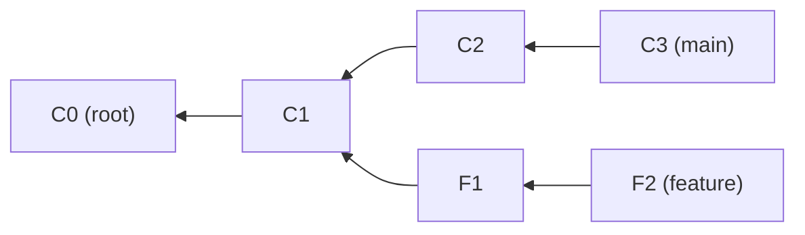
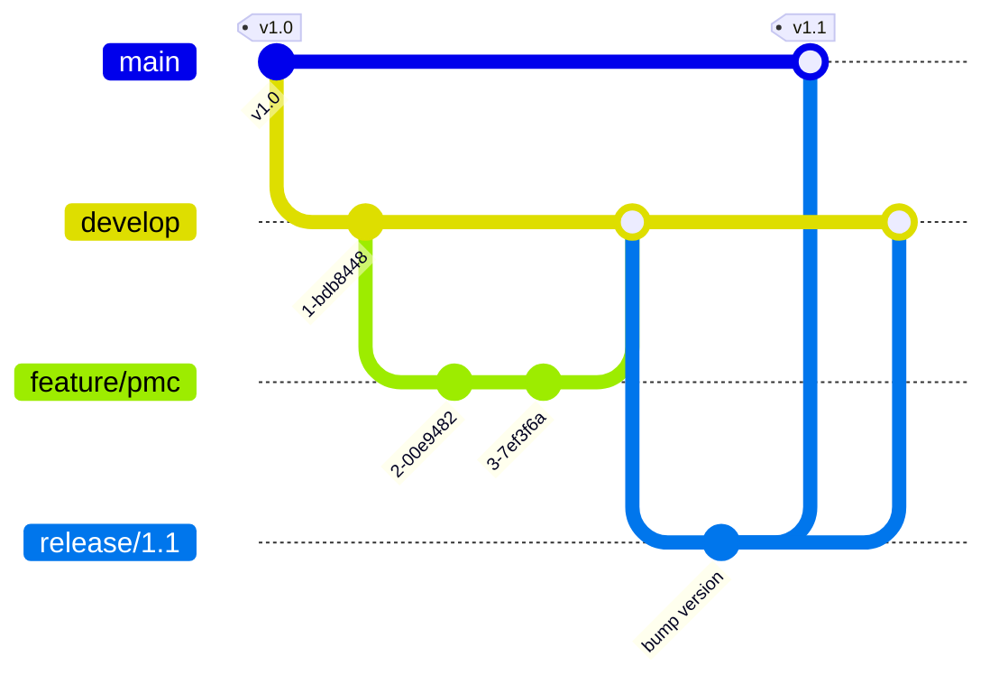

# Git Fundamentals -- Comprehensive Reference for Engineers and Interviews

> Last reviewed: 2026-11 · Versions assumed: Git 2.40+ (examples checked on Git 2.53); Git 3.0 changes (SHA-256, reftable, `main` default) noted where relevant but not yet released

> A deep-dive reference for Git as it is actually asked about in systems, tooling, HPC/GPU, and ML-infra interviews: the object model (blobs, trees, commits, tags, SHA hashes, refs, the index, packfiles), merging and rebasing, conflict resolution and `rerere`, cherry-pick / revert / reset, reflog-based recovery, stash, `bisect` (including bisecting a **performance regression** with a threshold script), history archaeology (`blame`, pickaxe `-S`/`-G`, `log -L`), worktrees, submodules vs subtrees, hooks, `.gitattributes`, large files and LFS, signing, and team workflows (trunk-based, GitFlow, stacked PRs). Each major section ends with interview questions and full answers; Section 23 is a "I messed up" recovery table and Section 24 is a consolidated interview Q&A.

---

## Table of Contents

1. [Mental Model: Snapshots, a DAG, and Three Trees](#1-mental-model-snapshots-a-dag-and-three-trees)
2. [Internals: The Object Database](#2-internals-the-object-database)
3. [Refs, HEAD, and Revision Syntax](#3-refs-head-and-revision-syntax)
4. [The Index (Staging Area)](#4-the-index-staging-area)
5. [Packfiles, Garbage Collection, and Scaling Large Repos](#5-packfiles-garbage-collection-and-scaling-large-repos)
6. [Branching and Merging](#6-branching-and-merging)
7. [Rebase and History Editing](#7-rebase-and-history-editing)
8. [Conflict Resolution and rerere](#8-conflict-resolution-and-rerere)
9. [Cherry-pick, Revert, and Reset](#9-cherry-pick-revert-and-reset)
10. [Reflog and Object Recovery](#10-reflog-and-object-recovery)
11. [Stash](#11-stash)
12. [Bisect: Finding the Commit That Broke It](#12-bisect-finding-the-commit-that-broke-it)
13. [History Archaeology: blame, Pickaxe, and Line History](#13-history-archaeology-blame-pickaxe-and-line-history)
14. [Remotes, Fetch, Push, and Force-Push Safety](#14-remotes-fetch-push-and-force-push-safety)
15. [Worktrees](#15-worktrees)
16. [Submodules vs Subtrees](#16-submodules-vs-subtrees)
17. [Hooks](#17-hooks)
18. [.gitattributes: Line Endings, Diff and Merge Drivers](#18-gitattributes-line-endings-diff-and-merge-drivers)
19. [Large Files: Git LFS, Partial Clone, and History Rewriting](#19-large-files-git-lfs-partial-clone-and-history-rewriting)
20. [Commit and Tag Signing](#20-commit-and-tag-signing)
21. [Team Workflows: Trunk-Based, GitFlow, and Stacked PRs](#21-team-workflows-trunk-based-gitflow-and-stacked-prs)
22. [Configuration Cheat Sheet](#22-configuration-cheat-sheet)
23. ["I Messed Up" Recovery Recipes](#23-i-messed-up-recovery-recipes)
24. [Interview Q&A](#24-interview-qa)

---

## 1. Mental Model: Snapshots, a DAG, and Three Trees

### 1.1 Snapshots, not diffs

Git does **not** store a commit as a diff against its parent. Each commit points to a **complete snapshot** of the project (a root tree). Diffs are computed on demand by comparing two snapshots. Storage stays small for two reasons:

1. **Content addressing / deduplication.** An unchanged file in commit N+1 has the same content, so the same hash, so the same blob. It is stored once.
2. **Delta compression in packfiles** (Section 5). When objects are packed, similar objects are stored as deltas against each other. This is a storage optimisation that is invisible to the object model.

Why it matters in interviews: "Git stores diffs" is the most common wrong answer. The snapshot model explains why branching is O(1) (a branch is a 41-byte file holding a hash), why `checkout` of any commit is fast, and why rename detection is a heuristic computed after the fact. Git never records "renamed".

### 1.2 The commit graph is a DAG

Every commit names zero or more parents: zero for a root commit, one normally, two or more for a merge. Because a commit's ID is a hash over its content, **including its parents' IDs**, you can't create a cycle and you can't change history without changing every descendant's ID. That makes the history a **Merkle DAG**, the same structure used by blockchains, IPFS, and ZFS.



(Arrows point from child to parent, the way Git stores them. Git only knows "who are my parents". "Who are my children" means walking the whole graph.)

### 1.3 The three trees

| "Tree" | Where it lives | What it represents |
|---|---|---|
| **HEAD** | `.git/HEAD` → a branch → a commit → its tree | The last commit you are on (the snapshot you started from) |
| **Index** (staging area) | `.git/index` (binary file) | The **proposed next commit**, a full flat snapshot rather than just "the changed files" |
| **Working tree** | Your checked-out files | What you are editing |

Most commands are easiest to understand as "which of the three trees does this move?":

| Command | HEAD (branch pointer) | Index | Working tree |
|---|---|---|---|
| `git add f` | -- | updated from WT | -- |
| `git commit` | moves to new commit | -- (it *becomes* the commit's tree) | -- |
| `git reset --soft X` | moves to X | -- | -- |
| `git reset [--mixed] X` | moves to X | reset to X | -- |
| `git reset --hard X` | moves to X | reset to X | reset to X |
| `git restore --staged f` | -- | `f` reset to HEAD | -- |
| `git restore f` | -- | -- | `f` reset to index |
| `git switch B` / `git checkout B` | HEAD now refers to B | updated to B | updated to B (keeps local changes if safe) |

`git diff` compares working tree vs index. `git diff --staged` (alias `--cached`) compares index vs HEAD. `git diff HEAD` compares working tree vs HEAD.

### 1.4 Plumbing vs porcelain

Git has two layers. The **porcelain** is the user commands: `commit`, `merge`, `rebase`, `log`. The **plumbing** is the low-level, script-stable commands: `hash-object`, `cat-file`, `update-index`, `write-tree`, `commit-tree`, `update-ref`, `rev-parse`, `rev-list`, `for-each-ref`, `merge-base`. In scripts and CI, prefer plumbing or porcelain commands with `--porcelain` or `--format` output. Human-facing output can change between versions.

> See also: [CS Fundamentals -- Hashing](../computer-science/CS_Fundamentals.md#92-hashing) for cryptographic hash properties, and [LeetCode Patterns -- Topological Sort](../computer-science/LeetCode_Patterns.md#14-topological-sort) for DAG algorithms (`git log --topo-order` is one).

**Q1. Does Git store diffs or snapshots? How is it space-efficient, then?**

Snapshots. Each commit points to a root tree describing every file. Space efficiency comes from (a) content addressing, where identical content hashes to the same blob and is stored once across all commits, and (b) packfiles, where `git gc`/`repack` delta-compresses similar objects, often the newer version stored whole and older ones as deltas. Deltas are a storage-layer detail. Logically, every commit is a full snapshot, which is why checking out any commit costs the same regardless of its age.

**Q2. Why is creating a branch in Git so cheap compared to SVN?**

A branch is a ref, a tiny file (or a reftable/packed-refs entry) containing one commit hash. Creating one writes about 41 bytes. Nothing is copied. In SVN, a branch is a server-side "cheap copy" of a directory tree, and it lives in the path namespace, which makes merging and tracking harder. Git branches are local, so you can create, rename, and delete them freely.

**Q3. What are the "three trees", and how does `git reset --mixed` affect them?**

HEAD (the last commit), the index (the proposed next commit), and the working tree (the files on disk). `reset --mixed X` moves the current branch to X and resets the index to X's tree. It leaves the working tree alone, so all changes since X show up as unstaged modifications.

---

## 2. Internals: The Object Database

### 2.1 The four object types

Everything in `.git/objects` is one of four immutable object types, addressed by the hash of its content:

| Type | Contains | Analogy |
|---|---|---|
| **blob** | Raw file bytes. No filename, no permissions | File content (inode data) |
| **tree** | Sorted list of entries `(mode, name, object-id)` pointing at blobs, subtrees, or gitlinks | A directory |
| **commit** | `tree`, zero or more `parent`, `author`, `committer`, optional `gpgsig`, message | A snapshot plus metadata plus history link |
| **tag** (annotated) | `object`, `type`, `tag` name, `tagger`, message, optional signature | A named, signed pointer to (usually) a commit |

Tree entry modes are a small fixed set:

| Mode | Meaning |
|---|---|
| `100644` | Regular file |
| `100755` | Executable file (Git only tracks the x bit, not full permissions) |
| `120000` | Symlink (blob content is the link target) |
| `040000` | Subdirectory (tree); stored without the leading zero as `40000` in the raw tree |
| `160000` | **Gitlink**, a commit in another repository (how submodules are recorded) |

Git does **not** track empty directories, because a tree with no entries has nothing to point to. That is why people commit `.gitkeep` files.

### 2.2 How an object ID is computed

The ID is `SHA-1("<type> <size-in-bytes>\0" + body)`, computed over the **uncompressed** bytes. The object is then zlib-compressed and written to `.git/objects/<first 2 hex>/<remaining 38 hex>`.

Worked example. The file content `hello\n` is 6 bytes:

```text
input to SHA-1 : "blob 6\0hello\n"
object id      : ce013625030ba8dba906f756967f9e9ca394464a
stored at      : .git/objects/ce/013625030ba8dba906f756967f9e9ca394464a  (zlib-deflated)
```

Two well-known constants you may be asked about:

| Object | ID |
|---|---|
| Empty blob | `e69de29bb2d1d6434b8b29ae775ad8c2e48c5391` |
| Empty tree | `4b825dc642cb6eb9a060e54bf8d69288fbee4904` |

(`git diff 4b825dc6 HEAD` diffs "nothing" against HEAD, which is handy for listing every file as added.)

The following complete program recomputes these IDs and reads a loose object back by hand:

```python
#!/usr/bin/env python3
"""Recompute Git object IDs by hand and read a loose object.

Usage: python3 git_objects.py [path-to-repo]
"""
import hashlib
import os
import sys
import zlib


def object_id(obj_type: str, body: bytes) -> str:
    """Git hashes '<type> <len>\\0' + body (uncompressed) with SHA-1."""
    header = f"{obj_type} {len(body)}\0".encode()
    return hashlib.sha1(header + body).hexdigest()


def tree_entry(mode: str, name: str, hex_id: str) -> bytes:
    """One tree entry: '<mode> <name>\\0' followed by the 20 raw ID bytes."""
    return f"{mode} {name}\0".encode() + bytes.fromhex(hex_id)


def read_loose(repo: str, hex_id: str) -> tuple[str, bytes]:
    path = os.path.join(repo, ".git", "objects", hex_id[:2], hex_id[2:])
    raw = zlib.decompress(open(path, "rb").read())
    header, _, body = raw.partition(b"\0")
    obj_type, size = header.decode().split()
    assert int(size) == len(body)
    return obj_type, body


if __name__ == "__main__":
    blob = object_id("blob", b"hello\n")
    print("blob('hello\\n')  =", blob)            # ce0136...
    print("empty blob       =", object_id("blob", b""))  # e69de2...
    print("empty tree       =", object_id("tree", b""))  # 4b825d...

    # A tree with one file a.txt -> the blob above (mode 100644).
    tree = object_id("tree", tree_entry("100644", "a.txt", blob))
    print("tree{a.txt}      =", tree)

    if len(sys.argv) > 1:
        repo = sys.argv[1]
        if os.path.exists(os.path.join(repo, ".git", "objects", blob[:2], blob[2:])):
            print(read_loose(repo, blob))
```

Running it prints `2e81171448eb9f2ee3821e3d447aa6b2fe3ddba1` for the one-file tree, which is exactly what `git write-tree` produces after `echo hello > a.txt && git add a.txt`. Note that the tree entry stores the **20 raw bytes** of the child ID, not 40 hex characters.

### 2.3 Inspecting objects with plumbing

```bash
# fragment
git cat-file -t HEAD            # commit
git cat-file -p HEAD            # pretty-print the commit object
# tree 6e5ac87200bfa55f556e39af920acd9d423c0b86
# parent a62f829d...            (absent on a root commit; 2+ lines on a merge)
# author A <a@b> 1793730709 +0000
# committer A <a@b> 1793730709 +0000
#
# init
git cat-file -p 'HEAD^{tree}'   # list the root tree
# 100644 blob ce013625030ba8dba906f756967f9e9ca394464a    a.txt
# 040000 tree 74e091be1b1379c449f2fc1010a5faeae5b419e3    src
git cat-file -s <id>            # size in bytes
git rev-parse HEAD:src/m.c      # object id of a path at a commit
git ls-tree -r --long HEAD      # recursive listing with blob sizes
git count-objects -vH           # loose vs packed counts and sizes
```

### 2.4 Building a commit with plumbing only

This sequence is a classic "do you really understand Git?" exercise. It creates a commit without `git add` or `git commit`:

```bash
git init -q -b main demo && cd demo   # -b main: stock Git still defaults to 'master'
blob=$(echo 'hello' | git hash-object -w --stdin)          # write blob to the ODB
git update-index --add --cacheinfo 100644,"$blob",greeting.txt  # stage it (index only)
tree=$(git write-tree)                                       # index -> tree object
c1=$(echo 'first commit, built by hand' | git commit-tree "$tree")   # tree -> commit
git update-ref refs/heads/main "$c1"                         # point the branch at it
git log --oneline          # <id> first commit, built by hand   (ID varies: it hashes author/committer + timestamps)
git status --short         #  D greeting.txt   <- the working tree never got the file
git restore greeting.txt   # materialise it from the index
```

The final `status` is instructive. HEAD and the index both contain `greeting.txt`, but the working tree doesn't, because we never wrote the file. The three trees really are independent.

### 2.5 Author vs committer

A commit records both. The **author** wrote the change. The **committer** last applied it. They differ after `cherry-pick`, `rebase`, `am` (applying an emailed patch), or `commit --amend` by someone else. Each has its own timestamp. `git log --format='%an %ad | %cn %cd'` shows both. `rebase` keeps the author date and sets a new committer date, unless you pass `--committer-date-is-author-date` or `--reset-author-date`.

### 2.6 Lightweight vs annotated tags

| | Lightweight (`git tag v1`) | Annotated (`git tag -a v1 -m msg`) |
|---|---|---|
| Storage | A ref only (`refs/tags/v1` → commit) | A **tag object** plus a ref pointing to that object |
| Metadata | None | Tagger, date, message, optional GPG/SSH signature |
| `git describe` | Ignored by default (needs `--tags`) | Used |
| Use for | Private or temporary markers | **Releases** (can be signed, carries provenance) |

`v1^{}` peels a tag to the object it points at. `git push --follow-tags` pushes annotated tags that point at the commits being pushed.

### 2.7 SHA-1, SHAttered, and SHA-256

- Git object IDs have been SHA-1 (160 bits, 40 hex characters) since 2005. The integrity argument: change one byte anywhere in history and every descendant commit ID changes, so a signed tag or commit transitively vouches for the whole tree and its history.
- **SHAttered (2017)** produced the first practical SHA-1 collision (two different PDFs). Git 2.13 switched to **SHA-1DC**, a hardened SHA-1 that detects the known collision-attack patterns and refuses such objects. Practical risk to Git today is low, but SHA-1 is deprecated for new designs.
- **SHA-256 repositories**: `git init --object-format=sha256` (added in 2.29; no longer labelled experimental since 2.42). IDs are 64 hex characters. **There is no interoperability with SHA-1 repositories yet** (work in progress since 2.45), and hosting support is limited. That is the main reason it isn't the default.
- **Git 3.0** (planned; *not released as of 2026-11*) is slated to default new repositories to SHA-256, the reftable ref backend, and `main` as the initial branch name. Existing repositories keep their formats.

**Interview nuance:** abbreviated IDs (`git log --oneline`) are only unique *within a repository right now*. A 7-character prefix can become ambiguous as the repo grows. Git automatically lengthens abbreviations (`core.abbrev=auto` scales with object count). In scripts and permanent records (bug reports, release notes), use full IDs.

**Q1. What exactly is hashed to produce a blob ID? Why is the type and size included?**

`SHA-1("blob " + decimal_length + "\0" + content)`. The header makes the ID domain-separated by type, so a blob and a tree with the same bytes get different IDs. The length also prevents trivial extension ambiguities and lets readers validate the object. The hash is over uncompressed data, so the ID doesn't depend on zlib level or packing.

**Q2. Where are filenames and permissions stored?**

In **trees**, not blobs. A tree entry is `(mode, name, id)`. That is why renaming a file without changing it reuses the same blob. Only the parent trees (and therefore the commit) change. It's also why Git can't record a rename explicitly: rename detection compares blob similarity between snapshots (`-M`, default 50% similarity threshold).

**Q3. If I change one file deep in `a/b/c/file.cpp`, which new objects are created on commit?**

One new blob (`file.cpp`), new trees for `c`, `b`, `a`, and the root (each parent tree's entry for its child changed), and one new commit. All other blobs and subtrees are reused by ID. So a commit creates O(depth) new tree objects, not O(files). This is the Merkle-tree property.

**Q4. Is Git's use of SHA-1 a security problem?**

Mostly mitigated. Since 2.13, Git uses SHA-1DC, which detects the collision technique used in SHAttered and rejects such objects. An attacker would also need to get a colliding object accepted into a repository you trust. SHA-256 repositories exist (`--object-format=sha256`) but don't yet interoperate with SHA-1 remotes. Signing (Section 20) is the real trust boundary. A hash only provides integrity, not authenticity.

---

## 3. Refs, HEAD, and Revision Syntax

### 3.1 What a ref is

A **ref** is a name for an object ID:

| Ref | Example path | Notes |
|---|---|---|
| Branch | `refs/heads/main` | Moves forward when you commit on it |
| Remote-tracking branch | `refs/remotes/origin/main` | Your **local cache** of where the remote's branch was at the last fetch. Updated only by `fetch`/`pull`/`push` |
| Tag | `refs/tags/v6.2.0` | Not supposed to move |
| Notes, stash, others | `refs/notes/commits`, `refs/stash` | `refs/stash` has a reflog holding the stack |

Storage backends:

- **Loose refs**: one file per ref under `.git/refs/` containing a hex ID and newline.
- **packed-refs**: one text file with many refs, written by `git pack-refs` / `gc`. A loose ref overrides a packed one.
- **reftable** (`git init --ref-format=reftable`, Git 2.45+): a binary, block-based format that supports atomic multi-ref updates and scales to millions of refs. It is planned as the default in Git 3.0. Use `git for-each-ref` / `git show-ref` / `git update-ref` instead of reading files directly, because those work with every backend.

### 3.2 HEAD and detached HEAD

`HEAD` is a **symbolic ref**. Normally `.git/HEAD` contains `ref: refs/heads/main`, so committing advances `main`. When you check out a commit, tag, or remote branch directly (`git switch --detach v1.0`, `git checkout origin/main`), HEAD contains a raw commit ID. This is **detached HEAD**. New commits are made, but no branch points to them. When you switch away they become reachable only via the reflog and will eventually be garbage-collected. Fix: `git switch -c rescue-branch` (before leaving), or later find the commit in `git reflog`.

Other special refs written by Git:

| Ref | Set by | Use |
|---|---|---|
| `ORIG_HEAD` | `reset`, `merge`, `rebase`, `am` (before moving HEAD dramatically) | `git reset --hard ORIG_HEAD` undoes the last such operation |
| `FETCH_HEAD` | `git fetch` | What was just fetched; `git merge FETCH_HEAD` |
| `MERGE_HEAD` | `git merge` while stopped on a conflict | The commit(s) being merged in |
| `CHERRY_PICK_HEAD`, `REVERT_HEAD` | Stopped cherry-pick or revert | Lets `--continue` / `--abort` work |
| `REBASE_HEAD` | Stopped rebase | The commit currently being replayed (`git show REBASE_HEAD`) |
| `BISECT_HEAD` | `git bisect start --no-checkout` | Candidate commit without touching the working tree |

### 3.3 Revision syntax cheat sheet

| Syntax | Meaning |
|---|---|
| `HEAD~3` | Third first-parent ancestor (`HEAD^^^`) |
| `HEAD^2` | **Second parent** of a merge (the branch that was merged in) |
| `HEAD^` / `HEAD^1` | First parent |
| `main@{u}` / `@{u}` | Upstream of `main` / of the current branch (e.g. `origin/main`) |
| `@{-1}` | The branch you were on before (`git switch -` uses it) |
| `HEAD@{2}` | Where HEAD was two moves ago (**reflog**) |
| `main@{yesterday}`, `main@{2.weeks.ago}` | Reflog by time (local history only) |
| `v1.0^{commit}`, `HEAD^{tree}` | Peel to the given object type |
| `HEAD:path/to/file` | The blob or tree at that path in that commit |
| `:path` / `:1:path` `:2:path` `:3:path` | Index entry (stage 0) / merge base, ours, theirs during a conflict |
| `:/fix race` | Youngest commit whose message matches the regex |
| `A..B` | Commits reachable from B but **not** from A ("what B has that A doesn't") |
| `A...B` | Symmetric difference: in either but not both. **In `git diff A...B`**: diff from `merge-base(A,B)` to B |
| `^A B` | Same as `A..B` (works with many refs: `git log B C ^A`) |

Common uses:

```bash
# fragment
git log --oneline main..feature         # what feature would bring into main
git log --oneline --left-right --cherry-pick main...feature   # < and > per side, dropping equivalent patches
git diff main...feature                  # "PR diff": changes on feature since it forked
git rev-list --count main..HEAD          # how many commits ahead
git merge-base main feature              # common ancestor used for 3-way merge
git rev-parse --abbrev-ref --symbolic-full-name @{u}   # name of the upstream
```

**Pitfall:** `git diff A..B` is the same as `git diff A B` (two endpoints). The `..` range semantics only apply to `log`/`rev-list`. `git diff A...B` is the one that is different and usually what you want for review.

**Q1. What is a detached HEAD and how do you avoid losing work in it?**

HEAD points directly at a commit instead of at a branch. Commits made there are not on any branch. Before switching away, run `git switch -c <name>` to create a branch at the current commit. If you already left, `git reflog` shows `HEAD@{n}` entries including those commits, and `git branch rescue <id>` recovers them, as long as reflog expiry and gc haven't run (unreachable reflog entries default to 30 days).

**Q2. Difference between `HEAD~2` and `HEAD^2`?**

`HEAD~2` is the grandparent following first parents: two steps back along the "mainline". `HEAD^2` is the **second parent** of HEAD, which only exists if HEAD is a merge. It's the tip of the branch that was merged in. They can be combined: `HEAD^2~3` means three first-parent steps back along the merged-in branch.

**Q3. Explain `main..feature` vs `main...feature` in `log` and in `diff`.**

In `log`, `main..feature` lists commits on feature not on main, and `main...feature` lists commits on either side but not both (add `--left-right` to see which side). In `diff`, `main..feature` equals `main feature` (compare the two tips), while `main...feature` compares `merge-base(main, feature)` to `feature`, showing only feature's changes. This is what GitHub's PR diff shows.

**Q4. What is `origin/main`, and why might it be stale?**

It's a remote-tracking ref: your local copy of where `main` was on `origin` at your last fetch or push. Nothing updates it automatically, so it can be arbitrarily stale. `git fetch` refreshes it. `git status` saying "up to date with origin/main" only means up to date with your *cached* view.

---

## 4. The Index (Staging Area)

### 4.1 What is in `.git/index`

The index is a binary file holding a **sorted, flat list of every tracked path** (not just changed ones). Each entry has:

- path, mode, blob ID, **stage number** (0 normally; 1/2/3 during conflicts)
- cached `stat` data: ctime, mtime, dev, inode, uid, gid, size

The stat cache is why `git status` is fast on large trees. If a file's stat data matches the index, Git assumes it is unchanged without re-hashing it. (If a file is modified within the same timestamp granularity as the index write, its stat data can match while its content differs. This is the "racy Git" problem. Git handles it by re-checking entries whose mtime is not older than the index file.) Extensions add a tree cache (fast `write-tree`), split index, untracked cache, and the fsmonitor token (an fsmonitor uses a filesystem watcher so `status` doesn't even need to `lstat` every file; `core.fsmonitor=true` starts Git's built-in daemon, which is available on Windows and macOS only; on Linux, point `core.fsmonitor` at a hook script backed by Watchman, e.g. the sample `fsmonitor-watchman` hook).

```bash
# fragment
git ls-files -s            # mode, id, stage, path for every index entry
git ls-files -u            # only unmerged (stage 1/2/3) entries
git ls-files --others --exclude-standard   # untracked, not ignored
```

### 4.2 Why a staging area exists

- **Craft commits deliberately**: stage some hunks now, others later (`git add -p`), so each commit is one logical change. This makes review, `revert`, and `bisect` far more effective.
- **Merge workspace**: during conflicts, the index holds the base, ours, and theirs versions of each conflicted path, so tools can do a 3-way display.
- **Performance**: the stat cache.

### 4.3 Everyday commands

```bash
# fragment
git add -p                  # interactively stage hunks (s = split, e = edit hunk)
git add -u                  # stage modifications and deletions of tracked files only
git add -A                  # stage everything incl. new files (respects .gitignore)
git restore --staged f      # unstage (== git reset -- f)
git restore f               # discard working-tree changes to f (from index)
git restore --source=HEAD~2 --staged --worktree f   # bring f back as of HEAD~2
git rm --cached secrets.env # stop tracking but keep the file on disk
git mv old new              # == mv + git rm old + git add new; rename detection still decides
git commit -v               # show the staged diff in the editor while writing the message
git diff --staged --stat    # what will be committed
```

### 4.4 assume-unchanged vs skip-worktree vs .gitignore

| Mechanism | Intent | Behavior |
|---|---|---|
| `.gitignore` | Never track *untracked* files matching a pattern | No effect on files already tracked. Untrack with `git rm --cached` |
| `update-index --assume-unchanged f` | **Performance** hint: "don't bother stat-ing f" | Git may still overwrite or notice it. Not meant for "local config tweaks" |
| `update-index --skip-worktree f` | "I intentionally keep a local version of this tracked file" | Git avoids touching it. Operations that need to change it fail loudly. Also used internally by sparse-checkout |

Interview trap: "How do I keep local changes to a tracked config file out of commits?" The best answer is to not track the file: commit a template (`config.example`) and ignore the real one. `--skip-worktree` is the correct per-clone hack if you can't change the repo. `--assume-unchanged` is the wrong tool.

**Q1. Is the index just a list of changed files?**

No. It is a complete snapshot of the next commit: every tracked path with its blob ID and mode, plus a stat cache. `git commit` simply turns the index into tree objects (`write-tree`) and wraps them in a commit. Files you didn't touch are in the index with the same IDs as in HEAD.

**Q2. What do stage numbers 1, 2, 3 mean?**

During a conflicted merge, a path can have up to three index entries: stage 1 = merge base version, stage 2 = "ours" (HEAD), stage 3 = "theirs" (the commit being merged or replayed). Stage 0 means resolved. `git add path` collapses them to a single stage-0 entry, which is how "mark as resolved" works. You can view each with `git show :1:path`, `:2:path`, `:3:path`.

**Q3. You committed `.env` with secrets and then added it to `.gitignore`. Why is it still tracked, and what must you do?**

`.gitignore` only affects untracked files. Run `git rm --cached .env` and commit. But the secret is still in history and in every clone or fork, so **rotate the credential first**. Then, if needed, rewrite history (`git filter-repo --path .env --invert-paths`) and force-push, coordinating with everyone who has a clone (Section 19.4).

---

## 5. Packfiles, Garbage Collection, and Scaling Large Repos

### 5.1 Loose objects vs packfiles

New objects are written **loose**: one zlib file each. Periodically (and on push and fetch), objects are combined into **packfiles**:

- `pack-<hash>.pack`: objects stored either whole or as **deltas** (copy/insert instructions) against a base object in the same pack. Chains can be several levels deep.
- `pack-<hash>.idx`: sorted IDs with offsets, plus a 256-entry **fanout table** indexed by the first byte, so a lookup is a narrowed binary search. That's O(log n), with no scanning.
- Optional: `.rev` (reverse index), `.bitmap` (reachability bitmaps, which make `clone`/`fetch` "counting objects" nearly instant on servers), and `multi-pack-index` (one index across many packs).

Delta selection is heuristic. Objects are sorted by type, a hash of the filename, and size. Each is tried against a sliding **window** of candidates (`pack.window`, default 10), with chain length limited by `pack.depth` (default 50). Git tends to keep the **most recent** version whole and older versions as deltas, because recent objects are accessed most often. Deltas are against *any* similar object, not necessarily "the previous version of the same file".

**Why binaries hurt:** compressed formats (zip, PNG, model weights, `.hsaco`/`.so` build outputs) barely delta-compress. A 200 MB file changed 50 times can cost about 10 GB of history that every full clone downloads. See Section 19.

### 5.2 gc, prune, and maintenance

```bash
# fragment
git count-objects -vH            # loose objects, packs, size-pack
git gc                           # pack refs, repack, expire reflogs, prune old unreachable
git gc --aggressive              # much larger window/depth; slow; rarely worth it
git repack -adf --window=250     # full repack (for a one-off cleanup)
git prune --expire=now           # delete unreachable loose objects now (dangerous: kills recovery)
git maintenance start            # schedule background prefetch, commit-graph, loose-objects,
                                 # incremental-repack via cron/systemd/launchd
git verify-pack -v .git/objects/pack/pack-*.idx | sort -k3 -n | tail -5   # largest objects
```

Default expiries (which define how long "lost" work is recoverable):

| Setting | Default | Meaning |
|---|---|---|
| `gc.reflogExpire` | 90 days | Reflog entries for commits still reachable from the ref |
| `gc.reflogExpireUnreachable` | 30 days | Reflog entries for commits no longer reachable (after reset/rebase) |
| `gc.pruneExpire` | 2 weeks | Unreachable loose objects younger than this are kept |
| `gc.auto` | 6700 | Loose-object count that triggers `gc --auto` |

Unreachable objects get packed into **cruft packs** (introduced in Git 2.37, default for `gc` since 2.41), which hold per-object mtimes so they can expire individually.

### 5.3 Scaling: shallow, partial, sparse, commit-graph

| Technique | Command | Downloads | Tradeoffs |
|---|---|---|---|
| **Shallow clone** | `git clone --depth 1` | Only the last N commits (full trees) | Fastest for one-shot CI builds. Breaks or slows `log`, `blame`, `merge-base`, `bisect`, `describe`. Deepen with `fetch --deepen`/`--unshallow` |
| **Blobless partial clone** | `git clone --filter=blob:none` | All commits and trees, blobs on demand | Best for developers: full history operations work, file contents are fetched lazily (`blame`/`log -p` trigger fetches). Requires server support (GitHub/GitLab have it) |
| **Treeless partial clone** | `--filter=tree:0` | Commits only | Best for CI that needs history but builds one commit. Bad for later interactive use |
| **Sparse checkout** | `git sparse-checkout set --cone dirA dirB` | Doesn't reduce download by itself (combine with partial clone) | Working tree contains only selected directories. Huge monorepos |
| **commit-graph** | `git commit-graph write --reachable` (gc and maintenance do it) | n/a | Stores generation numbers and parents, speeding up `log --graph`, `merge-base`, and ahead/behind by 10x or more on big repos |
| **Scalar** | `scalar clone <url>` | Partial clone + sparse + maintenance + fsmonitor | Microsoft-originated, shipped with Git since 2.38. Opinionated config for very large repos |

```bash
# fragment
# Typical "fast CI checkout" of a large ROCm-style monorepo that only builds one component:
git clone --filter=blob:none --sparse https://example.com/big/monorepo.git
cd monorepo
git sparse-checkout set --cone projects/rocprofiler-compute cmake
```

**Q1. How does Git find an object in a 2 GB packfile quickly?**

Via the `.idx`. A 256-entry fanout table gives the range of entries whose ID starts with each byte value, then a binary search over the sorted IDs inside that range returns the pack offset. If the object is a delta, Git reads the base (recursively, with a delta-base cache) and applies the delta. A `multi-pack-index` does the same across many packs. So it's O(log n) plus the delta chain length.

**Q2. Shallow clone vs partial clone. Which do you use for CI, and which for developers?**

CI that only builds the tip: `--depth 1` (or `--filter=tree:0`) is the cheapest. But anything that needs history breaks or gets slow: `git describe` for version strings, `merge-base` for "changed files since main", or `bisect`. Developers: `--filter=blob:none`. You get full commit and tree history (so log, merge-base, and rebase work normally) and blobs are fetched only when needed. Shallow clones also make the server work harder on subsequent fetches. Partial clone is generally the better default for humans.

**Q3. What does `git gc` actually do, and when can it destroy recoverable work?**

It packs loose objects and refs, expires reflog entries (by default 90 days for reachable, 30 for unreachable), and prunes unreachable objects older than `gc.pruneExpire` (2 weeks). Work is lost when a commit is unreachable from every ref *and* its reflog entries have expired *and* the prune grace period has passed. `git gc --prune=now` combined with `git reflog expire --expire-unreachable=now --all` destroys recovery immediately. Only do that deliberately, e.g. after purging a secret.

---

## 6. Branching and Merging

### 6.1 Fast-forward merges

If the current branch tip is an **ancestor** of the commit being merged, there is nothing to combine. Git just moves the branch pointer forward. No merge commit is created.

```text
before:  A---B---C  main
                  \
                   D---E  feature

git switch main && git merge feature      # fast-forward
after:   A---B---C---D---E  main, feature
```

| Flag | Behavior | Why use it |
|---|---|---|
| (default) | Fast-forward if possible, else 3-way merge | Normal |
| `--ff-only` | Refuse unless fast-forward is possible | Safe `pull` (`pull.ff=only`): never create surprise merge commits |
| `--no-ff` | Always create a merge commit, even if FF is possible | Preserve "this feature was developed as a unit" in history. `git log --first-parent` then shows one commit per feature, and `git revert -m 1` can undo the whole feature |

### 6.2 Three-way merge

When both sides have new commits, Git finds the **merge base** (best common ancestor, `git merge-base HEAD feature`) and compares each side against it. For each hunk:

| Base | Ours | Theirs | Result |
|---|---|---|---|
| X | X | X | X |
| X | **Y** | X | Y (only we changed it) |
| X | X | **Z** | Z (only they changed it) |
| X | Y | Y | Y (both made the identical change) |
| X | Y | Z | **CONFLICT** |

**Why three-way and not two-way?** With only "ours" and "theirs", if one side has a line and the other doesn't, you can't tell whether one side **added** it or the other **deleted** it. The base disambiguates. That is the entire reason merges need history, and why shallow clones without the merge base can't merge correctly.

Tree-level conflicts exist too: **modify/delete** (one side edited, the other deleted), **rename/rename** (both renamed the same file differently), **rename/delete**, **add/add** (both created the same path with different content), directory/file, and submodule pointer conflicts.

The result is a merge commit with two parents: first parent = the branch you were on (HEAD), second parent = the merged branch.

```text
A---B---C---F---M  main        M = merge commit, parents (F, E)
         \     /
          D---E    feature     merge base = C
```

### 6.3 Criss-cross merges and multiple merge bases

If two branches have merged into each other, there can be **several** "best" common ancestors (`git merge-base --all A B` lists them). The default strategy merges those bases together first, recursively, into a **virtual merge base**, then merges against it. That's why the old strategy was called "recursive". This avoids spurious conflicts that picking one base arbitrarily would cause.

### 6.4 Merge strategies and strategy options

| Strategy (`-s`) | What it does |
|---|---|
| `ort` | **Default for two heads since Git 2.34.** "Ostensibly Recursive's Twin", a faster rewrite of `recursive` with better rename handling. Since 2.50, `-s recursive` is just a synonym for `ort` (the old code was removed) |
| `resolve` | Old simple 3-way. Picks one base when there are several |
| `octopus` | Default when merging **more than two** heads. Refuses if manual resolution is needed |
| `ours` | Records a merge but **keeps our tree exactly**. Their changes are discarded entirely. Used to mark a branch as "merged/superseded" |
| `subtree` | Like ort, but shifts their tree to match a subdirectory (used with subtree merging) |

Strategy **options** (`-X`) tune `ort`:

| Option | Effect |
|---|---|
| `-X ours` / `-X theirs` | On **conflicting hunks only**, take our/their side automatically. Non-conflicting changes from both sides are still merged |
| `-X ignore-space-change`, `-X ignore-all-space` | Whitespace-insensitive hunk matching |
| `-X diff-algorithm=histogram` / `patience` | Better alignment for code with many similar lines (braces) |
| `-X find-renames=70%` / `-X no-renames` | Rename-detection threshold |
| `-X renormalize` | Apply `.gitattributes` normalisation (EOL) to all three versions before merging. Fixes the "every line conflicts" problem after a CRLF→LF change |

**Classic trap:** `-s ours` and `-X ours` are completely different. `-s ours` ignores the other branch's content entirely. `-X ours` merges normally and only auto-resolves *conflicts* in our favour.

### 6.5 Squash merges and first-parent history

- `git merge --squash feature` stages the combined diff of feature and **does not record a merge** (no second parent). After you commit, Git doesn't know `feature` was merged: `git branch --merged` won't list it, and merging `feature` again re-applies the changes, often with conflicts. PR UIs' "Squash and merge" behaves the same way. That's why you delete the branch after a squash merge, and why stacked branches need `rebase --onto` after the base is squash-merged (Section 21.4).
- `git log --first-parent main` walks only the first parent of each merge, giving one entry per merged PR in a merge-commit workflow. `git bisect --first-parent` (2.29+) bisects at PR granularity.

### 6.6 Testing a merge without touching the working tree

```bash
# fragment
git merge-tree --write-tree main feature     # prints the resulting tree id, and conflicts if any
echo $?                                      # 0 = clean, 1 = conflicts
git merge-tree --write-tree --quiet main feature && echo "merges cleanly"   # --quiet: Git 2.50+
git merge --no-commit --no-ff feature        # classic: perform it, inspect, then
git merge --abort                            #   ...back out
```

`merge-tree --write-tree` (2.38+) runs a real `ort` merge in memory. It's what server-side "can this PR be merged?" checks and merge queues use.

> See also: [Low-Level Design Interview Prep](../design-patterns/Low_Level_Design_Interview_Prep.md) for designing a version-control system as an LLD exercise.

**Q1. When does Git fast-forward, and why might a team forbid it with `--no-ff`?**

Git fast-forwards when the current tip is an ancestor of the merged commit, so it just moves the pointer. Teams using merge commits use `--no-ff` so every feature lands as a merge commit. That gives (1) `git log --first-parent` as a clean "one entry per PR" history, (2) one-command revert of a whole feature (`git revert -m 1 <merge>`), and (3) a record of when the feature was integrated. The cost is extra merge commits in the graph.

**Q2. What is the merge base, and why does a 3-way merge need it?**

It's the best common ancestor of the two tips: a common ancestor that isn't an ancestor of any other common ancestor. Comparing each side to the base tells Git who changed what. A line present in ours but absent in theirs could be our addition or their deletion, and only the base says which. Changes on one side only are taken automatically. Different changes to the same region conflict.

**Q3. Difference between `git merge -s ours` and `git merge -X ours`?**

`-s ours` produces a merge commit whose tree is identical to ours. The other branch's changes are thrown away, but history records it as merged. It's used to supersede an obsolete branch. `-X ours` is an option to the normal `ort` strategy: everything merges as usual, and only conflicting hunks are resolved to our side.

**Q4. Our team squash-merges PRs. A developer kept working on the same branch after the squash-merge and opened a second PR. Why is it full of conflicts or duplicate changes?**

The squash created a new commit on main with the same *content* as the branch's commits but no ancestry link. Git still thinks the branch's original commits are unmerged, so the new PR diff includes them again, and they can conflict with the squashed copy. Fix: `git rebase --onto main <last-commit-that-was-squashed> branch` (replay only the new commits), or start a fresh branch from main and cherry-pick the new work.

---

## 7. Rebase and History Editing

### 7.1 What rebase actually does

`git rebase main` (while on `feature`):

1. Computes the commits in `main..feature` (merge commits are dropped by default, as are commits whose patch already exists upstream, detected by **patch-id**).
2. Saves the old tip to `ORIG_HEAD`, then detaches HEAD at `main`'s tip.
3. **Cherry-picks** each commit in order, creating **new commits with new IDs** (same author and author date, new committer date, new parent).
4. Moves `feature` to the last new commit.

```text
before:            D---E  feature              after:                  D'--E'  feature
                  /                                                   /
         A---B---C---F---G  main                   A---B---C---F---G  main
```

The old `D` and `E` still exist. They're reachable via the reflog (`feature@{1}`, `ORIG_HEAD`) until expiry. That's why a bad rebase is easy to undo (Section 10).

### 7.2 `--onto`: transplanting a range

General form: `git rebase --onto <newbase> <upstream> [<branch>]` replays `upstream..branch` onto `newbase`.

```text
A---B---C  main
     \
      D---E  feature1
           \
            F---G  feature2

git rebase --onto main feature1 feature2
# Replays F, G (= feature1..feature2) directly onto main; D, E are left out.

A---B---C  main
     \    \
      D--E \  feature1
            F'--G'  feature2
```

Other uses: remove a range of commits from the current branch (`git rebase --onto X~3 X` replays `X..HEAD` onto `X~3`, dropping the three commits `X~2`, `X~1`, `X`), or move work off a wrongly chosen base branch.

### 7.3 Interactive rebase

`git rebase -i <base>` opens a **todo list** in your editor, one line per commit, oldest first:

```text
pick   1a2b3c4 Add ring buffer for PMC samples
fixup  5d6e7f8 fixup! Add ring buffer for PMC samples
reword 9a8b7c6 Parse rocprof CSV output
edit   0f1e2d3 Big refactor (to be split)
drop   4c5b6a7 WIP debug prints
exec   cmake --build build -j && ctest --test-dir build --output-on-failure
```

| Command | Effect |
|---|---|
| `pick` / `p` | Use the commit as-is |
| `reword` / `r` | Use it, but stop to edit the message |
| `edit` / `e` | Stop after applying, so you can amend, split, or test (`git rebase --continue` to resume) |
| `squash` / `s` | Meld into the previous commit, **combining** messages |
| `fixup` / `f` | Meld into the previous commit, **discarding** this message (`fixup -C` keeps this message instead) |
| `drop` / `d` (or delete the line) | Remove the commit |
| `exec` / `x <cmd>` | Run a shell command. Rebase stops if it fails (great for "every commit builds") |
| `break` | Stop here (inspect state), then `--continue` |
| `label` / `reset` / `merge` | Used by `--rebase-merges` to recreate merge topology |
| `update-ref` | Inserted by `--update-refs` to move other branches in a stack |

**Splitting a commit:** mark it `edit`. When rebase stops, run `git reset HEAD^` (the changes become unstaged), then `git add -p` and `git commit` several times, then `git rebase --continue`.

**Reordering** commits is just reordering lines, which can produce conflicts if later commits depend on earlier ones.

### 7.4 Rebasing without an interactive editor (CI, sandboxes, agents)

`git rebase -i` needs an interactive editor. In CI jobs, restricted sandboxes, and AI-agent shells there's often no TTY, and some environments block interactive flags outright (the environment these notes were prepared in disallows `-i`). The same operations can be scripted:

```bash
# fragment
# 1. Script the todo list: GIT_SEQUENCE_EDITOR edits the todo file, GIT_EDITOR handles messages.
#    Squash the 2nd commit of the last 3 into the 1st, keep the combined message as-is:
GIT_SEQUENCE_EDITOR="sed -i '2s/^pick/squash/'" GIT_EDITOR=true git rebase -i HEAD~3

# 2. Preferred: fixup commits + autosquash (no todo editing at all).
git commit --fixup=<sha-to-fix>            # creates "fixup! <subject>"
git commit --fixup=reword:<sha>            # amend just the message (2.32+)
git rebase --autosquash main               # non-interactive autosquash works in Git 2.44+
# (older Git: GIT_SEQUENCE_EDITOR=: git rebase -i --autosquash main)

# 3. Squash the last N commits into one without rebase:
git reset --soft HEAD~3 && git commit -m "Add PMC ring buffer"

# 4. Run a test at every commit of the branch:
git rebase --exec 'cmake --build build -j && ctest --test-dir build' main
```

`git config --global rebase.autoSquash true` makes every `rebase -i` honour `fixup!`/`squash!` commits.

### 7.5 Stacks: `--update-refs`, `--rebase-merges`, `range-diff`

- `git rebase --update-refs main` (Git 2.38+, or `rebase.updateRefs=true`): while rebasing the top branch of a stack, also moves every local branch that points into the rebased range. Without it you'd rebase each branch in the stack one by one with `--onto`.
- `git rebase --rebase-merges` (`-r`) preserves merge commits inside the rebased range instead of flattening them.
- `git range-diff @{u} ORIG_HEAD HEAD` compares the old series to the new series commit by commit after a rebase. Reviewers use it to see "what changed between v2 and v3 of this patch series" (the Linux kernel / Git mailing-list workflow, and Gerrit-style re-reviews).

### 7.6 Merge vs rebase

| | Merge | Rebase |
|---|---|---|
| History shape | True topology: shows parallel work and when it was integrated | Linear: reads as if work happened sequentially |
| Commit IDs | Preserved | **Rewritten**: new IDs for every replayed commit |
| Safe on shared branches | Yes | **No** (golden rule): others' clones still have the old commits, so you get duplicates or force-push fights |
| Conflict resolution | Once, in the merge commit | Possibly **once per replayed commit** (`rerere` helps) |
| Bisect friendliness | Fine with `--first-parent`. Intermediate branch commits may not build | Excellent if every commit builds |
| Revert a feature | `git revert -m 1 <merge>` (one commit) | Revert N commits (or the squash commit) |
| Traceability | Merge commit records integration | Lost unless the PR system records it |
| Typical policy | Integrating finished features into `main` / release branches | Updating *your own unpublished* branch with upstream; cleaning up before review |

A common hybrid: **rebase locally to clean up and catch up with `main`, then merge (or squash-merge) via the PR**. Many teams set `pull.rebase=true` so `git pull` on a feature branch rebases local commits instead of creating "Merge branch 'main' of ..." noise.

**The golden rule:** don't rebase commits that others have based work on. If you must (e.g. your own PR branch that a reviewer has checked out), communicate and push with `--force-with-lease` (Section 14).

**Q1. What happens to the original commits after a rebase?**

They're untouched: objects are immutable. Rebase creates new commits (new parent → new ID) and moves the branch ref. The originals are reachable via `ORIG_HEAD` and the branch's reflog (`feature@{1}`) until the reflog entries expire (30 days for unreachable by default) and gc prunes them. Undo with `git reset --hard ORIG_HEAD` (immediately) or `git reset --hard feature@{1}`.

**Q2. When would you choose rebase over merge, and vice versa?**

Rebase your **private** branch onto the latest upstream to get a linear, reviewable series and resolve conflicts against current code. Interactive rebase cleans up WIP commits before review. Use **merge** to integrate into shared long-lived branches (main, release), when you need to preserve the exact history that was tested, or when the branch is shared. Never rewrite published history others depend on.

**Q3. How do you squash the last 3 commits into one? Give two methods.**

(1) `git reset --soft HEAD~3 && git commit`: moves the branch back three commits while keeping the index (all their combined changes stay staged), then commits once. (2) `git rebase -i HEAD~3` and change the 2nd and 3rd `pick` to `squash`/`fixup` (scriptable via `GIT_SEQUENCE_EDITOR`). Method 1 is simplest. Method 2 lets you keep or merge messages and squash non-adjacent commits.

**Q4. During a rebase of 20 commits you hit the same conflict over and over. What can you do?**

Enable `rerere` (Section 8.5) so Git records your resolution and reapplies it. Better: first squash or fixup the related commits (`--autosquash`) so the conflicting area is touched once. Alternatively, merge `main` into the branch instead (one resolution), or rebase in stages onto intermediate upstream commits. If the conflict comes from a mechanical change on main (a reformat), rebase onto the commit just before it, then apply the same mechanical change to your branch.

**Q5. Explain `git rebase --onto A B C`.**

Take the commits in `B..C` (reachable from C but not B), replay them on top of A, and point branch C at the result. The typical case is a branch created from another feature branch that has since been merged or squashed. `--onto main old-feature1-tip feature2` moves only feature2's own commits onto main.

---

## 8. Conflict Resolution and rerere

### 8.1 Conflict markers and conflict styles

```text
<<<<<<< HEAD
    const int kMaxCounters = 8;
||||||| 23960f7          (base; only with diff3 / zdiff3)
    const int kMaxCounters = 4;
=======
    constexpr int kMaxCounters = 4;
>>>>>>> feature/constexpr
```

Set `git config --global merge.conflictStyle zdiff3` (Git 2.35+). The middle **base** section shows what both sides started from. In this example "ours raised the limit to 8, theirs made it `constexpr`", so the right answer is clearly `constexpr int kMaxCounters = 8;`. Without the base section you'd have to guess. `zdiff3` is `diff3` with common leading and trailing lines moved outside the markers. The label after `|||||||` is the abbreviated merge-base commit ID, or "merged common ancestors" when `ort` had to synthesise a virtual base from a criss-cross history (Section 6.3).

### 8.2 A systematic workflow

```bash
# fragment
git status                                  # "both modified", "deleted by them", ...
git diff --name-only --diff-filter=U        # list conflicted paths (scriptable)
git log --merge --oneline -- path           # commits on each side that touched the path
git show :1:path > base; git show :2:path > ours; git show :3:path > theirs   # all three versions
# edit the file, or:
git mergetool                               # configured 3-way tool (vimdiff, meld, kdiff3, VS Code)
git checkout --conflict=zdiff3 path         # re-create markers if you mangled the file
git checkout --ours path  /  --theirs path  # take one side wholesale (then git add)
git add path                                # mark resolved (collapses stages 1-3 to stage 0)
# build + run tests BEFORE continuing: a textually clean merge can still be semantically broken
git merge --continue        # or: git rebase --continue / git cherry-pick --continue
git merge --abort           # or: git rebase --abort -- restore pre-operation state
```

**Semantic conflicts** are the dangerous ones. Example: branch A renames `foo()` to `bar()` everywhere, branch B adds a new call to `foo()`. Git merges cleanly, and the build breaks. That's why CI must test the **merge result** (merge queues, or "test the merge commit" in PR CI), not just the branch tip.

### 8.3 "Ours" and "theirs" flip during rebase

| Operation | `--ours` / stage 2 / `HEAD` | `--theirs` / stage 3 |
|---|---|---|
| `git merge feature` (on main) | main (where you are) | feature |
| `git rebase main` (on feature) | **main + already-replayed commits** (the new base you are building on) | **your commit being replayed** |
| `git cherry-pick X` | your current branch | X |
| `git revert X` | your current branch | the inverse of X |

Reason: rebase works by checking out upstream and cherry-picking your commits onto it, so "ours" is the upstream side. If you resolve a rebase conflict with `git checkout --ours file`, you **discard your own change**. That's a common, painful mistake.

### 8.4 Special cases

| Conflict | How to handle |
|---|---|
| Modify/delete | Decide whether the file should exist: `git rm path` or `git add path` |
| Binary files (images, `.xlsx`, model files) | No markers. Choose a side: `git checkout --theirs -- f && git add f`. Use `.gitattributes` `merge=binary` to stop text-merge attempts |
| Lockfiles / generated files (`poetry.lock`, `package-lock.json`, generated headers) | Take one side, then **regenerate** with the tool. Never hand-merge |
| Submodule pointer | Pick the right commit: `cd sub && git checkout <id> && cd .. && git add sub` |
| Whitespace or EOL storms | `-X ignore-space-change`, or `-X renormalize` after a `.gitattributes` change |
| Mass reformat on one side | Reformat your side with the same tool and version first, then merge (`.git-blame-ignore-revs` keeps blame useful, Section 13.2) |

### 8.5 rerere: reuse recorded resolution

`rerere` ("reuse recorded resolution") remembers how you resolved a conflict and replays it when the **same conflict** (same conflicting hunks, identified by a hash of the normalised conflict) appears again.

```bash
# fragment
git config --global rerere.enabled true
git config --global rerere.autoUpdate true   # also `git add` files rerere fully resolved

# On conflict, rerere records the "preimage" (conflicted text) in .git/rr-cache/<hash>/.
# When you commit the resolution, it records the "postimage".
# Next time the identical conflict occurs (re-rebase, re-merge, test merge), it applies the postimage:
#   "Resolved 'src/counters.cpp' using previous resolution."

git rerere status          # paths rerere is tracking in the current conflict
git rerere diff            # what rerere would change / has changed
git rerere forget path     # drop a bad recorded resolution (then re-resolve)
git rerere gc              # prune old records (gc.rerereResolved, default 60 days; gc.rerereUnresolved, default 15 days)
```

Use cases:

1. **Long-lived topic branches rebased repeatedly** onto a moving `main`. You resolve each conflict once.
2. **Test merges**: merge `feature` into `main` to check for conflicts, abort, and later do the real merge. The resolution is remembered.
3. **Integration branches** (the Git project's own `seen`/`next` workflow): rebuild a throwaway integration branch daily from many topics. rerere replays all known resolutions.

Risk: rerere replays a **textual** resolution even if surrounding code changed its meaning. Always build and test, and review `git rerere diff`. With `autoUpdate` off (the default), rerere fixes the file but leaves it unstaged, which forces a human look.

**Q1. How do you resolve a merge conflict? Walk through it.**

`git status` / `git diff --name-only --diff-filter=U` to list conflicted files. For each, understand both intents (`git log --merge -p -- path`; the zdiff3 base section). Edit to a result that preserves both intents, or take one side with `checkout --ours/--theirs`, or use `mergetool`. `git add` each file. **Build and run the tests**, since clean text doesn't mean correct code. Then `git merge --continue` (or commit). If it goes wrong, `git merge --abort`. Enabling `merge.conflictStyle=zdiff3` makes most conflicts obvious.

**Q2. During a rebase you ran `git checkout --ours file` to "keep my version" and your change vanished. Why?**

During a rebase, "ours" is the branch being rebased **onto** (upstream plus the commits replayed so far), and "theirs" is your commit being replayed. You took upstream's version. Use `--theirs` to keep your commit's version. Recover with `git checkout --conflict=zdiff3 file` if still mid-rebase, or `git rebase --abort` and redo.

**Q3. What is rerere and when is it useful? Any danger?**

It records conflict preimage and postimage pairs in `.git/rr-cache` and automatically reapplies a resolution when an identical conflict reappears. It's useful for repeated rebases of long-lived branches, for test merges, and for rebuilding integration branches. The danger is a stale or wrong recorded resolution being applied silently to a context where it's no longer correct. Mitigate with tests, `git rerere diff`, leaving `rerere.autoUpdate` off, and `git rerere forget <path>` to drop a bad record.

**Q4. A merge produced no conflicts but CI fails. How?**

Semantic conflict: the two sides made textually independent changes that are incompatible, such as a rename versus a new use of the old name, a changed function contract, or a duplicate registration. Git only compares text hunks. Prevention: CI on the merge result (merge queue / "require branches up to date"), small and short-lived branches, and good tests.

---

## 9. Cherry-pick, Revert, and Reset

### 9.1 cherry-pick

`git cherry-pick X` computes the diff between `X^` and `X` and applies it to HEAD as a **new commit** (new ID, same author, new committer). It's a mini 3-way merge with base `X^`, ours `HEAD`, theirs `X`.

```bash
# fragment
git cherry-pick -x a1b2c3d               # append "(cherry picked from commit a1b2c3d...)" -- do this for backports
git cherry-pick A..B                     # commits after A up to and including B (A excluded!)
git cherry-pick A^..B                    # include A
git cherry-pick -n X                     # apply to index/WT without committing (combine several)
git cherry-pick -m 1 M                   # pick a merge commit: diff relative to its 1st parent
git cherry-pick --continue | --skip | --abort
git log --cherry-pick --oneline --right-only release...main   # which main commits are not yet on release (patch-id match)
```

**Backport workflow** (release branches, e.g. `release/rocm-rel-7.1`): land the fix on `main` first, then `git switch release/x && git cherry-pick -x <fix>`. The `-x` trailer lets anyone trace the backport to the original. Cherry-pick in the other direction ("fix on release, forward-port to main") risks forgetting the forward-port and regressing in the next release.

Pitfall: cherry-picked changes exist twice with different IDs. A later merge of the two branches usually resolves cleanly, because both sides made the same change. But if the code was modified further on one side you may get conflicts, and `git log` shows the change twice.

### 9.2 revert

`git revert X` creates a **new commit** that applies the inverse of X. History is not rewritten, so it's **safe on shared branches**. This is the standard way to undo something already pushed to `main`.

```bash
# fragment
git revert a1b2c3d                       # opens editor; message "Revert ..." + "This reverts commit ..."
git revert --no-edit HEAD~2..HEAD        # revert a range (newest first), one revert commit each
git revert -n HEAD~2..HEAD && git commit -m "Revert PMC sampling series"   # one combined revert
git revert -m 1 <merge-commit>           # revert a merge: keep parent 1 (mainline) side
```

**Reverting a merge, and the "revert the revert" trap:**

1. Feature branch `F` merged into main as `M`. It's buggy, so you `git revert -m 1 M` → commit `R`. Main's tree no longer has F's changes, **but F's commits are still ancestors of main**.
2. The developer fixes the bug on `F` and you merge `F` again. Git only brings in **commits after the previous merge**, because the old ones are already "merged". The original feature code does **not** come back, only the fix. The result is broken or incomplete.
3. Correct procedure: **revert the revert** (`git revert R`) to reintroduce the original changes, then merge the fix. Alternatively, rebase F's commits to new IDs (`git rebase --no-ff` / `-f`) so they're treated as new.

### 9.3 reset: moving the branch pointer

`git reset <mode> <commit>` moves **the current branch** (not just HEAD) to `<commit>`, then optionally resets the index and working tree:

| Mode | Branch/HEAD | Index | Working tree | Typical use |
|---|---|---|---|---|
| `--soft` | → commit | unchanged | unchanged | Squash or redo the last N commits (changes stay staged) |
| `--mixed` (default) | → commit | **reset** | unchanged | Unstage everything / un-commit but keep edits unstaged |
| `--hard` | → commit | **reset** | **reset** | Throw away commits *and* uncommitted changes (**destructive** for uncommitted work) |
| `--keep` | → commit | reset | updated, but **aborts** if a file with local changes would be overwritten | Safer `--hard`: move the branch while keeping unrelated local edits |
| `--merge` | → commit | reset | like `--keep`, for aborting a merge while keeping unrelated changes | Mostly superseded by `merge --abort` |

Worked example. Starting at `C` with three commits `A---B---C`, a staged edit to `x`, and an unstaged edit to `y`:

| Command | Branch at | `git status` afterwards |
|---|---|---|
| `git reset --soft HEAD~1` | B | C's changes **staged**, plus staged `x`, unstaged `y` |
| `git reset HEAD~1` | B | C's changes, `x`, and `y` all **unstaged** |
| `git reset --hard HEAD~1` | B | Clean. C's changes and **`x`, `y` gone** (C is recoverable via reflog; `x` maybe via `fsck` since it was staged; `y` is **unrecoverable**) |

`git reset -- path` (with a path) doesn't move the branch. It copies `path` from HEAD into the index, i.e. it unstages. The modern equivalent is `git restore --staged path`.

### 9.4 reset vs revert vs restore vs checkout vs switch

| Want to... | Use | Rewrites history? |
|---|---|---|
| Undo a pushed commit on a shared branch | `git revert` | No |
| Undo local, unpushed commits | `git reset --soft/--mixed/--hard` | Yes (local only) |
| Discard working-tree edits to a file | `git restore f` (old: `git checkout -- f`) | No |
| Unstage a file | `git restore --staged f` (old: `git reset f`) | No |
| Get a file as of another commit | `git restore --source=<rev> f` | No |
| Change branches | `git switch b` (old: `git checkout b`) | No |
| Create a branch at a commit | `git switch -c b <rev>` | No |

`git checkout` was overloaded: switching branches *and* overwriting files. Git 2.23 split it into `switch` and `restore`. Both are now standard (they were labelled experimental until 2.51). They're clearer in scripts and interviews.

**Q1. `git reset --hard` vs `git revert`. When do you use each?**

`revert` adds a new inverse commit and is safe on shared, pushed branches because nobody's history is rewritten. `reset --hard` moves the branch pointer back and discards index and working-tree changes. It rewrites your branch's history, so only use it on local or unpublished commits (or with explicit team agreement plus force-push). It also destroys uncommitted work irrecoverably.

**Q2. Explain soft, mixed, and hard reset.**

All three move the current branch to the target commit. `--soft` stops there: index and working tree untouched, so the undone commits' changes appear staged. `--mixed` also resets the index, so changes appear unstaged. `--hard` also resets the working tree, so changes are gone. Committed work stays recoverable via reflog. Uncommitted, unstaged work is not.

**Q3. You reverted a merged feature, fixed the bug on the feature branch, and merged again, but the feature is still missing. Why?**

The original feature commits are already ancestors of main, so the second merge only brings in the new fix commits. The revert commit still undoes the original code. You need to revert the revert first, then merge the fix. Or recreate the feature commits with new IDs (rebase with `--no-ff`) so Git treats them as unmerged.

**Q4. How do you cherry-pick a merge commit, and what does `-m 1` mean?**

A merge has two parents, so "the change introduced by M" is ambiguous. `-m 1` means "diff M against its first parent (the mainline)", which is the set of changes the merged branch brought in. The same applies to `git revert -m 1`. Usually you'd rather cherry-pick the individual commits from the merged branch.

---

## 10. Reflog and Object Recovery

### 10.1 What the reflog is

Every time a ref moves (commit, reset, rebase, checkout, merge, pull, amend), Git appends an entry to that ref's **reflog**: old ID, new ID, who, when, why. There's one for `HEAD`, one per branch, and (in non-bare repos, `core.logAllRefUpdates=true`) one per remote-tracking ref.

```bash
# fragment
git reflog                     # == git log -g --oneline HEAD
# 17085d4 HEAD@{0}: checkout: moving from tmp to main
# 663f6b5 HEAD@{1}: commit: tcommit
# 17085d4 HEAD@{2}: checkout: moving from main to tmp
git reflog show feature        # the branch's own history of positions
git reflog show origin/main    # where origin/main was at each fetch (detect upstream force-pushes)
git log -g --date=iso feature  # with timestamps
git diff feature@{1} feature   # what the last operation on feature changed
```

Key facts:

- The reflog is **local only**. It's never pushed or cloned. A fresh clone has an empty reflog.
- Entries expire: 90 days for entries reachable from the ref, **30 days** for entries no longer reachable (`gc.reflogExpire`, `gc.reflogExpireUnreachable`).
- `git branch -D x` **deletes x's own reflog**, but the HEAD reflog still remembers every commit you had checked out. Git also prints the tip when deleting: `Deleted branch tmp (was 663f6b5).`
- Commits are only truly lost when unreachable from all refs *and* all reflogs *and* older than the prune grace period (Section 5.2).

### 10.2 Recovery scenarios

| Situation | Recovery |
|---|---|
| `git reset --hard HEAD~3` by mistake | `git reset --hard HEAD@{1}` (or `ORIG_HEAD`) |
| Bad rebase / squash just finished | `git reset --hard ORIG_HEAD`, or `git reset --hard feature@{1}` (branch reflog: position before the rebase) |
| Rebase was a while ago, several moves since | `git reflog show feature` and find the entry *before* `rebase (start)`; `git reset --hard <id>` |
| Amended a commit and want the old version | `git reset --soft HEAD@{1}` (or `git show HEAD@{1}`) |
| Deleted a branch | Use the ID printed by `branch -D`, or find it in `git reflog`, then `git branch name <id>` |
| Committed on detached HEAD and switched away | `git reflog`, find `commit: ...` entries, then `git branch rescue <id>` |
| Dropped or cleared a stash | `git fsck --no-reflogs \| awk '/dangling commit/ {print $3}' \| xargs git log --no-walk --format='%h %s'` → look for `WIP on ...` → `git stash apply <id>` |
| Staged a file, then lost it (`reset --hard`) before committing | The blob exists: `git fsck --lost-found` → contents in `.git/lost-found/other/<id>` (no filenames; grep them) |
| Edits were never staged or committed, then `reset --hard` / `checkout -- f` | **Gone from Git.** Try editor or IDE local history, or filesystem snapshots |
| Someone force-pushed over `main` | Your `git reflog show origin/main` has the old tip (if you fetched before). Any teammate's clone too. Push it back with `--force-with-lease` after agreement |

### 10.3 fsck

```bash
# fragment
git fsck                         # integrity check of the object graph
git fsck --unreachable           # objects not reachable from refs or reflogs
git fsck --no-reflogs            # treat reflog-only objects as unreachable too ("dangling")
git fsck --lost-found            # write dangling commits/blobs into .git/lost-found/
```

A **dangling** object is unreachable and also not referenced by any other unreachable object, i.e. the tip of a lost chain. That's where you start recovery.

**Q1. You ran `git reset --hard` and lost three commits. Can you get them back?**

Yes, if done recently. `git reflog` shows where HEAD was before the reset (e.g. `HEAD@{1}: commit: ...`). `git reset --hard HEAD@{1}` or `git branch rescue <id>` restores them. They remain recoverable until reflog expiry (30 days for unreachable entries by default) plus gc's prune window. Uncommitted, unstaged changes that the reset wiped are not recoverable from Git. Staged-but-uncommitted content may be found as dangling blobs via `git fsck --lost-found`.

**Q2. Is the reflog shared with teammates?**

No. It's per-repository local metadata, never pushed. So it can't recover someone else's lost local work, and a fresh clone can't recover anything from before the clone. For a server-side force-push accident, the recovery source is any clone (or CI cache) that still has the old commits, or the hosting provider's audit and events log.

**Q3. How do you find which commit a branch pointed to yesterday?**

`git rev-parse 'main@{yesterday}'` or `git log -g main --since=...`. This uses the local reflog, so it reflects where *your* `main` was, not where the remote's was.

---

## 11. Stash

### 11.1 Commands

```bash
# fragment
git stash                       # == git stash push: tracked changes (staged + unstaged), then clean WT
git stash push -m "pmc ring buffer wip" -- src/pmc/   # message + only some paths
git stash -u                    # include untracked files (--include-untracked)
git stash -a                    # include untracked AND ignored files (careful: build dirs!)
git stash --keep-index          # stash, but leave staged changes in place (test exactly what you'll commit)
git stash --staged              # stash ONLY the staged changes (Git 2.35+)
git stash -p                    # choose hunks interactively
git stash list                  # stash@{0}: On main: pmc ring buffer wip
git stash show -p stash@{1}     # full diff of a stash (add -u to include untracked part, 2.32+)
git stash apply stash@{1}       # apply, keep the stash
git stash pop                   # apply and drop (if it applies cleanly)
git stash apply --index         # also restore which changes were staged
git stash branch fix stash@{0}  # new branch at the stash's base commit, apply there, drop stash
git stash drop stash@{2}; git stash clear
```

### 11.2 How a stash is stored

A stash entry is a **commit** referenced by `refs/stash`. The "stack" is that ref's reflog (`stash@{n}`). The commit has special parents:

```text
stash commit W   (working-tree state)
  parent 1: HEAD at stash time
  parent 2: I  -- commit of the index state
  parent 3: U  -- commit of untracked files (only with -u / -a)
```

That's why `git stash show` can show staged and unstaged parts separately, and why a dropped stash is recoverable as a dangling commit whose message starts with `WIP on <branch>:` or `On <branch>: <msg>` (Section 10.2).

### 11.3 Pitfalls

| Pitfall | Detail |
|---|---|
| Untracked files are not stashed by default | New files stay in the working tree. Use `-u` |
| `pop` with conflicts keeps the stash | Resolve, then `git stash drop` manually. Good, since nothing is lost |
| Stash is not a long-term store | No branch, easy to forget, local only. Prefer a WIP commit on a branch (`git commit -m wip`, later `reset --soft HEAD~1`) or a worktree |
| `-a` stashes ignored build outputs | Can be gigabytes, and clears your build dir |
| `rebase.autoStash` / `merge.autoStash` | Automatically stash and unstash around rebase or merge. Convenient, but conflicts on reapply leave a stash entry to deal with |

**Q1. What does `git stash` actually create?**

A merge-like commit W on `refs/stash` whose first parent is HEAD, second parent is a commit of the index, and optional third parent is a commit of untracked files. The stash list is `refs/stash`'s reflog. Since it's just commits, dropped stashes can be recovered with `fsck` until gc prunes them.

**Q2. You need to switch branches urgently but have half-done work. Options?**

(1) `git stash -u`, switch, later `git stash pop`. (2) A WIP commit on the current branch, later undone with `reset --soft HEAD~1` or squashed. (3) `git worktree add ../hotfix main` and do the urgent work in a separate directory without touching your current state (Section 15). Option (3) is the best for long builds, since there's no rebuild churn in your main tree.

---

## 12. Bisect: Finding the Commit That Broke It

### 12.1 Why it works

`git bisect` binary-searches the commit graph between a known **good** and a known **bad** commit. Each test halves the candidate set, so finding the culprit among N commits takes about ⌈log2 N⌉ tests:

| Commits in range | Tests needed |
|---|---|
| 100 | 7 |
| 1,000 | 10 |
| 10,000 | 14 |
| 100,000 | 17 |

For non-linear history, Git picks the commit that best splits the remaining **set** (by reachability counts), not a midpoint by date.

### 12.2 Manual bisect

```bash
# fragment
git bisect start
git bisect bad                 # current HEAD is broken
git bisect good v6.2.0         # last known good (tag, commit, branch)
# Git checks out a midpoint: "Bisecting: 511 revisions left to test after this (roughly 9 steps)"
# build + test, then mark:
git bisect good                # or: git bisect bad
git bisect skip                # can't test this one (doesn't build, unrelated breakage)
# ... repeat until: "<id> is the first bad commit"
git bisect log > bisect.log    # save the decisions (replay with: git bisect replay bisect.log)
git bisect visualize --oneline # remaining candidates (also: git bisect view)
git bisect reset               # return to the original branch (or: git bisect reset <commit>)
```

Shortcut: `git bisect start <bad> <good> [<good>...] -- [paths]`. Restricting to paths (e.g. `-- src/analysis/`) only tests commits touching those paths. It's faster, but wrong if the cause is elsewhere (a dependency bump in `requirements.txt`, say).

### 12.3 Automated: `git bisect run`

`git bisect run <cmd> [args...]` runs the command at each step and uses its **exit code**:

| Exit code | Meaning |
|---|---|
| `0` | good (old) |
| `1`-`127` except `125` | bad (new) |
| `125` | **skip**: this commit can't be tested |
| anything else (e.g. `128`-`255`, killed by signal) | **abort** the bisect |

```bash
# fragment
# Functional regression: a test started failing.
git bisect start HEAD v6.2.0
git bisect run sh -c 'cmake --build build -j || exit 125; ctest --test-dir build -R test_roofline --output-on-failure'
git bisect reset
```

Rules for reliable `bisect run` scripts:

1. **Keep the script outside the repo** (or untracked). Bisect checks out old commits, and a tracked script would change or vanish under you.
2. **Build failure → `exit 125`**, not 1. A broken build is not evidence that this commit introduced *your* bug.
3. **Never return >127 by accident**: `exit -1` becomes 255 (abort), and a segfaulting test via shell returns 139 (abort). Wrap the test: `./test || exit 1`.
4. **Clean state per step**: stale build artifacts or caches give wrong answers. Reconfigure if CMake files changed. `ccache` keeps rebuilds cheap.
5. Use a **separate worktree** (`git worktree add ../bisect-wt`) so bisecting doesn't disrupt your main checkout or its build directory.

### 12.4 Bisecting a performance regression with a threshold script

"Tests pass but the analysis got 4x slower" is the bread and butter of profiler and HPC work. Bisect needs a binary verdict, so you turn a timing into good/bad with a **threshold**. Use **custom terms** so the log reads naturally:

```bash
# fragment
git bisect start --term-old=fast --term-new=slow   # instead of good/bad
git bisect slow HEAD
git bisect fast v6.2.0
git bisect run /path/outside/repo/perf_check.sh
# ...  "035c657526ffc0f962ba0db8e46a5885e76bbaf0 is the first slow commit"
git bisect reset
```

A complete bash threshold script (median of several runs; build failures skip):

```bash
#!/usr/bin/env bash
# perf_check.sh -- exit 0 = good (fast), 1 = bad (slow), 125 = skip (cannot test)
set -u
THRESHOLD_MS=${THRESHOLD_MS:-60}
RUNS=${RUNS:-5}

# 1. Build; an unbuildable commit is not evidence either way -> skip.
# (cmake --build build -j || exit 125)   # real projects
[ -x ./bench.sh ] || exit 125

# 2. Run the benchmark several times; keep the median to reject noise.
times=()
for _ in $(seq "$RUNS"); do
  start=$(date +%s%N)
  ./bench.sh >/dev/null 2>&1 || exit 125
  end=$(date +%s%N)
  times+=( $(( (end - start) / 1000000 )) )
done
median=$(printf '%s\n' "${times[@]}" | sort -n | sed -n "$(( (RUNS + 1) / 2 ))p")
echo "commit $(git rev-parse --short HEAD): median ${median} ms (threshold ${THRESHOLD_MS} ms)"

# 3. Decide.
[ "$median" -le "$THRESHOLD_MS" ]   # exit 0 if fast, 1 if slow
```

The same in Python, with configurable build and benchmark commands and warm-up runs (useful when the first run pays JIT, cache, or GPU-init costs):

```python
#!/usr/bin/env python3
"""git bisect run helper: classify HEAD as fast (exit 0) or slow (exit 1).

Exit codes understood by `git bisect run`:
  0          -> good / old / fast
  1..127     -> bad / new / slow   (except 125)
  125        -> skip (cannot test this commit, e.g. build broken)
  >127 / <0  -> abort the whole bisect
"""
import os
import statistics
import subprocess
import sys
import time

THRESHOLD_S = float(os.environ.get("THRESHOLD_S", "0.060"))
RUNS = int(os.environ.get("RUNS", "7"))
WARMUP = int(os.environ.get("WARMUP", "1"))
BUILD_CMD = os.environ.get("BUILD_CMD", "")          # e.g. "cmake --build build -j"
BENCH_CMD = os.environ.get("BENCH_CMD", "./bench.sh")


def run(cmd: str) -> bool:
    return subprocess.run(cmd, shell=True, stdout=subprocess.DEVNULL,
                          stderr=subprocess.DEVNULL).returncode == 0


def main() -> int:
    if BUILD_CMD and not run(BUILD_CMD):
        print("build failed -> skip")
        return 125
    for _ in range(WARMUP):
        if not run(BENCH_CMD):
            return 125
    samples = []
    for _ in range(RUNS):
        t0 = time.perf_counter()
        if not run(BENCH_CMD):
            return 125
        samples.append(time.perf_counter() - t0)
    med = statistics.median(samples)
    head = subprocess.run(["git", "rev-parse", "--short", "HEAD"],
                          capture_output=True, text=True).stdout.strip()
    verdict = "slow" if med > THRESHOLD_S else "fast"
    print(f"{head}: median {med * 1e3:.1f} ms over {RUNS} runs -> {verdict}")
    return 1 if med > THRESHOLD_S else 0


if __name__ == "__main__":
    try:
        sys.exit(main())
    except Exception as exc:  # unexpected harness error: abort, don't mislabel
        print(f"harness error: {exc}")
        sys.exit(255)
```

Example session (a synthetic repo where commit `c13` introduced a 100 ms sleep):

```text
$ git bisect start --term-old=fast --term-new=slow HEAD HEAD~18
$ THRESHOLD_S=0.060 git bisect run python3 /tmp/scripts/perf_bisect.py
b125f15: median 23.3 ms over 7 runs -> fast
cce19b8: median 124.0 ms over 7 runs -> slow
035c657: median 125.1 ms over 7 runs -> slow
0312d5b: median 23.3 ms over 7 runs -> fast
035c657526ffc0f962ba0db8e46a5885e76bbaf0 is the first slow commit
```

### 12.5 Choosing the threshold: noise math

Bisect assumes every verdict is correct. A single misclassification sends the search into the wrong half, and it will confidently report a wrong commit. If each step is wrong with probability p, a bisect of k steps is right with probability (1 - p)^k:

| Per-step error p | 10 steps (about 1,000 commits) correct |
|---|---|
| 5% | 0.95^10 ≈ 60% (a 40% chance of blaming the wrong commit) |
| 1% | ≈ 90% |
| 0.1% | ≈ 99% |

So **drive p down**:

1. **Measure both endpoints first.** Run the benchmark 10-30 times at the known-fast and known-slow commits. Put the threshold between the two distributions, e.g. at the midpoint of the medians, and check that the gap is many standard deviations wide.
2. **Use the median of n runs.** For roughly normal noise, the standard error of the median is about 1.25·σ/√n. Worked example: run-to-run noise σ = 2% of runtime, regression = 3%, threshold at +1.5%:
   - n = 7: SE ≈ 1.25·2%/2.65 ≈ 0.94% → margin 1.5% ≈ 1.6 SE → p ≈ 5.5% per step → **too risky**.
   - n = 30: SE ≈ 0.46% → margin ≈ 3.3 SE → p ≈ 0.05% per step → fine.
3. **Reduce variance at the source.** Pin CPU frequency and governor (`cpupower frequency-set -g performance`), pin to cores (`taskset`), disable turbo if possible, quiet the machine, warm up. On GPUs, lock or pin clocks where the tooling supports it, and run on the same device each time. Use fixed input sizes and seeds.
4. **Add a "gray zone" → 125**: if the median lands within the noise band around the threshold, `exit 125` (skip) rather than guess. Bisect will test neighbours.
5. **Sanity-check the answer**: re-measure the culprit and its parent with many runs, and read the diff. Does it plausibly cause the slowdown?
6. **Multiple regressions stacked?** Bisect finds the first commit that crosses the threshold. If the slowdown arrived in steps (+10%, +15%, +20%), re-bisect from the culprit with a higher threshold.

### 12.6 Other bisect features

| Feature | Use |
|---|---|
| `git bisect start --first-parent` (2.29+) | Only test first-parent (mainline merge) commits. Finds the **merged PR** that broke it, and avoids untestable mid-branch commits |
| `git bisect start --no-checkout` | Don't touch the working tree. Sets `BISECT_HEAD` (for bare repos or when the test fetches its own artifacts by commit ID, e.g. prebuilt CI binaries) |
| `git bisect terms` | Show the current terms (`good/bad` or custom) |
| `git bisect skip v2.1..v2.3` | Skip a known-untestable range (e.g. build was broken for a week) |
| Bisect over **CI artifacts** | If CI stores per-commit builds, the script downloads the binary for `$(git rev-parse HEAD)` instead of compiling. Far faster for big C++/HIP builds |

> See also: [Math, Probability and Estimation -- Benchmarking checklist](../computer-science/Math_Probability_Estimation.md#65-benchmarking-checklist-where-this-shows-up-for-gpuhpc-roles), [Performance Engineering](../computer-science/Performance_Engineering.md), [Debugging and Profiling Tools](../tools/Debugging_and_Profiling_Tools.md), and [Project Deep Dive: rocprof-compute](../career/Project_Deep_Dive_rocprof-compute.md) for regression stories.

**Q1. How does `git bisect` work, and how many steps does it take?**

Binary search over the commit DAG between a known-good and known-bad commit. Each test classifies the midpoint and discards half the candidates, so it takes about ⌈log2 N⌉ steps: around 10 for 1,000 commits, 17 for 100,000. For merges, Git picks the commit that most evenly splits the remaining candidate set by reachability.

**Q2. How would you automatically find which commit made a benchmark 30% slower?**

Write a script outside the repo that builds (exit 125 on build failure), runs the benchmark several times after a warm-up, takes the median, and exits 0 if below a threshold and 1 if above. Calibrate the threshold by measuring the known-good and known-bad commits, and put it between the two distributions with a safe margin. Run `git bisect start --term-old=fast --term-new=slow <slow> <fast>` then `git bisect run ./perf_check.sh`. Control noise with pinned clocks, a quiet machine, enough runs, and a skip (125) gray zone. Verify the reported commit afterwards. Each misclassification corrupts the search, and with 10 steps a 5% per-step error rate yields a wrong answer about 40% of the time.

**Q3. What do exit codes 125 and 128+ mean to `git bisect run`?**

125 = skip this commit (untestable). Git picks a nearby commit instead and may end with "the first bad commit could be any of" a small set if the skipped ones are adjacent to the boundary. Codes above 127 (and negative ones) abort the whole bisect. That matters because a crashing test (signal → 128+n in the shell) aborts rather than counting as "bad", so wrap it: `./test || exit 1`.

**Q4. Some commits in the range don't build. Does that ruin the bisect?**

No. Mark them `skip` (or return 125). If the culprit sits among skipped commits, bisect reports a set of candidates rather than one commit. You can reduce untestable commits by bisecting with `--first-parent` (merges usually build) or by using per-commit CI artifacts.

---

## 13. History Archaeology: blame, Pickaxe, and Line History

### 13.1 Questions and the right tool

| Question | Command |
|---|---|
| Who last changed each line of this file? | `git blame -L 120,160 src/counters.cpp` |
| ...ignoring whitespace and code moves? | `git blame -w -M -C src/counters.cpp` (`-C -C -C`: also look in other files and commits) |
| When was this string **added or removed**? | `git log -S 'kMaxCounters' --oneline` (pickaxe) |
| Which commits touched lines **matching a regex**? | `git log -G 'hipMemcpy(Async)?\(' --oneline` |
| Evolution of a function | `git log -L :parse_pmc_config:src/config.cpp` |
| Evolution of a line range | `git log -L 120,160:src/counters.cpp` |
| History of a file across renames | `git log --follow -p -- src/new_name.py` |
| When was this file deleted, and what did it contain? | `git log --diff-filter=D --oneline -- path` then `git show <id>^:path` |
| Which release first contained this fix? | `git describe --contains <id>` / `git tag --contains <id>` |
| Which branches contain this commit? | `git branch -a --contains <id>` |
| Latest commit touching each path (directory listing view) | `git last-modified` (new and experimental in Git 2.52) |
| Search all file contents at a revision | `git grep -n 'pattern' v6.2.0 -- '*.cpp'` |
| Who knows this area? | `git shortlog -sne -- src/analysis/` |

### 13.2 blame details

- `blame` shows, per line, the commit that **last touched** it. It doesn't show the commit that introduced the logic. A reformat commit "owns" every line it touched.
- `-w` ignores whitespace changes. `-M` detects lines moved within a file. `-C` detects lines moved or copied from other files in the same commit. `-C -C` also checks the commit that created the file. `-C -C -C` checks all commits (slow).
- **Ignore mechanical commits** (clang-format, black, mass rename):

```bash
# fragment
# .git-blame-ignore-revs  (commit full IDs, one per line, comments allowed)
# Apply clang-format to the whole tree
3f2a9c1e0d5b7a8c6e4f2d1b0a9c8e7f6d5c4b3a

git config blame.ignoreRevsFile .git-blame-ignore-revs   # local; GitHub's blame UI honours this filename automatically
git blame --ignore-rev 3f2a9c1 file.cpp                   # one-off
```

- To go further back, blame the parent of the commit that blame reported: `git blame <id>^ -- file`, or use `log -L`.

### 13.3 Pickaxe: `-S` vs `-G`

- `-S<string>` finds commits where the **number of occurrences** of the string changed, i.e. it was added or removed. Add `--pickaxe-regex` to treat it as a regex.
- `-G<regex>` finds commits whose **diff contains added or removed lines matching** the regex, even if the count didn't change.

Worked example (checked with Git 2.53). A file contains `foo(x)`. One commit edits that same line (`foo(x)` becomes `x = foo(x) + 1`):

```bash
# fragment
git log --oneline -S'foo(x)'      # does NOT list the edit commit: occurrences of "foo(x)" stayed 1
git log --oneline -G'foo\(x\)'    # DOES list it: a removed and an added line both match
```

Rule of thumb: use `-S` for "when was this symbol introduced or deleted?" (fast and precise) and `-G` for "which commits touched lines using this API?". Add `-p` to see the diffs, and `--all` to search every branch.

**Q1. How do you find the commit that introduced a particular function call that's now causing a bug?**

`git log -S 'the_call(' --oneline --all` lists commits where the number of occurrences changed. The earliest is where it was introduced. `git log -L :function:file` shows every change to the enclosing function. If you only have a symptom, use `git bisect`. If you have a suspicious line, use `git blame -w -C` and then iterate with `git blame <id>^`.

**Q2. `git blame` points every line at a "clang-format the repo" commit. What do you do?**

List that commit in `.git-blame-ignore-revs` and set `blame.ignoreRevsFile` (or pass `--ignore-rev`). Blame then attributes lines to the previous meaningful change. GitHub's blame view reads this file automatically. Also use `-w` to ignore whitespace-only changes.

**Q3. How do you determine which releases include a given bug fix?**

`git tag --contains <fix-id>` lists every tag whose history includes the commit. `git describe --contains <id>` names the first tag after it. If the fix was cherry-picked to release branches it has different IDs there, so search by patch with `git log --cherry-pick --right-only` or by the `(cherry picked from commit ...)` trailer: `git log --grep='cherry picked from commit <id>' --all`.

---

## 14. Remotes, Fetch, Push, and Force-Push Safety

### 14.1 Fetch, pull, push

| Command | Does |
|---|---|
| `git fetch [remote]` | Downloads objects and updates **remote-tracking refs** (`origin/*`). Never touches your branches or working tree. Always safe |
| `git pull` | `fetch` + integrate the upstream into the current branch: merge by default, rebase with `pull.rebase=true`, fast-forward only with `pull.ff=only` |
| `git push` | Uploads objects and asks the remote to update its refs. Rejected if it's not a fast-forward, unless forced |

Refspecs define the mapping: `+refs/heads/*:refs/remotes/origin/*` (the default fetch refspec; `+` = allow non-fast-forward updates of the tracking ref).

```bash
# fragment
git remote -v                                   # origin = your fork, upstream = canonical repo
git remote add upstream https://github.com/ROCm/rocm-systems.git
git fetch upstream --prune                      # also delete stale tracking refs
git push -u origin HEAD                         # publish current branch and set upstream
git config --global push.autoSetupRemote true   # make plain `git push` do -u for new branches (2.37+)
git push origin --delete old-branch
git fetch origin pull/123/head:pr-123           # GitHub: fetch a PR's head into a local branch
git branch -vv                                  # upstream + ahead/behind for each branch
```

### 14.2 Force-push safely

| Command | Safety |
|---|---|
| `git push --force` | Overwrites the remote ref unconditionally. Can silently delete teammates' pushed commits |
| `git push --force-with-lease` | Only overwrites if the remote ref still equals **your remote-tracking ref** (what you last saw). Fails if someone pushed since |
| `--force-with-lease=main:<expected-id>` | Explicit expected value. Strongest form |
| `--force-with-lease --force-if-includes` (2.30+) | Also verifies your local branch actually **incorporated** the remote tip (via reflog), closing the hole below |

The hole: `--force-with-lease` compares against `origin/branch`. If a background `git fetch` (IDE, `git maintenance` prefetch writes to `refs/prefetch/` precisely to avoid this) updated `origin/branch` to include a teammate's commit you never integrated, the lease "matches" and you overwrite their work anyway. `--force-if-includes` or an explicit expected ID prevent this.

Protect shared branches server-side: branch protection or rulesets (no force-push, required reviews, required status checks, linear history if desired). Client-side discipline is not enough.

**Q1. `git fetch` vs `git pull`?**

`fetch` only downloads and updates `origin/*` tracking refs. Your branches and files are untouched, so it's always safe, and you can inspect with `git log HEAD..origin/main` before integrating. `pull` is fetch plus merge (or rebase, per `pull.rebase`) into the current branch, which can create merge commits or conflicts. Many engineers fetch, then explicitly `rebase` or `merge`, or set `pull.ff=only` to avoid surprises.

**Q2. Why prefer `--force-with-lease` over `--force`, and what is its weakness?**

`--force-with-lease` refuses to overwrite the remote branch if it moved since your last fetch, which protects teammates' new commits. Its weakness is that "last fetch" may have been an automatic background fetch that you never integrated, so the lease passes anyway. `--force-if-includes` (2.30+) additionally checks that the remote tip is in your local branch's reflog history. An explicit `--force-with-lease=branch:<id>` also closes the hole.

---

## 15. Worktrees

### 15.1 What a worktree is

`git worktree` lets one repository have **multiple working directories checked out at once**, each on a different branch, sharing a single object database and set of refs.

```bash
# fragment
git worktree add ../rocprof-hotfix -b hotfix/csv-parse origin/release/7.1   # new branch from a base
git worktree add ../review-pr-123 pr-123          # existing branch
git worktree add --detach ../bisect-wt HEAD       # detached, e.g. for bisect or benchmarking
git worktree list                                 # path, HEAD, branch for each
git worktree remove ../review-pr-123              # refuses if dirty (use --force deliberately)
git worktree prune                                # clean metadata for dirs deleted by hand
git worktree lock ../on-usb-drive --reason "removable media"   # keep prune from deleting it
git worktree move ../old ../new;  git worktree repair         # after moving dirs manually
```

| Shared across worktrees | Per worktree |
|---|---|
| Objects (`.git/objects`), branches and tags (`refs/heads`, `refs/tags`), remotes, config (unless `extensions.worktreeConfig` + `git config --worktree`) | `HEAD`, **index**, working files, `refs/bisect/*`, `refs/worktree/*`, rebase/merge state, per-worktree reflog for HEAD |

The linked worktree's `.git` is a **file** (`gitdir: /path/main/.git/worktrees/<name>`), and its private state lives under the main repo's `.git/worktrees/<name>/`.

**Constraint:** a branch can be checked out in **only one** worktree at a time. Git refuses a second checkout, because two index/working-tree pairs advancing the same branch would corrupt each other's view. Use `--detach` or a new branch.

### 15.2 Worktree vs second clone vs stash

| | Worktree | Second clone | Stash / switch |
|---|---|---|---|
| Disk | Only working files (objects shared) | Full object store again (unless `--reference`/`--shared`) | None |
| Fetch once, visible everywhere | Yes | No | n/a |
| Parallel builds of two branches | Yes | Yes | No (one tree) |
| Rebuild churn in your main build dir | None | None | **Yes**: switching branches touches mtimes → large C++/HIP rebuilds |

Use cases: hotfix on a release branch while a long build runs on `main`; reviewing a PR without stashing; running `bisect` or benchmarks in an isolated checkout; comparing performance of two branches side by side; parallel AI-agent sessions, each in its own worktree.

Pitfalls: each worktree needs its **own build directory** (CMake caches absolute source paths). Submodule support in worktrees is documented as incomplete. Don't `rm -rf` a worktree with unpushed work: commits are safe in the shared repo, but uncommitted files are not.

**Q1. What is `git worktree` and why use it instead of cloning twice?**

It attaches extra working directories to the same repository. Objects, refs, and config are shared; HEAD, index, and files are per worktree. Compared to a second clone: no duplicate object store, a fetch in one is visible in all, and branches stay in one place. Compared to stashing and switching: no disruption to your current state and no rebuild storms. The limitation is that a branch can be checked out in only one worktree.

---

## 16. Submodules vs Subtrees

### 16.1 Submodules

A submodule records **a specific commit of another repository** at a path. Two pieces make it up:

1. A **gitlink** tree entry (mode `160000`) holding the commit ID. There's no content, just a pointer.
2. `.gitmodules`, mapping path → URL (and an optional branch to track).

```bash
# fragment
git submodule add https://github.com/fmtlib/fmt.git third_party/fmt
git clone --recurse-submodules <url>             # or after clone:
git submodule update --init --recursive          # check out the recorded commits (detached HEAD!)
git config --global submodule.recurse true       # make checkout/pull/switch update submodules too
git submodule update --remote third_party/fmt    # move to tip of the tracked branch...
git add third_party/fmt && git commit -m "build: bump fmt"   # ...then RECORD the new pointer
git submodule status                              # '-' uninitialised, '+' checked-out != recorded
git diff --submodule=log                          # show the commits a pointer bump brings in
git submodule foreach 'git status --short'
git submodule sync --recursive                    # after a URL change in .gitmodules
# Remove: git rm third_party/fmt && rm -rf .git/modules/third_party/fmt  (then commit)
```

Common failure modes:

| Symptom | Cause |
|---|---|
| Build can't find headers in `third_party/x` | Cloned without `--recurse-submodules`. The directory is empty |
| "My commits in the submodule disappeared" | The submodule is on a **detached HEAD** at the recorded commit. You committed there without a branch, then `update` moved it. Recover via the submodule's reflog. Always `git switch -c` inside before working |
| Teammates get a pointer to a commit that doesn't exist on the server | You committed the superproject pointer but **didn't push the submodule** commit. Use `git push --recurse-submodules=check` (or `on-demand`) |
| `git status` shows `modified: sub (new commits)` after a pull | Superproject moved the pointer, but your submodule checkout didn't follow. Run `git submodule update` |
| Merge conflict on a gitlink | Pick the commit you want: `git -C sub checkout <id>; git add sub` |

### 16.2 Subtrees

`git subtree` (a contrib command packaged with most Git distributions) **copies another repository's content (optionally its history) into a subdirectory** of your repo as ordinary files and commits.

```bash
# fragment
git subtree add  --prefix=third_party/fmt https://github.com/fmtlib/fmt.git 11.0.2 --squash
git subtree pull --prefix=third_party/fmt https://github.com/fmtlib/fmt.git 11.1.0 --squash
git subtree push --prefix=third_party/fmt git@github.com:me/fmt-fork.git my-patches  # upstream local edits
git subtree split --prefix=lib/core -b core-only   # extract a dir's history into its own branch/repo
```

### 16.3 Comparison

| | Submodule | Subtree |
|---|---|---|
| What's stored in your repo | A pointer (commit ID) + `.gitmodules` | The actual files (plus history, or one squash commit) |
| Clone experience | Extra step (`--recurse-submodules`). Easy to forget | Plain `git clone` just works |
| Pinning | Exact commit, explicit and reviewable bumps | Whatever was last pulled. Version visible only in commit messages |
| Local modifications to the dependency | Commit inside the submodule, push to its repo/fork, bump pointer: clunky but clean separation | Edit in place like any file. Upstreaming needs `subtree push`/`split` |
| Repo size | Small | Grows with the dependency |
| Tooling friction | Detached HEADs, recursive flags, CI must init, more confusing for newcomers | Few surprises. Commands are less known, and history can be noisy without `--squash` |
| Best for | Large, independently versioned components. Several repos sharing one pinned dependency. Dependencies you rarely modify | Small vendored libraries you patch. Consumers who must not need Git knowledge |

Alternatives worth naming in an interview: a **package manager** (vcpkg, Conan, pip/conda), **CMake FetchContent** pinned to a tag or commit (dependency fetched at configure time), plain **vendoring** (copy a release tarball in), or a **monorepo** (one repo, one history; ROCm, for example, has consolidated many components into larger "super-repos"). Monorepos trade simpler cross-component changes for heavier clones and a need for sparse checkout, partial clone, and per-directory CI.

> See also: [CMake Fundamentals -- FetchContent Deep Dive](../tools/CMake_Fundamentals.md#31-fetchcontent-deep-dive) for dependency fetching at configure time.

**Q1. Submodules vs subtrees. When do you choose which?**

Submodules keep a precise, reviewable pointer to another repo's commit, keep your repo small, and suit large, independently released components you rarely modify. The cost is clone and update ergonomics (`--recurse-submodules`, detached HEADs, forgetting to push the submodule). Subtrees copy the code in, so clone "just works" and local patches are easy. The cost is repo size and harder upstreaming. For C++ dependencies, also consider a package manager or `FetchContent` pinned to a commit.

**Q2. A teammate pulled, and the build fails with missing files in `extern/`. Diagnose.**

Most likely the submodules weren't initialised or updated: `git submodule status` shows `-` (uninitialised) or `+` (checked-out commit differs from recorded). Fix with `git submodule update --init --recursive`, and set `submodule.recurse=true`. If the update fails with "not our ref", someone committed a pointer to a submodule commit they never pushed. They need to push it, and CI should run `git push --recurse-submodules=check`-style validation.

---

## 17. Hooks

### 17.1 Hook catalogue

Hooks are executables in `.git/hooks/` (or the directory in `core.hooksPath`), named after the event. A non-zero exit from a "pre" hook aborts the operation.

| Hook | When | Can abort? | Typical use |
|---|---|---|---|
| `pre-commit` | Before the commit message is requested | Yes | Format and lint **staged** files, block large files and secrets |
| `prepare-commit-msg` | Before the editor opens (args: msg file, source, sha) | Yes | Pre-fill a ticket ID from the branch name |
| `commit-msg` | After the message is written (arg: msg file) | Yes | Enforce message format (Conventional Commits, Jira key, DCO `Signed-off-by`) |
| `post-commit` | After commit | No | Notifications |
| `pre-rebase` | Before rebase | Yes | Forbid rebasing published branches |
| `post-checkout`, `post-merge` | After switch/checkout, after merge or pull | No | Update submodules, regenerate files, warn about dependency changes |
| `post-rewrite` | After `commit --amend` / `rebase` (stdin: old new pairs) | No | Carry over notes or metadata |
| `pre-push` | Before push (args: remote name, URL; stdin: `<local ref> <local sha> <remote ref> <remote sha>` lines) | Yes | Run fast tests, block pushing WIP or to protected branches |
| `pre-receive` (server) | Once per push, before any ref is updated (stdin: `<old> <new> <ref>` lines) | Yes, all-or-nothing | Policy enforcement: signatures, file size, protected refs |
| `update` (server) | Once per ref being updated | Yes, per ref | Per-branch permissions |
| `post-receive` (server) | After all refs are updated | No | Trigger CI, deploy, notify |
| `reference-transaction` | Around every ref update | Yes (prepared state) | Auditing and mirroring ref changes |

### 17.2 Sharing hooks with the team

`.git/hooks` is **not versioned or cloned** (a cloned hook would be remote code execution). Options:

1. Commit hooks to a directory such as `.githooks/` and have each developer run `git config core.hooksPath .githooks` (Git 2.9+). A setup script or CMake configure step can do this.
2. Use the **pre-commit framework** (`pip install pre-commit`; `.pre-commit-config.yaml`; `pre-commit install`). It manages per-hook environments and pins tool versions, and the same config can run in CI (`pre-commit run --all-files`).
3. Hosting-side enforcement (server hooks, branch rulesets, required status checks).

**Hooks are not a security boundary.** `git commit --no-verify` (`-n`) skips `pre-commit` and `commit-msg`, and `git push --no-verify` skips `pre-push`. Anything that must hold (formatting, tests, signatures) must also be enforced in **CI or server-side**.

### 17.3 Example hooks

A `pre-commit` that checks the **staged** content (not the working-tree file, so partially staged files are judged correctly):

```bash
#!/usr/bin/env bash
# .githooks/pre-commit -- reject commits whose *staged* C/C++/HIP content is not clang-formatted.
# Checks the index version (":path"), not the working-tree file, so partially staged files are judged correctly.
set -euo pipefail
command -v clang-format >/dev/null || { echo "pre-commit: clang-format not found, skipping" >&2; exit 0; }

fail=0
while IFS= read -r -d '' f; do
  if ! diff -q <(git show ":$f") <(git show ":$f" | clang-format --style=file --assume-filename="$f") >/dev/null; then
    echo "needs clang-format: $f" >&2
    fail=1
  fi
done < <(git diff --cached --name-only -z --diff-filter=ACMR -- '*.c' '*.cc' '*.cpp' '*.h' '*.hpp' '*.hip')

if [ "$fail" -ne 0 ]; then
  echo "Run: clang-format -i <files> && git add <files>   (or bypass once with --no-verify)" >&2
  exit 1
fi
```

A `commit-msg` enforcing Conventional Commits:

```bash
#!/usr/bin/env bash
# .githooks/commit-msg -- enforce "<type>(<scope>): <subject>" (Conventional Commits) and a 72-char subject.
# $1 = path to the file holding the proposed message.
set -euo pipefail
subject=$(grep -v '^#' "$1" | head -n1)

# Let Git's own generated messages through.
case "$subject" in
  Merge\ *|Revert\ *|fixup!\ *|squash!\ *|amend!\ *) exit 0 ;;
esac

re='^(feat|fix|perf|refactor|docs|test|build|ci|chore)(\([a-z0-9_-]+\))?!?: .+'
if ! [[ "$subject" =~ $re ]]; then
  echo "commit-msg: subject must look like 'fix(analysis): handle empty PMC CSV'" >&2
  exit 1
fi
if [ "${#subject}" -gt 72 ]; then
  echo "commit-msg: subject is ${#subject} chars; keep it <= 72" >&2
  exit 1
fi
```

Install: `chmod +x .githooks/* && git config core.hooksPath .githooks`.

A minimal `.pre-commit-config.yaml` using local hooks (no network-fetched hook repos):

```yaml
# .pre-commit-config.yaml
repos:
  - repo: local
    hooks:
      - id: clang-format
        name: clang-format
        entry: clang-format --dry-run --Werror
        language: system
        types_or: [c, c++]
      - id: no-large-files
        name: block files > 5 MB
        entry: bash -c 'for f in "$@"; do [ $(wc -c < "$f") -le 5242880 ] || { echo "$f too large"; exit 1; }; done' --
        language: system
```

**Q1. How do you enforce code formatting for every commit across a team?**

Two layers. Locally, a versioned hook (`core.hooksPath` or the pre-commit framework) gives fast feedback on staged files. Authoritatively, a CI check (and a required status check or merge rule) runs the same formatter on the whole diff, because local hooks are opt-in and bypassable with `--no-verify`. Pin the formatter version in both places. Different clang-format versions format differently, and a mismatch causes endless churn.

**Q2. Why aren't hooks cloned with the repository?**

Hooks are arbitrary executables that run on your machine during ordinary commands. If cloning installed them, cloning an untrusted repo would be remote code execution. Teams opt in explicitly via `core.hooksPath` or a hook manager.

---

## 18. .gitattributes: Line Endings, Diff and Merge Drivers

`.gitattributes` (versioned, per-path patterns like `.gitignore`) tells Git how to treat files: normalisation, diffing, merging, filtering, and archiving.

```text
# .gitattributes
# NOTE: comments must be on their own lines -- a trailing "# ..." would be parsed as attributes.

# Detect text; store with LF in the repo, convert on checkout per platform
*               text=auto
# Must be LF even on Windows (bash breaks on CRLF)
*.sh            text eol=lf
*.bat           text eol=crlf
*.cmd           text eol=crlf
# Better hunk headers ("@@ ... @@ void Foo::bar()")
*.cpp           diff=cpp
*.hpp           diff=cpp
*.hip           diff=cpp
*.py            diff=python
# binary = -text -diff -merge
*.png           binary
*.so            binary
*.hsaco         binary
# Custom textconv driver (configured with git config diff.ipynb.textconv ...)
*.ipynb         diff=ipynb
# Git LFS (these lines are written by `git lfs track`)
*.onnx          filter=lfs diff=lfs merge=lfs -text
*.safetensors   filter=lfs diff=lfs merge=lfs -text
# Keep both sides' lines on conflict -- only for append-only files
CHANGELOG.md    merge=union
# Don't show huge diffs; GitHub also collapses linguist-generated files
tests/golden/** -diff linguist-generated
# Excluded from `git archive` tarballs
docs/internal/** export-ignore
```

| Attribute | Purpose and notes |
|---|---|
| `text=auto` / `text` / `-text` | End-of-line normalisation: the repo stores LF, the working tree gets `eol` or the platform default. Attributes **override** each user's `core.autocrlf`, so they're the reliable team-wide fix for CRLF churn |
| `eol=lf` / `eol=crlf` | Force a checkout line ending for those paths |
| `binary` | Macro for `-text -diff -merge`: no EOL conversion, no textual diff, no textual merge |
| `diff=<driver>` | Built-in hunk-header drivers (`cpp`, `python`, `rust`, `golang`, `java`, `bash`, `markdown`, ...) or custom ones, e.g. `[diff "ipynb"] textconv = jupyter nbconvert --to script --stdout` to diff notebooks as code |
| `merge=<driver>` | `union` (concatenate both sides, which is risky for code), `binary`, or a custom driver. `merge=ours` requires defining it: `git config merge.ours.driver true` |
| `filter=<name>` | clean/smudge filters run on add and checkout (how LFS works, also keyword expansion and secret redaction) |
| `export-ignore`, `export-subst` | Control `git archive` output (release tarballs) |
| `whitespace=...` | Per-path whitespace error rules for `diff --check` / `apply` |
| `working-tree-encoding=UTF-16LE` | Store as UTF-8 in the repo, check out as UTF-16 (Windows resource files) |
| `linguist-*` | **GitHub-specific** (language stats, generated or vendored collapsing). Git itself ignores them |

After adding or changing normalisation rules, renormalise existing files once:

```bash
# fragment
git add --renormalize . && git commit -m "build: normalise line endings per .gitattributes"
git check-attr -a -- src/main.cpp scripts/run.sh   # debug which attributes apply
git ls-files --eol | head                          # index vs working-tree EOL per file
```

**Q1. Developers on Windows and Linux keep producing diffs where every line changed. Fix?**

It's line-ending churn. Add a committed `.gitattributes` with `* text=auto` (plus `eol=lf` for scripts that must stay LF), run `git add --renormalize .`, and commit once. Attributes override per-user `core.autocrlf`, so the behavior becomes consistent. For an in-flight merge, `-X renormalize` avoids spurious conflicts. Also set editors to respect `.editorconfig`.

**Q2. How can you make Git produce meaningful diffs for a binary-ish format such as notebooks or PDFs?**

Use a `diff` attribute with a `textconv` driver: `*.ipynb diff=ipynb` and `git config diff.ipynb.textconv "<command that prints a text form>"`. Git runs the converter on both versions and diffs the text. This affects display only. Merging still needs a merge driver or a "choose a side" policy.

---

## 19. Large Files: Git LFS, Partial Clone, and History Rewriting

### 19.1 Why large binaries are a problem

Every full clone downloads every version of every file ever committed. Binary formats (compressed archives, images, model checkpoints, prebuilt `.so`/code objects, trace databases) barely delta-compress. So a 500 MB model updated 20 times adds about 10 GB to every clone, forever, even after you delete it from the tip. Hosting providers also enforce limits: GitHub rejects files over 100 MB and warns above 50 MB.

### 19.2 Git LFS

LFS replaces the file in Git with a small **pointer file** and stores the real content in a separate LFS server, downloading it on checkout (smudge filter) and uploading on push.

```text
version https://git-lfs.github.com/spec/v1
oid sha256:4d7a214614ab2935c943f9e0ff69d22eadbb8f32b1258daaa5e2ca24d17e2393
size 12345
```

```bash
# fragment
git lfs install                          # once per machine: registers clean/smudge filters in ~/.gitconfig
git lfs track "*.safetensors" "traces/**/*.db"   # writes patterns to .gitattributes
git add .gitattributes model.safetensors && git commit -m "Track model weights with LFS"
git lfs ls-files                          # which files are LFS-managed
GIT_LFS_SKIP_SMUDGE=1 git clone <url>     # clone pointers only (fast CI); later:
git lfs pull --include="models/small/**"  # fetch just what you need
git lfs migrate import --include="*.bin" --everything   # REWRITE history to move existing blobs into LFS
git lfs lock path/to/asset.psd            # file locking for unmergeable binaries (server support needed)
```

Tradeoffs: an extra tool on every machine and in CI, storage and bandwidth quotas and costs on hosted services, pointer files committed by machines without LFS installed (a common breakage), and offline work needs prefetching. Alternatives: **partial clone with a size filter** (`git clone --filter=blob:limit=1m`) to defer big blobs without LFS (server support required), external artifact stores (S3, Artifactory, a model registry, DVC for datasets), or not committing generated artifacts at all (CI publishes them).

### 19.3 Finding what's big

```bash
# fragment
git count-objects -vH
git rev-list --objects --all \
  | git cat-file --batch-check='%(objecttype) %(objectname) %(objectsize) %(rest)' \
  | awk '$1 == "blob"' | sort -k3 -n | tail -10      # 10 largest blobs with their paths
```

### 19.4 Removing a large file or a secret from history

1. **Secret? Rotate or revoke it first.** Once pushed, assume it is compromised. Forks, clones, CI caches, and hosting PR refs may keep it no matter what you rewrite.
2. Rewrite with **git filter-repo** (the Git project's recommended tool; `filter-branch` is slow and footgun-prone) or BFG:

```bash
# fragment: run in a FRESH clone (filter-repo insists on it by default)
git filter-repo --path data/huge_trace.db --invert-paths        # drop a path from all history
git filter-repo --strip-blobs-bigger-than 50M                   # drop all big blobs
git filter-repo --replace-text expressions.txt                  # e.g. "AKIA...==>REDACTED"
```

3. Every commit ID after the first affected commit changes. **Coordinate**: force-push all branches and tags, have everyone re-clone (old clones will re-introduce the objects if merged), and ask the host to purge cached views or PR refs if needed.
4. Prevent recurrence: a `pre-commit` size and secret check, server-side push protection or secret scanning, and `.gitignore` for build and data directories.

**Q1. Someone committed a 2 GB trace file three months ago and deleted it last week. Why are clones still slow, and how do you fix it?**

Deleting it from the tip doesn't remove it from history. Every clone still downloads the blob, because it's reachable from old commits. The fix is a history rewrite (`git filter-repo --path <file> --invert-paths` or `--strip-blobs-bigger-than`), then a force-push of all refs, a coordinated re-clone, and possibly host-side gc. Then prevent it: LFS or an artifact store for traces, a size-limit hook, and `.gitignore`.

**Q2. How does Git LFS work under the hood?**

Through `.gitattributes` `filter=lfs`. On `git add`, the **clean** filter stores the file content in the local LFS cache and gives Git a ~130-byte pointer (spec version, sha256 oid, size). Git commits the pointer. On checkout, the **smudge** filter swaps the pointer for real content, downloading from the LFS server (an HTTP batch API) if needed. A pre-push hook uploads LFS objects. Git history stays small. Large content lives on the LFS server and is fetched lazily.

---

## 20. Commit and Tag Signing

### 20.1 What signing proves

The `author` and `committer` fields are free text, so anyone can commit as `Linus Torvalds <torvalds@...>`. A **signature** proves that the holder of a private key signed that exact commit or tag object, which transitively covers its tree and all of its history through the hash chain. It doesn't prove the code is good, and it doesn't cover later rebases (which create new, unsigned commits unless you re-sign).

| Format | Setup | Notes |
|---|---|---|
| OpenPGP (GPG) | `gpg --full-generate-key`; `user.signingkey <KEYID>` | Traditional (Linux kernel, distros). Web of trust, key expiry and revocation |
| SSH (Git 2.34+) | `gpg.format ssh`; `user.signingkey ~/.ssh/id_ed25519.pub` | Reuse SSH keys. Verification uses an **allowed signers** file. Supported by GitHub and GitLab |
| X.509 (`gpgsm`) | `gpg.format x509` | Corporate PKI / S/MIME certificates |
| Sigstore `gitsign` (external tool) | `gpg.format x509` + `gpg.x509.program gitsign` | Keyless: short-lived certificates bound to an OIDC identity, logged in a transparency log |

```bash
# fragment
# SSH signing (checked with Git 2.53)
git config --global gpg.format ssh
git config --global user.signingkey ~/.ssh/id_ed25519.pub
git config --global commit.gpgsign true          # sign every commit
git config --global tag.gpgSign true             # sign annotated tags
# verification needs a trust list: "<principal> [options] <keytype> <base64-key>"
echo "alice@example.com namespaces=\"git\" $(cut -d' ' -f1,2 ~/.ssh/id_ed25519.pub)" >> ~/.config/git/allowed_signers
git config --global gpg.ssh.allowedSignersFile ~/.config/git/allowed_signers

git commit -S -m "fix(analysis): ..."             # explicit (if commit.gpgsign is off)
git tag -s v1.2.0 -m "Release 1.2.0"              # signed annotated tag
git verify-commit HEAD                            # Good "git" signature for alice@example.com with ED25519 key ...
git verify-tag v1.2.0
git log --format='%h %G? %GS %s' -5               # %G?: G good, B bad, U good/unknown validity,
                                                  #      X/Y expired sig/key, R revoked, E can't check, N none
```

Practical notes:

- Hosting UIs show "Verified" when the signing key is registered to the account matching the committer email. Squash- or rebase-merged commits made **by the platform** are signed with the platform's key.
- Rebasing someone else's signed commits drops their signatures. With `commit.gpgsign=true`, the new commits are signed by **you**.
- For releases, **signed annotated tags** are the main provenance mechanism ("this release tag was cut by the release manager").
- Enforce with branch rules ("require signed commits") or a `pre-receive` hook. Client config alone isn't enforcement.

**Q1. Why sign commits if the hash already guarantees integrity?**

The hash guarantees the content hasn't changed relative to an ID you already trust. It says nothing about *who* created the content, because author fields are unauthenticated text. A signature binds a key holder to the commit or tag object, and through the Merkle hash chain to the entire tree and history. That gives authenticity and non-repudiation, especially for release tags and supply-chain policies.

**Q2. GPG vs SSH signing?**

They're equivalent cryptographically for this purpose. SSH signing (Git 2.34+) reuses keys developers already have and avoids GPG agent and keyring friction. Verification needs an `allowed_signers` file mapping identities to keys, which GitHub and GitLab handle by reading keys registered to accounts. GPG has richer key lifecycle features (expiry, revocation, web of trust) and is entrenched in projects like the Linux kernel and distro packaging.

---

## 21. Team Workflows: Trunk-Based, GitFlow, and Stacked PRs

### 21.1 Trunk-based development

Everyone integrates into one branch (`main`/trunk) at least daily. Branches are short-lived (hours to a couple of days) or work lands directly via small PRs.

- **Incomplete features hide behind feature flags or config**, not long-lived branches.
- **Main must stay releasable**: required CI on every PR, and ideally a **merge queue** that tests each PR rebased or merged on top of the current queue, so semantic conflicts are caught before landing.
- **Releases** are either tags on main (continuous delivery) or short-lived **release branches cut from main**. Fixes land on main first and are cherry-picked (`-x`) to the release branch.
- Pros: small diffs, few and small conflicts, fast feedback, easy bisect. Cons: needs strong automated tests, flag hygiene (removing stale flags), and fast review turnaround.

This is the dominant model at large tech companies (Google's monorepo, Meta) and in most CI/CD-heavy teams.

### 21.2 GitFlow



| Branch | Lifetime | Purpose |
|---|---|---|
| `main` | Permanent | Only released code. Every merge is tagged |
| `develop` | Permanent | Integration of finished features |
| `feature/*` | Per feature | Branched from and merged back to `develop` (`--no-ff`) |
| `release/*` | Per release | Stabilisation: only fixes. Merged to `main` (tagged) **and** back to `develop` |
| `hotfix/*` | Per urgent fix | Branched from `main`. Merged to `main` and `develop` |

Pros: explicit structure for **versioned, shipped software** with scheduled releases and parallel stabilisation. Cons: two long-lived branches, frequent back-merges, large late merges, slow integration. Its author added a 2020 note recommending simpler workflows (such as GitHub flow) for continuously delivered software.

### 21.3 Other common models

| Model | Shape | Good fit |
|---|---|---|
| **GitHub flow** | `main` + short-lived feature branches + PRs. Deploy from main | Web services with continuous deployment |
| **Release branches** (trunk + maintenance branches) | Trunk-based development plus long-lived `release/X.Y` branches receiving cherry-picked fixes | Versioned SDKs, drivers, and toolchains that support several releases at once. Release branches with names like `release/rocm-rel-7.1` are typical for ROCm-style stacks |
| **Forking workflow** | Contributors push to personal forks and open PRs to upstream | Open source, external contributors |
| **Gerrit / patch-series** | Each **commit** is a reviewable change (Change-Id trailer). Amend and re-push to update | Android, Chromium-adjacent, kernel-style review (mailing lists + `range-diff`) |

### 21.4 Stacked PRs (stacked diffs)

Instead of one 2,000-line PR, or waiting for PR 1 to merge before starting PR 2, you build a **stack** of small dependent PRs, each based on the previous one:

```text
main ── A ── B          (PR 1: refactor counter registry)      branch: stack/1-registry
              └── C     (PR 2: add new PMC block, base = PR 1) branch: stack/2-pmc-block
                   └── D (PR 3: roofline using it, base = PR 2) branch: stack/3-roofline
```

Why: reviewers see small focused diffs, you keep working while earlier PRs are in review, and each layer can land independently.

Plain-Git mechanics:

```bash
# fragment
# Build the stack
git switch -c stack/1-registry main         # commit A, B
git switch -c stack/2-pmc-block             # commit C
git switch -c stack/3-roofline              # commit D
# Open PRs: 1 -> main, 2 -> stack/1-registry, 3 -> stack/2-pmc-block

# Address review feedback on PR 1 while on the top branch, then restack everything at once:
git commit --fixup=<B>                      # fix lands in the right commit
git rebase --autosquash --update-refs main  # rewrites A..D and MOVES all three branch refs (2.38+)
git push --force-with-lease origin stack/1-registry stack/2-pmc-block stack/3-roofline

# After PR 1 is SQUASH-merged into main, its commits are "new" to Git. Replay only C, D:
git fetch origin
git rebase --update-refs --onto origin/main stack/1-registry stack/3-roofline
# then retarget PR 2's base to main in the hosting UI
```

Tooling automates the bookkeeping (restacking, retargeting PR bases, force-pushing): Graphite (`gt`), **ghstack** (used by PyTorch: one commit = one PR), `spr`, Sapling (Meta), git-branchless, and Gerrit's native commit-per-change model.

Pitfalls: squash-merging the bottom PR breaks naive rebases (use `--onto` as above). Force-pushing invalidates review comments in some UIs. Deep stacks multiply CI cost. Keep each layer independently buildable and tested.

### 21.5 PR merge methods

| Method | Result on main | Pros | Cons |
|---|---|---|---|
| Merge commit | All branch commits + a merge commit | Full history, one-command revert (`-m 1`), `--first-parent` view | Noisy graph if branch commits are messy |
| Squash and merge | One new commit per PR | Clean linear history, one commit = one PR, easy revert | Loses intermediate commits. Breaks stacked branches and re-merges of the same branch |
| Rebase and merge | Branch commits replayed linearly | Linear and keeps granular commits | New IDs (signatures and "same commit" tracking lost). Every commit should build for bisect |

### 21.6 Commit message conventions

```text
fix(analysis): handle empty PMC CSV when kernel filter matches nothing

rocprof-compute crashed with KeyError when --kernel matched no
dispatches because the per-kernel DataFrame was empty. Return an
empty report with a warning instead, and add a regression test.

Fixes: #1234
Signed-off-by: Jane Dev <jane@example.com>
```

- Subject at most about 50-72 characters, **imperative mood** ("Fix", not "Fixed"), no trailing period. Blank line. Body wrapped at 72, explaining **why** (the diff already shows what).
- **Trailers**: `Signed-off-by:` (DCO, added by `git commit -s`), `Fixes:`, `Reviewed-by:`, `Change-Id:` (Gerrit), and co-author credit trailers. Parse and add them with `git interpret-trailers`.
- Conventional Commits (`feat:`, `fix:`, `perf:`, `BREAKING CHANGE:`) enable automated changelogs and semantic versioning.

> See also: [Containers and CI](../tools/Containers_and_CI.md) for merge queues and CI pipeline design, and [Behavioral Interview Prep](../career/Behavioral_Interview_Prep.md) for "tell me about a time you improved team process" stories.

**Q1. Trunk-based development vs GitFlow. Which would you choose for a GPU profiling tool shipped with quarterly SDK releases?**

A hybrid: trunk-based development on `main` with short-lived PR branches, feature flags, and a merge queue, plus release branches cut from main per SDK release that receive only cherry-picked (`-x`) fixes. Fixes land on main first, then get backported. Full GitFlow's permanent `develop` branch and double merges add overhead without much benefit when CI keeps main releasable. What you need from it, stabilisation branches for versioned releases, the release-branch model already provides.

**Q2. What are stacked PRs, and how do you keep a stack up to date with plain Git?**

A chain of small dependent PRs, each based on the previous branch, so reviewers see focused diffs and the author isn't blocked. With plain Git: make fixes as `--fixup` commits, then `git rebase --autosquash --update-refs main` from the top branch restacks every branch in one pass, and `push --force-with-lease` updates them all. When the bottom PR is squash-merged, `git rebase --onto origin/main <old-bottom-branch> <top>` replays only the remaining commits. Tools like Graphite, ghstack, or Sapling automate this.

**Q3. Squash-merge vs merge-commit vs rebase-merge?**

Squash gives one commit per PR: clean, easy to revert and bisect at PR granularity, but intermediate commits are lost and the branch's relationship to main is lost (problems with stacks and re-merges). Merge commits preserve everything plus integration points (`--first-parent` gives the PR view, and `revert -m 1` undoes a PR) at the cost of a busier graph. Rebase-merge gives linear granular history, but rewrites IDs and requires every commit to be good.

---

## 22. Configuration Cheat Sheet

```bash
# fragment
# Identity (per-directory override for work vs personal)
git config --global user.name  "Your Name"
git config --global user.email "you@example.com"
git config --global includeIf.gitdir:~/work/.path ~/.gitconfig-work   # ~/.gitconfig-work sets the work email

# Defaults that prevent surprises
git config --global init.defaultBranch main
git config --global pull.ff only                 # or: pull.rebase true (feature-branch rebasing)
git config --global fetch.prune true             # drop tracking refs deleted on the remote
git config --global push.autoSetupRemote true    # first `git push` sets upstream (2.37+)
git config --global push.default simple

# Merging / rebasing
git config --global merge.conflictStyle zdiff3   # show the base in conflicts (2.35+)
git config --global rerere.enabled true
git config --global rebase.autoSquash true
git config --global rebase.autoStash true
git config --global rebase.updateRefs true       # restack branches automatically (2.38+)

# Diffs and log
git config --global diff.algorithm histogram
git config --global diff.colorMoved zebra        # moved lines shown differently from add/remove
git config --global branch.sort -committerdate   # most recent branches first
git config --global log.date iso
git config blame.ignoreRevsFile .git-blame-ignore-revs   # per repo, in repos that have the file

# Large repos
git config core.fsmonitor true                   # filesystem-watcher daemon (platform support varies)
git config core.untrackedCache true
git maintenance start                            # background commit-graph, prefetch, repack

# Containers / shared mounts: "detected dubious ownership in repository"
git config --global --add safe.directory /workspace/repo

# Aliases
git config --global alias.lg  "log --graph --oneline --decorate --all"
git config --global alias.st  "status -sb"
git config --global alias.undo "reset --soft HEAD~1"
git config --global alias.amend "commit --amend --no-edit"

# Where a setting comes from
git config --list --show-origin --show-scope | grep -i rebase
```

Config precedence (lowest → highest): system (`/etc/gitconfig`) → global (`~/.gitconfig` or `~/.config/git/config`) → local (`.git/config`) → worktree (`.git/config.worktree`) → command line (`git -c key=value`) and environment (`GIT_CONFIG_COUNT`/`GIT_CONFIG_KEY_n`/`GIT_CONFIG_VALUE_n`).

The `safe.directory` check (added in 2022 for CVE-2022-24765) refuses to operate in a repository owned by a different user. It shows up constantly in Docker and CI when the checkout is bind-mounted with a different UID. See [Containers and CI](../tools/Containers_and_CI.md).

---

## 23. "I Messed Up" Recovery Recipes

Golden rules: **(1)** stop and don't run more destructive commands. **(2)** `git status` and `git reflog` tell you where you are and where you were. **(3)** If it's already pushed to a shared branch, fix forward (`revert`) instead of rewriting. **(4)** When unsure, make a safety branch first: `git branch backup-$(date +%s)`.

| # | Situation | Pushed? | Recipe |
|---|---|---|---|
| 1 | Typo in the last commit message | No | `git commit --amend -m "correct message"` |
| 2 | Forgot to include a file in the last commit | No | `git add f && git commit --amend --no-edit` |
| 3 | Undo the last commit but keep its changes | No | `git reset --soft HEAD~1` (staged) or `git reset HEAD~1` (unstaged) |
| 4 | Committed on `main` instead of a feature branch | No | `git branch feature && git reset --keep origin/main && git switch feature` |
| 5 | Commits belong on another existing branch | No | `git switch right && git cherry-pick <ids> && git switch wrong && git reset --keep HEAD~<n>` |
| 6 | Unstage a file | -- | `git restore --staged f` |
| 7 | Discard local edits to a file | -- | `git restore f` (irreversible for unstaged edits) |
| 8 | Nuke all local changes, including untracked files | -- | `git reset --hard && git clean -nd` (dry run) then `git clean -fd` (`-x` also removes ignored files such as build dirs) |
| 9 | Bad commit already on shared `main` | **Yes** | `git revert <id> && git push` |
| 10 | Bad **merge** already on shared `main` | **Yes** | `git revert -m 1 <merge-id>`. To re-land later: revert the revert first (Section 9.2) |
| 11 | `git reset --hard` to the wrong place | No | `git reflog` → `git reset --hard HEAD@{1}` |
| 12 | Rebase in progress and it's a mess | No | `git rebase --abort` |
| 13 | Rebase finished but the result is wrong | No | `git reset --hard ORIG_HEAD` (right away) or `git reset --hard <branch>@{1}` |
| 14 | Merge in progress with conflicts you don't want | No | `git merge --abort` |
| 15 | Completed a local merge you didn't want (or `git pull` made a merge commit) | No | `git reset --keep ORIG_HEAD` (then `git pull --rebase` if intended) |
| 16 | Deleted a branch | -- | Use the ID from `Deleted branch x (was abc123)` or `git reflog` → `git branch x <id>` |
| 17 | Commits made on detached HEAD, then switched away | -- | `git reflog` → `git branch rescue <id>` |
| 18 | Dropped or cleared a stash | -- | `git fsck --no-reflogs \| awk '/dangling commit/ {print $3}' \| xargs git log --no-walk --format='%h %s'` → `git stash apply <id>` |
| 19 | Staged work lost before committing | -- | `git fsck --lost-found` → inspect `.git/lost-found/other/*` |
| 20 | Mangled conflict markers while resolving | -- | `git checkout --conflict=zdiff3 -- f` (re-creates the conflicted file) |
| 21 | Took the wrong side during a rebase conflict (`--ours`/`--theirs` flip) | No | Re-create the conflict with `git checkout --conflict=zdiff3 -- f`, or `--abort` and redo |
| 22 | Large file in the last (unpushed) commit | No | `git rm --cached big.bin && echo big.bin >> .gitignore && git commit --amend --no-edit` |
| 23 | Large file or secret deep in pushed history | **Yes** | Rotate the secret. `git filter-repo --path f --invert-paths` in a fresh clone, force-push all refs, everyone re-clones (Section 19.4) |
| 24 | Force-pushed over a teammate's commits | **Yes** | Find the old tip: `git reflog show origin/<branch>` in any clone that fetched it, or the host's activity log. Restore with `git push --force-with-lease=<branch>:<current-bad-id> origin <old-id>:refs/heads/<branch>` |
| 25 | Wrong author email on the last N commits | No | Fix `user.email`, then `git rebase --exec 'git commit --amend --no-edit --reset-author' HEAD~N` |
| 26 | Lost commits made inside a submodule (detached HEAD) | -- | `git -C path/to/sub reflog` → `git -C path/to/sub branch rescue <id>` |
| 27 | `Unable to create '.git/index.lock': File exists` | -- | Make sure no other Git process (IDE, hook) is running, then `rm .git/index.lock` (a crash left the lockfile) |
| 28 | `fatal: bad object` / corrupt repository | -- | `git fsck --full`. Re-fetch missing objects from the remote, or clone fresh and copy your working changes and unpushed branches over (`git bundle create` from the old repo can rescue refs) |
| 29 | Pushed to the wrong remote branch name | **Yes** | `git push origin <id>:refs/heads/right-name && git push origin --delete wrong-name` |
| 30 | Need a file as it was N commits ago | -- | `git restore --source=HEAD~N -- path` (or `git show HEAD~N:path > copy`) |

---

## 24. Interview Q&A

**Q1. Walk me through exactly what happens when you run `git commit -m "msg"`.**

(1) The `pre-commit` hook runs and can abort. (2) Git writes tree objects from the index (`write-tree`). Unchanged subtrees reuse existing IDs via the index's cache-tree extension. (3) `prepare-commit-msg` and `commit-msg` hooks run. (4) Git creates a commit object with the tree ID, the parent (current HEAD, plus `MERGE_HEAD` if concluding a merge), author and committer with timestamps, optional signature, and the message, and hashes it. (5) It updates the current branch ref atomically: write `refs/heads/x.lock`, verify the old value, rename into place. It appends reflog entries for the branch and HEAD. (6) `post-commit` runs. No working-tree files are read during this. The commit is exactly the index.

**Q2. What happens during `git clone`?**

`init` an empty repo, add `origin` with the default fetch refspec, then fetch. The client and server negotiate over the Git protocol (protocol v2 in modern Git: `ls-refs` advertises refs, then the client sends `want` lines and the server computes the needed objects, using reachability bitmaps on big servers) and stream **one packfile**. The client runs `index-pack`, which verifies every object's hash and builds the `.idx`. Git creates remote-tracking refs, sets `origin/HEAD` to the remote's default branch, creates a local branch tracking it, and checks it out (index + working tree). With `--filter` or `--depth`, the negotiation limits which objects are sent.

**Q3. How does Git detect renames if it doesn't record them?**

After computing which paths were deleted and added between two trees, Git pairs them by **similarity**. First exact matches (same blob ID, cheap), then inexact ones using a similarity score over content chunks. The default threshold is 50% (`-M50%`). `diff.renameLimit` caps the O(n·m) comparison. Copies are detected with `-C`. The same detection drives `log --follow` (one file only) and rename-aware merging in `ort`. Consequence: rename and heavy-edit in one commit can fall below the threshold and appear as delete plus add, so do renames in their own commit.

**Q4. You pushed a commit with a bug to `main` and others have already pulled. How do you undo it?**

`git revert <id>` and push. It creates an inverse commit and doesn't rewrite history, so everyone's next pull just applies it. Don't `reset` plus force-push a shared branch: collaborators' clones still contain the commit, and their next push or merge reintroduces it. If the commit is a merge, use `git revert -m 1 <merge>`, and remember to revert the revert before re-merging the fixed branch.

**Q5. How do you move the last three commits off `main` into a new branch? (They're not pushed.)**

`git branch feature` (it now points at the current tip, holding the three commits), then `git reset --keep HEAD~3` (or `--hard origin/main`) to move `main` back, then `git switch feature`. Nothing is copied. Branches are just pointers, so you're only re-pointing them. Use `--keep` instead of `--hard` to avoid clobbering unrelated uncommitted changes.

**Q6. How does `git status` stay fast on a repository with 500,000 files?**

The index caches `stat` data (mtime, ctime, size, inode) per path, so Git only re-hashes files whose stat changed. The **untracked cache** remembers directory mtimes to skip re-scanning unchanged directories for new files. **fsmonitor** (`core.fsmonitor`; built-in on macOS/Windows, via Watchman hook on Linux) asks a filesystem-watcher daemon which paths changed since the last query, avoiding even the `lstat` of every file. **Sparse checkout** reduces the number of files in the working tree at all. Together these turn O(files) syscalls into O(changed files).

**Q7. What's the difference between `git rm`, `git rm --cached`, and plain `rm`?**

`rm f` deletes the working-tree file only. The index still has it, so `status` shows "deleted, not staged". `git rm f` removes it from both the index and the working tree (staged deletion). `git rm --cached f` removes it from the index only, so the file stays on disk as untracked. That's how you stop tracking a file you then add to `.gitignore`.

**Q8. Two developers push to the same branch at nearly the same time. What happens?**

Ref updates on the server are compare-and-swap. The push says "update `refs/heads/main` from old ID X to new ID Y", and the server takes a lock on the ref. The first push wins. The second is rejected as non-fast-forward ("fetch first"), because the ref is no longer X and Y doesn't contain the new tip. The second developer fetches, rebases or merges, and pushes again. `pre-receive` hooks see all ref updates in a push together, and `git push --atomic` makes multi-ref pushes all-or-nothing.

**Q9. Explain `HEAD`, `origin/HEAD`, and `FETCH_HEAD`.**

`HEAD` is your current position: normally a symbolic ref to the checked-out branch, or a commit ID when detached. `origin/HEAD` (`refs/remotes/origin/HEAD`) is a symbolic ref recording the remote's default branch as of clone or `git remote set-head origin --auto`. It's what `origin` alone resolves to in revisions. `FETCH_HEAD` records what the last `git fetch` retrieved, used by `pull` internally and handy after `git fetch <url> <branch>`.

**Q10. How would you make every commit in a PR build and pass tests before merging?**

Locally: `git rebase --exec 'cmake --build build -j && ctest --test-dir build' origin/main` runs the command after each replayed commit and stops at the first failure. In CI, either test only the merge result (most common) plus a policy of squash-merging, or iterate over `git rev-list --reverse origin/main..HEAD`, checking out and building each (expensive, but it guarantees bisectability for rebase-merge workflows). A merge queue ensures the tested result is what lands.

**Q11. How would CI for a monorepo build only components affected by a PR?**

Compute the changed paths relative to the merge base: `git diff --name-only origin/main...HEAD` (three dots = since the fork point, so changes on main aren't included). Map paths to components, using build-system dependency graphs (CMake targets, Bazel queries) for transitive dependents, plus "build everything" triggers for shared files such as top-level CMake and toolchain files. The checkout must have enough history for the merge base: fetch the base branch, or don't use `--depth 1`. Blobless partial clone is a good compromise.

**Q12. What are `git cherry` and patch-ID, and why do they matter?**

A **patch-ID** is a hash of a commit's diff with whitespace and line numbers normalised. Commits with identical changes get the same patch-ID even with different IDs, parents, or messages. `git cherry -v upstream branch` lists branch commits and marks with `-` those whose patch already exists upstream. `git log --cherry-pick A...B` and `rebase` use patch-IDs too. Rebase skips commits already applied upstream. That's how you check which fixes were backported to a release branch, or why a rebase "dropped" a commit.

**Q13. How do you split a large commit (or a PR) into reviewable pieces after the fact?**

For the last commit: `git reset HEAD~1` (changes become unstaged), then repeatedly `git add -p` plus `git commit` to build logical commits. For an older commit: `git rebase -i` (or `GIT_SEQUENCE_EDITOR`) marking it `edit`, then `git reset HEAD^`, staged commits, `git rebase --continue`. To split a PR, put the commits on a stack of branches (Section 21.4) and verify each layer builds with `rebase --exec`.

**Q14. Why do two identical commits made on different machines get different IDs?**

The commit object includes author and committer names, emails, and **timestamps** (to the second, with time zone), plus the parent IDs and any signature. Any difference changes the hash. Trees and blobs, by contrast, are purely content-derived, so identical content yields identical tree IDs everywhere. Reproducible commit IDs (for tests) require fixing `GIT_AUTHOR_DATE`, `GIT_COMMITTER_DATE`, names, and emails.

**Q15. What happens if `.git/index.lock` exists, and why does Git use lockfiles?**

Git updates files such as the index and refs atomically by writing a `<file>.lock` (created with `O_CREAT|O_EXCL`, so only one writer can hold it), then `rename()`-ing it over the original. Rename is atomic on POSIX filesystems, so readers see either the old or the new version, never a partial one. If a Git process crashes, the lock remains and subsequent commands fail with "File exists". After confirming no Git process (IDE, background fetch, hook) is running, delete the lockfile.

**Q16. `git pull` vs `git pull --rebase`. What do you configure, and why?**

Plain `pull` merges the upstream into your branch, creating "Merge branch 'main' of ..." commits whenever you have local commits. That's noise in feature-branch history. `pull --rebase` replays your unpushed local commits on top of upstream, giving linear history and conflicts resolved per commit. `pull.ff=only` refuses anything but a fast-forward, forcing an explicit decision. Common setup: `pull.rebase=true` for personal feature branches, `pull.ff=only` as a safe global default. Don't rebase commits others already have.

**Q17. How would you use Git to track down a performance regression between two releases of a profiling tool?**

(1) Confirm and quantify the regression with repeated measurements at both release tags (median and spread) on a quiet, pinned machine. (2) In a separate worktree, `git bisect start --term-old=fast --term-new=slow <new-tag> <old-tag>`, optionally with `--first-parent` to bisect at the merged-PR level. (3) Write a run script outside the repo that builds (exit 125 on build failure), runs the workload with warm-up and N repetitions, and compares the median to a threshold chosen between the two distributions, with a skip gray zone. (4) `git bisect run ./perf_check.sh`. (5) Validate the culprit by re-measuring it and its parent many times, then read the diff (`git show`) and profile both builds to explain *why*: an extra file read, a pandas operation going quadratic, a lost cache. With 1,000 commits that's about 10 builds. Using CI artifacts per commit can avoid rebuilding at all.

**Q18. What is a "dangling" object versus an "unreachable" one?**

**Unreachable**: not reachable from any ref (or, by default, any reflog). **Dangling**: unreachable and also not referenced by any other unreachable object, i.e. the top of an orphaned chain (a lost commit tip, or a blob staged and then un-staged). Recovery starts from dangling commits. Gc removes unreachable objects once they're older than the prune expiry.

**Q19. Is it ever OK to rewrite published history?**

Yes, with coordination, when the cost of keeping it is worse: purging secrets or large files, removing legally problematic content, or cleaning up a personal PR branch that only reviewers look at (force-push with lease is normal in PR workflows). For shared branches, announce it, force-push all affected refs, have collaborators re-clone or `git reset --hard` to the new history (rebasing their local work with `--onto`), and expect hosting caches and forks to retain old objects. Branch protection should normally forbid it on `main` and release branches.

**Q20. How do tags differ from branches, and why shouldn't you move a tag?**

Both are refs. Branches are expected to move with new commits. Tags are expected to be immutable names for a specific commit (annotated tags are objects with tagger, message, and signature). Git doesn't update tags on fetch if they changed upstream, unless forced (`git fetch --tags --force`), so moving a published tag leaves different clones disagreeing about what `v1.2.0` means. Release builds, packages, and changelogs reference it. Cut a new tag (`v1.2.1`) instead.

**Q21. What is `git rerere`, and why might you enable it on a long-running integration branch?**

Covered in depth in Section 8.5. In short: it records how you resolved each distinct conflict (preimage → postimage) and replays the resolution automatically when the identical conflict reappears. Integration branches that are rebuilt or rebased repeatedly against a moving `main` hit the same conflicts every time. rerere turns that repeated work into a one-time cost. Always verify with a build, and use `git rerere forget` to discard a bad resolution.

> See also: [Night Before Cheat Sheet](../practice/Night_Before_Cheat_Sheet.md), [Flashcards](../practice/Flashcards.csv), [Linux Command Line](../tools/Linux_Command_Line.md), and [CPP Testing -- CI Reporters and JUnit XML](../languages/CPP_Testing.md#31-ci-reporters-and-junit-xml).
