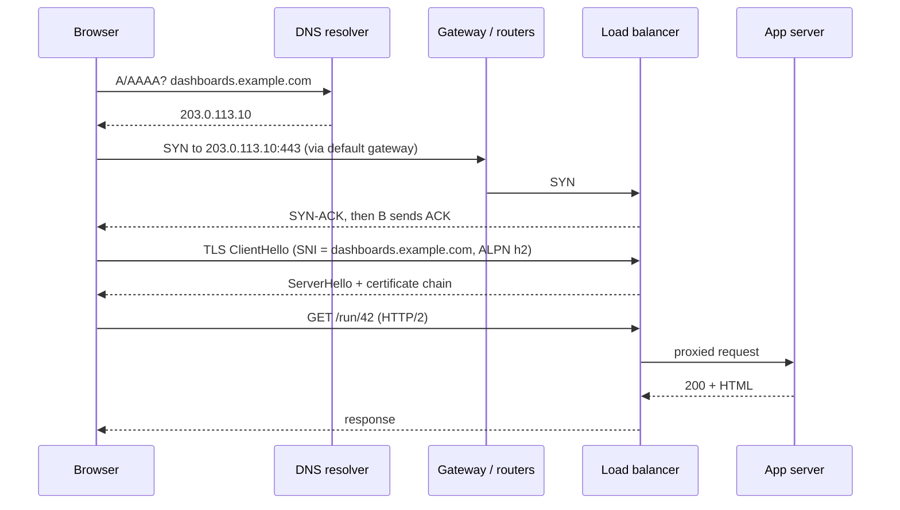

# Linux Command Line -- Comprehensive Interview Reference

> Last reviewed: 2026-11 · Versions assumed: bash 5.1-5.2, GNU coreutils 9.x, GNU grep/sed/awk (gawk 5.x), OpenSSH 9.x, tmux 3.3+, systemd 252+, Slurm 23.11-25.x, ROCm 6.x/7.x

> A working engineer's reference for the Linux shell and the tools around it: bash semantics and gotchas, process and job control, permissions and links, text-processing pipelines (with 20 one-liner interview tasks), environment and shared-library resolution, GPU device visibility on ROCm, SSH and tunnels, tmux, systemd/journalctl, disk/memory/network diagnostics, a "type a URL and debug every hop" walkthrough, and Slurm basics for HPC clusters. Each major section ends with interview questions and full answers. Kernel internals (fork/COW, signal delivery, page cache, scheduler, namespaces/cgroups) live in *CS Fundamentals*; gdb/perf/strace live in *Debugging and Profiling Tools*. This file stays at the command-line level.

---

## Table of Contents

### Part 1: Bash as a Programming Language

1. [How the Shell Parses a Command Line](#1-how-the-shell-parses-a-command-line)
2. [Exit Codes, Strict Mode, and Traps](#2-exit-codes-strict-mode-and-traps)
3. [Variables, Parameter Expansion, Arrays, and Here-Docs](#3-variables-parameter-expansion-arrays-and-here-docs)
4. [Redirection, Pipes, and Subshells](#4-redirection-pipes-and-subshells)

### Part 2: Processes, Files, and Text

5. [Process and Job Control](#5-process-and-job-control)
6. [Files, Permissions, and Links](#6-files-permissions-and-links)
7. [The Text-Processing Toolkit](#7-the-text-processing-toolkit)
8. [Twenty One-Liner Interview Tasks](#8-twenty-one-liner-interview-tasks)

### Part 3: Environment and Remote Work

9. [Environment Variables, Shared Libraries, and GPU Visibility](#9-environment-variables-shared-libraries-and-gpu-visibility)
10. [SSH: Keys, Config, Agents, Tunnels, and Jump Hosts](#10-ssh-keys-config-agents-tunnels-and-jump-hosts)
11. [tmux](#11-tmux)
12. [systemd, journalctl, and cron](#12-systemd-journalctl-and-cron)

### Part 4: Diagnostics and Clusters

13. [Disk and Memory Diagnostics](#13-disk-and-memory-diagnostics)
14. [Networking Tools](#14-networking-tools)
15. [What Happens When You Type a URL, and How to Debug Each Hop](#15-what-happens-when-you-type-a-url-and-how-to-debug-each-hop)
16. [HPC Job Scheduling with Slurm](#16-hpc-job-scheduling-with-slurm)
17. [Troubleshooting Scenarios](#17-troubleshooting-scenarios)

---

# Part 1: Bash as a Programming Language

---

## 1. How the Shell Parses a Command Line

Most bash bugs come from not knowing **what happens to a line before the command runs**. Bash does the following, in order:

| Step | What happens | Example |
|---|---|---|
| 1. Tokenize | Split into words and operators (`\|`, `&&`, `;`, `>`, ...) respecting quotes | `echo "a b" > f` becomes `echo`, `"a b"`, `>`, `f` |
| 2. Brace expansion | `{a,b}` and `{1..3}` (purely textual, happens before variables) | `cp f{,.bak}` becomes `cp f f.bak` |
| 3. Tilde expansion | `~` becomes `$HOME`, `~user` becomes that user's home | |
| 4. Parameter, arithmetic, command substitution | `$var`, `${var%x}`, `$((1+2))`, `$(cmd)` -- left to right | |
| 5. **Word splitting** | Results of **unquoted** step-4 expansions are split on `$IFS` (space, tab, newline) | `f="my file"; rm $f` runs `rm my file` |
| 6. **Pathname expansion (globbing)** | Unquoted words containing `*`, `?`, `[...]` are matched against files | `echo *.log` |
| 7. Quote removal | Remaining unescaped quotes are removed | |
| 8. Redirections, then execution | `>`, `<`, `2>&1` applied, then builtin/function/`$PATH` lookup | |

Consequence: **brace expansion cannot use variables** (`{1..$n}` does not work; use `seq 1 "$n"` or `for ((i=1; i<=n; i++))`), and **word splitting and globbing only apply to unquoted expansions**.

### 1.1 Quoting

| Form | Expands `$var`, `$(cmd)`? | Backslash escapes? | Use for |
|---|---|---|---|
| `'single'` | No | No (cannot contain `'`) | Literal strings, awk/sed/jq programs |
| `"double"` | Yes | Only `\$ \` \" \\` and newline | **Almost every variable expansion** |
| `$'ansi-c'` | No | Yes: `\n`, `\t`, `\x1b`, `\'` | Strings with control characters |
| unquoted | Yes, then **split and globbed** | Yes | Rarely what you want |

```bash
# fragment
f="My Report *.txt"
ls $f          # WRONG: splits into 3 words, then globs *.txt
ls "$f"        # right: one argument, literally "My Report *.txt"

# Embedding a single quote inside a single-quoted string: close, escape, reopen
echo 'it'\''s'         # it's
echo $'it\'s'          # it's (ANSI-C quoting)
```

**Rule of thumb:** quote every expansion (`"$var"`, `"$(cmd)"`, `"${arr[@]}"`) unless you specifically want splitting or globbing. Run `shellcheck` on every script -- it catches about 90% of quoting bugs (SC2086 "Double quote to prevent globbing and word splitting").

### 1.2 `"$@"` vs `"$*"` vs `$@`

```bash
#!/usr/bin/env bash
# args.sh -- run as: ./args.sh "a b" c
printf '[%s] ' "$@"; echo     # [a b] [c]      -- each arg preserved (what you want)
printf '[%s] ' "$*"; echo     # [a b c]        -- one string joined by first char of IFS
printf '[%s] ' $@;   echo     # [a] [b] [c]    -- re-split: original boundaries lost
```

Always forward arguments with `"$@"` (for example in wrapper scripts: `exec /opt/rocm/bin/real-tool "$@"`).

### 1.3 Word Splitting and `IFS`

`IFS` (internal field separator) defaults to space, tab, newline. It controls splitting of unquoted expansions **and** how `read` splits fields.

```bash
# fragment
line="alice:x:1000:1000::/home/alice:/bin/bash"
IFS=: read -r user _ uid gid _ home shell <<< "$line"   # IFS change scoped to this read
echo "$user $uid $shell"                                 # alice 1000 /bin/bash

# Canonical safe line loop: IFS= keeps leading/trailing whitespace, -r keeps backslashes
while IFS= read -r line; do
    printf '%s\n' "$line"
done < input.txt
```

Pitfall: `for line in $(cat file)` iterates over **words**, not lines, and also globs each word. Use `while IFS= read -r` or `mapfile -t lines < file`.

### 1.4 Globbing

| Pattern | Matches |
|---|---|
| `*` | Any string, **excluding** a leading `.` (hidden files) and `/` |
| `?` | Exactly one character |
| `[abc]`, `[a-z]`, `[!0-9]` | One character from (or not from) a set |
| `**` | Recursive match (requires `shopt -s globstar`) |
| `@(a\|b)`, `!(*.o)`, `+(x)` | Extended globs (requires `shopt -s extglob`) |

| Option | Effect |
|---|---|
| default | A pattern that matches nothing is passed **literally** (`ls *.xyz` gets the string `*.xyz`) |
| `shopt -s nullglob` | Non-matching pattern expands to nothing (safe for `for f in *.log`) |
| `shopt -s failglob` | Non-matching pattern is an error |
| `shopt -s dotglob` | `*` also matches hidden files |
| `shopt -s globstar` | `**/*.cpp` recurses into subdirectories |
| `set -f` | Disable globbing entirely |

```bash
#!/usr/bin/env bash
shopt -s nullglob
files=( *.log )
echo "found ${#files[@]} log files"     # 0 if none, instead of 1 bogus "*.log"
for f in "${files[@]}"; do gzip -- "$f"; done
```

Note the `--`: it ends option parsing so a file named `-rf` is not interpreted as flags. `rm -- *` or `rm ./*` is safe; `rm *` in a directory containing a file called `-rf` is not.

### 1.5 Tests: `[`, `[[`, and `((`

| Construct | What it is | Notes |
|---|---|---|
| `[ ... ]` / `test` | POSIX builtin command | Must quote variables: `[ "$x" = y ]`; `[ $x = y ]` breaks if `$x` is empty or has spaces |
| `[[ ... ]]` | Bash keyword | No word splitting or globbing inside; supports `&&`, `\|\|`, `=~` regex, `==` glob match |
| `(( ... ))` | Arithmetic evaluation | C-like: `(( i < 10 ))`; exit status 0 if result is non-zero |

```bash
# fragment
[[ $file == *.tar.gz ]] && echo "tarball"          # right side is a glob pattern (unquoted)
[[ $ver =~ ^([0-9]+)\.([0-9]+) ]] && echo "major=${BASH_REMATCH[1]} minor=${BASH_REMATCH[2]}"
[[ -f $p ]]   # regular file    -d dir   -e exists   -s non-empty   -x executable   -L symlink
[[ -z $s ]]   # empty string    -n non-empty
(( n > 0 )) && echo positive
[ "$a" -lt "$b" ]   # numeric comparison in [ ]; "<" inside [ ] is a REDIRECTION
```

Pitfall: in `[[ $x =~ "$re" ]]` quoting the right-hand side makes it a **literal string**, not a regex. Store the regex in a variable and use it unquoted: `[[ $x =~ $re ]]`.

### 1.6 Interview Questions

**Q1. A script does `rm -rf $DIR/` and wiped a machine. Why, and how do you prevent it?**

If `DIR` is unset or empty, `$DIR/` expands to `/`, so the command is `rm -rf /` (modern GNU `rm` refuses bare `/` via `--preserve-root`, but `rm -rf $DIR/*` expands to `/*` and is **not** protected). Defenses, in order of value: (1) `set -u` so an unset variable is a fatal error; (2) `${DIR:?DIR must be set}`, which aborts with a message if `DIR` is unset **or empty**; (3) quote it: `rm -rf -- "${DIR:?}/"`; (4) validate the path (`[[ $DIR == /scratch/$USER/* ]]`) before destructive operations. The Steam-for-Linux uninstaller bug (2015) was exactly `rm -rf "$STEAMROOT/"*` with an empty variable.

**Q2. What is the difference between `"$@"` and `"$*"`?**

`"$@"` expands to each positional parameter as a **separate word**, preserving embedded spaces: `"a b" c` stays two arguments. `"$*"` joins all parameters into **one word** using the first character of `IFS`. Unquoted `$@` and `$*` behave identically: they are re-split on `IFS` and globbed, so original argument boundaries are lost. Use `"$@"` to forward arguments; use `"$*"` only to build a single message string.

**Q3. Why does `for f in $(ls *.txt)` break, and what replaces it?**

The output of `ls` is word-split on whitespace, so `my file.txt` becomes two iterations; each word is then globbed again; and `ls` may mangle non-printable characters. Use the glob directly: `for f in *.txt; do ...; done` with `shopt -s nullglob` so a non-match gives zero iterations. For recursive cases use `find ... -print0 | while IFS= read -r -d '' f; do ...; done` or `find ... -exec cmd {} +`.

**Q4. Why does `echo {1..$n}` not work?**

Brace expansion happens **before** parameter expansion (step 2 vs step 4), so bash sees the literal `{1..$n}`, which is not a valid sequence expression, and leaves it unchanged; then `$n` is expanded, printing `{1..5}`. Use `seq 1 "$n"` or a C-style `for ((i=1; i<=n; i++))` loop.

**Q5. When would you use `[[ ]]` over `[ ]`?**

In bash scripts, prefer `[[ ]]`: it is a keyword, so variables inside are not word-split or globbed (fewer quoting bugs), it supports `&&`/`||` inside, glob matching with `==`, and regex with `=~` (captures in `BASH_REMATCH`). Use `[ ]` only when the script must run under a POSIX `/bin/sh` (dash on Debian/Ubuntu), where `[[` does not exist. A common bug is a script with `#!/bin/sh` that uses `[[`; it works on Fedora (where `sh` is bash) and fails on Ubuntu (where `sh` is dash).

---

## 2. Exit Codes, Strict Mode, and Traps

### 2.1 Exit Codes

Every command returns an 8-bit status (0-255). **0 is success**; anything else is failure. `$?` holds the status of the most recent foreground pipeline.

| Code | Meaning |
|---|---|
| 0 | Success |
| 1 | General error (also `grep`: "no match" -- **not** an error semantically) |
| 2 | Misuse of builtin / bad arguments (also `grep`: real error, e.g. unreadable file) |
| 126 | Command found but **not executable** (missing `+x`, or `noexec` mount) |
| 127 | **Command not found** (typo, or not on `PATH`) |
| 128+N | Killed by signal N |
| 130 | 128+2: SIGINT (Ctrl-C) |
| 134 | 128+6: SIGABRT (`abort()`, failed `assert`, uncaught C++ exception) |
| 137 | 128+9: SIGKILL (`kill -9`, **OOM killer**, Slurm/K8s memory limit) |
| 139 | 128+11: SIGSEGV (segfault) |
| 141 | 128+13: SIGPIPE (wrote to a closed pipe, e.g. `producer \| head -1`) |
| 143 | 128+15: SIGTERM (polite kill, `timeout`, `docker stop`) |
| 124 | `timeout` command: the time limit was hit |

`exit 256` yields 0 (status is taken mod 256), so never return counts as exit codes.

### 2.2 `$?` and `PIPESTATUS`

```bash
#!/usr/bin/env bash
false | true
echo "$?"                    # 0 -- status of the LAST command in the pipeline only

false | true | (exit 3)
echo "${PIPESTATUS[@]}"      # 1 0 3 -- per-stage statuses; must be read IMMEDIATELY
echo "${PIPESTATUS[@]}"      # 0 -- overwritten by the previous echo
```

Capture it right away: `cmd1 | cmd2; st=("${PIPESTATUS[@]}")`.

### 2.3 `set -euo pipefail` ("strict mode")

| Option | Effect | Why |
|---|---|---|
| `set -e` (`errexit`) | Exit when a command fails (non-zero status) | Stop instead of continuing in a broken state |
| `set -u` (`nounset`) | Expanding an unset variable is an error | Catches typos and the `rm -rf $DIR/` class of bug |
| `set -o pipefail` | Pipeline status = last **non-zero** stage status (or 0) | Without it, `curl ... \| tar x` "succeeds" when curl fails |
| `set -x` (`xtrace`) | Print each command after expansion (prefixed with `$PS4`) | Debugging; `PS4='+ ${BASH_SOURCE}:${LINENO}: '` adds locations |

**`set -e` is not "exit on any error".** Its caveats are a favorite interview topic:

| Situation | Does `set -e` exit? |
|---|---|
| `cmd` fails as a plain statement | Yes |
| `if cmd; then`, `while cmd`, `until cmd` | **No** -- the failure is the condition |
| `cmd1 && cmd2` where `cmd1` fails | **No** (only the last command of an `&&`/`\|\|` list counts) |
| `! cmd` | **No** |
| Function called in an `if` / `&&` / `\|\|` context | **No, for the whole function body** -- errexit is suspended inside it |
| `local x=$(failing_cmd)` | **No** -- status is that of `local` (0). Write `local x; x=$(failing_cmd)` |
| `x=$(failing_cmd)` (plain assignment) | Yes -- an assignment's status is the substitution's status |
| `echo "$(failing_cmd)"` | **No** -- `echo` succeeded |
| Inside `$(...)` | The subshell does **not** inherit `-e` unless `shopt -s inherit_errexit` (bash 4.4+) |
| `(( count++ ))` when `count` is 0 | **Yes, surprisingly** -- the expression evaluates to 0, so the status is 1. Use `(( count += 1 ))` or `count=$((count + 1))` |
| `grep pattern file` with no match | **Yes** -- status 1. Use `grep ... \|\| true` when "no match" is acceptable |

**`pipefail` caveat (SIGPIPE):** `producer | head -n1` -- once `head` exits, the producer's next write gets SIGPIPE and exits 141. With `pipefail` + `-e`, the script dies even though nothing is wrong. Fix: `producer | head -n1 || true`, or use a consumer that reads all input, such as `sed -n 1p` or `awk 'NR==1'` (no early exit), which is fine when the input is small. `awk 'NR==1{print; exit}'` exits early and triggers the same SIGPIPE.

**`set -u` caveats:** `$1` when no arguments are passed is an error -- use `${1:-}`. On bash older than 4.4, `"${arr[@]}"` on an **empty** array triggers "unbound variable" (fixed in 4.4; RHEL 7 ships bash 4.2).

### 2.4 Traps

`trap 'commands' SIGNALS...` runs commands when the shell receives a signal or hits a pseudo-signal:

| Pseudo-signal | When |
|---|---|
| `EXIT` | Whenever the shell exits (normal end, `exit`, `set -e` abort, or a caught signal that then exits) |
| `ERR` | A command fails under the same rules as `set -e`; **not inherited** by functions/subshells unless `set -E` (`errtrace`) |
| `DEBUG` | Before every simple command |
| `RETURN` | When a function or sourced script returns |

`SIGKILL` and `SIGSTOP` can never be trapped, so no trap runs on `kill -9`.

```bash
#!/usr/bin/env bash
# strict.sh -- a reasonable script template
set -Eeuo pipefail
shopt -s inherit_errexit nullglob

readonly SCRIPT_NAME=${0##*/}
tmpdir=$(mktemp -d)                     # unique, mode 0700; never hard-code /tmp/foo

cleanup() {
    local rc=$?                          # status that triggered the exit
    rm -rf -- "$tmpdir"
    exit "$rc"
}
trap cleanup EXIT                        # runs on success, failure, and Ctrl-C
trap 'echo "$SCRIPT_NAME: line $LINENO: \"$BASH_COMMAND\" failed" >&2' ERR
trap 'exit 130' INT                      # make Ctrl-C go through EXIT cleanup with status 130
trap 'exit 143' TERM

usage() { echo "usage: $SCRIPT_NAME <input-dir>" >&2; exit 2; }

main() {
    [[ $# -eq 1 ]] || usage
    local in=$1
    [[ -d $in ]] || { echo "not a directory: $in" >&2; exit 1; }

    local n
    n=$(find "$in" -type f | wc -l)      # declare then assign, so failures are not masked
    echo "$n files" > "$tmpdir/count"
    cat "$tmpdir/count"
}

main "$@"
```

**Why many experienced engineers use `set -e` but do not trust it:** its rules are complex and version-dependent, so critical steps should check explicitly: `if ! make -j; then echo "build failed" >&2; exit 1; fi`. Strict mode is a safety net, not error handling.

### 2.5 Interview Questions

**Q1. A CI script runs `curl -s $URL | tar xz` and reports success even when the download 404s. Why, and how do you fix it?**

Three bugs. (1) A pipeline's status is that of its last command; `tar` may succeed on empty input or fail without the script checking -- add `set -o pipefail` (and `set -e`). (2) `curl` returns 0 on HTTP 404 by default because the transfer itself succeeded; use `curl -fsSL` (`-f`/`--fail` makes HTTP >= 400 return exit 22). (3) `$URL` is unquoted. Fixed: `set -euo pipefail; curl -fsSL "$URL" | tar xz`. For robustness, download to a file, verify a checksum, then extract.

**Q2. A process exits with 137. What happened?**

137 = 128 + 9, so it was killed by SIGKILL. The usual culprits are the kernel OOM killer (check `dmesg -T | grep -i -E 'killed process|out of memory'` or `journalctl -k`), a cgroup memory limit (container or Slurm job hitting `--mem`; `sacct -j <id> -o JobID,State,MaxRSS,ReqMem` shows `OUT_OF_MEMORY`), or a human/supervisor running `kill -9` after a graceful SIGTERM (143) timed out. Since SIGKILL cannot be trapped, the process got no chance to clean up.

**Q3. Why is `local out=$(cmd)` dangerous under `set -e`?**

The exit status of the whole statement is the status of the `local` builtin, which succeeds, so a failure in `cmd` is silently ignored. The same applies to `export x=$(cmd)` and `readonly x=$(cmd)`. Split it: `local out; out=$(cmd)`. A plain assignment `out=$(cmd)` takes the substitution's status, so errexit fires. ShellCheck warns about this (SC2155).

**Q4. Why did `((errors++))` kill a script that uses `set -e`?**

`(( expr ))` returns status 1 when the expression evaluates to 0. Post-increment returns the **old** value, so on the first increment from 0 the expression's value is 0 and the status is 1, which triggers errexit. Use `(( errors += 1 ))` (value is the new count, at least 1) or `errors=$((errors + 1))`.

**Q5. How do you guarantee a temp directory is removed even if the script fails or is interrupted?**

Create it with `mktemp -d` and register `trap 'rm -rf -- "$tmpdir"' EXIT` immediately after. Bash runs the EXIT trap on normal completion, `exit`, and errexit aborts. For signals, bash runs the EXIT trap when the default action kills the shell in recent versions, but behavior across shells differs, so explicitly trapping `INT` and `TERM` to call `exit` makes it deterministic. Nothing runs on SIGKILL, so long-lived scratch data should also live somewhere periodically cleaned (for example, the job-scoped `$TMPDIR` that many Slurm sites provide).

---

## 3. Variables, Parameter Expansion, Arrays, and Here-Docs

### 3.1 Shell Variables vs Environment Variables

- `x=1` creates a **shell variable**, visible only to this shell (and its subshells, which are copies).
- `export x=1` marks it for the **environment**, which is copied into every child process at `exec`.
- `x=1 cmd` sets `x` in `cmd`'s environment only, for that one command.
- A child can **never** modify its parent's environment. That is why `cd` and `source` must be builtins, and why `./setenv.sh` does nothing to your shell while `source setenv.sh` (or `. setenv.sh`) does.
- No spaces around `=`: `x = 1` runs a command named `x` with arguments `=` and `1`.

### 3.2 Parameter Expansion Cheat Sheet

| Expansion | Result | Example (`p=/opt/rocm/lib/libamdhip64.so.6`) |
|---|---|---|
| `${v:-def}` | `v` if set and non-empty, else `def` | `${BUILD_TYPE:-Release}` |
| `${v-def}` | `v` if set (even empty), else `def` | |
| `${v:=def}` | Like `:-`, and also **assigns** `def` to `v` | |
| `${v:?msg}` | Abort with `msg` if unset or empty | `${ROCM_PATH:?set ROCM_PATH}` |
| `${v:+alt}` | `alt` if `v` is set and non-empty, else empty | `${DEBUG:+--verbose}` |
| `${#v}` | Length in characters | |
| `${v#pat}` / `${v##pat}` | Remove shortest / longest **prefix** match | `${p##*/}` gives `libamdhip64.so.6` (basename) |
| `${v%pat}` / `${v%%pat}` | Remove shortest / longest **suffix** match | `${p%/*}` gives `/opt/rocm/lib` (dirname); `${p%%.*}` gives `/opt/rocm/lib/libamdhip64` |
| `${v/pat/rep}` / `${v//pat/rep}` | Replace first / all | `${PATH//:/ }` |
| `${v/#pat/rep}` / `${v/%pat/rep}` | Replace anchored at start / end | |
| `${v:off:len}` | Substring (negative offset needs a space: `${v: -3}`) | |
| `${v^^}` / `${v,,}` | Upper / lower case (bash 4+) | |
| `${!name}` | Indirection: the value of the variable whose name is in `name` | |
| `${!prefix@}` | Names of all variables starting with `prefix` | `${!SLURM_@}` |

Mnemonic: `#` is on the **left** of `$` on a US keyboard (removes from the left/prefix), `%` is on the **right** (suffix).

```bash
#!/usr/bin/env bash
p=/opt/rocm/lib/libamdhip64.so.6
echo "${p##*/}"        # libamdhip64.so.6
echo "${p%/*}"         # /opt/rocm/lib
f=report.tar.gz
echo "${f%.*}"         # report.tar
echo "${f%%.*}"        # report
echo "${f##*.}"        # gz
for x in *.jpeg; do [[ -e $x ]] && mv -- "$x" "${x%.jpeg}.jpg"; done
```

These are builtins, so they are far faster than forking `basename`/`dirname`/`sed` inside a loop over thousands of files.

### 3.3 Arrays

```bash
#!/usr/bin/env bash
# Indexed arrays
flags=(-O2 -g "-DNAME=hello world")
flags+=(--offload-arch=gfx942)
echo "${#flags[@]}"                 # 4 elements
printf '<%s>\n' "${flags[@]}"       # each element intact, including the one with a space
echo "${flags[0]} ${flags[-1]}"     # first, last (negative index: bash 4.3+)
echo "${flags[@]:1:2}"              # slice: elements 1..2
unset 'flags[1]'                    # leaves a hole; indices are now 0,2,3
echo "${!flags[@]}"                 # 0 2 3 -- the indices

# Associative arrays (bash 4+), must be declared
declare -A count=()
for w in a b a c a; do count[$w]=$(( ${count[$w]:-0} + 1 )); done
for k in "${!count[@]}"; do echo "$k ${count[$k]}"; done   # iteration order is unspecified

# Read lines into an array (no word splitting, no globbing)
mapfile -t gpus < <(printf 'gfx90a\ngfx942\n')
echo "${gpus[1]}"                   # gfx942
```

Why arrays matter: they are the **only** correct way to build a command line with arguments that may contain spaces. `cmd $flags` with a string variable relies on word splitting and breaks on embedded spaces; `cmd "${flags[@]}"` does not.

### 3.4 Here-Docs and Here-Strings

```bash
#!/usr/bin/env bash
name=world
# Unquoted delimiter: $vars and $(cmds) in the body ARE expanded
cat <<EOF
Hello $name, today is $(date +%A)
EOF

# Quoted delimiter: body is literal
cat <<'EOF'
Literal $name and $(date)
EOF

if true; then
	cat <<-EOF
	Leading TABS (not spaces) are stripped with <<-
	EOF
fi

grep -c o <<< "foo boo"               # here-string: stdin is "foo boo\n"; prints 1 (lines matched)
```

Common use: generating a Slurm script or config file (`cat > job.sbatch <<'EOF' ... EOF`) -- quote the delimiter so `$SLURM_JOB_ID` is written literally and expanded at job runtime, not at generation time.

### 3.5 Interview Questions

**Q1. How do you get the filename without extension and the directory of a path in pure bash?**

`${path##*/}` strips the longest prefix up to the last `/` (basename); `${path%/*}` strips the shortest suffix starting at the last `/` (dirname); `${name%.*}` strips the last extension; `${name%%.*}` strips everything from the first dot. Edge cases: a path with no `/` is returned unchanged by `${p%/*}`, unlike `dirname`, which returns `.`; and a trailing slash yields an empty basename. Use the external tools when those edge cases matter.

**Q2. What is the difference between `${x:-y}` and `${x-y}`?**

The colon variant treats **set-but-empty** the same as unset: `x=""; echo "${x:-y}"` prints `y`, while `${x-y}` prints the empty string. The same colon rule applies to `:=`, `:?`, and `:+`. Typically you want the colon form for configuration defaults.

**Q3. Why does `./env.sh` not change your shell's environment, but `source env.sh` does?**

`./env.sh` runs in a **child process**; its exports go into the child's environment, which is discarded when it exits. A child process cannot modify its parent's memory. `source` (or `.`) reads and executes the file **in the current shell**, so variable assignments, `cd`, and function definitions persist. This is why Lmod's `module load` is a shell function that `eval`s output from the Lmod binary.

**Q4. How do you pass a list of compiler flags, some containing spaces, to a command?**

Use an array: `flags=(-O2 "-DMSG=hello world")`, then `g++ "${flags[@]}" main.cpp`. A string variable `flags="-O2 -DMSG='hello world'"` does **not** work, because quotes inside a variable's value are not re-parsed as syntax; word splitting produces `-DMSG='hello` and `world'`. Using `eval` "fixes" this but opens command-injection problems.

---

## 4. Redirection, Pipes, and Subshells

### 4.1 Redirection

| Syntax | Meaning |
|---|---|
| `> f` / `>> f` | stdout to file (truncate / append) |
| `2> f` | stderr to file |
| `> f 2>&1` | stdout to `f`, **then** stderr to wherever stdout points now (`f`) |
| `2>&1 > f` | stderr to the **old** stdout (terminal), then stdout to `f` -- order matters |
| `&> f` / `&>> f` | Both to file (bash shorthand) |
| `< f` | stdin from file |
| `cmd1 \|& cmd2` | Pipe stdout and stderr (bash shorthand for `2>&1 \|`) |
| `> /dev/null` | Discard |
| `exec 3> log` | Open fd 3 for the rest of the script; `echo hi >&3`; `exec 3>&-` closes it |
| `set -o noclobber` / `>\|` | Refuse to overwrite existing files with `>` / force overwrite |

Redirections are processed **left to right**, and `n>&m` means "make fd n a copy of what fd m points to **right now**". That single rule explains the `2>&1` ordering puzzle.

`sort file > file` empties the file: the shell truncates `file` **before** `sort` runs. Use `sort -o file file`, `sponge` (moreutils), or a temp file plus `mv`.

### 4.2 Pipes

- Each stage of a pipeline runs **concurrently** in its own process, connected by kernel pipe buffers (64 KiB by default on Linux). A slow consumer back-pressures the producer.
- When the reader exits, the writer gets **SIGPIPE** on its next write (exit 141) -- that is how `yes | head -3` terminates.
- Programs block-buffer stdout when it is not a terminal (glibc uses a 4-8 KiB buffer), so `tail -f log | grep X | cut ...` may show nothing for a long time. Fixes: `grep --line-buffered`, `sed -u`, `awk '{...; fflush()}'`, `stdbuf -oL cmd`, or `python3 -u`.

### 4.3 Subshells, Grouping, and Substitution

| Construct | Runs in | Variables set inside visible after? |
|---|---|---|
| `( cmds )` | **Subshell** (forked copy) | No; `cd` inside does not affect the parent either |
| `{ cmds; }` | Current shell (note the spaces and trailing `;`) | Yes |
| `$( cmds )` | Subshell; stdout is captured (trailing newlines stripped) | No |
| `<( cmds )` / `>( cmds )` | Process substitution: a `/dev/fd/N` path to a pipe | No |
| `a \| b \| c` | **Each stage is a subshell** in bash (last stage too, unless `shopt -s lastpipe` and job control is off) | No |

```bash
#!/usr/bin/env bash
printf 'a\nb\nc\n' > /tmp/lines.txt

count=0
cat /tmp/lines.txt | while IFS= read -r _; do count=$((count + 1)); done
echo "pipe: $count"          # pipe: 0  -- the loop ran in a subshell

count=0
while IFS= read -r _; do count=$((count + 1)); done < /tmp/lines.txt
echo "redirect: $count"      # redirect: 3

count=0
while IFS= read -r _; do count=$((count + 1)); done < <(grep -v '^#' /tmp/lines.txt)
echo "procsub: $count"       # procsub: 3

diff <(sort /tmp/lines.txt) <(sort -r /tmp/lines.txt | sort) && echo same
(cd /tmp && pwd)             # subshell: parent's working directory is unchanged
```

### 4.4 Builtins, Functions, and `exec`

- `type -a cmd` shows every candidate (alias, function, builtin, file); prefer it over `which`, which only searches `PATH`. `command -v cmd` is the POSIX way to test existence in scripts.
- `hash -r` clears bash's cache of command locations (needed after installing a binary earlier in `PATH` than one already used).
- `exec cmd` **replaces** the shell process with `cmd` (same PID, no return). Wrapper scripts and container entrypoints should end with `exec "$@"` so signals (SIGTERM from `docker stop` or Slurm) reach the real program instead of the shell.

### 4.5 Interview Questions

**Q1. What is the difference between `cmd > out 2>&1` and `cmd 2>&1 > out`?**

Redirections apply left to right, and `2>&1` duplicates whatever fd 1 points to **at that moment**. In the first form, fd 1 is pointed at `out`, then fd 2 copies it, so both go to the file. In the second, fd 2 copies fd 1 while it is still the terminal, then fd 1 is redirected to `out`; stderr still goes to the terminal. That second form is how you pipe **only** stderr: `cmd 2>&1 >/dev/null | grep error`.

**Q2. Why does a counter incremented inside `cat file | while read ...` reset after the loop?**

In bash, each pipeline stage runs in a subshell, a forked copy of the shell. The `while` loop increments the copy's variable, and the copy exits at the end of the pipeline. Fix by redirecting into the loop (`done < file`), using process substitution (`done < <(cmd)`), or enabling `shopt -s lastpipe` in a non-interactive script. zsh and ksh run the last stage in the current shell, which is why the same code "works" there.

**Q3. `tail -f app.log | grep ERROR | awk '{print $3}'` prints nothing for minutes, though errors are occurring. Why?**

`grep` writes into a pipe, not a terminal, so libc switches stdout to **full buffering** and only flushes every few KiB. The `awk` stage receives nothing until that buffer fills. Use `grep --line-buffered`, or `stdbuf -oL grep ...`. The last stage writes to a terminal, so it is line-buffered already. The same issue appears with Python (`python3 -u` or `PYTHONUNBUFFERED=1`) when piping a training script's logs to `tee`.

**Q4. Why should a Docker entrypoint or Slurm wrapper script end with `exec "$@"`?**

Without `exec`, the shell remains PID 1 (or the step's main process) and the real program is its child. `docker stop` signals only PID 1; bash does not forward signals to its children, so the program never sees SIGTERM, gets SIGKILL after the grace period (10 s in Docker by default), and loses its chance to checkpoint or flush. `exec` replaces the shell with the program, which then receives signals directly. As PID 1 in a container it also needs to reap zombies, which is why `docker run --init` (tini) exists.

Under Slurm the picture is different: time-limit and `scancel` SIGTERMs reach every process in a step (proctrack/cgroup signals the whole step), so a program behind a non-`exec` wrapper still gets them. Signals aimed only at the batch shell (`--signal=B:...`, `scancel -b`) do not reach its children unless the shell traps and forwards them. `exec` still matters most for container PID 1, and it remains good hygiene in Slurm wrappers (one fewer process, correct exit status).

> See also: [CS Fundamentals -- fd table and fork/exec](../computer-science/CS_Fundamentals.md#19-linux-process-lifecycle-signals-and-file-descriptors), [Containers and CI](Containers_and_CI.md)

---

# Part 2: Processes, Files, and Text

---

## 5. Process and Job Control

### 5.1 Foreground, Background, and Jobs

A **job** is a pipeline started from an interactive shell. Each job runs in its own **process group**; the terminal has one **foreground process group**, and keyboard signals go to the whole foreground group.

| Action | Effect |
|---|---|
| `cmd &` | Start in background; `$!` holds the PID of the last background process |
| `Ctrl-C` | Terminal driver sends **SIGINT** to the foreground process group |
| `Ctrl-Z` | Sends **SIGTSTP**: job is stopped (state `T`) |
| `Ctrl-\` | Sends **SIGQUIT** (terminate + core dump by default) |
| `jobs -l` | List this shell's jobs with PIDs |
| `bg %1` | Resume job 1 in background (sends SIGCONT) |
| `fg %1` | Bring job 1 to foreground |
| `kill %1` | Signal a job by job number |
| `wait` / `wait $pid` / `wait -n` | Wait for all / one / the next background job to finish (`wait -n`: bash 4.3+) |

A background job that tries to **read** from the terminal is stopped with SIGTTIN.

### 5.2 Surviving Logout: `nohup`, `disown`, `setsid`, tmux

When a terminal or SSH session closes, the kernel sends **SIGHUP** to the session leader (your shell). An interactive bash that receives SIGHUP re-sends SIGHUP to all its jobs before exiting, and the default action for SIGHUP is to terminate.

| Tool | What it does | Caveat |
|---|---|---|
| `nohup cmd > out.log 2>&1 &` | Starts `cmd` with SIGHUP **ignored**; if stdout is a terminal, writes to `nohup.out` | Must be decided at start; still in the shell's job table |
| `disown -h %1` / `disown` | Removes the job from the shell's job table (or marks it), so the shell does not send it SIGHUP | Works on an already-running job; output to the dead terminal then fails (EIO) unless redirected |
| `setsid cmd` | Runs `cmd` in a **new session** with no controlling terminal | Fully detached; no way to reattach |
| `tmux` / `screen` | The program keeps a pseudo-terminal alive on the server; you detach and reattach | Best for interactive work; see [Section 11](#11-tmux) |
| `systemd-run --user --unit=x cmd` | Runs under systemd with logging and resource control | Needs `loginctl enable-linger` to survive logout on many distros |
| `sbatch` | On a cluster, the right answer for anything long-running | Login nodes often kill long processes |

Already started a long job in the foreground without `nohup`? Press `Ctrl-Z`, run `bg`, then `disown -h %1`. Note that its output still goes to the terminal.

### 5.3 Signals from the Shell

| Signal | No. | Shell source | Typical use |
|---|---|---|---|
| SIGHUP | 1 | Terminal closed | Daemons: "reload config" by convention |
| SIGINT | 2 | Ctrl-C | Interrupt |
| SIGQUIT | 3 | Ctrl-\ | Quit with core dump; JVM prints thread dump |
| SIGKILL | 9 | `kill -9` | Cannot be caught; no cleanup |
| SIGUSR1/2 | 10/12 | `kill -USR1` | App-defined (e.g. `dd` prints progress on SIGUSR1) |
| SIGTERM | 15 | `kill` (default) | Polite shutdown request |
| SIGCONT | 18 | `fg`, `bg` | Resume a stopped process |
| SIGSTOP | 19 | `kill -STOP` | Uncatchable stop |
| SIGTSTP | 20 | Ctrl-Z | Catchable stop |

Numbers are for x86/ARM Linux; prefer names (`kill -TERM`), which are portable. Kernel-side delivery semantics (per-thread masks, async-signal-safety, `sigaction`) are covered in [CS Fundamentals: Signals](../computer-science/CS_Fundamentals.md#19-linux-process-lifecycle-signals-and-file-descriptors).

```bash
# fragment
kill 1234                  # SIGTERM
kill -TERM -- -1234        # negative PID: signal the whole PROCESS GROUP 1234
kill -0 1234 && echo alive # signal 0: existence/permission check, nothing is sent
pgrep -af 'python train'   # list PIDs + full command lines matching a pattern
pkill -f 'python train.py' # -f matches the full command line (careful: may match your own grep/ssh)
pkill -u "$USER" -x my_daemon   # exact process name, only my processes
timeout -k 10s 300s ./bench     # SIGTERM after 300 s, SIGKILL 10 s later if still alive; exit 124 on timeout

# Graceful stop pattern: TERM, wait up to 10 s, then KILL
stop() {
    local pid=$1
    kill -TERM "$pid" 2>/dev/null || return 0
    for _ in {1..10}; do kill -0 "$pid" 2>/dev/null || return 0; sleep 1; done
    kill -KILL "$pid" 2>/dev/null
}
```

### 5.4 Inspecting Processes: `ps`, `top`, `htop`, `/proc`

```bash
# fragment
ps aux                                        # BSD style: all processes, user-oriented columns
ps -ef --forest                               # System V style, with a parent/child tree
ps -eo pid,ppid,stat,ni,%cpu,%mem,rss,etime,cmd --sort=-%cpu | head
ps -o pid,stat,wchan:32,cmd -p 1234           # wchan: kernel function a sleeping process is blocked in
ps -L -p 1234 -o tid,stat,%cpu,comm           # threads (LWPs) of a process
pstree -p 1234                                # tree view
cat /proc/1234/status                         # State, VmRSS, Threads, voluntary_ctxt_switches...
ls -l /proc/1234/fd                           # open files and sockets
tr '\0' '\n' < /proc/1234/environ             # the process's environment AT START
cat /proc/1234/cmdline | tr '\0' ' '; echo
```

**Process state codes (`STAT` column):**

| Code | Meaning | Interview relevance |
|---|---|---|
| `R` | Running or runnable (on a run queue) | Counts toward load average |
| `S` | Interruptible sleep (waiting on an event; signals wake it) | Most idle processes |
| `D` | **Uninterruptible sleep**, usually in the I/O path (disk, NFS, GPU driver) | **Cannot be killed even with SIGKILL** until the kernel call returns; counts toward load average |
| `Z` | Zombie: exited, parent has not called `wait()` | Cannot be killed (already dead); fix or kill the **parent** |
| `T` / `t` | Stopped (job control) / stopped by a tracer (gdb, strace) | |
| `I` | Idle kernel thread | |
| modifiers | `<` high priority, `N` niced, `s` session leader, `l` multithreaded, `+` foreground group | |

**`top` keys:** `1` per-CPU view, `P` sort by CPU, `M` sort by memory, `H` show threads, `c` full command line, `k` kill, `u` filter by user, `f` choose fields. `%CPU` is per core, so a process using 8 cores shows ~800%. **htop:** `F5` tree, `F6` sort, `F4` filter, `F9` kill, `Space` tag, `H` toggle user threads. `atop` and `btop` are alternatives; `atop` also records history.

**Load average** (from `uptime`, `top`, `/proc/loadavg`): an exponentially damped average over 1, 5, and 15 minutes of the number of tasks that are **runnable (R) or in uninterruptible sleep (D)**. Compare it with the core count (`nproc`). Linux counts `D` tasks, so a load of 50 with idle CPUs means many tasks are stuck in I/O, often a hung NFS or Lustre mount.

### 5.5 Priorities: `nice`, `renice`, `ionice`, `taskset`

| Command | Effect |
|---|---|
| `nice -n 10 make -j"$(nproc)"` | Start with niceness 10. Range is **-20 (highest priority) to 19 (lowest)**; default 0 |
| `renice -n 5 -p 1234` | Change niceness of a running process (`-u user` for all of a user's processes) |
| `ionice -c3 cmd` | I/O scheduling class "idle": only gets disk time when no one else wants it |
| `chrt -f 50 cmd` | Real-time SCHED_FIFO priority 50 (root; can starve the system) |
| `taskset -c 0-7 ./bench` | Pin to CPUs 0-7 (reduces benchmark noise); `numactl --cpunodebind=0 --membind=0` for NUMA |

Unprivileged users can only **raise** niceness (lower their priority) and cannot lower it again (unless `RLIMIT_NICE` allows). Under the fair scheduler (CFS, replaced by EEVDF in Linux 6.6 with the same weight table), each nice step changes CPU weight by about 1.25x, so nice 0 vs nice 5 is about a 3:1 CPU split when both are CPU-bound. See [CS Fundamentals: The Linux Scheduler](../computer-science/CS_Fundamentals.md#112-the-linux-scheduler).

### 5.6 Running Things in Parallel from Bash

```bash
#!/usr/bin/env bash
# Run at most 4 jobs at a time (bash 4.3+ for wait -n)
set -uo pipefail
max=4
fail=0
for i in {1..10}; do
    ( sleep "0.$((RANDOM % 5))"; echo "task $i done" ) &
    while (( $(jobs -rp | wc -l) >= max )); do
        wait -n || fail=1
    done
done
while (( $(jobs -rp | wc -l) > 0 )); do wait -n || fail=1; done
echo "all done, fail=$fail"
```

Simpler alternatives: `xargs -P 4 -n 1 ./task.sh < inputs.txt`, or GNU `parallel -j 4 ./task.sh {} :::: inputs.txt`.

### 5.7 Interview Questions

**Q1. What actually happens when you press Ctrl-C?**

The keystroke reaches the terminal (pty) line discipline, which, because `ISIG` is enabled, does not pass the character to the program. It sends **SIGINT** to every process in the terminal's **foreground process group**. That is why `Ctrl-C` kills all stages of a pipeline. Each process runs its handler or the default action (terminate). The shell, in its own process group, sees the job exit with status 130 (128+2) and prints a prompt. Programs like Python translate SIGINT into `KeyboardInterrupt`; a program that ignores SIGINT keeps running, and you escalate with `Ctrl-\` (SIGQUIT) or `kill -9` from another terminal.

**Q2. A process ignores `kill -9`. How is that possible?**

Two cases. (1) It is a **zombie** (`Z`): it has already exited and only its process-table entry remains until the parent calls `wait()`. You cannot kill something dead; kill or fix the parent, after which `init`/the subreaper adopts and reaps it. (2) It is in **uninterruptible sleep** (`D`), blocked inside a kernel call such as I/O to a hung NFS server or a GPU driver operation. SIGKILL is queued and delivered when the call returns. Diagnose with `ps -o stat,wchan:32` and `cat /proc/PID/stack` (root). The fix is to resolve the underlying I/O (restore the server, `umount -f -l`) or reboot. Newer kernels use `TASK_KILLABLE` in many paths, so fatal signals can interrupt these waits.

**Q3. Compare `nohup`, `disown`, `setsid`, and tmux for keeping a job alive after logout.**

`nohup` starts the program with SIGHUP ignored and redirects output away from the terminal, but only at launch. `disown` removes an already-running job from the shell's job table so bash does not forward SIGHUP to it; output to the closed terminal will then error. `setsid` starts the program in a new session without a controlling terminal, so no terminal hangup can reach it. tmux keeps a pty alive on the server so you can **reattach** and interact, which is usually what you want for interactive work. On a cluster, long work belongs in the batch scheduler, not on the login node.

**Q4. Load average is 40 on a 16-core machine but `top` shows CPUs 90% idle. What is going on?**

Linux load average counts tasks in `R` **and** `D` states. High load with idle CPUs means many tasks are in uninterruptible sleep, typically waiting on storage: an overloaded or hung NFS/Lustre/GPFS mount, a failing disk, or heavy swapping. Check `vmstat 1` (the `b` column = blocked tasks, `wa` = I/O wait), `ps -eo stat,wchan:32,cmd | awk '$1 ~ /D/'` to see where they block, `iostat -x 1` for device utilization and latency, and `dmesg` for I/O errors or "task blocked for more than 120 seconds" messages.

**Q5. How do you kill a process and all of its children?**

If they share a process group (the normal case for a job started from a shell), signal the group: `kill -TERM -- -PGID` (find PGID with `ps -o pgid= -p PID`). Alternatively `pkill -TERM -P PID` kills direct children only, so recurse with `pstree -p` for deeper trees. Robust supervisors put the workload in its own cgroup (systemd units, containers, Slurm job steps) and kill the whole cgroup, which also catches processes that called `setsid` or double-forked to escape the group.

---

## 6. Files, Permissions, and Links

### 6.1 Reading `ls -l`

```text
-rwxr-x---  2  alice  gpu-team  4096  Nov  3 10:00  run.sh
|\_/\_/\_/  |  |      |         |     |             |
| |  |  |   |  owner  group     size  mtime         name
| |  |  |   hard-link count
| |  |  others: ---
| |  group: r-x
| owner: rwx
type: - file, d dir, l symlink, c char dev, b block dev, p FIFO, s socket
```

A trailing `+` after the permission bits (`-rw-r-----+`) means an ACL is present; a `.` means an SELinux context.

### 6.2 Permission Bits and `chmod`

| Bit | Octal | On a file | On a directory |
|---|---|---|---|
| `r` | 4 | Read contents | **List** names (`ls`) |
| `w` | 2 | Modify contents | **Create, delete, rename** entries (needs `x` too) |
| `x` | 1 | Execute | **Traverse**: access entries by name, `cd` into it |

Key consequences:
- **Deleting a file requires `w`+`x` on the directory**, not any permission on the file itself (unless the sticky bit is set).
- `r` without `x` on a directory: you can list names but not `stat` or open anything inside.
- `x` without `r` on a directory: you can open `dir/known_name` but not list it.
- To reach `/a/b/c/file`, you need `x` on **every** directory in the path.

```bash
# fragment
chmod 755 build.sh              # rwxr-xr-x
chmod 640 secrets.yaml          # rw-r-----
chmod u+x,g-w,o= file           # symbolic: add, remove, set exactly
chmod -R u=rwX,g=rX,o= proj/    # capital X: execute only on dirs and already-executable files
chown alice:gpu-team file       # changing OWNER requires root
chgrp gpu-team file             # a user may chgrp to any group they belong to
stat -c '%A %a %U:%G %n' file   # symbolic + octal permissions
```

### 6.3 `umask`

The umask lists permission bits to **remove** from newly created files. Programs request 0666 for files and 0777 for directories; the kernel applies `mode & ~umask`.

| umask | New files | New directories | Typical use |
|---|---|---|---|
| `022` | 644 `rw-r--r--` | 755 `rwxr-xr-x` | Common default |
| `002` | 664 | 775 | Group-collaborative systems (user private groups) |
| `027` | 640 | 750 | No access for others |
| `077` | 600 | 700 | Private (good for `~/.ssh` work) |

It is a bitwise mask, **not subtraction**: umask `033` on a 0666 file gives `0644`, not `0633`. `umask` is per process and inherited by children, so set it in a service unit (`UMask=`) or a job script, not just your interactive shell.

### 6.4 setuid, setgid, and the Sticky Bit

| Bit | Octal | On an executable | On a directory | `ls` shows |
|---|---|---|---|---|
| setuid | 4000 | Runs with the **file owner's** effective UID (e.g. `passwd` writes `/etc/shadow` as root) | No effect on Linux | `rwsr-xr-x` |
| setgid | 2000 | Runs with the file's group | **New files inherit the directory's group**; new subdirectories inherit setgid | `rwxr-sr-x` |
| sticky | 1000 | (obsolete) | Only the file's owner, the dir's owner, or root can delete/rename entries -- `/tmp` is `drwxrwxrwt` | `rwxrwxrwt` |

An uppercase `S` or `T` means the special bit is set **without** the underlying `x` (usually a mistake). Linux ignores setuid on interpreted scripts (`#!`), because the race between the kernel checking the script and the interpreter opening it was a classic exploit. Filesystems mounted `nosuid` ignore it too. Security audit: `find / -xdev -perm -4000 -type f 2>/dev/null` lists setuid binaries.

**Shared project directory on a cluster (classic interview task):**

```bash
# fragment
sudo mkdir /proj/rocprof && sudo chgrp rocprof-devs /proj/rocprof
sudo chmod 2770 /proj/rocprof                     # setgid: everything created inside gets group rocprof-devs
setfacl -d -m g:rocprof-devs:rwX /proj/rocprof    # default ACL: group-writable regardless of members' umask
```

### 6.5 ACLs

POSIX ACLs add per-user and per-group entries beyond owner/group/other.

```bash
# fragment
getfacl report.csv
setfacl -m u:bob:r report.csv           # give bob read access
setfacl -m g:interns:rx scripts/        # give a group access
setfacl -d -m g:team:rwX shared/        # DEFAULT ACL: inherited by new files in shared/
setfacl -x u:bob report.csv             # remove an entry
setfacl -b report.csv                   # remove all ACL entries
```

The **mask** entry caps the effective permissions of all named users, named groups, and the owning group; `chmod g=...` on a file with an ACL actually modifies the mask, which surprises people. NFSv4 uses a different ACL model (`nfs4_getfacl`/`nfs4_setfacl`).

### 6.6 Inodes, Hard Links, and Symbolic Links

An **inode** stores a file's metadata: type, mode, owner, size, timestamps, link count, and pointers to data blocks. It does **not** store the name. A **directory** is a table mapping names to inode numbers. See [CS Fundamentals: File Systems](../computer-science/CS_Fundamentals.md#15-file-systems).

| | Hard link | Symbolic (soft) link |
|---|---|---|
| What it is | Another directory entry pointing at the **same inode** | A separate small file containing a **path** |
| Create | `ln target name` | `ln -s target name` (target first, like `cp`) |
| Cross filesystems? | No | Yes |
| Link to a directory? | No (prevents cycles; `.` and `..` are the kernel's own hard links) | Yes |
| Original deleted | Data survives; the remaining name still works | Link **dangles** (broken) |
| Inode number | Same as target (`ls -i`) | Different |
| Relative target | N/A | Resolved relative to the **link's** directory, not your cwd |
| Permissions | Shared with target (same inode) | Link's own mode is ignored; target's mode applies |

**`rm` is really `unlink(2)`:** it removes one name and decrements the link count. The kernel frees the data only when the link count is 0 **and** no process holds the file open. That fact is behind the "disk full but `du` disagrees" scenario in [Section 13](#13-disk-and-memory-diagnostics), and behind safe log rotation.

**Timestamps:** `mtime` = content modified; `ctime` = inode **changed** (permissions, owner, link count, or content), **not** creation time; `atime` = last read (often relaxed by `relatime`); `btime` = birth, shown by `stat` where the filesystem and `statx` support it.

**Atomic file replacement:** write to a temp file **in the same directory**, `fsync` it, then `mv tmp final`. `mv` within one filesystem is `rename(2)`, which atomically swaps the name, so readers see either the old or the new file, never a half-written one. Across filesystems `mv` is copy-then-delete and is not atomic.

```bash
#!/usr/bin/env bash
set -euo pipefail
cd "$(mktemp -d)"
echo data > a
ln a hard; ln -s a soft
ls -li a hard soft          # a and hard share an inode number; link count is 2
rm a
cat hard                    # data -- inode still referenced
cat soft 2>&1 || true       # cat: soft: No such file or directory (dangling)
```

### 6.7 Interview Questions

**Q1. Can you delete a file that you do not have write permission on?**

Yes, if you have write **and** execute permission on the **containing directory** and the directory is not sticky (or you own the file). Deleting removes a directory entry, which modifies the directory, not the file. `rm` asks "remove write-protected regular file?" as a courtesy, and `rm -f` skips the question. Conversely, you can have `rw` on a file and still be unable to delete it if the directory is read-only to you. In a sticky directory like `/tmp`, only the file owner, directory owner, or root can delete it.

**Q2. `./run.sh` gives "Permission denied" even though `ls -l` shows `rwx`. What would you check?**

(1) Whether the filesystem is mounted `noexec` (common for `/tmp`, home directories on some clusters, or USB mounts): `findmnt -T run.sh`; workaround `bash run.sh`. (2) `x` permission on every parent directory. (3) The shebang interpreter: a missing interpreter gives "bad interpreter: No such file or directory", and Windows CRLF line endings produce `/usr/bin/env: 'bash\r': No such file or directory` (fix with `dos2unix` or `sed -i 's/\r$//'`). (4) SELinux/AppArmor denials (`ausearch -m avc`, `dmesg`). (5) ACL masks (`getfacl`).

**Q3. What do permissions 2770 on a directory mean, and why use them?**

The `2` is setgid: new files and subdirectories created inside inherit the directory's **group** rather than the creator's primary group, and new subdirectories inherit setgid too. `770` gives owner and group full access and others nothing. It is the standard shared-team directory setup. Combine it with a group-writable umask (`002`) or a default ACL (`setfacl -d -m g:team:rwX`) so files created by one member are writable by the others.

**Q4. You get "No space left on device" but `df -h` shows 40% free. Why?**

The filesystem has run out of **inodes**, usually from millions of tiny files (caches, build trees, per-step checkpoint shards). Check with `df -i`. Find the culprit by counting files per directory, e.g. `find /path -xdev -type f | cut -d/ -f2-4 | sort | uniq -c | sort -rn | head` or `du --inodes -x /path | sort -n | tail` (GNU coreutils 8.22+). Other causes: a per-user or per-project **quota** (`quota -s`, `lfs quota` on Lustre) and, on btrfs/ZFS, metadata or snapshot space.

**Q5. What is the difference between a hard link and a symlink? What happens when the original is deleted?**

A hard link is a second name for the same inode; all names are equal, and the data survives until the last name is removed and no process has it open. Hard links cannot span filesystems or point to directories. A symlink is a separate file containing a path; it can span filesystems and point to directories, but it breaks (dangles) if the target is moved or deleted. Version-switching tools use symlinks (`/opt/rocm -> /opt/rocm-6.4.1`) because you can atomically retarget them with `ln -sfn new tmp && mv -T tmp link`.

---

## 7. The Text-Processing Toolkit

The Unix philosophy: small tools that read lines on stdin and write lines on stdout, composed with pipes. In interviews you are expected to build a pipeline quickly **and** explain each stage.

### 7.1 `grep` and `rg` (ripgrep)

| Flag | Meaning |
|---|---|
| `-i` / `-w` / `-x` | Case-insensitive / whole word / whole line |
| `-v` | Invert (non-matching lines) |
| `-c` / `-l` / `-L` | Count matching lines / list matching files / list non-matching files |
| `-n` / `-o` | Line numbers / print only the matched part (one per line) |
| `-E` / `-F` / `-P` | Extended regex / fixed string (fast, no regex) / Perl regex (lookaround, `\d`) |
| `-r` / `-R` | Recursive (`-R` follows symlinks) |
| `-A N` / `-B N` / `-C N` | Context lines after / before / around |
| `-m N` / `-q` | Stop after N matches / quiet (exit status only) |
| `--include='*.cpp'` / `--exclude-dir=build` | Filter files during recursion |
| `-Z` (with `-l`) | NUL-terminate file names for `xargs -0` |

Exit status: **0 = match, 1 = no match, 2 = error**. `LC_ALL=C grep` avoids multibyte locale handling and can be several times faster on large ASCII logs.

**ripgrep** (`rg`) is recursive by default, respects `.gitignore`, skips hidden and binary files, and is multithreaded -- usually much faster on source trees. Useful flags: `-t cpp` (file type), `-g '*.hip'` (glob), `-S` (smart case), `-F`, `-l`, `--hidden`, `-uuu` (search everything), `-0` (NUL after file names). `rg -r` rewrites the **output only**; it never modifies files.

### 7.2 `sed`

```bash
# fragment
sed 's/foo/bar/' f               # replace first match per line
sed 's/foo/bar/g' f              # all matches
sed -E 's/([0-9]+)ms/\1 ms/g' f  # ERE with capture groups; & = whole match
sed 's|/usr/local|/opt/rocm|g' f # any delimiter avoids escaping slashes
sed -n '10,20p' f                # print lines 10-20 only (-n suppresses default printing)
sed -n '/BEGIN/,/END/p' f        # print a range between two patterns (inclusive)
sed '/^\s*#/d; /^\s*$/d' f       # delete comment and blank lines (GNU \s)
sed '1d' f                       # delete header line
sed -i.bak 's/old/new/g' f       # in place, keep f.bak  (GNU sed)
sed -i '' 's/old/new/g' f        # in place on macOS/BSD sed (empty suffix is a separate argument)
```

Portability trap: GNU `sed -i` takes an **optional attached** suffix; BSD `sed -i` requires a suffix argument. A script using `sed -i 's/...//'` fails on macOS with a confusing error. `perl -pi -e 's/old/new/g' files` behaves the same everywhere.

### 7.3 `awk`

awk reads each **record** (line), splits it into **fields** `$1..$NF` on `FS` (default: runs of whitespace, ignoring leading blanks), and runs every `pattern { action }` whose pattern matches.

| Variable | Meaning |
|---|---|
| `$0`, `$1..$NF` | Whole line, fields; `$NF` = last field, `$(NF-1)` = second to last |
| `NR` / `FNR` | Record number overall / within the current file |
| `NF` | Number of fields in the current record |
| `FS` / `OFS` | Input / output field separator (`-F,` or `BEGIN{FS=","; OFS="\t"}`) |
| `RS` / `ORS` | Record separators |

```bash
# fragment
awk '{print $1, $NF}' f                         # first and last field
awk -F: '$3 >= 1000 {print $1}' /etc/passwd     # regular users
awk '$9 >= 500' access.log                      # pattern only: default action prints the line
awk '{s += $5} END {print s, s/NR}' f           # sum and average
awk '{c[$1]++} END {for (k in c) print c[k], k}' f | sort -rn   # group-by count
awk 'NR==FNR {keep[$1]; next} $1 in keep' ids.txt data.txt     # semi-join: rows whose key is in ids.txt
awk 'length($0) > 120 {printf "%s:%d: long line\n", FILENAME, FNR}' *.cpp
awk '!seen[$0]++' f                             # remove duplicate lines, keep first occurrence, no sort
```

`awk '!seen[$0]++'` is worth memorizing: `seen[$0]++` returns the old count (0 the first time), `!0` is true, so the line prints once. Unlike `sort -u`, it preserves order and streams.

### 7.4 `cut`, `sort`, `uniq`, `tr`, `wc`, `head`, `tail`, and Friends

| Tool | Key usage | Gotcha |
|---|---|---|
| `cut -d, -f2,5` / `cut -c1-10` | Select fields / characters | Single-character delimiter only; cannot handle runs of spaces or quoted CSV (use `awk`, `mlr`, `csvkit`, or Python) |
| `sort` | `-n` numeric, `-h` human sizes (`2K 1G`), `-r` reverse, `-k3,3` key = field 3 only, `-t,` delimiter, `-u` unique, `-s` stable, `-V` versions | `-k3` means "from field 3 **to end of line**"; use `-k3,3`. Locale affects order: `LC_ALL=C sort` for byte order and speed |
| `uniq` | `-c` count, `-d` only duplicated, `-u` only unique | Only collapses **adjacent** duplicates, so `sort` first |
| `tr` | `tr a-z A-Z`, `tr -d '\r'`, `tr -s ' '` (squeeze), `tr -cs '[:alnum:]' '\n'` (one word per line) | Works on characters, not strings; reads stdin only |
| `wc` | `-l` lines, `-w` words, `-c` bytes, `-m` chars | `wc -l` counts newline characters; a last line without `\n` is not counted |
| `head` / `tail` | `head -n 5`, `tail -n +2` (from line 2: skip header), `tail -f` | `tail -F` follows by **name** and survives log rotation; `-f` follows the old inode |
| `paste` | `paste -sd+ nums.txt \| bc` (sum), `paste a b` (side by side) | |
| `comm` | `comm -23 a b` = lines only in a, `-12` = in both | Inputs must be sorted with the same locale |
| `join` | Relational join on a sorted key | Both inputs sorted on the join field |
| `column -t -s,` | Pretty-print delimited data as aligned columns | |
| `numfmt --to=iec` | 1073741824 -> 1.0G | GNU only |

**Why sort is safe on huge files:** GNU `sort` is an external merge sort. It sorts chunks that fit in its buffer (`-S 2G`), spills them to temp files (`-T /scratch`), and merges them, so it handles files far bigger than RAM. `--parallel=N` uses multiple threads.

### 7.5 `find` and `xargs`

```bash
# fragment
find . -name '*.cpp'                         # quote the pattern so the SHELL does not glob it first
find . -type f -size +100M                   # > 100 MiB (units: k, M, G)
find . -type f -mtime -1                     # modified in the last 24 h (-mmin -30: last 30 minutes)
find . -type f -mtime +7                     # modified more than 7 days ago
find . -maxdepth 2 -type d -empty
find . -path ./build -prune -o -name '*.hpp' -print     # skip a directory tree
find . -name '*.o' -delete                   # -delete LAST: "find . -delete -name '*.o'" deletes EVERYTHING
find . -name '*.py' -exec grep -l TODO {} +  # {} + batches many files per grep invocation (fast)
find . -name '*.py' -exec grep -l TODO {} \; # {} \; runs one grep PER FILE (slow)
find . -type f -print0 | xargs -0 -n 100 -P 8 md5sum      # NUL-safe, 100 files per call, 8 in parallel
```

`find` evaluates its expression **left to right** with implicit `-and`; actions like `-delete` and `-print` are expressions too. That is why order matters.

`xargs` builds command lines from stdin. Without `-0` it splits on whitespace **and interprets quotes and backslashes**, so file names with spaces or apostrophes break it. Always pair `find -print0` / `grep -lZ` / `rg -0` with `xargs -0`.

| `xargs` flag | Meaning |
|---|---|
| `-0` | Input items are NUL-separated |
| `-n N` | At most N arguments per command |
| `-P N` | Run up to N commands in parallel (`-P 0`: as many as possible) |
| `-I{}` | Replace `{}` with each input line (implies one command per line) |
| `-r` | GNU: do not run the command if input is empty (default on BSD) |
| `-t` | Print each command before running it |

"Argument list too long" (`E2BIG`) happens when `rm *` expands to more than the kernel's argument size limit (`getconf ARG_MAX`, typically 2 MiB, which includes the environment). `find ... -delete`, `find ... -exec rm {} +`, or `xargs` avoid it because they batch.

### 7.6 `jq`

```bash
# fragment
jq . data.json                                   # pretty-print and validate
jq -r '.name' data.json                          # -r: raw strings without quotes
jq '.items[] | {id, status}' data.json           # iterate and project
jq '[.items[] | select(.status == "failed")] | length' data.json
jq -r '.items[] | [.id, .duration_ms] | @tsv' data.json     # to TSV for sort/awk
jq 'group_by(.kernel) | map({kernel: .[0].kernel, total: (map(.dur) | add)}) | sort_by(-.total)' kernels.json
jq --arg k "$KEY" '.[$k]' cfg.json               # pass a shell variable safely
jq -s 'map(.latency) | add / length' events.jsonl   # -s slurps a stream of JSON values into one array
jq -c 'select(.level == "error")' app.jsonl      # NDJSON in, compact JSON out (one per line)
```

`jq` processes a **stream** of JSON values, so newline-delimited JSON logs (`.jsonl`) work directly without `-s`. `-s` loads everything into memory.

### 7.7 Interview Questions

**Q1. Why must you `sort` before `uniq`?**

`uniq` only compares each line with the **previous** line, so it collapses only adjacent duplicates. That makes it a streaming O(1)-memory tool; the O(n log n) work and the memory pressure are delegated to `sort`, which can spill to disk. If you want order-preserving deduplication without sorting, `awk '!seen[$0]++'` uses a hash table instead, costing memory proportional to the number of distinct lines.

**Q2. When do you use `find -exec {} +` vs `-exec {} \;` vs `xargs`?**

`-exec cmd {} \;` forks one process per file, which is simple but slow for 100k files. `-exec cmd {} +` appends as many files as fit in one argument list, like `xargs`, and is NUL-safe by construction. Use `xargs -0` when you need parallelism (`-P`), a fixed batch size (`-n`), or to consume names produced by something other than `find` (`grep -lZ`, `rg -0`, `git ls-files -z`).

**Q3. What is the difference between `grep -E`, `grep -F`, and `grep -P`?**

`-E` uses POSIX extended regular expressions (`+`, `?`, `|`, `()` without backslashes). `-F` treats the pattern as a literal string (or a list of strings, with `-f file`), which is fastest and avoids escaping dots in IPs or brackets in C++ code. `-P` uses PCRE, which adds `\d`, non-greedy quantifiers, and lookaround (`grep -oP '(?<=id=)\d+'`). Its backtracking engine can be exponential on pathological patterns, whereas GNU grep's default DFA-based matcher is linear time for patterns without back-references.

**Q4. A teammate wrote `sort -k2 file` to sort by the second column and the result looks wrong. Why?**

`-k2` defines the key as starting at field 2 and running **to the end of the line**, so ties in field 2 are broken by fields 3..N and the result may look unexpected. Write `-k2,2`. Two related traps: numeric fields need `-n` (`-k2,2n`), otherwise `10` sorts before `9`; and the default field separator is the transition from non-blank to blank with leading blanks counted as part of the field, so use `-t$'\t'` or `-t,` for delimited data. Also check the locale: `LC_ALL=C` makes ordering byte-wise and reproducible across machines.

> See also: [SQL and Pandas Exercises](../practice/SQL_and_Pandas_Exercises.md) for the same group-by/join reasoning in SQL and pandas, and [Pandas](../languages/Pandas.md).

---

## 8. Twenty One-Liner Interview Tasks

These come up in phone screens, SRE/infra loops, and "you have a shell, find out X" exercises. Say what each stage does as you type it. Unless stated otherwise, the commands assume GNU tools.

**Sample inputs used below:**

```text
# access.log -- nginx "combined" format with request time (seconds) appended as the LAST field
203.0.113.7 - - [03/Nov/2026:14:02:11 +0000] "GET /api/v1/jobs HTTP/1.1" 502 512 "-" "curl/8.5.0" 0.023
# fields:  $1 = IP, $4 = "[03/Nov/2026:14:02:11", $7 = path, $9 = status, $10 = bytes, $NF = latency

# app.log -- application log
2026-11-03T14:22:01Z ERROR code=E42 worker=3 msg="kernel launch failed"

# app.jsonl -- one JSON object per line
{"ts": 17, "level": "error", "msg": "timeout", "latency_ms": 430}
```

**T1. Top 10 client IPs by request count.**

```bash
awk '{print $1}' access.log | sort | uniq -c | sort -rn | head -10
```

Extract the field, sort so equal IPs are adjacent, count runs with `uniq -c`, sort counts numerically descending, take 10. Complexity is O(n log n) from the sort. For very large logs `awk '{c[$1]++} END {for (ip in c) print c[ip], ip}' access.log | sort -rn | head` is O(n) plus a sort of only the distinct IPs.

**T2. Distribution of HTTP status codes.**

```bash
awk '{print $9}' access.log | sort | uniq -c | sort -rn
```

**T3. Count 5xx errors per hour, broken down by status code.**

```bash
awk '$9 >= 500 { print substr($4, 2, 14), $9 }' access.log | sort | uniq -c
#   41 03/Nov/2026:13 502
```

`substr($4, 2, 14)` drops the leading `[` and keeps `03/Nov/2026:14`, which is the hour bucket. The `$9 >= 500` comparison is numeric because the field looks like a number.

**T4. Count application error codes per hour.**

```bash
awk '/ ERROR / && match($0, /code=[A-Za-z0-9]+/) {
       print substr($1, 1, 13), substr($0, RSTART + 5, RLENGTH - 5)
     }' app.log | sort | uniq -c
#   24 2026-11-03T10 E42
```

`match()` sets `RSTART`/`RLENGTH`; the `+ 5` skips `code=`. `substr($1, 1, 13)` keeps `2026-11-03T10`. An alternative with GNU grep: `grep -oP '^\S{13}(?=.* ERROR )|(?<=code=)\w+'` gets messy -- awk is the cleaner tool when you need two fields.

**T5. The busiest minute (requests per minute, peak).**

```bash
awk '{ print substr($4, 2, 17) }' access.log | sort | uniq -c | sort -rn | head -1
```

**T6. Endpoints with the highest average latency.**

```bash
awk '{ n[$7]++; s[$7] += $NF }
     END { for (p in n) printf "%.3f %6d %s\n", s[p]/n[p], n[p], p }' access.log | sort -rn | head
```

Mention the follow-up: averages hide tails, so also compute percentiles (T7) and filter out endpoints with very few requests.

**T7. p50 and p99 latency (nearest-rank method).**

```bash
awk '{print $NF}' access.log | sort -n | awk '
    { v[NR] = $1 }
    END {
        r50 = int(NR * 0.50); if (r50 < NR * 0.50) r50++    # ceil(p * N)
        r99 = int(NR * 0.99); if (r99 < NR * 0.99) r99++
        print "n=" NR, "p50=" v[r50], "p99=" v[r99], "max=" v[NR]
    }'
```

For N = 3000, the p99 rank is ceil(2970) = 2970. Loading all values is O(n) memory; at scale you would use a streaming sketch (t-digest, HDR histogram) instead.

**T8. The 20 largest files under a directory (stay on one filesystem).**

```bash
find /data -xdev -type f -printf '%s\t%p\n' 2>/dev/null | sort -rn | head -20 | numfmt --to=iec --field=1
```

`-xdev` avoids descending into other mounts (`/proc`, NFS). `-printf` is GNU find; portable alternative: `find /data -xdev -type f -exec du -k {} + | sort -rn | head -20`.

**T9. Which directories use the most space.**

```bash
du -xh --max-depth=1 /var 2>/dev/null | sort -rh | head -15
```

`sort -h` understands `K/M/G` suffixes. Repeat one level deeper on the winner; `ncdu -x /var` does this interactively.

**T10. Replace a string in every Python file under a tree.**

```bash
grep -rlZ --include='*.py' 'oldName' . | xargs -0 -r sed -i 's/oldName/newName/g'
# ripgrep variant:
rg -l0 -t py 'oldName' | xargs -0 -r sed -i 's/oldName/newName/g'
```

Only files that contain the string are rewritten (preserving mtimes of the rest); `-Z`/`-0` make names with spaces safe; `-r` skips `sed` when nothing matched. Commit or back up first (`sed -i.bak`), and run `git diff` afterwards. On macOS use `sed -i ''`. Use `\bOldName\b` (GNU) if partial-word matches are a risk.

**T11. Rename all `*.jpeg` to `*.jpg` in a directory.**

```bash
for f in *.jpeg; do mv -- "$f" "${f%.jpeg}.jpg"; done
```

Quoting and `--` handle spaces and leading dashes. The Perl `rename` utility (`rename 's/\.jpeg$/.jpg/' *.jpeg`) differs from util-linux `rename .jpeg .jpg *.jpeg` -- check which one is installed.

**T12. Delete log files older than 7 days (dry run first).**

```bash
find /var/log/myapp -type f -name '*.log' -mtime +7 -print      # look first
find /var/log/myapp -type f -name '*.log' -mtime +7 -delete     # then delete
```

`-mtime +7` means "modified more than 7 full 24-hour periods ago" (that is, 8 or more days, because of truncation). Keep `-delete` as the last expression.

**T13. Files that contain `TODO` but not `FIXME`.**

```bash
grep -rlZ 'TODO' src/ | xargs -0 -r grep -L 'FIXME'
```

**T14. Lines in file A that are not in file B.**

```bash
comm -23 <(sort -u A) <(sort -u B)       # set difference, sorted output
grep -Fxv -f B A                         # keeps A's order and duplicates; -F literal, -x whole line
```

For large B, `grep -F -f` builds an Aho-Corasick automaton, so it scales well. `awk 'NR==FNR {b[$0]; next} !($0 in b)' B A` is the hash-table version.

**T15. The 10 most frequent words in a text.**

```bash
tr -cs '[:alpha:]' '\n' < book.txt | tr '[:upper:]' '[:lower:]' | sort | uniq -c | sort -rn | head -10
```

`tr -c` complements the set (all non-letters), and `-s` squeezes runs into a single newline, giving one word per line.

**T16. Find duplicate files by content.**

```bash
find . -type f -size +0 -print0 | xargs -0 md5sum | sort | uniq -w32 --all-repeated=separate
```

`uniq -w32` compares only the first 32 characters (the hash). At scale, group by size first (only same-size files can be duplicates) and hash only those candidates; `fdupes` and `rdfind` do this.

**T17. Which process is listening on port 8080, and stop it.**

```bash
ss -ltnp 'sport = :8080'                 # l=listening t=TCP n=numeric p=process (root to see others' processes)
lsof -nP -iTCP:8080 -sTCP:LISTEN         # alternative
fuser -k -TERM 8080/tcp                  # send SIGTERM to whatever owns the port
```

**T18. The 10 processes using the most resident memory.**

```bash
ps -eo pid,user,rss,comm --sort=-rss | head -11       # RSS in KiB; 11 = header + 10
```

RSS double-counts shared pages (shared libraries, shared memory); `smem -s pss` reports PSS, which divides shared pages among their users.

**T19. Count error messages in a JSON-lines log.**

```bash
jq -r 'select(.level == "error") | .msg' app.jsonl | sort | uniq -c | sort -rn
jq -s '[.[] | select(.level == "error") | .latency_ms] | {n: length, avg: (add / length), max: max}' app.jsonl
```

**T20. Run a command on 200 hosts, 16 at a time, with each output line labeled.**

```bash
xargs -P 16 -I{} sh -c 'ssh -n -o BatchMode=yes -o ConnectTimeout=5 "$1" uptime 2>&1 | sed "s/^/$1: /"' _ {} < hosts.txt
```

`-n` stops `ssh` from reading stdin. That is the classic bug in `while read h; do ssh "$h" uptime; done < hosts.txt`, where the first `ssh` swallows the rest of `hosts.txt` and the loop runs only once. `BatchMode=yes` fails instead of hanging on a password prompt. Passing the host as `$1` to `sh -c` (rather than splicing `{}` into the script) avoids quoting and injection problems. At scale use `pdsh`, `clush` (ClusterShell), or Ansible.

**Bonus quick ones:**

```bash
# fragment
awk -F, 'NR > 1 {s += $4} END {print s}' data.csv                  # sum a CSV column (no quoted commas!)
tail -n +2 data.csv | cut -d, -f3 | sort -u                         # distinct values of column 3
git ls-files -z '*.cpp' '*.hpp' | xargs -0 cat | wc -l              # lines of C++ in a repo
tail -F app.log | grep --line-buffered -E 'ERROR|FATAL' | tee -a alerts.log   # live filter
sed -n '/^BEGIN TRACE/,/^END TRACE/p' run.log                       # extract a block
grep -oE '\b([0-9]{1,3}\.){3}[0-9]{1,3}\b' file | sort -u           # IPv4-looking strings (not validated)
```

### 8.1 Interview Questions

**Q1. The access log is 200 GB. Does `awk | sort | uniq -c | sort -rn | head` still work? How would you make it faster?**

It works, because `sort` is an external merge sort that spills to temp files, but it is slow: it sorts 200 GB of lines just to count a few million distinct IPs. Faster: (1) aggregate with a hash table in one pass, `awk '{c[$1]++} END {...}'` -- memory is proportional to distinct keys, not lines, and only the distinct keys get sorted; (2) `LC_ALL=C` to avoid locale-aware comparisons; (3) parallelize: split by byte range or by file (logs are usually rotated hourly), count each part with `xargs -P`/GNU `parallel`, then merge partial counts with another `awk` sum. That is MapReduce in miniature. (4) For compressed logs use `zcat`/`pigz -dc` or `zstdcat` into the same pipeline; decompression is often the bottleneck. At truly large scale, push this into the log system (Loki, Elasticsearch, BigQuery) instead.

**Q2. How would you find what is using the disk on a server you have never seen before?**

`df -hT` to find the full filesystem and its type. Then `du -xh --max-depth=1 <mount> | sort -rh | head` and drill down level by level, using `-x` so `du` stays on that filesystem. `ncdu -x` makes this interactive. Then check for the cases where `du` and `df` disagree: deleted-but-open files (`lsof +L1`), files hidden under a mount point, reserved blocks, and inode exhaustion (`df -i`). [Section 13](#13-disk-and-memory-diagnostics) walks through this.

**Q3. What is wrong with `cat hosts | while read h; do ssh $h hostname; done`?**

`ssh` inherits the loop's stdin, which is the rest of `hosts`, and reads it to forward to the remote command; so the first iteration consumes all remaining host names and the loop ends after one host. Fix with `ssh -n` (stdin from `/dev/null`) or `ssh "$h" hostname < /dev/null`, or read the loop from another fd (`while read -u 3 h; ... done 3< hosts`). Other issues: `$h` is unquoted, there is no timeout (`-o ConnectTimeout=5`) or `BatchMode`, and it is serial; use `xargs -P` or `pdsh`.

---

# Part 3: Environment and Remote Work

---

## 9. Environment Variables, Shared Libraries, and GPU Visibility

### 9.1 Which Startup Files Run

| Shell type | Example | Reads |
|---|---|---|
| Interactive **login** | SSH login, console login, `bash -l` | `/etc/profile`, then the **first** of `~/.bash_profile`, `~/.bash_login`, `~/.profile` |
| Interactive non-login | New terminal tab in most desktop terminals, typing `bash` | `~/.bashrc` (and `/etc/bash.bashrc` on Debian) |
| Non-interactive | Scripts, `cron`, `systemd`, `bash -c` | Only the file named in `$BASH_ENV`, if set |
| `ssh host cmd` | Remote command | Non-interactive, but bash documents that it sources `~/.bashrc` when it detects it was started by `sshd`/`rshd` (detection depends on build options; Debian/Ubuntu enable it explicitly) |

Convention: put environment setup in `~/.bashrc` and have `~/.bash_profile` source it (`[[ -f ~/.bashrc ]] && . ~/.bashrc`). tmux starts **login** shells by default (`default-command` is empty, so it runs `$SHELL -l`), which is why `PATH` can get duplicated in tmux panes when `.bash_profile` appends to it unconditionally.

**"It works in my terminal but not from cron / systemd / CI":** those environments do not read your dotfiles. Cron's default `PATH` is typically `/usr/bin:/bin`, there is no `module load`, and no `conda activate`. Use absolute paths, set `PATH` in the crontab or unit (`Environment=`), or source an explicit environment file from the job.

### 9.2 `PATH` Lookup

- The shell searches `PATH` directories **left to right** and runs the first match; bash then caches it (`hash`; reset with `hash -r`).
- Prepend to override: `export PATH="$HOME/.local/bin:$PATH"`. Appending gives system binaries priority.
- Never put `.` (or an empty entry, `::` or a leading/trailing `:`) in `PATH`: anyone who can write a file named `ls` into a directory you `cd` into can run code as you.
- `type -a python3` shows every candidate in order; `command -v` is the scriptable check.

### 9.3 Shared-Library Resolution (`LD_LIBRARY_PATH` and Friends)

When a dynamically linked ELF program starts, the dynamic loader `ld.so` loads each `DT_NEEDED` library, searching in this order (glibc):

| Order | Source | Notes |
|---|---|---|
| 0 | `LD_PRELOAD` | Loaded **before** everything; used by interposers and many tracing/profiling tools |
| 1 | `DT_RPATH` of the object | Only if the object has **no** `DT_RUNPATH`; legacy |
| 2 | `LD_LIBRARY_PATH` | Ignored for setuid/setgid programs |
| 3 | `DT_RUNPATH` of the object | Applies only to that object's **direct** dependencies |
| 4 | `/etc/ld.so.cache` | Built by `ldconfig` from `/etc/ld.so.conf.d/*.conf` |
| 5 | Default dirs | `/lib`, `/usr/lib` (`/lib64`, `/usr/lib64` on 64-bit RPM distros) |

```bash
# fragment
ldd ./app                                           # resolved libraries ("not found" entries are the problem)
readelf -d ./app | grep -E 'NEEDED|RPATH|RUNPATH'   # what the binary asks for and where it looks
LD_DEBUG=libs ./app 2>&1 | grep -E 'find library|trying file' | head   # watch the loader search
ldconfig -p | grep amdhip                           # what the system cache knows about
grep amdhip /proc/"$(pgrep -n app)"/maps            # which file a RUNNING process actually mapped
```

Do not run `ldd` on untrusted binaries: some implementations execute the program with a special environment variable to collect the list.

**Why `LD_LIBRARY_PATH` is considered harmful:** it is global and inherited by every child process, so setting it for one tool can make an unrelated program load an incompatible library (two ROCm versions mixed in one process is a classic source of crashes and "invalid device function" errors). Prefer an `$ORIGIN`-relative `RUNPATH` set at build time, an `ld.so.conf.d` entry for system installs, or a wrapper script that sets it only for one command. See [CMake: RPATH and RUNPATH](CMake_Fundamentals.md#65-rpath-and-runpath).

### 9.4 GPU Visibility on ROCm

| Variable | Layer | Applies to | Format |
|---|---|---|---|
| `ROCR_VISIBLE_DEVICES` | ROCr (HSA runtime) | **Everything** built on ROCm's user-mode stack: HIP, OpenCL, OpenMP offload, and HSA-level tools | Indices and/or UUIDs, e.g. `0,GPU-4b2c1a9f8d3e6f7a` |
| `GPU_DEVICE_ORDINAL` | ROCclr | HIP and OpenCL | Indices |
| `HIP_VISIBLE_DEVICES` | HIP runtime | HIP applications only | Indices |
| `CUDA_VISIBLE_DEVICES` | HIP runtime (compatibility) | Same effect as `HIP_VISIBLE_DEVICES` on AMD | Indices |
| `OMP_DEFAULT_DEVICE` | OpenMP runtime | Default target device for offloading | Index |

Practical rules:
- AMD's current guidance for Linux is to use **`ROCR_VISIBLE_DEVICES`**, since it filters at the lowest user-space layer and accepts UUIDs, which are stable across reboots and PCIe re-enumeration. `HIP_VISIBLE_DEVICES` is the Windows choice; `CUDA_VISIBLE_DEVICES` is for vendor-portable scripts.
- Inside the process, visible devices are **renumbered from 0**: with `ROCR_VISIBLE_DEVICES=2,3`, `hipSetDevice(0)` is physical GPU 2.
- Stacking several of these is legal but confusing, because the higher-layer indices refer to what the lower layer already exposes. Set exactly one. Slurm can set several at once by default; see the **GPUs** note in [Section 16.3](#163-a-batch-script) (`Flags=amd_gpu_env`).
- These variables only **hide** devices from the runtime; a process can still open `/dev/kfd` and `/dev/dri/renderD*`. Real isolation comes from containers (pass only specific `/dev/dri/renderD*` nodes) or the scheduler's cgroup device constraints.
- `Permission denied` on `/dev/kfd` usually means the user is not in the `render` (and on some distros `video`) group.
- Inspect devices with `rocm-smi`, `amd-smi list`, or `rocminfo` (shows each agent's name, such as `gfx942`, and its UUID).

Debug and tuning variables (`AMD_LOG_LEVEL`, `HIP_LAUNCH_BLOCKING`, and so on) are covered in [AMD GPU Architecture and Profiling](../ml-gpu/AMD_GPU_Architecture_and_Profiling.md).

```bash
#!/usr/bin/env bash
# gpu_per_rank.sh -- one GPU per MPI/Slurm task, for sites where the scheduler does NOT bind GPUs per task.
# usage: srun --ntasks-per-node=8 ./gpu_per_rank.sh ./my_app args...
set -euo pipefail
local_id=${SLURM_LOCALID:?not running under srun}
IFS=, read -ra gpus <<< "${ROCR_VISIBLE_DEVICES:-}"
if (( ${#gpus[@]} > 0 )); then
    export ROCR_VISIBLE_DEVICES=${gpus[local_id % ${#gpus[@]}]}   # pick from the GPUs Slurm gave this job
else
    export ROCR_VISIBLE_DEVICES=$local_id
fi
unset HIP_VISIBLE_DEVICES CUDA_VISIBLE_DEVICES GPU_DEVICE_ORDINAL   # filter at exactly one layer
exec "$@"
```

### 9.5 Environment Modules and Lmod (HPC)

HPC sites install many versions of compilers, MPI, and ROCm side by side. **Environment modules** edit `PATH`, `LD_LIBRARY_PATH`, `MANPATH`, `CMAKE_PREFIX_PATH`, `PKG_CONFIG_PATH`, and so on in your **current** shell. Lmod (Lua-based, from TACC) is the most common implementation; the older Tcl "Environment Modules" uses mostly the same commands.

| Command | Purpose |
|---|---|
| `module avail` | Modules loadable **now** (in Lmod's hierarchy, depends on the loaded compiler/MPI) |
| `module spider rocm` | Search **all** modules, including those hidden behind the hierarchy, and show how to load them |
| `module load rocm/6.4.1` / `ml rocm/6.4.1` | Load (`ml` is Lmod shorthand) |
| `module unload X` / `module swap A B` | Remove / replace |
| `module list` | What is loaded |
| `module show rocm/6.4.1` | What the module would change (read this before debugging paths) |
| `module purge` | Unload everything (start of every batch script, for reproducibility) |
| `module use ~/modulefiles` | Add a directory of your own modulefiles |
| `module save mine` / `module restore mine` | Lmod collections: save and restore a set of loaded modules |

`module` is a **shell function** (`type module`) that runs the Lmod binary and `eval`s its output, because a child process cannot change the parent shell's environment. That is also why `module` is often missing in non-interactive contexts such as some `ssh host cmd` invocations or containers: the function was never defined. Source the site's init script (for example `/etc/profile.d/lmod.sh` or `$LMOD_PKG/init/bash`) to get it.

### 9.6 Interview Questions

**Q1. The program builds fine but fails at startup with `error while loading shared libraries: libamdhip64.so.6: cannot open shared object file`. Walk through debugging it.**

The linker found the library at build time (via `-L` or CMake's full path), but the runtime loader cannot. (1) `ldd ./app` to see every `not found`. (2) `readelf -d ./app | grep -E 'RUNPATH|RPATH'`: is there a runpath, and does it point somewhere that exists on this machine? Build-tree RPATHs are often stripped at install time. (3) Locate the library (`ls /opt/rocm*/lib/libamdhip64.so*`, `ldconfig -p`). (4) Fix: properly, set `INSTALL_RPATH` to `$ORIGIN/../lib` or the ROCm lib directory at build time, or add an `ld.so.conf.d` entry and run `ldconfig`. As a quick test, `LD_LIBRARY_PATH=/opt/rocm/lib ./app`. (5) `LD_DEBUG=libs` shows the exact search path if it is still confusing. Also check for a version mismatch: the `.so.6` SONAME means the binary needs major version 6, and a machine with only ROCm 5 has `libamdhip64.so.5`.

**Q2. A job works when you run it by hand but fails under cron (or systemd, or CI). What is different?**

The **environment**. Cron and systemd do not start a login or interactive shell, so `~/.bashrc`, `module load`, conda activation, and your `PATH` additions are absent; cron's `PATH` is minimal; the working directory is `$HOME` (cron) or `/` (systemd); there is no terminal, so anything that prompts hangs or fails; `umask`, locale (`LANG`), and resource limits can differ; and CI may run as a different user. Debug by dumping `env`, `pwd`, and `id` to a file from inside the job, then make the job self-contained: absolute paths, an explicit environment file, `set -euo pipefail`, and logging stdout/stderr.

**Q3. What is the difference between `ROCR_VISIBLE_DEVICES` and `HIP_VISIBLE_DEVICES`?**

They filter at different layers. `ROCR_VISIBLE_DEVICES` is read by the ROCr (HSA) runtime, the lowest user-mode layer, so it affects every ROCm-based runtime in the process (HIP, OpenCL, OpenMP offload, HSA tools) and accepts UUIDs as well as indices. `HIP_VISIBLE_DEVICES` (and `CUDA_VISIBLE_DEVICES`, its compatibility alias on AMD) is read by the HIP runtime and only affects HIP. AMD recommends `ROCR_VISIBLE_DEVICES` on Linux. In both cases the visible devices are renumbered from 0 inside the process. Neither one is a security boundary; containers and cgroups provide real isolation.

**Q4. Why does `module load` not work inside a script started with `#!/bin/bash`, and how do you fix it?**

`module` is a shell function defined by the site's profile scripts, which run for login/interactive shells. A non-interactive script does not source them, so `module: command not found`. Fix: `source /etc/profile.d/lmod.sh` (or the site's equivalent) at the top, start the script with `#!/bin/bash -l` to make it a login shell, or, in Slurm, rely on the fact that `sbatch` propagates the submitting environment by default (`--export=ALL`). Many sites recommend `module purge` followed by explicit `module load` lines inside the job script so the job does not depend on whatever was loaded at submission time.

> See also: [Containers and CI](Containers_and_CI.md), [Parallel GPU Programming: ROCm Software Stack](../ml-gpu/Parallel_GPU_Programming.md#254-rocm-software-stack)

---

## 10. SSH: Keys, Config, Agents, Tunnels, and Jump Hosts

### 10.1 Keys and Authentication

```bash
# fragment
ssh-keygen -t ed25519 -C "abchoudh@workstation"     # private: ~/.ssh/id_ed25519, public: ~/.ssh/id_ed25519.pub
ssh-copy-id -i ~/.ssh/id_ed25519.pub user@host        # appends the PUBLIC key to host:~/.ssh/authorized_keys
chmod 700 ~/.ssh; chmod 600 ~/.ssh/id_ed25519 ~/.ssh/authorized_keys
ssh-keygen -lf ~/.ssh/id_ed25519.pub                  # fingerprint
ssh-keygen -R oldhost                                  # remove a stale known_hosts entry (after verifying why it changed!)
```

How public-key authentication works: the TCP connection is set up, then a key exchange (for example curve25519) derives session keys and a **session identifier**. The server proves its identity by signing with its **host key**, which the client checks against `~/.ssh/known_hosts` (trust on first use). The client then proves it holds the private key by **signing data that includes the session identifier**; the server verifies the signature with the public key from `authorized_keys`. The private key never leaves the client, and the signature cannot be replayed on another session.

`sshd` refuses keys if `~`, `~/.ssh`, or `authorized_keys` are group- or world-writable (`StrictModes`), which is a very common cause of "Permission denied (publickey)".

Prefer **ed25519** keys (small, fast, no parameter pitfalls). RSA needs at least 3072 bits for new keys, and OpenSSH 8.8+ disables the SHA-1 `ssh-rsa` signature scheme by default (RSA keys still work with `rsa-sha2-256/512`).

### 10.2 The Agent and Agent Forwarding

```bash
# fragment
eval "$(ssh-agent -s)"     # start an agent; sets SSH_AUTH_SOCK
ssh-add ~/.ssh/id_ed25519  # unlock once with the passphrase
ssh-add -l                 # list loaded keys
```

The agent holds decrypted keys in memory and performs signing on request through the Unix socket in `$SSH_AUTH_SOCK`. **Agent forwarding** (`ssh -A`, `ForwardAgent yes`) creates a socket on the remote host that tunnels signing requests back to your local agent, so you can `git clone` from the remote host using your laptop's key.

**Risk:** while you are connected, anyone with root on that remote host (or access to the socket) can use your agent to authenticate **as you** anywhere your key is accepted. They cannot copy the key, but they do not need to. Only forward to hosts you trust; use `ssh-add -c` (confirm each use); and prefer **ProxyJump**, which never exposes the agent on intermediate hosts.

### 10.3 `~/.ssh/config`

```text
# ~/.ssh/config -- for each option, the FIRST matching value wins, so put specific hosts first and "Host *" last
Host bastion
    HostName bastion.example.com
    User abchoudh
    IdentityFile ~/.ssh/id_ed25519

Host gpu-* compute-*
    ProxyJump bastion                 # hop through bastion transparently: "ssh gpu-17"
    User abchoudh

Host cluster
    HostName login.cluster.example.com
    ControlMaster auto                # multiplex: later sessions reuse the first TCP+auth (fast, one 2FA prompt)
    ControlPath ~/.ssh/cm-%r@%h:%p
    ControlPersist 10m

Host *
    ServerAliveInterval 60            # keepalive every 60 s so idle NAT/firewall state is not dropped
    ServerAliveCountMax 3
    AddKeysToAgent yes
```

With this config, `ssh gpu-17`, `scp file gpu-17:`, `rsync`, `git`, and VS Code Remote all go through the bastion automatically.

### 10.4 Port Forwarding and Tunnels

| Kind | Command | Meaning | Typical use |
|---|---|---|---|
| Local | `ssh -L 8888:localhost:8888 node` | Connections to **my** port 8888 are forwarded through SSH and opened **from `node`** to `localhost:8888` (node's own loopback) | Jupyter, TensorBoard, or a profiler UI running on a remote machine |
| Local, third host | `ssh -L 5432:db.internal:5432 bastion` | My `localhost:5432` reaches `db.internal:5432` as seen **from the bastion** | Reach a service only the bastion can see |
| Remote | `ssh -R 9000:localhost:3000 server` | Connections to **server's** port 9000 come back through SSH to **my** `localhost:3000` | Expose a local dev server to a remote machine |
| Dynamic | `ssh -D 1080 bastion` | My `localhost:1080` becomes a **SOCKS5 proxy** that exits from the bastion | Browse an internal network: `curl --socks5-hostname localhost:1080 http://intranet/` |
| Jump | `ssh -J bastion user@internal` | Connect to `internal` **through** `bastion` (OpenSSH 7.3+); end-to-end encrypted, no agent on bastion | Reaching compute nodes |

Useful flags: `-N` (no remote command, forward only), `-f` (go to background after authentication), `-o ExitOnForwardFailure=yes` (fail if the port is taken). Forwarded ports bind to `127.0.0.1` by default; binding remote-forwarded ports on other interfaces requires `GatewayPorts` on the server.

**Jupyter on a compute node (common HPC task):**

```bash
# fragment
# 1) On the cluster, inside an allocation:
salloc -N1 --gpus=1 -t 2:00:00
jupyter lab --no-browser --port=8888 --ip=127.0.0.1     # note the node name, e.g. gpu-017
# 2) On your laptop:
ssh -N -L 8888:localhost:8888 -J login.cluster.example.com gpu-017
# 3) Open http://localhost:8888 locally (use the token printed by Jupyter)
```

Many sites only allow SSH to a compute node while you have a job running on it (`pam_slurm_adopt`), and the session is placed in that job's cgroup.

### 10.5 File Transfer and Escape Sequences

- `rsync -avP src/ host:dst/` -- incremental, resumable (`-P` = `--partial --progress`). **Trailing slash matters:** `src/` copies the *contents* of `src`; `src` copies the directory itself into `dst/`.
- `scp` is fine for one-off copies; since OpenSSH 9.0 it uses the SFTP protocol under the hood by default.
- Escape sequences (typed at the start of a line): `~.` kills a frozen session, `~?` lists escapes, `~C` opens a command line to add forwards (disabled by default since OpenSSH 9.2; enable with `EnableEscapeCommandline yes`).
- Debug connection problems with `ssh -vvv host`; on the server, read `journalctl -u sshd` (or `-u ssh` on Debian/Ubuntu) or `/var/log/auth.log` / `/var/log/secure`.

### 10.6 Interview Questions

**Q1. Explain the difference between `-L`, `-R`, and `-D`.**

`-L` (local) listens on **your** machine and forwards each connection through the SSH server, which then opens a connection to the given host:port from **its** network position. `-R` (remote) is the mirror image: the **server** listens and forwards connections back to a host:port reachable from **your** side. `-D` (dynamic) listens locally as a SOCKS proxy, and the destination is chosen per connection by the client application, exiting from the server. Mnemonic: the letter names the side that **listens**. A frequent mistake is `-L 8888:localhost:8888`: `localhost` there is resolved on the **remote** end, meaning the remote machine's loopback.

**Q2. Why is ProxyJump preferred over agent forwarding for reaching internal hosts?**

With agent forwarding you SSH to the bastion, then SSH from the bastion onward using a forwarded agent socket that lives on the bastion. Anyone with root there can use your keys during your session. With `ProxyJump`, your local client opens a TCP stream **through** the bastion (`direct-tcpip` channel) and runs the full SSH handshake end to end with the internal host. The bastion only relays encrypted bytes and never sees your keys, the agent, or the session content. You also need an account on the bastion only for the tunnel, not a usable shell.

**Q3. "Permission denied (publickey)". What do you check?**

Client side: `ssh -vvv` shows which keys were offered (wrong `IdentityFile`, key not loaded in the agent, or too many keys offered, causing "Too many authentication failures" -- fix with `IdentitiesOnly yes`); the correct user name; whether the key is the one installed. Server side: the public key is in the right user's `~/.ssh/authorized_keys` on one line; permissions on `~`, `~/.ssh` (700), and `authorized_keys` (600) are not group/world-writable; the account's home directory is the one you think (NFS homes or LDAP); `sshd_config` allows the key type and user (`PubkeyAuthentication`, `AllowUsers`/`AllowGroups`, `PubkeyAcceptedAlgorithms` for old RSA keys); SELinux contexts on `.ssh` (`restorecon -R ~/.ssh`). The server log (`journalctl -u sshd`) states the exact reason.

**Q4. SSH sessions to the cluster drop after a few minutes of inactivity. Why, and how do you fix it?**

A NAT gateway or stateful firewall between you and the server times out idle TCP connections and drops their state, so the next packet is rejected. Set `ServerAliveInterval 60` (and `ServerAliveCountMax 3`) so the client sends an encrypted keepalive every 60 s, keeping the state alive and detecting a dead link within about 3 minutes. Run long interactive work inside **tmux** on the remote side so a dropped connection does not kill it, and use `ControlMaster` multiplexing so reconnecting is cheap.

---

## 11. tmux

tmux is a terminal multiplexer: a **server** process on the remote machine owns pseudo-terminals, so your shells keep running when the SSH connection drops. Hierarchy: **session** > **window** (like tabs) > **pane** (splits). All key bindings start with the **prefix**, `Ctrl-b` by default.

| Action | Command / keys |
|---|---|
| New named session | `tmux new -s prof` |
| Attach, or create if missing | `tmux new -A -s prof` |
| List / attach / kill sessions | `tmux ls`, `tmux attach -t prof` (`tmux a`), `tmux kill-session -t prof` |
| Detach | `prefix d` |
| New window / next / previous / pick | `prefix c`, `prefix n`, `prefix p`, `prefix w` |
| Rename window | `prefix ,` |
| Split left-right / top-bottom | `prefix %`, `prefix "` |
| Move between panes / zoom pane | `prefix` + arrow, `prefix z` |
| Scroll / copy mode | `prefix [` (then `q` to quit; vi keys with `setw -g mode-keys vi`) |
| Choose session | `prefix s` |
| Command prompt | `prefix :` |
| Send prefix to a nested tmux | press the prefix **twice** (`C-b C-b`) with the default `send-prefix` binding |

```text
# ~/.tmux.conf
set -g mouse on                 # scroll and select panes with the mouse
set -g history-limit 100000     # scrollback lines per pane
set -g base-index 1             # windows numbered from 1
setw -g mode-keys vi
set -g default-terminal "tmux-256color"
bind r source-file ~/.tmux.conf \; display "reloaded"
```

Useful tricks: `tmux pipe-pane -o 'cat >> ~/pane.log'` logs a pane's output to a file; two people attaching to the same session see the same screen (pair debugging); `tmux new -d -s train 'python train.py'` starts a detached session running a command.

`screen` is the older equivalent (`screen -S name`, `Ctrl-a d`, `screen -r name`). tmux is more scriptable and is the default choice today.

### 11.1 Interview Questions

**Q1. Why use tmux instead of `nohup` for a long-running interactive task?**

`nohup` only makes a process immune to SIGHUP; you lose the terminal, cannot interact with prompts or a debugger, and must read output from a file. tmux keeps a real pseudo-terminal alive on the server, so the program is unaware you disconnected, and you can reattach from another machine to see the full scrollback, answer prompts, or press Ctrl-C. For non-interactive long work on a cluster, the batch scheduler beats both.

**Q2. Your tmux session disappeared after you logged out of a server that uses systemd. Why?**

If the administrator set `KillUserProcesses=yes` in `logind.conf` (the documented default is `no`, but it is a build-time option and some sites enable it), systemd-logind kills every process in the session's scope when you log out, including the tmux server. The `logind.conf` man page warns about exactly this. Fixes: start tmux outside the session scope (`systemd-run --scope --user tmux new -s x`), ask for lingering (`loginctl enable-linger $USER`) so your user manager survives logout, or get the setting changed. On HPC login nodes, process reapers that kill long-running user processes have the same effect.

---

## 12. systemd, journalctl, and cron

### 12.1 Units and `systemctl`

systemd is PID 1 on most distributions. It manages **units**: `.service` (daemons), `.socket` (socket activation), `.timer` (scheduled jobs), `.mount`, `.target` (groups, like runlevels), and `.slice`/`.scope` (cgroup groupings).

| Command | Purpose |
|---|---|
| `systemctl status nginx` | State, main PID, cgroup tree, and the last log lines |
| `systemctl start\|stop\|restart\|reload nginx` | Control now (`reload` = re-read config without restart, if supported) |
| `systemctl enable --now nginx` | Start at boot (creates `WantedBy` symlinks) **and** start now |
| `systemctl disable nginx` / `mask nginx` | Do not start at boot / make it impossible to start |
| `systemctl daemon-reload` | Re-read unit files after editing them |
| `systemctl list-units --failed` | What is broken |
| `systemctl cat nginx` / `systemctl edit nginx` | Show the unit including drop-ins / create a drop-in override |
| `systemctl --user ...` | Per-user units (`~/.config/systemd/user/`) |
| `systemd-analyze blame` | What slowed down boot |

```text
# /etc/systemd/system/metrics-exporter.service
[Unit]
Description=GPU metrics exporter
After=network-online.target
Wants=network-online.target

[Service]
Type=simple
User=metrics
ExecStart=/opt/exporter/bin/exporter --port 9400
Restart=on-failure
RestartSec=5
Environment=ROCR_VISIBLE_DEVICES=0,1
MemoryMax=512M

[Install]
WantedBy=multi-user.target
```

`Restart=on-failure` restarts on non-zero exit, unclean signals, or watchdog timeouts; systemd rate-limits restarts (by default 5 starts within 10 s puts the unit in a failed state). `MemoryMax` is a cgroup v2 limit enforced by the kernel.

### 12.2 `journalctl`

```bash
# fragment
journalctl -u metrics-exporter -f              # follow one unit's logs
journalctl -u sshd --since "1 hour ago"        # time window ("2026-11-03 09:00", "yesterday")
journalctl -b -p err                           # this boot, priority err and worse
journalctl -b -1 -e                            # previous boot (after a crash), jump to the end
journalctl -k | grep -i -E 'amdgpu|oom|xid'    # kernel messages (same as dmesg)
journalctl _PID=1234                           # by field
journalctl -u app -o json-pretty -n 5          # structured output
journalctl --disk-usage; sudo journalctl --vacuum-time=2weeks
```

`-b -1` requires a **persistent** journal (`/var/log/journal` exists, or `Storage=persistent`); otherwise logs live in `/run` and vanish at reboot.

### 12.3 cron vs systemd Timers

```text
# crontab -e        min hour dom mon dow  command
*/15 * * * *  /home/me/bin/sync.sh >> /home/me/log/sync.log 2>&1
0 2 * * 1-5   /usr/bin/flock -n /tmp/nightly.lock /home/me/bin/nightly.sh
# "%" is special in crontab (newline); escape it: date +\%F
```

| | cron | systemd timer |
|---|---|---|
| Syntax | 5 fields | `OnCalendar=Mon..Fri 02:00`, `OnUnitActiveSec=15min` |
| Missed runs (machine off) | Lost (unless anacron) | `Persistent=true` runs it at next boot |
| Logging | Mail or your own redirect | Journal, automatically |
| Overlap protection | Manual (`flock`) | A service unit does not start twice while active |
| Resource limits, dependencies | None | Full unit features (cgroups, `After=`, `User=`) |
| Environment | Minimal | Explicit in the unit |

### 12.4 Interview Questions

**Q1. A service keeps crashing on boot. How do you investigate?**

`systemctl status svc` shows the state, exit code or signal, and the last log lines. `journalctl -u svc -b --no-pager` gives the full log for this boot (`-b -1` for the previous boot). Check the exit status meaning (203/EXEC = binary not found or not executable; 217/USER = bad `User=`). Look at ordering: does it need the network or a mount that is not ready (`After=network-online.target`, `RequiresMountsFor=`)? Run the exact `ExecStart` command by hand as the service user (`sudo -u svc ...`) with the unit's environment (`systemctl show svc -p Environment`). Check whether it hit the restart rate limit (`systemctl reset-failed svc`), and whether a cgroup limit killed it (`MemoryMax`, `journalctl -k | grep -i oom`).

**Q2. What is the difference between `restart` and `reload`, and between `enable` and `start`?**

`restart` stops the process and starts a new one (connections drop, state is lost). `reload` runs the unit's `ExecReload` (typically sending SIGHUP) so the running daemon re-reads its config without dropping connections; it fails if the unit does not define one. `start` runs the unit now; `enable` hooks it into a target so it starts at boot, but does not start it now. `enable --now` does both. Also: after editing a unit file you must run `daemon-reload`, or systemd keeps using the old definition.

---

# Part 4: Diagnostics and Clusters

---

## 13. Disk and Memory Diagnostics

### 13.1 Disk Space: `df`, `du`, and Friends

| Command | What it reports | How |
|---|---|---|
| `df -hT` | Used/available space per **mounted filesystem**, plus type | Asks the filesystem for its block counts (`statfs`) |
| `df -i` | Inode usage per filesystem | |
| `du -sh dir` | Space used by the **files reachable by name** under `dir` | Walks the directory tree and sums allocated blocks |
| `du -xh --max-depth=1 / \| sort -rh` | Biggest top-level directories on the root filesystem only | `-x` = do not cross mount points |
| `du --apparent-size -sh` | Logical size rather than allocated blocks (differs for sparse and compressed files) | |
| `ncdu -x /` | Interactive drill-down | |
| `lsblk -f`, `findmnt`, `mount` | Block devices, filesystems, and mount tree | |

### 13.2 Scenario: "The Disk Is Full but `du` Disagrees"

`df` says `/var` is 100% used (50 GB), yet `du -sh /var` adds up to 12 GB. Where did 38 GB go? `df` counts **allocated blocks** in the filesystem; `du` counts **blocks of files it can reach by name**. Anything allocated but not reachable by name explains the gap.

| Cause | How to confirm | Fix |
|---|---|---|
| **1. Deleted files still held open** (the classic: someone `rm`'d a huge log while the daemon kept writing) | `lsof -nP +L1` (open files with link count < 1), or `ls -l /proc/*/fd 2>/dev/null \| grep '(deleted)'` | Restart or signal the process to reopen its logs (e.g. SIGHUP / `logrotate` `postrotate`), or truncate through the fd: `: > /proc/PID/fd/N` |
| 2. Files hidden **under a mount point** (written to `/data` before the disk was mounted there) | Bind-mount the parent elsewhere and look underneath: `mount --bind / /mnt/rootview; du -sh /mnt/rootview/data` | Unmount, move the files, remount |
| 3. **Reserved blocks** (ext4 reserves 5% for root by default) | `tune2fs -l /dev/sdX \| grep -i 'reserved block count'`; "Avail" is less than "Size - Used" | `tune2fs -m 1 /dev/sdX` on large data volumes |
| 4. `du` cannot read some directories | Run as root; look for "Permission denied" on stderr | |
| 5. Snapshots / copy-on-write filesystems (btrfs, ZFS, LVM thin) | `btrfs filesystem du`, `zfs list -o space` | Delete old snapshots |
| 6. Container layers | `docker system df` | `docker system prune` (carefully) |

Related but different: **"No space left on device" while `df -h` shows free space** means inodes are exhausted (`df -i`) or a quota is hit.

**Reproduce the deleted-open-file case (safe, no root needed):**

```bash
#!/usr/bin/env bash
set -euo pipefail
dir=$(mktemp -d)
exec 3> "$dir/big.log"                 # this shell holds the file open on fd 3
head -c 100M /dev/zero >&3
rm "$dir/big.log"                      # unlink the NAME; the inode is still referenced by fd 3
echo "du : $(du -sh "$dir" | cut -f1)" # tiny -- du walks names
ls -l /proc/$$/fd/3                    # ... -> /tmp/tmp.XXXX/big.log (deleted)
lsof -a -nP +L1 -p $$ 2>/dev/null || true  # -a ANDs the filters; shows NLINK 0 for big.log
: > /proc/$$/fd/3                      # truncate through the fd: blocks are freed now
exec 3>&-                              # closing the fd would also free them
rmdir "$dir"
```

**Why it happens in production:** a logrotate config without `copytruncate` or a `postrotate` HUP renames/deletes the log while the daemon keeps writing to the old inode; or someone runs `rm` on a 40 GB log of a running service. Prevention: logrotate with `postrotate` reload, or `copytruncate` (which may lose a few lines), or log to journald.

### 13.3 Memory: `free`, `/proc/meminfo`, and Per-Process Usage

```text
$ free -h
               total        used        free      shared  buff/cache   available
Mem:           503Gi        61Gi        12Gi       2.1Gi       430Gi       438Gi
Swap:          8.0Gi          0B       8.0Gi
```

- **free** is memory doing nothing at all. Linux deliberately keeps it low by using spare RAM for the **page cache** (`buff/cache`).
- **available** is the kernel's estimate of how much could be given to new allocations **without swapping**: free memory plus reclaimable cache and slab. This is the number to watch. In the example the machine has 438 GiB available, so it is healthy despite only 12 GiB "free".
- Real memory pressure looks like: `available` near zero, sustained `si`/`so` (swap in/out) in `vmstat`, rising major page faults, `kswapd` using CPU, and finally OOM-killer messages in `dmesg`.

| Per-process metric | Meaning |
|---|---|
| **VSZ / VIRT** | Virtual address space reserved. Huge for GPU processes (ROCm/HIP map large VA ranges), so mostly meaningless |
| **RSS / RES** | Physical pages currently mapped, **including shared** library pages, so summing RSS over processes overcounts |
| **PSS** | Proportional set size: shared pages divided among sharers (`smem`, `/proc/PID/smaps_rollup`) |
| **USS** | Pages private to the process (what you would free by killing it) |

`pmap -x PID` and `/proc/PID/smaps` break memory down by mapping. Device (VRAM) memory does **not** appear in RSS; use `rocm-smi --showmeminfo vram` or `amd-smi`. See [CS Fundamentals: Linux Memory Management Internals](../computer-science/CS_Fundamentals.md#111-linux-memory-management-internals) for the page cache, overcommit, and the OOM killer.

### 13.4 `vmstat`, `iostat`, and Friends

```text
$ vmstat 1 5
procs -----------memory---------- ---swap-- -----io---- -system-- ------cpu-----
 r  b   swpd   free   buff  cache   si   so    bi    bo   in   cs us sy id wa st
34  0      0 12688384 2202008 448790528    0    0     5   120 41230 88412 96  3  1  0  0
```

Memory columns are KiB (use `-S M` for MiB; `-w` widens columns). procps-ng 4.x adds a `gu` (guest time) column after `st`.

| Column | Meaning | Red flag |
|---|---|---|
| `r` | Runnable tasks (running + waiting for CPU) | Consistently > number of CPUs: CPU saturation |
| `b` | Tasks blocked in uninterruptible sleep | > 0 sustained: I/O (or NFS) stalls |
| `si` / `so` | Swap-in / swap-out per second | Any sustained non-zero: memory pressure |
| `bi` / `bo` | Blocks read / written per second | |
| `in` / `cs` | Interrupts / context switches per second | Very high `cs`: lock contention or too many threads |
| `us sy id wa st` | User, system, idle, I/O wait, **steal** (VM: hypervisor gave your CPU to someone else) | High `sy`: syscall- or kernel-heavy; high `wa`: waiting on disk; `st` > 0 on a VM: noisy neighbor |

The first `vmstat` line is an average since boot; read the following lines.

```bash
# fragment
iostat -xz 1        # per device: r/s, w/s, rkB/s, wkB/s, r_await, w_await (ms), aqu-sz, %util (sysstat package)
pidstat -d 1        # per-process disk I/O;  pidstat -u 1 CPU, pidstat -r 1 memory, pidstat -t threads
iotop -o            # top-like view of processes doing I/O (root)
mpstat -P ALL 1     # per-CPU utilization: one core at 100% = single-threaded bottleneck
sar -n DEV 1        # network throughput per interface; sar keeps history if sysstat collection is enabled
```

`%util` is the fraction of time the device had at least one request outstanding. For a single spinning disk, 100% means saturated. For **NVMe SSDs and RAID arrays**, which serve many requests in parallel, 100% `%util` can coexist with plenty of spare capacity. Look at `await` (latency including queueing) and `aqu-sz` (average queue depth) instead.

### 13.5 `lsof` and File-Descriptor Limits

```bash
# fragment
lsof -p 1234                 # everything process 1234 has open (files, sockets, pipes, mapped libraries)
lsof -nP -iTCP -sTCP:LISTEN  # listening TCP sockets (-n no DNS, -P numeric ports: much faster)
lsof -nP -i :443             # who uses port 443
lsof /mnt/data               # who is keeping a filesystem busy ("umount: target is busy"); also: fuser -vm /mnt/data
lsof -nP +L1                 # deleted-but-open files
ulimit -n                    # this shell's soft limit on open files
cat /proc/1234/limits        # a running process's limits
ls /proc/1234/fd | wc -l     # how many fds it has open now
```

"Too many open files" (`EMFILE`) means the process hit its `RLIMIT_NOFILE` soft limit (often 1024). Either it leaks fds (the count grows without bound -- a bug), or it legitimately needs more (a busy server): raise it with `ulimit -n` (up to the hard limit), `LimitNOFILE=` in the systemd unit, or `/etc/security/limits.conf` for login sessions.

### 13.6 The USE Method

For each resource, check **U**tilization, **S**aturation (queued work), and **E**rrors. It is a checklist that keeps you from staring only at CPU graphs.

| Resource | Utilization | Saturation | Errors |
|---|---|---|---|
| CPU | `mpstat -P ALL 1`, `top` | `vmstat` `r` > CPUs, load average | `dmesg` (MCE) |
| Memory | `free -h` (available) | `vmstat` `si/so`, PSI `/proc/pressure/memory` | OOM kills in `dmesg` |
| Disk | `iostat -x` `%util` | `aqu-sz`, `await`, `vmstat` `b` | `dmesg`, `smartctl -a` |
| Network | `sar -n DEV 1`, `ip -s link` | `ss -s`, retransmits (`nstat -az TcpRetransSegs`), drops | `ip -s link` errors, `ethtool -S` |
| GPU | `rocm-smi` / `amd-smi metric` | Queue depth in the profiler, pending kernels | `dmesg \| grep amdgpu`, RAS/ECC counters |

Pressure Stall Information (`/proc/pressure/{cpu,memory,io}`, Linux 4.20+) directly reports the percentage of time tasks were stalled waiting for each resource, which is the most direct saturation signal available.

### 13.7 Interview Questions

**Q1. `df` shows a filesystem 100% full but `du` accounts for only a fraction of it. What do you do?**

Explain the difference first: `df` reports blocks allocated in the filesystem, `du` sums files reachable by name. Then check the causes in order of likelihood. (1) Deleted-but-open files: `lsof -nP +L1` (or `find /proc/*/fd -lname '*(deleted)'`) shows the PID, fd, and size. Free the space by restarting or HUP-ing the process so it reopens its log, or truncate through `/proc/PID/fd/N` if a restart is not possible. (2) Data hidden under a mount point: bind-mount `/` elsewhere and run `du` there. (3) Reserved blocks (5% on ext4 by default) and filesystem metadata. (4) Snapshots on btrfs/ZFS/LVM. Finally, prevent recurrence by fixing log rotation, so files are not deleted underneath a writer.

**Q2. `free` shows only 2 GB free on a 256 GB machine. Is it running out of memory?**

Probably not. Linux uses otherwise-idle RAM as page cache, which it can drop instantly when applications need memory. Look at the **available** column (free + reclaimable). Real pressure shows as low `available`, swap activity in `vmstat` (`si`/`so`), memory PSI, major faults, and OOM-killer entries in `dmesg`. Dropping caches (`echo 3 > /proc/sys/vm/drop_caches`) to "free memory" only hurts performance; it is useful only to get cold-cache benchmark numbers.

**Q3. How do you find which process is causing heavy disk I/O?**

`iostat -xz 1` identifies the busy device and whether the load is reads or writes, and whether latency (`await`) is high. Then `pidstat -d 1` or `iotop -o` attributes I/O to processes. For a process already suspected, `/proc/PID/io` shows cumulative `read_bytes`/`write_bytes`, and `strace -f -e trace=file,read,write -p PID` (or `perf trace`) shows what it is doing. Remember that writes are usually buffered in the page cache and flushed later by kernel writeback threads, so the process that dirtied the pages is not always the one issuing the I/O at that moment.

**Q4. A service fails with "Too many open files". How do you diagnose it?**

Compare `ls /proc/PID/fd | wc -l` with the soft limit in `/proc/PID/limits`. If the count climbs steadily over time, the service is leaking descriptors: `ls -l /proc/PID/fd` (or `lsof -p PID`) shows what kind (sockets in `CLOSE_WAIT` mean the app never closes connections the peer closed; many handles to the same file mean a missing `close`). If the count is stable and simply large, raise `LimitNOFILE` in the unit. Note that `ulimit -n` in your shell does not affect an already-running daemon, and limits are inherited at process start.

---

## 14. Networking Tools

### 14.1 Interfaces and Routes: `ip`

The iproute2 `ip` command replaces the deprecated net-tools (`ifconfig`, `route`, `arp`, `netstat`).

```bash
# fragment
ip -br addr                  # brief: interface, state, addresses
ip -br link                  # link state (UP/DOWN), MAC
ip route                     # routing table; "default via 10.0.0.1 dev eth0" is the gateway
ip route get 10.20.30.40     # which interface, source IP, and gateway the kernel will use for this destination
ip neigh                     # ARP/NDP cache: IP -> MAC of neighbors (FAILED/INCOMPLETE = L2 problem)
ip -s link show eth0         # RX/TX bytes, errors, drops
ethtool eth0                 # negotiated speed/duplex ("Speed: 1000Mb/s" on a 100G NIC = cabling/negotiation issue)
```

### 14.2 Sockets: `ss`

```bash
# fragment
ss -tlnp                     # TCP, listening, numeric, with process (root to see all processes)
ss -tunap                    # all TCP+UDP sockets
ss -s                        # summary counts by state
ss -tn state established '( dport = :443 or sport = :443 )'
ss -tan state time-wait | wc -l
ss -tin dst 10.0.0.5         # -i: TCP internals per socket: rtt, cwnd, retrans, delivery rate
```

**Reading `Recv-Q` / `Send-Q`:** for a **LISTEN** socket, `Recv-Q` is the number of connections waiting in the accept queue and `Send-Q` is the backlog limit. If `Recv-Q` is near `Send-Q`, the application is not calling `accept()` fast enough and new SYNs are dropped. For an **ESTABLISHED** socket, `Recv-Q` is bytes received but not yet read by the application (app is slow), and `Send-Q` is bytes sent but not yet acknowledged (network or peer is slow).

A service bound to `127.0.0.1:8080` is reachable only from the same host; `0.0.0.0:8080` (or `*:8080`) accepts on all interfaces. That is the most common reason for "works with curl on the server, connection refused from my laptop".

### 14.3 HTTP: `curl`

```bash
# fragment
curl -v https://api.example.com/health        # verbose: DNS result, connect, TLS handshake, request/response headers
curl -sSfL -o out.tar.gz URL                   # silent but show errors, fail on HTTP >= 400, follow redirects
curl -I https://example.com                    # HEAD request: headers only
curl --resolve api.example.com:443:10.0.0.7 https://api.example.com/   # bypass DNS, keep correct SNI/Host
curl --connect-timeout 3 --max-time 10 URL
curl -x http://proxy:3128 URL                  # explicit proxy (curl also honors https_proxy / no_proxy)
curl -o /dev/null -s -w 'dns=%{time_namelookup} tcp=%{time_connect} tls=%{time_appconnect} ttfb=%{time_starttransfer} total=%{time_total} code=%{http_code}\n' https://example.com/
```

The `-w` timings are **cumulative from the start**: with `dns=0.012 tcp=0.045 tls=0.120 ttfb=0.480 total=0.510`, DNS took 12 ms, the TCP handshake 33 ms (about one RTT), TLS 75 ms (about two RTTs for TLS 1.2, one for TLS 1.3), the server spent about 360 ms before the first byte, and the body transfer took 30 ms. Here the server is the bottleneck, not the network.

### 14.4 DNS: `dig`, `getent`, `resolvectl`

```bash
# fragment
dig api.example.com +short               # A records via the configured resolver
dig @1.1.1.1 api.example.com A           # ask a specific resolver (compare answers: split-horizon DNS?)
dig api.example.com AAAA / MX / NS / TXT / CNAME
dig +trace api.example.com               # iterate from the root servers yourself: root -> .com -> authoritative
dig -x 10.0.0.7                          # reverse lookup (PTR)
getent hosts api.example.com             # resolve the way APPLICATIONS do (NSS: /etc/hosts, DNS, LDAP...)
resolvectl status                        # systemd-resolved: per-link DNS servers and search domains
cat /etc/resolv.conf                     # "nameserver 127.0.0.53" = the systemd-resolved stub
```

`dig` and `nslookup` talk to DNS servers directly and **ignore `/etc/hosts` and `nsswitch.conf`**. Applications use glibc's resolver via NSS. When `dig` and the application disagree, compare with `getent hosts`.

### 14.5 Reachability and Paths: `ping`, `traceroute`, `mtr`

- `ping -c 5 host`: ICMP echo, gives RTT and loss. Many networks block ICMP, so no reply does not prove the host is down. `ping -M do -s 1472 host` sends a full 1500-byte packet with Don't Fragment set (1472 payload + 8 ICMP + 20 IP) to test the path MTU.
- `traceroute host` sends probes with increasing TTL; each router that decrements TTL to 0 replies with ICMP Time Exceeded, revealing the path. On Linux it uses UDP probes by default (`-I` ICMP, `-T` TCP SYN, which gets through firewalls that allow the service port). `tracepath` needs no root and also reports PMTU.
- `mtr -rwzbc 100 host` combines both: per-hop loss and latency over 100 cycles. **Interpretation:** loss shown at an intermediate hop that does **not** continue to later hops is just that router rate-limiting ICMP replies to itself, not real loss. Real loss starts at a hop and persists to the destination.

### 14.6 Packets and Ports: `tcpdump`, `nc`, `openssl s_client`

```bash
# fragment
sudo tcpdump -i any -nn 'host 10.0.0.7 and tcp port 443'                 # live, numeric
sudo tcpdump -i eth0 -nn -s0 -c 1000 -w cap.pcap 'port 53'                # save for Wireshark
sudo tcpdump -i any -nn 'tcp[tcpflags] & (tcp-syn|tcp-rst) != 0'          # only handshakes and resets
nc -zv host 22                     # is the TCP port open? (OpenBSD netcat)
nc -l 9000 > recv.bin              # listener (traditional netcat syntax: nc -l -p 9000)
nc host 9000 < file.bin            # send a file
timeout 3 bash -c '</dev/tcp/host/443' && echo open    # no nc installed? bash's /dev/tcp
openssl s_client -connect host:443 -servername host </dev/null 2>/dev/null | openssl x509 -noout -subject -issuer -dates
```

In a capture: SYN with no SYN-ACK means a firewall silently drops, or nothing is routed there; SYN answered by RST means the host is reachable but **nothing listens** on that port ("connection refused"); a handshake that completes but large packets vanish suggests an **MTU black hole**.

### 14.7 Throughput: `iperf3`

```bash
# fragment
iperf3 -s                                  # on the server
iperf3 -c server -t 30 -P 4                # client: 30 s, 4 parallel streams
iperf3 -c server -R                        # reverse direction (server sends)
iperf3 -c server -u -b 5G                  # UDP at 5 Gbit/s: reports loss and jitter
```

Worked number: on a 10 GbE link with a 1500-byte MTU, each frame on the wire is 1538 bytes (1500 + 14 Ethernet header + 4 FCS + 8 preamble + 12 inter-frame gap), carrying 1448 bytes of TCP payload (1500 - 20 IP - 20 TCP - 12 timestamp option). 1448 / 1538 = 94.1%, so **about 9.41 Gbit/s is line rate** for TCP goodput; seeing 9.4 is perfect, not a problem. A single stream that is far below line rate on a high-latency path is usually limited by window size (throughput <= window / RTT). For InfiniBand/RoCE fabrics use `ib_write_bw`/`ib_read_lat` (perftest), and for GPU collectives use `rccl-tests` (`all_reduce_perf`).

### 14.8 Interview Questions

**Q1. `ping` to a server works but `curl https://server` hangs. What could be wrong?**

ICMP proves only L3 reachability. Check in order: (1) Is anything listening, and on which address? `ss -tlnp` on the server (bound to `127.0.0.1` only?). (2) A firewall dropping TCP/443 (hang = silent drop; immediate "connection refused" = RST, port closed): `nc -zv server 443`, `tcpdump` for SYNs without replies, `nft list ruleset`/`iptables -L -n -v`, cloud security groups. (3) A proxy: `curl` honors `https_proxy`, so an unreachable corporate proxy causes hangs; check `env | grep -i proxy` and `no_proxy`. (4) An MTU black hole: the handshake succeeds but the server's large TLS certificate packets are dropped, so `curl -v` stops after "Client hello"; test with `ping -M do -s 1472`. (5) DNS resolving to a different IP than the one you pinged (IPv6 vs IPv4: `curl -4`).

**Q2. `ss` shows 30,000 sockets in TIME_WAIT. Is that a problem?**

TIME_WAIT is held by the side that **actively closes** a TCP connection, for 2 x MSL (fixed at 60 s on Linux), to absorb delayed duplicate segments and to retransmit the final ACK if lost. It costs little memory. It becomes a problem mainly on a **client** that opens many short connections to the same destination IP:port, because each TIME_WAIT pins a local ephemeral port (default range 32768-60999, about 28k ports), leading to `EADDRNOTAVAIL`. The fix is connection reuse (HTTP keep-alive, connection pools); `net.ipv4.tcp_tw_reuse=1` helps outgoing connections. Never use the removed `tcp_tw_recycle`, which broke clients behind NAT.

**Q3. Single-stream transfers between two data centers reach only 200 Mbit/s on a 10 Gbit/s link. Why?**

TCP throughput per stream is bounded by window / RTT. With an 80 ms RTT, filling 10 Gbit/s needs a window of 10e9 / 8 x 0.08 = 100 MB (the bandwidth-delay product). If socket buffers are capped at a few MB (`net.ipv4.tcp_rmem`/`tcp_wmem` max, or the application's `SO_RCVBUF`), throughput caps at, for example, 2 MB / 0.08 s = 25 MB/s = 200 Mbit/s. Fixes: raise the buffer maximums and let autotuning work, use parallel streams (`iperf3 -P`, `rclone`/`gsutil -m`), or check for packet loss (`ss -ti` retransmits), which makes loss-based congestion control back off; BBR copes better with random loss.

> See also: [CS Fundamentals: TCP vs UDP](../computer-science/CS_Fundamentals.md#22-tcp-vs-udp), [DNS](../computer-science/CS_Fundamentals.md#24-dns-domain-name-system), [TLS Handshake](../computer-science/CS_Fundamentals.md#28-tlsssl-handshake)

---

## 15. What Happens When You Type a URL, and How to Debug Each Hop

The classic question, answered the way an infra interviewer wants: each step, what can fail, and the command that proves it. Example: `https://dashboards.example.com/run/42` typed into a browser on a corporate laptop.



| # | Step | What happens | What can go wrong | How to check |
|---|---|---|---|---|
| 1 | URL parsing and browser shortcuts | Scheme, host, port (443 default for https), path. HSTS may force https; the browser may answer from its HTTP cache or reuse an existing connection | Stale cache, HSTS errors, extensions | Browser DevTools Network tab; reproduce with `curl -v` to exclude the browser |
| 2 | Proxy decision | PAC file or `https_proxy` may send everything to a corporate proxy | Proxy down, wrong `no_proxy` for internal hosts | `env \| grep -i proxy`; `curl -v --noproxy '*' URL` vs through the proxy |
| 3 | Name resolution | Browser cache, then OS: NSS (`/etc/hosts`, then DNS via systemd-resolved stub), then the recursive resolver, which iterates root -> `.com` TLD -> authoritative servers; answers cached for their TTL | NXDOMAIN, stale record after a migration (TTL), split-horizon (internal vs external answers), VPN DNS not applied, IPv6 AAAA to an unreachable address | `getent hosts host` (what apps see), `dig host`, `dig @8.8.8.8 host`, `dig +trace host`, `resolvectl status` |
| 4 | Routing and ARP | Kernel picks the route (`default via` gateway); ARP/NDP resolves the gateway's MAC; packets go hop by hop | No route, wrong VPN split-tunnel routes, gateway unreachable, asymmetric routing | `ip route get <ip>`, `ip neigh`, `ping <gateway>`, `ping <ip>`, `mtr <ip>` |
| 5 | TCP handshake | SYN, SYN-ACK, ACK: one RTT. Load balancer may terminate TCP | Firewall drop (timeout), RST (nothing listening: "connection refused"), SYN backlog full | `nc -zv host 443`, `curl -v` ("Connected to"), `tcpdump 'tcp[tcpflags] & (tcp-syn\|tcp-rst) != 0'`, server `ss -tlnp` |
| 6 | TLS handshake | ClientHello with **SNI** and ALPN; server sends cert chain; key exchange; TLS 1.3 = 1 RTT | Expired cert, missing intermediate, hostname mismatch, corporate TLS inspection (unknown CA), MTU black hole on large cert packets, clock skew | `openssl s_client -connect host:443 -servername host -showcerts`, `curl -v` (TLS lines), `date` |
| 7 | HTTP request | `GET /run/42`, `Host` header (or `:authority` in HTTP/2), cookies, auth headers | 301/302 loops, 401/403 (auth), 404 (routing), 413/431 (size limits) | `curl -v -L`, `curl -I`, response headers (`server`, `via`, request IDs) |
| 8 | Load balancer / reverse proxy | Picks a healthy backend, may add headers (`X-Forwarded-For`), enforces timeouts | 502 (backend refused/crashed), 503 (no healthy backends), 504 (backend too slow) | LB logs and health checks; `curl` the backend directly, bypassing the LB |
| 9 | Application server | Routes the request, queries databases and caches, renders a response | Slow queries, exhausted connection pools, exceptions -> 500 | App logs with the request ID, `journalctl -u app`, metrics/traces, `ss -tn` to the DB |
| 10 | Response and rendering | Browser parses HTML, fetches CSS/JS/images (more requests, often over the same HTTP/2 connection), runs JS | Slow third-party assets, blocked mixed content, CORS errors | DevTools waterfall; `curl -w` timings to split network vs server time |

**How to narrate it in an interview:** go top-down but **bisect** when debugging. Start with `curl -v` from the client, which exercises DNS, TCP, TLS, and HTTP in one command and shows exactly where it stops. Then move closer to the server: `curl` from a host inside the network, then `curl` to the backend directly, then `curl localhost` on the server. The first place where it starts working tells you which layer is broken.

**Common follow-ups:** "What changes with HTTP/3?" (QUIC over UDP/443; TCP and TLS handshakes merge into one 1-RTT handshake, or 0-RTT on resumption; check with `curl --http3` if built with support; UDP/443 is sometimes blocked, and browsers fall back to TCP.) "Where does caching happen?" (browser, OS DNS cache, recursive resolver, CDN edge, reverse proxy, application cache, database buffer pool.) "How does the browser know the certificate is valid?" (chain to a trusted root in the OS/browser store, hostname in SAN, validity dates, revocation via OCSP/CRL or short-lived certs.)

### 15.1 Interview Questions

**Q1. A user reports `https://internal-tool.corp/` "does not load". Walk me through your first five commands.**

(1) `curl -v https://internal-tool.corp/` from the user's machine, which shows the stage where it fails. (2) If it fails at resolution: `getent hosts internal-tool.corp` and `dig internal-tool.corp`, comparing with `dig @<corporate-dns>`; internal names often resolve only on VPN DNS (`resolvectl status`). (3) If it fails at connect: `ip route get <ip>` (is the VPN route there?), `nc -zv <ip> 443`, `mtr <ip>`. (4) If TLS fails: `openssl s_client -connect <ip>:443 -servername internal-tool.corp` to see the chain and expiry. (5) If HTTP returns 5xx: take the request ID from the response headers to the server-side logs, and `curl` the backend directly from inside the network. Each command rules out one layer, which is the point to make out loud.

**Q2. Name resolution works with `dig` but the application says "unknown host". How?**

`dig` queries a DNS server directly. The application uses glibc's `getaddrinfo`, which follows `/etc/nsswitch.conf` (files, dns, possibly mdns/ldap) and `/etc/hosts`, uses the search domains in `resolv.conf`, and may be inside a container with a different `/etc/resolv.conf`. Differences that cause this: a short name that needs a search domain (`dig` does not apply search domains by default, `getent` does), a wrong `/etc/hosts` entry, an NSS module failing, the application only trying IPv6 (AAAA) while only an A record exists, or a JVM/Go program with its own resolver and cache. `getent hosts name` reproduces what the application sees.

---

## 16. HPC Job Scheduling with Slurm

### 16.1 Concepts

| Term | Meaning |
|---|---|
| **Node** | One machine (e.g. 2 CPUs + 8 GPUs) |
| **Partition** | A queue of nodes with its own limits (`gpu`, `debug`, `long`) |
| **Job** | A resource allocation (nodes, CPUs, GPUs, memory, time) granted to you |
| **Job step** | A set of tasks launched with `srun` inside an allocation (`<jobid>.0`, `.1`, ...); the batch script itself is the `.batch` step |
| **Task** | One process of a step, typically one MPI rank (`--ntasks`, `--ntasks-per-node`) |
| **CPUs per task** | Cores given to each task, for its threads (`--cpus-per-task`, matches `OMP_NUM_THREADS`) |
| **GRES / TRES** | Generic/trackable resources: `--gpus`, `--gpus-per-node`, `--gpus-per-task` |
| **Account / QoS** | Who pays (fair-share accounting) and service class limits |

### 16.2 Commands

| Command | Purpose |
|---|---|
| `sinfo` / `sinfo -N -l` | Partitions and node states (`idle`, `mix`, `alloc`, `drain`, `down`) |
| `sbatch job.sh` | Submit a batch script; returns immediately with a job ID (`--parsable` prints only the ID) |
| `salloc -N1 --gpus=1 -t 1:00:00` | Get an interactive allocation; you get a shell, then use `srun` inside it |
| `srun ...` | Launch tasks (a job step) inside an allocation; outside one, it creates an allocation and runs immediately |
| `srun -N1 --gpus=1 -t 30 --pty bash -l` | Quick interactive shell on a compute node |
| `squeue -u $USER` / `squeue --start -j ID` | Your jobs, with state and reason / estimated start time |
| `scancel ID` / `scancel -u $USER` / `scancel --signal=USR1 ID` | Cancel or signal jobs |
| `sacct -j ID -o JobID,JobName,State,ExitCode,Elapsed,MaxRSS,ReqMem,AllocTRES` | Accounting for finished (and running) jobs and steps |
| `sstat -j ID.0 -o MaxRSS,AveCPU` | Live statistics of a running step |
| `scontrol show job ID` | Everything about a job (nodes, reason, limits, working directory) |
| `scontrol hold/release/update ...` | Modify pending jobs, e.g. `scontrol update JobId=ID TimeLimit=2:00:00` (reducing is allowed; increasing usually needs an admin) |
| `seff ID` | CPU and memory efficiency summary (contrib tool, installed at most sites) |
| `sprio`, `sshare` | Priority factors and fair-share standing |

### 16.3 A Batch Script

```bash
#!/bin/bash
#SBATCH --job-name=rocprof-sweep
#SBATCH --partition=gpu
#SBATCH --account=myproj
#SBATCH --nodes=2
#SBATCH --ntasks-per-node=8          # 8 ranks per node = 1 per GPU
#SBATCH --gpus-per-node=8
#SBATCH --cpus-per-task=8            # 8 cores per rank for its host threads
#SBATCH --time=02:00:00              # wall-clock limit (accurate limits help backfill)
#SBATCH --output=%x-%j.out           # %x = job name, %j = job ID
#SBATCH --signal=B:USR1@300          # send SIGUSR1 to the batch shell 5 minutes before the time limit

set -euo pipefail
module purge
module load rocm                     # site-specific module name and version

export OMP_NUM_THREADS=$SLURM_CPUS_PER_TASK
checkpoint() { echo "time limit approaching, requesting checkpoint"; touch "$SLURM_SUBMIT_DIR/STOP"; }
trap checkpoint USR1

echo "job $SLURM_JOB_ID on $SLURM_JOB_NUM_NODES nodes: $SLURM_JOB_NODELIST"
# srun in the background + wait, so the batch shell can run the USR1 trap while the step runs
srun --cpus-per-task="$SLURM_CPUS_PER_TASK" --gpus-per-task=1 --gpu-bind=closest \
     ./my_app --input data/ &
step=$!
while true; do
    wait "$step" && rc=0 || rc=$?
    (( rc > 128 )) && kill -0 "$step" 2>/dev/null && continue   # interrupted by the USR1 trap: keep waiting
    break
done
exit "$rc"
```

Notes:
- `#SBATCH` lines must come before the first executable command; they are comments to bash.
- The batch script runs on the **first** node of the allocation only; `srun` is what launches tasks on all nodes.
- Pass `--cpus-per-task` to `srun` explicitly: whether `srun` inherits it from `sbatch` has changed between Slurm releases (22.05 stopped inheriting it; later releases read `SLURM_CPUS_PER_TASK` again).
- Bash defers traps while a **foreground** child runs, so `srun ... &` followed by `wait` lets the `USR1` trap fire promptly (`wait` returns early when a trapped signal arrives). `wait` returns >128 when a trapped signal interrupts it; under `set -e` that would end the script, and when the batch script exits Slurm kills the running step before it can checkpoint. So loop on `wait` until the step has really exited.

**Useful environment variables inside a job:** `SLURM_JOB_ID`, `SLURM_JOB_NODELIST` (compressed, e.g. `gpu[017-018]`; expand with `scontrol show hostnames "$SLURM_JOB_NODELIST"`), `SLURM_NNODES`, `SLURM_NTASKS`, `SLURM_PROCID` (global rank), `SLURM_LOCALID` (rank within the node, handy for GPU selection), `SLURM_NODEID`, `SLURM_CPUS_PER_TASK`, `SLURM_SUBMIT_DIR`, `SLURM_ARRAY_TASK_ID`. For PyTorch distributed, a common pattern is `MASTER_ADDR=$(scontrol show hostnames "$SLURM_JOB_NODELIST" | head -n1)`.

**GPUs:** Slurm's GPU GRES plugin sets the device-visibility variable for each step (`CUDA_VISIBLE_DEVICES` on NVIDIA; on AMD nodes configured with `AutoDetect=rsmi`, `ROCR_VISIBLE_DEVICES`). With cgroup device constraints, the job only sees its own GPUs, renumbered from 0. Verify on your site with `srun --gpus-per-task=1 bash -c 'echo $SLURM_PROCID $ROCR_VISIBLE_DEVICES'`. If gres.conf sets neither `AutoDetect` nor environment `Flags`, Slurm sets *all* the vendor variables (`CUDA_VISIBLE_DEVICES`, `ROCR_VISIBLE_DEVICES`, `ZE_AFFINITY_MASK`, `GPU_DEVICE_ORDINAL`). The ROCm runtime then filters twice (`ROCR_VISIBLE_DEVICES` first, then `CUDA_VISIBLE_DEVICES` on the already-filtered list), which can hide or mis-select devices; the gres.conf docs recommend `Flags=amd_gpu_env` on AMD nodes so only `ROCR_VISIBLE_DEVICES` is set. Check with `srun ... env | grep -E 'VISIBLE|ORDINAL'`.

### 16.4 Arrays and Dependencies

```bash
# fragment
sbatch --array=0-99%10 sweep.sh            # 100 tasks, at most 10 running at once; ${SLURM_ARRAY_TASK_ID} = 0..99
#SBATCH --output=sweep_%A_%a.out           # %A = array master job ID, %a = array index

jid=$(sbatch --parsable preprocess.sh)
sbatch --dependency=afterok:"$jid" train.sh        # start only if preprocess succeeded
sbatch --dependency=afterany:"$jid" cleanup.sh     # start after it ends, whatever the outcome
# Inside sweep.sh: pick this task's parameters from a file, one line per task (sed line numbers are 1-based)
# params=$(sed -n "$((SLURM_ARRAY_TASK_ID + 1))p" params.txt)
```

### 16.5 Job States and Pending Reasons

| `squeue` state | Meaning |
|---|---|
| `PD` | Pending; the `NODELIST(REASON)` column says why |
| `R` / `CG` | Running / completing (cleaning up; long `CG` can mean processes stuck in `D` state) |
| `CD`, `F`, `TO`, `OOM`, `NF`, `CA` | (in `sacct`) Completed, failed (non-zero exit), timeout, out of memory, node failure, cancelled |

| Pending reason | Meaning |
|---|---|
| `Priority` | Other jobs are ahead of you in priority |
| `Resources` | You are next, waiting for nodes to free up |
| `QOSMaxJobsPerUserLimit`, `AssocGrpGRES`, `QOSMaxGRESPerUser` | You hit a per-user, per-account, or per-QoS limit |
| `ReqNodeNotAvail` | Requested nodes are down, drained, or reserved (maintenance reservation) |
| `Dependency` / `DependencyNeverSatisfied` | Waiting on another job / that job failed, so this one will never run (cancel it) |

**Priority and backfill:** most sites use the multifactor priority plugin (age, fair-share, job size, partition, QoS). The **backfill** scheduler starts lower-priority jobs early if they fit into gaps **without delaying** the reserved start time of higher-priority jobs. A job with an accurate, short `--time` fits more gaps, so overestimating the time limit by 10x costs you queue time.

### 16.6 Interview Questions

**Q1. What is the difference between `sbatch`, `salloc`, and `srun`?**

`sbatch` submits a script for later execution and returns immediately; the script runs on the first allocated node when resources are granted. `salloc` requests an allocation and gives you an interactive shell (on the login node or the first compute node, depending on configuration) for as long as the allocation lasts. `srun` launches a **job step**: parallel tasks across the allocated nodes, with CPU and GPU binding. Inside `sbatch` or `salloc`, `srun` uses the existing allocation; called on its own it creates an allocation and runs the command in one go. The usual pattern is `sbatch` with `srun` lines inside the script.

**Q2. My job has been pending for hours. How do you find out why and speed it up?**

`squeue -j ID -o '%i %T %r %S'` gives the state, the reason, and an estimated start time (`squeue --start` too). `Priority`/`Resources` means it is waiting in line: compare `sprio -j ID` and your fair-share (`sshare`). Speed it up by requesting less: an accurate shorter `--time` (helps backfill), fewer nodes or GPUs, a different partition with idle nodes (`sinfo`), or splitting into array tasks. A limit reason (`QOSMax...`, `AssocGrp...`) means it will not start until your other jobs finish or you use a different QoS/account. `ReqNodeNotAvail` often means an upcoming maintenance reservation that your time limit would overlap: shortening `--time` so the job ends before the reservation lets it start.

**Q3. A job ended with state `OUT_OF_MEMORY`, and another with `TIMEOUT`. How do you investigate and handle them?**

`sacct -j ID -o JobID,State,ExitCode,Elapsed,Timelimit,MaxRSS,ReqMem` shows per-step peak memory versus the request. For OOM, the step exceeded its cgroup memory limit and the kernel killed it (exit status 137, SIGKILL). Request more (`--mem`, `--mem-per-cpu`, `--mem-per-gpu`) based on `MaxRSS` plus a margin, or reduce memory (smaller batch, fewer loader workers). For TIMEOUT, Slurm sends SIGTERM, waits `KillWait` seconds (often 30), then SIGKILL. Handle it by checkpointing periodically and by requesting an early warning with `--signal=B:USR1@300` plus a trap that triggers a checkpoint, optionally followed by `scontrol requeue $SLURM_JOB_ID` if the site allows requeueing.

**Q4. All 8 ranks of my job on a node are using GPU 0. Why?**

Each rank sees every GPU on the node (or all of the job's GPUs) and the application calls `hipSetDevice(0)` by default, or never sets the device. Fixes: let Slurm give each task exactly one GPU (`--gpus-per-task=1`, or `--gpu-bind=map_gpu:0,1,...,7` / `--gpu-bind=single:1`), so each rank sees only its own device as device 0; add `--gpu-bind=closest` for NUMA affinity, but on its own it does not limit a task to one GPU (it typically leaves every GPU of the task's NUMA domain visible); or select the device in the application with `hipSetDevice(local_rank % num_devices)` using `SLURM_LOCALID`; or use a small wrapper that picks entry `SLURM_LOCALID` from the job's GPU list into `ROCR_VISIBLE_DEVICES` (see [Section 9.4](#94-gpu-visibility-on-rocm)). Verify with `rocm-smi --showpids` or by printing the PCI bus ID per rank. CPU binding matters too: ranks should run on the cores of the NUMA domain closest to their GPU (`--gpu-bind=closest`, `--cpu-bind=cores`).

> See also: [Parallel GPU Programming: ROCm-Aware MPI](../ml-gpu/Parallel_GPU_Programming.md#312-rocm-aware-mpi), [ML Systems Design](../ml-gpu/ML_Systems_Design.md)

---

## 17. Troubleshooting Scenarios

These are open-ended "you are on call / you have a shell" questions. Interviewers look for a **systematic method** (observe, form a hypothesis, test it, narrow down) rather than a list of commands. Deep tool usage (gdb, perf, strace, valgrind) is in [Debugging and Profiling Tools](Debugging_and_Profiling_Tools.md).

**Q1. "The server is slow." What do you run in the first 60 seconds?**

A version of Brendan Gregg's checklist, roughly USE-method ordered:
1. `uptime`: load averages; rising or falling? Compare with `nproc`.
2. `dmesg -T | tail` (or `journalctl -k -e`): OOM kills, I/O errors, GPU resets, hung-task warnings.
3. `vmstat 1`: `r` (CPU saturation), `b` (blocked on I/O), `si/so` (swapping), `us/sy/wa/st`.
4. `mpstat -P ALL 1`: one hot core means a single-threaded bottleneck; uniformly busy means real CPU load.
5. `pidstat 1`: which processes use the CPU.
6. `iostat -xz 1`: disk latency (`await`) and queue depth.
7. `free -h`: `available` memory.
8. `sar -n DEV 1` and `sar -n TCP,ETCP 1`: network throughput, retransmits.
9. `top` / `htop`: overall confirmation.
Then go deeper on whatever looks abnormal. State that you would also check what changed recently (deploys, config, traffic) and look at dashboards for when it started.

**Q2. A process is at 100% CPU. How do you find out what it is doing?**

`top -H -p PID` shows which **thread** is hot. Sample its stack: `perf top -p PID` or `perf record -g -p PID -- sleep 10` then `perf report` (needs symbols and ideally frame pointers); for Python, `py-spy top --pid PID` / `py-spy dump`; for a quick look, `gdb -p PID -batch -ex 'thread apply all bt'` (pauses the process briefly). `strace -c -p PID` tells you whether the time is in system calls (a busy-poll loop) or in user space (`sy` vs `us` in `top`). Typical findings: a spin loop, a busy-wait on a lock or a GPU queue, an accidental O(n^2) loop, GC or allocator thrash, or a regex with catastrophic backtracking.

**Q3. A process seems hung (no CPU use, no progress). How do you debug it?**

Check its state: `ps -o pid,stat,wchan:32,cmd -p PID`. **`S`** with a `wchan` such as `futex_wait` means it is waiting in user space on a lock or condition variable, likely a deadlock: get all thread stacks with `gdb -p PID -batch -ex 'thread apply all bt'` (or `py-spy dump`, `jstack`) and look for lock-order cycles. **`D`** means it is stuck in the kernel (NFS, disk, driver): `cat /proc/PID/stack` (root) and `dmesg` for hung-task warnings. `strace -p PID` shows the syscall it is blocked in (`read` on a socket = waiting on a peer; `futex` = lock; `poll` = event loop with nothing to do). `ls -l /proc/PID/fd` and `ss -tnp | grep PID` reveal which file or peer it waits on. For GPU programs, a host thread waiting in `hipDeviceSynchronize` points to a kernel that never finishes; see [AMD GPU Architecture and Profiling](../ml-gpu/AMD_GPU_Architecture_and_Profiling.md).

**Q4. Memory usage of a service grows every day until it is OOM-killed. How do you approach it?**

First confirm it is a leak and not a cache that grows to a configured size: track RSS/PSS over time (`pidstat -r 1`, `smem`, metrics), and check `/proc/PID/smaps_rollup` to see whether growth is anonymous heap, file mappings, or something else. Also check fd and thread counts (leaking threads leaks stacks). For C/C++: reproduce under ASan/LSan in testing, or `heaptrack`/`valgrind --leak-check=full`; in production, compare heap profiles over time (jemalloc/tcmalloc profiling). Fragmentation can look like a leak (RSS grows while live objects do not); `malloc_trim` or a different allocator tests that hypothesis. For Python: `tracemalloc` snapshot diffs, and watch for growing global caches or reference cycles holding large objects. Mitigate in the meantime with a cgroup `MemoryMax` plus restart policy so the failure is controlled.

**Q5. You installed a tool, but the shell says "command not found" (or runs an old version). Why?**

(1) The install directory is not on `PATH` (`~/.local/bin`, `/opt/rocm/bin`); check with `ls` on the expected path and `echo "$PATH" | tr : '\n'`. (2) Bash cached the old location: `hash -r`, or open a new shell. (3) An alias or function shadows it: `type -a tool`. (4) The PATH change is in a startup file that this kind of shell does not read (`.bash_profile` vs `.bashrc`, see [Section 9.1](#91-which-startup-files-run)). (5) For a script: the shebang interpreter is missing (exit 127 or "bad interpreter"), or the file lacks `+x` (exit 126). (6) On clusters, the module is not loaded in this shell or job.

**Q6. A shell script works on your laptop but fails on the cluster (or in CI). What differences do you look for?**

Shell and version: `#!/bin/sh` is dash on Ubuntu (no `[[`, arrays, or `${var//}`), and bash 4.2 on old RHEL lacks newer features (`declare -n` in 4.3, `inherit_errexit`, empty-array handling with `set -u` in 4.4). GNU vs BSD tools on macOS (`sed -i`, `date -d`, `readlink -f`, `grep -P`). Locale (`LANG`/`LC_ALL` change sort order and number formats). Environment: `PATH`, modules, proxies, `HOME` on a different filesystem. Filesystems: `noexec` mounts, case sensitivity, slow NFS for many small files, quotas. Line endings (CRLF from a Windows editor). Running as a different user without a TTY (prompts hang). Make the script defensive: `#!/usr/bin/env bash`, `set -euo pipefail`, a version check, absolute paths, and `shellcheck` in CI.

> See also: [Debugging and Profiling Tools](Debugging_and_Profiling_Tools.md), [Performance Engineering](../computer-science/Performance_Engineering.md), [CS Fundamentals: Operating Systems Interview Questions](../computer-science/CS_Fundamentals.md#114-operating-systems----interview-questions), [Night-Before Cheat Sheet](../practice/Night_Before_Cheat_Sheet.md)
